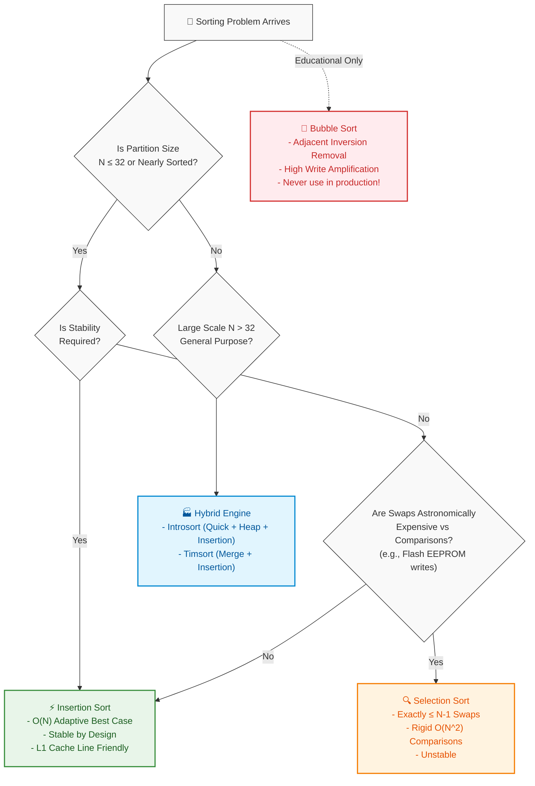

# 📘 Week 03 Day 01: Sorting Fundamentals — Invariants, Stability & Production Hybrid Sorts

> 🧭 **Navigation:** [← Week Overview](README.md) • [🏠 Week Overview](README.md) • [📘 Curriculum Syllabus](../COMPLETE_SYLLABUS.md) • [Next Day →](Week_03_Day_02_Merge_Quick_Sort_Instructional_Revised.md)
> 
> 💡 **Instructor Note:** *Elementary sorts are not dusty academic relics. While you will rarely call Bubble Sort in production, understanding sorting invariants, memory shift mechanics, stability preservation, and CPU cache locality is what separates junior coders from FAANG Senior Architects who design high-performance hybrid sorting engines like Timsort and Introsort.*

---

## 🎯 Learning Objectives

*By the end of this masterclass, you will be able to:*
- 🎯 **Internalize the Mechanical Invariants** behind Bubble, Selection, and Insertion Sort (what physical partition is guaranteed sorted after each pass).
- 🧠 **Explain Sorting Stability Physically** using multi-key record ordering (e.g., sorting users by Last Name then First Name) and prove why certain sorts destroy prior work.
- ⚡ **Trace the Adaptive Nature of Insertion Sort** through the lens of *inversion destruction* (`O(N + I)` time) and contrast it against rigid `O(N^2)` selection scans.
- 🏭 **Connect Elementary Sorts to Modern Runtimes** by understanding why .NET's `Array.Sort` (Introsort) and Python's `sort()` (Timsort) switch to Insertion Sort for partitions where `N <= 32`.
- 💻 **Implement Production-Grade C# (.NET 8/9 `Span<T>`) and Python (3.11+)** routines with strict stability preservation, zero-allocation memory slicing, and overflow-safe guards.

---

## 🎬 Pillar 1: The 60-Second Hook & Everyday Analogy

Hey engineers, welcome back to **Week 3 Day 1**! 

If you have ever sat in a technical interview or prep session and thought:  
*"Why on earth do interviewers still ask about Bubble, Selection, or Insertion Sort when QuickSort, MergeSort, and built-in runtime sorts run in `O(N log N)`?"*  
—you are not alone.

Here is the industry secret that separates junior developers from Senior Architects:  
**Modern production engines do not throw away elementary sorts; they embed them inside their fastest engines.**

Every time you call `.Sort()` in C# (.NET Introsort), `std::sort()` in C++, or `sorted()` in Python (Timsort), the engine dynamically monitors subarray sizes. The second a partition drops to `N <= 32` elements, the runtime halts expensive recursive branching and hands the entire block over to **Insertion Sort**.

To master these algorithms intuitively, let us look at three real-world physical metaphors.

---

### Metaphor 1: The Poker Hand (Insertion Sort)
Imagine you are sitting at a card table and the dealer passes you cards one by one. You pick up your cards into your left hand:
1. You pick up a `7`. Your hand is just `[ 7 ]`. Trivially sorted.
2. Next, the dealer hands you a `3`. You look at the `7`, slide the `7` one spot to the right, and drop the `3` in front of it: `[ 3, 7 ]`.
3. Next card is a `5`. You slide the `7` to the right, compare `5` against `3` (stop sliding!), and drop the `5` right in the slot: `[ 3, 5, 7 ]`.

```text
Incoming Card: [ 5 ]
Sorted Left Hand: [ 3, 7 ]
Action: Shift 7 right -> [ 3, _, 7 ] -> Place 5 in hole -> [ 3, 5, 7 ]
```

You are actively maintaining a **Sorted Prefix** on the left. Each incoming card slides backward only as far as necessary. If the dealer hands you a card that is already larger than everything in your hand (e.g., an `Ace`), you do **zero shifts**. That is why Insertion Sort is **adaptive**—it automatically accelerates to blazing `O(N)` speed on nearly-sorted data!

---

### Metaphor 2: The Grocery Store Clearance Hunt (Selection Sort)
Now imagine you are pushing a cart down a supermarket cereal aisle looking for the cheapest box:
1. You walk the **entire length of the aisle** from start to finish, checking every price tag, and find the absolute cheapest box ($1.99). You swap it into Slot 0 of your cart.
2. You walk the **entire remaining aisle again** from item 1 to the end, find the second-cheapest box ($2.49), and place it into Slot 1 of your cart.

Notice what happened:
- You made **very few physical item swaps** (at most `N - 1` swaps total).
- But your eyes scanned **every single box on the shelf** every single time (`N(N - 1) / 2` comparisons), regardless of whether the shelf was already sorted! Selection Sort is completely blind to existing order. It does the exact same grinding `O(N^2)` comparisons whether the array is completely random, reverse-sorted, or already 100% sorted.

---

### Metaphor 3: Sorting Stability Explained Physically (The Multi-Key Roster)
What does **Stability** actually mean in production software, and why do senior engineers obsess over it?

Imagine an HR database table containing customer orders or employee names. You need to sort users primarily by **Department**, but within each department, you want them sorted by **Seniority Level**.

To do this with a single-key sort pipeline, you perform two sequential passes:
1. **Pass 1:** Sort the entire list by **Seniority Level** (Secondary Key).
2. **Pass 2:** Sort the list by **Department** (Primary Key).

Look at what happens to Alice and Bob, who are in the same department:

```text
Initial state after Pass 1 (Sorted by Seniority):
Index 0: [ Alice | Engineering | Senior Level 3 ]
Index 1: [ Bob   | Engineering | Senior Level 2 ]  (Alice arrived first, has higher seniority)

Now run Pass 2 (Sort by Department):
Department keys are EQUAL ('Engineering' == 'Engineering').

✅ STABLE SORT (Insertion Sort / MergeSort):
Preserves original relative order when keys tie!
Result: [ Alice (Level 3), Bob (Level 2) ] -> Seniority order is 100% preserved!

❌ UNSTABLE SORT (Selection Sort / QuickSort):
Blindly swaps elements across equal keys.
Result: [ Bob (Level 2), Alice (Level 3) ] -> Seniority order is corrupted!
```

> [!IMPORTANT]
> **The Stability Golden Rule:** A sorting algorithm is **Stable** if and only if two items with identical comparison keys appear in the exact same relative order in the output as they did in the input. If an algorithm allows equal items to leapfrog each other, it is **Unstable**.

---

### Why the Hardware Loves Insertion Sort (`N <= 32`)
Why does modern .NET (`Array.Sort`) switch to Insertion Sort for sub-arrays of size `N <= 16` to `32` instead of continuing QuickSort's divide-and-conquer recursion?

```text
+---------------------------------------------------------------+
|                      64-Byte CPU Cache Line                   |
|  [ arr[0] | arr[1] | arr[2] | arr[3] | ... | arr[15] ]        |
+---------------------------------------------------------------+
  ^ Entire 16-element integer partition fits in ONE cache line!
```

1. **L1 Data Cache Hit Rate:** A 32-element `int` array consumes `32 * 4 = 128 bytes`—exactly **two 64-byte CPU cache lines**. The CPU loads the entire array into ultra-fast L1 cache in a single memory cycle.
2. **Near-Zero Branch Misprediction:** On small, partially sorted runs, CPU branch predictors accurately guess whether `arr[j] > key`, keeping the hardware instruction pipeline completely saturated.
3. **Zero Stack Allocation Overhead:** QuickSort and MergeSort require recursive stack frames, pointer arithmetic, and pivot calculations. For 16 items, the overhead of setting up function frames and partition loops dwarfs the raw CPU cost of a simple backward-shifting while-loop.

---

## 🪜 Pillar 2: The Scaffolding Ladder & Toy Napkin Trace

Let us trace **Insertion Sort** by hand on a toy 4-element napkin array:
```text
Initial Array: [ 5, 2, 4, 3 ]
Index:           0  1  2  3
```

Our invariant: **Before we process outer loop index `i`, the prefix `arr[0 .. i - 1]` is guaranteed to be in fully sorted relative order.**

---

### Step 0: The Base Case (`i = 0`)
Prefix `[ 5 ]` has length 1. Any single-element array is trivially sorted. Our outer loop begins at index `1`.

---

### Step 1: Processing `i = 1`, `key = 2`
- **Sorted Prefix:** `[ 5 ]` (indices `0 .. 0`)
- **Key to insert:** `2`
- **Slide Pointer:** `j = i - 1 = 0`

```text
Compare arr[j] (5) with key (2):
5 > 2 is TRUE!
-> Shift 5 right into index 1:
   [ 5, 5, 4, 3 ]
   j decrements to -1.
-> While loop terminates because j < 0 (hit left wall).
-> Insert key (2) into arr[j + 1] -> arr[0]:
   [ 2, 5, 4, 3 ]
```
✅ **Prefix after Step 1:** `[ 2, 5 ]` is sorted!

---

### 🧠 Pause & Predict #1
> **Question:** Look at `i = 2`, where `key = 4`. The current array is `[ 2, 5, 4, 3 ]`.  
> How many total comparisons will the inner while loop make before inserting `4`? Will it compare `4` against `2`? Think for 5 seconds before reading below!

*Answer:* Exactly **two comparisons**!  
1. First, it compares `5 > 4` (True -> shifts 5 right).  
2. Next, it compares `2 > 4` (False!).  
The while loop halts **immediately**. It never touches index 0 or checks `2` again, because the prefix `[ 2, 5 ]` was already sorted. That early-halt is the essence of adaptiveness!

---

### Step 2: Processing `i = 2`, `key = 4`
- **Sorted Prefix:** `[ 2, 5 ]`
- **Key to insert:** `4`
- **Slide Pointer:** `j = 1`

```text
Compare arr[1] (5) with key (4):
5 > 4 is TRUE!
-> Shift 5 right into index 2:
   [ 2, 5, 5, 3 ]
   j decrements to 0.

Compare arr[0] (2) with key (4):
2 > 4 is FALSE!
-> STOP immediately!
-> Insert key (4) into arr[j + 1] -> arr[1]:
   [ 2, 4, 5, 3 ]
```
✅ **Prefix after Step 2:** `[ 2, 4, 5 ]` is sorted!

---

### Step 3: Processing `i = 3`, `key = 3`
- **Sorted Prefix:** `[ 2, 4, 5 ]`
- **Key to insert:** `3`
- **Slide Pointer:** `j = 2`

```text
Compare arr[2] (5) with key (3):
5 > 3 is TRUE! -> Shift 5 right: [ 2, 4, 5, 5, 3 ] -> [ 2, 4, 5, 5 ]
j decrements to 1.

Compare arr[1] (4) with key (3):
4 > 3 is TRUE! -> Shift 4 right: [ 2, 4, 4, 5 ]
j decrements to 0.

Compare arr[0] (2) with key (3):
2 > 3 is FALSE! -> STOP!
j remains 0.

-> Insert key (3) into arr[j + 1] -> arr[1]:
   [ 2, 3, 4, 5 ]
```
✅ **Final Array:** `[ 2, 3, 4, 5 ]` — 100% sorted in-place!

---

## 🎨 Pillar 3: Pragmatic Visual Models

### 1. ASCII Contiguous Memory Layout
Notice how the sorted prefix expands to the right while the unsorted suffix shrinks. The `key` is lifted into a temporary CPU register, creating a "vacant hole" that shifts leftward:

```text
Array Memory View at index i = 3 (key = 3):

 Index:       0       1       2       3
         +-------+-------+-------+-------+
 Memory: |   2   |   4   |   5   | [ 3 ] |   <-- Key 3 stored in CPU Register
         +-------+-------+-------+-------+
         [----- Sorted Prefix ---]    ^
                    j                 i (Key position)

 Step A: Shift 5 right:
         +-------+-------+-------+-------+
 Memory: |   2   |   4   | [hole]|   5   |
         +-------+-------+-------+-------+
                     j

 Step B: Shift 4 right:
         +-------+-------+-------+-------+
 Memory: |   2   | [hole]|   4   |   5   |
         +-------+-------+-------+-------+
             j (arr[j] = 2 <= 3 -> STOP)

 Step C: Drop key (3) into hole at arr[j + 1]:
         +-------+-------+-------+-------+
 Memory: |   2   |   3   |   4   |   5   |
         +-------+-------+-------+-------+
         [---------- Sorted Prefix ------]  --> DONE!
```

---

### 2. Elementary Sort Decision Architecture (Mermaid)

When should an engineer pick Bubble, Selection, or Insertion Sort? The following production decision flowchart models the exact trade-offs:



---

## 🛑 Pillar 4: The Rookie Trap Zone

### Trap 1: The Bubble Sort "Fast Best-Case" Delusion

```csharp
// ❌ ROOKIE BLUNDER: Believing Bubble Sort is a viable production algorithm
public static void BubbleSortDelusion(int[] arr)
{
    // "Look! If the array is already sorted, it exits in O(N) time!"
    for (int i = 0; i < arr.Length - 1; i++)
    {
        bool swapped = false;
        for (int j = 0; j < arr.Length - 1 - i; j++)
        {
            if (arr[j] > arr[j + 1])
            {
                (arr[j], arr[j + 1]) = (arr[j + 1], arr[j]);
                swapped = true;
            }
        }
        if (!swapped) break;
    }
}
```

```csharp
// ✅ SENIOR ARCHITECT PATTERN: Use Adaptive Insertion Sort
public static void InsertionSortAdaptive(Span<int> span)
{
    // Insertion sort also executes in O(N) best case, BUT:
    // 1. Performs single-memory shifts (1 write) instead of tuple swaps (2 writes).
    // 2. Eliminates outer-pass loop iterations immediately.
    // 3. Destroys inversions locally with zero cache-line thrashing.
    for (int i = 1; i < span.Length; i++)
    {
        int key = span[i];
        int j = i - 1;
        while (j >= 0 && span[j] > key)
        {
            span[j + 1] = span[j];
            j--;
        }
        span[j + 1] = key;
    }
}
```

> **Why this matters to a FAANG interviewer:**  
> Bubble sort's theoretical `O(N)` best case requires sweeping through the **entire array** comparing every adjacent neighbor `N - 1` times just to confirm no swaps occurred. If even a *single* element is out of place at the start, Bubble sort requires full passes across the entire length of the array. Insertion sort only slides that specific element backward locally and finishes in `O(1)` operations for the remaining sorted elements. Bubble sort is conceptually swap-heavy (write amplification) and should never be suggested as a production solution.

---

### Trap 2: The Silent Stability Killer (`>=` vs `>`)

This is one of the most common live coding mistakes made by candidates during an Insertion Sort implementation:

```text
Comparing two equal items: A = (5, 'First'), B = (5, 'Second')
Incoming key is B. In the prefix, we encounter A.
```

```csharp
// ❌ ROOKIE BLUNDER: Using '>=' breaks stability silently!
while (j >= 0 && arr[j] >= key) // 💥 BUG: If arr[j] == key, it shifts arr[j] right!
{
    arr[j + 1] = arr[j];
    j--;
}
arr[j + 1] = key; // B is placed BEFORE A! Relative order destroyed!
```

```csharp
// ✅ SENIOR ARCHITECT PATTERN: Strict inequality preserves arrival stability!
while (j >= 0 && arr[j] > key)  // 🛡️ STABLE: Stops immediately when arr[j] == key!
{
    arr[j + 1] = arr[j];
    j--;
}
arr[j + 1] = key; // B is placed safely AFTER A! Original relative order preserved.
```

> [!WARNING]
> In an interview, off-by-one errors and strict vs non-strict inequalities (`>` vs `>=`) are not treated as minor syntax typos. They alter the **semantic stability contract** of the algorithm. If an interviewer asks: *"Is your insertion sort stable?"*, pointing out that your while loop stops strictly on `arr[j] > key` proves you understand stability at a mechanical level.

---

### Trap 3: The Selection Sort "Minimal Swaps" Myth
Candidates often memorize: *"Selection sort only makes `N - 1` swaps, so it is faster when writes are expensive!"*

**The Senior Reality Check:**  
While Selection Sort does limit writes to at most `N - 1` swaps, it is completely incapable of adapting. Even if an array of 100,000 items is already 99.9% sorted, Selection Sort will stubbornly perform `100,000 * 99,999 / 2 ≈ 5,000,000,000` comparisons. Moreover, standard swap-based Selection Sort is **fundamentally unstable** because swapping the minimum element into place leaps across identical keys:

```text
Array: [ (2, 'A'), (2, 'B'), (1, 'X') ]
Step 0: Minimum is (1, 'X'). Swap with index 0.
Result: [ (1, 'X'), (2, 'B'), (2, 'A') ]
-> Equal keys (2, 'A') and (2, 'B') reversed order! Unstable!
```

---

## 🎙️ Pillar 5: The 45-Minute Interview Talk Track

When an interviewer opens with:  
*"Can you walk me through the elementary sorts (Bubble, Selection, Insertion), their invariants, and why modern runtimes still care about them?"*

Speak this exact **3-Sentence Architectural Script**:

```text
🎙️ THE 3-SENTENCE FAANG INTERVIEW SCRIPT:

1. (Invariants & Mechanics)
   "All three elementary sorts operate in-place with O(1) auxiliary space, but maintain distinct mechanical invariants: Selection Sort fixes the global minimum into a growing prefix via at most N - 1 swaps, Bubble Sort bubbles the largest unsorted element into the suffix via adjacent pairwise swaps, while Insertion Sort maintains a sorted prefix and slides the current key backward into its sorted position."

2. (Adaptiveness & Inversion Destruction)
   "Between them, Insertion Sort is uniquely optimal because it is both stable and adaptive: its runtime is proportional to O(N + I), where I is the number of inversions, running in pure linear O(N) time on nearly-sorted data while Selection Sort rigidly executes O(N^2) comparisons regardless of input topology."

3. (Production Systems Architecture)
   "This is why production hybrid algorithms like .NET's Introsort and Python's Timsort switch to Insertion Sort for sub-arrays of size N <= 32: at that threshold, the entire partition fits within L1 cache lines, branch prediction is near-perfect, and the zero-allocation shift loop completely outperforms the recursive overhead of QuickSort or MergeSort."
```

---

## ⚡ Pillar 6: Production Dual-Language Implementations

### C# (.NET 8/9) — Zero-Allocation `Span<T>` Implementations

In modern .NET high-throughput systems (ASP.NET Core, gRPC, distributed storage engines), we do not allocate temporary arrays or sort via boxing interfaces. We operate directly on `Span<T>` to achieve zero GC pressure.

```csharp
using System;

namespace DSAMasterCurriculum.Sorting
{
    /// <summary>
    /// Production-grade elementary sorting routines engineered for .NET 8/9.
    /// Demonstrates zero heap allocation via Span<T> and strict stability preservation.
    /// </summary>
    public static class ElementarySorts
    {
        /// <summary>
        /// Adaptive Insertion Sort on a Span.
        /// Time Complexity: O(N) best case (0 inversions), O(N^2) worst case.
        /// Auxiliary Space: O(1) memory - strictly zero GC heap allocations.
        /// Stability: Guaranteed STABLE (stops shifting on equal keys).
        /// </summary>
        public static void InsertionSort<T>(Span<T> span) where T : IComparable<T>
        {
            int n = span.Length;
            if (n <= 1) return; // Guard clause

            for (int i = 1; i < n; i++)
            {
                T key = span[i];
                int j = i - 1;

                // STABILITY INVARIANT:
                // Use strict inequality span[j].CompareTo(key) > 0.
                // Do NOT use >=, which would shift equal elements rightward and corrupt order!
                while (j >= 0 && span[j].CompareTo(key) > 0)
                {
                    span[j + 1] = span[j]; // Shift element right
                    j--;
                }

                span[j + 1] = key; // Place key in the vacated hole
            }
        }

        /// <summary>
        /// Selection Sort on a Span.
        /// Time Complexity: Strictly O(N^2) comparisons, at most N - 1 swaps.
        /// Auxiliary Space: O(1) stack memory.
        /// Stability: UNSTABLE (long-distance swap leaps over equal elements).
        /// </summary>
        public static void SelectionSort<T>(Span<T> span) where T : IComparable<T>
        {
            int n = span.Length;
            if (n <= 1) return;

            for (int i = 0; i < n - 1; i++)
            {
                int minIndex = i;

                for (int j = i + 1; j < n; j++)
                {
                    if (span[j].CompareTo(span[minIndex]) < 0)
                    {
                        minIndex = j;
                    }
                }

                // Avoid redundant self-swap if the minimum is already in place
                if (minIndex != i)
                {
                    (span[i], span[minIndex]) = (span[minIndex], span[i]);
                }
            }
        }

        /// <summary>
        /// Bubble Sort with Early-Termination and Last-Swap Boundary Tracking.
        /// Time Complexity: O(N) best case, O(N^2) average/worst case.
        /// Auxiliary Space: O(1).
        /// Stability: Guaranteed STABLE (swaps strictly when left > right).
        /// </summary>
        public static void BubbleSortLastSwap<T>(Span<T> span) where T : IComparable<T>
        {
            int end = span.Length - 1;

            while (end > 0)
            {
                int lastSwapIndex = 0;

                for (int j = 0; j < end; j++)
                {
                    // STABILITY INVARIANT: Swap strictly on >
                    if (span[j].CompareTo(span[j + 1]) > 0)
                    {
                        (span[j], span[j + 1]) = (span[j + 1], span[j]);
                        lastSwapIndex = j;
                    }
                }

                // If no swaps occurred, lastSwapIndex remains 0 -> loop terminates immediately!
                // If the tail was already sorted, end shrinks aggressively past all sorted elements.
                end = lastSwapIndex;
            }
        }

        /// <summary>
        /// Binary Insertion Sort.
        /// Uses binary search to find insertion slot in O(log i) comparisons,
        /// then performs block rightward shift.
        /// Useful when comparison operation is computationally expensive.
        /// </summary>
        public static void BinaryInsertionSort<T>(Span<T> span) where T : IComparable<T>
        {
            int n = span.Length;
            if (n <= 1) return;

            for (int i = 1; i < n; i++)
            {
                T key = span[i];

                // Binary search for insertion point in sorted prefix [0 .. i]
                int lo = 0;
                int hi = i;

                while (lo < hi)
                {
                    int mid = lo + ((hi - lo) >> 1);
                    // To maintain stability, if span[mid] <= key, advance lo
                    if (span[mid].CompareTo(key) <= 0)
                    {
                        lo = mid + 1;
                    }
                    else
                    {
                        hi = mid;
                    }
                }

                // Shift elements in range [lo .. i - 1] one slot right
                for (int j = i; j > lo; j--)
                {
                    span[j] = span[j - 1];
                }

                span[lo] = key;
            }
        }
    }
}
```

---

### Python (3.11+) — Idiomatic, Clean & Typed Implementations

```python
"""Production Elementary Sorting Implementations in Python 3.11+.

Includes strict type hints, inversion-adaptive mechanics, and stability preservation.
"""

from typing import TypeVar, Protocol
import bisect

class Comparable(Protocol):
    def __lt__(self, other: "Comparable") -> bool: ...
    def __gt__(self, other: "Comparable") -> bool: ...
    def __le__(self, other: "Comparable") -> bool: ...

T = TypeVar("T", bound=Comparable)


def insertion_sort(arr: list[T]) -> list[T]:
    """Adaptive in-place Insertion Sort.
    
    Time: O(N + I) where I is inversion count. O(N) best, O(N^2) worst.
    Space: O(1) auxiliary memory.
    Stability: STABLE.
    """
    n = len(arr)
    if n <= 1:
        return arr

    for i in range(1, n):
        key = arr[i]
        j = i - 1
        
        # Stability invariant: strictly '>' preserves order of equal elements
        while j >= 0 and arr[j] > key:
            arr[j + 1] = arr[j]
            j -= 1
            
        arr[j + 1] = key
        
    return arr


def selection_sort(arr: list[T]) -> list[T]:
    """In-place Selection Sort.
    
    Time: O(N^2) comparisons, at most N - 1 swaps.
    Space: O(1) auxiliary memory.
    Stability: UNSTABLE.
    """
    n = len(arr)
    if n <= 1:
        return arr

    for i in range(n - 1):
        min_idx = i
        for j in range(i + 1, n):
            if arr[j] < arr[min_idx]:
                min_idx = j
                
        if min_idx != i:
            arr[i], arr[min_idx] = arr[min_idx], arr[i]
            
    return arr


def bubble_sort_last_swap(arr: list[T]) -> list[T]:
    """Bubble Sort tracking the last swap boundary to aggressively prune sorted tails.
    
    Time: O(N) best case, O(N^2) worst case.
    Space: O(1) auxiliary memory.
    Stability: STABLE.
    """
    end = len(arr) - 1
    while end > 0:
        last_swap = 0
        for j in range(end):
            if arr[j] > arr[j + 1]:
                arr[j], arr[j + 1] = arr[j + 1], arr[j]
                last_swap = j
        end = last_swap
    return arr


def binary_insertion_sort(arr: list[T]) -> list[T]:
    """Binary Insertion Sort reducing comparisons to O(N log N).
    
    Time: O(N log N) comparisons, O(N^2) shifts.
    Space: O(1) auxiliary memory.
    Stability: STABLE.
    """
    for i in range(1, len(arr)):
        key = arr[i]
        # bisect_right ensures key is placed AFTER existing identical elements (Stability)
        insert_idx = bisect.bisect_right(arr, key, 0, i)
        
        # Shift slice right
        for j in range(i, insert_idx, -1):
            arr[j] = arr[j - 1]
            
        arr[insert_idx] = key
    return arr
```

---

## 📊 Comprehensive Complexity & Invariant Matrix

| Algorithm | Best-Case Time | Average-Case Time | Worst-Case Time | Auxiliary Space | Output Space | In-Place? | Stable? | Mechanical Invariant |
| :--- | :--- | :--- | :--- | :--- | :--- | :---: | :---: | :--- |
| **Bubble Sort (Early Exit)** | `O(N)` | `O(N^2)` | `O(N^2)` | `O(1)` | `O(1)` | Yes | **Yes** | Suffix `[N-1-pass .. N-1]` contains the largest elements in final sorted positions. |
| **Selection Sort** | `O(N^2)` | `O(N^2)` | `O(N^2)` | `O(1)` | `O(1)` | Yes | **No** | Prefix `[0 .. i]` contains the `i + 1` smallest elements in strictly sorted order. |
| **Insertion Sort** | `O(N)` | `O(N^2)` | `O(N^2)` | `O(1)` | `O(1)` | Yes | **Yes** | Prefix `[0 .. i-1]` is sorted; element `i` slides backward to destroy local inversions. |
| **Binary Insertion Sort** | `O(N log N)` comp | `O(N^2)` shifts | `O(N^2)` shifts | `O(1)` | `O(1)` | Yes | **Yes** | Binary search finds slot in `O(log i)` comparisons; block shift creates slot. |

### In-Depth Mathematical Intuition: The Inversion Measure
An **inversion** is any pair of indices `(i, j)` where `i < j` but `arr[i] > arr[j]`.
- A fully sorted array has exactly **`0` inversions**.
- A reverse-sorted array has the theoretical maximum: `N(N - 1) / 2` inversions.
- **Each adjacent swap** in Bubble Sort or shift in Insertion Sort destroys **exactly 1 inversion**.
- Therefore, Insertion Sort's precise time complexity is:
  `Time = O(N + I)`
  where `I` is the total number of inversions in the input array!
  - If an array is **`k`-sorted** (every element is at most `k` positions away from its sorted index), Insertion Sort runs in deterministic `O(N * k)` time. If `k` is a small constant, this is **pure linear `O(N)`**!

---

## 🧪 Edge-Case Matrix & Failure Modes

| Edge Case Scenario | Input Example | Expected Behavior | Algorithmic Risk |
| :--- | :--- | :--- | :--- |
| **Empty or Single Element** | `[]` or `[ 42 ]` | Return immediately without mutation. | NullReferenceException or IndexOutOfRangeException if bounds check is missing. |
| **Already 100% Sorted** | `[ 1, 2, 3, 4, 5 ]` | Insertion: `N - 1` compares, 0 shifts. Bubble: 1 pass, exits. Selection: Still `N(N-1)/2` compares! | Selection sort wastes CPU cycles doing useless work. |
| **Reverse Sorted** | `[ 5, 4, 3, 2, 1 ]` | Maximum inversions `N(N-1)/2`. Every element shifts the entire length of the prefix. | Worst-case quadratic runtime on all three sorts. |
| **All Identical Elements** | `[ 7, 7, 7, 7, 7 ]` | Insertion sort while loop never triggers; finishes in `O(N)` time without shifts. | Using `>=` instead of `>` in Insertion Sort triggers useless shifts and destroys stability. |
| **Extreme Values (`int.MinValue`, `int.MaxValue`)** | `[ int.MaxValue, -1, int.MinValue ]` | Correct ordering: `[ int.MinValue, -1, int.MaxValue ]`. | Subtraction-based comparators `(a - b)` cause integer overflow! Always use `CompareTo()`. |
| **Nearly-Sorted (`k = 1`)** | `[ 1, 3, 2, 4, 6, 5 ]` | Insertion Sort repairs order in `O(N)` time with only two local shifts. | Running unoptimized QuickSort on this input risks `O(N^2)` pivot degradation unless randomized. |

---

## 🏋️ FAANG Practice Drills & Interview Question Bank

### Practice Problems
1. **LeetCode 75: Sort Colors (Dutch National Flag)** — 3-way partitioning without full sort (`O(N)` time, `O(1)` space).
2. **LeetCode 147: Insertion Sort List** — Implement Insertion Sort on a Singly Linked List (pointer rewiring mechanics).
3. **LeetCode 912: Sort an Array** — Implement hybrid Quick/Merge with Insertion sort base-case cutoff (`N <= 16`).
4. **LeetCode 56: Merge Intervals** — Demonstrates sorting as a required preprocessing step for overlapping ranges.
5. **Inversion Counting Problem** — Naive `O(N^2)` count vs MergeSort divide-and-conquer preview (`O(N log N)`).
6. **K-Sorted Array Sorter** — Given an array where every item is at most `k` spots from home, sort in `O(N log k)` (Min-Heap) vs `O(N * k)` (Insertion Sort).
7. **Stable Multi-Key Record Sorter** — Sort employees by Salary descending, preserving original timestamp order on ties.

### 🎙️ Mock Interview Deep-Dive Questions

#### Q1: "Why is Insertion Sort adaptive, but Selection Sort is not?"
**Answer:**  
"Insertion Sort's inner while loop terminates as soon as `arr[j] <= key`. Because the prefix is already sorted, once the condition is false, all earlier elements are guaranteed to be smaller, allowing the algorithm to skip redundant comparisons. In contrast, Selection Sort must find the absolute minimum of the remaining suffix. Because the suffix is unsorted, it has no choice but to examine every single element to the end of the array, regardless of existing order."

#### Q2: "Can you make Selection Sort stable? What is the trade-off?"
**Answer:**  
"Yes. Standard Selection Sort is unstable because it swaps the minimum across multiple equal elements. To make it stable, instead of swapping `arr[i]` and `arr[min_idx]`, you extract the minimum value, shift all elements from `i` to `min_idx - 1` one position to the right, and insert the minimum at index `i`. However, this converts Selection Sort from a minimal-write algorithm (`N - 1` swaps) into an algorithm that executes `O(N^2)` writes, completely eliminating its only practical hardware advantage."

#### Q3: "What exact condition causes Bubble Sort to achieve `O(N)` best-case performance?"
**Answer:**  
"In an optimized Bubble Sort, we track a boolean flag `swapped = false`. If an entire pass through the array completes without triggering a single swap, no adjacent inversions exist, proving the array is completely sorted. The algorithm breaks immediately after `N - 1` comparisons and 0 swaps, achieving `O(N)` best-case runtime."

---

## 📌 The Senior Architect's Takeaway Hook

> **The Mental Anchor:**  
> *"Bubble swaps neighbors, Selection hunts the global minimum, and Insertion repairs order like a poker hand. When arrays are small (`N <= 32`) or nearly sorted, Insertion Sort is King because CPU cache lines beat asymptotic theory every single time."*

---

> 🧭 **Navigation:** [← Week Overview](README.md) • [🏠 Week Overview](README.md) • [📘 Curriculum Syllabus](../COMPLETE_SYLLABUS.md) • [Next Day →](Week_03_Day_02_Merge_Quick_Sort_Instructional_Revised.md)
