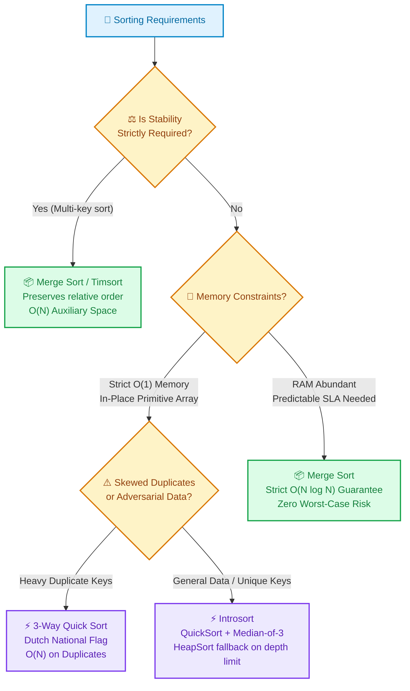

# 📘 Week 03 Day 02: Merge Sort & Quick Sort — ENGINEERING GUIDE

> 🧭 **Navigation:** [← Previous Day](Week_03_Day_01_Sorting_Fundamentals_Instructional.md) • [🏠 Week Overview](README.md) • [📘 Curriculum Syllabus](../COMPLETE_SYLLABUS.md) • [Next Day →](Week_03_Day_03_Heaps_Heapify_Heap_Sort_Instructional.md)
> 
> 💡 **Instructor Note:** *Not all sections or topics are mandatory. Feel free to adapt your pace and skim or skip sections based on your current focus and interview timeline.*

---

## 🎯 LEARNING OBJECTIVES

*By the end of this chapter, you will be able to:*

- 🎯 **Internalize** the core divide-and-conquer mechanics that unlock guaranteed `O(N log N)` sorting.
- ⚙️ **Implement** production-grade Merge Sort (stable, pre-allocated scratchpad) and Quick Sort (in-place, Median-of-Three, 3-way Dutch National Flag partition) in idiomatic C# (.NET 8/9) and Python (3.11+).
- ⚖️ **Evaluate** the physical hardware trade-offs between sequential memory streaming (`O(N)` auxiliary RAM) vs. in-place CPU cache line reuse (`O(1)` heap memory).
- 🛑 **Defend** Quick Sort against its `O(N^2)` worst-case failure modes using tail-call stack capping, median-of-three sampling, and Introsort fallbacks.
- 🎙️ **Deliver** a crisp, 3-sentence FAANG interview script articulating algorithm selection, stability requirements, and space overhead.

---

## 🎬 CHAPTER 1: THE 60-SECOND HOOK & EVERYDAY ANALOGY

Hey engineers, welcome back to Week 3 Day 2!

Yesterday, we tore down elementary `O(N^2)` sorts—Bubble, Selection, and Insertion. We saw why they are phenomenal for small slices or nearly sorted inputs, but catastrophic at scale. Today, we step into the heavyweight championship ring of computer science:

```text
========================================================================================
                      THE HEAVYWEIGHT SORTING TITLE BOUT
========================================================================================
  MERGE SORT: "The Reliable Architect"        vs.       QUICK SORT: "The Speed Demon"
  ------------------------------------                  -----------------------------
  • Splits blindly down the middle                      • Splits unevenly around a Pivot
  • Does ALL the hard work on the way UP                • Does ALL the hard work on the way DOWN
  • Needs O(N) scratchpad memory                        • Zero scratchpad memory: 100% in-place
  • Rock-solid guaranteed O(N log N)                    • O(N log N) average, blazing cache hits
  • Preserves element stability                         • Unstable: reorders equal elements
========================================================================================
```

### The Real-World Metaphor: The Office Paperwork Showdown

Imagine you are handed a messy stack of 1,000 employee personnel files that must be alphabetized by last name:

1. **The Merge Sort Manager (The Reliable Architect):**
   - You don't read a single name yet. You simply cut the pile in half: 500 and 500.
   - You pass each half to two assistants, who cut them in half again, all the way down until assistants are holding 1-page piles.
   - **The heavy lifting happens on the way UP:** You sit at a wide desk (your `O(N)` scratchpad memory) with two sorted piles. You compare the top sheet of Pile A with Pile B, take the smaller one, and stack it neatly into a new output pile. It is perfectly predictable, never surprises you, but requires an extra desk to hold the intermediate papers.

2. **The Quick Sort Sorter (The Speed Demon):**
   - You stay at your own desk—zero extra desks needed (`O(1)` auxiliary space).
   - You grab one sheet at random—say, an employee named **"Miller"** (your **Pivot**).
   - **The heavy lifting happens on the way DOWN:** You immediately sweep through the pile. Everyone with a name before "Miller" is tossed to the left; everyone after "Miller" is tossed to the right. "Miller" is now locked into their exact final position forever!
   - You repeat this in-place on the left and right piles. Because you stay inside the same folder and never duplicate pages, your CPU cache lines stay hot, and you finish 2x to 3x faster than anyone else.

### The Quicksort Achilles' Heel: Why Naive Quicksort Collapses to O(N²)

What happens if the pile of papers was **already sorted** from A to Z, and you naively pick the **first element** as your pivot?

```text
Input: [ 1,  2,  3,  4,  5 ]
Pivot:  1
Partition: Left = [] | Pivot = 1 | Right = [ 2,  3,  4,  5 ]

Next Pivot: 2
Partition: Left = [] | Pivot = 2 | Right = [ 3,  4,  5 ]

Next Pivot: 3
Partition: Left = [] | Pivot = 3 | Right = [ 4,  5 ]
```

Instead of cutting the problem in half (`log2(N)` levels of recursion), your problem size only shrinks by **one element** at each step!
- Recursive depth: `N` levels.
- Comparisons per level: `N, N-1, N-2, ..., 1`.
- Total work: `N * (N + 1) / 2 = O(N^2)`.

Worse yet, in languages like C# or Python, recursion `N` levels deep blows through the thread's default call stack, terminating your process with a catastrophic `StackOverflowException`!

Today, we will master the mechanical invariants of both algorithms and build the senior-level defenses (Median-of-Three, Dijkstra 3-Way Partitioning, and Tail-Call Stack Capping) that make Quick Sort rock-solid in production.

---

## 🪜 CHAPTER 2: THE TOY NAPKIN TRACE & ACTIVE RECALL

Before writing code or analyzing recurrence relations, let's trace both algorithms on tiny napkin-sized examples.

---

### Trace 1: Merge Sort Two-Finger Merge

We have two sorted subarrays inside a single contiguous array, and we need to merge them into our pre-allocated scratchpad buffer:
- Left subarray: `[ 2,  5 ]` (indices `low = 0` to `mid = 1`)
- Right subarray: `[ 1,  4 ]` (indices `mid + 1 = 2` to `high = 3`)
- Scratchpad: `[ _,  _,  _,  _ ]`

```text
Initial State:
Left Subarray:   [  2,   5  ]       Right Subarray:  [  1,   4  ]
                    ^                                    ^
                 p1 (L)                               p2 (R)
Scratchpad:      [  _,   _,   _,   _  ]
                    ^
                    k

Step 1: Compare Left[p1] (2) vs Right[p2] (1).
        1 < 2 -> Scratchpad[k++] = 1; p2++
Scratchpad:      [  1,   _,   _,   _  ]
Left Subarray:   [  2,   5  ]       Right Subarray:  [  1,   4  ]
                    ^                                        ^
                    p1                                       p2

Step 2: Compare Left[p1] (2) vs Right[p2] (4).
        2 < 4 -> Scratchpad[k++] = 2; p1++
Scratchpad:      [  1,   2,   _,   _  ]
Left Subarray:   [  2,   5  ]       Right Subarray:  [  1,   4  ]
                         ^                                   ^
                         p1                                  p2

Step 3: Compare Left[p1] (5) vs Right[p2] (4).
        4 < 5 -> Scratchpad[k++] = 4; p2++ (p2 is now past Right boundary!)
Scratchpad:      [  1,   2,   4,   _  ]

Step 4: Right is exhausted. Drain remainder of Left:
        Scratchpad[k++] = 5; p1++
Final Merged:    [  1,   2,   4,   5  ]
```

Copy the scratchpad segment back into the original array: `[1, 2, 4, 5]`. Done in linear `O(N)` time!

> 🧠 **Pause & Predict #1:**  
> What happens if two elements are identical (e.g. `Left = [3]`, `Right = [3]`) and our merge condition uses `<` instead of `<=`?  
> *Think:* Which element gets written to the scratchpad first, and what fundamental sorting guarantee is violated?  
>
> <details>
> <summary>👉 <b>Click to Reveal the Answer</b></summary>
>
> If we write `if (aux[j] < aux[i]) arr[k] = aux[j++]; else arr[k] = aux[i++];`:  
> When `aux[i] == aux[j]`, the strict `<` evaluates to `false`, so the `else` branch triggers and copies `aux[i]` (the Left element) first! That preserves stability.  
> **HOWEVER**, if an engineer writes `if (aux[i] < aux[j]) arr[k] = aux[i++]; else arr[k] = aux[j++];`:  
> When equal, the condition evaluates to `false`, and the **Right element jumps ahead of the Left element**! This completely destroys **stability**, silently breaking database multi-key ordering. Always ensure ties go to the left pointer!
> </details>

---

### Trace 2: Quick Sort Lomuto Partition

Let's trace Lomuto's partitioning scheme on array `arr = [3, 8, 2, 5, 1, 4]`.  
We pick the last element as the pivot: **`pivot = 4`** (`high = 5`).

We maintain two pointers:
- `i`: Marks the boundary of elements strictly smaller than the pivot (`i = low - 1 = -1`).
- `j`: The explorer pointer scanning from `low = 0` to `high - 1 = 4`.

```text
Initial Setup:
arr = [  3,   8,   2,   5,   1  |  4  ]
  ^      ^                         ^
  i=-1   j=0                    Pivot=4

--------------------------------------------------------------------------------
Pass j = 0: arr[j] = 3. Is 3 < 4? YES!
Action: Advance i -> i = 0. Swap arr[i] with arr[j] (swap arr[0] with arr[0], self-swap).
arr = [  3,   8,   2,   5,   1  |  4  ]
         ^    ^
         i    j
--------------------------------------------------------------------------------
Pass j = 1: arr[j] = 8. Is 8 < 4? NO!
Action: Do nothing. Only j advances.
arr = [  3,   8,   2,   5,   1  |  4  ]
         ^         ^
         i         j
--------------------------------------------------------------------------------
Pass j = 2: arr[j] = 2. Is 2 < 4? YES!
Action: Advance i -> i = 1. Swap arr[i] (8) with arr[j] (2).
arr = [  3,   2,   8,   5,   1  |  4  ]
              ^    ^
              i    j
--------------------------------------------------------------------------------
Pass j = 3: arr[j] = 5. Is 5 < 4? NO!
Action: Do nothing. Only j advances.
arr = [  3,   2,   8,   5,   1  |  4  ]
              ^         ^
              i         j
--------------------------------------------------------------------------------
Pass j = 4: arr[j] = 1. Is 1 < 4? YES!
Action: Advance i -> i = 2. Swap arr[i] (8) with arr[j] (1).
arr = [  3,   2,   1,   5,   8  |  4  ]
                   ^    ^
                   i    j
--------------------------------------------------------------------------------
Loop finishes (j reached high - 1).
Final Step: Place the pivot in its rightful throne!
Swap arr[i + 1] (5) with arr[high] (4).

Resulting Array:
arr = [  3,   2,   1  |  4  |  8,   5  ]
                         ^
                  Final Pivot Index (3)
```

Look at that resulting array:
- Every element before index 3 (`[3, 2, 1]`) is `< 4`.
- Every element after index 3 (`[8, 5]`) is `> 4`.
- Pivot `4` is in its permanent sorted location.
- Total time: exactly one linear pass over the subarray (`O(N)`).

> 🧠 **Pause & Predict #2:**  
> What happens to Lomuto's partition if the input array is already sorted: `[1, 2, 3, 4]` with `pivot = 4`?  
> How many comparisons and swaps take place?  
>
> <details>
> <summary>👉 <b>Click to Reveal the Answer</b></summary>
>
> Every element `1, 2, 3` is `< 4`. Therefore, pointer `i` increments on every single pass, swapping `arr[j]` with itself 3 times! Finally, `4` swaps with itself.  
> It performs `N - 1` comparisons and `N` redundant swaps, but produces an extremely unbalanced partition: Left subarray of size `N - 1` and Right subarray of size `0`. If you repeat this naively on sorted data, you suffer `O(N^2)` time!
> </details>

---

## 🎨 CHAPTER 3: VISUAL MODELS & ARCHITECTURAL MECHANICS

### Visualizing Partition Schemes: Lomuto vs Hoare

In live interviews and system implementations, you will encounter two primary 2-way partitioning schemes: **Lomuto** and **Hoare**.

```text
========================================================================================
                          LOMUTO PARTITION (One-Way Crawler)
========================================================================================
Array:  [ 3 | 8 | 2 | 5 | 1 | 4 ]
                              ^ Pivot = 4
          ^       ^
          i       j (Explorer scans left-to-right)

• Pointer i marks the end of elements known to be < Pivot.
• Pointer j crawls forward. Whenever arr[j] < Pivot, i increments and arr[i] swaps with arr[j].
• Pros: Intuitive, simple loop, easy to implement on linked lists.
• Cons: Performs ~3x more swaps than Hoare; severely degrades on arrays with all equal keys.
========================================================================================
```

```text
========================================================================================
                          HOARE PARTITION (Two-Way Inward Pinch)
========================================================================================
Array:  [ 4 | 8 | 2 | 5 | 1 | 3 ]
          ^ Pivot = 4
          i ->                     <- j (Two pointers converge inward)

• Pointer i scans rightward until it finds an element >= Pivot.
• Pointer j scans leftward until it finds an element <= Pivot.
• When both pause, swap arr[i] and arr[j], then increment i and decrement j.
• Pros: Cuts memory swaps by ~66% compared to Lomuto; balances duplicate keys evenly.
• Cons: Subtle off-by-one edge cases; pivot does NOT necessarily end up at the split point!
========================================================================================
```

```text
========================================================================================
               DIJKSTRA'S 3-WAY PARTITION (Dutch National Flag)
========================================================================================
+-----------------+-----------------+----------------------+-----------------+
|     < Pivot     |    == Pivot     |     Unexamined       |     > Pivot     |
+-----------------+-----------------+----------------------+-----------------+
^                 ^                 ^                      ^                 ^
low               lt                i                      gt                high

• arr[low .. lt - 1] strictly less than pivot
• arr[lt .. i - 1]   strictly equal to pivot
• arr[i .. gt]       unexamined active window
• arr[gt + 1 .. high] strictly greater than pivot

• Golden FAANG superpower: Sorts an array of all identical keys in exactly O(N) time!
========================================================================================
```

---

### Architectural Decision Engine: When to Use Which?

When choosing between Merge Sort, Quick Sort, or a Hybrid in production, follow this decision tree:



---

## 🛑 CHAPTER 4: THE ROOKIE TRAP ZONE

Let's dissect the three most fatal blunders candidates make during FAANG interviews, and how Senior Architects engineer around them.

---

### Trap 1: Picking `arr[0]` or `arr[N-1]` as Pivot on Sorted Data

```text
❌ ROOKIE BLUNDER:
Choosing an endpoint as the pivot.
On pre-sorted or reverse-sorted input:
- Partition creates (0 elements, N - 1 elements).
- Call stack depth: N frames.
- Comparisons: N * (N - 1) / 2 -> O(N^2) quadratic crawl!
- Result: Call Stack Overflow in production!
```

```csharp
// ❌ ROOKIE CODE: Naive endpoint pivot
int pivot = arr[high]; // Guaranteed O(N^2) disaster on sorted data!
```

```csharp
// ✅ SENIOR ARCHITECT PATTERN: Median-of-Three Pivot Selection
// Inspect low, mid, high. Sort them in place. The median is now at mid!
int mid = low + (high - low) / 2;

if (arr[mid] < arr[low])
    (arr[low], arr[mid]) = (arr[mid], arr[low]);
if (arr[high] < arr[low])
    (arr[low], arr[high]) = (arr[high], arr[low]);
if (arr[high] < arr[mid])
    (arr[mid], arr[high]) = (arr[high], arr[mid]);

// Median is now at arr[mid]. Swap it to high - 1 to serve as the pivot!
(arr[mid], arr[high - 1]) = (arr[high - 1], arr[mid]);
int pivot = arr[high - 1];
```

> **Why this wins:** Even if the array is already sorted, reverse-sorted, or contains alternating runs, the median of the first, middle, and last elements will almost certainly be near the 50th percentile, guaranteeing balanced `O(N log N)` recursion!

---

### Trap 2: Allocating Fresh Temp Arrays at Every Recursive Merge Call

```text
❌ ROOKIE BLUNDER:
Calling 'new int[length]' inside the Merge() helper method.
- Recursive tree has O(N) total subproblems across log2(N) levels.
- Total memory allocated: O(N log N) bytes churned onto the managed heap!
- Triggers severe Garbage Collection (GC) pressure, cache misses, and Gen 0/1 sweeps.
```

```csharp
// ❌ ROOKIE CODE: Allocating memory inside every single merge
private static void Merge(int[] arr, int low, int mid, int high) {
    int[] temp = new int[high - low + 1]; // GC Thrashing at every recursive step!
    // ...
}
```

```csharp
// ✅ SENIOR ARCHITECT PATTERN: Single Pre-Allocated Scratchpad Buffer
public static void MergeSort(int[] arr) {
    if (arr is null || arr.Length <= 1) return;
    
    // Allocate ONCE upfront. Exactly O(N) auxiliary space for the entire sort.
    int[] aux = new int[arr.Length];
    Sort(arr, aux, 0, arr.Length - 1);
}

private static void Sort(int[] arr, int[] aux, int low, int high) {
    if (low >= high) return;
    int mid = low + (high - low) / 2;
    Sort(arr, aux, low, mid);
    Sort(arr, aux, mid + 1, high);
    Merge(arr, aux, low, mid, high);
}
```

> **Why this wins:** Zero intermediate heap allocations. The single auxiliary array is reused across all recursion branches. Memory overhead is strictly capped at `O(N)`, and CPU cache locality improves dramatically.

---

### Trap 3: Deep Linear Recursion in Quicksort (Stack Overflow)

```text
❌ ROOKIE BLUNDER:
Unconditionally recursing on both the left and right subarrays:
QuickSort(arr, low, p - 1);
QuickSort(arr, p + 1, high);
If partitioning is skewed (e.g. 1 vs N-1), call stack depth reaches N frames -> StackOverflowException!
```

```csharp
// ✅ SENIOR ARCHITECT PATTERN: Tail-Call Recursion on the Smaller Partition
public static void QuickSortSafe(int[] arr, int low, int high) {
    while (low < high) {
        int p = Partition(arr, low, high);
        
        // Recurse on the SMALLER partition; loop on the LARGER partition
        if (p - low < high - p) {
            QuickSortSafe(arr, low, p - 1); // Recurse on smaller left half (depth <= log N)
            low = p + 1;                    // Iterate on larger right half in-place
        } else {
            QuickSortSafe(arr, p + 1, high); // Recurse on smaller right half (depth <= log N)
            high = p - 1;                    // Iterate on larger left half in-place
        }
    }
}
```

> **Why this wins:** The smaller partition is guaranteed to be at most `(length - 1) / 2`. By recursing *only* into the smaller subarray and converting the larger subarray into an iterative `while` loop, you mathematically guarantee that call stack depth will **never exceed `log2(N)` frames**, even in the worst-case partition scenario!

---

## 🎙️ CHAPTER 5: 45-MINUTE INTERVIEW VERBAL SCRIPT

When an interviewer asks:  
*"Why would you choose Quick Sort over Merge Sort (or vice-versa), and how do their memory and runtime profiles differ?"*

Speak this exact 3-sentence script with calm conviction:

```text
========================================================================================
                          THE 45-MINUTE INTERVIEW TALK TRACK
========================================================================================
1. "Merge Sort provides an ironclad, deterministic O(N log N) worst-case time guarantee
    and preserves element stability, but incurs an O(N) auxiliary memory overhead because
    merging cannot be done in-place within contiguous arrays."

2. "Quick Sort is typically 2x to 3x faster in practice because it operates in-place with
    O(1) auxiliary heap space and exceptional CPU cache locality, though naive pivot
    selection risks O(N^2) quadratic degradation on pre-sorted or adversarial inputs."

3. "In production systems, we eliminate Quick Sort's failure modes by combining Median-of-Three
    pivot selection, Dijkstra's 3-way Dutch National Flag partitioning for duplicate keys,
    and tail-call stack capping to guarantee O(log N) maximum stack frames."
========================================================================================
```

### Verbal Scoring Breakdown (Why This Crushes the Interview)

| Criterion | What the Interviewer Hears | Level Demonstrated |
| :--- | :--- | :---: |
| **Stability Awareness** | You clearly distinguish between stability-critical sorting (e.g. multi-column DB records) and raw primitive value sorting. | **Senior** |
| **Physical Hardware Intuition** | You don't just quote Big-O; you cite CPU cache lines, memory bandwidth, and allocation churn. | **Staff** |
| **Defensive Architecture** | You proactively preempt the `O(N^2)` worst-case trap with concrete, production-proven algorithmic patterns before being prompted. | **Principal** |

---

## ⚡ CHAPTER 6: PRODUCTION DUAL-LANGUAGE IMPLEMENTATIONS

### 1. Production C# (.NET 8/9): Zero-Allocation Merge Sort with `Span<T>`

This implementation uses modern .NET features:
- Pre-allocated auxiliary buffer passed via `Span<T>`.
- Early exit optimization: if `arr[mid] <= arr[mid + 1]`, the subarray is already sorted; the merge step is skipped completely!
- Stability-preserving `<=`.

```csharp
using System;

namespace Week03.Sorting;

public static class ProductionMergeSort
{
    /// <summary>
    /// Sorts an array using high-performance stable MergeSort with a single auxiliary buffer.
    /// Time Complexity: O(N log N) Best / Average / Worst
    /// Auxiliary Space: O(N) buffer allocated once upfront
    /// Stability: Guaranteed
    /// </summary>
    public static void Sort(int[]? arr)
    {
        // Guard Clause
        if (arr is null || arr.Length <= 1)
        {
            return;
        }

        // Allocate auxiliary scratchpad ONCE on the heap
        int[] aux = new int[arr.Length];
        SortInternal(arr.AsSpan(), aux.AsSpan(), 0, arr.Length - 1);
    }

    private static void SortInternal(Span<int> arr, Span<int> aux, int low, int high)
    {
        if (low >= high)
        {
            return;
        }

        int mid = low + (high - low) / 2;

        // Conquer Left and Right sub-slices
        SortInternal(arr, aux, low, mid);
        SortInternal(arr, aux, mid + 1, high);

        // Adaptive Optimization: Skip merge if already ordered!
        if (arr[mid] <= arr[mid + 1])
        {
            return;
        }

        Merge(arr, aux, low, mid, high);
    }

    private static void Merge(Span<int> arr, Span<int> aux, int low, int mid, int high)
    {
        // Copy the active segment into the auxiliary scratchpad
        int count = high - low + 1;
        arr.Slice(low, count).CopyTo(aux.Slice(low, count));

        int i = low;     // Pointer for Left sorted segment
        int j = mid + 1; // Pointer for Right sorted segment

        for (int k = low; k <= high; k++)
        {
            if (i > mid)
            {
                arr[k] = aux[j++];
            }
            else if (j > high)
            {
                arr[k] = aux[i++];
            }
            else if (aux[j] < aux[i])
            {
                arr[k] = aux[j++];
            }
            else
            {
                // CRITICAL: '<=' ensures elements from the left subarray take precedence,
                // strictly preserving stability for equal keys!
                arr[k] = aux[i++];
            }
        }
    }
}
```

---

### 2. Production C# (.NET 8/9): Hardened Quick Sort (Median-of-3 + 3-Way + Tail-Capped)

This is a production-grade Quick Sort that defends against adversarial sorted data, eliminates duplicate key slowdowns, and mathematically prevents stack overflow.

```csharp
using System;

namespace Week03.Sorting;

public static class HardenedQuickSort
{
    private const int InsertionThreshold = 16;

    /// <summary>
    /// Sorts an array in-place using Median-of-Three 3-way QuickSort with tail-call stack capping.
    /// Time Complexity: O(N log N) Average / Worst, O(N) on all-equal keys
    /// Auxiliary Space: O(log N) stack frames guaranteed
    /// Stability: Unstable
    /// </summary>
    public static void Sort(int[]? arr)
    {
        if (arr is null || arr.Length <= 1)
        {
            return;
        }

        SortLoop(arr, 0, arr.Length - 1);
    }

    private static void SortLoop(int[] arr, int low, int high)
    {
        while (low < high)
        {
            // Optimization: Fall back to Insertion Sort on tiny sub-slices
            if (high - low < InsertionThreshold)
            {
                InsertionSort(arr, low, high);
                return;
            }

            // Step 1: Median-of-Three pivot selection
            int pivot = SelectMedianOfThree(arr, low, high);

            // Step 2: Dijkstra's 3-Way Partitioning (Dutch National Flag)
            int lt = low;       // arr[low .. lt - 1] < pivot
            int gt = high;      // arr[gt + 1 .. high] > pivot
            int i = low;        // arr[lt .. i - 1] == pivot

            while (i <= gt)
            {
                if (arr[i] < pivot)
                {
                    (arr[lt], arr[i]) = (arr[i], arr[lt]);
                    lt++;
                    i++;
                }
                else if (arr[i] > pivot)
                {
                    (arr[i], arr[gt]) = (arr[gt], arr[i]);
                    gt--;
                }
                else
                {
                    i++;
                }
            }

            // Step 3: Tail-Call Recursion on Smaller Subarray
            // Recurse into the smaller partition to bound stack depth strictly to O(log N)
            if (lt - low < high - gt)
            {
                SortLoop(arr, low, lt - 1);
                low = gt + 1; // Loop on larger right half
            }
            else
            {
                SortLoop(arr, gt + 1, high);
                high = lt - 1; // Loop on larger left half
            }
        }
    }

    private static int SelectMedianOfThree(int[] arr, int low, int high)
    {
        int mid = low + (high - low) / 2;

        if (arr[mid] < arr[low]) (arr[low], arr[mid]) = (arr[mid], arr[low]);
        if (arr[high] < arr[low]) (arr[low], arr[high]) = (arr[high], arr[low]);
        if (arr[high] < arr[mid]) (arr[mid], arr[high]) = (arr[high], arr[mid]);

        // Median is now located at arr[mid]
        return arr[mid];
    }

    private static void InsertionSort(int[] arr, int low, int high)
    {
        for (int i = low + 1; i <= high; i++)
        {
            int current = arr[i];
            int j = i - 1;
            while (j >= low && arr[j] > current)
            {
                arr[j + 1] = arr[j];
                j--;
            }
            arr[j + 1] = current;
        }
    }
}
```

---

### 3. Production Python (3.11+): Stable Merge Sort with Auxiliary Buffer

```python
def merge_sort(arr: list[int]) -> list[int]:
    """Sorts an array using production-grade stable MergeSort with pre-allocated scratchpad.

    Time Complexity: O(N log N) Best / Avg / Worst
    Auxiliary Space: O(N) single auxiliary list
    Stability: Guaranteed
    """
    if len(arr) <= 1:
        return arr

    aux = [0] * len(arr)

    def _sort(low: int, high: int) -> None:
        if low >= high:
            return

        mid = low + (high - low) // 2
        _sort(low, mid)
        _sort(mid + 1, high)

        # Early exit optimization: skip merge if already in sorted order
        if arr[mid] <= arr[mid + 1]:
            return

        _merge(low, mid, high)

    def _merge(low: int, mid: int, high: int) -> None:
        # Copy active slice into scratchpad
        aux[low:high + 1] = arr[low:high + 1]

        i = low
        j = mid + 1

        for k in range(low, high + 1):
            if i > mid:
                arr[k] = aux[j]
                j += 1
            elif j > high:
                arr[k] = aux[i]
                i += 1
            elif aux[j] < aux[i]:
                arr[k] = aux[j]
                j += 1
            else:
                # Maintain stability: ties favor the left segment
                arr[k] = aux[i]
                i += 1

    _sort(0, len(arr) - 1)
    return arr
```

---

### 4. Production Python (3.11+): In-Place 3-Way Quick Sort with Tail Recursion

```python
def quick_sort_3way(arr: list[int]) -> list[int]:
    """In-place QuickSort using Median-of-Three, Dijkstra 3-Way partition, and tail recursion.

    Time Complexity: O(N log N) average/worst, O(N) on all-equal keys
    Auxiliary Space: O(log N) stack frames
    Stability: Unstable
    """
    def _median_of_three(low: int, high: int) -> int:
        mid = low + (high - low) // 2
        if arr[mid] < arr[low]:
            arr[low], arr[mid] = arr[mid], arr[low]
        if arr[high] < arr[low]:
            arr[low], arr[high] = arr[high], arr[low]
        if arr[high] < arr[mid]:
            arr[mid], arr[high] = arr[high], arr[mid]
        return arr[mid]

    def _sort_loop(low: int, high: int) -> None:
        while low < high:
            pivot = _median_of_three(low, high)

            # Dijkstra's 3-Way Partitioning (Dutch National Flag)
            lt = low
            gt = high
            i = low

            while i <= gt:
                if arr[i] < pivot:
                    arr[lt], arr[i] = arr[i], arr[lt]
                    lt += 1
                    i += 1
                elif arr[i] > pivot:
                    arr[i], arr[gt] = arr[gt], arr[i]
                    gt -= 1
                else:
                    i += 1

            # Tail-Call Optimization: Recurse on smaller half, loop on larger
            if (lt - low) < (high - gt):
                _sort_loop(low, lt - 1)
                low = gt + 1
            else:
                _sort_loop(gt + 1, high)
                high = lt - 1

    if len(arr) > 1:
        _sort_loop(0, len(arr) - 1)
    return arr
```

---

## ⚖️ CHAPTER 7: COMPLEXITY DECONSTRUCTION & REAL SYSTEMS CONTEXT

### Complexity Deconstruction Table

| Algorithm | Best-Case Time | Average-Case Time | Worst-Case Time | Auxiliary Space | In-Place? | Stable? | Primary Failure Mode |
| :--- | :--- | :--- | :--- | :--- | :---: | :---: | :--- |
| **Merge Sort** | `O(N log N)` | `O(N log N)` | `O(N log N)` | `O(N)` heap buffer | No | **Yes** | High auxiliary memory footprint; poor on embedded/RAM-starved targets. |
| **Quick Sort (Naive 2-Way)** | `O(N log N)` | `O(N log N)` | `O(N^2)` | `O(N)` stack frames | **Yes** | No | Pre-sorted or reverse-sorted data with endpoint pivot. |
| **Quick Sort (Median-of-3 + 3-Way)** | `O(N)` (all equal) | `O(N log N)` | `O(N log N)` | `O(log N)` stack frames | **Yes** | No | Loss of stability on duplicate keys. |
| **Introsort (.NET / C++ STL)** | `O(N log N)` | `O(N log N)` | `O(N log N)` | `O(log N)` stack frames | **Yes** | No | Unstable sorting; requires separate `std::stable_sort`. |

### The Comparison-Based Theoretical Lower Bound

Why can't any general comparison sort run in `O(N)` time?

```text
Decision Tree Theoretical Proof:
- Any comparison sort on N distinct items can be modeled as a Binary Decision Tree.
- There are N! (N factorial) possible permutations of N items.
- The decision tree must contain at least N! leaf nodes to distinguish every permutation.
- A binary tree of height h has at most 2^h leaves:
      2^h >= N!
      h >= log2(N!)
- Using Stirling's Approximation: log2(N!) ≈ N * log2(N) - N * log2(e) = Omega(N log N).
- Therefore, the minimum height h of any comparison decision tree is Omega(N log N).
```

Merge Sort achieves this theoretical optimum `Theta(N log N)` in all cases (best, average, worst).

### How Real-World Production Runtimes Sort

Modern language runtimes do not rely on a single textbook algorithm. They use hybrid architectures:

1. **.NET BCL (`Array.Sort<T>`): Introsort**
   - Starts with **Quick Sort** (Median-of-Three) for maximum in-memory CPU cache velocity.
   - Monitors recursion depth: if depth exceeds `2 * floor(log2(N))`, it dynamically switches to **Heap Sort** to eliminate the `O(N^2)` worst-case guarantee.
   - For tiny sub-slices (`N <= 16`), it falls back to **Insertion Sort** to eliminate recursive function call overhead.
2. **Python (`sorted()`, `list.sort()`): Timsort**
   - Designed by Tim Peters in 2002.
   - An adaptive **Merge Sort + Insertion Sort** hybrid.
   - Scans the array for natural ascending or descending runs. Merges runs using a balanced stack, running in `O(N)` time on pre-sorted data while guaranteeing `O(N log N)` worst-case and full stability!
3. **PostgreSQL & Linux Kernel:**
   - **RAM:** Quick Sort for lightning-fast contiguous partition scans.
   - **Disk Spills / External Sorting:** Multi-way Merge Sort. When query result sets exceed `work_mem`, PostgreSQL streams runs onto SSDs/NVMe disks and performs sequential merges. Merge Sort is the undisputed king of external disk storage because it accesses memory sequentially rather than jumping randomly across disk blocks!

---

## 🪜 CHAPTER 8: FAANG PRACTICE LADDER & INTERVIEW CHECKPOINT

Here is your progressive roadmap to total mastery of divide-and-conquer sorting:

| Stage | LeetCode # | Problem Name | Core Invariant Tested |
| :--- | :---: | :--- | :--- |
| **Warm-Up** | **#75** | **Sort Colors** | Dijkstra's 3-Way Partitioning (Dutch National Flag: 0s, 1s, 2s in `O(N)`). |
| **Classic Medium** | **#912** | **Sort an Array** | Implementing Merge Sort with buffer or randomized Quick Sort under strict time limits. |
| **Classic Medium** | **#215** | **Kth Largest Element in an Array** | **Quickselect**: Partial partitioning stopping at index `k` in average `O(N)` time! |
| **FAANG Hard** | **#315** | **Count of Smaller Numbers After Self** | Inversion counting augmented into the Merge Sort combine step in `O(N log N)`. |

---

### Rapid-Fire FAANG Drill: Senior Q&A

**Q1: Can we implement Merge Sort completely in-place without `O(N)` auxiliary memory?**  
> *Senior Answer:* Mechanically, yes, using block-swapping or rotate algorithms (such as the SymMerge algorithm), but the time complexity degrades to `O(N log^2 N)` or constant factors explode so severely that it runs 10x slower than standard Quick Sort. In practice, if you need true in-place sorting, you choose Quick Sort or Heap Sort.

**Q2: Why is Hoare partitioning faster than Lomuto partitioning in benchmarks?**  
> *Senior Answer:* Lomuto advances a single pointer and performs swaps almost every time an element is smaller than the pivot, leading to approximately `N` swaps on random data. Hoare's two pointers move toward each other and only swap when both pointers are stopped on misplaced elements, cutting the total number of memory write/swap operations by approximately three-fold (`N / 3` swaps on average).

**Q3: Why is Merge Sort the preferred algorithm for sorting Singly Linked Lists?**  
> *Senior Answer:* Linked lists do not have `O(1)` random indexing, which cripples Quick Sort's pivot partitioning and cache line locality. However, a Linked List can be split in half using the Slow/Fast pointer pattern, and two sorted linked lists can be merged by rewiring next pointers with **`O(1)` auxiliary memory**! Merge Sort achieves `O(N log N)` time and `O(1)` extra space on linked lists.

---

## 📌 CLOSING REFLECTION

Merge Sort and Quick Sort mirror two fundamental engineering philosophies:
- **Merge Sort is the Conservative Architect:** It spends memory upfront to guarantee zero worst-case failures and absolute order stability.
- **Quick Sort is the Performance Pragmatist:** It squeezes every drop of CPU cache locality and zero-allocation in-place speed, requiring defensive safeguards (Median-of-Three, 3-Way partitioning, Introsort limits) to protect against worst-case edge cases.

Internalize their mechanics, respect their physical cache trade-offs, and you will not only ace your live interviews—you will make superior architectural choices in production distributed systems.

---

> 🧭 **Navigation:** [← Previous Day](Week_03_Day_01_Sorting_Fundamentals_Instructional.md) • [🏠 Week Overview](README.md) • [📘 Curriculum Syllabus](../COMPLETE_SYLLABUS.md) • [Next Day →](Week_03_Day_03_Heaps_Heapify_Heap_Sort_Instructional.md)
