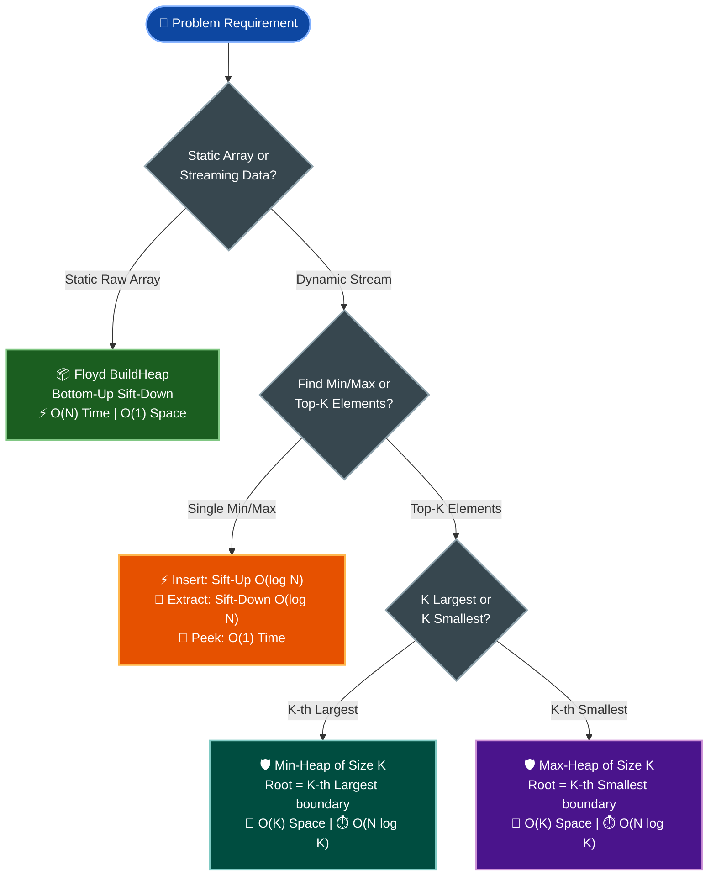

# 📘 Week 03 Day 03: Heaps, Heapify & Heap Sort — MASTER INSTRUCTIONAL GUIDE

> 🧭 **Navigation:** [← Previous Day](Week_03_Day_02_Merge_Quick_Sort_Instructional_Revised.md) • [🏠 Week Overview](README.md) • [📘 Curriculum Syllabus](../COMPLETE_SYLLABUS.md) • [Next Day →](Week_03_Day_04_Hash_Tables_Separate_Chaining_Instructional.md)

---

## 🎯 LEARNING OBJECTIVES

*By the end of this instructional module, you will be able to:*

- 🎬 **Internalize** the Array-Tree magic trick: how complete binary trees live inside contiguous 1D arrays with zero pointers and zero object allocations.
- ⚙️ **Master** the core mechanics: Sift-Up (`O(log N)` insertion), Sift-Down (`O(log N)` extraction), and Floyd's bottom-up `BuildHeap` (`O(N)` construction).
- 🧠 **Deconstruct** the mathematical intuition: why bottom-up heap construction takes strictly `O(N)` time while repeated insertion takes `O(N log N)`.
- 🛑 **Avoid** the high-stakes FAANG interview traps: choosing the optimal bounded heap for streaming Top-K problems and distinguishing heap partial order from BST total order.
- 🎙️ **Recite** the exact 3-sentence verbal talk track to explain heap invariants and streaming trade-offs under live FAANG interview pressure.
- ⚡ **Implement** production-grade, allocation-aware heaps in idiomatic **C# (.NET 8/9)** and **Python (3.11+)**.

---

## 🎬 PILLAR 1: THE 60-SECOND HOOK & EVERYDAY ANALOGY

Hey engineers, welcome back to Week 3 Day 3!

Imagine you are an emergency room triage doctor on a chaotic Friday night. Fifty patients sit in the waiting room. A new patient arrives with a severe cardiac arrest. 

Do you stop everything, pull out a clipboard, and alphabetically or chronologically sort all 50 patients from scratch? **Never.** 

Do you maintain a fully sorted line where every single patient is meticulously ordered by blood pressure from 1 to 50? **No!** If someone with a broken pinky arrives, shifting 30 people down the hallway to squeeze them in at index 22 wastes precious seconds.

All you care about is **one singular invariant**:
> *"The single most critical patient must be at the very front of the room (Index 0). Everyone else behind them is only loosely organized by urgency."*

```text
THE EMERGENCY ROOM TRIAGE PRINCIPLE:
+-----------------------------------------------------------------------+
|  INDEX 0: CRITICAL PATIENT (Heart Attack) -> IMMEDIATE DISPATCH O(1)   |
+-----------------------------------------------------------------------+
             /                                      \
   [Patient: Compound Fracture]            [Patient: High Fever]
          /              \                         /           \
   [Mild Concussion]   [Sprained Ankle]    [Stomach Flu]   [Paper Cut]
```

This is the exact purpose of a **Heap** (Priority Queue). It does not waste CPU cycles sorting data you don't need yet. It guarantees that the extreme element—the absolute maximum or absolute minimum—is available at index `0` in instant `O(1)` time, while insertions and extractions cost only `O(log N)` hops.

---

### 🪄 The Array-Tree Magic Trick: Zero Pointers, Pure Arithmetic

When most developers hear "Tree", they instinctively picture object allocations:
`new TreeNode { Value = x, Left = leftChild, Right = rightChild }`.

In high-performance systems engineering, linked node trees are a disaster for memory and CPU cache:
- Every node carries object header metadata (16 bytes in 64-bit .NET/Java) plus memory alignment padding.
- Every node stores two 8-byte reference pointers (`left` and `right`), burning 16 bytes of memory just to point to children!
- Nodes are scattered across dynamic memory (heap fragmentation), triggering L1/L2 CPU cache misses on every pointer dereference.

Here is the **magic trick**: A Binary Heap is a **Complete Binary Tree** stored inside a **flat, contiguous 1D array**. No `left` pointer. No `right` pointer. No `parent` pointer. Zero node allocations!

How do we traverse up and down the tree? **Pure integer arithmetic on array indices.**

```text
FLAT ARRAY INDEX FORMULAS (0-INDEXED):
For any node sitting at index i:
- Left Child Index:   2 * i + 1
- Right Child Index:  2 * i + 2
- Parent Index:       (i - 1) / 2    (integer truncation)
- Last Non-Leaf Node: (N / 2) - 1
```

```text
THE HARDWARE IMPACT (Contiguous Array vs Linked Tree Nodes):

LINKED TREE NODE (64-bit OS):
+-------------------------------------------------------------+
| Object Header (SyncBlock + TypeHandle)            [16 bytes]|
| Left Child Reference Pointer                      [ 8 bytes]|
| Right Child Reference Pointer                     [ 8 bytes]|
| Payload Integer                                   [ 4 bytes]|
| Memory Alignment Padding                          [ 4 bytes]|
+-------------------------------------------------------------+
Total per element: 40 bytes (10x memory inflation!) + DRAM cache misses.

CONTIGUOUS FLAT ARRAY HEAP:
+-----------+-----------+-----------+-----------+-----------+
|    50     |    30     |    20     |    10     |     5     |
|  [idx 0]  |  [idx 1]  |  [idx 2]  |  [idx 3]  |  [idx 4]  |
+-----------+-----------+-----------+-----------+-----------+
Total per element: Exactly 4 bytes. 
Hardware Benefit: 16 integers fit into a single 64-byte L1 CPU cache line!
```

---

### 🤯 The Mind-Blowing Revelation: Why BuildHeap is `O(N)`, NOT `O(N log N)`!

Here is one of the most famous algorithmic traps asked in FAANG interviews:
> *"If inserting into a heap takes `O(log N)` time, does building a heap from an unsorted array of `N` items take `O(N log N)`?"*

Every rookie answers: *"Yes, `N` elements times `O(log N)` equals `O(N log N)`."*

**Wrong!** Floyd's bottom-up `BuildHeap` algorithm builds a heap in strictly **`O(N)` linear time**. 

Why? Think about the physical geometry of a tree:
- In any complete binary tree, **roughly 50% of all nodes (`N / 2`) sit at the very bottom level (leaves)**.
- Another **25% (`N / 4`) sit just one level above the leaves**.
- Only **one single node (the root)** sits at the very top!

```text
PHYSICAL INTUITION: WORK PER LEVEL IN BOTTOM-UP HEAPIFY:
Level 0 (Root):       [ 1 node ]        -> Travels at most log(N) levels down (Max work, but only 1 node!)
Level 1:             [ 2 nodes ]       -> Travel at most 2 levels down
Level 2:            [ 4 nodes ]       -> Travel at most 1 level down
Level 3 (Leaves):  [ 8 nodes = 50% ]  -> Travel ZERO levels down! (0 hops!)
```

When you build bottom-up using Sift-Down:
- Half the entire array (`N / 2` leaves) does **0 swaps**.
- A quarter of the array (`N / 4` nodes) does at most **1 swap**.
- An eighth of the array (`N / 8` nodes) does at most **2 swaps**.
- Only the 1 root node does `log N` swaps.

The heaviest work is done by the fewest nodes; the lightest work (zero) is done by the vast majority of nodes. When you sum up the mathematical series:

`Total Swaps = (N/4 * 1) + (N/8 * 2) + (N/16 * 3) + ... = N * sum(h / 2^(h+1)) = N * 1 = O(N)`

The infinite series converges strictly to a constant! Building a heap from scratch takes **linear time `O(N)`**.

---

## 🪜 PILLAR 2: THE SCAFFOLDING LADDER & THE TOY NAPKIN TRACE

Let's demystify bottom-up heapification by taking a napkin, picking a tiny 5-element array, and tracing every single memory swap by hand.

### 📐 The Toy Array: `[4, 10, 3, 5, 1]`

We want to transform this raw, unsorted array into a valid **Max-Heap** (where every parent is greater than or equal to both of its children).

Length `N = 5`.
Let's find the **last non-leaf node**:
`LastNonLeaf = (N / 2) - 1 = (5 / 2) - 1 = 2 - 1 = 1`.

This means nodes at indices `2`, `3`, and `4` are leaves! They have no children, so they already satisfy the heap property by definition. We only need to process internal nodes backwards: **Index 1**, then **Index 0**.

```text
INITIAL TREE INTERPRETATION (Unsorted Array [4, 10, 3, 5, 1]):

             [ 4 ] (idx 0)
            /     \
    [ 10 ] (idx 1) [ 3 ] (idx 2: leaf)
     /    \
[ 5 ]      [ 1 ]
(idx 3)    (idx 4)
```

---

### Step 1: Sift-Down on Index 1 (`Value = 10`)

- Node at index 1 has value `10`.
- Left child: `2 * 1 + 1 = 3` (Value `5`).
- Right child: `2 * 1 + 2 = 4` (Value `1`).
- Compare parent and children: `{10, 5, 1}`.
- Largest value is `10` (the parent itself).
- **Result:** No swap needed! Index 1 is already a valid max-heap subtree.

---

### Step 2: Sift-Down on Index 0 (`Value = 4`)

Now we move backwards to index 0.

- Node at index 0 has value `4`.
- Left child: `2 * 0 + 1 = 1` (Value `10`).
- Right child: `2 * 0 + 2 = 2` (Value `3`).
- Compare `{4, 10, 3}`: The largest child is `10` at index 1.
- `10 > 4` -> Heap invariant violated! **Swap index 0 and index 1.**

```text
SWAP 1 OCCURS (Index 0 <-> Index 1):
Array before swap: [ 4, 10, 3, 5, 1 ]
Array after swap:  [ 10, 4, 3, 5, 1 ]

Intermediate Tree State:
             [ 10 ] (idx 0)   <-- 10 promoted to root!
            /      \
     [ 4 ] (idx 1)  [ 3 ] (idx 2)
     /    \
[ 5 ]      [ 1 ]
(idx 3)    (idx 4)
```

**Notice:** Node `4` has moved down to index 1. We must continue sifting it down until it finds its proper resting place!

- Node at index 1 now has value `4`.
- Left child: `2 * 1 + 1 = 3` (Value `5`).
- Right child: `2 * 1 + 2 = 4` (Value `1`).
- Compare `{4, 5, 1}`: The largest child is `5` at index 3.
- `5 > 4` -> Invariant violated! **Swap index 1 and index 3.**

```text
SWAP 2 OCCURS (Index 1 <-> Index 3):
Array before swap: [ 10, 4, 3, 5, 1 ]
Array after swap:  [ 10, 5, 3, 4, 1 ]

Final Tree State:
             [ 10 ] (idx 0)
            /      \
     [ 5 ] (idx 1)  [ 3 ] (idx 2)
     /    \
[ 4 ]      [ 1 ]
(idx 3)    (idx 4)
```

Node `4` is now at index 3. Its left child would be `2 * 3 + 1 = 7`, which is `>= N` (out of bounds). It has become a leaf! Sift-down terminates.

**Final Array:** `[10, 5, 3, 4, 1]`.
Let's verify:
- Root `10` `>=` children `5` and `3`. (Valid!)
- Parent `5` `>=` children `4` and `1`. (Valid!)
- Leaf `3` has no children. (Valid!)

We have transformed an arbitrary array into a valid Max-Heap in just **2 comparisons and 2 swaps**!

---

### 🧠 Pause & Predict Micro-Drill

> **Active Recall Challenge:**
> Suppose you take our finalized Max-Heap array `[10, 5, 3, 4, 1]` and invoke `Insert(12)`.
> 
> Before reading further, answer these 3 questions on your notepad:
> 1. At which array index is `12` initially placed?
> 2. What is the index of its initial parent?
> 3. How many swaps will take place, and what will the final array look like?

<details>
<summary>🔍 Click here to reveal the step-by-step verification!</summary>

**Solution Walkthrough:**
1. **Initial placement:** `12` is appended to the very end of the array at index `5` (`Count` becomes 6). Array: `[10, 5, 3, 4, 1, 12]`.
2. **Initial Parent:** `Parent(5) = (5 - 1) / 2 = 2` (which contains value `3`).
3. **Sift-Up Trace:**
   - **Comparison 1:** `12 > 3` -> Invariant violated! Swap index 5 and index 2.
     - Array becomes: `[10, 5, 12, 4, 1, 3]`.
   - **Comparison 2:** `12` is now at index 2. Its parent is `(2 - 1) / 2 = 0` (which contains value `10`).
   - `12 > 10` -> Invariant violated! Swap index 2 and index 0.
     - Array becomes: `[12, 5, 10, 4, 1, 3]`.
   - `12` is now at index 0 (the root). Sift-up terminates!
4. **Final Array:** `[12, 5, 10, 4, 1, 3]`. Total swaps: **Exactly 2**.

</details>

---

## 🎨 PILLAR 3: PRAGMATIC VISUAL MODELS

### 1. ASCII Contiguous Memory & Pointer Arithmetic Map

Here is the exact mental model to hold in your head during an interview. See how the visual tree perfectly mirrors array indices:

```text
COMPLETE BINARY TREE (SHAPE INVARIANT):
                  +--------------+
                  |  Index 0: 50 |
                  +--------------+
                   /            \
        +--------------+    +--------------+
        |  Index 1: 30 |    |  Index 2: 20 |
        +--------------+    +--------------+
         /            \      /
  +--------------+  +----+  +----+
  |  Index 3: 10 |  | 5  |  | 15 |
  +--------------+  +----+  +----+
                    idx 4   idx 5

FLAT CONTIGUOUS ARRAY STORAGE IN RAM:
+-------------+-------------+-------------+-------------+-------------+-------------+
|     50      |     30      |     20      |     10      |      5      |     15      |
+-------------+-------------+-------------+-------------+-------------+-------------+
    Index 0       Index 1       Index 2       Index 3       Index 4       Index 5
     (Root)     Left(0)=2(0)+1 Right(0)=2(0)+2 Left(1)=2(1)+1 Right(1)=2(1)+2 Left(2)=2(2)+1
```

---

### 2. Modern Mermaid Flowchart: Heap Strategy & Decision Tree

When solving FAANG algorithmic problems, how do you decide which heap operation or data structure to use? Follow this senior architectural decision tree:



---

## ⚙️ COMPLETE CRUD OPERATIONS & UNDER-THE-HOOD MECHANICS

Let's break down the mechanical execution of every core heap operation.

### 🔧 Operation 1: `Peek()` (`O(1)` Time)
Because of the heap invariant, the absolute extremum sits at index `0`. We directly return `arr[0]`. No child checks, no loops, strictly one CPU memory dereference.

---

### 🔧 Operation 2: `Insert(item)` (Sift-Up / Bubble-Up — `O(log N)` Time)
When inserting an element, we must satisfy two invariants:
1. **The Complete Binary Tree Shape Invariant:** There must be zero gaps in the array.
2. **The Heap Invariant:** Every parent must dominate its children.

**Mechanical Steps:**
1. Append the new item to the end of the array at index `N` (`Count`). This preserves the complete tree shape.
2. Compare the item with its parent at `(i - 1) / 2`.
3. If the item violates the heap property (e.g., in a Min-Heap, `heap[i] < heap[parent]`), swap them.
4. Move `i = parent` and repeat upward until the parent is valid or the item becomes the root (`i == 0`).

```text
INSERT SIFT-UP MECHANICAL FLOW:
Step 1: Append to end of array -> Shape invariant preserved!
Step 2: Compare with Parent at (i - 1) / 2.
Step 3: If child has higher priority, SWAP and bubble UP.
Step 4: Stop when parent is higher priority or i == 0.
Max Hops: Tree height = floor(log2(N)) -> O(log N).
```

---

### 🔧 Operation 3: `ExtractMin()` / `ExtractMax()` (Sift-Down / Bubble-Down — `O(log N)` Time)
Removing the root creates a hole at index `0`. How do we fill it without shifting `N` array elements in slow `O(N)` time?

**The Root-Swap-and-Pop Technique:**
1. Save the root value `arr[0]` to return.
2. Overwrite `arr[0]` with the very last leaf element `arr[Count - 1]`, and shrink array length by 1 (`Count--`). This preserves the complete binary tree shape.
3. Sift-down from index `0`:
   - Compute left child `2*i + 1` and right child `2*i + 2`.
   - Find the highest priority among the parent and its valid children.
   - If a child has higher priority than the parent, swap them.
   - Set `i = child_index` and repeat downward until no child violates the invariant or the node becomes a leaf (`2*i + 1 >= Count`).

```text
EXTRACT SIFT-DOWN MECHANICAL FLOW:
Step 1: Save arr[0].
Step 2: arr[0] = arr[Count - 1]; Count--; (Overwrite root with last leaf).
Step 3: Find smallest (or largest) among {arr[i], arr[left], arr[right]}.
Step 4: If child violates invariant, SWAP and bubble DOWN.
Step 5: Stop when parent is properly ordered or node has no children.
Max Hops: Tree height = floor(log2(N)) -> O(log N).
```

---

### 🔧 Operation 4: Floyd's Bottom-Up `BuildHeap` (`O(N)` Time)
Rather than starting with an empty heap and calling `Insert` `N` times (which takes `O(N log N)`), Floyd's algorithm starts from the last internal node `(N / 2) - 1` and calls `SiftDown` backwards down to `0`.

```csharp
// Floyd's Linear Time Heapify:
for (int i = (n / 2) - 1; i >= 0; i--) {
    SiftDown(i);
}
```

---

### 🔧 Operation 5: In-Place `HeapSort` (`O(N log N)` Time, `O(1)` Auxiliary Space)
HeapSort is a comparison-based sorting algorithm that operates **in-place** with zero extra memory allocation!

**The 2-Phase Algorithm:**
- **Phase 1 (Heapify):** Transform the input array into a **Max-Heap** in `O(N)` using Floyd's bottom-up sift-down.
- **Phase 2 (Sorted Extraction):** Repeatedly swap the root `arr[0]` (the maximum element) with the last element of the active heap `arr[end]`. Shrink the active heap boundary (`end--`), and call `SiftDown(0)` to restore the heap invariant.
- After `N - 1` iterations, the array is strictly sorted in ascending order!

```text
HEAPSORT TWO-PHASE IN-PLACE PIPELINE:
Phase 1: Build Max-Heap bottom-up in O(N).
         Array: [ 50, 30, 20, 10, 5 ]

Phase 2: Extract Root to End & Shrink Boundary:
Iteration 1: Swap arr[0] (50) with arr[4] (5). Active size becomes 4.
             Array: [ 5, 30, 20, 10 | 50 ]  <-- 50 locked into final position!
             SiftDown(0) on active region [0..3]:
             Array: [ 30, 10, 20, 5 | 50 ]

Iteration 2: Swap arr[0] (30) with arr[3] (5). Active size becomes 3.
             Array: [ 5, 10, 20 | 30, 50 ]  <-- 30 locked!
             SiftDown(0) on active region [0..2]:
             Array: [ 20, 10, 5 | 30, 50 ]

Iteration 3: Swap arr[0] (20) with arr[2] (5). Active size becomes 2.
             Array: [ 5, 10 | 20, 30, 50 ]
             SiftDown(0):
             Array: [ 10, 5 | 20, 30, 50 ]

Iteration 4: Swap arr[0] (10) with arr[1] (5). Active size becomes 1.
             Array: [ 5, 10, 20, 30, 50 ]  <-- FULLY SORTED IN-PLACE!
```

---

### 🔧 Operation 6: Linear-Time Sorting — Counting Sort (`O(N + K)`)

When sorting integers bounded in a finite range `[0..K]`, comparison sorting algorithms hit an information-theoretic lower bound of `Omega(N log N)`. **Counting Sort** bypasses this lower bound completely by using values directly as array indices.

```text
COUNTING SORT PIPELINE (N = 7, K = 8):
Input Array:       [ 4,  2,  2,  8,  3,  3,  1 ]

Step 1: Frequency Histogram (Count occurrences):
Index:  0   1   2   3   4   5   6   7   8
Count: [0,  1,  2,  2,  1,  0,  0,  0,  1]

Step 2: Running Prefix Sum (Determines exact boundary positions in output):
Prefix:[0,  1,  3,  5,  6,  6,  6,  6,  7]

Step 3: Stable Reverse Traversal & Placement into Output:
Output: [ 1,  2,  2,  3,  3,  4,  8 ]
Time: O(N + K) | Auxiliary Space: O(N + K) | Stable
```

---

## 🛑 PILLAR 4: THE ROOKIE TRAP ZONE

### Trap 1: The Top-K Streaming Trap (The #1 FAANG Interview Filter)

```text
THE SCENARIO:
"Find the K-th Largest element in a massive incoming stream of N numbers."
```

```text
❌ ROOKIE BLUNDER
Using a Max-Heap of size N:
- The candidate inserts all N numbers into a Max-Heap.
- Then calls ExtractMax() K times.
- Time Complexity: O(N + K log N)
- Memory: O(N)
Why this fails FAANG interviews:
If N = 1,000,000,000 (1 billion telemetry events) and K = 10, you store 1 billion items in RAM!
Your server crashes with an OutOfMemoryException (OOM).
```

```text
✅ SENIOR ARCHITECT PATTERN
Using a Bounded Min-Heap of size K:
- Maintain a Min-Heap of capacity K.
- Process elements one by one:
  - If heap.Count < K: push item.
  - Else if item > heap.Peek(): pop root, push item.
- Time Complexity: O(N log K)
- Memory: Strictly O(K)
Why this dominates:
The Min-Heap acts as an exclusive VIP club of size K.
The weakest member sits at the root (heap.Peek()).
If someone better arrives, the weakest gets evicted!
At the end, heap.Peek() IS the K-th largest element.
Memory is O(K) — for K = 10, you store only 10 integers in RAM even if N is 1 trillion!
```

---

### Trap 2: Heap Construction Trap (Top-Down vs Bottom-Up)

```text
❌ ROOKIE BLUNDER: Repeated Insertion
var heap = new MinHeap();
foreach (var num in array) {
    heap.Insert(num); // Sift-Up for every element!
}
// Time Complexity: O(N log N)
```

```text
✅ SENIOR ARCHITECT PATTERN: Floyd's Heapify
var heap = new MinHeap(array); // Sift-Down from (N/2)-1 down to 0
// Time Complexity: Strictly O(N)
```

---

### Trap 3: The "Heap is Sorted" Fallacy (Heap vs BST)

```text
❌ ROOKIE MYTH:
"An in-order traversal of a min-heap outputs elements in sorted order."

REALITY:
A Heap is only PARTIALLY ordered vertically (Parent <= Children).
Siblings have ZERO ordering relationship with each other!
Example Min-Heap:
             5
           /   \
         20     10
        /  \   /  \
       25  30 15  35

In-Order Walk (Left -> Root -> Right): 25, 20, 30, 5, 15, 10, 35 (AN ARBITRARY JUMBLE!)
To extract sorted order from a heap, you MUST call ExtractMin() N times in O(N log N) time.
If you need non-destructive sorted iteration in O(N), use a Balanced BST (Red-Black / AVL Tree).
```

---

### Trap 4: Off-By-One Child Index Calculation

```csharp
// ❌ ROOKIE BLUNDER (Confusing 1-based textbook formulas with 0-based code):
int left = 2 * i;      // WRONG! For i=0, 2*0 = 0 (infinite self loop!)
int right = 2 * i + 1; // WRONG!

// ✅ SENIOR ARCHITECT PATTERN (Strict 0-indexed arithmetic):
int left = 2 * i + 1;
int right = 2 * i + 2;
int parent = (i - 1) / 2;
```

---

### Trap 5: Missing Boundary Guard Before Array Access

```csharp
// ❌ ROOKIE BLUNDER (IndexOutOfRangeException):
if (arr[left] > arr[largest]) largest = left; // CRASH if left >= N!

// ✅ SENIOR ARCHITECT PATTERN (Short-circuit boundary validation):
if (left < n && arr[left] > arr[largest]) largest = left;
if (right < n && arr[right] > arr[largest]) largest = right;
```

---

## 🎙️ PILLAR 5: 45-MINUTE INTERVIEW TALK TRACK

In a live FAANG interview, when a problem requires priority access, Top-K filtering, or streaming median tracking, deliver this crisp **3-sentence verbal script** before writing a single line of code:

> 🎙️ **Sentence 1 (Data Structure & Layout):**  
> *"I will model this problem using a binary heap backed by a contiguous 1D array, computing parent-child relationships via zero-overhead index arithmetic—`2i + 1` for the left child, `2i + 2` for the right child, and `(i - 1) / 2` for the parent."*

> 🎙️ **Sentence 2 (Algorithmic Construction & Complexity):**  
> *"If given a static array, I will initialize the heap in linear `O(N)` time using Floyd's bottom-up sift-down starting at index `(N / 2) - 1`, leveraging the fact that leaf nodes do zero swaps and work decreases exponentially toward the root."*

> 🎙️ **Sentence 3 (Streaming Top-K Invariant):**  
> *"To find the K-th largest element in a streaming dataset, I will maintain a bounded Min-Heap of size K rather than a Max-Heap of size N; this caps auxiliary space at strictly `O(K)` and ensures the root continually stores the K-th largest boundary in `O(N log K)` total time."*

---

## ⚡ PILLAR 6: PRODUCTION DUAL-LANGUAGE IMPLEMENTATIONS

### 1. Modern C# (.NET 8/9): Production Allocation-Aware Min-Heap

Here is a production-grade, allocation-aware `MinHeap<T>` implementation using modern C# features: primary constructors, expression-bodied members, generics with `IComparable<T>`, and Floyd's `O(N)` heapify.

```csharp
using System;
using System.Collections.Generic;

/// <summary>
/// High-performance contiguous array-backed binary min-heap.
/// Zero node allocations, zero GC pointer chasing.
/// </summary>
public class MinHeap<T> where T : IComparable<T> {
    private T[] _heap;
    private int _count;
    private const int DefaultCapacity = 16;

    public int Count => _count;
    public bool IsEmpty => _count == 0;
    public int Capacity => _heap.Length;

    public MinHeap(int capacity = DefaultCapacity) {
        if (capacity < 1) throw new ArgumentOutOfRangeException(nameof(capacity), "Capacity must be positive.");
        _heap = new T[capacity];
        _count = 0;
    }

    /// <summary>
    /// Constructs a heap from an existing collection in linear O(N) time using Floyd's bottom-up heapify.
    /// </summary>
    public MinHeap(ReadOnlySpan<T> items) {
        _count = items.Length;
        _heap = new T[Math.Max(_count, DefaultCapacity)];
        items.CopyTo(_heap);

        // Floyd's bottom-up heapify: start at last non-leaf node
        for (int i = (_count / 2) - 1; i >= 0; i--) {
            SiftDown(i);
        }
    }

    /// <summary>Returns the root minimum element in O(1) time without removing it.</summary>
    public T Peek() {
        if (_count == 0) throw new InvalidOperationException("Heap is empty.");
        return _heap[0];
    }

    /// <summary>Inserts a new item in O(log N) time.</summary>
    public void Insert(T item) {
        ArgumentNullException.ThrowIfNull(item);
        EnsureCapacity();
        
        int current = _count++;
        _heap[current] = item;
        SiftUp(current);
    }

    /// <summary>Extracts and returns the root minimum element in O(log N) time.</summary>
    public T ExtractMin() {
        if (_count == 0) throw new InvalidOperationException("Heap is empty.");

        T min = _heap[0];
        _count--;

        if (_count > 0) {
            _heap[0] = _heap[_count];
            _heap[_count] = default!; // Avoid memory leaks for reference types
            SiftDown(0);
        } else {
            _heap[0] = default!;
        }

        return min;
    }

    private void SiftUp(int i) {
        T item = _heap[i];
        while (i > 0) {
            int parent = (i - 1) / 2;
            if (item.CompareTo(_heap[parent]) >= 0) break;

            _heap[i] = _heap[parent];
            i = parent;
        }
        _heap[i] = item;
    }

    private void SiftDown(int i) {
        T item = _heap[i];
        int half = _count / 2;

        // While node has at least one child (i < half)
        while (i < half) {
            int left = 2 * i + 1;
            int right = 2 * i + 2;
            int smallest = left;

            if (right < _count && _heap[right].CompareTo(_heap[left]) < 0) {
                smallest = right;
            }

            if (item.CompareTo(_heap[smallest]) <= 0) break;

            _heap[i] = _heap[smallest];
            i = smallest;
        }
        _heap[i] = item;
    }

    private void EnsureCapacity() {
        if (_count == _heap.Length) {
            Array.Resize(ref _heap, _heap.Length * 2);
        }
    }
}
```

---

### 2. Modern C# (.NET 8/9): Top-K Streaming with `System.Collections.Generic.PriorityQueue`

In actual FAANG coding rounds using C#, you should know how to leverage .NET's built-in `PriorityQueue<TElement, TPriority>`:

```csharp
using System;
using System.Collections.Generic;

public class TopKStreamingService {
    /// <summary>
    /// Finds the K-th Largest element in an incoming stream of numbers.
    /// Time Complexity: O(N log K) | Space: Strictly O(K)
    /// </summary>
    public static int FindKthLargest(int[] nums, int k) {
        ArgumentNullException.ThrowIfNull(nums);
        if (k <= 0 || k > nums.Length) throw new ArgumentOutOfRangeException(nameof(k));

        // .NET PriorityQueue is a MIN-HEAP by default on TPriority
        PriorityQueue<int, int> minHeap = new(k);

        foreach (int num in nums) {
            if (minHeap.Count < k) {
                minHeap.Enqueue(num, num);
            } else if (num > minHeap.Peek()) {
                minHeap.Dequeue();
                minHeap.Enqueue(num, num);
            }
        }

        return minHeap.Peek(); // Root holds the K-th largest element!
    }
}
```

---

### 3. Modern C# (.NET 8/9): In-Place `HeapSort`

```csharp
public static class HeapSort {
    /// <summary>
    /// In-place HeapSort sorting arr in ascending order.
    /// Time: O(N log N) Best/Avg/Worst | Space: Strictly O(1) Auxiliary | Unstable
    /// </summary>
    public static void Sort(Span<int> arr) {
        int n = arr.Length;
        if (n <= 1) return;

        // Phase 1: Build Max-Heap bottom-up in O(N)
        for (int i = (n / 2) - 1; i >= 0; i--) {
            SiftDown(arr, n, i);
        }

        // Phase 2: Extract maximum element to sorted suffix
        for (int i = n - 1; i > 0; i--) {
            (arr[0], arr[i]) = (arr[i], arr[0]); // Move max to final spot
            SiftDown(arr, i, 0);                 // Restore heap on prefix of size i
        }
    }

    private static void SiftDown(Span<int> arr, int heapSize, int i) {
        int largest = i;
        int left = 2 * i + 1;
        int right = 2 * i + 2;

        if (left < heapSize && arr[left] > arr[largest]) largest = left;
        if (right < heapSize && arr[right] > arr[largest]) largest = right;

        if (largest != i) {
            (arr[i], arr[largest]) = (arr[largest], arr[i]);
            SiftDown(arr, heapSize, largest);
        }
    }
}
```

---

### 4. Modern C# (.NET 8/9): Stable `CountingSort`

```csharp
public static class CountingSort {
    /// <summary>
    /// Stable linear-time counting sort for non-negative integers bounded by maxVal.
    /// Time: O(N + K) | Space: O(N + K) | Stable
    /// </summary>
    public static int[] Sort(int[] arr, int maxVal) {
        if (arr.Length <= 1) return (int[])arr.Clone();

        int[] count = new int[maxVal + 1];
        int[] output = new int[arr.Length];

        // Step 1: Frequency count
        for (int i = 0; i < arr.Length; i++) {
            count[arr[i]]++;
        }

        // Step 2: Cumulative prefix sum
        for (int i = 1; i <= maxVal; i++) {
            count[i] += count[i - 1];
        }

        // Step 3: Iterate backwards to maintain stability
        for (int i = arr.Length - 1; i >= 0; i--) {
            int val = arr[i];
            output[--count[val]] = val;
        }

        return output;
    }
}
```

---

### 5. Idiomatic Python (3.11+): Production Min-Heap Class

```python
from typing import Generic, TypeVar, Sequence

T = TypeVar("T")

class MinHeap(Generic[T]):
    """Contiguous array-backed binary min-heap with zero pointer overhead.
    
    Supports O(1) peek, O(log N) insert, O(log N) extract, and O(N) build_heap.
    """
    def __init__(self, items: Sequence[T] | None = None) -> None:
        self._heap: list[T] = list(items) if items is not None else []
        if self._heap:
            self._build_heap()

    def __len__(self) -> int:
        return len(self._heap)

    def is_empty(self) -> bool:
        return len(self._heap) == 0

    def peek(self) -> T:
        """Return the root minimum element in O(1) without removing it."""
        if not self._heap:
            raise IndexError("Peek from empty heap")
        return self._heap[0]

    def insert(self, item: T) -> None:
        """Insert a new item in O(log N) time."""
        self._heap.append(item)
        self._sift_up(len(self._heap) - 1)

    def extract_min(self) -> T:
        """Remove and return the minimum element in O(log N) time."""
        if not self._heap:
            raise IndexError("Extract from empty heap")

        min_val = self._heap[0]
        last_val = self._heap.pop()

        if self._heap:
            self._heap[0] = last_val
            self._sift_down(0)

        return min_val

    def _sift_up(self, i: int) -> None:
        item = self._heap[i]
        while i > 0:
            parent = (i - 1) // 2
            if item >= self._heap[parent]:
                break
            self._heap[i] = self._heap[parent]
            i = parent
        self._heap[i] = item

    def _sift_down(self, i: int) -> None:
        item = self._heap[i]
        n = len(self._heap)
        half = n // 2

        while i < half:
            left = 2 * i + 1
            right = 2 * i + 2
            smallest = left

            if right < n and self._heap[right] < self._heap[left]:
                smallest = right

            if item <= self._heap[smallest]:
                break

            self._heap[i] = self._heap[smallest]
            i = smallest
        self._heap[i] = item

    def _build_heap(self) -> None:
        """Floyd's bottom-up heapify in linear O(N) time."""
        for i in range((len(self._heap) // 2) - 1, -1, -1):
            self._sift_down(i)
```

---

### 6. Idiomatic Python (3.11+): Standard Library `heapq` Patterns

In Python whiteboard interviews, master the built-in `heapq` module:

```python
import heapq

def find_kth_largest(nums: list[int], k: int) -> int:
    """Find the K-th Largest element using a bounded Min-Heap.
    
    Time: O(N log K) | Auxiliary Space: O(K)
    """
    if not (1 <= k <= len(nums)):
        raise ValueError("Invalid value for k")

    # Min-heap initialized with the first k elements in O(K)
    min_heap = nums[:k]
    heapq.heapify(min_heap)

    # Process remaining elements
    for num in nums[k:]:
        if num > min_heap[0]:
            heapq.heappushpop(min_heap, num)

    return min_heap[0]

def in_place_heap_sort(arr: list[int]) -> list[int]:
    """In-place Max-HeapSort in ascending order.
    
    Time: O(N log N) | Space: O(1) | Unstable
    """
    n = len(arr)

    def _sift_down(heap_size: int, i: int) -> None:
        while True:
            largest = i
            left = 2 * i + 1
            right = 2 * i + 2
            if left < heap_size and arr[left] > arr[largest]:
                largest = left
            if right < heap_size and arr[right] > arr[largest]:
                largest = right
            if largest == i:
                break
            arr[i], arr[largest] = arr[largest], arr[i]
            i = largest

    # Phase 1: Floyd's Build Max-Heap in O(N)
    for i in range((n // 2) - 1, -1, -1):
        _sift_down(n, i)

    # Phase 2: Extract max elements to sorted suffix
    for i in range(n - 1, 0, -1):
        arr[0], arr[i] = arr[i], arr[0]
        _sift_down(i, 0)

    return arr
```

---

## ⚖️ ARCHITECTURAL TRADE-OFF MATRIX & COMPLEXITY DECONSTRUCTION

### High-ROI Algorithmic Trade-Off Matrix

Choosing between a Binary Heap, Balanced BST, Sorted Array, and Unsorted Array is a core systems architecture interview topic:

| Operation / Metric | Binary Heap (Flat Array) | Balanced BST (Red-Black / AVL) | Sorted Dynamic Array | Unsorted Dynamic Array |
| :--- | :---: | :---: | :---: | :---: |
| **Find-Min / Peek** | `O(1)` | `O(log N)` (or `O(1)` cached) | `O(1)` (at index `0`) | `O(N)` |
| **Extract-Min / Delete-Min** | `O(log N)` | `O(log N)` | `O(N)` (shifts elements) | `O(N)` |
| **Insert / Enqueue** | `O(log N)` (amortized) | `O(log N)` | `O(N)` (maintain order) | `O(1)` (amortized) |
| **Arbitrary Search (`Contains`)** | `O(N)` (unsorted levels) | `O(log N)` | `O(log N)` (Binary Search) | `O(N)` |
| **Bulk Construction (`Heapify`)** | `O(N)` (Floyd's bottom-up) | `O(N log N)` | `O(N log N)` (full sort) | `O(1)` (raw copy) |
| **Sorted In-Order Traversal** | `O(N log N)` (destructive) | `O(N)` (in-order walk) | `O(N)` (linear scan) | `O(N log N)` (sort first)|
| **Memory Overhead per Node** | **0 bytes** (contiguous array) | 24-32 bytes (pointers + color) | **0 bytes** (contiguous array)| **0 bytes** (contiguous array)|
| **Hardware Cache Locality** | **High** (sequential array access) | **Poor** (scattered heap nodes) | **Maximum** (contiguous scan) | **Maximum** (contiguous scan) |
| **Structural Invariant** | Vertical: Parent <= Children | Horizontal: Left < Root < Right| Linear Total Order | None |

---

### Complexity Deconstruction

| Algorithm / Operation | Time Complexity | Auxiliary Space | Output Space | In-Place? | Key Mechanism |
| :--- | :--- | :--- | :--- | :---: | :--- |
| **Binary Heap: Peek** | `O(1)` | `O(1)` | `O(1)` | Yes | Direct dereference at `arr[0]`. |
| **Binary Heap: Insert** | `O(log N)` | `O(1)` | `O(1)` | Yes | Bubble-up across at most `log2(N)` tree levels. |
| **Binary Heap: Extract** | `O(log N)` | `O(1)` | `O(1)` | Yes | Root swap with last leaf, bubble-down. |
| **Build-Heap (Floyd Heapify)**| `O(N)` | `O(1)` | `O(1)` | Yes | Bottom-up sift-down: work is concentrated on leaves. |
| **HeapSort** | `O(N log N)` Best/Avg/Worst | `O(1)` | `O(1)` | Yes | In-place Max-Heapify + prefix boundary contraction. |
| **Counting Sort** | `O(N + K)` | `O(N + K)` | `O(N)` | No | Direct histogram indexing & prefix-sum accumulation. |

---

## ⚔️ FAANG INTERVIEW PROBLEM SCAFFOLDING LADDER

Master these 5 classic FAANG interview problems to achieve full mastery of Heaps:

```text
THE HEAP MASTERY LADDER:
[Level 5: Hard]   LeetCode 295: Find Median from Data Stream (Two Balanced Heaps)
        ^
[Level 4: Hard]   LeetCode 23:  Merge k Sorted Lists (K-Way Min-Heap Merge)
        ^
[Level 3: Medium] LeetCode 347: Top K Frequent Elements (Bucket Queue vs Min-Heap)
        ^
[Level 2: Medium] LeetCode 215: Kth Largest Element in an Array (Bounded Min-Heap)
        ^
[Level 1: Easy]   LeetCode 703: Kth Largest Element in a Stream (Min-Heap of Size K)
```

1. **LeetCode 703 — Kth Largest Element in a Stream (🟢 Easy):**  
   *Pattern:* Maintain a Min-Heap of capacity `K`. Evict the root when size exceeds `K`. The root is always the answer.
2. **LeetCode 215 — Kth Largest Element in an Array (🟡 Medium):**  
   *Pattern:* Bounded Min-Heap of size `K` (`O(N log K)` time, `O(K)` space) vs QuickSelect (`O(N)` average time, `O(1)` space).
3. **LeetCode 347 — Top K Frequent Elements (🟡 Medium):**  
   *Pattern:* Hash map for frequencies + Min-Heap of size `K` on frequencies (`O(N log K)`) or Bucket Sort (`O(N)` linear time).
4. **LeetCode 23 — Merge k Sorted Lists (🔴 Hard):**  
   *Pattern:* Seed a Min-Heap with the head node of each of the `K` lists. Repeatedly pop the smallest node and push its `next` pointer into the heap. Time: `O(N log K)` where `N` is total nodes across all lists.
5. **LeetCode 295 — Find Median from Data Stream (🔴 Hard):**  
   *Pattern:* Two Heaps! A Max-Heap for the smaller half of numbers, and a Min-Heap for the larger half of numbers. Balance sizes so they differ by at most 1. Median is retrieved in `O(1)`!

---

## 📌 CLOSING REFLECTION & SOCRATIC REVIEW

Before wrapping up Week 3 Day 3, pause and test your retention with these 3 questions:

1. **On Hardware:** Why does storing a complete binary tree in a flat array offer a 10x memory reduction and significantly faster execution than a pointer-based tree?
2. **On Math:** Why does Floyd's `BuildHeap` execute in `O(N)` time while repeated `Insert` takes `O(N log N)`?
3. **On Strategy:** In a streaming system with 100 million numbers, why must you use a **Min-Heap of size K** instead of a **Max-Heap of size N** to find the K-th largest item?

> 💡 **The Senior Architect's Motto:**  
> *"Structure determines performance. By eliminating pointers and letting array indices do the arithmetic, Heaps unlock cache-friendly, logarithmic priority scheduling with zero GC overhead. Master the bounded heap invariant, and streaming FAANG challenges become second nature."*

---

> 🧭 **Navigation:** [← Previous Day](Week_03_Day_02_Merge_Quick_Sort_Instructional_Revised.md) • [🏠 Week Overview](README.md) • [📘 Curriculum Syllabus](../COMPLETE_SYLLABUS.md) • [Next Day →](Week_03_Day_04_Hash_Tables_Separate_Chaining_Instructional.md)
