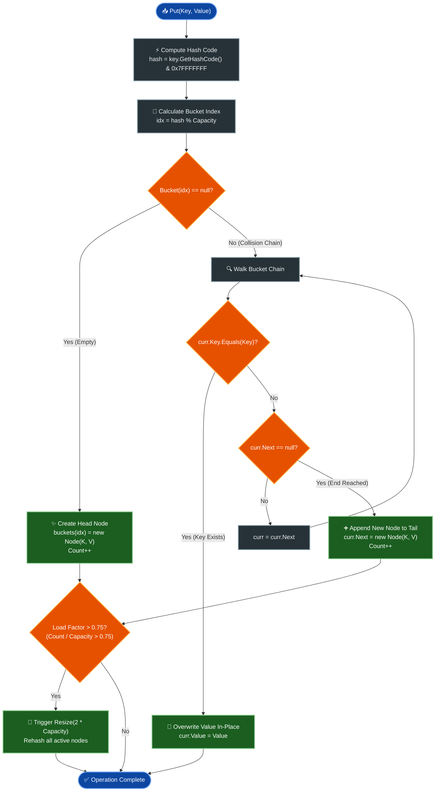

# 📘 Week 03 Day 04: Hash Tables I — Separate Chaining — ENGINEERING GUIDE

> 🧭 **Navigation:** [← Previous Day](Week_03_Day_03_Heaps_Heapify_Heap_Sort_Instructional.md) • [🏠 Week Overview](README.md) • [📘 Curriculum Syllabus](../COMPLETE_SYLLABUS.md) • [Next Day →](Week_03_Day_05_Hash_Tables_Open_Addressing_Rolling_Hash_Instructional.md)
> 
> 💡 **Instructor Note:** *Welcome to the most important associative data structure in all of software engineering. Every database index, in-memory cache, and high-throughput web service relies on hash tables. Skim or skip historical trivia, but master the mechanics of collision resolution, memory layouts, and resizing.*

---

## 🎯 LEARNING OBJECTIVES

*By the end of this chapter, you will be able to:*

- 🎯 **Internalize** the Hash Function Contract: determinism, uniform distribution, and the Avalanche Effect.
- ⚙️ **Construct** a production-grade separate chaining hash table with linked-list buckets and dynamic `2M` resizing.
- 🎨 **Visualize** contiguous bucket arrays and pointer chains down to the CPU cache and memory allocator level.
- 🛑 **Eliminate** rookie traps: garbage hash codes, mutable dictionary keys, and negative index overflow bugs (`int.MinValue`).
- 🎙️ **Deliver** the exact 3-sentence verbal script explaining load factor, collisions, and amortized `O(1)` complexity under live FAANG interview pressure.
- ⚡ **Implement** clean, idiomatic, zero-allocation-aware code in both modern C# (.NET 8/9) and Python (3.11+).

---

## 🎬 CHAPTER 1: THE 60-SECOND HOOK & EVERYDAY ANALOGY

### Hey Engineers, Welcome Back to Week 3 Day 4!

In Week 2 Day 5, we saw that binary search gives us blazing `O(log N)` lookups on sorted data. But what happens when your data is completely unsorted, highly dynamic, and you need to look up records in **constant time `O(1)`** across 100 million entries?

Binary search cannot save you without paying an `O(N log N)` sorting toll every time an item is inserted. You need direct, instant access.

Enter the **Hash Table**.

```
Search Cost Comparison (N = 1,000,000 items):
┌─────────────────────────┬──────────────────────────┬─────────────────────────┐
│ Linear Search           │ Binary Search            │ Hash Table (Separate    │
│                         │                          │ Chaining)               │
├─────────────────────────┼──────────────────────────┼─────────────────────────┤
│ Up to 1,000,000 steps   │ ~20 comparisons          │ 1 to 2 memory jumps!    │
│ O(N)                    │ O(log N)                 │ O(1) expected           │
└─────────────────────────┴──────────────────────────┴─────────────────────────┘
```

---

### The Everyday Analogy: The Giant Postal Sorting Facility

Imagine you manage a central international mail distribution hub handling millions of letters every single hour.

```
Incoming Mail: "apple", "banana", "cherry", "date"...
                   │
                   ▼
     ┌───────────────────────────┐
     │  Optical Zip Code Scanner │  <── (The Hash Function)
     │   Maps Address -> Bin #   │
     └─────────────┬─────────────┘
                   │
       ┌───────────┼───────────┬───────────┐
       ▼           ▼           ▼           ▼
   ┌───────┐   ┌───────┐   ┌───────┐   ┌───────┐
   │ Bin 0 │   │ Bin 1 │   │ Bin 2 │   │ Bin 3 │  <── (Bucket Array [0..M-1])
   └───────┘   └───────┘   └───────┘   └───────┘
```

1. **The Mail Arrival:** Letters pour in with arbitrary sender names ("Alice", "Bob", "Charlie").
2. **The Scanner (The Hash Function):** Instead of walking through millions of pigeonholes alphabetically, a high-speed scanner reads the address and instantly computes a postal routing bin number from `0` to `M - 1`.
3. **Direct Placement:** The sorter drops the letter directly into that calculated bin in one physical movement: **`O(1)` time**.
4. **Instant Retrieval:** When a courier asks for "Alice's" mail, you don't scan the entire warehouse. You scan "Alice", get bin `1`, walk straight to bin `1`, and pick up the mail.

---

### The Hash Function Contract

A hash function is not magic; it is a mathematical compressor. It maps an infinite universe of possible keys (strings, objects, UUIDs) into a finite integer range `[0, M - 1]`.

To be production-ready, every hash function must uphold **four non-negotiable laws**:

```
                              THE HASH FUNCTION CONTRACT
  ┌──────────────────────┬────────────────────────────────────────────────────────┐
  │ 1. Determinism       │ Same input MUST ALWAYS produce the identical hash code.│
  │                      │ If hash("user_42") is 0x7F2A now, it MUST be 0x7F2A    │
  │                      │ 5 hours later in the same execution run.               │
  ├──────────────────────┼────────────────────────────────────────────────────────┤
  │ 2. Uniformity        │ Keys must scatter evenly across all M buckets without  │
  │                      │ clustering or favoring specific indices.               │
  ├──────────────────────┼────────────────────────────────────────────────────────┤
  │ 3. Avalanche Effect  │ Flipping a single bit in the input string must scramble│
  │                      │ roughly 50% of the bits in the output hash code.       │
  │                      │ "cat" vs "bat" must yield wildly different integers!   │
  ├──────────────────────┼────────────────────────────────────────────────────────┤
  │ 4. O(1) Speed        │ The hash computation must be fast and lightweight,     │
  │                      │ consuming negligible CPU cycles per key.               │
  └──────────────────────┴────────────────────────────────────────────────────────┘
```

---

### What Happens When Collisions Strike? Enter Separate Chaining

Here is the physical reality: Dirichlet's **Pigeonhole Principle** guarantees that if you place 10 pigeons into 9 pigeonholes, at least one hole must hold 2 or more pigeons. Because the universe of possible keys (e.g., all 64-character strings) vastly exceeds our array capacity `M`, **two distinct keys will eventually compute to the exact same bucket index**. This is a **Hash Collision**.

Even with sparse tables, the **Birthday Paradox** shows that in a room of just 23 people, there is a greater than 50% chance two share a birthday. Collisions are not exceptions; they are inevitable physical facts.

**How do we handle them?**

In **Separate Chaining**, we don't evict existing items or panic. Instead, every bucket slot in our array holds a reference to an independent **Linked List** (a chain). When multiple keys land in the same bucket, we simply link the new `(Key, Value)` node onto that bucket's chain!

---

## 🪜 CHAPTER 2: THE SCAFFOLDING LADDER & TOY NAPKIN TRACE

### Scaffolding Level 1: The 4-Bucket Toy Napkin Trace (`M = 4`)

Let's trace a hash table with capacity `M = 4` (indices `0`, `1`, `2`, `3`).

We use the modulo formula: `bucketIndex = (hash(key) & 0x7FFFFFFF) % 4`.

```
Our Toy Keys and Hash Values:
- "apple"   ──> hash = 5   ──> 5 % 4 = 1
- "banana"  ──> hash = 13  ──> 13 % 4 = 1  <── COLLISION with "apple"!
- "cherry"  ──> hash = 7   ──> 7 % 4 = 3
```

#### Step 1: Insert `("apple", 10)`
- Hash `"apple"`: `5 % 4 = 1`.
- Go to Bucket `1`. It is currently empty (`null`).
- Create node `["apple" : 10 | null]`. Bucket `1` points to it.
- Table Count `N = 1`.

```
Bucket Array:
[ 0 ] ──> null
[ 1 ] ──> [ "apple" : 10 | null ]
[ 2 ] ──> null
[ 3 ] ──> null
```

#### Step 2: Insert `("banana", 20)` — COLLISION!
- Hash `"banana"`: `13 % 4 = 1`.
- Go to Bucket `1`. Bucket `1` is already occupied by `"apple"`.
- We walk the chain: Does `"apple" == "banana"`? No!
- Reached end of chain: Append `["banana" : 20 | null]` to the tail (or prepend to head).
- Table Count `N = 2`.

```
Bucket Array:
[ 0 ] ──> null
[ 1 ] ──> [ "apple" : 10 | Next ] ──> [ "banana" : 20 | null ]  <── COLLISION CHAIN!
[ 2 ] ──> null
[ 3 ] ──> null
```

#### Step 3: Insert `("cherry", 30)`
- Hash `"cherry"`: `7 % 4 = 3`.
- Go to Bucket `3`. It is empty (`null`).
- Create node `["cherry" : 30 | null]`.
- Table Count `N = 3`.

```
Bucket Array:
[ 0 ] ──> null
[ 1 ] ──> [ "apple" : 10 | Next ] ──> [ "banana" : 20 | null ]
[ 2 ] ──> null
[ 3 ] ──> [ "cherry" : 30 | null ]
```

#### Step 4: Lookup `Get("banana")`
- Hash `"banana"`: `13 % 4 = 1`.
- Jump directly to Bucket `1` in `O(1)` time.
- Traverse the chain:
  - Check Node 1: Key is `"apple"`. `"apple" == "banana"`? **False**. Follow `Next` pointer.
  - Check Node 2: Key is `"banana"`. `"banana" == "banana"`? **True**! Match found!
- Return Value: `20`.

```
Lookup Path:
Bucket[1] ──> [ "apple" : 10 ] (Mismatch) ──> [ "banana" : 20 ] (HIT! Return 20)
```

---

### 🧠 Pause & Predict Micro-Drill #1

> **Question:** Suppose we now execute:
> ```csharp
> table.Put("apple", 99);
> ```
> Does Bucket `1` grow a third linked list node, or does something else happen? What should the table's `Count` be after this call?
>
> *Take 15 seconds to visualize before reading below.*

<details>
<summary>👉 Click to reveal the mechanical truth</summary>

**Answer:** 
No new node is allocated, and `Count` remains `3`!

Hash tables implement **Upsert** (Update or Insert) semantics:
1. Hash `"apple"` -> Bucket `1`.
2. Scan the chain starting at the head.
3. Node 1 has Key `"apple"`. Match found!
4. Overwrite its value in-place: `node.Value = 99`.
5. Return immediately.

A hash table guarantees **Key Uniqueness**. If the key already exists on the chain, it updates the payload; it never appends a duplicate key.
</details>

---

### Scaffolding Level 2: Warm-up — Frequency Counting & Deduplication

The fundamental utility of a hash table is turning an `O(N^2)` brute-force search into an `O(N)` linear pass.

**Classic Problem:** Given an array of integers, return `true` if any value appears at least twice.

```
Naive Approach:
For every element i (0 to N-1):
    For every element j (i+1 to N-1):
        if nums[i] == nums[j] -> return true
Time: O(N^2) | Space: O(1)

Hash Table Approach:
Initialize seen = new HashSet<int>()
For each num in nums:
    if seen.Contains(num) -> return true   <── O(1) expected lookup!
    seen.Add(num)
return false
Time: O(N) | Space: O(N)
```

---

### Scaffolding Level 3: Classic FAANG Medium — LeetCode 706 (Design HashMap) & Subarray Sum Equals K

In live interviews, Meta, Google, and Amazon frequently test whether you can design a hash table from scratch without using built-in language dictionaries.

Key engineering requirements:
1. Fixed bucket array of size `M`.
2. Explicit singly-linked list node `Node { Key, Value, Next }`.
3. Safe hash index calculation: `Math.Abs(key.GetHashCode()) % M`.
4. Dynamic resizing when load factor `alpha = N / M > 0.75`.

---

### Scaffolding Level 4: Edge Cases & Boundary Traps

| Edge Case | Failure Mode | Defensive Pattern |
| :--- | :--- | :--- |
| **Negative Hash Code (`int.MinValue`)** | `Math.Abs(int.MinValue)` overflows and returns a negative number! `index % M` throws `IndexOutOfRangeException`. | Mask the 31st sign bit: `(key.GetHashCode() & 0x7FFFFFFF) % capacity`. |
| **Duplicate Keys** | Blindly appending creates duplicate keys, violating dictionary invariants. | Walk the bucket chain first. If key matches, update value in-place and return early. |
| **Removal of Chain Head** | Removing bucket head requires updating `buckets[idx] = head.Next`. | Standard linked list deletion with pointer relinking or dummy head sentinel. |
| **Empty Table Sizing** | Creating table with `capacity = 0` causes modulo-by-zero crashes. | Enforce minimum capacity (e.g., `Math.Max(4, initialCapacity)`). |

---

## 🎨 CHAPTER 3: PRAGMATIC VISUAL MODELS & OPERATIONAL MECHANICS

### Contiguous RAM vs Heap Pointer Architecture

Understanding hash table performance requires understanding how modern hardware accesses memory:

```text
CONTIGUOUS MEMORY (L1/L2 Cache Friendly)         HEAP-ALLOCATED NODES (Pointer Chasing)
┌─────────────────────────────────────────┐     ┌──────────────────────────────────────┐
│ Bucket Array: Memory Address: 0x1000   │     │ Node at 0x8400:                      │
│ [ 0 ] -> 0x8400                         │────>│ Key: "apple" | Val: 10 | Next: 0x9200│
│ [ 1 ] -> null                           │     └───────────────────┬──────────────────┘
│ [ 2 ] -> 0x7100                         │                         │
│ [ 3 ] -> null                           │                         ▼
└─────────────────────────────────────────┘     ┌──────────────────────────────────────┐
                                                │ Node at 0x9200:                      │
                                                │ Key: "banana" | Val: 20 | Next: null │
                                                └──────────────────────────────────────┘
```

> [!IMPORTANT]
> **Hardware Intuition:** The bucket array itself is contiguous memory—indexing `buckets[idx]` takes 1 clock cycle. However, each node in a collision chain is a separate heap allocation (`new Node()`). Chasing `node.Next` can trigger CPU cache misses. This is why keeping chains short (via low load factors) is essential for raw throughput!

---

### Separate Chaining Operation Lifecycle



---

### 🔄 Dynamic Resizing (`2M`) & Rehashing Trace

When the load factor `alpha = Count / Capacity` exceeds `0.75`, the table doubles its capacity to prevent chains from elongating.

```text
REHASHING TRACE: Resizing from M = 4 to M = 8 (Count = 4, alpha = 4/4 = 1.0 > 0.75)

Before Resize: Capacity M = 4, Elements N = 4
Formula: idx = hash % 4

Bucket Array [0..3]:
[ 0 ] ──> [ "cat" : 10 ] (hash: 8  -> 8 % 4 = 0)
          └──> [ "act" : 4 ] (hash: 12 -> 12 % 4 = 0)  <── Collision Chain!
[ 1 ] ──> [ "dog" : 7  ] (hash: 5  -> 5 % 4 = 1)
[ 2 ] ──> null
[ 3 ] ──> [ "fish": 9  ] (hash: 7  -> 7 % 4 = 3)

Resize Triggered: Allocate new bucket array of size 2 * M = 8.
New Formula: idx = hash % 8

Rehashing Each Node:
  - "cat"  (hash: 8)  : 8 % 8  = 0  ──> Bucket [ 0 ]
  - "act"  (hash: 12) : 12 % 8 = 4  ──> Bucket [ 4 ]  <── COLLISION RESOLVED!
  - "dog"  (hash: 5)  : 5 % 8  = 5  ──> Bucket [ 5 ]
  - "fish" (hash: 7)  : 7 % 8  = 7  ──> Bucket [ 7 ]

After Resize: Capacity M = 8, Elements N = 4 (alpha = 4 / 8 = 0.50)
Bucket Array [0..7]:
[ 0 ] ──> [ "cat"  : 10 ] ──> null
[ 1 ] ──> null
[ 2 ] ──> null
[ 3 ] ──> null
[ 4 ] ──> [ "act"  : 4  ] ──> null  (Split away from bucket 0!)
[ 5 ] ──> [ "dog"  : 7  ] ──> null
[ 6 ] ──> null
[ 7 ] ──> [ "fish" : 9  ] ──> null
```

---

### 🧩 Collision Resolution Variations: Singly Linked vs Doubly Linked vs Treeification

In production engineering, separate chaining comes in 3 primary architectural variations:

```text
VARIATION 1: Singly Linked List Buckets (Standard / Classic)
Bucket [ 2 ] ───> [ KeyA:ValA | Next ] ───> [ KeyB:ValB | Next ] ───> null
- Pros: Minimal node overhead (just 1 reference pointer `Next`).
- Cons: Deletion requires tracking the predecessor node; linear scan O(K).

VARIATION 2: Doubly Linked List Buckets (LRU-Integrated)
Bucket [ 2 ] ───> [ Prev | KeyA:ValA | Next ] <===> [ Prev | KeyB:ValB | Next ]
- Pros: Node can unlink itself in O(1) time if pointer is held (essential for LRU Caches).
- Cons: 2 pointers per node (16 bytes pointer overhead on 64-bit platforms).

VARIATION 3: Treeification into Self-Balancing Trees (Java 8+ HashMap)
When an individual bucket chain exceeds TREEIFY_THRESHOLD (default = 8) and total
table capacity >= 64, convert the linked list into a balanced Red-Black Tree.

Chain length < 8 (Linked List):
Bucket [ 2 ] ───> [ K1 ] ───> [ K2 ] ───> [ K3 ] ───> [ K4 ] ───> [ K5 ] ───> [ K6 ] ───> [ K7 ]

Chain length >= 8 (Treeified into Red-Black Tree):
Bucket [ 2 ] ───>           [ K4 (Black) ]
                           /              \
                  [ K2 (Red) ]          [ K6 (Red) ]
                 /            \        /            \
             [ K1 ]          [ K3 ]  [ K5 ]        [ K7 ]
                                                     \
                                                    [ K8 (Red) ]

- Pros: Defeats Hash-Flooding DoS attacks! Worst-case lookup drops from O(N) to O(log K).
- Cons: Additional memory overhead for tree pointers (Left, Right, Parent) and color bit.
```

---

## 🛑 CHAPTER 4: THE ROOKIE TRAP ZONE

### Side-by-Side: Common Blunders vs Senior Architect Patterns

#### ❌ Trap 1: The Garbage Hash Function (Cluster Catastrophe)

```csharp
// ❌ ROOKIE BLUNDER: Trivially bad hash function
public class BadCustomer {
    public string Name { get; set; } = "";
    
    // Returning key length or a constant!
    public override int GetHashCode() => Name.Length; 
}
```
> **What happens:** Every customer named "John", "Mike", "Dave", "Sara" has length `4`. All keys collide into the exact same bucket! Lookup time collapses from `O(1)` to `O(N)`.

```csharp
// ✅ SENIOR ARCHITECT PATTERN: High-entropy bit-mixing hash code
public sealed class SeniorCustomer : IEquatable<SeniorCustomer> {
    public string Id { get; }
    public string Name { get; }
    
    public SeniorCustomer(string id, string name) {
        Id = id ?? throw new ArgumentNullException(nameof(id));
        Name = name ?? throw new ArgumentNullException(nameof(name));
    }
    
    // HashCode.Combine mixes bits using FNV-1a / xxHash algorithm
    public override int GetHashCode() => HashCode.Combine(Id, Name);
    
    public bool Equals(SeniorCustomer? other) {
        if (other is null) return false;
        return Id == other.Id && Name == other.Name;
    }
    
    public override bool Equals(object? obj) => Equals(obj as SeniorCustomer);
}
```

---

#### ❌ Trap 2: The Mutable Key Nightmare (Ghost Entries & Memory Leaks)

```csharp
// ❌ ROOKIE BLUNDER: Key object fields are publicly mutable!
public class MutableUser {
    public string Username { get; set; }
    public override int GetHashCode() => Username.GetHashCode();
}

// In driver code:
var map = new Dictionary<MutableUser, int>();
var user = new MutableUser { Username = "alice" };
map[user] = 100;

// Later in the program:
user.Username = "bob"; // 💥 MUTATION! Hash code changes!

// Result:
bool found = map.ContainsKey(user); // FALSE! 
// "user" is permanently lost in the bucket corresponding to hash("alice"),
// but map searches the bucket for hash("bob"). Ghost entry memory leak!
```

```csharp
// ✅ SENIOR ARCHITECT PATTERN: Keys must be strictly immutable
public readonly record struct ImmutableUserKey(string Username);
// Value equality + hash code generated automatically and cannot mutate!
```

---

#### ❌ Trap 3: The Signed Integer Modulo Overflow (`int.MinValue`)

```csharp
// ❌ ROOKIE BLUNDER: Naive Math.Abs modulo
int bucketIndex = Math.Abs(key.GetHashCode()) % capacity;
// If key.GetHashCode() returns int.MinValue (-2,147,483,648),
// Math.Abs(int.MinValue) throws OverflowException (in checked contexts)
// or returns -2,147,483,648! 
// Negative index -> IndexOutOfRangeException crashes production!
```

```csharp
// ✅ SENIOR ARCHITECT PATTERN: Sign-bit masking or power-of-two bitwise AND
// Option A: Bitwise AND with 0x7FFFFFFF clears the 31st sign bit (guaranteed >= 0)
int safeIndexA = (key.GetHashCode() & 0x7FFFFFFF) % capacity;

// Option B: Power-of-two capacity sizing (Capacity = 2^K)
// When capacity is a power of 2, (Capacity - 1) creates a bitmask of all 1s
int safeIndexB = key.GetHashCode() & (capacity - 1);
```

---

## 🎙️ CHAPTER 5: 45-MINUTE INTERVIEW TALK TRACK

### The Exact 3-Sentence Script to Speak Out Loud Before Typing Code

> **"A separate chaining hash table maps keys to an array of `M` bucket chains by computing `hash(key) % M`, achieving expected `O(1)` lookups under the Simple Uniform Hashing Assumption.**
>
> **When collisions occur, entries form a linked list at that bucket, and we enforce an average chain length under 2 by resizing and rehashing all elements whenever the load factor `alpha = N / M` exceeds `0.75`.**
>
> **This guarantees amortized `O(1)` insertions and lookups, while guarding against edge cases like negative hash codes (`int.MinValue`) and key uniqueness updates."**

---

### Key Follow-Up Questions You Must Ace

#### Follow-up 1: "Why is the default load factor threshold 0.75 across Java, C#, and Python?"
**Candidate Response:**  
"The `0.75` load factor represents the sweet spot between time efficiency and memory density derived from the Poisson distribution:
- At `alpha = 0.75`, the probability of an empty bucket is approximately `47.2%`.
- The probability of a chain length of 1 is `35.4%`.
- The probability of a chain length of 2 is `13.3%`.
- The probability of a chain having 4 or more collisions is under `0.8%`!
This mathematically guarantees that average chain scans take fewer than 1.4 comparisons during successful lookups without wasting excessive memory on empty bucket slots."

#### Follow-up 2: "What is a Hash-Flooding DoS Attack, and how do production systems defend against it?"
**Candidate Response:**  
"If an attacker knows our hash function, they can pre-generate 100,000 keys that all hash to the same bucket index. When sent to a server, this collapses the hash table from `O(1)` into an `O(N)` linear search, consuming 100% CPU and causing a Denial-of-Service. Production systems defend against this by:
1. Using keyed, salted hash functions (like SipHash in Python and .NET) where a random seed is generated per process, making hash values unpredictable to external callers.
2. Converting deep linked list chains into balanced Red-Black Trees (Treeification) once chain length reaches 8, providing an `O(log N)` worst-case performance guarantee."

---

## ⚖️ CHAPTER 6: PERFORMANCE, TRADE-OFFS & SYSTEMS ARCHITECTURE

### Complexity Deconstruction

| Operation | Best Case | Average Case (SUHA) | Adversarial Worst Case | Auxiliary Space | Output Space | Key Governing Condition |
| :--- | :---: | :---: | :---: | :---: | :---: | :--- |
| **Lookup (`Get`)** | `O(1)` | `O(1 + alpha)` | `O(N)` | `O(1)` | `O(1)` | Simple Uniform Hashing Assumption (SUHA); `alpha <= 0.75`. |
| **Insert (`Put`)** | `O(1)` | `O(1 + alpha)` amortized | `O(N)` | `O(1)` | `O(1)` | Amortized over doubling resize operations (`2M`). |
| **Delete (`Remove`)** | `O(1)` | `O(1 + alpha)` | `O(N)` | `O(1)` | `O(1)` | Unlinks node from chain in `O(1)` once located. |
| **Resize & Rehash** | `O(N + M)` | `O(N + M)` | `O(N + M)` | `O(N + M)` | `O(1)` | Allocates `2M` array and re-evaluates indices for all `N` nodes. |

---

### Architectural Trade-off Matrix: Separate Chaining vs Open Addressing vs TreeMap

| Dimension / Metric | Separate Chaining (Linked Lists) | Open Addressing (Linear Probing / SwissTable) | TreeMap / Balanced BST (Red-Black Tree) |
| :--- | :--- | :--- | :--- |
| **Lookup (Average)** | `O(1)` (1–2 chain comparisons) | `O(1)` (1 probe step when `alpha < 0.5`) | `O(log N)` (height traversal) |
| **Lookup (Worst-Case)**| `O(N)` (or `O(log K)` with Treeification) | `O(N)` (primary clustering) | **`O(log N)` guaranteed** |
| **Deletions** | **Trivial** (unlink list node) | Complex (requires Tombstone markers) | Moderate (tree rebalancing) |
| **Memory Overhead** | Higher (1–2 pointers + node overhead) | **Lowest** (flat array, zero pointer overhead)| Highest (3 pointers + color bit) |
| **Cache Locality** | Poor (chasing heap nodes) | **Maximum** (contiguous RAM, CPU prefetching) | Poor (chasing heap tree nodes) |
| **High Load Factor** | **Tolerates `alpha > 1.0` gracefully** | Breaks down severely when `alpha > 0.7` | Not applicable (dynamic nodes) |
| **Ordering Support** | None (arbitrary hash order) | None (arbitrary probe order) | **Strictly Sorted In-Order `O(N)`** |
| **Range Queries** | `O(N)` full scan required | `O(N)` full scan required | **`O(log N + K)` optimal range scan** |
| **Production Standard** | Java `HashMap` | Python `dict`, Rust `hashbrown`, C++ Abseil | C# `SortedDictionary`, C++ `std::map` |

---

## ⚡ CHAPTER 7: PRODUCTION DUAL-LANGUAGE IMPLEMENTATIONS

### Primary Language: Modern C# (.NET 8/9)

Below is a production-grade, generic implementation of `ChainedHashTable<TKey, TValue>`. It demonstrates:
- Generic constraints (`where TKey : notnull`).
- Power-of-two capacity sizing and bitwise masking (`hash & (capacity - 1)`).
- Overflow-safe sign-bit masking (`& 0x7FFFFFFF`).
- Dynamic resizing and rehashing at load factor `0.75`.
- Full dictionary CRUD operations with guard clauses.

```csharp
#nullable enable
using System;
using System.Collections;
using System.Collections.Generic;

namespace AdvancedDataStructures;

/// <summary>
/// A high-performance separate chaining hash table implementation.
/// Implements amortized O(1) CRUD operations with power-of-two bitwise indexing.
/// </summary>
/// <typeparam name="TKey">The type of keys in the dictionary. Must be non-nullable.</typeparam>
/// <typeparam name="TValue">The type of values in the dictionary.</typeparam>
public sealed class ChainedHashTable<TKey, TValue> : IEnumerable<KeyValuePair<TKey, TValue>> 
    where TKey : notnull 
{
    private sealed class Node 
    {
        public readonly TKey Key;
        public TValue Value;
        public Node? Next;

        public Node(TKey key, TValue value, Node? next = null) 
        {
            Key = key;
            Value = value;
            Next = next;
        }
    }

    private Node?[] _buckets;
    private int _count;
    private readonly float _loadFactorThreshold;
    private const int DefaultInitialCapacity = 16;
    private const float DefaultLoadFactor = 0.75f;

    public int Count => _count;
    public int Capacity => _buckets.Length;
    public float CurrentLoadFactor => (float)_count / _buckets.Length;

    public ChainedHashTable(int initialCapacity = DefaultInitialCapacity, float loadFactorThreshold = DefaultLoadFactor) 
    {
        if (loadFactorThreshold <= 0.05f || loadFactorThreshold >= 1.0f)
            throw new ArgumentOutOfRangeException(nameof(loadFactorThreshold), "Load factor must be between 0.05 and 1.0.");

        // Enforce power-of-two capacity for fast bitwise modulo
        int capacity = RoundUpToPowerOfTwo(Math.Max(4, initialCapacity));
        _buckets = new Node?[capacity];
        _loadFactorThreshold = loadFactorThreshold;
        _count = 0;
    }

    /// <summary>
    /// Computes safe bucket index using bitwise AND with power-of-two mask.
    /// </summary>
    private int GetBucketIndex(TKey key, int bucketLength) 
    {
        int rawHash = key.GetHashCode();
        // Mask out sign bit to guarantee non-negative, then mask with (capacity - 1)
        return (rawHash & 0x7FFFFFFF) & (bucketLength - 1);
    }

    /// <summary>
    /// Inserts or updates (upserts) the specified key-value pair.
    /// Time Complexity: O(1) amortized.
    /// </summary>
    public void Put(TKey key, TValue value) 
    {
        ArgumentNullException.ThrowIfNull(key);

        int bucketIdx = GetBucketIndex(key, _buckets.Length);
        Node? current = _buckets[bucketIdx];

        // 1. Scan chain for existing key (Update in-place)
        while (current != null) 
        {
            if (EqualityComparer<TKey>.Default.Equals(current.Key, key)) 
            {
                current.Value = value; // In-place update
                return;
            }
            current = current.Next;
        }

        // 2. Key does not exist: prepend new node to bucket head (O(1) insertion)
        _buckets[bucketIdx] = new Node(key, value, _buckets[bucketIdx]);
        _count++;

        // 3. Check load factor threshold and resize if necessary
        if ((float)_count / _buckets.Length > _loadFactorThreshold) 
        {
            Resize(_buckets.Length * 2);
        }
    }

    /// <summary>
    /// Attempts to retrieve the value associated with the specified key.
    /// Time Complexity: O(1) expected.
    /// </summary>
    public bool TryGetValue(TKey key, out TValue value) 
    {
        ArgumentNullException.ThrowIfNull(key);

        int bucketIdx = GetBucketIndex(key, _buckets.Length);
        Node? current = _buckets[bucketIdx];

        while (current != null) 
        {
            if (EqualityComparer<TKey>.Default.Equals(current.Key, key)) 
            {
                value = current.Value;
                return true;
            }
            current = current.Next;
        }

        value = default!;
        return false;
    }

    /// <summary>
    /// Returns the value associated with key, or throws KeyNotFoundException.
    /// </summary>
    public TValue Get(TKey key) 
    {
        if (TryGetValue(key, out TValue value)) 
            return value;

        throw new KeyNotFoundException($"The key '{key}' was not found in the hash table.");
    }

    /// <summary>
    /// Checks whether the dictionary contains the given key.
    /// </summary>
    public bool ContainsKey(TKey key) => TryGetValue(key, out _);

    /// <summary>
    /// Removes the specified key and its associated value.
    /// Time Complexity: O(1) expected.
    /// </summary>
    public bool Remove(TKey key) 
    {
        ArgumentNullException.ThrowIfNull(key);

        int bucketIdx = GetBucketIndex(key, _buckets.Length);
        Node? current = _buckets[bucketIdx];
        Node? previous = null;

        while (current != null) 
        {
            if (EqualityComparer<TKey>.Default.Equals(current.Key, key)) 
            {
                if (previous == null) 
                {
                    // Unlink head node
                    _buckets[bucketIdx] = current.Next;
                } 
                else 
                {
                    // Unlink interior node
                    previous.Next = current.Next;
                }
                _count--;
                return true;
            }
            previous = current;
            current = current.Next;
        }

        return false;
    }

    /// <summary>
    /// Doubles bucket array capacity and rehashes all active entries.
    /// Time Complexity: O(N + M).
    /// </summary>
    private void Resize(int newCapacity) 
    {
        Node?[] newBuckets = new Node?[newCapacity];

        // Rehash all existing nodes into new bucket array
        for (int i = 0; i < _buckets.Length; i++) 
        {
            Node? current = _buckets[i];
            while (current != null) 
            {
                Node? next = current.Next; // Save pointer
                int newIdx = GetBucketIndex(current.Key, newCapacity);

                // Prepend to new chain
                current.Next = newBuckets[newIdx];
                newBuckets[newIdx] = current;

                current = next;
            }
        }

        _buckets = newBuckets;
    }

    /// <summary>
    /// Rounds integer up to the nearest power of 2.
    /// </summary>
    private static int RoundUpToPowerOfTwo(int value) 
    {
        int power = 1;
        while (power < value) power <<= 1;
        return power;
    }

    public TValue this[TKey key] 
    {
        get => Get(key);
        set => Put(key, value);
    }

    public IEnumerator<KeyValuePair<TKey, TValue>> GetEnumerator() 
    {
        for (int i = 0; i < _buckets.Length; i++) 
        {
            Node? current = _buckets[i];
            while (current != null) 
            {
                yield return new KeyValuePair<TKey, TValue>(current.Key, current.Value);
                current = current.Next;
            }
        }
    }

    IEnumerator IEnumerable.GetEnumerator() => GetEnumerator();
}
```

---

### Secondary Language: Clean Python (3.11+)

Here is the equivalent idiomatic Python implementation featuring full type annotations, dunder methods, and dynamic resizing:

```python
from __future__ import annotations
from typing import Generic, TypeVar, Optional, Iterator

K = TypeVar("K")
V = TypeVar("V")


class _Node(Generic[K, V]):
    """Internal singly-linked node storing a key-value pair."""
    __slots__ = ("key", "value", "next")

    def __init__(self, key: K, value: V, next_node: Optional[_Node[K, V]] = None) -> None:
        self.key: K = key
        self.value: V = value
        self.next: Optional[_Node[K, V]] = next_node


class ChainedHashTable(Generic[K, V]):
    """Production-grade separate chaining hash table with dynamic resizing.
    
    Time Complexity: O(1) expected for get/set/del | Space Complexity: O(N + M)
    """

    def __init__(self, initial_capacity: int = 16, load_factor_threshold: float = 0.75) -> None:
        if not (0.05 <= load_factor_threshold < 1.0):
            raise ValueError("load_factor_threshold must be between 0.05 and 1.0")

        self._capacity: int = max(4, initial_capacity)
        self._load_factor_threshold: float = load_factor_threshold
        self._count: int = 0
        self._buckets: list[Optional[_Node[K, V]]] = [None] * self._capacity

    def _get_bucket_index(self, key: K, capacity: int) -> int:
        """Computes bucket index safely using hash and modulo."""
        return (hash(key) & 0x7FFFFFFF) % capacity

    def put(self, key: K, value: V) -> None:
        """Inserts or updates (upserts) key-value pair."""
        idx = self._get_bucket_index(key, self._capacity)
        curr = self._buckets[idx]

        # 1. Update in-place if key exists
        while curr is not None:
            if curr.key == key:
                curr.value = value
                return
            curr = curr.next

        # 2. Prepend new node to bucket head
        self._buckets[idx] = _Node(key, value, self._buckets[idx])
        self._count += 1

        # 3. Check load factor threshold
        if (self._count / self._capacity) > self._load_factor_threshold:
            self._resize(self._capacity * 2)

    def get(self, key: K) -> V:
        """Retrieves value for key; raises KeyError if absent."""
        idx = self._get_bucket_index(key, self._capacity)
        curr = self._buckets[idx]

        while curr is not None:
            if curr.key == key:
                return curr.value
            curr = curr.next

        raise KeyError(f"Key not found: {key!r}")

    def contains_key(self, key: K) -> bool:
        """Returns True if key is present in table."""
        try:
            _ = self.get(key)
            return True
        except KeyError:
            return False

    def remove(self, key: K) -> bool:
        """Removes key from table; returns True if removed, False otherwise."""
        idx = self._get_bucket_index(key, self._capacity)
        curr = self._buckets[idx]
        prev: Optional[_Node[K, V]] = None

        while curr is not None:
            if curr.key == key:
                if prev is None:
                    self._buckets[idx] = curr.next
                else:
                    prev.next = curr.next
                self._count -= 1
                return True
            prev = curr
            curr = curr.next

        return False

    def _resize(self, new_capacity: int) -> None:
        """Allocates larger bucket array and rehashes all active nodes."""
        new_buckets: list[Optional[_Node[K, V]]] = [None] * new_capacity

        for head in self._buckets:
            curr = head
            while curr is not None:
                next_node = curr.next
                new_idx = self._get_bucket_index(curr.key, new_capacity)

                # Prepend to new bucket chain
                curr.next = new_buckets[new_idx]
                new_buckets[new_idx] = curr

                curr = next_node

        self._buckets = new_buckets
        self._capacity = new_capacity

    # Python Dunder Protocols
    def __setitem__(self, key: K, value: V) -> None:
        self.put(key, value)

    def __getitem__(self, key: K) -> V:
        return self.get(key)

    def __delitem__(self, key: K) -> None:
        if not self.remove(key):
            raise KeyError(f"Key not found: {key!r}")

    def __contains__(self, key: K) -> bool:
        return self.contains_key(key)

    def __len__(self) -> int:
        return self._count

    def __iter__(self) -> Iterator[tuple[K, V]]:
        for head in self._buckets:
            curr = head
            while curr is not None:
                yield (curr.key, curr.value)
                curr = curr.next

    @property
    def load_factor(self) -> float:
        return self._count / self._capacity
```

---

## ⚔️ CHAPTER 8: INTERVIEW MASTERY & PRACTICE DRILLS

### High-Frequency FAANG Practice Ladder

| LeetCode # | Problem Name | Difficulty | Core Hashing Pattern | Key Mechanism |
| :---: | :--- | :---: | :--- | :--- |
| **706** | **Design HashMap** | 🟢 Easy | Separate Chaining from Scratch | Modulo indexing, chain node traversal, dynamic resizing. |
| **1** | **Two Sum** | 🟢 Easy | Complement Index Lookup | Map `target - num` to index in a single pass. |
| **49** | **Group Anagrams** | 🟡 Medium | Canonical Hash Key Generation | Character count tuples or sorted strings as dictionary keys. |
| **560** | **Subarray Sum Equals K** | 🟡 Medium | Prefix Sum Frequency Map | Map cumulative prefix sums to frequencies to count subarrays in `O(N)`. |
| **146** | **LRU Cache** | 🟠 Med-Hard | Hash Table + Doubly Linked List | `O(1)` get and evict by pairing hash table pointers with DLL nodes. |

---

### Socratic Active Recall Checkpoints

1. **Why do we prepend rather than append to a bucket chain during insertion?**  
   *Answer:* Prepending is strictly `O(1)` without requiring a tail pointer. Since keys on a bucket chain have already been confirmed unique during the search phase, inserting at the head takes 1 pointer update.
2. **What occurs if you fail to override `Equals()` when overriding `GetHashCode()` in C#?**  
   *Answer:* The hash table finds the correct bucket, but object reference equality is used instead of value equality. Two logically equal objects will fail `Equals()` and the table will fail to find existing keys or insert duplicates.
3. **Why does dynamic resizing double the table (`2M`) instead of adding a constant size (`M + 100`)?**  
   *Answer:* Doubling gives **amortized `O(1)`** insertions. Adding a fixed constant degrades resizing to `O(N^2)` cumulative work over `N` insertions.

---

## 📌 KEY TAKEAWAYS & SUMMARY

```
                      SEPARATE CHAINING MASTER CHEAT SHEET
┌─────────────────────────────────┬─────────────────────────────────────────────┐
│ Core Mechanism                  │ Array of M buckets holding linked lists.    │
├─────────────────────────────────┼─────────────────────────────────────────────┤
│ Average Complexity (SUHA)       │ Lookup: O(1) | Insert: O(1) | Delete: O(1)  │
├─────────────────────────────────┼─────────────────────────────────────────────┤
│ Adversarial Worst Case          │ O(N) lookup when all keys collide into 1 bin│
├─────────────────────────────────┼─────────────────────────────────────────────┤
│ Load Factor Standard            │ alpha = N / M <= 0.75                       │
├─────────────────────────────────┼─────────────────────────────────────────────┤
│ Resizing Rule                   │ Double capacity (2M) & rehash all elements  │
├─────────────────────────────────┼─────────────────────────────────────────────┤
│ Cardinal Rule of Hash Keys      │ KEYS MUST BE IMMUTABLE!                     │
└─────────────────────────────────┴─────────────────────────────────────────────┘
```

> **The Senior Engineer Mindset:** *"Hash tables represent systems design in miniature: trading worst-case guarantees for average-case brilliance through randomization. By mastering hash distribution, memory layouts, and collision mitigation, you master the foundational engine of modern computing."*

---

> 🧭 **Navigation:** [← Previous Day](Week_03_Day_03_Heaps_Heapify_Heap_Sort_Instructional.md) • [🏠 Week Overview](README.md) • [📘 Curriculum Syllabus](../COMPLETE_SYLLABUS.md) • [Next Day →](Week_03_Day_05_Hash_Tables_Open_Addressing_Rolling_Hash_Instructional.md)
