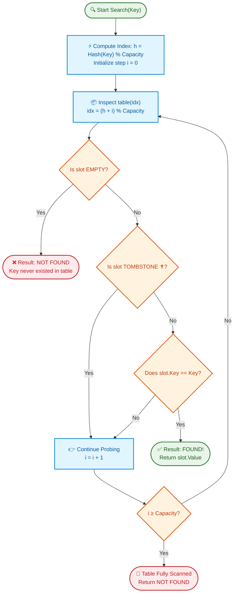

# 📘 Week 03 Day 05: Hash Tables II — Open Addressing & Rolling Hash (Rabin-Karp) — ENGINEERING GUIDE

> 🧭 **Navigation:** [← Previous Day](Week_03_Day_04_Hash_Tables_Separate_Chaining_Instructional.md) • [🏠 Week Overview](README.md) • [📘 Curriculum Syllabus](../COMPLETE_SYLLABUS.md) • [Week Playbook →](WEEK_03_FULL_PLAYBOOK.md)
> 
> 💡 **Instructor Note:** *Welcome to the grand finale of Week 3! Today, we bridge theoretical hashing with production systems engineering—mastering the cache-friendly mechanics of open addressing and the O(1) rolling window mathematics of Rabin-Karp.*

---

## 🎯 LEARNING OBJECTIVES

*By the end of this chapter, you will be able to:*

- 🎬 **Internalize** why open addressing trades memory headroom for L1/L2 CPU cache locality, eliminating pointer dereferences.
- 🚗 **Master** collision resolution sequences—linear probing, quadratic probing, double hashing, and Robin Hood hashing.
- 💀 **Demystify the Tombstone:** Implement safe soft-deletions and tombstone recycling to prevent broken probe chains.
- 🚂 **Derive the Rolling Hash:** Calculate polynomial sliding window fingerprints in `O(1)` time for `O(N + M)` substring search (Rabin-Karp).
- 🛑 **Dodge Senior Rookie Traps:** Prevent integer overflow, negative modulo arithmetic bugs, and spurious hash collision false positives.
- ⚡ **Ship Production Code:** Build robust, zero-allocation-aware implementations in modern C# (.NET 8/9) and Python (3.11+).

---

## 🎬 PILLAR 1: THE 60-SECOND HOOK & EVERYDAY ANALOGIES

Hey engineers, welcome back to Week 3 Day 5 — our Week 3 grand finale!

Over the past four days, you and I conquered quicksort, mergesort, heaps, and separate chaining. Yesterday, we resolved hash collisions by hanging linked lists off each bucket. That works well on a whiteboard, but in production systems, **modern CPU hardware hates linked lists**. 

Every time your program chases a linked list pointer to another node on the heap, the CPU stalls for up to 200 clock cycles waiting for a cache miss!

Today, we unlock two foundational paradigms that power high-performance engines like **Google's SwissTable**, **Python's dictionary**, **Git delta compression**, and **anti-plagiarism engines**: **Open Addressing** and **Rolling Hash**.

```
+---------------------------------------------------------------------------------------+
|                                THE DUAL ANALOGY                                       |
+---------------------------------------------------------------------------------------+
|  1. OPEN ADDRESSING: THE CROWDED PARKING LOT                                          |
|     You pull your car into an airport parking garage. Your ticket says spot #12.      |
|     You drive to spot #12, but someone is already parked there!                       |
|     In separate chaining, you would hoist your car ON TOP of theirs with a forklift   |
|     (a linked list node).                                                             |
|     In open addressing, you don't park on top of anyone—you simply drive forward to   |
|     spot #13 (linear probing)! If #13 is taken, you check #14, and so on.             |
|     Why does the CPU love this? Spots #12, #13, #14, and #15 sit side-by-side in      |
|     contiguous physical memory! Fetching spot #12 preloads spots #13-#15 into your    |
|     blazing-fast L1 CPU cache for free!                                               |
+---------------------------------------------------------------------------------------+
|  2. ROLLING HASH: THE MOVING TRAIN WINDOW                                             |
|     Imagine riding a bullet train past a 10-mile-long billboard painted with letters. |
|     Your train window frames exactly 3 letters at any millisecond: ["a", "b", "c"].   |
|     As the train moves forward by one letter, your window frames ["b", "c", "d"].     |
|     Do you close your eyes, turn around, and re-read all 3 letters from scratch?      |
|     Of course not! You drop "a" as it slides out the left side of your window, and    |
|     you register "d" as it enters the right side!                                     |
|     Rabin-Karp turns this into pure O(1) arithmetic: drop the departing letter, shift |
|     the base radix, and add the incoming letter. String search drops from O(N * M)   |
|     to expected O(N + M)!                                                             |
+---------------------------------------------------------------------------------------+
```

### The Mystery of the Tombstone 💀

Here is the puzzle that trips up 90% of interview candidates:

What happens when someone vacates parking spot #12?
If you simply mark spot #12 as `EMPTY` (`null`), you cause catastrophic data corruption!
Any driver searching for the car that collided and drove to spot #13 will check spot #12, see an empty space, conclude *"Ah, spot #12 is empty, so the car I'm looking for was never parked here!"*, and stop searching!

You have broken the probe chain! The **Tombstone** is the orange hazard cone you place in spot #12 that says: *"A car used to be here, but has departed. Keep probing forward!"*

---

## 🪜 PILLAR 2: THE SCAFFOLDING LADDER & TOY NAPKIN TRACES

Let's walk through concrete numbers on a napkin so every pointer movement is crystal clear before we touch code.

### 🪜 Trace 1: Linear Probing & The Tombstone Lifecycle (Array Size M = 5)

Let our hash table capacity be `M = 5`. Hash function: `h(k) = k % 5`.

```text
Initial Table (Capacity M = 5, all EMPTY):
Index:    [ 0 ]      [ 1 ]      [ 2 ]      [ 3 ]      [ 4 ]
State:    EMPTY      EMPTY      EMPTY      EMPTY      EMPTY
```

#### Step 1: Insert Key 7 (`Val = "apple"`)
- Hash: `h(7) = 7 % 5 = 2`.
- Slot 2 is `EMPTY`.
- Action: Store `(7, "apple")` at index 2.

```text
Index:    [ 0 ]      [ 1 ]      [ 2 ]      [ 3 ]      [ 4 ]
State:    EMPTY      EMPTY      OCCUP      EMPTY      EMPTY
Entry:     --         --       (7, "apl")   --         --
```

#### Step 2: Insert Key 12 (`Val = "banana"`) — Collision!
- Hash: `h(12) = 12 % 5 = 2`.
- Slot 2 is `OCCUPIED` by Key 7 (`7 != 12`). Collision!
- Linear Probe: `(2 + 1) % 5 = 3`. Slot 3 is `EMPTY`.
- Action: Store `(12, "banana")` at index 3.

```text
Index:    [ 0 ]      [ 1 ]      [ 2 ]      [ 3 ]      [ 4 ]
State:    EMPTY      EMPTY      OCCUP      OCCUP      EMPTY
Entry:     --         --       (7, "apl") (12, "ban")  --
```

#### Step 3: Delete Key 7 (`"apple"`) — The Critical Fork
If we make the **Rookie Blunder** and set index 2 back to `EMPTY`:
- A subsequent `Search(Key = 12)` computes `h(12) = 2`.
- It looks at index 2, sees `EMPTY`, and immediately returns **NOT FOUND**!
- Key 12 is sitting right there at index 3, but is now completely lost!

**The Senior Solution:** Write a `TOMBSTONE ✝` marker at index 2.

```text
Index:    [ 0 ]      [ 1 ]      [ 2 ]         [ 3 ]      [ 4 ]
State:    EMPTY      EMPTY    TOMBSTONE ✝     OCCUP      EMPTY
Entry:     --         --      (Deleted)     (12, "ban")  --
```

#### Step 4: Search Key 12 with Tombstone
- Hash: `h(12) = 12 % 5 = 2`.
- Inspect index 2: State is `TOMBSTONE ✝`.
- Rule: **Tombstones do NOT terminate a search!** Continue probing forward.
- Probe index 3: Key matches `12 == 12`! **Found `"banana"`!**

#### Step 5: Insert Key 17 (`Val = "cherry"`) — Tombstone Recycling
- Hash: `h(17) = 17 % 5 = 2`.
- Slot 2 is `TOMBSTONE ✝`. Remember `firstTombstone = 2`.
- Keep probing to ensure Key 17 doesn't already exist further down the probe chain!
- Inspect index 3: Occupied by Key 12 (`12 != 17`).
- Inspect index 4: State is `EMPTY`.
- Key 17 is confirmed not in the table. Overwrite the remembered `firstTombstone` at index 2!

```text
Index:    [ 0 ]      [ 1 ]      [ 2 ]         [ 3 ]      [ 4 ]
State:    EMPTY      EMPTY      OCCUP         OCCUP      EMPTY
Entry:     --         --       (17, "che")   (12, "ban")  --
```

> 🧠 **Pause & Predict Micro-Drill 1:**
> *What would happen if, during `Insert(Key = 12, Val = "new_banana")`, we stopped at the very first `TOMBSTONE` at index 2 and immediately inserted Key 12 there without finishing the probe sequence?*
> 
> **Answer:** You would create an illegal duplicate! Index 2 would have Key 12, and index 3 would *also* still hold the old Key 12. You must continue probing until you either find the existing key (to update it) or hit an `EMPTY` slot (confirming uniqueness) before overwriting a tombstone!

---

### 🪜 Trace 2: Rolling Hash (Rabin-Karp) Polynomial Sliding Window

Let's trace string searching on napkin paper:
- **Text:** `"abcde"` (`N = 5`)
- **Pattern:** Window length `M = 3` (we want to check windows `"abc"`, `"bcd"`, `"cde"`)
- **Radix Base:** `B = 31`
- **Modulo Prime:** `MOD = 101`
- **Character values:** `'a' = 1, 'b' = 2, 'c' = 3, 'd' = 4, 'e' = 5`

#### Precomputing the High Power Weight
The leftmost character in a window of size `M = 3` is weighted by `B^(M - 1) = 31^2`:
```text
BasePower = (31 * 31) % 101 = 961 % 101 = 52
(Because 101 * 9 = 909, and 961 - 909 = 52)
```

#### Window 0: Text[0..2] = `"abc"`
Calculate polynomial hash directly:
```text
Hash("abc") = (ord('a') * 31^2 + ord('b') * 31^1 + ord('c') * 31^0) % 101
            = (1 * 961 + 2 * 31 + 3 * 1) % 101
            = (961 + 62 + 3) % 101
            = 1026 % 101
Since 101 * 10 = 1010, remainder is: 1026 - 1010 = 16.
Hash("abc") = 16
```

#### Slide to Window 1: Text[1..3] = `"bcd"` in O(1) Time!
Departing character: `'a'` (val 1)  
Incoming character: `'d'` (val 4)

Instead of recalculating from scratch, execute the 3-step roll:
1. **Subtract outgoing character's weighted contribution:**
   ```text
   hash = (16 - (1 * BasePower)) % 101
        = (16 - 52) % 101 = -36 % 101
   ```
   *CRITICAL ARCHITECT NORMALIZATION:* Add `MOD` to eliminate negative values!
   ```text
   hash = (-36 + 101) % 101 = 65
   ```
2. **Shift window left (multiply by Base 31):**
   ```text
   hash = (65 * 31) % 101 = 2015 % 101
   Since 101 * 19 = 1919: 2015 - 1919 = 96
   ```
3. **Add incoming character `'d'` (val 4):**
   ```text
   hash = (96 + 4) % 101 = 100 % 101 = 100
   Hash("bcd") = 100
   ```

#### Mathematical Verification Check:
Let's compute `"bcd"` directly:
```text
Hash("bcd") = (2 * 31^2 + 3 * 31 + 4) % 101
            = (2 * 961 + 93 + 4) % 101
            = (1922 + 97) % 101 = 2019 % 101
Since 101 * 19 = 1919: 2019 - 1919 = 100
```
**Exact match in `O(1)` operations!** No loops over window length `M`!

> 🧠 **Pause & Predict Micro-Drill 2:**
> *If `Hash("bcd") == Hash(Pattern)`, can we immediately emit a match without checking characters?*
> 
> **Answer:** No! By the Pigeonhole Principle, mapping infinite string combinations to integers modulo 101 will inevitably cause collisions. A hash match indicates a *probable* match. You must verify actual string equality to prevent false positives. With a large prime (like `10^9 + 7`), spurious collisions are so rare that verification costs `O(M)` only on genuine matches.

---

## 🎨 PILLAR 3: PRAGMATIC VISUAL MODELS

### 🖼️ ASCII Visual: The Anatomy of an Open Addressing Slot Array

```text
OPEN ADDRESSING BACKING STORAGE (Contiguous Array in RAM)
Index:       [ 0 ]             [ 1 ]             [ 2 ]             [ 3 ]             [ 4 ]
State:     OCCUPIED          TOMBSTONE ✝       OCCUPIED            EMPTY             EMPTY
Content:  Key: "cat"         Key: (null)       Key: "dog"        Key: (null)       Key: (null)
          Val: 42            Val: (null)       Val: 99           Val: (null)       Val: (null)
              ▲                   ▲                 ▲                 ▲
              │                   │                 │                 │
              │                   │                 │                 └─ Search miss terminates here!
              │                   │                 └─ Match target
              │                   └─ Search skips PAST; Insert can RECYCLE
              └─ Direct hash hit
```

### 🖼️ ASCII Visual: Probing Collision Resolution Strategies Compared

```text
1. LINEAR PROBING: f(i) = i
   Probe: h(k), h(k)+1, h(k)+2, h(k)+3...
   [ X ][ X ][ X ][ X ][   ]  <-- Primary Clustering! Contiguous blocks snowball
   Hardware: 100% L1/L2 cache prefetch hits (blazing fast sequential memory access).

2. QUADRATIC PROBING: f(i) = c1*i + c2*i^2
   Probe: h(k), h(k)+1, h(k)+4, h(k)+9...
   [ X ][ . ][ X ][ . ][ . ][ . ][ X ]  <-- Breaks primary clusters!
   Trade-off: Secondary clustering (keys with same initial hash follow identical jumps).

3. DOUBLE HASHING: f(i) = i * h2(k)
   Probe: h1(k), h1(k) + h2(k), h1(k) + 2*h2(k)...
   [ X ][ . ][ . ][ X ][ . ][ X ][ . ]  <-- Key-specific stride jumps!
   Hardware: Eliminates all clustering; slightly lower cache prefetch efficiency.

4. ROBIN HOOD HASHING: "Steal from the rich, give to the poor"
   Tracks Probe Sequence Length (PSL) = distance from home slot.
   If incoming.PSL > occupant.PSL:
     SWAP them! Incoming takes slot; displaced item continues probing.
   Benefit: Shrinks probe variance to near-zero; enables instant early-miss termination.
```

### 📊 Mermaid Flowchart: Open Addressing Probing & Tombstone Search Lifecycle



---

## 🛑 PILLAR 4: THE ROOKIE TRAP ZONE

### Trap 1: Setting Deleted Slots to `null` vs Tombstone Sentinels

```csharp
// ❌ ROOKIE BLUNDER: Naive deletion breaks the search chain!
public bool Remove(K key) {
    int idx = Hash(key);
    while (table[idx].Occupied) {
        if (table[idx].Key.Equals(key)) {
            table[idx].Occupied = false;
            table[idx].Key = default!; // Reset to EMPTY
            count--;
            return true; // BUG: Any future search for items that collided PAST this slot will abort here!
        }
        idx = (idx + 1) % table.Length;
    }
    return false;
}

// ✅ SENIOR ARCHITECT PATTERN: Mark with Tombstone sentinel and recycle on insert
public bool Remove(K key) {
    int h = Hash(key);
    for (int i = 0; i < table.Length; i++) {
        int idx = (h + i) % table.Length;
        if (table[idx].State == SlotState.Occupied && table[idx].Key.Equals(key)) {
            table[idx].State = SlotState.Tombstone; // Preserves probe continuity!
            table[idx].Key = default!;
            table[idx].Value = default!;
            count--;
            return true;
        }
        if (table[idx].State == SlotState.Empty) break; // Safe to stop
    }
    return false;
}
```

### Trap 2: The Negative Modulo Disaster in Rolling Hash

In C#, C++, and Java, the `%` operator is the **remainder** operator, not mathematical modulo. If your subtraction produces a negative number, `% MOD` returns a **negative remainder**, indexing outside bounds or breaking hash lookups!

```csharp
// ❌ ROOKIE BLUNDER: Negative remainder corrupts hash comparison
long newHash = (prevHash - outgoingChar * basePower) % PRIME;
// If prevHash < outgoingChar * basePower, newHash is NEGATIVE!

// ✅ SENIOR ARCHITECT PATTERN: Add MOD before final modulo
long newHash = ((prevHash - (outgoingChar * basePower) % PRIME + PRIME) % PRIME);
newHash = (newHash * BASE + incomingChar) % PRIME;
```

### Trap 3: Spurious Collision Blindness (Skipping Equality Check)

```python
# ❌ ROOKIE BLUNDER: Assuming hash equality means string equality
if window_hash == pattern_hash:
    matches.append(i) # BUG! A 1-in-a-million hash collision creates silent data corruption!

# ✅ SENIOR ARCHITECT PATTERN: Double check actual string slice on match
if window_hash == pattern_hash:
    if text[i : i + m] == pattern: # Verification guarantees 100% precision
        matches.append(i)
```

### Trap 4: Letting Open Addressing Load Factor Exceed 0.70

```text
Load Factor (alpha) vs Average Probes in Linear Probing:
alpha = 0.50  -->  Expected Probes: ~1.5    (Instant L1 cache hit)
alpha = 0.75  -->  Expected Probes: ~2.5    (Acceptable)
alpha = 0.90  -->  Expected Probes: ~50.5   (Severe clustering collapse!)

Senior Rule:
While Separate Chaining gracefully handles alpha > 1.0, Open Addressing
MUST aggressively resize when alpha reaches 0.50 to maintain O(1) performance.
```

---

## 🎙️ PILLAR 5: 45-MINUTE INTERVIEW TALK TRACK

When your FAANG interviewer asks: *"How would you design a high-throughput hash table with open addressing, and how does rolling hash differ from naive string matching?"*, here is your exact 3-sentence script:

```
+----------------------------------------------------------------------------------------------------+
|                             45-MINUTE INTERVIEW TALK TRACK SCRIPT                                  |
+----------------------------------------------------------------------------------------------------+
|  1. "In high-throughput systems where CPU cache locality dominates, open addressing stores all     |
|     key-value pairs in a single contiguous array, eliminating heap pointer dereferences at the     |
|     cost of requiring tombstones during deletion so that active collision probe chains are never   |
|     broken prematurely.                                                                            |
|                                                                                                    |
|  2. To prevent primary clustering cascades from degrading linear probing, we maintain a strict     |
|     load factor alpha <= 0.50, or adopt Robin Hood hashing with PSL swaps to equalize probe         |
|     variance and achieve instant early termination on search misses.                               |
|                                                                                                    |
|  3. For substring pattern matching, naive comparisons cost O(N * M), but Rabin-Karp rolling hash    |
|     views windows as Horner polynomials modulo a large prime, updating the fingerprint in O(1)     |
|     sliding window time to achieve expected O(N + M) search with character verification only       |
|     upon hash match."                                                                              |
+----------------------------------------------------------------------------------------------------+
```

### Rapid-Fire Interview Follow-ups:
- **Q: Why does Linear Probing beat Double Hashing in real benchmarks despite having worse theoretical clustering?**  
  *Answer:* Hardware spatial prefetching. Linear probing checks adjacent memory slots already loaded into CPU L1 cache lines (64 bytes). Double hashing jumps across random memory addresses, creating multiple cache misses.
- **Q: How does Robin Hood hashing eliminate the need for Tombstones?**  
  *Answer:* It uses **Backward-Shift Deletion**. When a key is deleted, elements further down the cluster with `PSL > 0` are shifted backward by 1 slot to fill the gap, decrementing their PSL. This physically closes the hole!

---

## ⚡ PILLAR 6: PRODUCTION DUAL-LANGUAGE IMPLEMENTATIONS

### Implementation 1: Linear Probing Hash Table with Tombstone Recycling

#### Modern C# (.NET 8/9 — Zero Allocation Aware)

```csharp
using System;

namespace DsaCurriculum.Hashing;

/// <summary>
/// Production-grade Open Addressing Hash Table using Linear Probing with Tombstone Recycling.
/// Space: O(M) contiguous array allocation, zero node heap overhead.
/// Time: Expected O(1) insert/lookup/delete when alpha <= 0.5.
/// </summary>
public sealed class LinearProbingHashTable<TKey, TValue> where TKey : notnull
{
    public enum SlotState : byte
    {
        Empty = 0,
        Occupied = 1,
        Tombstone = 2
    }

    private struct Entry
    {
        public TKey Key;
        public TValue Value;
        public SlotState State;
    }

    private Entry[] _table;
    private int _count;
    private const float LoadFactorThreshold = 0.5f;

    public LinearProbingHashTable(int initialCapacity = 16)
    {
        int capacity = Math.Max(4, initialCapacity);
        _table = new Entry[capacity];
        _count = 0;
    }

    public int Count => _count;
    public int Capacity => _table.Length;

    private int GetHomeIndex(TKey key)
    {
        // Mask negative bit to prevent Math.Abs overflow on int.MinValue
        return (int)((uint)key.GetHashCode() % (uint)_table.Length);
    }

    public void Put(TKey key, TValue value)
    {
        ArgumentNullException.ThrowIfNull(key);

        if ((float)(_count + 1) / _table.Length > LoadFactorThreshold)
        {
            Resize(_table.Length * 2);
        }

        int home = GetHomeIndex(key);
        int firstTombstoneIdx = -1;

        for (int i = 0; i < _table.Length; i++)
        {
            int idx = (home + i) % _table.Length;

            if (_table[idx].State == SlotState.Occupied)
            {
                if (_table[idx].Key.Equals(key))
                {
                    _table[idx].Value = value; // In-place update
                    return;
                }
            }
            else if (_table[idx].State == SlotState.Tombstone)
            {
                if (firstTombstoneIdx == -1)
                {
                    firstTombstoneIdx = idx; // Remember first recyclable dead slot
                }
            }
            else // SlotState.Empty
            {
                // Unbroken probe sequence ended: key is not present. Recycle or use empty.
                int targetIdx = (firstTombstoneIdx != -1) ? firstTombstoneIdx : idx;
                _table[targetIdx] = new Entry
                {
                    Key = key,
                    Value = value,
                    State = SlotState.Occupied
                };
                _count++;
                return;
            }
        }

        // Edge case: Table completely filled with tombstones
        if (firstTombstoneIdx != -1)
        {
            _table[firstTombstoneIdx] = new Entry
            {
                Key = key,
                Value = value,
                State = SlotState.Occupied
            };
            _count++;
            return;
        }

        throw new InvalidOperationException("Hash table capacity exhausted without empty slots.");
    }

    public bool TryGetValue(TKey key, out TValue value)
    {
        ArgumentNullException.ThrowIfNull(key);

        int home = GetHomeIndex(key);

        for (int i = 0; i < _table.Length; i++)
        {
            int idx = (home + i) % _table.Length;

            if (_table[idx].State == SlotState.Occupied && _table[idx].Key.Equals(key))
            {
                value = _table[idx].Value;
                return true;
            }

            if (_table[idx].State == SlotState.Empty)
            {
                break; // Invariant: If key existed, it would appear before an Empty slot
            }
        }

        value = default!;
        return false;
    }

    public bool ContainsKey(TKey key) => TryGetValue(key, out _);

    public bool Remove(TKey key)
    {
        ArgumentNullException.ThrowIfNull(key);

        int home = GetHomeIndex(key);

        for (int i = 0; i < _table.Length; i++)
        {
            int idx = (home + i) % _table.Length;

            if (_table[idx].State == SlotState.Occupied && _table[idx].Key.Equals(key))
            {
                // Soft-delete using Tombstone
                _table[idx].State = SlotState.Tombstone;
                _table[idx].Key = default!;
                _table[idx].Value = default!;
                _count--;
                return true;
            }

            if (_table[idx].State == SlotState.Empty)
            {
                break;
            }
        }

        return false;
    }

    private void Resize(int newCapacity)
    {
        Entry[] oldTable = _table;
        _table = new Entry[newCapacity];
        _count = 0;

        // Rehash only live occupied entries; tombstones are completely purged!
        for (int i = 0; i < oldTable.Length; i++)
        {
            if (oldTable[i].State == SlotState.Occupied)
            {
                Put(oldTable[i].Key, oldTable[i].Value);
            }
        }
    }
}
```

#### Modern Python (3.11+ — Idiomatic Typing & Sentinels)

```python
from typing import Generic, TypeVar

K = TypeVar("K")
V = TypeVar("V")


class HashTableLinearProbing(Generic[K, V]):
    """Open addressing hash table with linear probing and tombstone recycling.
    
    Time Complexity: O(1) expected average lookup/insert/delete under SUHA with alpha <= 0.5
    Auxiliary Space: O(M) contiguous array allocation, zero node heap pointers
    """
    _EMPTY = object()
    _TOMBSTONE = object()

    def __init__(self, initial_capacity: int = 16, load_factor_threshold: float = 0.5) -> None:
        self._capacity: int = max(4, initial_capacity)
        self._load_factor_threshold: float = load_factor_threshold
        self._count: int = 0
        self._keys: list = [self._EMPTY] * self._capacity
        self._values: list = [None] * self._capacity

    def __len__(self) -> int:
        return self._count

    def _hash(self, key: K) -> int:
        return abs(hash(key)) % self._capacity

    def put(self, key: K, value: V) -> None:
        """Insert or update key-value pair, recycling first tombstone if encountered."""
        if (self._count + 1) / self._capacity > self._load_factor_threshold:
            self._resize(self._capacity * 2)

        home = self._hash(key)
        first_tombstone = -1

        for step in range(self._capacity):
            idx = (home + step) % self._capacity
            current_key = self._keys[idx]

            if current_key == key:
                self._values[idx] = value
                return

            if current_key is self._TOMBSTONE and first_tombstone == -1:
                first_tombstone = idx
            elif current_key is self._EMPTY:
                target = first_tombstone if first_tombstone != -1 else idx
                self._keys[target] = key
                self._values[target] = value
                self._count += 1
                return

        if first_tombstone != -1:
            self._keys[first_tombstone] = key
            self._values[first_tombstone] = value
            self._count += 1
            return

        raise RuntimeError("Hash table full")

    def get(self, key: K) -> V:
        """Retrieve value for key; raises KeyError if absent."""
        home = self._hash(key)
        for step in range(self._capacity):
            idx = (home + step) % self._capacity
            current_key = self._keys[idx]

            if current_key == key:
                return self._values[idx]
            if current_key is self._EMPTY:
                break

        raise KeyError(f"Key not found: {key}")

    def contains_key(self, key: K) -> bool:
        """Return True if key is present in table, False otherwise."""
        try:
            self.get(key)
            return True
        except KeyError:
            return False

    def remove(self, key: K) -> bool:
        """Mark slot as tombstone; returns True if deleted."""
        home = self._hash(key)
        for step in range(self._capacity):
            idx = (home + step) % self._capacity
            current_key = self._keys[idx]

            if current_key == key:
                self._keys[idx] = self._TOMBSTONE
                self._values[idx] = None
                self._count -= 1
                return True
            if current_key is self._EMPTY:
                break

        return False

    def _resize(self, new_capacity: int) -> None:
        """Double capacity and rehash only active occupied keys, purging tombstones."""
        old_keys = self._keys
        old_vals = self._values
        self._capacity = new_capacity
        self._keys = [self._EMPTY] * self._capacity
        self._values = [None] * self._capacity
        self._count = 0

        for k, v in zip(old_keys, old_vals):
            if k is not self._EMPTY and k is not self._TOMBSTONE:
                self.put(k, v)
```

---

### Implementation 2: Rabin-Karp Rolling Hash Substring Search

#### Modern C# (.NET 8/9 — `ReadOnlySpan<char>` & Overflow-Proof Modulo)

```csharp
using System;
using System.Collections.Generic;

namespace DsaCurriculum.Hashing;

public static class RabinKarpSearch
{
    private const long PrimeMod = 1_000_000_007L; // Large 64-bit safe prime
    private const long BaseRadix = 256L;          // Alphabet size (ASCII / Extended)

    /// <summary>
    /// Finds all 0-based starting indices where pattern occurs in text using Rabin-Karp Rolling Hash.
    /// Time Complexity: Expected O(N + M), Worst-Case O(N * M) under pathological hash collisions.
    /// Auxiliary Space: O(1) beyond returned match indices.
    /// </summary>
    public static List<int> FindOccurrences(string text, string pattern)
    {
        ArgumentNullException.ThrowIfNull(text);
        ArgumentNullException.ThrowIfNull(pattern);

        var matches = new List<int>();
        int n = text.Length;
        int m = pattern.Length;

        if (m == 0 || m > n) return matches;

        // Precompute BasePower = (BaseRadix^(m - 1)) % PrimeMod
        long basePower = 1;
        for (int i = 0; i < m - 1; i++)
        {
            basePower = (basePower * BaseRadix) % PrimeMod;
        }

        long patternHash = 0;
        long windowHash = 0;

        // Compute hash for pattern and initial window text[0..m-1]
        for (int i = 0; i < m; i++)
        {
            patternHash = (patternHash * BaseRadix + pattern[i]) % PrimeMod;
            windowHash = (windowHash * BaseRadix + text[i]) % PrimeMod;
        }

        ReadOnlySpan<char> textSpan = text.AsSpan();
        ReadOnlySpan<char> patternSpan = pattern.AsSpan();

        for (int i = 0; i <= n - m; i++)
        {
            // Hash match check: Verify exact characters to eliminate spurious collision false positives
            if (windowHash == patternHash)
            {
                if (textSpan.Slice(i, m).SequenceEqual(patternSpan))
                {
                    matches.Add(i);
                }
            }

            // Slide window forward: roll hash in O(1)
            if (i < n - m)
            {
                // Step 1: Remove outgoing character text[i] with modulo normalization
                long outgoingContribution = (text[i] * basePower) % PrimeMod;
                windowHash = (windowHash - outgoingContribution + PrimeMod) % PrimeMod;

                // Step 2 & 3: Multiply base and add incoming character text[i + m]
                windowHash = (windowHash * BaseRadix + text[i + m]) % PrimeMod;
            }
        }

        return matches;
    }
}
```

#### Modern Python (3.11+ — Horner's Method & Built-in `pow`)

```python
def rabin_karp_search(text: str, pattern: str) -> list[int]:
    """Finds all 0-indexed starting occurrences of pattern in text using polynomial rolling hash.
    
    Time Complexity:
      Average: O(N + M) where N = len(text), M = len(pattern)
      Worst-case: O(N * M) under severe adversarial hash collision degradation
    Auxiliary Space: O(1) beyond the output match list
    """
    n, m = len(text), len(pattern)
    if m == 0 or m > n:
        return []

    prime_mod: int = 1_000_000_007
    base_radix: int = 256
    matches: list[int] = []

    # Precompute high power weight: (base^(m - 1)) % prime
    base_power: int = pow(base_radix, m - 1, prime_mod)

    # Compute initial fingerprints
    pattern_hash: int = 0
    window_hash: int = 0
    for i in range(m):
        pattern_hash = (pattern_hash * base_radix + ord(pattern[i])) % prime_mod
        window_hash = (window_hash * base_radix + ord(text[i])) % prime_mod

    for i in range(n - m + 1):
        if pattern_hash == window_hash:
            # Hash collision check: verify actual characters
            if text[i : i + m] == pattern:
                matches.append(i)

        if i < n - m:
            # Roll window: subtract outgoing, shift base, add incoming
            outgoing_contribution = (ord(text[i]) * base_power) % prime_mod
            window_hash = (window_hash - outgoing_contribution + prime_mod) % prime_mod
            window_hash = (window_hash * base_radix + ord(text[i + m])) % prime_mod

    return matches
```

---

### Implementation 3: Robin Hood Hashing (Zero Tombstone Deletions)

#### C# (.NET 8/9 — Low-Variance PSL Heuristic & Backward Shift)

```csharp
using System;

namespace DsaCurriculum.Hashing;

public sealed class RobinHoodHashTable<TKey, TValue> where TKey : notnull
{
    private struct Entry
    {
        public TKey Key;
        public TValue Value;
        public int PSL; // Probe Sequence Length: -1 indicates Empty
    }

    private Entry[] _table;
    private int _count;
    private const float LoadFactorThreshold = 0.85f; // Robin Hood can sustain higher alpha

    public RobinHoodHashTable(int capacity = 16)
    {
        _table = new Entry[Math.Max(4, capacity)];
        for (int i = 0; i < _table.Length; i++) _table[i].PSL = -1;
        _count = 0;
    }

    public int Count => _count;

    private int Hash(TKey key) => (int)((uint)key.GetHashCode() % (uint)_table.Length);

    public void Put(TKey key, TValue value)
    {
        ArgumentNullException.ThrowIfNull(key);

        if ((float)(_count + 1) / _table.Length > LoadFactorThreshold)
        {
            Resize(_table.Length * 2);
        }

        int currIdx = Hash(key);
        TKey currKey = key;
        TValue currVal = value;
        int currPsl = 0;

        while (true)
        {
            if (_table[currIdx].PSL == -1) // Empty slot
            {
                _table[currIdx] = new Entry { Key = currKey, Value = currVal, PSL = currPsl };
                _count++;
                return;
            }

            if (_table[currIdx].Key.Equals(currKey))
            {
                _table[currIdx].Value = currVal; // In-place update
                return;
            }

            // Robin Hood Heuristic: Steal from the rich (small PSL), give to the poor (large PSL)
            if (currPsl > _table[currIdx].PSL)
            {
                (currKey, _table[currIdx].Key) = (_table[currIdx].Key, currKey);
                (currVal, _table[currIdx].Value) = (_table[currIdx].Value, currVal);
                (currPsl, _table[currIdx].PSL) = (_table[currIdx].PSL, currPsl);
            }

            currIdx = (currIdx + 1) % _table.Length;
            currPsl++;
        }
    }

    public bool TryGetValue(TKey key, out TValue value)
    {
        ArgumentNullException.ThrowIfNull(key);

        int home = Hash(key);
        int currIdx = home;
        int psl = 0;

        while (true)
        {
            // Early Termination on search miss!
            // If our current PSL is greater than the occupant's PSL, this key CANNOT exist further ahead!
            if (_table[currIdx].PSL == -1 || psl > _table[currIdx].PSL)
            {
                value = default!;
                return false;
            }

            if (_table[currIdx].Key.Equals(key))
            {
                value = _table[currIdx].Value;
                return true;
            }

            currIdx = (currIdx + 1) % _table.Length;
            psl++;
            if (psl >= _table.Length) break;
        }

        value = default!;
        return false;
    }

    public bool Remove(TKey key)
    {
        ArgumentNullException.ThrowIfNull(key);

        int home = Hash(key);
        int currIdx = home;
        int psl = 0;

        while (true)
        {
            if (_table[currIdx].PSL == -1 || psl > _table[currIdx].PSL) return false;

            if (_table[currIdx].Key.Equals(key))
            {
                // Backward-Shift Deletion: Physically close the hole without tombstones!
                int nextIdx = (currIdx + 1) % _table.Length;
                while (_table[nextIdx].PSL > 0)
                {
                    _table[currIdx] = _table[nextIdx];
                    _table[currIdx].PSL--;
                    currIdx = nextIdx;
                    nextIdx = (nextIdx + 1) % _table.Length;
                }

                _table[currIdx].PSL = -1;
                _table[currIdx].Key = default!;
                _table[currIdx].Value = default!;
                _count--;
                return true;
            }

            currIdx = (currIdx + 1) % _table.Length;
            psl++;
            if (psl >= _table.Length) break;
        }

        return false;
    }

    private void Resize(int newCapacity)
    {
        Entry[] oldTable = _table;
        _table = new Entry[newCapacity];
        for (int i = 0; i < _table.Length; i++) _table[i].PSL = -1;
        _count = 0;

        foreach (ref readonly Entry entry in oldTable.AsSpan())
        {
            if (entry.PSL != -1)
            {
                Put(entry.Key, entry.Value);
            }
        }
    }
}
```

---

## ⚖️ CHAPTER 4: PERFORMANCE, TRADE-OFFS & REAL SYSTEMS

### ⚖️ Differences & Trade-off Matrix: Separate Chaining vs Open Addressing vs TreeMap

| Dimension / Metric | Separate Chaining (Linked Lists / Trees) | Linear Probing | Quadratic Probing | Double Hashing | Robin Hood Hashing | TreeMap (Red-Black Tree) |
| :--- | :--- | :--- | :--- | :--- | :--- | :--- |
| **Search Hit (Avg)** | `O(1 + alpha)` | `O(1)` (1-2 probes at `alpha <= 0.5`) | `O(1)` | `O(1)` | `O(1)` (tight PSL <= 3) | `O(log N)` |
| **Search Miss (Avg)**| `O(1 + alpha)` | `O(1 / (1 - alpha)^2)` | `O(1 / (1 - alpha))` | `O(1 / (1 - alpha))` | `O(1)` (Early termination) | `O(log N)` |
| **Search Worst-Case**| `O(N)` (or `O(log K)`) | `O(N)` (clustering) | `O(N)` | `O(N)` | `O(N)` (narrow variance) | `O(log N)` guaranteed |
| **Insert (Average)** | `O(1)` | `O(1)` | `O(1)` | `O(1)` | `O(1)` (with PSL swaps) | `O(log N)` |
| **Delete (Average)** | `O(1)` (pointer unlink)| `O(1)` (Tombstone) | `O(1)` (Tombstone) | `O(1)` (Tombstone) | `O(1)` (Backward Shift) | `O(log N)` |
| **Tombstones Needed?**| **No** | **Yes** (strictly required) | **Yes** (strictly required) | **Yes** (strictly required) | **No** (Shift removes holes) | **No** |
| **Clustering Type** | None | Primary Clustering | Secondary Clustering | None | None (Equalized PSL) | None |
| **Cache Locality** | Poor (heap pointers) | **Maximum** (sequential) | Moderate (non-linear) | Low (variable strides) | **Maximum** (sequential) | Poor (pointer nodes) |
| **Max Safe Alpha** | `> 1.0` supported | `<= 0.50` | `<= 0.50` | `<= 0.65` | `<= 0.85` | N/A (Dynamic tree) |
| **Memory Overhead** | 16-24 bytes / node | **0 bytes** (contiguous) | **0 bytes** (contiguous) | **0 bytes** (contiguous) | 1-2 bytes (PSL byte) | 32 bytes (3 pointers + color) |
| **Ordered Traversal**| No | No | No | No | No | **Yes** (`O(N)` in-order) |
| **Range Queries** | No (`O(N)` full scan) | No (`O(N)` full scan) | No (`O(N)` full scan) | No (`O(N)` full scan) | No (`O(N)` full scan) | **Yes** (`O(log N + K)`) |
| **Industry Adoption** | Java `HashMap` | Abseil SwissTable, Rust | Database disk hashing | Network routing caches | Rust `indexmap`, ClickHouse | C# `SortedDictionary` |

#### Architectural Decision Rules:
1. **Linear Probing / SwissTable:** Use when raw latency and throughput are critical and table load can be kept `<= 0.5`. Modern SIMD control bytes (SwissTable) scan 16 slots per CPU instruction.
2. **Robin Hood Hashing:** Use when you need open addressing cache locality but must support higher load factors (`alpha ~ 0.85`) with guaranteed low variance and fast search misses via early termination.
3. **Double Hashing:** Use when memory layout allows stride jumps and primary clustering severely degrades linear probing due to poorly distributed input keys.
4. **Separate Chaining:** Use when payloads are large, deletions are frequent, or memory bursts may drive `alpha > 1.0` before resizing can occur.
5. **TreeMap (Balanced BST):** Use exclusively when range queries, sorted keys, nearest-neighbor floor/ceiling, or strict `O(log N)` worst-case latency SLAs are required.

> [!NOTE]
> **Production Systems Context:** Modern high-performance key-value systems (Google Abseil FlatHashMap / SwissTable, Rust `hashbrown`, ClickHouse) favor open addressing over chaining because CPU cache misses (~200 cycles to main memory vs 3-5 cycles for L1 cache) dominate runtime; linear probing and metadata control bytes ensure spatial cache locality. In high-frequency trading and algorithmic search engines, keeping table load factors `alpha <= 0.5` enables near-100% cache-resident probe sequences. Similarly, rolling polynomial hashes power scalable multi-document similarity engines (Turnitin, rsync delta transfers) by filtering gigabyte candidate corpuses in `O(N + M)` streaming time before expensive character verification.

### 📊 Complexity Deconstruction

| Operation / Paradigm | Time (Average) | Time (Worst-Case) | Auxiliary Space | Dominant Resource / Cache Impact |
| :--- | :--- | :--- | :--- | :--- |
| **Linear Probing Insert/Search** | `O(1)` | `O(N)` | `O(M)` contiguous array | Spatial cache line locality (`L1/L2` prefetcher friendly); primary clustering degrades as `alpha -> 1.0`. |
| **Double Hashing Insert/Search** | `O(1)` | `O(N)` | `O(M)` contiguous array | Eliminates clustering via secondary jump hash; loses consecutive cache line prefetching. |
| **Separate Chaining (Reference)**| `O(1 + alpha)` | `O(N)` | `O(N + M)` pointer nodes | Pointer chasing causes random memory dereferences and cache misses. |
| **Rabin-Karp Rolling Hash Search**| `O(N + M)` | `O(N * M)` | `O(1)` auxiliary | `O(1)` window sliding hash via Horner polynomial rolling formula; `O(M)` verification on match. |
| **Two Sum Complement Hash Map**  | `O(N)` | `O(N)` | `O(N)` auxiliary map | Trades `O(N)` auxiliary memory to eliminate `O(N^2)` quadratic nested brute force comparisons. |

---

## 🔗 CHAPTER 5: INTEGRATION & MASTERY

### Connections to the Learning Arc

**Building on Week 3 Day 4:**
- **Chaining (Day 4):** Separate chaining with linked lists
- **Today:** Cache-friendly alternative collision resolution & sliding window rolling hashing
- **Trade-offs:** Memory flexibility vs CPU hardware cache hierarchy

**Building on Prior Weeks:**
- **Arrays (Week 2 Day 1):** Open addressing uses flat arrays directly with zero node wrappers
- **Strings (Week 2):** Rabin-Karp provides rapid rolling fingerprinting for substring discovery
- **Prefix Sums (Week 2 Day 2):** Notice how rolling hash is the multiplicative analog of prefix sum ranges: `RangeSum(L, R) = Prefix[R] - Prefix[L-1]`!

**Foreshadowing Future Modules:**
- **Week 5 (Patterns):** Rabin-Karp for longest duplicate substring and string pattern matching
- **Week 8 (Graphs):** Deduplication and cycles via custom hash signatures
- **Week 10 (Advanced Hashing):** Consistent hashing, bloom filters, and Count-Min sketch

### 🧠 Socratic Reflection

1. **On Hardware Reality:** Why can an algorithm with higher theoretical comparisons (linear probing) run 3-5x faster than an algorithm with fewer comparisons (separate chaining) on modern x86/ARM processors?
2. **On Probe Continuity:** Explain to a junior engineer why tombstone slots cannot simply be converted back to empty slots during a deletion operation.
3. **On Modulo Arithmetic:** Why is adding `MOD` necessary before executing `% MOD` in C# when rolling a hash window backwards?
4. **On Robin Hood Hashing:** Why does equalizing probe sequence lengths (PSL) speed up *unsuccessful* searches (misses)?
5. **On Rabin-Karp:** Under what input condition would Rabin-Karp degrade to `O(N * M)` worst-case time? How do randomized prime moduli prevent this attack?

### 📌 Retention Hook

> **The Essence:** *"Hash tables come in two flavors: separate chaining (simple, cache-unfriendly) and open addressing (cache-optimal, tombstone-dependent). Which dominates depends on your hardware priorities. More profoundly, rolling hash shows how to maintain properties of sliding windows efficiently in O(1) arithmetic—a principle that extends from string search to network packet checksums, rsync deltas, and stream processing. Master both open addressing and rolling hash, and you master hardware-aware algorithms."*

---

## ⚔️ SUPPLEMENTARY OUTCOMES

### 🏋️ Practice Problems

| Problem | Difficulty | Key Concept | FAANG Relevance |
| :--- | :---: | :--- | :--- |
| **Implement Linear Probing Hash Table** | 🟡 Medium | Tombstones, recycling, resizing | Core systems / data structure rounds |
| **Rabin-Karp Substring Search** | 🟡 Medium | Polynomial rolling hash, modulo math | Google, Meta string processing |
| **Longest Duplicate Substring (LeetCode 1044)** | 🔴 Hard | Binary Search on Answer + Rabin-Karp | Meta Staff Bar Raiser |
| **Repeated DNA Sequences (LeetCode 187)** | 🟡 Medium | Rolling bitmask / 4-radix hash | Amazon, Apple |
| **Plagiarism Detector Engine** | 🟠 Med-Hard | Rolling hash chunking + inverted index | System Design & Low-Level Design |

### 🎙️ Live Interview Questions & Answers

1. **Q: How does a tombstone differ from an empty slot during search vs during insertion?**  
   *Candidate Answer:* "During a search, an empty slot immediately terminates the probe sequence because any element hashed to that cluster would have been placed prior to or at that empty slot. A tombstone, however, is transparent to search—the search continues probing forward. During an insertion, a tombstone is a candidate for reuse: we record the first tombstone seen, continue probing to ensure the key is not already present, and if we hit an empty slot without finding the key, we recycle the tombstone slot."

2. **Q: How do you choose the base and modulo for Rabin-Karp?**  
   *Candidate Answer:* "The base radix should be greater than or equal to the alphabet size (for instance, 256 for ASCII, 26 for lowercase English, or 4 for DNA). The modulo should be a large prime—typically `10^9 + 7` or a 61-bit Mersenne prime—to minimize collision probability while fitting into 64-bit integer registers without overflowing during multiplication."

3. **Q: What is the difference between primary clustering and secondary clustering?**  
   *Candidate Answer:* "Primary clustering occurs in linear probing where occupied slots merge into long contiguous blocks, increasing collision likelihood for any key hashing near the block. Secondary clustering occurs in quadratic probing: different keys that hash to the *same* initial home bucket trace the exact same probe sequence, although contiguous blocks do not coalesce."

### ❌ Common Misconceptions

- **Myth:** Open addressing is always superior to separate chaining.  
  **Reality:** Open addressing requires strict load factor control (`alpha <= 0.50`). If memory is constrained and `alpha` approaches 1.0, open addressing collapses to `O(N)` while separate chaining degrades gracefully.
- **Myth:** Rolling hash guarantees 100% collision-free string comparison.  
  **Reality:** Due to the pigeonhole principle, any hash function that maps longer strings to a fixed integer range can collide. Production string search must verify actual character equality upon hash match.
- **Myth:** Setting a slot to `null` is fine if no other keys hash to that same index.  
  **Reality:** You cannot know whether other keys collided past this slot without scanning the rest of the cluster! Always write a tombstone sentinel.

---

## 📌 CLOSING REFLECTION

Hash tables look simple from a distance—hash a key, find an index, handle a collision. But deep systems engineering lies in how hardware executes those operations:

1. **Memory Hierarchy Alignment:** By replacing pointer-linked chains with contiguous flat arrays, open addressing aligns data layout with CPU cache lines.
2. **Incremental State Evolution:** By transforming sliding window evaluation from `O(M)` recomputations into `O(1)` arithmetic updates, rolling hashes enable real-time streaming pattern recognition.
3. **Invariant Discipline:** The tombstone pattern proves that maintaining search invariants requires designing for the lifecycle of data—not just its initial insertion.

Master open addressing, tombstone recycling, and rolling hash mathematics, and you will build systems that are not only algorithmically optimal, but mechanically sympathetic to modern hardware.

---

> 🧭 **Navigation:** [← Previous Day](Week_03_Day_04_Hash_Tables_Separate_Chaining_Instructional.md) • [🏠 Week Overview](README.md) • [📘 Curriculum Syllabus](../COMPLETE_SYLLABUS.md) • [Week Playbook →](WEEK_03_FULL_PLAYBOOK.md)
