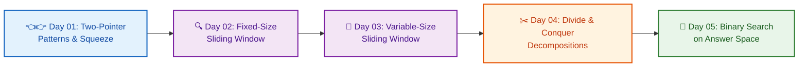

# 📘 Week 04: Tier-1 Core Problem-Solving Patterns I

> 🧭 **Navigation:** [← Previous: Week 03](../week_03_foundations_iii_sorting_and_hashing/README.md) • [🏠 Curriculum Overview](../README.md) • [📘 Complete Syllabus](../COMPLETE_SYLLABUS.md) • [Next: Week 05 →](../week_05_tier_1_critical_patterns/README.md)

---

> 💡 **Instructor Guidance Note:**  
> *Welcome to Week 04! This is the most famous week in FAANG algorithmic interview preparation. The patterns taught here—Two Pointers, Fixed Sliding Window, Variable Sliding Window, Divide & Conquer, and Binary Search on Answer Space—appear in more than 60% of all coding interview questions at Meta, Google, Amazon, and Apple. Master the invariants that convert O(N^2) brute force into clean O(N) linear scans.*

---

## 🎯 Weekly Mission & Conceptual Focus

Master opposing and same-direction two-pointer sweeps, running fixed-window sums and max-deques, dynamic expanding/shrinking variable windows, divide-and-conquer recurrences, and monotonic answer-space binary search.

---

## 📅 The 5-Day YouTube-Style Masterclass Path

| Day / Episode | Masterclass Module | The 60-Second Hook & Core Concept | Key Interview Takeaway |
| :--- | :--- | :--- | :--- |
| **Day 01** | [📘 Two-Pointer Patterns](Week_04_Day_01_Two_Pointer_Patterns_Instructional.md) | 👈👉 *The Caliper Squeeze & Explorer Pointers:* Squeezing sorted arrays from both ends (Two Sum II, Container With Most Water) and fast/slow runners (Deduplication, Cycle Detection). | Justify why sorted order allows safely discarding elements in O(1) extra space. |
| **Day 02** | [📘 Fixed-Size Sliding Window](Week_04_Day_02_Sliding_Window_Fixed_Size_Instructional.md) | 🔍 *The Moving Picture Frame:* Maintaining a fixed-size window of K elements by adding the right element and subtracting the left element in O(1) time. | Prevent O(N * K) re-summing traps and implement rolling hash/deque optimization. |
| **Day 03** | [📘 Variable-Size Sliding Window](Week_04_Day_03_Sliding_Window_Variable_Size_Instructional.md) | 📏 *The Caterpillar Crawl:* Expanding right pointer to satisfy conditions, contracting left pointer to restore validity (Longest Substring Without Repeating, Minimum Window Substring). | Master the "Expand Right, Shrink Left" loop template and frequency hash maps. |
| **Day 04** | [📘 Divide & Conquer Pattern](Week_04_Day_04_Divide_and_Conquer_Pattern_Instructional.md) | ✂️ *The Split, Solve, Combine Engine:* Breaking large problems into independent subproblems, recursion trees, and Master Theorem intuition. | Formulate clean recurrences and defend O(N log N) divide-and-conquer algorithms. |
| **Day 05** | [📘 Binary Search as Pattern](Week_04_Day_05_Binary_Search_as_Pattern_Instructional.md) | 🎯 *The Feasibility Thermostat:* Searching for the optimal answer across a monotonic predicate (Koko Eating Bananas, Capacity to Ship Packages). | Translate optimization questions into `CanAchieve(mid)` decision functions. |

---

## 📚 Consolidated Playbooks & Reference Guides

*   📖 **Comprehensive Week Playbook:** [WEEK_04_FULL_PLAYBOOK.md](WEEK_04_FULL_PLAYBOOK.md) — High-density synthesis of all invariants, theorems, and pattern triggers for this week.
*   📊 **Visual Concepts Playbook (Hybrid):** [Week_04_Visual_Concepts_Playbook_HYBRID.md](Week_04_Visual_Concepts_Playbook_HYBRID.md) — Compact Mermaid diagrams, state transitions, and complexity reference tables.
*   💻 **Production C# Reference (.NET 8/9):** [Week_04_Extended_CSharp_Complete.md](Week_04_Extended_CSharp_Complete.md) — Idiomatic, zero-allocation memory-aware implementations and problem ladders.
*   🐍 **Production Python Reference (Python 3.11+):** [Week_04_Extended_Python_Complete.md](Week_04_Extended_Python_Complete.md) — Clean, pythonic reference implementations for rapid whiteboard prototyping.

---

## 🛠️ The 5 Core Support Files (`support files/`)

Every week is accompanied by five dedicated support files located in the `support files/` subdirectory:

1.  📋 [Daily Progress Checklist](support%20files/Week_04_Daily_Progress_Checklist.md) — Step-by-step accountability tracker for theory, coding, and variants.
2.  🧭 [Weekly Guidelines & Mental Models](support%20files/Week_04_Guidelines.md) — Strategic roadmap, common pitfalls, and conceptual anchors.
3.  🎙️ [Interview Q&A Comprehensive Reference](support%20files/Week_04_Interview_QA_Reference.md) — High-frequency senior technical questions with verbal response frameworks.
4.  🗺️ [Problem-Solving Roadmap](support%20files/Week_04_Problem_Solving_Roadmap.md) — Tier-1 problem progression ladder from warm-up to advanced.
5.  📑 [Summary & Key Concepts Synthesis](support%20files/Week_04_Summary_Key_Concepts.md) — Fast-revision cheat sheet covering all governing invariants and system trade-offs.

---

> 🧭 **Navigation:** [← Previous: Week 03](../week_03_foundations_iii_sorting_and_hashing/README.md) • [🏠 Curriculum Overview](../README.md) • [📘 Complete Syllabus](../COMPLETE_SYLLABUS.md) • [Next: Week 05 →](../week_05_tier_1_critical_patterns/README.md)
