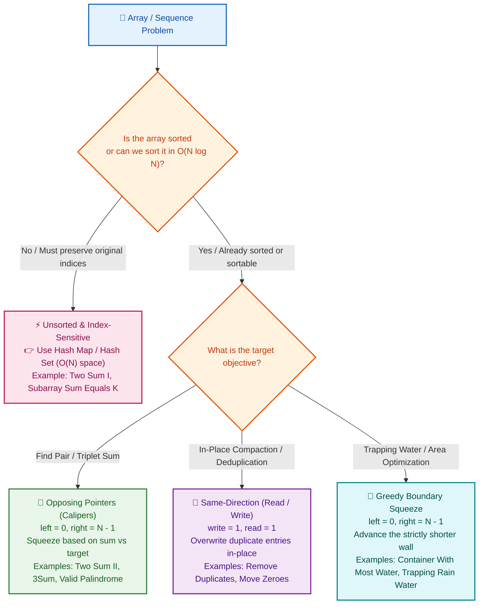

# 📘 Week 04 Day 01: Two-Pointer Patterns — Elegance Through Synchronized Movement

> 🧭 **Navigation:** [← Week Overview](README.md) • [🏠 Week Overview](README.md) • [📘 Curriculum Syllabus](../COMPLETE_SYLLABUS.md) • [Next Day →](Week_04_Day_02_Sliding_Window_Fixed_Size_Instructional.md)
> 
> 💡 **Instructor Note:** *Not all sections or topics are mandatory. Feel free to adapt your pace and skim or skip sections based on your current focus and interview timeline.*

---

## 🎯 LEARNING OBJECTIVES

*By the end of this module, you will be able to:*

- 🎬 **Internalize** why sorted order provides monotonic guarantees that allow safely discarding search candidates in `O(1)` time per step.
- ⚙️ **Implement** opposing calipers (`left` / `right`) and same-direction (`read` / `write`) two-pointer patterns with zero memorization.
- 🎨 **Architect** zero-allocation `Span<T>` routines in C# (.NET 8/9) and clean, idiomatic Python (3.11+) that pass strict FAANG production bar tests.
- 🛑 **Spot and Defuse** the three classic interview traps: unsorted pointer traps, self-pairing index boundary errors, and duplicate handling in multi-pointer expansions (3Sum/4Sum).
- 🎙️ **Articulate** a polished 3-sentence verbal walk track in live 45-minute technical screens before touching the keyboard.

---

## 🎬 PILLAR 1: THE 60-SECOND HOOK & REAL-WORLD METAPHORS

Hey engineers, welcome back to Week 4 Day 1! 

Today, we unlock one of the highest-ROI, most universally tested algorithmic patterns in top-tier software engineering interviews: **The Two-Pointer Pattern**.

When you first hear "two pointers," it sounds deceptive. *Isn't it just two integer variables tracking array indices?* 
Yes, syntactically. But algorithmically, it represents something profound: **turning an exponential or quadratic combinatorial search space into a linear `O(N)` conveyor belt by exploiting order.**

Let's anchor this with two everyday physical metaphors you will never forget.

```
================================================================================
          METAPHOR 1: THE GROCERY STORE CHECKOUT ($20 GIFT CARD)
================================================================================

Imagine you are standing in a boutique grocery store with a $20 gift card.
The store policy says: "Pick exactly two distinct items whose prices sum to $20."
Crucially, all items on the store shelves are arranged in strict sorted order:

  [$2 Gum]  [$4 Milk]  [$7 Bread]  [$11 Cheese]  [$15 Olive Oil]  [$19 Steak]
   Index 0    Index 1    Index 2     Index 3        Index 4         Index 5

You place your left hand on the cheapest item ($2 Gum) and your right hand on
the most expensive item ($19 Steak).

Sum = $2 + $19 = $21.

Total is $1 too high! Now ask yourself:
Can the $19 Steak pair with ANY other item on the shelf and sum to $20?
- If you pair $19 with $4 Milk  -> $23 (Even higher!)
- If you pair $19 with $7 Bread -> $26 (Way too high!)

Because the shelf is SORTED, the $2 Gum is the absolute cheapest item in the store.
If the $19 Steak cannot make $20 with the cheapest item, it can NEVER make $20
with anyone. You safely put the $19 Steak back on the shelf and discard it forever.

You move your right hand inward to $15 Olive Oil.
New Sum = $2 + $15 = $17.
Now the sum is too small! Can the $2 Gum pair with anything left to reach $20?
The most expensive item remaining is $15 ($17 total). The $2 Gum is hopeless!
You discard the $2 Gum forever and slide your left hand rightward to $4 Milk.

Total = $4 + $15 = $19 (too small) -> Left moves to $7 Bread.
Total = $7 + $15 = $22 (too large) -> Right moves to $11 Cheese.
Total = $7 + $11 = $18 (too small) -> Left moves to $11 (Crossed / Not found).

Notice what just happened: In exactly 5 moves, you evaluated all possible pairs
without ever checking all 15 combinations!
================================================================================
```

### Metaphor 2: The Caliper Squeeze & The Conductor's Batons

- **The Caliper Squeeze (Opposing Pointers):** Think of a precision metal machinist caliper measuring the diameter of a steel cylinder. The jaws start wide open at the extreme left and right boundaries and smoothly squeeze inward toward the center. At each step, physical constraints dictate which jaw slides inward.
- **The Conductor's Two Batons (Same-Direction Pointers):** Imagine an orchestra conductor with two hands moving left to right across the score. Hand 1 (the `read` explorer) scans forward looking for the next melodic theme; Hand 2 (the `write` anchor) sets down the rhythm section. They never cross, but work in synchronized harmony.

### The Core Invariant: Why Discarding Candidates Works

Why can we discard an entire element with 100% mathematical certainty?

In an unsorted array, numbers are randomly scattered. If a pair `(nums[i], nums[j])` fails, you learn nothing about `nums[j]` paired with any other number. You are doomed to an `O(N^2)` brute-force search.

In a sorted array where `nums[0] <= nums[1] <= ... <= nums[N - 1]`:
1. If `nums[L] + nums[R] > target`:
   For every index `k > L`, `nums[k] >= nums[L]`. Therefore, `nums[k] + nums[R] >= nums[L] + nums[R] > target`. 
   `nums[R]` is mathematically guaranteed to overshoot the target with every single candidate to the right of `L`. **We can discard `R` permanently (`R--`).**
2. If `nums[L] + nums[R] < target`:
   For every index `k < R`, `nums[k] <= nums[R]`. Therefore, `nums[L] + nums[k] <= nums[L] + nums[R] < target`.
   `nums[L]` is mathematically guaranteed to undershoot the target with every single candidate to the left of `R`. **We can discard `L` permanently (`L++`).**

This invariant guarantees that **no valid pair is ever missed**, reducing the search space from `O(N^2)` pairs to at most `N` pointer movements.

---

## 🎨 PILLAR 2: PRAGMATIC VISUAL MODELS

### Opposing Pointers vs. Same-Direction Pointers

```
================================================================================
                   PATTERN A: OPPOSING POINTERS (CONVERGING)
================================================================================
Used for: Pair sums (Two Sum II, 3Sum), Palindromes, Caliper Area (Container With Most Water)

Indices:   0       1       2       3       4       5       6       7
Values:  [ 2   |   7   |  11   |  15   |  18   |  22   |  27   |  35  ]
           ▲                                                       ▲
           │                                                       │
         Left ────────────────►                         ◄──────── Right
         Starts at index 0                               Starts at index N - 1
         Advances rightward (L++)                        Advances leftward (R--)
         Pointers converge inward until they meet: while (Left < Right)

================================================================================
                 PATTERN B: SAME-DIRECTION POINTERS (READ / WRITE)
================================================================================
Used for: In-place deduplication, Array compaction (Remove Element, Move Zeroes)

Indices:   0       1       2       3       4       5       6       7
Values:  [ 1   |   1   |   2   |   2   |   3   |   4   |   4   |   5  ]
           ▲       ▲
           │       │
         Write   Read ───────────────────────────────────────────►
         Anchor  Explorer scans ahead
         Tracks valid prefix: nums[0 ... Write - 1]
         Both pointers advance left-to-right at varying speeds: Read >= Write
================================================================================
```

### Two-Pointer Strategy Decision Flow

Use this decision tree whenever an interviewer gives you an array or sequence problem:



---

## 🪜 PILLAR 3: THE SCAFFOLDING LADDER & TOY NAPKIN TRACES

### 🪜 Step 1: Toy Napkin Trace — Two Sum II (Opposing Calipers)

Let's trace `numbers = [2, 7, 11, 15]` with `target = 9`.

```
Initial State:
  Index:     0      1      2      3
  Array:   [ 2  ,   7  ,  11  ,  15  ]
             ▲                    ▲
             │                    │
            L=0                  R=3

Step 1:
  Calculate Sum: numbers[0] + numbers[3] = 2 + 15 = 17
  Compare: 17 > 9 (Sum is too large!)
  Action: Discard rightmost element (15). Decrement R: R = 2.

  Index:     0      1      2      3
  Array:   [ 2  ,   7  ,  11  ,  15  ]
             ▲             ▲
             │             │
            L=0           R=2

Step 2:
  Calculate Sum: numbers[0] + numbers[2] = 2 + 11 = 13
  Compare: 13 > 9 (Still too large!)
  Action: Discard 11. Decrement R: R = 1.

  Index:     0      1      2      3
  Array:   [ 2  ,   7  ,  11  ,  15  ]
             ▲      ▲
             │      │
            L=0    R=1

Step 3:
  Calculate Sum: numbers[0] + numbers[1] = 2 + 7 = 9
  Compare: 9 == 9 (MATCH FOUND!)
  Action: Return 1-based indices: [0 + 1, 1 + 1] => [1, 2].
```

#### State Trace Table
| Step | `L` Index | `R` Index | `nums[L]` | `nums[R]` | `Current Sum` | `Target` | Decision / Invariant Action |
| :---: | :---: | :---: | :---: | :---: | :---: | :---: | :--- |
| **0** | `0` | `3` | `2` | `15` | `17` | `9` | `17 > 9` -> Discard `15`, `R--` |
| **1** | `0` | `2` | `2` | `11` | `13` | `9` | `13 > 9` -> Discard `11`, `R--` |
| **2** | `0` | `1` | `2` | `7` | `9` | `9` | `9 == 9` -> **Match Found! Return `[1, 2]`** |

---

### 🪜 Step 2: Toy Napkin Trace — Remove Duplicates In-Place (Same-Direction)

Let's trace `nums = [1, 1, 2, 2, 3]`. Objective: Compact unique elements in-place with `O(1)` memory.

```
Initial State:
  Index:      0     1     2     3     4
  Array:   [  1  ,  1  ,  2  ,  2  ,  3  ]
              ▲     ▲
              │     │
           write=1 read=1
  Invariant: nums[0 ... write - 1] contains unique elements seen so far.
             nums[write - 1] = 1.

Step 1 (read = 1):
  Compare: nums[read] (1) vs nums[write - 1] (1) -> EQUAL (Duplicate detected!)
  Action: Ignore duplicate. Advance read to 2.
  Array:   [ 1, 1, 2, 2, 3 ]
             ▲     ▲
             W=1   R=2

Step 2 (read = 2):
  Compare: nums[read] (2) vs nums[write - 1] (1) -> DIFFERENT!
  Action: Copy nums[read] into nums[write]. Advance both W and R.
  Write Operation: nums[1] = 2
  Array:   [ 1, 2, 2, 2, 3 ]
                ▲     ▲
                W=2   R=3

Step 3 (read = 3):
  Compare: nums[read] (2) vs nums[write - 1] (2) -> EQUAL (Duplicate detected!)
  Action: Ignore. Advance read to 4.
  Array:   [ 1, 2, 2, 2, 3 ]
                ▲        ▲
                W=2      R=4

Step 4 (read = 4):
  Compare: nums[read] (3) vs nums[write - 1] (2) -> DIFFERENT!
  Action: Copy nums[read] into nums[write]. Advance both W and R.
  Write Operation: nums[2] = 3
  Array:   [ 1, 2, 3, 2, 3 ]
                   ▲        ▲
                   W=3      R=5 (Out of bounds -> Loop terminates)

Final State:
  Valid Unique Prefix: nums[0 ... 2] = [1, 2, 3]
  Return count k = write = 3.
```

#### State Trace Table
| `read` | `nums[read]` | `nums[write - 1]` | Match? | Action | Array Buffer State | `write` |
| :---: | :---: | :---: | :---: | :--- | :--- | :---: |
| `1` | `1` | `1` | Yes | Skip duplicate | `[1, 1, 2, 2, 3]` | `1` |
| `2` | `2` | `1` | No | `nums[write] = nums[read]`, `write++` | `[1, 2, 2, 2, 3]` | `2` |
| `3` | `2` | `2` | Yes | Skip duplicate | `[1, 2, 2, 2, 3]` | `2` |
| `4` | `3` | `2` | No | `nums[write] = nums[read]`, `write++` | `[1, 2, 3, 2, 3]` | `3` |

---

### 🧠 Pause & Predict: The 3Sum Duplicate Dilemma

> [!IMPORTANT]
> **Active Recall Drill:**
> Suppose you are implementing **3Sum** (`nums[i] + nums[L] + nums[R] == 0`) on the sorted array:
> `nums = [-2, 0, 0, 2, 2]`.
> 
> You fix `i = 0` (`nums[i] = -2`). Your pointers start at `L = 1` (`0`) and `R = 4` (`2`).
> The sum is `-2 + 0 + 2 = 0` — you record triplet `[-2, 0, 2]`.
> 
> **Question:** What happens if you simply execute `L++; R--;` without skipping duplicates? What duplicate triplet will your algorithm generate next? How must you advance `L` and `R` to guarantee unique triplets?
> 
> *Take 30 seconds to think before reading the reveal below!*

<details>
<summary>🔍 Click to Reveal the Architectural Solution</summary>

**The Disaster:**
If you merely execute `L++; R--;`, `L` moves to index 2 (`nums[2] = 0`) and `R` moves to index 3 (`nums[3] = 2`).
The new sum is `-2 + 0 + 2 = 0`.
Your code records `[-2, 0, 2]` a second time, failing the LeetCode 15 uniqueness constraint!

**The Senior Architect Fix:**
Whenever a matching triplet is recorded, you must actively burn through contiguous duplicates for both `L` and `R`:
```csharp
// Record the match
result.Add(new List<int> { nums[i], nums[left], nums[right] });

// Skip duplicate values on the left
int leftVal = nums[left];
while (left < right && nums[left] == leftVal)
{
    left++;
}

// Skip duplicate values on the right
int rightVal = nums[right];
while (left < right && nums[right] == rightVal)
{
    right--;
}
```
Furthermore, the outer loop must skip duplicate fixed elements:
`if (i > 0 && nums[i] == nums[i - 1]) continue;`
This ensures strict triplet uniqueness in `O(1)` auxiliary space without needing an expensive `HashSet<Tuple>`.
</details>

---

## 🛑 PILLAR 4: THE ROOKIE TRAP ZONE

### Trap 1: Attempting Two Pointers on an Unsorted Array

```
❌ ROOKIE BLUNDER
--------------------------------------------------------------------------------
int[] nums = { 3, 1, 4, 2 }; // UNSORTED! Target = 5
int left = 0, right = nums.Length - 1;
while (left < right)
{
    int sum = nums[left] + nums[right]; // 3 + 2 = 5 (Found!)
    // But what if target was 5 and nums was { 3, 5, 2, 1 }?
    // Left=3, Right=1 -> Sum=4 < 5 -> left++ -> Left=5, Right=1 -> Sum=6 > 5 -> right--
    // Misses 3 + 2 = 5 completely!
}
// Why it fails: Two-pointer discarding relies strictly on monotonicity.
// Without sorted order, incrementing left might increase OR decrease the value!
```

```csharp
// ✅ SENIOR ARCHITECT PATTERN
// Rule: If the problem allows sorting and requires O(1) space: SORT FIRST.
// If the problem requires O(N) time and original indices: USE A HASH MAP.
public int[] TwoSum(int[] nums, int target)
{
    // When indices cannot be rearranged, Hash Map is mandatory:
    var seen = new Dictionary<int, int>();
    for (int i = 0; i < nums.Length; i++)
    {
        int complement = target - nums[i];
        if (seen.TryGetValue(complement, out int complementIndex))
        {
            return new int[] { complementIndex, i };
        }
        seen[nums[i]] = i;
    }
    return Array.Empty<int>();
}
```

---

### Trap 2: Loop Condition Blunder — `left <= right` vs `left < right`

```
❌ ROOKIE BLUNDER
--------------------------------------------------------------------------------
// Finding two distinct numbers that sum to target
while (left <= right) // ⚠️ DANGER: allows left == right
{
    int sum = nums[left] + nums[right];
    if (sum == target) return new int[] { left, right }; // BUG!
}
// Consider nums = [1, 3, 4], target = 6
// Iteration 1: L=0 (1), R=2 (4) -> sum = 5 < 6 -> left++
// Iteration 2: L=1 (3), R=2 (4) -> sum = 7 > 6 -> right--
// Iteration 3: L=1 (3), R=1 (3) -> sum = 3 + 3 = 6 == target!
// Returns indices [1, 1]! You paired index 1 with ITSELF!
```

```csharp
// ✅ SENIOR ARCHITECT PATTERN
// Pair-sum contracts require TWO DISTINCT elements:
while (left < right) // Guarantees left != right at all times
{
    int sum = nums[left] + nums[right];
    if (sum == target)
    {
        return new int[] { left + 1, right + 1 };
    }
    if (sum < target) left++;
    else right--;
}
```

---

### Trap 3: Forgetting Duplicate Skips in 3Sum (Exploding Combinatorics)

```
❌ ROOKIE BLUNDER
--------------------------------------------------------------------------------
for (int i = 0; i < nums.Length - 2; i++)
{
    // Forgetting: if (i > 0 && nums[i] == nums[i - 1]) continue;
    int left = i + 1, right = nums.Length - 1;
    while (left < right)
    {
        int sum = nums[i] + nums[left] + nums[right];
        if (sum == 0)
        {
            result.Add(new List<int> { nums[i], nums[left], nums[right] });
            left++;  // ⚠️ Only incrementing by 1 step!
            right--; // ⚠️ Generates identical duplicate triplets!
        }
        else if (sum < 0) left++;
        else right--;
    }
}
```

```csharp
// ✅ SENIOR ARCHITECT PATTERN
// 1. Skip duplicate anchors at the outer loop:
if (i > 0 && nums[i] == nums[i - 1]) continue;

// 2. Skip duplicate candidates after finding a valid triplet:
int leftVal = nums[left];
while (left < right && nums[left] == leftVal) left++;

int rightVal = nums[right];
while (left < right && nums[right] == rightVal) right--;
```

---

## 🎙️ PILLAR 5: 45-MINUTE INTERVIEW VERBAL TALK TRACK

Deliver this exact 3-sentence script to your FAANG interviewer before typing a single line of code. It immediately flags you as a Senior/Lead engineer:

> *"Since the array is sorted in non-decreasing order, we can replace the naive `O(N^2)` pairwise search with an opposing two-pointer caliper strategy spanning index `0` to index `N - 1`.*
> 
> *At each step, if the sum exceeds the target, decrementing the right pointer safely discards that maximum element because no remaining element can pair with it without overshooting; conversely, if the sum is deficient, incrementing the left pointer safely discards the minimum element.*
> 
> *Because each iteration monotonically reduces the distance between pointers by at least 1, the algorithm strictly terminates in `O(N)` time with `O(1)` auxiliary space and zero heap allocations."*

---

## ⚡ PILLAR 6: PRODUCTION DUAL-LANGUAGE IMPLEMENTATIONS

### Problem 1: Two Sum II — Input Array Is Sorted (LeetCode 167)

#### C# Primary Implementation (.NET 8/9 — Zero Allocation `ReadOnlySpan<int>`)

```csharp
using System;

public static class TwoPointerSolvers
{
    /// <summary>
    /// Finds two 1-indexed positions whose values sum to target in a sorted array.
    /// Time Complexity: O(N) | Auxiliary Space: O(1)
    /// </summary>
    public static int[] TwoSumSorted(ReadOnlySpan<int> numbers, int target)
    {
        // Guard Clause: Minimum array contract
        if (numbers.Length < 2)
        {
            return Array.Empty<int>();
        }

        int left = 0;
        int right = numbers.Length - 1;

        while (left < right)
        {
            // Note: In extreme domains, cast to long to prevent 32-bit integer overflow:
            long currentSum = (long)numbers[left] + numbers[right];

            if (currentSum == target)
            {
                // LeetCode 167 contract requires 1-based indexing
                return new int[] { left + 1, right + 1 };
            }

            if (currentSum < target)
            {
                left++; // Sum is too small: discard left element
            }
            else
            {
                right--; // Sum is too large: discard right element
            }
        }

        return Array.Empty<int>();
    }
}
```

#### Python Secondary Implementation (3.11+ — Idiomatic & Typed)

```python
def two_sum_sorted(numbers: list[int], target: int) -> list[int]:
    """Finds two 1-indexed positions whose values sum to target in a sorted list.
    
    Time Complexity: O(N) | Auxiliary Space: O(1)
    """
    if len(numbers) < 2:
        return []

    left: int = 0
    right: int = len(numbers) - 1

    while left < right:
        current_sum: int = numbers[left] + numbers[right]
        if current_sum == target:
            return [left + 1, right + 1]
        elif current_sum < target:
            left += 1
        else:
            right -= 1

    return []
```

#### 📊 Explicit Complexity Deconstruction
- **Time Complexity:** `O(N)` — Every iteration advances `left` or decrements `right`. The maximum number of steps is `N - 1`.
- **Auxiliary Space:** `O(1)` — Only two stack-allocated pointer variables (`left`, `right`). Zero dynamic memory allocation.
- **Output Space:** `O(1)` — Returns a fixed 2-element integer array.

---

### Problem 2: Remove Duplicates from Sorted Array (LeetCode 26)

#### C# Primary Implementation (.NET 8/9 — In-Place Memory Mutation via `Span<int>`)

```csharp
using System;

public static class DuplicateRemover
{
    /// <summary>
    /// Removes duplicates in-place from a sorted array and returns unique count k.
    /// Time Complexity: O(N) | Auxiliary Space: O(1)
    /// </summary>
    public static int RemoveDuplicates(Span<int> numbers)
    {
        // Guard Clause: Arrays of size 0 or 1 are already deduplicated
        if (numbers.Length <= 1)
        {
            return numbers.Length;
        }

        // 'write' anchors the boundary of unique elements; index 0 is always unique
        int write = 1;

        // 'read' explores subsequent elements
        for (int read = 1; read < numbers.Length; read++)
        {
            if (numbers[read] != numbers[write - 1])
            {
                numbers[write] = numbers[read];
                write++;
            }
        }

        return write; // First 'write' elements contain unique elements
    }
}
```

#### Python Secondary Implementation (3.11+ — Idiomatic In-Place Compaction)

```python
def remove_duplicates(numbers: list[int]) -> int:
    """Removes duplicates in-place from a sorted list and returns count of unique elements.
    
    Time Complexity: O(N) | Auxiliary Space: O(1)
    """
    if len(numbers) <= 1:
        return len(numbers)

    write: int = 1
    for read in range(1, len(numbers)):
        if numbers[read] != numbers[write - 1]:
            numbers[write] = numbers[read]
            write += 1

    return write
```

#### 📊 Explicit Complexity Deconstruction
- **Time Complexity:** `O(N)` — The `read` explorer touches each index from `1` to `N - 1` exactly once.
- **Auxiliary Space:** `O(1)` — Mutations happen directly inside the caller's array buffer.
- **Output Space:** `O(1)` — Returns a single integer scalar `k`.

---

### Problem 3: 3Sum (LeetCode 15 — Classic FAANG Medium)

#### C# Primary Implementation (.NET 8/9 — Sort + Two-Pointer Calipers + Duplicate Suppression)

```csharp
using System;
using System.Collections.Generic;

public static class ThreeSumSolver
{
    /// <summary>
    /// Finds all unique triplets [nums[i], nums[j], nums[k]] summing to 0.
    /// Time Complexity: O(N^2) | Auxiliary Space: O(1) auxiliary (excluding sort stack)
    /// </summary>
    public static IList<IList<int>> ThreeSum(int[] nums)
    {
        if (nums == null || nums.Length < 3)
        {
            return Array.Empty<IList<int>>();
        }

        // Sort array in-place: O(N log N)
        Array.Sort(nums);
        var result = new List<IList<int>>();

        for (int i = 0; i < nums.Length - 2; i++)
        {
            // Early Exit Optimization: Smallest remaining element is > 0, sum can never be 0
            if (nums[i] > 0) break;

            // Skip duplicate anchor elements
            if (i > 0 && nums[i] == nums[i - 1]) continue;

            int left = i + 1;
            int right = nums.Length - 1;

            while (left < right)
            {
                // Prevent 32-bit integer overflow
                long sum = (long)nums[i] + nums[left] + nums[right];

                if (sum == 0)
                {
                    result.Add(new List<int> { nums[i], nums[left], nums[right] });

                    // Skip duplicate values on the left
                    int leftVal = nums[left];
                    while (left < right && nums[left] == leftVal)
                    {
                        left++;
                    }

                    // Skip duplicate values on the right
                    int rightVal = nums[right];
                    while (left < right && nums[right] == rightVal)
                    {
                        right--;
                    }
                }
                else if (sum < 0)
                {
                    left++; // Need a larger sum
                }
                else
                {
                    right--; // Need a smaller sum
                }
            }
        }

        return result;
    }
}
```

#### Python Secondary Implementation (3.11+ — Clean & Idiomatic)

```python
def three_sum(nums: list[int]) -> list[list[int]]:
    """Finds all unique triplets in nums that sum to 0.
    
    Time Complexity: O(N^2) | Auxiliary Space: O(1) auxiliary (ignoring Python sort memory)
    """
    if len(nums) < 3:
        return []

    nums.sort()
    result: list[list[int]] = []

    for i in range(len(nums) - 2):
        # Optimization: If the anchor is positive, no triplet can sum to 0
        if nums[i] > 0:
            break

        # Skip duplicate anchors
        if i > 0 and nums[i] == nums[i - 1]:
            continue

        left, right = i + 1, len(nums) - 1

        while left < right:
            current_sum: int = nums[i] + nums[left] + nums[right]

            if current_sum == 0:
                result.append([nums[i], nums[left], nums[right]])

                # Skip duplicate left values
                left_val = nums[left]
                while left < right and nums[left] == left_val:
                    left += 1

                # Skip duplicate right values
                right_val = nums[right]
                while left < right and nums[right] == right_val:
                    right -= 1

            elif current_sum < 0:
                left += 1
            else:
                right -= 1

    return result
```

#### 📊 Explicit Complexity Deconstruction
- **Time Complexity:** `O(N^2)` — Sorting takes `O(N log N)`. The outer loop runs `N - 2` times, and each inner two-pointer pass runs in `O(N)`. `O(N log N) + O(N^2) = O(N^2)`.
- **Auxiliary Space:** `O(1)` auxiliary space in C# (in-place Dual-Pivot Quicksort stack uses `O(log N)`). No auxiliary hash sets are allocated for deduplication.
- **Output Space:** `O(K)` where `K` is the number of valid unique triplets returned (at most `O(N^2)` in the worst case).

---

### Problem 4: Container With Most Water (LeetCode 11)

#### C# Primary Implementation (.NET 8/9 — Invariant-First Greedy Squeeze)

```csharp
using System;

public static class ContainerSolvers
{
    /// <summary>
    /// Calculates the maximum water area that can be trapped between two vertical lines.
    /// Time Complexity: O(N) | Auxiliary Space: O(1)
    /// </summary>
    public static int MaxArea(ReadOnlySpan<int> height)
    {
        if (height.Length < 2) return 0;

        int left = 0;
        int right = height.Length - 1;
        int maxWater = 0;

        while (left < right)
        {
            int hLeft = height[left];
            int hRight = height[right];
            int currentWidth = right - left;
            int currentArea = Math.Min(hLeft, hRight) * currentWidth;

            if (currentArea > maxWater)
            {
                maxWater = currentArea;
            }

            // Invariant: The shorter line is the bottleneck.
            // Moving the taller line inward will only decrease width while height is still capped.
            // Therefore, we MUST advance the shorter line to seek a taller wall.
            if (hLeft < hRight)
            {
                left++;
            }
            else
            {
                right--;
            }
        }

        return maxWater;
    }
}
```

#### Python Secondary Implementation (3.11+ — Clean & Idiomatic)

```python
def max_area(height: list[int]) -> int:
    """Calculates max water area between vertical lines using opposing calipers.
    
    Time Complexity: O(N) | Auxiliary Space: O(1)
    """
    left: int = 0
    right: int = len(height) - 1
    max_water: int = 0

    while left < right:
        width: int = right - left
        current_water: int = min(height[left], height[right]) * width
        if current_water > max_water:
            max_water = current_water

        if height[left] < height[right]:
            left += 1
        else:
            right -= 1

    return max_water
```

#### 📊 Explicit Complexity Deconstruction
- **Time Complexity:** `O(N)` — In every step, either `left` increments or `right` decrements. Exactly `N - 1` iterations.
- **Auxiliary Space:** `O(1)` — Only scalar integers stored on the stack frame.
- **Output Space:** `O(1)` — Returns a single integer maximum area.

---

## ⚖️ SENIOR FAANG ARCHITECT PERSPECTIVE & PRODUCTION REALITY

> [!NOTE]
> **Why FAANG Engine Architects Test This Pattern:**
> In relational database engines (like PostgreSQL, MySQL InnoDB, and CockroachDB), joins between two tables are executed using either **Hash Joins** or **Merge Joins**.
> 
> - A **Hash Join** must buffer the entire build table into a memory hash table, incurring `O(M)` heap allocations and CPU cache misses.
> - A **Merge Join** takes two pre-sorted index streams and executes an opposing/same-direction two-pointer scan. It runs in `O(N + M)` time, requires **`O(1)` auxiliary RAM**, and streams sequentially through CPU L1/L2 cache lines with hardware prefetching.
> 
> When you write zero-allocation two-pointer code, you are writing the same foundational pattern that powers low-latency database engines, streaming network deduplicators, and real-time audio mixers.

### 🎯 Pattern Recognition Cheat Sheet

| Trigger Signal in Interview Prompt | Recommended Pattern | Initial Pointer Setup | Pointer Advance Rule |
| :--- | :--- | :--- | :--- |
| "Array is sorted" + "Find pair summing to K" | Opposing Calipers | `left = 0`, `right = N - 1` | `sum < target -> L++` else `R--` |
| "Find unique triplets summing to 0" | 3Sum (Sort + Calipers) | Outer `i`, `left = i + 1`, `right = N - 1` | Skip duplicates on match: `L++`, `R--` |
| "Remove elements in-place" / "Compacting" | Same-Direction (Read/Write) | `write = 1`, `read = 1` | `nums[read] != nums[write-1] -> copy & write++` |
| "Trapping rain water / max rectangular area" | Greedy Boundary Squeeze | `left = 0`, `right = N - 1` | Advance pointer pointing to strictly shorter height |
| "Check if string is a palindrome ignoring non-alphanumeric" | Opposing Filtering Calipers | `left = 0`, `right = N - 1` | Skip invalid chars, compare, `L++`, `R--` |

### 🧪 Concrete Edge-Case Checklist

1. **Null or Empty Input (`nums == null || nums.Length == 0`):** Always place guard clauses first to return immediately.
2. **Fewer Than Required Elements (`N < 2` for pairs, `N < 3` for triplets):** Return empty array / 0 before accessing pointers.
3. **All Elements Identical (`[1, 1, 1, 1, 1]`):** Ensure `write` does not write out of bounds and duplicates are properly skipped.
4. **All Negative Numbers (`[-10, -7, -4, -1]`):** Ensure pair sum logic does not assume values are positive.
5. **Integer Overflow on Addition:** In languages like C# and Java, adding `nums[left] + nums[right]` can overflow 32-bit signed integer (`int.MaxValue + int.MaxValue = negative number`). Always cast to 64-bit `long` before summing!

---

## 🏋️ HIGH-ROI FAANG PRACTICE LADDER

Master these problems in sequence. They reinforce the exact invariants covered today:

| # | Problem | Difficulty | Key Invariant / Mechanism |
| :---: | :--- | :---: | :--- |
| **1** | [LeetCode 167: Two Sum II - Input Array Is Sorted](https://leetcode.com/problems/two-sum-ii-input-array-is-sorted/) | 🟢 Easy | Opposing calipers on monotonic sequence |
| **2** | [LeetCode 26: Remove Duplicates from Sorted Array](https://leetcode.com/problems/remove-duplicates-from-sorted-array/) | 🟢 Easy | Same-direction read/write memory compaction |
| **3** | [LeetCode 125: Valid Palindrome](https://leetcode.com/problems/valid-palindrome/) | 🟢 Easy | Opposing calipers with character skip predicates |
| **4** | [LeetCode 88: Merge Sorted Array](https://leetcode.com/problems/merge-sorted-array/) | 🟢 Easy | Reverse three-pointer merge from end to start |
| **5** | [LeetCode 11: Container With Most Water](https://leetcode.com/problems/container-with-most-water/) | 🟡 Medium | Greedy boundary squeeze discarding shorter wall |
| **6** | [LeetCode 15: 3Sum](https://leetcode.com/problems/3sum/) | 🟡 Medium | Sorting + fixed anchor + caliper scan + duplicate skip |
| **7** | [LeetCode 16: 3Sum Closest](https://leetcode.com/problems/3sum-closest/) | 🟡 Medium | Caliper tracking minimum absolute distance |
| **8** | [LeetCode 42: Trapping Rain Water](https://leetcode.com/problems/trapping-rain-water/) | 🔴 Hard | Opposing calipers tracking running `leftMax` and `rightMax` |

---

## 🎙️ 6 FAANG BAR-RAISER DRILL QUESTIONS

1. **Q:** *"Why does the Two Sum II opposing pointer strategy fail on an unsorted array?"*
   - **Answer:** The strategy relies on monotonicity: `nums[L] <= nums[L+1]` and `nums[R-1] <= nums[R]`. Without this guarantee, incrementing `L` could either increase or decrease the sum, destroying the mathematical proof that allows discarding candidates.
2. **Q:** *"In LeetCode 26 (Remove Duplicates), what does 'in-place' strictly mean from an OS memory perspective?"*
   - **Answer:** It means zero heap allocations (`O(1)` auxiliary space). The array is modified in its existing contiguous memory chunk, returning integer `k` representing the valid prefix boundary `[0 ... k - 1]`.
3. **Q:** *"In Container With Most Water, prove why moving the taller wall can never result in a larger area."*
   - **Answer:** `Area = min(h[L], h[R]) * (R - L)`. If `h[L] < h[R]`, the current area is bounded by `h[L]`. Moving `R` inward reduces width from `(R - L)` to `(R - 1 - L)`. Even if the new wall at `R - 1` is infinite, the height is still capped at `h[L]`. Thus, area strictly decreases. Only moving the shorter wall `L` has any possibility of uncovering a taller bottleneck.
4. **Q:** *"How do you avoid duplicate triplets in 3Sum without using a hash set?"*
   - **Answer:** Sort the array first. Skip duplicate values at the outer loop with `if (i > 0 && nums[i] == nums[i - 1]) continue;`. When a zero-sum match is found inside the caliper loop, advance `L` while `nums[L] == nums[L + 1]` and decrement `R` while `nums[R] == nums[R - 1]`.
5. **Q:** *"When would you choose a Hash Map over Two Pointers for Two Sum?"*
   - **Answer:** When the array is unsorted and we are either strictly required to maintain `O(N)` time without paying `O(N log N)` sort cost, or when we must return original array indices that sorting would scramble.
6. **Q:** *"What is the advantage of passing `ReadOnlySpan<T>` in C# two-pointer implementations?"*
   - **Answer:** `ReadOnlySpan<T>` is a `ref struct` that lives on the stack. It eliminates heap allocations, works identically across arrays, native pointers, or stackalloc memory, and enables the JIT compiler to eliminate bounds checks in tight loops.

---

## 📌 CLOSING REFLECTION

Mastering two-pointer algorithms is not about memorizing loops; it is about **identifying the invariant that lets you throw away half the problem at every step**.

When an array is sorted, every comparison gives you leverage. A naive brute force tests pairs blindfolded; a senior engineer lets the data structure do the heavy lifting.

Take these patterns, practice them on the high-ROI ladder, and trace your pointers on a napkin before you touch your keyboard. See you tomorrow for **Day 2: Fixed-Size Sliding Windows!**

---

> 🧭 **Navigation:** [← Week Overview](README.md) • [🏠 Week Overview](README.md) • [📘 Curriculum Syllabus](../COMPLETE_SYLLABUS.md) • [Next Day →](Week_04_Day_02_Sliding_Window_Fixed_Size_Instructional.md)
