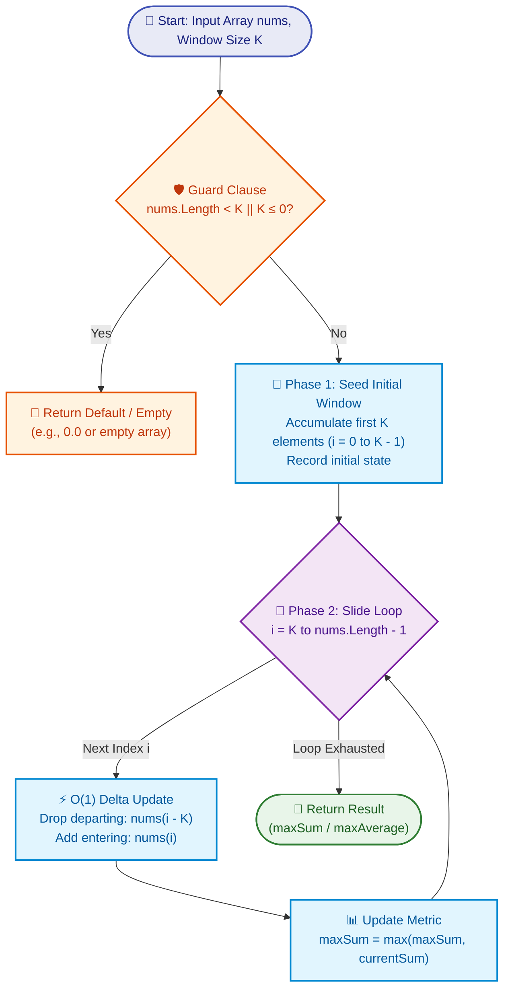

# 📘 Week 04 Day 02: Sliding Window (Fixed Size) — Efficient Sequential Processing

> 🧭 **Navigation:** [← Previous Day](Week_04_Day_01_Two_Pointer_Patterns_Instructional.md) • [🏠 Week Overview](README.md) • [📘 Curriculum Syllabus](../COMPLETE_SYLLABUS.md) • [Next Day →](Week_04_Day_03_Sliding_Window_Variable_Size_Instructional.md)
> 
> 💡 **Instructor Note:** *Not all sections or topics are mandatory. Feel free to adapt your pace and skim or skip sections based on your current focus and interview timeline.*

---

## 🎯 LEARNING OBJECTIVES

*By the end of this chapter, you will be able to:*

- 🎯 **Internalize** why fixed-size sliding windows eliminate redundant re-computation, collapsing naive `O(N * K)` iteration down to blazing-fast `O(N)` linear processing.
- ⚙️ **Master** the canonical two-phase window pattern (*Seed First K -> Slide Right Loop*) across rolling sums, moving averages, character frequency maps, and monotonic deques.
- 🛑 **Evade** classic rookie blunders: off-by-one fencepost errors, 32-bit integer overflow, and `O(N * K)` inner-loop re-summing.
- 🎙️ **Articulate** the exact 3-sentence live interview talk track that proves algorithmic mastery to a FAANG interviewer before typing a single character.
- ⚡ **Ship** zero-allocation production C# (.NET 8/9 `ReadOnlySpan<T>` and `stackalloc`) alongside idiomatic Python (3.11+).

---

## 🎬 PILLAR 1: THE 60-SECOND HOOK & EVERYDAY ANALOGY

### Hey Engineers, Welcome Back to Week 4 Day 2!

Today we are unpacking one of the absolute highest-ROI, most frequently tested patterns in technical interviews: **The Fixed-Size Sliding Window**.

If you have ever stared at a problem asking for *"the maximum sum of any contiguous subarray of length K"*, *"the moving average of CPU load over the last 60 seconds"*, or *"all anagram occurrences of a pattern P in string S"*, this pattern is your secret weapon.

### The Everyday Analogy: The Moving Picture Frame

Imagine you are walking down an art gallery corridor. On the wall hangs a continuous row of **1,000,000 paintings**.

You are holding a physical wooden picture frame that reveals exactly **`K = 1,000` paintings** at a time. Your job is to calculate the total estimated value of the paintings visible inside your frame at every possible position along the wall.

```
Corridor:  [ P0 | P1 | P2 | P3 | ... | P999 | P1000 | P1001 | ... | P999999 ]
             +----------------------------+
Frame (K=1000):   | P0 | P1 | ... | P999 |
             +----------------------------+
```

Now, let's look at two ways to do this:

#### 1. The Exhausting Naive Way (Brute Force)
Every time you take one step forward, you stop. You pull out your notebook, look through the frame, and painstakingly re-sum all 1,000 paintings from left to right.
* Cost per step: `1,000` additions.
* For `1,000,000` paintings, that is `1,000,000 * 1,000 = 1,000,000,000` (1 BILLION operations!).
* Your CPU melts, your battery dies, and your interview ends in a heartbreaking **Time Limit Exceeded (TLE)**.

#### 2. The Senior Engineer's Epiphany (Sliding Window Delta)
Notice what actually happened when you took that single step forward:
* **998 paintings inside the frame never moved!** They were in the frame before, and they are still in the frame now.
* Exactly **one painting disappeared** off the back edge (exited on the left).
* Exactly **one brand-new painting appeared** into the front edge (entered on the right).

Instead of re-adding all 1,000 paintings, you do two lightning-fast math operations:
```
New_Window_Sum = Old_Window_Sum - Exiting_Painting + Entering_Painting
```

* Cost per step: Exactly **1 subtraction + 1 addition = `O(1)` constant time**.
* Total operations for all 1,000,000 paintings: `1,000` ops to seed the first frame + `999,000` slides of 1 op each = **~1,000,000 operations**.

> 💡 **The Core Speedup:** You just crushed the runtime from **1 billion operations to 1 million operations**—a **1,000x speedup** from `O(N * K)` to strict `O(N)`. That is the difference between a failing timeout and an immediate FAANG offer.

---

## 🪜 PILLAR 2: THE TOY NAPKIN TRACE & ACTIVE RECALL

Let's anchor this intuition with a real concrete trace on a napkin before writing a line of code.

### The Toy Problem: Maximum Sum Subarray of Size K
* **Input Array:** `nums = [2, 1, 5, 1, 3, 2]`
* **Window Size:** `K = 3`
* **Goal:** Find the maximum sum of any contiguous slice of length 3.

```
Array indices:   0   1   2   3   4   5
Array values:  [ 2,  1,  5,  1,  3,  2 ]
```

---

### Step-by-Step Execution Trace

#### Phase 1: Seed the Initial Window (First `K` Elements)
We take the first `K = 3` elements at indices `[0, 1, 2]`:
* Elements: `nums[0] = 2`, `nums[1] = 1`, `nums[2] = 5`
* `currentSum = 2 + 1 + 5 = 8`
* `maxSum = 8`

```
  Index:     0   1   2   3   4   5
  Array:   [ 2 | 1 | 5 | 1 | 3 | 2 ]
           +-----------+
  Window:  | 2 | 1 | 5 |
           +-----------+
             L       R     ==> Window Sum = 8, Max Sum = 8
```

---

#### Phase 2: Slide 1 (Right pointer advances to index `3`)
* **Departing element:** `nums[3 - 3] = nums[0] = 2` (falls off the left edge)
* **Arriving element:** `nums[3] = 1` (enters on the right edge)
* **Delta calculation:** `currentSum = 8 - 2 + 1 = 7`
* **Update Max:** `maxSum = max(8, 7) = 8`

```
  Index:     0   1   2   3   4   5
  Array:   [ 2 | 1 | 5 | 1 | 3 | 2 ]
               +-----------+
  Window:      | 1 | 5 | 1 |
               +-----------+
                 L       R   ==> Window Sum = 7, Max Sum = 8
```

---

#### Phase 3: Slide 2 (Right pointer advances to index `4`)
* **Departing element:** `nums[4 - 3] = nums[1] = 1`
* **Arriving element:** `nums[4] = 3`
* **Delta calculation:** `currentSum = 7 - 1 + 3 = 9`
* **Update Max:** `maxSum = max(8, 9) = 9` ⭐️ *(New record!)*

```
  Index:     0   1   2   3   4   5
  Array:   [ 2 | 1 | 5 | 1 | 3 | 2 ]
                   +-----------+
  Window:          | 5 | 1 | 3 |
                   +-----------+
                     L       R   ==> Window Sum = 9, Max Sum = 9
```

---

#### Phase 4: Slide 3 (Right pointer advances to index `5`)
* **Departing element:** `nums[5 - 3] = nums[2] = 5`
* **Arriving element:** `nums[5] = 2`
* **Delta calculation:** `currentSum = 9 - 5 + 2 = 6`
* **Update Max:** `maxSum = max(9, 6) = 9`

```
  Index:     0   1   2   3   4   5
  Array:   [ 2 | 1 | 5 | 1 | 3 | 2 ]
                       +-----------+
  Window:              | 1 | 3 | 2 |
                       +-----------+
                         L       R   ==> Window Sum = 6, Max Sum = 9
```

**Final Answer:** `maxSum = 9` (corresponding to subarray `[5, 1, 3]`).

---

### 📊 The Napkin Trace Table

| Step | Active Window | Window Indices `[L..R]` | Exiting Element (`nums[i-K]`) | Entering Element (`nums[i]`) | Delta Arithmetic | Window Sum | Running `maxSum` |
| :--- | :--- | :--- | :--- | :--- | :--- | :--- | :--- |
| **Seed** | `[2, 1, 5]` | `[0..2]` | *None (Init)* | `2, 1, 5` | `2 + 1 + 5` | **8** | **8** |
| **Slide 1** | `[1, 5, 1]` | `[1..3]` | `nums[0] = 2` | `nums[3] = 1` | `8 - 2 + 1` | **7** | **8** |
| **Slide 2** | `[5, 1, 3]` | `[2..4]` | `nums[1] = 1` | `nums[4] = 3` | `7 - 1 + 3` | **9** | **9** ⭐️ |
| **Slide 3** | `[1, 3, 2]` | `[3..5]` | `nums[2] = 5` | `nums[5] = 2` | `9 - 5 + 2` | **6** | **9** |

---

### 🧠 Pause & Predict (Active Recall Checkpoint)

> [!IMPORTANT]
> **Stop and test your mental model:**
> 
> We just saw that updating a running sum is trivial: `New_Sum = Old_Sum - Exiting + Entering`.
> 
> What if the problem asks for the **Maximum element** in every window of size `K` instead of the sum?
> 
> Can we just do: `New_Max = max(Old_Max, Entering)`?
> 
> **Think:** What happens if the element that just exited the window was itself the `Old_Max`? Who becomes the new maximum?
> 
> *Take 30 seconds before reading ahead!*

<details>
<summary>🔍 Click to Reveal the Invariant Insight</summary>

**Why Simple Delta Math Fails for Max/Min:**
Addition has an inverse operation: **subtraction**. When an element leaves, you can undo its contribution in `O(1)` time by subtracting it.

**Extremes (Max and Min) have no inverse!** If the current maximum was `5` and `5` leaves the window, knowing `5` left tells you nothing about which of the remaining elements is the new king. If you scan the window to find the runner-up, you are back to `O(K)` per slide, degrading to `O(N * K)`.

**The Solution:** We need an auxiliary data structure that preserves the order of potential future winners. That structure is the **Monotonic Decreasing Deque**, covered in Problem 2 below!

</details>

---

## 🎨 PILLAR 3: PRAGMATIC VISUAL MODELS

### 1. ASCII Contiguous Memory & Pointer Anatomy

Here is what contiguous memory looks like under the hood as the fixed window slides. Notice how the window size `(R - L + 1)` is rigidly locked at `K`:

```text
Array in Contiguous Memory:
Index:     0       1       2       3       4       5       ...     N-1
Value:  [ 10  |   20  |   30  |   40  |   50  |   60  |   ...   |  99  ]
        +---------------------+
Frame:  | 10  |   20  |   30  |          (Window Size K = 3)
        +---------------------+
          ^               ^
          |               |
          L               R              (L = 0, R = 2)

Step to Next Window:
Value:  [ 10  |   20  |   30  |   40  |   50  |   60  |   ...   |  99  ]
              +---------------------+
Frame:        |   20  |   30  |   40  |  (Window Size K = 3)
              +---------------------+
          ^       ^               ^
          |       |               |
       Evicted    L               R      (L advances to 1, R advances to 3)
     nums[R - K]
```

---

### 2. Mermaid Flowchart: Fixed Sliding Window Execution Lifecycle

The canonical lifecycle consists of three distinct phases: **Guard Clause**, **Seeding the First K Elements**, and the **O(1) Delta Sliding Loop**.



---

## 🛑 PILLAR 4: THE ROOKIE TRAP ZONE

Let's dissect the three most common blunders candidates commit in 45-minute FAANG interviews and how to write the senior architect pattern instead.

---

### Trap 1: Re-Summing the Window with an Inner Loop (`O(N * K)` TLE)

```csharp
// ❌ ROOKIE BLUNDER: Nested loops recalculate K elements every single time
public int MaxSubArraySumRookie(int[] nums, int k)
{
    int maxSum = int.MinValue;
    // Outer loop runs N - K + 1 times
    for (int i = 0; i <= nums.Length - k; i++)
    {
        int windowSum = 0;
        // Inner loop runs K times -> Total work: O(N * K) -> TLE!
        for (int j = i; j < i + k; j++)
        {
            windowSum += nums[j];
        }
        maxSum = Math.Max(maxSum, windowSum);
    }
    return maxSum;
}
```

```csharp
// ✅ SENIOR ARCHITECT PATTERN: Seed once, slide with O(1) delta updates
public int MaxSubArraySumSenior(ReadOnlySpan<int> nums, int k)
{
    if (nums.Length < k || k <= 0) return 0;

    // Phase 1: Seed first K elements once in O(K)
    int currentSum = 0;
    for (int i = 0; i < k; i++) currentSum += nums[i];

    int maxSum = currentSum;

    // Phase 2: Slide right in O(1) per iteration -> Total work: O(N)
    for (int i = k; i < nums.Length; i++)
    {
        currentSum += nums[i] - nums[i - k]; // Drop old, add new
        if (currentSum > maxSum) maxSum = currentSum;
    }
    return maxSum;
}
```

---

### Trap 2: Off-By-One Window Seeding (The Fencepost Error)

A classic off-by-one bug happens when candidates confuse 0-based indexing with length `K`:

```csharp
// ❌ ROOKIE BLUNDER: Inclusive bound 'i <= k' seeds K + 1 elements!
int sum = 0;
for (int i = 0; i <= k; i++) // BUG: Iterates K + 1 times (indices 0, 1, ..., k)
{
    sum += nums[i];
}

// ❌ ROOKIE BLUNDER: Starting slide loop at k - 1 double-counts index k
for (int i = k - 1; i < nums.Length; i++) // BUG: nums[k-1] already in sum!
```

```csharp
// ✅ SENIOR ARCHITECT PATTERN: Crystal clear indexing invariant
// 1. First K elements live strictly at indices 0, 1, 2, ..., k - 1
for (int i = 0; i < k; i++)
{
    sum += nums[i];
}

// 2. Sliding loop starts precisely at index k (the first entering element!)
for (int i = k; i < nums.Length; i++)
{
    sum += nums[i] - nums[i - k]; // nums[i-k] is the exactly corresponding exiting element
}
```

---

### Trap 3: 32-Bit Integer Overflow in Accumulator

When calculating rolling sums over large integer arrays (e.g., `nums[i] <= 10^5`, `K = 10^5`), the window sum can easily reach `10^10`, exceeding `int.MaxValue` (`~2.14 * 10^9`).

```csharp
// ❌ ROOKIE BLUNDER: 32-bit int silently overflows into negative numbers
int currentSum = 0; 

// ✅ SENIOR ARCHITECT PATTERN: Accumulate into 64-bit long
long currentSum = 0;
for (int i = 0; i < k; i++) currentSum += nums[i];
```

---

### Trap 4: Storing Raw Values Instead of Indices in Monotonic Deques

When implementing Sliding Window Maximum, novices frequently push raw numbers into their deque. But when the window slides, how do you know if the maximum at the front has expired?

```python
# ❌ ROOKIE BLUNDER: Storing raw values
dq.append(val)
# If nums has duplicate values, which one are you evicting? You don't know the index!

# ✅ SENIOR ARCHITECT PATTERN: Store array INDICES in the deque
dq.append(i) # Storing index i gives you both the value (nums[i]) AND the age (i - k)
if dq[0] <= i - k:
    dq.popleft() # Clean O(1) age eviction!
```

---

## 🎙️ PILLAR 5: THE 45-MINUTE INTERVIEW TALK TRACK

When the interviewer presents a problem, **never start typing immediately**. Speak this exact 3-sentence script out loud to project staff-level confidence:

### Talk Track 1: Running Sum / Moving Average
> *"Because the window size K is constant, calculating each window from scratch would wastefully take `O(N * K)` time with 99% redundant overlap. Instead, I will maintain a fixed-size window using delta arithmetic: I will seed the running sum with the first K elements, and then slide from index K to N - 1. At each step, I will subtract the departing element at `i - K` and add the arriving element at `i`, computing the answer in optimal `O(N)` time and `O(1)` auxiliary space."*

### Talk Track 2: Sliding Window Maximum (Monotonic Deque)
> *"A naive scan takes `O(N * K)` time, and a max-heap costs `O(N log K)` with `O(K)` arbitrary removal penalties. We can achieve optimal `O(N)` time by maintaining a monotonic decreasing deque of array indices. The front of the deque will always hold the index of the maximum element for the active window; on each step, we evict out-of-boundary indices from the front, pop smaller elements from the back because they can never be future maximums, and append the current index."*

### Talk Track 3: String Permutation / Anagrams
> *"Since the target pattern P has a fixed length K, any valid anagram must be a contiguous substring of length exactly K with an identical character frequency distribution. We maintain two 26-element frequency arrays and a `matches` counter. As we slide across string S, we update only the entering and exiting characters in `O(1)` time, capturing the start index whenever `matches == 26`."*

---

## ⚡ PILLAR 6: PRODUCTION DUAL-LANGUAGE IMPLEMENTATIONS

---

### Problem 1: Maximum Average Subarray I (LeetCode 643)

**Problem Statement:** Given an integer array `nums` consisting of `n` elements and an integer `k`, find a contiguous subarray whose length is equal to `k` that has the maximum average value and return this value.

#### 📐 Mechanics
Maximizing the average of a fixed number of elements `k` is mathematically identical to maximizing their sum (`avg = sum / k`). We accumulate rolling sums using a 64-bit integer to prevent overflow, then divide once at the end.

#### C# Primary Implementation (.NET 8/9 — Zero-Allocation `ReadOnlySpan<T>`)
```csharp
using System;

public static class FixedWindowSolutions
{
    /// <summary>
    /// Computes the maximum average value for any contiguous subarray of size k.
    /// Time Complexity: O(N) | Auxiliary Space: O(1)
    /// </summary>
    public static double FindMaxAverage(ReadOnlySpan<int> nums, int k)
    {
        // 1. Guard Clause: Validate contract boundaries
        if (nums.Length < k || k <= 0)
        {
            return 0.0;
        }

        // 2. Phase 1: Seed the initial window of size k using 64-bit integer
        long currentWindowSum = 0;
        for (int i = 0; i < k; i++)
        {
            currentWindowSum += nums[i];
        }

        long maxWindowSum = currentWindowSum;

        // 3. Phase 2: Slide the window across the remaining elements
        // Index i represents the new entering element
        // Index (i - k) represents the departing element
        for (int i = k; i < nums.Length; i++)
        {
            currentWindowSum += nums[i] - nums[i - k];

            if (currentWindowSum > maxWindowSum)
            {
                maxWindowSum = currentWindowSum;
            }
        }

        // 4. Compute floating-point average once at the very end
        return (double)maxWindowSum / k;
    }
}
```

#### Python Secondary Implementation (3.11+ — Idiomatic)
```python
def find_max_average(nums: list[int], k: int) -> float:
    """Finds the maximum average value for any contiguous subarray of length k.
    
    Time Complexity: O(N) | Auxiliary Space: O(1)
    """
    # 1. Guard Clause
    if len(nums) < k or k <= 0:
        return 0.0

    # 2. Phase 1: Seed initial window sum
    current_window_sum = sum(nums[:k])
    max_window_sum = current_window_sum

    # 3. Phase 2: Slide window from index k to end
    for i in range(k, len(nums)):
        current_window_sum += nums[i] - nums[i - k]
        if current_window_sum > max_window_sum:
            max_window_sum = current_window_sum

    return max_window_sum / k
```

#### 📊 Explicit Complexity Deconstruction
* **Time Complexity:** `O(N)` — The initial seeding loop takes `K` operations, followed by `N - K` slides each executing 1 addition, 1 subtraction, and 1 comparison (`O(1)`). Total time is strictly linear in `N`.
* **Auxiliary Space:** `O(1)` — Only two scalar 64-bit accumulators (`currentWindowSum`, `maxWindowSum`) live on the stack. No heap memory is allocated.
* **Output Space:** `O(1)` — Returns a single 64-bit IEEE floating-point number.

---

### Problem 2: Sliding Window Maximum (LeetCode 239 — Hard)

**Problem Statement:** You are given an array of integers `nums`, there is a sliding window of size `k` which is moving from the very left of the array to the very right. You can only see the `k` numbers in the window. Each time the sliding window moves right by one position, return the max sliding window.

#### 🧠 Monotonic Deque Invariant
We maintain a double-ended queue storing **array indices** with two non-negotiable rules:
1. **Monotonicity (Decreasing Order):** Elements at stored indices are always strictly decreasing: `nums[deque.First] > nums[deque.Second] > ...`
2. **Freshness:** Stored indices must fall within the active window: `index > i - k`.

**Why Smaller Elements are Popped:** If incoming element `nums[i]` is greater than or equal to an older element sitting in the deque, that older element can **never** be the maximum in the current window or any future window (it is older AND smaller!). It is dead weight—pop it from the back!

#### C# Primary Implementation (.NET 8/9 — Monotonic Deque)
```csharp
using System;
using System.Collections.Generic;

public static class SlidingWindowMaxSolutions
{
    /// <summary>
    /// Computes the maximum value within each sliding window of size k using a monotonic deque.
    /// Time Complexity: O(N) | Auxiliary Space: O(K)
    /// </summary>
    public static int[] MaxSlidingWindow(ReadOnlySpan<int> nums, int k)
    {
        if (nums.Length == 0 || k <= 0) return Array.Empty<int>();
        if (k == 1) return nums.ToArray();

        int n = nums.Length;
        int[] result = new int[n - k + 1];

        // Deque stores array indices in strictly decreasing order of values
        var deque = new LinkedList<int>();

        for (int i = 0; i < n; i++)
        {
            // 1. Evict elements that have fallen outside the active window [i - k + 1 .. i]
            if (deque.Count > 0 && deque.First.Value <= i - k)
            {
                deque.RemoveFirst();
            }

            // 2. Maintain monotonic decreasing invariant:
            // Pop elements from back that are smaller than or equal to incoming element nums[i]
            while (deque.Count > 0 && nums[deque.Last.Value] <= nums[i])
            {
                deque.RemoveLast();
            }

            // 3. Append current index
            deque.AddLast(i);

            // 4. Once we have processed at least k elements, front is the window max
            if (i >= k - 1)
            {
                result[i - k + 1] = nums[deque.First.Value];
            }
        }

        return result;
    }
}
```

#### Python Secondary Implementation (3.11+ — `collections.deque`)
```python
from collections import deque

def max_sliding_window(nums: list[int], k: int) -> list[int]:
    """Computes the maximum value within each sliding window of size k.
    
    Time Complexity: O(N) | Auxiliary Space: O(K)
    """
    if not nums or k <= 0:
        return []
    if k == 1:
        return list(nums)

    dq: deque[int] = deque()  # Stores array indices
    result: list[int] = []

    for i, val in enumerate(nums):
        # 1. Evict expired index from front
        if dq and dq[0] <= i - k:
            dq.popleft()

        # 2. Maintain monotonic decreasing order: pop smaller or equal from back
        while dq and nums[dq[-1]] <= val:
            dq.pop()

        # 3. Add current index
        dq.append(i)

        # 4. Record maximum once the first window is fully formed
        if i >= k - 1:
            result.append(nums[dq[0]])

    return result
```

#### 📊 Explicit Complexity Deconstruction
* **Time Complexity:** `O(N)` — Every single element index is pushed into the deque exactly once, and popped from the deque at most once (either from the back during pruning or from the front upon expiry). Across all `N` iterations, the total number of deque operations is bounded by `2N`. Amortized cost per window slide is strict `O(1)`.
* **Auxiliary Space:** `O(K)` — The deque holds indices strictly belonging to the active window; its size is bounded by `min(N, K)`.
* **Output Space:** `O(N - K + 1)` — Stores one maximum integer per complete window.

---

### Problem 3: Find All Anagrams in a String (LeetCode 438 — Medium)

**Problem Statement:** Given two strings `s` and `p`, return an array of all the start indices of `p`'s anagrams in `s`.

#### 🧠 Mechanics
Since `p` has fixed length `K = p.Length`, any valid anagram in `s` must be a contiguous substring of length exactly `K`. We maintain two 26-element character frequency tables. Instead of comparing all 26 integers on every step (`O(26)`), we maintain a running count of matching character frequencies (`matches`). When `matches == 26`, we found an anagram!

#### C# Primary Implementation (.NET 8/9 — Zero-Allocation `stackalloc Span<int>`)
```csharp
using System;
using System.Collections.Generic;

public static class AnagramWindowSolutions
{
    /// <summary>
    /// Finds all start indices of p's anagrams in s using a fixed frequency window.
    /// Time Complexity: O(N) | Auxiliary Space: O(1)
    /// </summary>
    public static List<int> FindAnagrams(string s, string p)
    {
        var result = new List<int>();
        if (string.IsNullOrEmpty(s) || string.IsNullOrEmpty(p) || s.Length < p.Length)
        {
            return result;
        }

        ReadOnlySpan<char> sSpan = s.AsSpan();
        ReadOnlySpan<char> pSpan = p.AsSpan();
        int k = pSpan.Length;

        // Zero-allocation stack buffers for 26 lowercase English letters
        Span<int> pCount = stackalloc int[26];
        Span<int> windowCount = stackalloc int[26];

        // Seed initial frequency window
        for (int i = 0; i < k; i++)
        {
            pCount[pSpan[i] - 'a']++;
            windowCount[sSpan[i] - 'a']++;
        }

        // Count initial matches across all 26 character slots
        int matches = 0;
        for (int c = 0; c < 26; c++)
        {
            if (pCount[c] == windowCount[c]) matches++;
        }

        if (matches == 26) result.Add(0);

        // Slide the window across s
        for (int i = k; i < sSpan.Length; i++)
        {
            int enterChar = sSpan[i] - 'a';
            int exitChar = sSpan[i - k] - 'a';

            // 1. Process entering character
            windowCount[enterChar]++;
            if (windowCount[enterChar] == pCount[enterChar])
                matches++;
            else if (windowCount[enterChar] == pCount[enterChar] + 1)
                matches--;

            // 2. Process exiting character
            windowCount[exitChar]--;
            if (windowCount[exitChar] == pCount[exitChar])
                matches++;
            else if (windowCount[exitChar] == pCount[exitChar] - 1)
                matches--;

            // 3. If all 26 letter frequencies match, record the start index
            if (matches == 26)
            {
                result.Add(i - k + 1);
            }
        }

        return result;
    }
}
```

#### Python Secondary Implementation (3.11+ — Idiomatic)
```python
def find_anagrams(s: str, p: str) -> list[int]:
    """Finds all start indices of p's anagrams in s.
    
    Time Complexity: O(N) | Auxiliary Space: O(1)
    """
    if len(s) < len(p):
        return []

    k = len(p)
    p_count = [0] * 26
    w_count = [0] * 26

    # Seed frequency tables for the first k characters
    for i in range(k):
        p_count[ord(p[i]) - ord('a')] += 1
        w_count[ord(s[i]) - ord('a')] += 1

    matches = sum(1 for c in range(26) if p_count[c] == w_count[c])
    result: list[int] = []

    if matches == 26:
        result.append(0)

    # Slide across string s
    for i in range(k, len(s)):
        enter = ord(s[i]) - ord('a')
        exit_char = ord(s[i - k]) - ord('a')

        # Add entering character
        w_count[enter] += 1
        if w_count[enter] == p_count[enter]:
            matches += 1
        elif w_count[enter] == p_count[enter] + 1:
            matches -= 1

        # Remove exiting character
        w_count[exit_char] -= 1
        if w_count[exit_char] == p_count[exit_char]:
            matches += 1
        elif w_count[exit_char] == p_count[exit_char] - 1:
            matches -= 1

        if matches == 26:
            result.append(i - k + 1)

    return result
```

#### 📊 Explicit Complexity Deconstruction
* **Time Complexity:** `O(N)` — Seeding takes `O(K)`. The sliding loop performs exactly `N - K` iterations, updating constant-size buffers in `O(1)` time without re-scanning 26 elements. Total time: `O(N)`.
* **Auxiliary Space:** `O(1)` — Memory is bounded by two 26-element integer buffers (`stackalloc` on the call stack in C#).
* **Output Space:** `O(N)` in the worst case (e.g., `s = "aaaa"`, `p = "a"` where every index matches).

---

## ⚖️ CHAPTER 5: FAANG INTERVIEW PATTERN SIGNALS & EDGE CASES

> [!NOTE]
> **Production Reality (Why FAANG Tests This):**
> High-throughput telemetry pipelines (such as AWS CloudWatch metric alarms, Netflix adaptive bitrate (ABR) estimators, and Stripe payment rate limiters) ingest millions of events per second. Recomputing rolling metrics naively costs `O(N * K)` CPU cycles, causing catastrophic thread contention and garbage collector pauses. Fixed sliding windows maintain rolling averages, variances, and monotonic peaks in strict `O(1)` amortized time per incoming telemetry packet using cache-friendly contiguous buffers.

### 🎯 Pattern Recognition Signals
When you read a FAANG interview prompt, look for these giveaway phrases:

| Signal Phrase | What It Means | Recommended Approach |
| :--- | :--- | :--- |
| **"Subarray / substring of fixed length K"** | Strict window boundary | Fixed-size sliding window |
| **"Rolling average / moving sum over past K minutes"** | Additive delta update | Maintain scalar accumulator: `- nums[i-k] + nums[i]` |
| **"Maximum / minimum in each K-length segment"** | Monotonic ordering | Monotonic deque storing indices |
| **"Check if any substring of length K is an anagram"** | Fixed frequency vector | Fixed window of size `len(P)` with 26-char frequency vector |
| **"Shortest subarray with sum >= target"** | Window length is **variable**! | Switch to Variable-Size Sliding Window (Week 4 Day 3) |

---

### 🧪 Concrete Edge-Case Checklist

Before declaring your code ready in an interview, dry run these 5 edge cases:

1. **`K > N` (Window Larger than Array):**
   * *Example:* `nums = [1, 2], K = 5`.
   * *Required Behavior:* Immediate return via guard clause (`0.0` or empty array). No array access.
2. **`K == 1` (Window of Size One):**
   * *Example:* `nums = [4, -2, 7], K = 1`.
   * *Required Behavior:* For maximum sum, answer is the maximum element. For sliding window maximum, result is identical to the input array.
3. **`K == N` (Window Exactly Equals Array Size):**
   * *Example:* `nums = [1, 2, 3], K = 3`.
   * *Required Behavior:* Slide loop never executes (`i = 3` to `2`). Returns the initial seeded window immediately.
4. **All Negative Values:**
   * *Example:* `nums = [-5, -2, -8, -1], K = 2`.
   * *Required Trap:* Never initialize `maxSum = 0`! In an all-negative array, `0` is greater than any valid subarray sum. Always initialize `maxSum` to the sum of the first `K` elements.
5. **Duplicate Elements in Monotonic Deque:**
   * *Example:* `nums = [2, 2, 2, 2], K = 2`.
   * *Required Behavior:* Using `<=` when popping from the back ensures we evict older duplicates and retain the freshest index, keeping the deque minimal.

---

## ⚔️ HIGH-ROI PRACTICE PROBLEMS & INTERVIEW QUESTIONS

### 🏋️ Practice Problem Ladder (8 High-Yield Problems)

| # | Problem | LeetCode | Difficulty | Core Technique |
| :- | :--- | :--- | :--- | :--- |
| 1 | Maximum Average Subarray I | #643 | 🟢 Easy | Additive delta update |
| 2 | Diet Plan Performance | #1176 | 🟢 Easy | Running sum threshold evaluation |
| 3 | Max Vowels in Substring of Length K | #1456 | 🟡 Medium | Sliding window character counter |
| 4 | Find All Anagrams in a String | #438 | 🟡 Medium | Fixed 26-char frequency difference |
| 5 | Permutation in String | #567 | 🟡 Medium | Boolean anagram window match |
| 6 | Grumpy Bookstore Owner | #1052 | 🟡 Medium | Fixed window delta over unsatisfied customers |
| 7 | Sliding Window Maximum | #239 | 🔴 Hard | Monotonic decreasing deque storing indices |
| 8 | Sliding Window Median | #480 | 🔴 Hard | Dual heaps or balanced binary search tree |

---

### 🎙️ 6 FAANG Architectural Interview Questions

#### Q1: "Can we use a Max-Heap instead of a Monotonic Deque for Sliding Window Maximum?"
* **Answer:** A max-heap gives `O(N log K)` time, but element deletion in a standard heap is `O(K)` because locating an arbitrary exiting element requires scanning the heap array. You can implement lazy deletion (leaving expired elements in the heap until they bubble to the top), which runs in `O(N log N)` time and `O(N)` space. A monotonic deque is strictly superior: true `O(N)` time and `O(K)` space.

#### Q2: "How do you prevent floating-point precision loss when computing moving averages over millions of stream elements?"
* **Answer:** Accumulating floating-point numbers (`float`/`double`) using delta updates (`sum += enter - exit`) accumulates rounding errors over millions of cycles due to binary representation limits. In production, maintain the running sum as an integer (e.g. cents instead of dollars, or fixed-point integer microseconds) and divide only when querying the average.

#### Q3: "Why must the monotonic deque store indices instead of values?"
* **Answer:** If we only store values, we cannot determine when the maximum element at the front has slid out of the active window (`index <= i - K`). Storing indices gives us both the value via `nums[index]` and its exact position to enforce window boundaries in `O(1)` time.

#### Q4: "How does fixed-size sliding window compare to a Prefix Sum array?"
* **Answer:** A Prefix Sum array requires `O(N)` auxiliary space to answer arbitrary range queries in `O(1)` time. A fixed sliding window requires only `O(1)` auxiliary space because it processes sequentially. In a real-time streaming architecture (Kafka/Kinesis), prefix sums are impossible because the entire array is not known in advance, making sliding window the only viable approach.

#### Q5: "How would you design a fixed-window rate limiter for a public REST API?"
* **Answer:** Maintain a counter for the current fixed time bucket (e.g., current minute timestamp). Each incoming request increments the counter. If the counter exceeds the threshold (e.g., 100 req/min), reject with HTTP 429 Too Many Requests. The trade-off is the *boundary burst problem*: a user can send 100 requests at 00:59 and 100 requests at 01:00, delivering 200 requests within a 2-second span. A sliding log or token bucket eliminates this boundary burst.

#### Q6: "When is the amortized complexity of Monotonic Deque operations strictly O(1)?"
* **Answer:** Although a single incoming element may trigger up to `K` pops from the back of the deque, each element index enters the deque at most once and can be popped at most once across the entire algorithm. For `N` elements, the total number of operations across all slides is strictly bounded by `2N`. Dividing by `N` proves amortized `O(1)` time per slide.

---

## 📌 CLOSING REFLECTION

Fixed-size sliding windows embody the essence of senior software engineering: **never recompute what you can incrementally update**.

By isolating the state delta—the single element entering and the single element leaving—computations that naively scale as `O(N * K)` collapse into clean, cache-friendly, zero-allocation `O(N)` streaming pipelines.

Master the two-phase lifecycle (*Seed First K -> Slide Right Loop*), internalize the monotonic deque invariant, and you will walk into any FAANG interview ready to turn high-pressure questions into clean offers.

---

> 🧭 **Navigation:** [← Previous Day](Week_04_Day_01_Two_Pointer_Patterns_Instructional.md) • [🏠 Week Overview](README.md) • [📘 Curriculum Syllabus](../COMPLETE_SYLLABUS.md) • [Next Day →](Week_04_Day_03_Sliding_Window_Variable_Size_Instructional.md)
