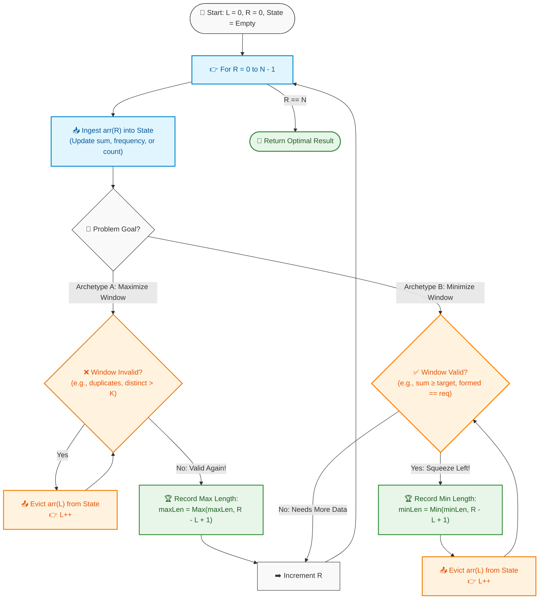

# 📘 Week 04 Day 03: Sliding Window (Variable Size) — Dynamic Constraint Management

> 🧭 **Navigation:** [← Previous Day](Week_04_Day_02_Sliding_Window_Fixed_Size_Instructional.md) • [🏠 Week Overview](README.md) • [📘 Curriculum Syllabus](../COMPLETE_SYLLABUS.md) • [Next Day →](Week_04_Day_04_Divide_and_Conquer_Pattern_Instructional.md)
> 
> 💡 **Instructor Note:** *Not all sections or topics are mandatory. Feel free to adapt your pace and skim or skip sections based on your current focus and interview timeline.*

---

## 🎯 LEARNING OBJECTIVES

*By the end of this chapter, you will be able to:*

- 🎯 **Internalize** why dynamic window expansion and contraction solve constraint-based optimization problems in `O(N)` time despite nested loops looking deceptively like `O(N^2)`.
- ⚙️ **Master the Two Archetypes:** Implement Archetype A (Maximize Window) and Archetype B (Minimize Window), tracking dynamic constraints with frequency maps and direct-indexed ASCII tables.
- 📐 **Apply the "At Most K" Reduction:** Decompose tricky, non-monotonic "Exactly K" problems into two monotonic sliding window passes via `Exactly(K) = AtMost(K) - AtMost(K - 1)`.
- 🛑 **Evade Rookie Traps:** Dodge the 4 classic blunders: the nested-loop complexity panic, the single-element `if` contraction bug, premature min-window evaluation, and zombie hash map keys.
- ⚡ **Write Production Dual-Language Code:** Author zero-allocation, high-performance C# (.NET 8/9, `ReadOnlySpan<char>`, `stackalloc int[128]`) and clean, idiomatic Python (3.11+).

---

## 🎬 PILLAR 1: THE 60-SECOND HOOK & EVERYDAY ANALOGY

### Hey Engineers, Welcome Back to Week 4 Day 3!

You and I are diving into one of the absolute highest-ROI, most frequently tested patterns in FAANG interview history: the **Variable-Size Sliding Window**.

If yesterday's fixed-size window was a rigid train car of length `K` rolling along a track, today's variable window is an **accordion** or an **inchworm (caterpillar)** crawling across a twig!

```
                    THE INCHWORM (CATERPILLAR) CRAWL
                    
Step 1: Head stretches forward into new territory
        [ Tail ] ====================> [ Head ]
           L                              R
        
Step 2: Constraint broken! Tail snaps forward to relieve tension
                          [ Tail ] ===> [ Head ]
                             L            R
```

### The Real-World Engineering Problem

Imagine you are designing a real-time rate limiter or memory manager at Cloudflare or AWS API Gateway. User requests arrive with variable payload sizes:
- You need to find the **longest burst of requests** that consumed no more than 100 MB of RAM.
- Or you need to find the **shortest timeframe** in which a client sent 500 requests to flag a potential DDoS attack.

A naive approach evaluates every possible start and end request `(i, j)`. That demands `O(N^2)` window candidates, and validating each takes up to `O(N)` work. On `N = 10^5` requests, an `O(N^3)` or even `O(N^2)` algorithm causes complete CPU starvation and timeouts.

With a variable-size sliding window, you evaluate the entire stream in a single, fluid `O(N)` linear pass.

### The Two Core Archetypes

Every variable-size sliding window problem on LeetCode boils down to one of two archetypes:

```
+---------------------------------------------------------------------------------------------------+
| ARCHETYPE A: MAXIMIZE WINDOW (Longest / At Most)                                                 |
+---------------------------------------------------------------------------------------------------+
| • Goal: Find the MAXIMUM window length satisfying a condition.                                   |
| • Mindset: "Greedy Expansion, Reluctant Shrink"                                                  |
| • Mechanics: Expand Right until the constraint BREAKS. Then shrink Left with a while-loop         |
|              JUST ENOUGH to restore validity. Record your max length AFTER the shrink loop.       |
| • Examples: Longest Substring Without Repeating Characters, Max Consecutive Ones III.             |
+---------------------------------------------------------------------------------------------------+

+---------------------------------------------------------------------------------------------------+
| ARCHETYPE B: MINIMIZE WINDOW (Shortest / At Least)                                                 |
+---------------------------------------------------------------------------------------------------+
| • Goal: Find the MINIMUM window length satisfying a condition.                                   |
| • Mindset: "Greedy Shrink, Reluctant Expansion"                                                  |
| • Mechanics: Expand Right until the condition is SATISFIED (window becomes valid). Then shrink   |
|              Left with a while-loop to squeeze out every drop of excess fat. Record min length   |
|              INSIDE the shrink loop BEFORE evicting Left breaks validity.                         |
| • Examples: Minimum Size Subarray Sum, Minimum Window Substring.                                  |
+---------------------------------------------------------------------------------------------------+
```

### The Secret Weapon: The "At Most K" Reduction Formula

What about problems that ask for subarrays with **"Exactly K"** distinct elements? (e.g., LeetCode 992: *Subarrays with K Different Integers*).

Direct sliding windows fail here because the condition is **non-monotonic**: shrinking `Left` might keep the window valid, or it might break it unpredictably. 

Here is the Senior Architect's secret weapon:

```
Count(Exactly K) = Count(At Most K) - Count(At Most K - 1)
```

By decomposing one non-monotonic problem into two monotonic sliding window passes, you solve a LeetCode Hard problem using two runs of a standard LeetCode Medium template!

---

## 🪜 PILLAR 2: THE SCAFFOLDING LADDER & TOY NAPKIN TRACES

Let's build intuition through toy napkin traces on concrete, real-world examples.

---

### Trace 1 (Archetype A — Maximize): Longest Substring Without Repeating Characters

*Problem:* Find the length of the longest substring without repeating characters in `s = "abcabcbb"`.

Let's trace `Right` expanding and `Left` contracting using our ASCII pointer fingers:

```
String:   a   b   c   a   b   c   b   b
Index:    0   1   2   3   4   5   6   7

Step 1: R=0 ('a') -> Not seen before. Window = [a]
        a   b   c   a   b   c   b   b
        ^
       L,R                                 -> Valid! Len = 0-0+1 = 1, MaxLen = 1

Step 2: R=1 ('b') -> Not seen before. Window = [a, b]
        a   b   c   a   b   c   b   b
        ^   ^
        L   R                              -> Valid! Len = 1-0+1 = 2, MaxLen = 2

Step 3: R=2 ('c') -> Not seen before. Window = [a, b, c]
        a   b   c   a   b   c   b   b
        ^       ^
        L       R                          -> Valid! Len = 2-0+1 = 3, MaxLen = 3

Step 4: R=3 ('a') -> DUPLICATE 'a'! Last seen at index 0.
        Jump L past previous 'a': L = 0 + 1 = 1. Window = [b, c, a]
        a   b   c   a   b   c   b   b
            ^       ^
            L       R                      -> Valid! Len = 3-1+1 = 3, MaxLen = 3

Step 5: R=4 ('b') -> DUPLICATE 'b'! Last seen at index 1.
        Jump L past previous 'b': L = 1 + 1 = 2. Window = [c, a, b]
        a   b   c   a   b   c   b   b
                ^       ^
                L       R                  -> Valid! Len = 4-2+1 = 3, MaxLen = 3

Step 6: R=5 ('c') -> DUPLICATE 'c'! Last seen at index 2.
        Jump L past previous 'c': L = 2 + 1 = 3. Window = [a, b, c]
        a   b   c   a   b   c   b   b
                    ^       ^
                    L       R              -> Valid! Len = 5-3+1 = 3, MaxLen = 3

Step 7: R=6 ('b') -> DUPLICATE 'b'! Last seen at index 4.
        Jump L past previous 'b': L = 4 + 1 = 5. Window = [c, b]
        a   b   c   a   b   c   b   b
                            ^   ^
                            L   R          -> Valid! Len = 6-5+1 = 2, MaxLen = 3

Step 8: R=7 ('b') -> DUPLICATE 'b'! Last seen at index 6.
        Jump L past previous 'b': L = 6 + 1 = 7. Window = [b]
        a   b   c   a   b   c   b   b
                                    ^
                                   L,R     -> Valid! Len = 7-7+1 = 1, MaxLen = 3

Result: MaxLen = 3 ("abc")
```

#### 🧠 Pause & Predict #1
> **Question:** Suppose `s = "abba"`. At `R = 2`, `s[R] = 'b'`, so `Left` jumps to index 2. At `R = 3`, `s[R] = 'a'`. Our table shows `'a'` was last seen at index 0. If you blindly set `Left = lastSeen['a'] + 1`, what catastrophic bug happens?
>
> **Answer:** `Left` would jump backwards from index 2 to index 1 (`0 + 1`)! You would re-admit the duplicate `'b'` back into your window. That is why the pointer advancement rule is strictly:
> ```csharp
> left = Math.Max(left, lastSeen[c] + 1);
> ```
> `Left` must **never** backtrack!

---

### Trace 2 (Archetype B — Minimize): Minimum Window Substring

*Problem:* Find the minimum window in `s = "ADOBECODEBANC"` containing all characters of `t = "ABC"`.

Here `t` requires: `{'A': 1, 'B': 1, 'C': 1}`. Total unique target characters required: `required = 3`.

```
Target: {A:1, B:1, C:1} -> required = 3 distinct characters satisfied

Phase 1: Expand Right until all target characters are present (formed == 3)
s =  A   D   O   B   E   C   O   D   E   B   A   N   C
     ^                   ^
     L                   R
Window "ADOBEC" -> Contains A:1, B:1, C:1 -> formed = 3 (VALID!)
Candidate Min Window = "ADOBEC" (Length = 6)

Phase 2: Squeeze Left to minimize!
- Evict 'A' at L=0: Window drops 'A'. formed drops to 2 (INVALID!). L moves to 1.
  Shrink loop stops.

Phase 3: Expand Right to find another 'A'
s =  A   D   O   B   E   C   O   D   E   B   A   N   C
         ^                                   ^
         L                                   R
At R=10 ('A'): We now have A:1, B:2, C:1. formed = 3 (VALID!)
Window "DOBECODEBA" (Length = 10)

Phase 4: Squeeze Left again!
- Evict 'D' (L=1): Still valid!
- Evict 'O' (L=2): Still valid!
- Evict 'B' (L=3): Window had 2 'B's, now has 1 'B'. Still valid!
- Evict 'E' (L=4): Still valid!
- Evict 'C' (L=5): Window loses only 'C'. formed drops to 2 (INVALID!). L moves to 6.
  Shrink loop stops.

Phase 5: Expand Right to find another 'C'
s =  A   D   O   B   E   C   O   D   E   B   A   N   C
                             ^                       ^
                             L                       R
At R=12 ('C'): Window "ODEBANC". formed = 3 (VALID!)

Phase 6: Final Squeeze on Left!
- Evict 'O' (L=6), 'D' (L=7), 'E' (L=8): Still valid!
- Window reaches L=9: "BANC" (Contains B:1, A:1, C:1, Length = 4).
Candidate Min Window = min(6, 4) = 4 ("BANC")!
- Evict 'B' (L=9): formed drops to 2.
Search terminates at end of string.
Final Answer: "BANC"
```

#### 🧠 Pause & Predict #2
> **Question:** In Minimum Window Substring, how do you verify if the current window satisfies all characters of `t` in `O(1)` time without comparing two 128-element arrays on every step?
>
> **Answer:** Use a `formed` scalar counter!
> 1. `required` = number of **unique** characters in `t`.
> 2. Whenever an incoming character's frequency in the window reaches its required count in `t` (`windowFreq[c] == targetFreq[c]`), increment `formed++`.
> 3. Whenever an evicted character's frequency drops strictly below its required count (`windowFreq[c] < targetFreq[c]`), decrement `formed--`.
> 4. The window is valid if and only if `formed == required` — an instant `O(1)` check!

---

### Trace 3: Minimum Size Subarray Sum (`sum >= target`)

*Problem:* `nums = [2, 3, 1, 2, 4, 3]`, `target = 7`.

| `Right` | `nums[Right]` | `currentSum` | Valid? (`sum >= 7`) | Actions Taken & Window State | `minLen` |
| :--- | :--- | :--- | :--- | :--- | :--- |
| **0** | 2 | 2 | No | Expand | inf |
| **1** | 3 | 5 | No | Expand | inf |
| **2** | 1 | 6 | No | Expand | inf |
| **3** | 2 | 8 | **Yes** | Valid `[2, 3, 1, 2]` (len 4). Record `minLen = 4`. Evict `nums[0]` (2) -> `sum = 6`. Stop. | **4** |
| **4** | 4 | 10 | **Yes** | Valid `[3, 1, 2, 4]` (len 4). Evict `nums[1]` (3) -> `sum = 7`.<br>Still Valid `[1, 2, 4]` (len 3). Record `minLen = 3`. Evict `nums[2]` (1) -> `sum = 6`. Stop. | **3** |
| **5** | 3 | 9 | **Yes** | Valid `[2, 4, 3]` (len 3). Evict `nums[3]` (2) -> `sum = 7`.<br>Still Valid `[4, 3]` (len 2). Record `minLen = 2`. Evict `nums[4]` (4) -> `sum = 3`. Stop. | **2** |

Result: `minLen = 2` (subarray `[4, 3]`).

---

## 🎨 PILLAR 3: PRAGMATIC VISUAL MODELS

### ASCII Memory & Pointer State Engine

In contiguous memory, the variable sliding window maintains two index bounds `[L..R]` alongside an auxiliary state tracker:

```
                            Dynamic Window [L..R]
                        +---------------------------+
  Indices:    0     1   |  2     3     4     5     6|   7     8
  Array:   [ 10 |  20 | | 30 |  40 |  50 |  60 |  70| | 80 |  90 ]
                        +---------------------------+
                           ^                       ^
                           L                       R
                      Left Pointer            Right Pointer
                   (Contracts on violation)  (Expands on search)

  State Buffer:
  - Running Metric: currentSum = 250 (or character counts / distinct keys)
  - Invariant Check: Is State VALID?
    - If Maximizing: while (!Valid) { Evict(arr[L]); L++; }
    - If Minimizing: while (Valid)  { UpdateMin(); Evict(arr[L]); L++; }
```

---

### Variable Sliding Window Master Loop Engine

Here is the architectural control flow that powers every variable sliding window algorithm:



---

## 🛑 PILLAR 4: THE ROOKIE TRAP ZONE

Let's inspect the four deadly mistakes candidates make in FAANG interviews, with side-by-side comparisons.

---

### Trap 1: The `O(N^2)` Panic (Nested Loop Optical Illusion)

```csharp
// ❌ Rookie Blunder: Assuming nested loops mean O(N^2)
for (int right = 0; right < n; right++)
{
    while (ConditionViolated())
    {
        left++; // Candidate panics during interview: "Oh no, nested loops, this is O(N^2)!"
    }
}
```

```csharp
// ✅ Senior Architect Invariant: Strict Amortized O(N) Proof
// Proof: 
// 1. Pointer 'right' starts at 0 and increments at most N times.
// 2. Pointer 'left' starts at 0 and increments at most N times.
// 3. 'left' NEVER resets or moves backwards.
// Total pointer advancements across the entire program <= N + N = 2N operations.
// Complexity is mathematically bounded by O(2N) = O(N).
```

---

### Trap 2: Contraction with `if` Instead of `while`

```csharp
// ❌ Rookie Blunder: Using 'if' to shrink
if (distinctCount > k)
{
    evict(nums[left]);
    left++; 
    // BUG: Evicting ONE element might not be enough to restore validity!
    // Window remains invalid, corrupting subsequent calculations.
}
```

```csharp
// ✅ Senior Architect Pattern: Contraction with 'while'
while (distinctCount > k)
{
    evict(nums[left]);
    left++;
    // Window is guaranteed to be 100% valid before advancing 'right'.
}
```

---

### Trap 3: Updating Answer at the Wrong Point in Min vs Max

```csharp
// ❌ Rookie Blunder: Updating minLen AFTER the shrink loop
while (currentSum >= target)
{
    currentSum -= nums[left++];
}
// BUG: When the while-loop finishes, currentSum < target!
// Window [left..right] is now INVALID, so calculating length here records an invalid span!
minLen = Math.Min(minLen, right - left + 1);
```

```csharp
// ✅ Senior Architect Pattern: Update minLen INSIDE the valid while-loop
while (currentSum >= target)
{
    // Window is currently VALID! Record candidate answer now.
    minLen = Math.Min(minLen, right - left + 1);
    
    // Now shrink to test if a smaller window is also valid
    currentSum -= nums[left++];
}
```

---

### Trap 4: Zombie Hash Map Keys (Count Dropping to Zero)

```python
# ❌ Rookie Blunder: Decrementing count without deleting key
freq_map[char] -= 1
# BUG: In Python, len(freq_map) still counts keys with value 0!
# len({'a': 0, 'b': 1}) is 2, NOT 1! The window thinks 'a' is still present!
if len(freq_map) > k:
    ...
```

```python
# ✅ Senior Architect Pattern: Delete key immediately when count hits 0
freq_map[char] -= 1
if freq_map[char] == 0:
    del freq_map[char]  # len(freq_map) now accurately reflects distinct count!
```

---

## 🎙️ PILLAR 5: 45-MINUTE INTERVIEW TALK TRACK

Here is the exact 3-sentence script to speak aloud in a live interview before touching your keyboard:

```text
+---------------------------------------------------------------------------------------------------------+
| 🎙️ THE 3-SENTENCE FAANG INTERVIEW SCRIPT                                                                |
+---------------------------------------------------------------------------------------------------------+
| 1. The Invariant & Pattern:                                                                             |
|    "Because we are looking for an optimal contiguous subarray under monotonic conditions, we can       |
|    maintain a variable-size sliding window bounded by pointers 'left' and 'right'."                    |
|                                                                                                         |
| 2. The Mechanics (Expand & Contract):                                                                   |
|    "As pointer 'right' expands to ingest elements into our running state, we detect constraint           |
|    violations and monotonically advance pointer 'left' in a while-loop until validity is restored."     |
|                                                                                                         |
| 3. The Complexity Defense:                                                                              |
|    "Although the code contains nested loops, both 'left' and 'right' advance strictly forward and       |
|    never backtrack, bounding total pointer movements to at most 2N — guaranteeing strict O(N) time     |
|    and O(1) auxiliary space."                                                                           |
+---------------------------------------------------------------------------------------------------------+
```

### ⏱️ Strategic 45-Minute Interview Playbook

| Minute | Phase | What You Say & Do |
| :--- | :--- | :--- |
| **00 - 05** | **Clarify & Bounds** | Ask: "Can numbers be negative?" (Crucial: negative numbers break sum monotonicity!). Clarify character set (ASCII vs Unicode). |
| **05 - 12** | **Naive -> Invariant** | State naive `O(N^2)` brute force. Explain the sliding window invariant. Speak the 3-sentence talk track. |
| **12 - 28** | **Production Code** | Write clean C# with `ReadOnlySpan<char>` or Python. Implement the Master Loop Engine with guard clauses. |
| **28 - 38** | **Napkin Dry Run** | Trace with a small 4-element test case on paper/comments. Walk pointers `L` and `R` step by step. |
| **38 - 45** | **Edge Cases & Depth** | Check empty inputs, single elements, all duplicates, and zero-allocation memory constraints. |

---

## ⚡ PILLAR 6: PRODUCTION DUAL-LANGUAGE CODE

---

### Problem 1: Longest Substring Without Repeating Characters (LeetCode 3)

#### C# Primary (.NET 8/9 — Zero Allocation `ReadOnlySpan<char>` + `stackalloc int[128]`)

```csharp
using System;

public static class LongestSubstringSolver
{
    /// <summary>
    /// Finds the length of the longest substring without duplicate characters.
    /// Time Complexity: O(N) | Auxiliary Space: O(1) via 128-element stackalloc table.
    /// </summary>
    public static int LengthOfLongestSubstring(string? s)
    {
        // Guard clause: empty or null string has length 0
        if (string.IsNullOrEmpty(s))
        {
            return 0;
        }

        ReadOnlySpan<char> span = s.AsSpan();
        int maxLength = 0;
        int left = 0;

        // Zero heap-allocation: 128 integers allocated directly on the thread stack.
        // Stores the most recent 0-based index where each ASCII character was observed.
        Span<int> lastSeen = stackalloc int[128];
        lastSeen.Fill(-1);

        for (int right = 0; right < span.Length; right++)
        {
            char c = span[right];

            // If character was previously seen within the current active window [left..right]
            if (c < 128 && lastSeen[c] >= left)
            {
                // Advance left pointer past the prior occurrence
                left = lastSeen[c] + 1;
            }

            if (c < 128)
            {
                lastSeen[c] = right;
            }

            // Invariant: window [left..right] is strictly duplicate-free
            int currentLength = right - left + 1;
            if (currentLength > maxLength)
            {
                maxLength = currentLength;
            }
        }

        return maxLength;
    }
}
```

#### Python Secondary (3.11+ — Idiomatic Index Jump)

```python
def length_of_longest_substring(s: str) -> int:
    """
    Finds the length of the longest substring without repeating characters.
    
    Time Complexity: O(N)
    Auxiliary Space: O(min(N, Sigma)) where Sigma is the alphabet size.
    """
    if not s:
        return 0

    last_seen: dict[str, int] = {}
    left = 0
    max_length = 0

    for right, char in enumerate(s):
        # If character was seen within the active window, jump left past it
        if char in last_seen and last_seen[char] >= left:
            left = last_seen[char] + 1

        last_seen[char] = right
        max_length = max(max_length, right - left + 1)

    return max_length
```

#### 📊 Explicit Complexity Deconstruction
* **Time Complexity:** `O(N)` — The `right` pointer traverses `N` characters exactly once. Pointer `left` moves strictly forward via `O(1)` index jumps.
* **Auxiliary Space:** `O(1)` in C# using a 512-byte stack buffer (`stackalloc int[128]`); `O(min(N, Alphabet))` in Python for the dictionary.
* **Output Space:** `O(1)` — Returns a single scalar integer.

---

### Problem 2: Minimum Size Subarray Sum (LeetCode 209)

#### C# Primary (.NET 8/9 — `ReadOnlySpan<int>` Zero-Allocation)

```csharp
using System;

public static class MinSubArrayLenSolver
{
    /// <summary>
    /// Finds minimal length of a contiguous subarray whose sum is >= target.
    /// Time Complexity: O(N) | Auxiliary Space: O(1)
    /// </summary>
    public static int MinSubArrayLen(int target, ReadOnlySpan<int> nums)
    {
        if (nums.Length == 0 || target <= 0)
        {
            return 0;
        }

        int minLength = int.MaxValue;
        long currentSum = 0; // Guard against 32-bit integer overflow during accumulation
        int left = 0;

        for (int right = 0; right < nums.Length; right++)
        {
            currentSum += nums[right];

            // Archetype B: Squeeze window while condition is SATISFIED
            while (currentSum >= target)
            {
                int currentLength = right - left + 1;
                if (currentLength < minLength)
                {
                    minLength = currentLength;
                }

                currentSum -= nums[left];
                left++;
            }
        }

        return minLength == int.MaxValue ? 0 : minLength;
    }
}
```

#### Python Secondary (3.11+ — Idiomatic)

```python
def min_sub_array_len(target: int, nums: list[int]) -> int:
    """
    Finds minimal length of contiguous subarray whose sum is >= target.
    
    Time Complexity: O(N)
    Auxiliary Space: O(1)
    """
    if not nums or target <= 0:
        return 0

    min_length = float("inf")
    current_sum = 0
    left = 0

    for right, val in enumerate(nums):
        current_sum += val

        # Shrink while valid to isolate minimal window
        while current_sum >= target:
            min_length = min(min_length, right - left + 1)
            current_sum -= nums[left]
            left += 1

    return 0 if min_length == float("inf") else int(min_length)
```

#### 📊 Explicit Complexity Deconstruction
* **Time Complexity:** `O(N)` — Outer loop advances `right` `N` times. Inner loop advances `left` at most `N` times across the entire array. Total operations <= `2N`.
* **Auxiliary Space:** `O(1)` — Only scalar pointers (`left`, `right`) and numeric accumulators on the stack.
* **Output Space:** `O(1)` — Returns a primitive integer.

---

### Problem 3: Minimum Window Substring (LeetCode 76) — Classic FAANG Hard

#### C# Primary (.NET 8/9 — 128-Element ASCII Array Map + `ReadOnlySpan<char>`)

```csharp
using System;

public static class MinimumWindowSubstringSolver
{
    /// <summary>
    /// Finds the minimum window substring of s containing all characters in t.
    /// Time Complexity: O(|S| + |T|) | Auxiliary Space: O(1)
    /// </summary>
    public static string MinWindow(string? s, string? t)
    {
        if (string.IsNullOrEmpty(s) || string.IsNullOrEmpty(t) || s.Length < t.Length)
        {
            return string.Empty;
        }

        ReadOnlySpan<char> sSpan = s.AsSpan();
        ReadOnlySpan<char> tSpan = t.AsSpan();

        // Direct-indexed frequency maps for ASCII table (O(1) lookups, zero hashing overhead)
        Span<int> targetFreq = stackalloc int[128];
        Span<int> windowFreq = stackalloc int[128];

        int requiredUnique = 0;
        for (int i = 0; i < tSpan.Length; i++)
        {
            char c = tSpan[i];
            if (targetFreq[c] == 0)
            {
                requiredUnique++;
            }
            targetFreq[c]++;
        }

        int formed = 0;
        int left = 0;
        int minLen = int.MaxValue;
        int bestStart = 0;

        for (int right = 0; right < sSpan.Length; right++)
        {
            char rightChar = sSpan[right];
            windowFreq[rightChar]++;

            // Did this incoming character satisfy the frequency requirement for t?
            if (targetFreq[rightChar] > 0 && windowFreq[rightChar] == targetFreq[rightChar])
            {
                formed++;
            }

            // Contract from left while window contains all required characters of t
            while (left <= right && formed == requiredUnique)
            {
                int currentLen = right - left + 1;
                if (currentLen < minLen)
                {
                    minLen = currentLen;
                    bestStart = left;
                }

                char leftChar = sSpan[left];
                windowFreq[leftChar]--;

                // If removing this character breaks the required count, decrement formed
                if (targetFreq[leftChar] > 0 && windowFreq[leftChar] < targetFreq[leftChar])
                {
                    formed--;
                }

                left++;
            }
        }

        return minLen == int.MaxValue ? string.Empty : s.Substring(bestStart, minLen);
    }
}
```

#### Python Secondary (3.11+ — Idiomatic `Counter` State Engine)

```python
from collections import Counter

def min_window(s: str, t: str) -> str:
    """
    Finds the minimum window substring in s containing all characters of t.
    
    Time Complexity: O(|S| + |T|)
    Auxiliary Space: O(|Sigma|) = O(1) for standard ASCII.
    """
    if not s or not t or len(s) < len(t):
        return ""

    target_freq = Counter(t)
    required = len(target_freq)
    window_freq: dict[str, int] = {}

    formed = 0
    left = 0
    min_len = float("inf")
    best_range = (0, 0)

    for right, char in enumerate(s):
        window_freq[char] = window_freq.get(char, 0) + 1

        # Check if current character satisfies required count
        if char in target_freq and window_freq[char] == target_freq[char]:
            formed += 1

        # Shrink while valid to find minimal window
        while left <= right and formed == required:
            current_len = right - left + 1
            if current_len < min_len:
                min_len = current_len
                best_range = (left, right)

            left_char = s[left]
            window_freq[left_char] -= 1
            if left_char in target_freq and window_freq[left_char] < target_freq[left_char]:
                formed -= 1

            left += 1

    return "" if min_len == float("inf") else s[best_range[0] : best_range[1] + 1]
```

#### 📊 Explicit Complexity Deconstruction
* **Time Complexity:** `O(|S| + |T|)` — Building `targetFreq` takes `O(|T|)`. Pointers `left` and `right` traverse `s` in at most `2 * |S|` steps. Character checks run in `O(1)`.
* **Auxiliary Space:** `O(1)` — Fixed 128-element integer tables on the stack.
* **Output Space:** `O(min(|S|, |T|))` — Memory for the returned substring.

---

### Problem 4: The "Exactly K" Transformation — Subarrays with K Different Integers (LeetCode 992)

#### C# Primary (.NET 8/9 — Dual Monotonic Pass)

```csharp
using System;

public static class SubarraysWithKDistinctSolver
{
    /// <summary>
    /// Counts subarrays with exactly k distinct integers using the formula:
    /// Exactly(K) = AtMost(K) - AtMost(K - 1)
    /// Time Complexity: O(N) | Auxiliary Space: O(N)
    /// </summary>
    public static int SubarraysWithKDistinct(int[] nums, int k)
    {
        if (nums == null || nums.Length == 0 || k <= 0)
        {
            return 0;
        }

        return CountAtMostKDistinct(nums, k) - CountAtMostKDistinct(nums, k - 1);
    }

    private static int CountAtMostKDistinct(int[] nums, int k)
    {
        if (k <= 0) return 0;

        int n = nums.Length;
        // Direct-indexed array lookup (1 <= nums[i] <= n)
        int[] freq = new int[n + 1];
        int distinctCount = 0;
        int totalSubarrays = 0;
        int left = 0;

        for (int right = 0; right < n; right++)
        {
            int rightVal = nums[right];
            if (freq[rightVal] == 0)
            {
                distinctCount++;
            }
            freq[rightVal]++;

            // Shrink window while distinct count exceeds k
            while (distinctCount > k)
            {
                int leftVal = nums[left];
                freq[leftVal]--;
                if (freq[leftVal] == 0)
                {
                    distinctCount--;
                }
                left++;
            }

            // Invariant: all contiguous subarrays ending at 'right' starting from [left..right] are valid!
            totalSubarrays += (right - left + 1);
        }

        return totalSubarrays;
    }
}
```

#### Python Secondary (3.11+ — Idiomatic DefaultDict)

```python
from collections import defaultdict

def subarrays_with_k_distinct(nums: list[int], k: int) -> int:
    """
    Counts subarrays with exactly k distinct integers.
    Uses the transformation: Exactly(K) = AtMost(K) - AtMost(K - 1).
    
    Time Complexity: O(N)
    Auxiliary Space: O(K)
    """
    if not nums or k <= 0:
        return 0

    def at_most_k(max_distinct: int) -> int:
        if max_distinct <= 0:
            return 0

        freq: defaultdict[int, int] = defaultdict(int)
        total = 0
        left = 0

        for right, val in enumerate(nums):
            if freq[val] == 0:
                max_distinct -= 1
            freq[val] += 1

            while max_distinct < 0:
                freq[nums[left]] -= 1
                if freq[nums[left]] == 0:
                    max_distinct += 1
                left += 1

            # Number of valid subarrays ending at 'right' is window length
            total += (right - left + 1)

        return total

    return at_most_k(k) - at_most_k(k - 1)
```

#### 📊 Explicit Complexity Deconstruction
* **Time Complexity:** `O(N)` — Runs the linear sliding window twice (`2 * 2N = 4N = O(N)`).
* **Auxiliary Space:** `O(N)` for the direct frequency array in C#; `O(K)` for the dictionary in Python.
* **Output Space:** `O(1)` scalar integer result.

---

## ⚖️ FAANG INTERVIEW PATTERN SIGNALS & CONCRETE EDGE CASES

### 🎯 Pattern Recognition Checklist

Use this cheat sheet to instantly identify whether a problem calls for a variable sliding window:

| Signal Phrase in Problem | Pattern Choice | Invariant Rule |
| :--- | :--- | :--- |
| **"Longest substring without repeating..."** | Archetype A (Maximize) | Expand `R`, shrink `L` if character is duplicate. |
| **"Longest subarray with at most K distinct..."** | Archetype A (Maximize) | Expand `R`, shrink `L` while `distinct > K`. |
| **"Minimum size subarray with sum >= target"** | Archetype B (Minimize) | Expand `R`, shrink `L` while `sum >= target`. |
| **"Minimum window substring containing all of T"** | Archetype B (Minimize) | Expand `R`, shrink `L` while `formed == required`. |
| **"Number of subarrays with exactly K distinct..."** | Exactly K Formula | `Count(AtMost(K)) - Count(AtMost(K - 1))`. |
| **"Subarray sum equals target (with negative numbers)"** | 🛑 **STOP! DO NOT USE WINDOW!** | Monotonicity breaks! Use **Prefix Sum + Hash Map**. |

---

### 🧪 Concrete Edge-Case Checklist

Before declaring your code ready, run through these 5 battle-tested edge cases:

1. **Empty String or Array (`Length == 0`):** Return `0` or `""` immediately via guard clauses.
2. **Target String Larger Than Source (`|T| > |S|`):** Minimum window substring must immediately return `""`.
3. **All Elements Identical (`s = "bbbbb"`):**
   - For LC 3: Window length should never exceed 1.
   - For LC 76 (`s = "b"`, `t = "b"`): Window should return `"b"`.
4. **All Elements Unique (`s = "abcdef"`):** Window should expand from start to end without a single contraction.
5. **Target Character Duplicates in `t` (e.g., `t = "AABC"`):** The frequency map must demand two `'A'`s, not just one. Your `formed` counter must only increment when the window contains at least 2 `'A'`s!

---

## ⚔️ CURATED PRACTICE PROBLEMS & INTERVIEW DRILLS

### 🏋️ Top High-ROI Practice Problems

| # | Problem | Source | Difficulty | Archetype & Core Invariant |
| :-: | :--- | :--- | :-: | :--- |
| 1 | **Longest Substring Without Repeating Characters** | LeetCode 3 | 🟡 Medium | Archetype A: Direct last-seen index jumping |
| 2 | **Minimum Size Subarray Sum** | LeetCode 209 | 🟡 Medium | Archetype B: Shrink while `sum >= target` |
| 3 | **Minimum Window Substring** | LeetCode 76 | 🔴 Hard | Archetype B: Multi-char match with `formed == required` |
| 4 | **Subarrays with K Different Integers** | LeetCode 992 | 🔴 Hard | Exactly K via `AtMost(K) - AtMost(K - 1)` |
| 5 | **Longest Substring with At Most K Distinct** | LeetCode 340 | 🟡 Medium | Archetype A: Dynamic distinct count tracking |
| 6 | **Fruit Into Baskets** | LeetCode 904 | 🟡 Medium | Archetype A: At most 2 distinct integers |
| 7 | **Max Consecutive Ones III** | LeetCode 1004 | 🟡 Medium | Archetype A: Window with at most K zeros |
| 8 | **Subarray Product Less Than K** | LeetCode 713 | 🟡 Medium | Archetype A: Accumulate `R - L + 1` valid spans |

---

### 🎙️ Senior Architectural Interview Questions (With Follow-Ups)

#### 1. Why is the time complexity `O(N)` even though there is a `while` loop nested inside a `for` loop?
- **Answer:** Amortized analysis. Each element enters the window through pointer `Right` exactly once, and exits through pointer `Left` at most once. Neither pointer ever decrements or resets. Total pointer increments across the entire runtime cannot exceed `2N`, guaranteeing strict `O(N)` time.
- **Architectural Follow-Up:** Can a *single* step of the outer loop take `O(N)` time?
  - *Yes.* If `Right` ingests an element that triggers `Left` to slide `N - 1` times in one go. In real-time streaming systems, this causes a temporary p99 latency spike (jitter), even though average throughput is `O(1)`.

#### 2. How do negative numbers break the variable sliding window for subarray sums?
- **Answer:** The sliding window depends on **monotonicity**: expanding `Right` must strictly increase the sum, and advancing `Left` must strictly decrease the sum. Negative numbers destroy this property: expanding could decrease the sum, and shrinking could increase it.
- **Follow-Up:** What data structure solves subarray sum with negative numbers in `O(N)`?
  - *Prefix Sums with a Hash Map (`PrefixSum[j] - PrefixSum[i] = Target`).*

#### 3. In Minimum Window Substring, how do you achieve `O(1)` validation per window slide?
- **Answer:** Maintain a scalar `formed` counter tracking how many unique characters in `t` currently have their frequency requirements satisfied inside the window. Only increment `formed` when `windowFreq[c] == targetFreq[c]`, and only decrement when `windowFreq[c] < targetFreq[c]`. The window is valid when `formed == requiredUnique`.

---

### 🚀 Production Applications of Variable Sliding Windows

1. **TCP Congestion Control (AIMD):**
   - The TCP sliding window dynamically expands (`Additive Increase`) as network packets are acknowledged, and sharply cuts its window size in half (`Multiplicative Decrease`) when packet drop or timeout is detected.
2. **Distributed Stream Rate Limiters (Leaky Bucket / Sliding Log):**
   - Cloudflare and AWS API Gateways track user request timestamps inside a variable sliding window to throttle burst traffic while maintaining high throughput.
3. **Real-Time Video Streaming (DASH / HLS Buffering):**
   - Video players expand their download window buffer during high network bandwidth and dynamically throttle or flush frames during memory pressure or playback stalls.

---

## 📌 CLOSING REFLECTION

Variable-size sliding windows are the ultimate test of an engineer's ability to maintain **monotonic invariants**. 

By viewing the window as an elastic inchworm that crawls forward to explore new territory and snaps its tail to restore balance, you transform intimidating `O(N^2)` combinatorial problems into smooth, elegant, linear `O(N)` algorithms.

Master the difference between **Archetype A (Maximize: shrink until valid)** and **Archetype B (Minimize: shrink while valid)**, keep your pointer advancement proofs sharp, and you will dominate this pattern in any FAANG interview!

---

> 🧭 **Navigation:** [← Previous Day](Week_04_Day_02_Sliding_Window_Fixed_Size_Instructional.md) • [🏠 Week Overview](README.md) • [📘 Curriculum Syllabus](../COMPLETE_SYLLABUS.md) • [Next Day →](Week_04_Day_04_Divide_and_Conquer_Pattern_Instructional.md)
