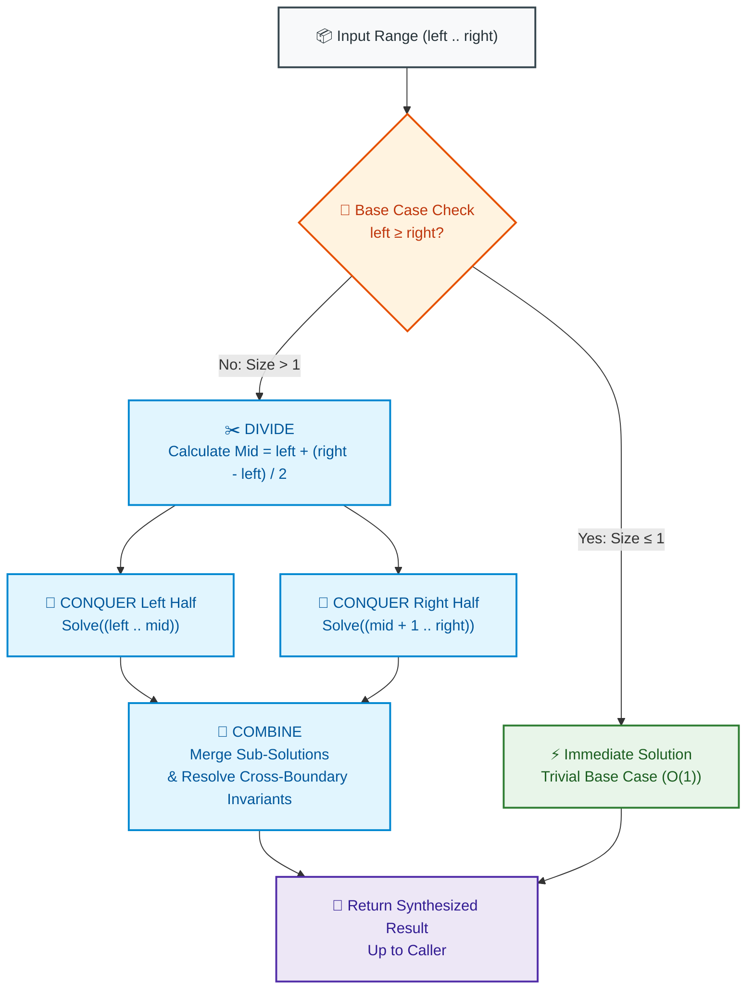

# 📘 Week 04 Day 04: Divide & Conquer Pattern — Recursive Problem Decomposition

> 🧭 **Navigation:** [← Previous Day](Week_04_Day_03_Sliding_Window_Variable_Size_Instructional.md) • [🏠 Week Overview](README.md) • [📘 Curriculum Syllabus](../COMPLETE_SYLLABUS.md) • [Next Day →](Week_04_Day_05_Binary_Search_as_Pattern_Instructional.md)
> 
> 💡 **Instructor Note:** *Not all sections or topics are mandatory. Feel free to adapt your pace and skim or skip sections based on your current focus and interview timeline.*

---

## 🎯 LEARNING OBJECTIVES

*By the end of this chapter, you will be able to:*

- 🎯 **Internalize** the Divide & Conquer trichotomy: chopping a problem into strictly disjoint subproblems, conquering them down to rock-bottom base cases, and recombining them through a high-leverage merge step.
- ⚙️ **Implement** classic Divide & Conquer algorithms (Fast Exponentiation `pow(x, n)`, Inversion Counting, Maximum Subarray cross-sum, and Canonical Merge Sort) with zero heap allocations during recursion.
- ⚖️ **Deconstruct** recurrence relations intuitively without getting bogged down in dense academic proofs: determining instantly whether work at the root, work at the leaves, or work across all levels dominates total runtime.
- 🛑 **Avoid** classic candidate traps: overlapping subproblems without memoization, quadratic combine steps that annihilate divide speedups, and choosing recursive D&C when a greedy `O(N)` scan is strictly superior.
- 🏭 **Connect** this pattern directly to production distributed infrastructure: MapReduce partitions, external multiway merge sorting on disk, and parallelized stream analytics.

---

## 🎬 CHAPTER 1: THE 60-SECOND HOOK & EVERYDAY ANALOGY

Hey engineers, welcome back to Week 4 Day 4!

If you've ever felt intimidated by recursive trees or the Master Theorem, take a deep breath. Today, we are going to strip away the textbook fluff and see Divide & Conquer for what it truly is: **the single most powerful weapon in computer science for smashing quadratic `O(N^2)` brute-force walls into lightning-fast `O(N log N)` or `O(log N)` solutions**.

### The Real-World Metaphor: The Skyscraper Delegation Tree

Imagine you are tasked with constructing a 100-story skyscraper. 

```
                                  [ 🏢 CEO: Build 100-Story Tower ]
                                                  |
                         +------------------------+------------------------+
                         |                                                 |
             [ 🏗️ VP West Wing: Floors 1-50 ]                 [ 🏗️ VP East Wing: Floors 51-100 ]
                         |                                                 |
             +-----------+-----------+                         +-----------+-----------+
             |                       |                         |                       |
       [ Floors 1-25 ]        [ Floors 26-50 ]           [ Floors 51-75 ]       [ Floors 76-100 ]
             |                       |                         |                       |
             v                       v                         v                       v
      (Down to Floor Managers -> Sub-contractors -> Workers laying 1 brick = BASE CASE!)
```

No single human being can lay 10 million bricks alone. A naive worker laying bricks sequentially one by one would take centuries. 

Instead, what happens?
1. The **CEO** does not pour concrete on floor 87. The CEO splits the project in half: West Wing and East Wing.
2. The **Project VPs** split their wings into 25-floor blocks and assign them to Floor Managers.
3. The delegation cascades down until a single worker is assigned a single brick at a single coordinate. That is your **Base Case**! Placing 1 brick is so trivial it requires zero delegation—you just place it (`O(1)` work).
4. **The Results Flow Back Up:** Once individual bricks are placed, walls are finished. Once walls are finished, floors are certified. Once both wings are complete, the structural engineers inspect the joint where the wings meet—**The Combine Phase**—and the skyscraper stands complete.

### The 3 Sacred Steps of Divide & Conquer

Every single Divide & Conquer algorithm follows this exact three-beat rhythm:

```
1. ✂️ DIVIDE:  Slice the big problem into smaller, completely independent subproblems.
2. 🔁 CONQUER: Recurse on the subproblems. If the subproblem is rock-bottom trivial (size 1 or 0), solve it immediately (Base Case).
3. 🔗 COMBINE: The real secret sauce! Stitch the solved subproblems together to construct the global answer.
```

> **💡 The Architectural Secret:** The speedup of Divide & Conquer does **not** come from doing less total work; it comes from **structuring comparisons hierarchically**. Instead of comparing an element against all `N - 1` other elements (`O(N^2)` work), each element participates in only `log_2(N)` hierarchical combine stages.

---

### De-Jargoning the Master Theorem: The 3 Physical Cases

In textbooks, you'll see dense academic formulas for the Master Theorem: `T(N) = a * T(N / b) + O(N^d)`. Candidates panic trying to memorize logarithmic inequalities. 

Let's throw away the academic jargon. The Master Theorem is simply asking one intuitive question: **Where is the bulk of the work being done in your recursion tree?**

```
                                  ROOT (Combine Step)
                                     /    |    \
                                    O     O     O
                                   / \   / \   / \
                                  o   o o   o o   o  ...
                                 ====================
                                  LEAVES (Base Cases)
```

Look at the tree. There are only three physical possibilities for where CPU cycles are spent:

| Intuitive Case | Physical Reality | Who Dominates? | Resulting Complexity | Classic Example |
| :--- | :--- | :--- | :--- | :--- |
| **Case 1: The Root Dominates** (`d > log_b(a)`) | The combine step at the top level is so expensive that by the time you reach the leaves, the work at the bottom is negligible. | **The Root** dictates total runtime. | `O(N^d)` | Matrix operations with heavy top-level combine |
| **Case 2: The Leaves Dominate** (`d < log_b(a)`) | The problem spawns new branches so aggressively that the sheer explosion of base cases at the bottom drowns out the combine cost. | **The Leaves** dictate total runtime. | `O(N^(log_b a))` | Karatsuba multiplication (`O(N^1.585)`), Naive Tree Traversals |
| **Case 3: Perfectly Balanced** (`d == log_b(a)`) | Every single horizontal level of your tree performs the **exact same total amount of work**. | **Equal across all levels**. Multiply work-per-level by tree depth (`log N`). | `O(N^d * log N)` | **Merge Sort** (`N` work per level * `log N` levels = `O(N log N)`) |

That's it! When you look at Merge Sort:
- You split into `a = 2` halves of size `N / 2` (`b = 2`).
- The combine phase takes linear time `O(N^1)` (`d = 1`).
- `log_2(2) = 1`, which exactly matches `d = 1`. 
- Every level does `N` work. Tree depth is `log_2(N)`. Total work is `O(N log N)`. Clean, intuitive, zero stress.

---

## 🪜 CHAPTER 2: THE SCAFFOLDING LADDER & TOY NAPKIN TRACES

Let's build intuition through concrete napkin traces before writing full production code.

### 🪜 Napkin Trace 1: Fast Power (`pow(2, 10)`)

Suppose you need to compute `2^10 = 1024`.

#### The Naive Linear Way
`2 * 2 * 2 * 2 * 2 * 2 * 2 * 2 * 2 * 2` -> **10 multiplications** (`O(N)` time).
If `N = 1,000,000,000`, your system hangs for seconds.

#### The Divide & Conquer Way
Notice the algebraic symmetry:
`2^10 = (2^5) * (2^5) = (2^5)^2`

We do **not** need to compute `2^5` twice! We compute it **once**, cache the result in a local variable, and square it!

```
Trace Tree:
pow(2, 10)
   └── Compute half = pow(2, 5)
          └── 5 is odd: 2 * (pow(2, 2))^2
                 └── Compute half = pow(2, 2)
                        └── 2 is even: (pow(2, 1))^2
                               └── Compute half = pow(2, 1)
                                      └── 1 is odd: 2 * (pow(2, 0))^2
                                             └── pow(2, 0) = 1.0 (BASE CASE)
```

Now trace the values bubbling back up:
1. `pow(2, 0) = 1.0` (Base case)
2. `pow(2, 1) = 2 * (1.0 * 1.0) = 2.0` (1 multiplication)
3. `pow(2, 2) = 2.0 * 2.0 = 4.0` (1 multiplication)
4. `pow(2, 5) = 2 * (4.0 * 4.0) = 2 * 16.0 = 32.0` (2 multiplications)
5. `pow(2, 10) = 32.0 * 32.0 = 1024.0` (1 multiplication)

**Total Operations:** Exactly **5 multiplications** instead of 10!
For `N = 10^9`, `log_2(10^9) ≈ 30` multiplications instead of 1 billion! That is the difference between 30 nanoseconds and a CPU timeout.

> 🧠 **Pause & Predict #1:** What happens if the exponent `n` is negative, such as `pow(2, -2)`? More critically, what happens in C# or Java if `n = -2147483648` (`int.MinValue`) and you execute `n = -n`?
> 
> *Think about 32-bit signed integer limits before reading Chapter 6!*

---

### 🪜 Napkin Trace 2: Maximum Subarray Cross-Boundary Combine Step

Consider LeetCode 53: Find the contiguous subarray with the largest sum.
Input array: `nums = [-2, 1, -3, 4, -1, 2, 1, -5, 4]` (length 9).

If we divide the array at `mid = 4` (value `-1`):
- **Left Subproblem:** `[-2, 1, -3, 4]` (indices 0 to 3)
- **Midpoint Element:** `nums[4] = -1`
- **Right Subproblem:** `[2, 1, -5, 4]` (indices 5 to 8)

The maximum contiguous subarray can only reside in one of **three possible locations**:
1. Entirely inside the left half.
2. Entirely inside the right half.
3. **Straddling the boundary across `mid`!**

```
Indices:    0    1    2    3      4      5    6    7    8
Values:   [-2,   1,  -3,   4] | [-1] |  [2,   1,  -5,   4]
          [--- Left Half ---]   mid   [--- Right Half ---]
                                  
                        CROSS-BOUNDARY WINDOW
                        [      4,  -1,   2,   1      ] -> Sum = 6!
```

#### How the Cross-Boundary Combine Step Works:
To find the best subarray crossing the middle in `O(N)` time:
1. **Walk LEFT from `mid` towards `left`:** Accumulate a running sum and record the highest peak.
   - At index 4 (`-1`): running sum = `-1`, max = `-1`
   - At index 3 (`4`): running sum = `-1 + 4 = 3`, max = `3`
   - At index 2 (`-3`): running sum = `3 + (-3) = 0`, max = `3`
   - At index 1 (`1`): running sum = `0 + 1 = 1`, max = `3`
   - At index 0 (`-2`): running sum = `1 + (-2) = -1`, max = `3`
   - **Left Best Crossing Sum = `3`** (achieved at slice `[4, -1]`).

2. **Walk RIGHT from `mid + 1` towards `right`:** Accumulate a running sum and record the highest peak.
   - At index 5 (`2`): running sum = `2`, max = `2`
   - At index 6 (`1`): running sum = `2 + 1 = 3`, max = `3`
   - At index 7 (`-5`): running sum = `3 + (-5) = -2`, max = `3`
   - At index 8 (`4`): running sum = `-2 + 4 = 2`, max = `3`
   - **Right Best Crossing Sum = `3`** (achieved at slice `[2, 1]`).

3. **Stitch Them Together:**
   `CrossMax = LeftBest + RightBest = 3 + 3 = 6` (Subarray `[4, -1, 2, 1]`).
   
4. **Take the Global Maximum:**
   `GlobalMax = Max(LeftMax, RightMax, CrossMax) = Max(4, 4, 6) = 6`.

> 🧠 **Pause & Predict #2:** Kadane's algorithm solves Maximum Subarray in `O(N)` time and `O(1)` space using an iterative scan. Why would a FAANG interviewer ask you to implement the `O(N log N)` Divide & Conquer approach?
> 
> *Hint: Think about distributed computing. Can Kadane's algorithm run across 1,000 independent worker machines processing a petabyte stream without central state?*

---

### 🪜 Napkin Trace 3: Cross-Inversion Counting Mechanics

An **inversion** is a pair of indices `(i, j)` where `i < j` but `nums[i] > nums[j]` (the elements are out of order).
Counting inversions measures how "unsorted" a dataset is—used directly in recommendation engines (collaborative filtering) and financial anomaly detection.

Naive nested loops take `O(N^2)` time. Divide & Conquer solves this in `O(N log N)` by hitchhiking on Merge Sort!

Suppose we are merging two already-sorted subarrays:
- `Left  = [3, 8]` (indices `i`)
- `Right = [1, 5]` (indices `j`)

```
Left:  [ 3,  8 ]           Right: [ 1,  5 ]
         ^                          ^
         i                          j
```

1. **Compare `Left[i] = 3` vs `Right[j] = 1`:**
   - Clearly, `3 > 1`.
   - **The High-Yield Invariant:** Because `Left` is already sorted, if `Left[i] > Right[j]`, then **EVERY element after `i` in the left half is also guaranteed to be greater than `Right[j]`!**
   - Both `3` and `8` are greater than `1`!
   - Inversions discovered immediately: `mid - i + 1 = 1 - 0 + 1 = 2` pairs (`(3, 1)` and `(8, 1)`).
   - Advance `j` to 1 (`Right[1] = 5`), copy `1` to output.

2. **Compare `Left[i] = 3` vs `Right[j] = 5`:**
   - `3 <= 5` (In order).
   - Inversions added: `0`.
   - Advance `i` to 1 (`Left[1] = 8`), copy `3` to output.

3. **Compare `Left[i] = 8` vs `Right[j] = 5`:**
   - `8 > 5`.
   - Inversions discovered: `mid - i + 1 = 1 - 1 + 1 = 1` pair (`(8, 5)`).
   - Advance `j` to 2 (Right exhausted), copy `5` to output.

4. **Flush remaining `Left` (`8`):**
   - Copy `8` to output. Total inversions found: `2 + 1 = 3`.

In a single linear pass of the merge step, we counted all cross-boundary inversions without inspecting individual pairs!

---

## 🎨 CHAPTER 3: PRAGMATIC VISUAL MODELS & LIFECYCLE

### Visual Model 1: The Recurrence Tree Split & Combine

Here is the exact mechanical execution flow of Merge Sort on an 8-element array. Notice how division happens top-down, and synthesis happens bottom-up:

```
                            [ 38, 27, 43, 3, 9, 82, 10, 1 ]
                                           |
                                  DIVIDE (Split at Mid)
                                           v
                       +-------------------+-------------------+
                       |                                       |
              [ 38, 27, 43, 3 ]                       [ 9, 82, 10, 1 ]
                       |                                       |
               +-------+-------+                       +-------+-------+
               |               |                       |               |
           [ 38, 27 ]      [ 43, 3 ]               [ 9, 82 ]       [ 10, 1 ]
               |               |                       |               |
            +--+--+         +--+--+                 +--+--+         +--+--+
            |     |         |     |                 |     |         |     |
          [38]   [27]     [43]   [3]               [9]   [82]      [10]   [1]   <-- BASE CASES (Size 1)
           |      |        |      |                 |     |         |      |
================================ BOTTOM-UP COMBINE ================================
           \      /        \      /                 \     /         \      /
          [ 27, 38 ]      [ 3, 43 ]                [ 9, 82 ]       [ 1, 10 ]  <-- Level 1 Merged
               \               /                       \               /
              [ 3, 27, 38, 43 ]                       [ 1, 9, 10, 82 ]        <-- Level 2 Merged
                       \                                       /
                            [ 1, 3, 9, 10, 27, 38, 43, 82 ]                   <-- FULLY SORTED
```

---

### Visual Model 2: The Divide & Conquer State Machine

Below is the standard execution lifecycle followed by every production Divide & Conquer engine:



---

### Memory Layout & Call Stack Anatomy

When executing Divide & Conquer recursively, candidates often forget about the **Call Stack** memory footprint:

```
[Stack Frame 0]: Solve(left = 0, right = 7)
    ├── [Stack Frame 1]: Solve(left = 0, right = 3)
    │       ├── [Stack Frame 2]: Solve(left = 0, right = 1)
    │       │       ├── [Stack Frame 3]: Solve(left = 0, right = 0) -> Returns [38]
    │       │       └── [Stack Frame 3]: Solve(left = 1, right = 1) -> Returns [27]
    │       └── Merges into [27, 38]
    └── Continues...
```

- **Maximum Call Stack Depth:** Exactly `log_2(N)`. For `N = 10^6`, stack depth is only 20 frames—well within the standard 1 MB stack limit.
- **Scratch Buffer Space:** If you allocate `new int[N]` inside every stack frame, you allocate `O(N log N)` total heap memory and trigger severe Garbage Collection pressure!
- **Senior Architect Pattern:** Allocate **one single auxiliary buffer** of size `N` at the root call, and slice it down using `Span<T>` or indices. Auxiliary heap allocations: `O(1)`. Total auxiliary space: `O(N)`.

---

## 🛑 CHAPTER 4: THE ROOKIE TRAP ZONE

### Side-by-Side Architectural Comparisons

#### ⚠️ Trap 1: Overlapping Subproblems in D&C (The Exponential Explosion)

```csharp
// ❌ ROOKIE BLUNDER: Blindly using Divide & Conquer for overlapping subproblems
// Recurrence: T(N) = T(N - 1) + T(N - 2) -> O(2^N) Exponential Disaster!
public int Fib(int n)
{
    if (n <= 1) return n;
    return Fib(n - 1) + Fib(n - 2); // Recomputes Fib(n - 3) thousands of times!
}
```

```csharp
// ✅ SENIOR ARCHITECT PATTERN: Recognize non-disjoint subproblems and use Memoization / DP
// Or enforce strictly DISJOINT subproblems in D&C where left and right never overlap!
public int Fib(int n)
{
    if (n <= 1) return n;
    int prev2 = 0, prev1 = 1;
    for (int i = 2; i <= n; i++)
    {
        int curr = prev1 + prev2;
        prev2 = prev1;
        prev1 = curr;
    }
    return prev1; // O(N) time, O(1) space!
}
```

> **Senior Rule of Thumb:** Divide & Conquer is for **disjoint, non-overlapping** subproblems (e.g. left array `[0..mid]` and right array `[mid+1..right]`). If subproblems overlap, it is **Dynamic Programming**.

---

#### ⚠️ Trap 2: Doing `O(N^2)` Work in the Combine Phase

```csharp
// ❌ ROOKIE BLUNDER: Inefficient Combine Step destroys divide speedup
// Recurrence: T(N) = 2*T(N/2) + O(N^2)
// By Master Theorem: T(N) = O(N^2)! You divided for nothing!
void InefficientCombine(int[] arr, int left, int mid, int right)
{
    // Candidate uses nested loops to reconcile left and right halves
    for (int i = left; i <= mid; i++)
    {
        for (int j = mid + 1; j <= right; j++)
        {
            if (arr[i] > arr[j]) Swap(arr, i, j); // O(N^2) combine!
        }
    }
}
```

```csharp
// ✅ SENIOR ARCHITECT PATTERN: Linear O(N) Two-Pointer Combine
// Recurrence: T(N) = 2*T(N/2) + O(N) -> O(N log N) optimal!
void EfficientCombine(Span<int> arr, int left, int mid, int right, Span<int> aux)
{
    int i = left, j = mid + 1, k = left;
    // Single linear pass merging two sorted streams
    while (i <= mid && j <= right)
    {
        aux[k++] = (arr[i] <= arr[j]) ? arr[i++] : arr[j++];
    }
    while (i <= mid) aux[k++] = arr[i++];
    while (j <= right) aux[k++] = arr[j++];
    aux.Slice(left, right - left + 1).CopyTo(arr.Slice(left, right - left + 1));
}
```

---

#### ⚠️ Trap 3: Using D&C When a Linear Scan or Greedy Approach Exists

```
Comparison: Maximum Subarray (LeetCode 53)

Approach 1: Divide & Conquer
- Time Complexity: O(N log N)
- Space Complexity: O(log N) stack frames
- Lines of code: ~45 lines
- When to use: When parallelizing on Apache Spark across multiple GPU/CPU nodes.

Approach 2: Kadane's Algorithm (Greedy / DP)
- Time Complexity: O(N)
- Space Complexity: O(1) auxiliary
- Lines of code: ~8 lines
- When to use: Single-machine in-memory processing.
```

> **Interview Pro-Tip:** If an interviewer asks you LeetCode 53, **always propose Kadane's `O(N)` first**! State: *"I can solve this in `O(N)` time and `O(1)` space using Kadane's algorithm. However, if this dataset is partitioned across a distributed map-reduce cluster or we want to explore a divide-and-conquer recurrence, we can decompose it into `O(N log N)` with independent cross-boundary combines."* This demonstrates principal-level breadth.

---

## 🎙️ CHAPTER 5: 45-MINUTE INTERVIEW TALK TRACKS

When your interviewer gives you a Divide & Conquer problem, speak these exact scripts before typing a single character of code:

### 🎙️ The Universal D&C Elevator Pitch
> *"I can model this problem using the Divide & Conquer pattern. We will partition the search range at `mid = left + (right - left) / 2` into two disjoint subproblems, solve them recursively until reaching our base case of a single element, and then synthesize the solution in our combine step in linear `O(N)` time. According to the Master Theorem where `T(N) = 2*T(N/2) + O(N)`, this reduces our brute-force quadratic runtime to optimal `O(N log N)` time with `O(log N)` stack depth."*

---

### 🎙️ Problem-Specific Talk Tracks

#### 1. Fast Power (`pow(x, n)`)
> *"Instead of multiplying `x` by itself `n` times linearly, we observe that `x^n = (x^(n/2))^2`. We recursively compute `half = pow(x, n / 2)`. If `n` is even, the result is simply `half * half`; if odd, it is `half * half * x`. To prevent integer overflow on `int.MinValue` (-2^31), we cast `n` to a 64-bit integer before inverting negative powers. This drops the time complexity from `O(N)` to `O(log N)` with `O(log N)` stack depth."*

#### 2. Inversion Counting
> *"An inversion occurs when `i < j` but `arr[i] > arr[j]`. We can piggyback onto Merge Sort. During the combine step, because both the left and right halves are already sorted, if `aux[i] > aux[j]`, then every element remaining in the left subarray from `i` through `mid` is also strictly greater than `aux[j]`. This allows us to accumulate `(mid - i + 1)` inversions in `O(1)` time per comparison, achieving `O(N log N)` total time without quadratic nested scans."*

#### 3. Maximum Subarray Cross-Sum
> *"Any maximum contiguous subarray must either lie completely within the left half, completely within the right half, or cross through the midpoint. We recursively find the max left and max right subarrays. For the crossing subarray, we perform two independent linear scans radiating outward from the midpoint in `O(N)` time. We then return the maximum of the three candidates. The recurrence is `T(N) = 2*T(N/2) + O(N)`, giving `O(N log N)` time."*

---

## ⚡ CHAPTER 6: PRODUCTION DUAL-LANGUAGE IMPLEMENTATIONS

### Problem 1: Fast Power (`pow(x, n)` — LeetCode 50)

#### C# Primary Implementation (.NET 8/9 — Overflow-Safe, Zero Heap Allocation)
```csharp
using System;

public static class FastPowerSolver
{
    /// <summary>
    /// Computes x raised to the power n using Divide & Conquer Fast Exponentiation.
    /// Time Complexity: O(log |n|) | Auxiliary Space: O(log |n|) call stack
    /// </summary>
    public static double MyPow(double x, int n)
    {
        // Edge case: base is 0 or 1
        if (x == 1.0) return 1.0;
        if (x == 0.0) return 0.0;

        // ⚠️ CRITICAL ROOKIE TRAP: In C# and Java, -int.MinValue overflows!
        // int.MinValue is -2,147,483,648. Negating it exceeds int.MaxValue (2,147,483,647).
        // We MUST widen n to a 64-bit long before negating.
        long exp = n;
        if (exp < 0)
        {
            x = 1.0 / x;
            exp = -exp;
        }

        return FastPow(x, exp);
    }

    private static double FastPow(double baseVal, long exp)
    {
        // Base case: any number to power 0 is 1
        if (exp == 0) return 1.0;

        // 1. DIVIDE & CONQUER: Compute half power once
        double half = FastPow(baseVal, exp / 2);

        // 2. COMBINE: Square the result
        if (exp % 2 == 0)
        {
            return half * half;
        }
        else
        {
            return half * half * baseVal;
        }
    }
}
```

#### Python Secondary Implementation (3.11+ — Idiomatic)
```python
def my_pow(x: float, n: int) -> float:
    """Computes x^n using Divide & Conquer Fast Exponentiation.
    
    Time Complexity: O(log |n|) | Auxiliary Space: O(log |n|) call stack
    """
    if x == 1.0:
        return 1.0
    if x == 0.0:
        return 0.0

    exp = n
    if exp < 0:
        x = 1.0 / x
        exp = -exp

    def fast_pow(base: float, power: int) -> float:
        # Base case
        if power == 0:
            return 1.0

        # Divide & Conquer: compute once
        half = fast_pow(base, power // 2)

        # Combine
        if power % 2 == 0:
            return half * half
        return half * half * base

    return fast_pow(x, exp)
```

#### 📊 Explicit Complexity Deconstruction
* **Time Complexity:** `O(log |n|)` — At each recursive step, `n` is halved (`n / 2`). The tree height is bounded strictly by `log_2(|n|)`.
* **Auxiliary Space:** `O(log |n|)` — Space consumed by the recursion call stack. No heap objects allocated.
* **Output Space:** `O(1)` — Returns a single 64-bit floating point number.

---

### Problem 2: Count Inversions in an Array (Classic / CSES)

#### C# Primary Implementation (.NET 8/9 — Single Scratch Buffer Span, 64-bit Overflow Guard)
```csharp
using System;

public static class InversionCounter
{
    /// <summary>
    /// Counts total inversions (i < j and arr[i] > arr[j]) in an array using Divide & Conquer.
    /// Time Complexity: O(N log N) | Auxiliary Space: O(N) single scratch buffer
    /// </summary>
    public static long CountInversions(Span<int> array)
    {
        if (array.Length <= 1) return 0;

        // Allocate a single scratch buffer to eliminate GC churn across recursive frames
        int[] auxBuffer = new int[array.Length];
        return CountInversionsInternal(array, 0, array.Length - 1, auxBuffer);
    }

    private static long CountInversionsInternal(Span<int> array, int left, int right, Span<int> aux)
    {
        // Base case: range of size 1 has 0 inversions
        if (left >= right) return 0;

        int mid = left + (right - left) / 2;
        long totalInversions = 0;

        // 1. DIVIDE & CONQUER
        totalInversions += CountInversionsInternal(array, left, mid, aux);
        totalInversions += CountInversionsInternal(array, mid + 1, right, aux);

        // 2. COMBINE: Count cross-boundary inversions during merge
        totalInversions += MergeAndCountCross(array, left, mid, right, aux);

        return totalInversions;
    }

    private static long MergeAndCountCross(Span<int> array, int left, int mid, int right, Span<int> aux)
    {
        // Snapshot the range into scratch buffer
        for (int idx = left; idx <= right; idx++)
        {
            aux[idx] = array[idx];
        }

        int i = left;      // Pointer in sorted Left half
        int j = mid + 1;   // Pointer in sorted Right half
        int k = left;      // Write pointer in array
        long crossInversions = 0;

        while (i <= mid && j <= right)
        {
            if (aux[i] <= aux[j])
            {
                array[k++] = aux[i++];
            }
            else
            {
                // Invariant: Since Left is sorted, all elements from i..mid are strictly > aux[j]!
                crossInversions += (mid - i + 1);
                array[k++] = aux[j++];
            }
        }

        // Flush remaining elements of left half
        while (i <= mid)
        {
            array[k++] = aux[i++];
        }
        // Elements remaining in right half are already in their correct relative positions

        return crossInversions;
    }
}
```

#### Python Secondary Implementation (3.11+ — Idiomatic)
```python
def count_inversions(nums: list[int]) -> int:
    """Counts inversions in an array using Divide and Conquer.
    
    Time Complexity: O(N log N) | Auxiliary Space: O(N)
    """
    if len(nums) <= 1:
        return 0

    arr = list(nums)
    aux = [0] * len(arr)

    def sort_and_count(left: int, right: int) -> int:
        if left >= right:
            return 0

        mid = left + (right - left) // 2
        inv_count = sort_and_count(left, mid) + sort_and_count(mid + 1, right)

        # Snapshot slice
        for k in range(left, right + 1):
            aux[k] = arr[k]

        i, j, curr = left, mid + 1, left
        while i <= mid and j <= right:
            if aux[i] <= aux[j]:
                arr[curr] = aux[i]
                i += 1
            else:
                # Key insight: mid - i + 1 elements are inverted
                inv_count += (mid - i + 1)
                arr[curr] = aux[j]
                j += 1
            curr += 1

        while i <= mid:
            arr[curr] = aux[i]
            i += 1
            curr += 1

        return inv_count

    return sort_and_count(0, len(arr) - 1)
```

#### 📊 Explicit Complexity Deconstruction
* **Time Complexity:** `O(N log N)` — Tree depth is `log_2(N)`. At each level, the two-pointer merge inspects every element in `O(N)` total time.
* **Auxiliary Space:** `O(N)` — Single scratch array of size `N` allocated once at entry, plus `O(log N)` stack depth.
* **Output Space:** `O(1)` — Returns a 64-bit integer count. (Guarded with `long` because `N = 10^5` reversed elements produces `~5 * 10^9` inversions, overflowing 32-bit signed ints).

---

### Problem 3: Maximum Subarray via Divide & Conquer (LeetCode 53)

#### C# Primary Implementation (.NET 8/9 — `ReadOnlySpan<int>`)
```csharp
using System;

public static class MaxSubarrayDivideAndConquer
{
    /// <summary>
    /// Solves Maximum Subarray using Divide and Conquer.
    /// Time Complexity: O(N log N) | Auxiliary Space: O(log N) stack frames
    /// Note: In single-threaded production, Kadane's O(N) algorithm is preferred.
    /// </summary>
    public static int FindMaxSubarray(ReadOnlySpan<int> nums)
    {
        if (nums.IsEmpty) return 0;
        return MaxSubarrayInternal(nums, 0, nums.Length - 1);
    }

    private static int MaxSubarrayInternal(ReadOnlySpan<int> nums, int left, int right)
    {
        // Base case: single element
        if (left == right) return nums[left];

        int mid = left + (right - left) / 2;

        // 1. DIVIDE & CONQUER: solve left and right halves independently
        int leftMax = MaxSubarrayInternal(nums, left, mid);
        int rightMax = MaxSubarrayInternal(nums, mid + 1, right);

        // 2. COMBINE: find best subarray crossing the midpoint
        int crossMax = FindCrossMax(nums, left, mid, right);

        // 3. SYNTHESIZE: Global maximum is the best of all three
        return Math.Max(leftMax, Math.Max(rightMax, crossMax));
    }

    private static int FindCrossMax(ReadOnlySpan<int> nums, int left, int mid, int right)
    {
        // Walk left from mid to find maximum prefix sum going backward
        int leftRunningSum = 0;
        int maxLeftSum = int.MinValue;
        for (int i = mid; i >= left; i--)
        {
            leftRunningSum += nums[i];
            if (leftRunningSum > maxLeftSum)
            {
                maxLeftSum = leftRunningSum;
            }
        }

        // Walk right from mid + 1 to find maximum prefix sum going forward
        int rightRunningSum = 0;
        int maxRightSum = int.MinValue;
        for (int j = mid + 1; j <= right; j++)
        {
            rightRunningSum += nums[j];
            if (rightRunningSum > maxRightSum)
            {
                maxRightSum = rightRunningSum;
            }
        }

        return maxLeftSum + maxRightSum;
    }
}
```

#### Python Secondary Implementation (3.11+ — Idiomatic)
```python
def max_sub_array_dc(nums: list[int]) -> int:
    """Finds maximum subarray sum using Divide and Conquer.
    
    Time Complexity: O(N log N) | Auxiliary Space: O(log N) stack
    """
    if not nums:
        return 0

    def solve(left: int, right: int) -> int:
        if left == right:
            return nums[left]

        mid = left + (right - left) // 2
        left_max = solve(left, mid)
        right_max = solve(mid + 1, right)

        # Cross-boundary combine step
        curr_left_sum = 0
        best_left = float("-inf")
        for i in range(mid, left - 1, -1):
            curr_left_sum += nums[i]
            best_left = max(best_left, curr_left_sum)

        curr_right_sum = 0
        best_right = float("-inf")
        for j in range(mid + 1, right + 1):
            curr_right_sum += nums[j]
            best_right = max(best_right, curr_right_sum)

        cross_max = best_left + best_right
        return max(left_max, right_max, cross_max)

    return solve(0, len(nums) - 1)
```

#### 📊 Explicit Complexity Deconstruction
* **Time Complexity:** `O(N log N)` — Recurrence `T(N) = 2*T(N/2) + O(N)`. The crossing sum examines elements between `left` and `right` in linear time.
* **Auxiliary Space:** `O(log N)` — Call stack depth only. Zero heap allocations.
* **Output Space:** `O(1)` — Returns a single integer sum.

---

### Problem 4: Canonical In-Place Merge Sort

#### C# Primary Implementation (.NET 8/9 — Single Reusable Scratch Buffer with Early Exit Optimization)
```csharp
using System;

public static class ProductionMergeSorter
{
    /// <summary>
    /// Sorts a span in ascending order using Divide & Conquer with an auxiliary scratch buffer.
    /// Time Complexity: O(N log N) | Auxiliary Space: O(N)
    /// </summary>
    public static void MergeSort(Span<int> array)
    {
        if (array.Length <= 1) return;

        // Allocate auxiliary memory ONCE at entry point to prevent recursion allocation overhead
        int[] aux = new int[array.Length];
        SortInternal(array, 0, array.Length - 1, aux);
    }

    private static void SortInternal(Span<int> array, int left, int right, Span<int> aux)
    {
        // Base case: single element is inherently sorted
        if (left >= right) return;

        int mid = left + (right - left) / 2;

        // 1. DIVIDE & CONQUER
        SortInternal(array, left, mid, aux);
        SortInternal(array, mid + 1, right, aux);

        // 🚀 PRODUCTION OPTIMIZATION: If already sorted across boundary, skip the merge!
        // Drops best-case runtime to O(N) on sorted inputs.
        if (array[mid] <= array[mid + 1]) return;

        // 2. COMBINE
        Merge(array, left, mid, right, aux);
    }

    private static void Merge(Span<int> array, int left, int mid, int right, Span<int> aux)
    {
        // Copy target range to scratch buffer
        for (int idx = left; idx <= right; idx++)
        {
            aux[idx] = array[idx];
        }

        int i = left;
        int j = mid + 1;
        int k = left;

        // Two-pointer merge back into array
        while (i <= mid && j <= right)
        {
            array[k++] = (aux[i] <= aux[j]) ? aux[i++] : aux[j++];
        }

        // Flush remaining elements in left half
        while (i <= mid)
        {
            array[k++] = aux[i++];
        }
        // Elements in right half are already in their final resting slots
    }
}
```

#### Python Secondary Implementation (3.11+ — Idiomatic)
```python
def merge_sort(nums: list[int]) -> list[int]:
    """Sorts a list in-place using Divide and Conquer Merge Sort.
    
    Time Complexity: O(N log N) | Auxiliary Space: O(N)
    """
    if len(nums) <= 1:
        return nums

    aux = [0] * len(nums)

    def sort_range(left: int, right: int) -> None:
        if left >= right:
            return

        mid = left + (right - left) // 2
        sort_range(left, mid)
        sort_range(mid + 1, right)

        # Early exit optimization: already ordered
        if nums[mid] <= nums[mid + 1]:
            return

        for k in range(left, right + 1):
            aux[k] = nums[k]

        i, j, curr = left, mid + 1, left
        while i <= mid and j <= right:
            if aux[i] <= aux[j]:
                nums[curr] = aux[i]
                i += 1
            else:
                nums[curr] = aux[j]
                j += 1
            curr += 1

        while i <= mid:
            nums[curr] = aux[i]
            i += 1
            curr += 1

    sort_range(0, len(nums) - 1)
    return nums
```

---

## ⚖️ CHAPTER 7: FAANG INTERVIEW PATTERN SIGNALS & EDGE CASES

> [!NOTE]
> **Production Reality (Why FAANG Tests Divide & Conquer):**
> Distributed big-data engines (such as MapReduce, Apache Spark sort-merge joins, and PostgreSQL External Merge Sort) routinely process petabytes of data that far exceed available RAM. Divide & Conquer allows servers to partition data into memory-sized chunks, sort each chunk locally on SSD, and perform sequential streaming merge passes across network disks with optimal sequential I/O and zero random seeks.

### 🎯 Pattern Recognition Cheat Sheet

| Problem Characteristic | Go-To Pattern | Why Divide & Conquer Wins |
| :--- | :--- | :--- |
| **"Count pairs `(i, j)` satisfying an order violation"** | Inversion Counting via Merge | Sorted halves allow counting `mid - i + 1` elements in `O(1)` time. |
| **"Merge `k` sorted collections"** | Pairwise Divide & Conquer Merge | Merges `k` lists in `O(N log k)` vs naive sequential merging `O(N * k)`. |
| **"Compute large powers `x^n`"** | Fast Exponentiation | Halves the exponent at each step, dropping runtime from `O(N)` to `O(log N)`. |
| **"Subproblems are independent and non-overlapping"** | Divide & Conquer | Disjoint subsets prevent redundant recalculations. |
| **"Subproblems overlap repeatedly (Fibonacci, Knapsack, LCS)"** | **Dynamic Programming** | Pure D&C blows up into `O(2^N)`; DP caches subproblems in `O(N)`. |

---

### 🧪 Concrete Edge-Case Checklist

1. **Midpoint Integer Overflow:**
   - ❌ Blunder: `mid = (left + right) / 2`
   - ✅ Correct: `mid = left + (right - left) / 2` (Prevents 32-bit signed overflow when `left + right > 2^31 - 1`).
2. **Negative Exponents and `int.MinValue`:**
   - When evaluating `x^n` where `n = -2147483648`, executing `-n` overflows a signed 32-bit integer. Always widen `n` to a 64-bit integer (`long` in C# / standard Python `int`) before negating!
3. **64-Bit Inversion Counters:**
   - On an array of `N = 10^5` descending elements, the number of inversions is `N * (N - 1) / 2 ≈ 5 * 10^9`, which exceeds `int.MaxValue` (`2.14 * 10^9`). Always return `long`!
4. **Already Sorted Short-Circuit:**
   - Before executing the combine phase in Merge Sort, verify `if (array[mid] <= array[mid + 1]) return;`. This allows sorted or partially sorted arrays to finish in `O(N)` time.

---

## ⚔️ CHAPTER 8: PRACTICE DRILLS & CURATED INTERVIEW QUESTIONS

### 🏋️ Curated Practice Problems (8 High-ROI FAANG Classics)

| Problem | Source | Difficulty | Key Concept Tested |
| :--- | :--- | :--- | :--- |
| **Pow(x, n)** | LeetCode 50 | 🟡 Medium | Fast exponentiation, negative exponent & overflow guard |
| **Sort an Array (Merge Sort)** | LeetCode 912 | 🟡 Medium | Single auxiliary buffer, in-place recursion |
| **Count Inversions** | Classic / CSES | 🟡 Medium | Cross-inversion counting during combine phase |
| **Maximum Subarray (D&C Formulation)** | LeetCode 53 | 🟡 Medium | Cross-boundary maximum subarray combine step |
| **Merge k Sorted Lists** | LeetCode 23 | 🔴 Hard | Pairwise divide & conquer list merging |
| **Reverse Pairs** | LeetCode 493 | 🔴 Hard | Condition `nums[i] > 2 * nums[j]` via two-pointer combine |
| **Majority Element** | LeetCode 169 | 🟢 Easy | Recursive divide & conquer majority vote |
| **The Skyline Problem** | LeetCode 218 | 🔴 Hard | Divide building footprints, combine overlapping silhouettes |

---

### 🎙️ FAANG Deep-Dive Interview Questions (With Model Answers)

#### Q1: What is the recurrence relation of Merge Sort, and how does the Master Theorem prove it runs in `O(N log N)`?
> **Answer:** Merge Sort divides the array into 2 halves (`a = 2`, `b = 2`) and merges them in linear time (`d = 1`). The recurrence is `T(N) = 2*T(N/2) + O(N)`. Comparing `log_b(a) = log_2(2) = 1` with `d = 1`, we see that `log_b(a) == d`. This represents a perfectly balanced recurrence tree where every single horizontal level does exactly `O(N)` total work across `log_2(N)` levels, yielding a total time complexity of `O(N log N)`.

#### Q2: Why is Merge Sort preferred over Quick Sort for external sorting of massive datasets on disk?
> **Answer:** External sorting operates on datasets larger than physical RAM (e.g. 10 TB of database logs on a 64 GB machine). Merge Sort accesses data sequentially in streaming chunks, which maximizes disk read throughput and minimizes expensive random disk seeks. Furthermore, Merge Sort is naturally stable and guarantees deterministic `O(N log N)` worst-case performance, whereas Quick Sort can degrade to `O(N^2)` with random disk access patterns.

#### Q3: How does counting inversions in `O(N log N)` work? Why does `aux[i] > aux[j]` imply `(mid - i + 1)` inversions?
> **Answer:** In the combine step of Merge Sort, the left half `[left..mid]` and right half `[mid+1..right]` are both sorted. If an element `aux[j]` from the right half is strictly smaller than `aux[i]` from the left half, then because the left half is in ascending order, every remaining element from index `i` through `mid` must also be strictly greater than `aux[j]`. We can therefore add `(mid - i + 1)` cross-inversions in `O(1)` time without iterating through them.

#### Q4: What is the difference between Divide & Conquer and Dynamic Programming?
> **Answer:** Both decompose a problem into smaller subproblems. However, Divide & Conquer applies when subproblems are **independent and strictly disjoint** (e.g. sorting the left half does not affect the right half). Dynamic Programming applies when subproblems **overlap extensively** (e.g. Fibonacci, shortest paths, string edit distance). Applying pure D&C to overlapping subproblems causes an exponential explosion `O(2^N)`, whereas DP caches shared states in polynomial time.

#### Q5: Can Merge Sort be implemented with `O(1)` auxiliary space on arrays?
> **Answer:** In theory, in-place merge sort algorithms exist (such as block sort or SymMerge), but they introduce complex pointer rotations that increase the constant factor substantially, often degrading real-world runtime to `O(N log^2 N)` or slowing down CPU cache utilization. On singly linked lists, however, Merge Sort achieves true `O(1)` auxiliary space because pointer rewiring requires zero scratch arrays.

#### Q6: How does MapReduce apply Divide & Conquer across thousands of distributed servers?
> **Answer:** MapReduce is Divide & Conquer at hyperscale. The **Divide** step splits a multi-terabyte dataset into distributed chunks across thousands of worker nodes. The **Conquer** step executes the `Map()` function locally on each chunk in parallel. The **Combine / Reduce** step groups intermediate keys and merges sub-results across the network to produce the final global tally.

---

### ❌ Common Misconceptions Deconstructed

- **Myth #1: "Divide & Conquer always yields `O(N log N)` time."**
  - **Reality:** Complexity depends entirely on the branching factor `a`, the division factor `b`, and the combine work `O(N^d)`. Binary Search is Divide & Conquer with `a = 1, b = 2, d = 0`, yielding `O(log N)`. Karatsuba is `a = 3, b = 2, d = 1`, yielding `O(N^1.585)`.
- **Myth #2: "Allocating temporary arrays inside the recursive helper does not affect Big-O."**
  - **Reality:** While theoretical Big-O remains `O(N log N)`, allocating `O(N)` heap objects at every recursive frame triggers massive Garbage Collection pauses that can degrade real-world execution speed by 10x-50x. Always allocate a single scratch buffer at the entry point.
- **Myth #3: "Divide & Conquer requires multi-core parallelism to be useful."**
  - **Reality:** Even on a single-threaded CPU, Divide & Conquer provides exponential algorithmic speedups by eliminating redundant combinatorial comparisons.

---

### 🚀 Advanced Distributed & Algorithmic Extensions

- **Strassen's Matrix Multiplication:** Decomposes standard `N x N` matrix multiplication from 8 recursive multiplications down to 7, dropping runtime from `O(N^3)` to `O(N^2.807)`.
- **External Multiway Merge Sort (k-way Merge):** Merges hundreds of sorted disk runs concurrently using a min-heap tournament tree, powering production database engines.
- **Cache-Oblivious Algorithms:** Recursive divide-and-conquer structures naturally align with CPU cache hierarchies (L1, L2, L3) without requiring hardcoded hardware constants.
- **Closest Pair of Points in 2D:** Solves geometric proximity in `O(N log N)` time by dividing points across a vertical median line and combining points within a narrow geometric strip in linear time.

---

## 📌 CLOSING REFLECTION

Divide & Conquer is more than just a sorting trick—it is a foundational engineering philosophy: **decompose intractable complexity into trivial, independent fragments, then synthesize their solutions systematically**.

When facing an intimidating FAANG problem, ask yourself:
1. *Can I slice this problem into two independent halves?*
2. *What is my rock-bottom base case?*
3. *How can I combine the two halves in linear `O(N)` or constant `O(1)` time?*

Master this mental model, and you will transform quadratic bottlenecks into elegant, scalable logarithmic architectures.

---

> 🧭 **Navigation:** [← Previous Day](Week_04_Day_03_Sliding_Window_Variable_Size_Instructional.md) • [🏠 Week Overview](README.md) • [📘 Curriculum Syllabus](../COMPLETE_SYLLABUS.md) • [Next Day →](Week_04_Day_05_Binary_Search_as_Pattern_Instructional.md)
