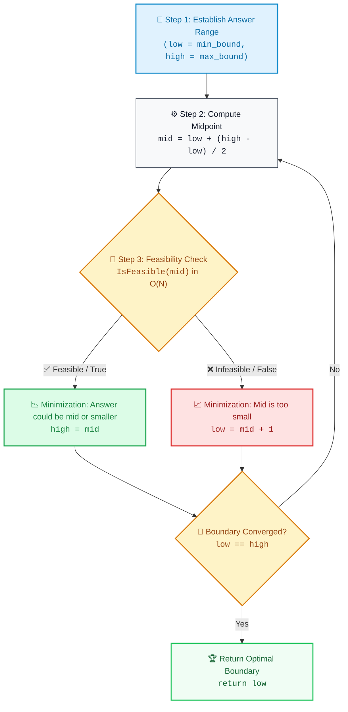

# 📘 Week 04 Day 05: Binary Search as a Pattern — Optimization Through Feasibility Testing

> 🧭 **Navigation:** [← Previous Day](Week_04_Day_04_Divide_and_Conquer_Pattern_Instructional.md) • [🏠 Week Overview](README.md) • [📘 Curriculum Syllabus](../COMPLETE_SYLLABUS.md) • [Week Playbook →](WEEK_04_FULL_PLAYBOOK.md)
> 
> 💡 **Instructor Note:** *Not all sections or topics are mandatory. Feel free to adapt your pace and skim or skip sections based on your current focus and interview timeline.*

---

## 🎯 LEARNING OBJECTIVES

*By the end of this chapter, you will be able to:*

- 🎯 **Internalize the Grand Paradigm Shift:** Recognize that Binary Search is not merely an algorithm for finding an element in a sorted array; it is a universal **Optimization Engine** for solving complex minimization and maximization problems across virtual answer spaces.
- ⚙️ **Construct Zero-Allocation Feasibility Oracles:** Design deterministic `O(N)` verification functions (`CanShip`, `CanEatAll`, `CanSplit`, `CanPlace`) that evaluate candidate answers without extra heap allocations.
- ⚖️ **Prove Monotonicity:** Mathematically and physically verify whether a problem exhibits a single boolean phase-transition (`False -> True` or `True -> False`).
- 🛑 **Eliminate Boundary Bugs & Integer Overflows:** Calculate mathematically airtight initial bounds (`low`, `high`) and implement overflow-safe ceiling calculations in pure integer arithmetic.
- 🏭 **Connect Algorithmic Theory to Production Systems:** Map binary search optimization to Kubernetes CPU/memory pod scheduling, database batch-size throttling, and network streaming bitrate calibration.

---

## 🎬 PILLAR 1: THE 60-SECOND HOOK & REAL-WORLD METAPHOR

Hey engineers, welcome back to Week 4 Day 5 — our **Week 4 grand finale**!

If you ask 95% of junior engineers *"What is Binary Search?"*, they will give you the textbook answer:
> *"It's when you have an array like `[1, 3, 5, 7, 9]`, look at the middle number `5`, and go left or right to find target `7`."*

In senior FAANG and Tier-1 product interviews, that elementary usage represents barely 5% of what interviewers actually care about!

### 💡 The Big Paradigm Shift

Binary Search is **NOT** an array lookup algorithm. 
Binary Search is an **Optimization Engine** for finding the extreme boundary of ANY problem where the answer space satisfies a **monotonic condition**:

```
[ False,  False,  False,  False,  True,  True,  True,  True ]
                                    ^
                           The Phase Transition
```

Whenever a problem asks you to:
1. **"Minimize the maximum..."** (e.g. ship capacity, largest subarray sum, painter's time)
2. **"Maximize the minimum..."** (e.g. distance between placed servers, aggressive cows)
3. **"Find the minimum rate/speed to finish within time `T`"** (e.g. Koko eating bananas)

...stop trying to design an intricate constructive greedy algorithm or a combinatorially explosive Dynamic Programming table. **Invert your perspective:**

> **The Inversion Principle:** Instead of trying to directly *calculate* the optimal answer, **guess** candidate answers and use a simple linear `O(N)` simulation to **verify** if that guess is physically feasible!

---

### 🌡️ The Everyday Analogy: The Thermostat Dial

Imagine you enter a hotel room and the thermostat knob has arbitrary tick marks from `1` to `100`. The room is currently boiling hot. You don't have an HVAC engineering degree, and you don't know the exact differential equations for heat dissipation in the room.

```
Cold/Comfortable ....................................... Too Hot!
[ 1,  2,  3,  ...,  68,  69,  70 | 71,  72,  ...,  99,  100 ]
  Feasible (Comfortable)         | Infeasible (Sweating)
```

How do you find the maximum dial setting that keeps the room comfortable?
1. You set the dial to `75`. You wait a moment and feel: **"Too hot!"**
2. **Here is the punchline:** Do you need to test `76`, `80`, `90`, or `100`? **Of course not!** If `75` is already too hot, anything hotter is guaranteed to be too hot! You instantly eliminate the entire upper half `[75..100]`.
3. You turn the dial down to `50`. The room is chilly (Comfortable/Feasible).
4. Because `50` is feasible, you now test between `51` and `74`.

In just **7 adjustments** (`log_2(100) ≈ 7`), you pinpoint the exact comfort threshold. You didn't solve a complex thermodynamic system; you queried a **monotonic physical oracle** across a numeric range.

---

### 🏭 Production Reality: Cloud Capacity Schedulers

Why do Meta, Google, and Netflix ask this pattern constantly?
Because production cloud infrastructure runs on it every day:
- **Kubernetes Pod Resource Sizing:** Schedulers do not know the analytical limit of your microservice under peak load. They calibrate memory and CPU limits using binary bisection on load test results.
- **Database Bulk Replication:** Finding the largest batch size `B` that doesn't trigger replication lag or connection pool starvation. If batch size `10,000` causes database timeouts, batch size `20,000` will certainly crash it.
- **Adaptive Bitrate Streaming (Netflix / YouTube):** Dynamically selecting video chunk bitrates over fluctuating network bandwidth.

---

## 🪜 PILLAR 2: THE SCAFFOLDING LADDER & TOY NAPKIN TRACE

Let's dissect the canonical problem that trips up thousands of candidates: **LeetCode 875 — Koko Eating Bananas**.

### 🍌 The Problem Setup
- Banana piles: `piles = [3, 6, 7, 11]`
- Guard return deadline: `H = 8` hours
- Rule: Koko chooses an integer eating speed `k` (bananas per hour). Each hour, she picks a pile and eats up to `k` bananas from it. If the pile has fewer than `k` bananas, she eats them all and **waits out the rest of the hour** (she cannot move to another pile during the same hour).
- **Goal:** Find the **minimum integer speed `k`** such that Koko can finish all bananas in `<= H` hours.

---

### 🪜 Step 1: Establish the Physical Search Boundaries

Before touching any code, determine the absolute theoretical extremes for speed `k`:

```
low  = 1            --> Koko must eat at least 1 banana per hour (speed cannot be 0).
high = max(piles)   --> Eating faster than 11 bananas/hr is completely pointless!
                        Because Koko cannot jump between piles within the same hour,
                        eating at speed 100 takes 1 hr for pile 11, exactly the same as speed 11!
```

Our Virtual Answer Space is: `k ∈ [1, 11]`.

---

### 🪜 Step 2: The Toy Napkin Trace (Watch the Range Collapse!)

Let's trace Koko's decisions step-by-step on a napkin:

```
Answer Space: [ 1, 2, 3, 4, 5, 6, 7, 8, 9, 10, 11 ]
                L               M               H
```

#### 🔄 Iteration 1:
- `low = 1`, `high = 11`
- `mid = 1 + (11 - 1) / 2 = 6` bananas/hour.
- **Linear Feasibility Simulation (`O(N)`):**
  - Pile `3`: `ceil(3 / 6) = 1` hour
  - Pile `6`: `ceil(6 / 6) = 1` hour
  - Pile `7`: `ceil(7 / 6) = 2` hours
  - Pile `11`: `ceil(11 / 6) = 2` hours
  - **Total Hours:** `1 + 1 + 2 + 2 = 6` hours.
- **Evaluation:** `6 <= 8` hours? **YES (Feasible! True)**
- **Deduction:** Speed `6` works! But Koko wants the *minimum* speed. Can she eat slower? 
- Any speed `> 6` (`7, 8, 9, 10, 11`) is guaranteed feasible and can be safely discarded.
- Contract range: `high = mid = 6`.

---

#### 🔄 Iteration 2:
- `low = 1`, `high = 6`
- `mid = 1 + (6 - 1) / 2 = 3` bananas/hour.
- **Linear Feasibility Simulation:**
  - Pile `3`: `ceil(3 / 3) = 1` hour
  - Pile `6`: `ceil(6 / 3) = 2` hours
  - Pile `7`: `ceil(7 / 3) = 3` hours
  - Pile `11`: `ceil(11 / 3) = 4` hours
  - **Total Hours:** `1 + 2 + 3 + 4 = 10` hours.
- **Evaluation:** `10 <= 8` hours? **NO (Infeasible! False — too slow!)**
- **Deduction:** At speed `3`, Koko misses the deadline! 
- If speed `3` fails, speeds `1` and `2` will be even slower! Discard `[1..3]`.
- Contract range: `low = mid + 1 = 4`.

---

#### 🔄 Iteration 3:
- `low = 4`, `high = 6`
- `mid = 4 + (6 - 4) / 2 = 5` bananas/hour.
- **Linear Feasibility Simulation:**
  - Pile `3`: `ceil(3 / 5) = 1` hour
  - Pile `6`: `ceil(6 / 5) = 2` hours
  - Pile `7`: `ceil(7 / 5) = 2` hours
  - Pile `11`: `ceil(11 / 5) = 3` hours
  - **Total Hours:** `1 + 2 + 2 + 3 = 8` hours.
- **Evaluation:** `8 <= 8` hours? **YES (Feasible! True)**
- **Deduction:** Speed `5` works! Contract range: `high = mid = 5`.

---

#### 🔄 Iteration 4:
- `low = 4`, `high = 5`
- `mid = 4 + (5 - 4) / 2 = 4` bananas/hour.
- **Linear Feasibility Simulation:**
  - Pile `3`: `ceil(3 / 4) = 1` hour
  - Pile `6`: `ceil(6 / 4) = 2` hours
  - Pile `7`: `ceil(7 / 4) = 2` hours
  - Pile `11`: `ceil(11 / 4) = 3` hours
  - **Total Hours:** `1 + 2 + 2 + 3 = 8` hours.
- **Evaluation:** `8 <= 8` hours? **YES (Feasible! True)**
- **Deduction:** Speed `4` works! Contract range: `high = mid = 4`.

---

#### 🏁 Termination:
- `low == 4`, `high == 4` -> Loop terminates (`low < high` breaks).
- **Final Result:** Optimal minimum speed `k = 4` bananas/hour.

```
Iterations needed: 4 checks instead of 11 sequential tests!
At scale (10^9 bananas): 30 checks instead of 1,000,000,000!
```

---

### 🧠 PAUSE & PREDICT: Micro-Drills for Active Recall

> **Drill 1:** In Koko Eating Bananas, what happens if an engineer initializes `low = 0`?
> *Pause for 5 seconds... think through the math...*
>
> **Answer:** Runtime Crash! `ceil(pile / speed)` will evaluate `pile / 0`, throwing a `DivideByZeroException` (or `ZeroDivisionError` in Python). In rate/speed problems, `low` is always strictly `>= 1`.

> **Drill 2:** What if `H < piles.Length`? For example, 5 piles of bananas, but the guards return in 3 hours?
> *Pause for 5 seconds...*
>
> **Answer:** By the rules of the problem, Koko can at most consume 1 pile per hour. By the **Pigeonhole Principle**, she needs at least `piles.Length` hours. If `H < piles.Length`, it is mathematically impossible to finish regardless of speed! In an interview, mention this edge case immediately to establish high senior bar presence.

---

## 🎨 PILLAR 3: PRAGMATIC VISUAL MODELS

### 1. ASCII Predicate Transition Model

Notice how the virtual answer space transforms under the feasibility oracle:

```
Speed Candidate k:   1     2     3     4     5     6     7     8     9    10    11
Feasibility P(k):  [ F  |  F  |  F  |  T  |  T  |  T  |  T  |  T  |  T  |  T  |  T  ]
                                       ^
                            First True (Optimal Min)
                                       
Contraction Trace:
Initial:           [ L = 1 ............................................. H = 11 ]
Step 1: Mid = 6 -> Feasible (T)   => Discard (6..11]  => [ L = 1 ..... H = 6 ]
Step 2: Mid = 3 -> Infeasible (F) => Discard [1..3]   => [ L = 4 ..... H = 6 ]
Step 3: Mid = 5 -> Feasible (T)   => Discard (5..6]   => [ L = 4 . H = 5 ]
Step 4: Mid = 4 -> Feasible (T)   => Discard (4..5]   => [ L = 4, H = 4 ] -> Converged!
```

---

### 2. Mermaid Master Engine Flowchart



---

### 3. Master Taxonomy of Binary Search Archetypes

| Problem Archetype | Search Space `[Low..High]` | Feasibility Function (`P(mid)`) | Transition Direction | Canonical LeetCode |
| :--- | :--- | :--- | :--- | :--- |
| **Capacity Allocation** | `[max(item), sum(items)]` | Can ship/pack all within `D` days? | `F -> T` (Minimization) | 1011 (Ship Packages) |
| **Rate / Speed Optimization** | `[1, max(pile)]` | Can consume all piles in `<= H` hours? | `F -> T` (Minimization) | 875 (Koko Bananas) |
| **Array Partitioning** | `[max(num), sum(nums)]` | Can partition array into `<= k` subarrays? | `F -> T` (Minimization) | 410 (Split Array) |
| **Maximum Minimum Distance** | `[1, (max - min) / (k - 1)]`| Can place `k` items with `dist >= mid`? | `T -> F` (Maximization) | 1552 (Magnetic Force) |

---

## 🛑 PILLAR 4: THE ROOKIE TRAP ZONE

### Trap Comparison Matrix

| Problem Area | ❌ Rookie Blunder | ✅ Senior Architect Pattern |
| :--- | :--- | :--- |
| **Problem Formulation** | Trying to use 2D Dynamic Programming (`dp[i][k] = min max(...)`) or recursive backtracking to partition arrays, resulting in `O(N^2 * K)` or `O(2^N)` exponential TLE. | Recognize monotonicity and **invert the problem**: don't construct the partitions directly; binary search candidate sums in `O(N * log(Sum - Max))`. |
| **Search Space Bounds** | Initializing `low = 0` (causing division by zero) or `low = 1` for container capacity problems (where a single package weighing 50 cannot fit). | Ground boundaries in physical reality: for capacity, `low = max(weights)` (must hold largest item); for speed, `low = 1`. |
| **Ceiling Division** | Using floating-point conversions: `Math.Ceiling((double)pile / speed)`, which loses IEEE 754 precision on large values and slows CPU execution. | Use pure integer arithmetic: `(pile + speed - 1) / speed` (guaranteed exact, zero float conversions). |
| **Integer Accumulation** | Accumulating hours/days into a 32-bit `int`, causing silent sign-bit wrap around (overflow) when `pile / speed` sums exceed `2 * 10^9`. | Accumulate simulation hours/days into a 64-bit `long` primitive. |
| **Search Termination** | Mixing up `while (low <= high)` and `while (low < high)`, getting stuck in infinite loops when `high = mid` without convergence. | For minimization (`First True`): use `low < high`, update `high = mid` on true, `low = mid + 1` on false, return `low`. |

---

## 🎙️ PILLAR 5: 45-MINUTE INTERVIEW VERBAL TALK TRACK

When solving this in a FAANG interview, do not immediately start writing code! Speak this exact **3-sentence pitch** to align with the interviewer:

> ### 💬 The 3-Sentence Master Pitch
> 1. *"Notice that the problem asks us to minimize the maximum workload [or find the minimum feasible speed], and the feasibility condition is monotonic: if capacity `X` can accomplish the task, any capacity greater than `X` will also trivially succeed."*
> 2. *"Because the answer space is bounded between `[max_element, sum_elements]` [or `[1, max_element]`], we can binary search the answer rather than using a complex constructive DP approach."*
> 3. *"At each iteration, we run an `O(N)` greedy feasibility oracle to test candidate `mid`, allowing us to converge on the optimal answer in `O(N * log(Range))` time with strictly `O(1)` auxiliary space."*

---

## ⚡ PILLAR 6: PRODUCTION DUAL-LANGUAGE IMPLEMENTATIONS

---

### Problem 1: Capacity To Ship Packages Within D Days (LeetCode 1011)

#### 🎙️ Interview Talk Track (30 Seconds)
> *"We want the minimum ship capacity to deliver packages in `days`. The minimum possible capacity is `max(weights)` because the ship must be able to carry the single heaviest item. The maximum capacity is `sum(weights)`—delivering everything on day 1. If capacity `C` can ship all items within `D` days, any capacity `> C` can also do so. We binary search between `max(weights)` and `sum(weights)`. In our `O(N)` greedy check, we load packages sequentially until exceeding capacity, then start a new day. Total time is `O(N * log(Sum - Max))` with `O(1)` auxiliary space."*

#### C# Primary Implementation (.NET 8/9 — Zero Allocation `ReadOnlySpan<T>`)

```csharp
using System;

public static class ShipCapacitySolver
{
    /// <summary>
    /// Finds the minimum ship capacity to deliver packages within given days.
    /// Time Complexity: O(N * log(Sum - Max)) | Auxiliary Space: O(1)
    /// </summary>
    public static int ShipWithinDays(ReadOnlySpan<int> weights, int days)
    {
        // Guard clause: validate inputs
        if (weights.IsEmpty || days <= 0)
        {
            return 0;
        }

        int low = 0;
        int high = 0;

        // Establish tight physical search boundaries in a single O(N) pass
        for (int i = 0; i < weights.Length; i++)
        {
            if (weights[i] > low)
            {
                low = weights[i]; // Must hold at least the single heaviest package
            }
            high += weights[i];   // Can ship everything in 1 day
        }

        // Monotonic Search: [False, False, ..., False, True, True, ..., True]
        // Goal: Find First True
        while (low < high)
        {
            int mid = low + (high - low) / 2;

            if (CanShip(weights, mid, days))
            {
                high = mid; // Feasible: search for an even smaller valid capacity
            }
            else
            {
                low = mid + 1; // Infeasible: capacity too small, discard [low..mid]
            }
        }

        return low; // When low == high, we have locked onto the minimum feasible capacity
    }

    private static bool CanShip(ReadOnlySpan<int> weights, int capacity, int maxDays)
    {
        int daysUsed = 1;
        int currentLoad = 0;

        for (int i = 0; i < weights.Length; i++)
        {
            if (currentLoad + weights[i] > capacity)
            {
                daysUsed++;
                currentLoad = weights[i];

                // Early exit: avoid redundant iterations
                if (daysUsed > maxDays)
                {
                    return false;
                }
            }
            else
            {
                currentLoad += weights[i];
            }
        }

        return true;
    }
}
```

#### Python Secondary Implementation (3.11+ — Idiomatic)

```python
def ship_within_days(weights: list[int], days: int) -> int:
    """Finds minimum ship capacity to ship all packages within given days.
    
    Time Complexity: O(N * log(Sum - Max)) | Auxiliary Space: O(1)
    """
    if not weights or days <= 0:
        return 0

    def can_ship(capacity: int) -> bool:
        days_used = 1
        current_load = 0
        for w in weights:
            if current_load + w > capacity:
                days_used += 1
                current_load = w
                if days_used > days:
                    return False
            else:
                current_load += w
        return True

    low = max(weights)
    high = sum(weights)

    while low < high:
        mid = low + (high - low) // 2
        if can_ship(mid):
            high = mid
        else:
            low = mid + 1

    return low
```

#### 📊 Explicit Complexity Deconstruction
* **Time Complexity:** `O(N * log(Sum - Max))` — Range size is `Sum - Max`. The binary search executes at most `log_2(Sum - Max)` iterations (typically `<= 30`). Each iteration performs an `O(N)` linear greedy scan.
* **Auxiliary Space:** `O(1)` — Operates with pure stack-allocated scalar pointers (`low`, `high`, `mid`). Zero heap allocations.
* **Output Space:** `O(1)` — Returns a single integer capacity.

---

### Problem 2: Koko Eating Bananas (LeetCode 875)

#### 🎙️ Interview Talk Track (30 Seconds)
> *"Koko needs the minimum integer speed `k` to finish all banana piles within `h` hours. Eating speed is bounded by `low = 1` and `high = max(piles)`. For any candidate speed `mid`, the hours taken for a pile is integer ceiling `(pile + mid - 1) / mid`. If the sum of hours across all piles is `<= h`, speed `mid` is feasible and we try slower speeds (`high = mid`); otherwise, we must speed up (`low = mid + 1`). This completes in `O(N * log(Max))` time with strictly integer operations and zero floating-point imprecision."*

#### C# Primary Implementation (.NET 8/9 — Pure Integer Ceiling)

```csharp
using System;

public static class KokoEatingSolver
{
    /// <summary>
    /// Finds the minimum integer eating speed k to consume all bananas within h hours.
    /// Time Complexity: O(N * log(Max)) | Auxiliary Space: O(1)
    /// </summary>
    public static int MinEatingSpeed(ReadOnlySpan<int> piles, int h)
    {
        if (piles.IsEmpty || h <= 0)
        {
            return 0;
        }

        int low = 1; // Minimum speed is 1 banana/hour (cannot be 0)
        int high = 1;

        for (int i = 0; i < piles.Length; i++)
        {
            if (piles[i] > high)
            {
                high = piles[i]; // Eating faster than max(piles) gives no extra benefit per pile
            }
        }

        while (low < high)
        {
            int mid = low + (high - low) / 2;

            if (CanFinishAll(piles, mid, h))
            {
                high = mid; // Feasible: search for a slower valid speed
            }
            else
            {
                low = mid + 1; // Infeasible: must eat faster
            }
        }

        return low;
    }

    private static bool CanFinishAll(ReadOnlySpan<int> piles, int speed, int maxHours)
    {
        long totalHours = 0; // 64-bit integer prevents overflow during large problem sums

        for (int i = 0; i < piles.Length; i++)
        {
            // Pure integer ceiling division: ceil(pile / speed) == (pile + speed - 1) / speed
            totalHours += (long)(piles[i] + speed - 1) / speed;

            if (totalHours > maxHours)
            {
                return false;
            }
        }

        return true;
    }
}
```

#### Python Secondary Implementation (3.11+ — Idiomatic)

```python
def min_eating_speed(piles: list[int], h: int) -> int:
    """Finds minimum integer eating speed k to finish all bananas within h hours.
    
    Time Complexity: O(N * log(Max)) | Auxiliary Space: O(1)
    """
    if not piles or h <= 0:
        return 0

    def can_finish(speed: int) -> bool:
        total_hours = 0
        for pile in piles:
            # Pure integer ceiling division
            total_hours += (pile + speed - 1) // speed
            if total_hours > h:
                return False
        return True

    low = 1
    high = max(piles)

    while low < high:
        mid = low + (high - low) // 2
        if can_finish(mid):
            high = mid
        else:
            low = mid + 1

    return low
```

#### 📊 Explicit Complexity Deconstruction
* **Time Complexity:** `O(N * log(Max))` — Search space is `1..max(piles)`. Testing takes `log_2(max(piles))` rounds, each computing `N` integer divisions.
* **Auxiliary Space:** `O(1)` — Only primitive 64-bit and 32-bit accumulators on the stack frame.
* **Output Space:** `O(1)` — Returns single integer speed.

---

### Problem 3: Split Array Largest Sum (LeetCode 410)

#### 🎙️ Interview Talk Track (30 Seconds)
> *"We need to split an array into `k` contiguous subarrays such that the maximum subarray sum is minimized. This is mathematically identical to the shipping capacity problem! The answer space is bounded by `max(nums)` (a subarray must hold at least the largest single element) and `sum(nums)` (1 partition holding all elements). If a maximum sum of `mid` allows splitting into `<= k` subarrays, `mid` is feasible and we try smaller maximum sums (`high = mid`). Our greedy partitioner counts how many subarrays are created in `O(N)` time. Overall time is `O(N * log(Sum - Max))` with `O(1)` auxiliary space."*

#### C# Primary Implementation (.NET 8/9 — Zero Allocation)

```csharp
using System;

public static class SplitArraySolver
{
    /// <summary>
    /// Minimizes the largest subarray sum when splitting nums into k non-empty subarrays.
    /// Time Complexity: O(N * log(Sum - Max)) | Auxiliary Space: O(1)
    /// </summary>
    public static int SplitArray(ReadOnlySpan<int> nums, int k)
    {
        if (nums.IsEmpty || k <= 0)
        {
            return 0;
        }

        int low = 0;
        int high = 0;

        for (int i = 0; i < nums.Length; i++)
        {
            if (nums[i] > low)
            {
                low = nums[i]; // Must hold at least the largest single number
            }
            high += nums[i];   // Sum of all elements (k = 1)
        }

        while (low < high)
        {
            int mid = low + (high - low) / 2;

            if (CanSplit(nums, mid, k))
            {
                high = mid; // Feasible with <= k subarrays: try a tighter bound
            }
            else
            {
                low = mid + 1; // Infeasible: requires more than k partitions
            }
        }

        return low;
    }

    private static bool CanSplit(ReadOnlySpan<int> nums, int maxSubarraySum, int maxPartitions)
    {
        int partitionsUsed = 1;
        int currentSubarraySum = 0;

        for (int i = 0; i < nums.Length; i++)
        {
            if (currentSubarraySum + nums[i] > maxSubarraySum)
            {
                partitionsUsed++;
                currentSubarraySum = nums[i];

                if (partitionsUsed > maxPartitions)
                {
                    return false;
                }
            }
            else
            {
                currentSubarraySum += nums[i];
            }
        }

        return true;
    }
}
```

#### Python Secondary Implementation (3.11+ — Idiomatic)

```python
def split_array(nums: list[int], k: int) -> int:
    """Minimizes the largest subarray sum when partitioning nums into k parts.
    
    Time Complexity: O(N * log(Sum - Max)) | Auxiliary Space: O(1)
    """
    if not nums or k <= 0:
        return 0

    def can_split(max_sum: int) -> bool:
        partitions = 1
        current_sum = 0
        for num in nums:
            if current_sum + num > max_sum:
                partitions += 1
                current_sum = num
                if partitions > k:
                    return False
            else:
                current_sum += num
        return True

    low = max(nums)
    high = sum(nums)

    while low < high:
        mid = low + (high - low) // 2
        if can_split(mid):
            high = mid
        else:
            low = mid + 1

    return low
```

#### 📊 Explicit Complexity Deconstruction
* **Time Complexity:** `O(N * log(Sum - Max))` — The answer range spans from `max(nums)` to `sum(nums)`. At most 32 bisection steps, each traversing `nums` once.
* **Auxiliary Space:** `O(1)` — Only scalar counters. Zero heap allocations.
* **Output Space:** `O(1)` — Returns the minimal largest subarray sum.

---

### Problem 4: Magnetic Force Between Two Balls / Aggressive Cows (LeetCode 1552)

#### 🎙️ Interview Talk Track (30 Seconds)
> *"This is the canonical **Maximization** archetype: maximize the minimum distance between `m` balls. The distance range is `[1, (max_pos - min_pos) / (m - 1)]`. If distance `D` is achievable, any smaller distance is also trivially achievable, yielding a `True -> False` transition. We sort coordinates in `O(N log N)` time to enable greedy placement. Our oracle greedily places the first ball at index 0, and each subsequent ball at the next coordinate `>= last_pos + D`. If we can place all `m` balls, we record `mid` as a valid candidate and search higher (`low = mid + 1`); otherwise, we shrink (`high = mid - 1`). Total time is `O(N log N + N * log(MaxDist))`."*

#### C# Primary Implementation (.NET 8/9 — In-Place Span Sort)

```csharp
using System;

public static class MagneticForceSolver
{
    /// <summary>
    /// Finds the maximum possible minimum distance between m placed balls/cows.
    /// Time Complexity: O(N log N + N * log(MaxDist)) | Auxiliary Space: O(1)
    /// </summary>
    public static int MaxDistance(Span<int> position, int m)
    {
        if (position.Length < m || m < 2)
        {
            return 0;
        }

        // Sort coordinates in-place to enable greedy linear placement
        position.Sort();

        int low = 1;
        int high = (position[^1] - position[0]) / (m - 1);
        int optimalDistance = 1;

        // Monotonic Search: [True, True, ..., True, False, False, ..., False]
        // Goal: Find Last True
        while (low <= high)
        {
            int mid = low + (high - low) / 2;

            if (CanPlace(position, m, mid))
            {
                optimalDistance = mid; // Record candidate
                low = mid + 1;          // Try an even larger minimum distance
            }
            else
            {
                high = mid - 1;         // Too ambitious: shrink search distance
            }
        }

        return optimalDistance;
    }

    private static bool CanPlace(ReadOnlySpan<int> position, int m, int minDistance)
    {
        int placedCount = 1;
        int lastPlacedPos = position[0];

        for (int i = 1; i < position.Length; i++)
        {
            if (position[i] - lastPlacedPos >= minDistance)
            {
                placedCount++;
                lastPlacedPos = position[i];

                if (placedCount >= m)
                {
                    return true;
                }
            }
        }

        return false;
    }
}
```

#### Python Secondary Implementation (3.11+ — Idiomatic)

```python
def max_distance(position: list[int], m: int) -> int:
    """Finds maximum possible minimum distance between m placed items.
    
    Time Complexity: O(N log N + N * log(MaxDist)) | Auxiliary Space: O(1)
    """
    if len(position) < m or m < 2:
        return 0

    position.sort()

    def can_place(min_dist: int) -> bool:
        count = 1
        last_pos = position[0]
        for pos in position[1:]:
            if pos - last_pos >= min_dist:
                count += 1
                last_pos = pos
                if count >= m:
                    return True
        return False

    low = 1
    high = (position[-1] - position[0]) // (m - 1)
    best = 1

    while low <= high:
        mid = low + (high - low) // 2
        if can_place(mid):
            best = mid
            low = mid + 1
        else:
            high = mid - 1

    return best
```

#### 📊 Explicit Complexity Deconstruction
* **Time Complexity:** `O(N log N + N * log(MaxDist))` — Initial coordinate sorting takes `O(N log N)`. Binary search runs `O(log(MaxDist))` iterations, each performing an `O(N)` linear greedy placement scan.
* **Auxiliary Space:** `O(1)` — In-place sort with zero heap allocations.
* **Output Space:** `O(1)` — Returns the optimal integer distance.

---

## ⚖️ FAANG INTERVIEW PATTERN SIGNALS & EDGE CASES

### 🎯 Pattern Recognition Checklist

1. **Trigger Keywords:**
   - *"Minimize the maximum workload / days / time..."*
   - *"Maximize the minimum distance / allocation / score..."*
   - *"Find the smallest threshold / divisor / capacity such that condition holds..."*
2. **Monotonicity Sanity Check:**
   - Ask yourself: *"If candidate answer X is valid, is X + 1 guaranteed to be valid as well?"* If yes, you have a monotonic phase transition!
3. **Linear Verifiability:**
   - Can you verify whether a candidate `X` works in `O(N)` linear time using a greedy pass? If yes, Binary Search on the Answer Space is the optimal solution.

---

### 🧪 Concrete Edge-Case Checklist

| Edge Case | Risk / Failure Mode | Architect Guard Clause |
| :--- | :--- | :--- |
| **`H < piles.Length` or `days < weights.Length`** | Impossible condition: cannot ship/eat in fewer steps than items. | Check `if (h < piles.Length) return -1;` or handle per problem contract. |
| **`m > position.Length`** | More items to place than stalls available. | Return `0` immediately via guard clause. |
| **32-bit Integer Overflow** | Computing `(low + high) / 2` or summing large array weights. | Write `mid = low + (high - low) / 2` and use `long` for sum accumulators. |
| **Division by Zero** | Setting `low = 0` in speed/rate calculations. | Always start speed search at `low = 1`. |
| **All elements equal** | `piles = [5, 5, 5, 5]`. | Fast convergence; check boundary behavior when `min == max`. |

---

## ⚔️ CURATED PRACTICE LADDER

| Problem | LeetCode # | Difficulty | Archetype | Target Time |
| :--- | :--- | :--- | :--- | :--- |
| **Capacity To Ship Packages Within D Days** | LC 1011 | 🟡 Medium | Capacity Minimization | 15 mins |
| **Koko Eating Bananas** | LC 875 | 🟡 Medium | Speed Minimization | 15 mins |
| **Split Array Largest Sum** | LC 410 | 🔴 Hard | Array Partitioning | 20 mins |
| **Magnetic Force Between Two Balls** | LC 1552 | 🟡 Medium | Distance Maximization | 20 mins |
| **Find the Smallest Divisor Given a Threshold** | LC 1283 | 🟡 Medium | Ceiling Division Minimization | 15 mins |
| **Minimum Number of Days to Make m Bouquets** | LC 1482 | 🟡 Medium | Segment Feasibility | 20 mins |
| **Painter's Partition Problem** | Classic | 🟡 Medium | Workload Allocation | 15 mins |
| **Aggressive Cows** | SPOJ / Classic | 🟡 Medium | Distance Maximization | 15 mins |

---

## 🎙️ MOCK INTERVIEW PROBING QUESTIONS & FOLLOW-UPS

1. **"Why do we use `low < high` for minimization problems, but `low <= high` with a `best` variable for maximization problems?"**
   - *Senior Answer:* In minimization, when `mid` is feasible, `mid` itself could be the answer, so we contract `high = mid`. The loop terminates when `low == high`, pointing precisely to the first true boundary. In maximization, when `mid` is feasible, we record `best = mid` and aggressively push `low = mid + 1` to explore higher values; the loop terminates when `low > high`, leaving `best` holding the last true value.

2. **"Could we solve Split Array Largest Sum using Dynamic Programming? What would the time complexity be?"**
   - *Senior Answer:* Yes, via `dp[i][j] = min_{p} { max(dp[p][j - 1], sum(nums[p..i])) }`. However, this requires `O(N^2 * k)` time and `O(N * k)` space. Binary search on the answer reduces the time to `O(N * log(Sum - Max))` with `O(1)` auxiliary space — a massive asymptotic leap.

3. **"In Koko Bananas, why does floating-point math `Math.Ceiling((double)pile / speed)` cause bugs in competitive programming and production?"**
   - *Senior Answer:* Floating-point IEEE-754 numbers maintain only 53 bits of precision in mantissa. For large integers approaching or exceeding `2^53`, floating-point arithmetic incurs rounding truncation, causing off-by-one errors. Pure integer arithmetic `(pile + speed - 1) / speed` is mathematically exact on 64-bit integers and avoids expensive FPU register context switches.

---

## 📌 CLOSING REFLECTION

Congratulations on finishing **Week 4 Day 5** and conquering the entire **Week 4 Core Problem Solving Patterns**!

The transition from a junior coder to a FAANG senior engineer hinges on this exact mindset:
- **Junior instinct:** *"How do I craft a complex formula to directly compute the answer?"*
- **Senior Architect instinct:** *"Can I formulate a monotonic feasibility oracle and let binary search do the heavy lifting across logarithmic boundaries?"*

Whenever you see *"minimize the maximum"*, *"maximize the minimum"*, or *"find the optimal rate"*, you now have an unstoppable, production-grade template in your arsenal.

Take a well-deserved break, review your Week 4 drills, and get ready for Week 5! 🚀

---

> 🧭 **Navigation:** [← Previous Day](Week_04_Day_04_Divide_and_Conquer_Pattern_Instructional.md) • [🏠 Week Overview](README.md) • [📘 Curriculum Syllabus](../COMPLETE_SYLLABUS.md) • [Week Playbook →](WEEK_04_FULL_PLAYBOOK.md)
