# 📘 Week 05: Tier-1 Critical Problem-Solving Patterns

> 🧭 **Navigation:** [← Previous: Week 04](../week_04_core_problem_solving_patterns_i/README.md) • [🏠 Curriculum Overview](../README.md) • [📘 Complete Syllabus](../COMPLETE_SYLLABUS.md) • [Next: Week 06 →](../week_06_string_manipulation_patterns/README.md)

---

> 💡 **Instructor Guidance Note:**  
> *Welcome to Week 05! These are the heavy hitters of technical interviews: Hash Maps with Prefix Sums, Monotonic Stacks, Interval Merging, Cyclic Sort, Kadane's Algorithm, and Fast & Slow Pointers. Each pattern solves an entire family of LeetCode Medium and Hard problems with surgical precision.*

---

## 🎯 Weekly Mission & Conceptual Focus

Master hash map complement lookups, prefix sum range caching, monotonic stack next-greater elements, calendar/interval scheduling, in-place cyclic index placement, maximum contiguous subarrays, and tortoise-hare cycle detection.

```mermaid
%%{init: {"flowchart": {"htmlLabels": true, "padding": 20}, "themeCSS": "foreignObject { overflow: visible !important; }"}}%%
flowchart LR
    classDef hashNode fill:#e8f5e9,stroke:#2e7d32,stroke-width:2px,color:#1b5e20
    classDef stackNode fill:#f3e5f5,stroke:#7b1fa2,stroke-width:2px,color:#4a148c
    classDef intNode fill:#e3f2fd,stroke:#1565c0,stroke-width:2px,color:#0d47a1
    classDef sortNode fill:#fff3e0,stroke:#e65100,stroke-width:2px,color:#bf360c
    classDef ptrNode fill:#fce4ec,stroke:#c2185b,stroke-width:2px,color:#880e4f

    D1["🗝️ Day 01: Hash Map &<br/>Prefix Sum Patterns"]:::hashNode --> D2["📉 Day 02: Monotonic Stack<br/>& Next Greater"]:::stackNode
    D2 --> D3["📅 Day 03: Interval Merging<br/>& Overlaps"]:::intNode
    D3 --> D4A["🔄 Day 04A: Cyclic Sort<br/>(Numbers in 1..N)"]:::sortNode
    D4A --> D4B["⚡ Day 04B: Kadane's<br/>Max Subarray"]:::sortNode
    D4B --> D5["🐢🐇 Day 05: Fast & Slow<br/>Pointers (Floyd)"]:::ptrNode
```

---

## 📅 The 6-Module YouTube-Style Masterclass Path

| Day / Episode | Masterclass Module | The 60-Second Hook & Core Concept | Key Interview Takeaway |
| :--- | :--- | :--- | :--- |
| **Day 01** | [📘 Hash Map & Prefix Sum Patterns](Week_05_Day_01_Hash_Map_Hash_Set_Patterns_Instructional_EXPANDED.md) | 🗝️ *The Time-Space Trade-off:* Converting O(N^2) pair searches to O(N) complement lookups, and running prefix sum maps to find Subarray Sum Equals K. | Articulate single-pass prefix sum hash caching in 45-minute rounds. |
| **Day 02** | [📘 Monotonic Stack Patterns](Week_05_Day_02_Monotonic_Stack_Patterns_Instructional.md) | 📉 *The Line of Sight:* Finding the Next Greater/Smaller element in O(N) by popping elements that can never see past the incoming taller building. | Master the monotonic decreasing/increasing stack template without getting lost. |
| **Day 03** | [📘 Merge Operations & Interval Patterns](Week_05_Day_03_Merge_Operations_Interval_Patterns_Instructional.md) | 📅 *The Google Calendar Schedulizer:* Sorting intervals by start time and extending `end = max(end, next.end)` to merge overlapping events. | Solve Merge Intervals, Insert Interval, and Meeting Rooms with clean sorting invariants. |
| **Day 04 Part A** | [📘 Cyclic Sort Pattern](Week_05_Day_04_Part_A_Partition_Cyclic_Sort_Instructional.md) | 🔄 *The Musical Chairs Protocol:* When an array contains numbers in range `1..N`, every number `x` belongs at index `x - 1`. Place each element into its home in O(N) time and O(1) space. | Find Missing Number and First Missing Positive without allocating hash sets. |
| **Day 04 Part B** | [📘 Kadane's Algorithm](Week_05_Day_04_Part_B_Kadane_Algorithm_Instructional.md) | ⚡ *Reset or Continue:* Slicing through negative baggage—if the running prefix sum becomes negative, drop it and reset from the current number. | Implement maximum subarray and circular maximum subarray in 5 minutes. |
| **Day 05** | [📘 Fast & Slow Pointers](Week_05_Day_05_Fast_Slow_Pointers_Instructional.md) | 🐢🐇 *The Tortoise & The Hare:* Two runners on a circular track are mathematically guaranteed to collide in at most one full lap. | Detect cycles, locate cycle entrances, and find linked list midpoints in O(1) space. |

---

## 📚 Consolidated Playbooks & Reference Guides

*   📖 **Comprehensive Week Playbook:** [WEEK_05_FULL_PLAYBOOK.md](WEEK_05_FULL_PLAYBOOK.md) — High-density synthesis of all invariants, theorems, and pattern triggers for this week.
*   📊 **Visual Concepts Playbook (Hybrid):** [Week_05_Visual_Concepts_Playbook_HYBRID.md](Week_05_Visual_Concepts_Playbook_HYBRID.md) — Compact Mermaid diagrams, state transitions, and complexity reference tables.
*   💻 **Production C# Reference (.NET 8/9):** [Week_05_Extended_CSharp_Complete.md](Week_05_Extended_CSharp_Complete.md) — Idiomatic, zero-allocation memory-aware implementations and problem ladders.
*   🐍 **Production Python Reference (Python 3.11+):** [Week_05_Extended_Python_Complete.md](Week_05_Extended_Python_Complete.md) — Clean, pythonic reference implementations for rapid whiteboard prototyping.

---

## 🛠️ The 5 Core Support Files (`support files/`)

Every week is accompanied by five dedicated support files located in the `support files/` subdirectory:

1.  📋 [Daily Progress Checklist](support%20files/Week_05_Daily_Progress_Checklist.md) — Step-by-step accountability tracker for theory, coding, and variants.
2.  🧭 [Weekly Guidelines & Mental Models](support%20files/Week_05_Guidelines.md) — Strategic roadmap, common pitfalls, and conceptual anchors.
3.  🎙️ [Interview Q&A Comprehensive Reference](support%20files/Week_05_Interview_QA_Reference.md) — High-frequency senior technical questions with verbal response frameworks.
4.  🗺️ [Problem-Solving Roadmap](support%20files/Week_05_Problem_Solving_Roadmap.md) — Tier-1 problem progression ladder from warm-up to advanced.
5.  📑 [Summary & Key Concepts Synthesis](support%20files/Week_05_Summary_Key_Concepts.md) — Fast-revision cheat sheet covering all governing invariants and system trade-offs.

---

> 🧭 **Navigation:** [← Previous: Week 04](../week_04_core_problem_solving_patterns_i/README.md) • [🏠 Curriculum Overview](../README.md) • [📘 Complete Syllabus](../COMPLETE_SYLLABUS.md) • [Next: Week 06 →](../week_06_string_manipulation_patterns/README.md)
