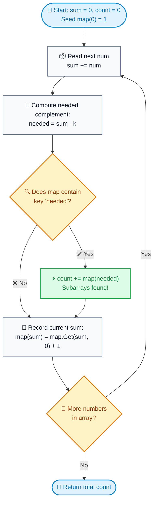

# 📚 Week 05 Day 01: Hash Map & Hash Set Patterns — Engineering Guide

> 🧭 **Navigation:** [← Week Overview](README.md) • [🏠 Week Overview](README.md) • [📘 Curriculum Syllabus](../COMPLETE_SYLLABUS.md) • [Next Day →](Week_05_Day_02_Monotonic_Stack_Patterns_Instructional.md)
> 
> 💡 **Instructor Note:** *Not all sections or topics are mandatory. Adapt your pace and skim or focus based on your target interview timeline.*

---

## 🎯 LEARNING OBJECTIVES

By the end of this chapter, you will be able to:

- 🎯 **Internalize** the core hash-based mental models: complement lookup, running prefix accumulation, modular congruence, canonical signatures, and frequency bucketing.
- ⚙️ **Implement** Two Sum (LC 1), Subarray Sum Equals K (LC 560), Continuous Subarray Sum (LC 523), Group Anagrams (LC 49), and Top-K Frequent Elements (LC 347) in modern C# (.NET 8/9) and idiomatic Python (3.11+).
- 🧠 **Explain** why arrays with negative numbers break sliding window and make Prefix Sum + Hash Map strictly necessary.
- 🛑 **Avoid** the classic rookie traps: forgetting to seed `map[0] = 1`, integer overflow in cumulative sums, and negative modulo pitfalls.
- 🎙️ **Recite** the exact 3-sentence interview verbal scripts to articulate invariants cleanly before writing a single line of code.
- 🏭 **Connect** hash structures to production engines: Redis key-value caching, distributed stream deduplication, and database index lookups.

---

## 🎬 CHAPTER 1: THE 60-SECOND HOOK & EVERYDAY ANALOGIES

Hey engineers, welcome back to Week 5 Day 1 — the start of **Tier-1 Critical Patterns**!

Today we are diving headfirst into the single most heavily tested data structure family in FAANG technical interviews: **Hash Maps and Hash Sets**.

Almost every interviewer starts here because hash tables test your fundamental engineering reflex: **trading a little bit of auxiliary memory (`O(N)`) to eliminate repeated quadratic scans and collapse runtime down to instant `O(1)` average time.**

Let us build two unforgettable physical mental models that make these algorithms click immediately.

---

### 🧥 Analogy 1: The Coat Check Room (Two Sum Complement)

Imagine you walk into a crowded gala with a cloakroom holding 10,000 winter coats. Every coat has a numbered claim ticket. Your friend asks you: *"Are there two coats here whose ticket numbers add up to exactly 100?"*

```
Naive Brute-Force Approach (O(N^2)):
You pick coat #2, then walk through all 9,999 other coats checking each ticket.
Then you pick coat #7, and walk through all 9,999 other coats again...
You will be running around the cloakroom all night!

The Hash Map Approach (O(N)):
You stand at the coat check counter with a ledger.
You pick up coat #2. You do NOT search the room.
You simply ask the clerk: "Has anyone already checked in coat ticket (100 - 2) = 98?"
- If YES: You are done! You found the matching pair in O(1) time.
- If NO:  You write down "Coat #2 is at Hook 0" in your ledger, pick up the next coat, and repeat.
```

Instead of looking **forward** across the entire remaining universe (`O(N)` work per item), you look **backward** into your ledger history in `O(1)` time. That is the complement lookup pattern.

---

### 🚗 Analogy 2: The Car Odometer (Prefix Sum with Hash Map)

Now imagine you are on a massive road trip across the country. Your trip began at Mile 0, and you have been recording your car's odometer reading at every single rest stop.

Your friend asks: *"Did we ever travel a highway stretch of exactly K = 150 miles between any two rest stops?"*

```
Naive Approach:
Calculate the driving distance between every possible pair of past rest stops.
With 500 rest stops, checking all pairs takes O(N^2) road segment calculations.

The Odometer Invariant:
At any current rest stop where your odometer reads CurrentMileage:
  CurrentMileage - PastMileage == K

Rearranging this basic algebraic identity:
  PastMileage == CurrentMileage - K
```

You open your travel diary and ask a single question: *"Did my odometer ever read `CurrentMileage - 150` miles at any previous rest stop?"*

If your odometer currently reads 450 miles, and your diary shows you were at Mile 300 two hours ago, then the road segment between that stop and right now was **precisely 150 miles**!

By maintaining a hash map of past odometer readings (prefix sums), you resolve subarray sums in `O(1)` lookup time—even if the road has detours, turnarounds, or negative elevation shifts!

> [!NOTE]
> **Production Reality (Why FAANG Tests This):**
> Distributed key-value stores like Redis and Memcached, alongside database hash indexes (PostgreSQL, MySQL), achieve sub-millisecond retrieval by mapping arbitrary keys to bucket indices in `O(1)` average time. Interviewers evaluate whether you instinctively reach for hash-based complement tracking and frequency grouping instead of defaulting to expensive `O(N^2)` scans or unnecessary `O(N log N)` sorts.

---

## 🧠 CHAPTER 2: BUILDING THE MENTAL MODEL & TAXONOMY

### The Core Invariant: "Looking Backward at History in O(1)"

At its core, a hash table is an array of buckets combined with a deterministic hash function:

```
Key ("alice")   ──> hash("alice")   % 8 ──> Index 3
Key ("carol")   ──> hash("carol")   % 8 ──> Index 3 (Collision chained)
Key ("bob")     ──> hash("bob")     % 8 ──> Index 1

Array of Buckets (Size = 8):
Index
 [0] ──> null
 [1] ──> [ "bob" : 15 ] ──> null
 [2] ──> null
 [3] ──> [ "alice" : 42 ] ──> [ "carol" : 99 ] ──> null
 [4] ──> [ "dave" : 8 ] ──> null
 [5] ──> null
 [6] ──> [ "eve" : 12 ] ──> null
 [7] ──> null
```

1. **Deterministic Indexing Invariant:** For any key `K`, `hash(K)` always evaluates to the identical integer value throughout execution.
2. **Localized Search Invariant:** If key `K` exists in the table, it resides strictly within bucket `hash(K) % bucket_count`.
3. **Amortized `O(1)` Complexity:** When the load factor `alpha = N / buckets` remains below threshold (typically 0.75), bucket chains remain short (`O(1)` length). When exceeded, the table doubles bucket capacity and rehashes in amortized `O(1)` time per insertion.

---

### The 5 Tier-1 Hash Patterns Taxonomy

| Pattern Variant | Core Mechanism | Algebraic Query | Time | Space | Canonical Problem |
| :--- | :--- | :--- | :--- | :--- | :--- |
| **1. Direct Complement Lookup** | Store past values; check if complement exists | `map.ContainsKey(target - num)` | `O(N)` | `O(N)` | Two Sum (LC 1) |
| **2. Prefix Sum Accumulator** | Tally cumulative sums; query past prefix | `map.ContainsKey(current_sum - k)` | `O(N)` | `O(N)` | Subarray Sum Equals K (LC 560) |
| **3. Prefix Modulo Remainder** | Store earliest index of remainder | `(current_sum % k + k) % k` | `O(N)` | `O(min(N, K))` | Continuous Subarray Sum (LC 523) |
| **4. Canonical Signature Grouping** | Sort string or build char-frequency tuple | `map[signature].Add(item)` | `O(N * K)` | `O(N * K)` | Group Anagrams (LC 49) |
| **5. Frequency Bucketing** | Tally counts, map frequencies to array indices | `buckets[count].Add(num)` | `O(N)` | `O(N)` | Top K Frequent Elements (LC 347) |

---

## 🪜 CHAPTER 3: THE TOY NAPKIN TRACES & INTERACTIVE CHECKPOINTS

### 1. Two Sum Napkin Trace (LeetCode 1)

Let's trace `nums = [2, 7, 11, 15]` with `target = 9`.

```
Goal: Find two indices where nums[i] + nums[j] == 9
Data Structure: Dictionary<number, index> map = new();

Step 0 (i = 0, num = 2):
  [ 2 | 7 | 11 | 15 ]
    ▲
   i=0
  Complement needed = target - num = 9 - 2 = 7
  Query: Does map contain key 7? -> NO
  Action: Record current number -> map[2] = 0
  Map State: { 2: 0 }

Step 1 (i = 1, num = 7):
  [ 2 | 7 | 11 | 15 ]
        ▲
       i=1
  Complement needed = target - num = 9 - 7 = 2
  Query: Does map contain key 2? -> YES! (Found at index 0)
  Action: Match found! Return [ map[2], 1 ] => [0, 1]
  Execution terminates immediately in 1 linear pass!
```

---

### 2. Subarray Sum Equals K Napkin Trace (LeetCode 560)

Now let's trace the iconic FAANG favorite: `nums = [1, 2, 3, -2, 1]` with `k = 3`.

> [!IMPORTANT]
> **Why Seeding `map[0] = 1` is Mandatory:**
> Before processing any elements, our cumulative sum is `0`. A prefix sum of `0` has occurred exactly **1 time** (the empty prefix before index 0). If a subarray starting at index 0 has a sum of `k` (e.g., `nums[0..1] = 1 + 2 = 3`), then `current_sum - k = 3 - 3 = 0`. If `map[0]` is not initialized to `1`, this valid subarray starting at index 0 is completely ignored!

Let us trace every step with precision:

```
Input: nums = [1, 2, 3, -2, 1], k = 3
State: runningSum = 0, totalCount = 0
Map:   prefixCounts = { 0: 1 }  <-- MANDATORY SEED
```

| Step `i` | Element `num` | `runningSum` | Needed `sum - k` | Is Needed in Map? | Count Added | Map State After Step | Subarrays Discovered |
| :---: | :---: | :---: | :---: | :---: | :---: | :--- | :--- |
| **Seed** | - | `0` | - | - | - | `{ 0: 1 }` | None |
| **0** | `1` | `1` | `1 - 3 = -2` | ❌ No | `+0` | `{ 0: 1, 1: 1 }` | None |
| **1** | `2` | `3` | `3 - 3 = 0` | ✅ Yes (`map[0] == 1`) | `+1` | `{ 0: 1, 1: 1, 3: 1 }` | `nums[0..1] = [1, 2]` |
| **2** | `3` | `6` | `6 - 3 = 3` | ✅ Yes (`map[3] == 1`) | `+1` | `{ 0: 1, 1: 1, 3: 1, 6: 1 }` | `nums[2..2] = [3]` |
| **3** | `-2` | `4` | `4 - 3 = 1` | ✅ Yes (`map[1] == 1`) | `+1` | `{ 0: 1, 1: 1, 3: 1, 6: 1, 4: 1 }` | `nums[1..3] = [2, 3, -2]` |
| **4** | `1` | `5` | `5 - 3 = 2` | ❌ No | `+0` | `{ 0: 1, 1: 1, 3: 1, 6: 1, 4: 1, 5: 1 }` | None |

**Final Result:** `totalCount = 3` valid subarrays:
1. `nums[0..1] = [1, 2]` (sum = 3)
2. `nums[2..2] = [3]` (sum = 3)
3. `nums[1..3] = [2, 3, -2]` (sum = 3)

---

### 🧠 Pause & Predict Active Recall Drill

> **Micro-Drill:**
> Suppose your input array contains zeros and negative numbers, such as:  
> `nums = [1, -1, 0]`, target `k = 0`.
> 
> *Pause for 15 seconds and predict:*
> 1. What happens to `runningSum` when processing the `0` at index 2?
> 2. Does `prefixCounts[runningSum]` overwrite the previous entry or increment it?
> 3. What would happen if you used a `HashSet<int>` storing boolean membership (`seen.Add(sum)`) instead of a frequency count dictionary?

<details>
<summary>🔍 Click to Reveal Senior Architect Analysis</summary>

1. At index 0 (`num = 1`), `runningSum = 1`.  
   At index 1 (`num = -1`), `runningSum = 0`. Needed = `0 - 0 = 0`. `map[0]` already equals 1 (the seed!), so count increments to 1 (`nums[0..1]`). Then `map[0]` increments to **2**.  
   At index 2 (`num = 0`), `runningSum = 0 + 0 = 0`. Needed = `0 - 0 = 0`. We look up `map[0]`, which is now **2**! So we add **2** to our count!
2. The count increments to 3. Why? Because there are 3 distinct subarrays with sum 0:
   - `nums[0..1] = [1, -1]`
   - `nums[2..2] = [0]`
   - `nums[0..2] = [1, -1, 0]`
3. If you stored a boolean `HashSet`, you would only count a single occurrence! **Whenever an array contains zeros or negative loops, multiple identical prefix sums can occur.** A frequency map is strictly mandatory.
</details>

---

## 🎨 CHAPTER 4: PRAGMATIC VISUAL MODELS

### 1. ASCII Visual Model: The Prefix Sum Line & Subarray Identity

The entire mathematics of Subarray Sum Equals K rests on an elementary number-line identity:

```
Index:            -1      0       1       2       3       4
Array:           [--]   [ 1   |   2   |   3   |  -2   |   1   ]
Prefix Sum:       0       1       3       6       4       5
                          ▲                       ▲
                          │                       │
                     Prefix[0]=1             Prefix[3]=4

The Subarray Identity:
  Sum(nums[i + 1 ... j]) = Prefix[j] - Prefix[i]

When we seek a subarray whose sum equals K:
  Prefix[j] - Prefix[i] == K   ===>   Prefix[i] == Prefix[j] - K

Visualizing Subarray (0, 3] spanning indices 1 through 3:
  0 ──[nums[0]=1]──► 1 ──[nums[1]=2]──► 3 ──[nums[2]=3]──► 6 ──[nums[3]=-2]──► 4
  │                  ▲                                                          ▲
  │                  │                                                          │
  └── Prefix[0] = 1 ─┘                                                          │
  └────────────────────────────── Prefix[3] = 4 ────────────────────────────────┘
                     ├───────────────── Subarray Sum = 4 - 1 = 3 ───────────────┤
                     │                  nums[1..3] = [2, 3, -2] == 3            │
```

Whenever we stand at index `j`, our prefix sum is `Prefix[j]`. If our hash map has previously recorded `Prefix[i] == Prefix[j] - K`, then the segment between `i + 1` and `j` is guaranteed to have a sum of exactly `K`!

---

### 2. Mermaid Flowchart: Prefix Sum & Hash Map Execution Flow



---

## 🛑 CHAPTER 5: THE ROOKIE TRAP ZONE

### Trap 1: Forgetting to Seed `map[0] = 1`

```csharp
// ❌ ROOKIE BLUNDER: Forgetting the base prefix
var map = new Dictionary<long, int>();
long sum = 0;
int count = 0;
foreach (int num in nums)
{
    sum += num;
    if (map.TryGetValue(sum - k, out int c)) count += c;
    map[sum] = map.GetValueOrDefault(sum, 0) + 1;
}
// FAILS on nums = [3], k = 3:
// sum = 3, sum - k = 0.
// map does not contain 0! Returns count = 0 instead of 1!
```

```csharp
// ✅ SENIOR ARCHITECT PATTERN: Pre-seed map[0] = 1
var map = new Dictionary<long, int> { [0] = 1 };
long sum = 0;
int count = 0;
foreach (int num in nums)
{
    sum += num;
    if (map.TryGetValue(sum - k, out int c)) count += c;
    map[sum] = map.GetValueOrDefault(sum, 0) + 1;
}
// PASSES: When sum == k, sum - k == 0.
// Matches map[0] = 1 immediately, correctly capturing nums[0..i]!
```

---

### Trap 2: Using Sliding Window / Two Pointers on Arrays with Negative Numbers

Engineers frequently attempt to solve LeetCode 560 with a sliding window because sliding window uses `O(1)` space on non-negative arrays.

```
Why Sliding Window Catastrophically Fails on Negative Numbers:
Sliding Window depends entirely on MONOTONICITY:
- Expanding the right pointer MUST monotonically increase (or keep equal) the window sum.
- Shrinking the left pointer MUST monotonically decrease (or keep equal) the window sum.

When negative numbers exist:
- Adding a negative number DECREASES the window sum.
- Removing a negative number INCREASES the window sum.

Because the direction of sum change is non-monotonic, the greedy decision:
"If windowSum > target, shrink left"
is completely invalid! You could shrink left past the optimal subarray.

✅ SENIOR RULE:
- All positive numbers (or non-negative) -> Sliding Window (O(N) time, O(1) space).
- Array contains negative numbers -> Prefix Sum + Hash Map (O(N) time, O(N) space).
```

---

### Trap 3: 32-bit Integer Overflow on Running Prefix Sums

When constraints specify `nums.length <= 10^5` and `nums[i] <= 10^9`, cumulative sums can reach `10^14`. In C# and Java, a 32-bit `int` wraps around at `2,147,483,647` into negative values, corrupting hash map keys silently.

```csharp
// ❌ ROOKIE BLUNDER: Using int for cumulative sums
int runningSum = 0;
var map = new Dictionary<int, int>();

// ✅ SENIOR ARCHITECT PATTERN: Always use long for cumulative sums
long runningSum = 0;
var map = new Dictionary<long, int>();
```

---

### Trap 4: Negative Remainder in Modular Subarray Problems (LC 523)

In C# and Python, remainder operations behave differently on negative numbers:
- In C#: `-1 % 5` evaluates to `-1` (truncation toward zero). But in modular arithmetic, `-1 == 4 (mod 5)`.
- If you use raw `%` in C#, negative remainders will not match positive remainders of the same congruence class!

```csharp
// ❌ ROOKIE BLUNDER: Direct remainder in C#
int remainder = (int)(runningSum % k); // Yields -1 for negative sums!

// ✅ SENIOR ARCHITECT PATTERN: Normalized mathematical modulo
int remainder = (int)(((runningSum % k) + k) % k); // Always in range [0, k - 1]
```

---

## 🎙️ CHAPTER 6: 45-MINUTE INTERVIEW TALK TRACKS

Memorize these exact 3-sentence scripts to deliver out loud to your interviewer before typing code.

### Two Sum (LC 1) Script
> *"A brute-force scan comparing all pairs takes `O(N^2)` time. Rather than rescanning previous elements repeatedly, we can trade `O(N)` auxiliary space for an `O(N)` single pass using a hash map. For each element, we compute its complement `target - num` and query the dictionary; if present, we return the pair immediately, otherwise we insert the current value and index, ensuring zero self-matching."*

### Subarray Sum Equals K (LC 560) Script
> *"Because the array can contain negative numbers, a two-pointer sliding window is fundamentally invalid due to non-monotonic window sums. Instead, any contiguous subarray sum between indices `i` and `j` equals the difference of two prefix sums: `prefix[j] - prefix[i-1] = k`, which rearranges to `prefix[i-1] = prefix[j] - k`. We can track prefix sum frequency counts in a single `O(N)` pass using a hash map, pre-seeding `map[0] = 1` to correctly account for valid subarrays that originate at index 0."*

### Continuous Subarray Sum (LC 523) Script
> *"To determine if there is a subarray of length at least 2 whose sum is a multiple of `k`, we leverage modular congruence: if two prefix sums share the identical remainder modulo `k`, the intermediate subarray between them is cleanly divisible by `k`. We maintain a hash map storing the earliest index at which each normalized remainder was observed, initialized with `map[0] = -1` to handle valid prefixes from index 0. We return true as soon as the current index minus the recorded index is at least 2."*

---

## ⚡ CHAPTER 7: PRODUCTION DUAL-LANGUAGE IMPLEMENTATIONS

### Problem 1: Two Sum (LeetCode 1) — Complement Lookup

#### C# Primary Implementation (.NET 8/9 — Production-Grade)
```csharp
using System;
using System.Collections.Generic;

public static class TwoSumSolver
{
    /// <summary>
    /// Finds two indices whose values sum to target using a one-pass hash map complement lookup.
    /// Time Complexity: O(N) | Auxiliary Space: O(N) | Output Space: O(1)
    /// </summary>
    public static int[] TwoSum(int[] nums, int target)
    {
        ArgumentNullException.ThrowIfNull(nums);
        if (nums.Length < 2) return [];

        // Pre-size dictionary to avoid internal rehashing allocations
        var map = new Dictionary<int, int>(nums.Length);

        for (int i = 0; i < nums.Length; i++)
        {
            int complement = target - nums[i];

            if (map.TryGetValue(complement, out int complementIndex))
            {
                return [complementIndex, i];
            }

            // Record current value and index for future elements
            map[nums[i]] = i;
        }

        return [];
    }
}
```

#### Python Secondary Implementation (3.11+ — Clean & Idiomatic)
```python
def two_sum(nums: list[int], target: int) -> list[int]:
    """Finds two indices whose values sum to target in a single linear pass.

    Time Complexity: O(N) | Auxiliary Space: O(N) | Output Space: O(1)
    """
    seen: dict[int, int] = {}
    for i, num in enumerate(nums):
        complement = target - num
        if complement in seen:
            return [seen[complement], i]
        seen[num] = i
    return []
```

#### 📊 Explicit Complexity Deconstruction
* **Time Complexity:** `O(N)` — Single pass evaluating at most `N` elements with `O(1)` average dictionary lookup and insertion.
* **Auxiliary Space:** `O(N)` — Stores up to `N` key-value pairs in the dictionary in the worst case (no matching pair until end).
* **Output Space:** `O(1)` — Returns a fixed 2-element array.

---

### Problem 2: Subarray Sum Equals K (LeetCode 560) — Prefix Sum Frequency Map

#### C# Primary Implementation (.NET 8/9 — Production-Grade & Overflow-Safe)
```csharp
using System;
using System.Collections.Generic;

public static class SubarraySumSolver
{
    /// <summary>
    /// Finds the total number of continuous subarrays whose sum equals k.
    /// Time Complexity: O(N) | Auxiliary Space: O(N) | Output Space: O(1)
    /// </summary>
    public static int SubarraySum(int[] nums, int k)
    {
        ArgumentNullException.ThrowIfNull(nums);
        if (nums.Length == 0) return 0;

        // Key: prefix sum (long to prevent 32-bit overflow), Value: frequency count
        var prefixCounts = new Dictionary<long, int>
        {
            [0] = 1 // Mandatory seed: accounts for subarrays starting at index 0
        };

        long runningSum = 0;
        int totalSubarrays = 0;

        foreach (int num in nums)
        {
            runningSum += num;
            long complement = runningSum - k;

            // If (runningSum - k) occurred in history, those prefix boundaries form valid subarrays
            if (prefixCounts.TryGetValue(complement, out int count))
            {
                totalSubarrays += count;
            }

            // Record the current prefix sum frequency
            prefixCounts[runningSum] = prefixCounts.GetValueOrDefault(runningSum, 0) + 1;
        }

        return totalSubarrays;
    }
}
```

#### Python Secondary Implementation (3.11+ — Clean & Idiomatic)
```python
from collections import defaultdict


def subarray_sum(nums: list[int], k: int) -> int:
    """Calculates total continuous subarrays summing to k using prefix frequencies.

    Time Complexity: O(N) | Auxiliary Space: O(N) | Output Space: O(1)
    """
    prefix_counts: dict[int, int] = defaultdict(int)
    prefix_counts[0] = 1  # Mandatory seed for subarrays starting at index 0

    running_sum = 0
    total_subarrays = 0

    for num in nums:
        running_sum += num
        complement = running_sum - k
        if complement in prefix_counts:
            total_subarrays += prefix_counts[complement]
        prefix_counts[running_sum] += 1

    return total_subarrays
```

#### 📊 Explicit Complexity Deconstruction
* **Time Complexity:** `O(N)` — Exactly one iteration over the `N` elements of the array with `O(1)` average map lookup and insertion.
* **Auxiliary Space:** `O(N)` — In the worst case (strictly increasing or decreasing positive numbers), the dictionary stores up to `N + 1` distinct prefix sums.
* **Output Space:** `O(1)` — Returns a single integer count.

---

### Problem 3: Continuous Subarray Sum (LeetCode 523) — Prefix Modulo Remainder

#### C# Primary Implementation (.NET 8/9 — Production-Grade)
```csharp
using System;
using System.Collections.Generic;

public static class ContinuousSubarraySumSolver
{
    /// <summary>
    /// Returns true if nums has a good continuous subarray of length >= 2 whose sum is a multiple of k.
    /// Time Complexity: O(N) | Auxiliary Space: O(min(N, K)) | Output Space: O(1)
    /// </summary>
    public static bool CheckSubarraySum(int[] nums, int k)
    {
        ArgumentNullException.ThrowIfNull(nums);
        if (nums.Length < 2) return false;

        // Key: remainder modulo k, Value: earliest index seen
        // Seed remainder 0 at index -1 to handle valid subarrays starting at index 0
        var remainderIndexMap = new Dictionary<int, int>
        {
            [0] = -1
        };

        long runningSum = 0;

        for (int i = 0; i < nums.Length; i++)
        {
            runningSum += nums[i];

            // Normalize remainder for negative numbers: ((sum % k) + k) % k
            int remainder = (int)(((runningSum % k) + k) % k);

            if (remainderIndexMap.TryGetValue(remainder, out int earliestIndex))
            {
                // Subarray length must be at least 2: i - earliestIndex >= 2
                if (i - earliestIndex >= 2)
                {
                    return true;
                }
            }
            else
            {
                // Store only the EARLIEST index to maximize distance for future checks
                remainderIndexMap[remainder] = i;
            }
        }

        return false;
    }
}
```

#### Python Secondary Implementation (3.11+ — Clean & Idiomatic)
```python
def check_subarray_sum(nums: list[int], k: int) -> bool:
    """Verifies existence of subarray (len >= 2) whose sum is a multiple of k.

    Time Complexity: O(N) | Auxiliary Space: O(min(N, K)) | Output Space: O(1)
    """
    if len(nums) < 2:
        return False

    remainder_map: dict[int, int] = {0: -1}
    running_sum = 0

    for i, num in enumerate(nums):
        running_sum += num
        remainder = running_sum % k

        if remainder in remainder_map:
            if i - remainder_map[remainder] >= 2:
                return True
        else:
            remainder_map[remainder] = i

    return False
```

#### 📊 Explicit Complexity Deconstruction
* **Time Complexity:** `O(N)` — Single pass through `N` elements with `O(1)` dictionary operations.
* **Auxiliary Space:** `O(min(N, K))` — There are at most `K` distinct possible remainders `[0, k - 1]`, and at most `N` elements inserted.
* **Output Space:** `O(1)` — Returns a single boolean.

---

### Problem 4: Group Anagrams (LeetCode 49) — Canonical Key Grouping

#### C# Primary Implementation (.NET 8/9 — Production-Grade)
```csharp
using System;
using System.Collections.Generic;

public static class GroupAnagramsSolver
{
    /// <summary>
    /// Groups words into anagram collections using sorted string canonical keys.
    /// Time Complexity: O(N * K log K) | Auxiliary Space: O(N * K) | Output Space: O(N * K)
    /// </summary>
    public static IList<IList<string>> GroupAnagrams(string[] strs)
    {
        ArgumentNullException.ThrowIfNull(strs);
        if (strs.Length == 0) return [];

        var groups = new Dictionary<string, List<string>>();

        foreach (string s in strs)
        {
            char[] chars = s.ToCharArray();
            Array.Sort(chars);
            string key = new(chars);

            if (!groups.TryGetValue(key, out var list))
            {
                list = [];
                groups[key] = list;
            }
            list.Add(s);
        }

        var result = new List<IList<string>>(groups.Count);
        foreach (var list in groups.Values)
        {
            result.Add(list);
        }
        return result;
    }
}
```

#### Python Secondary Implementation (3.11+ — Clean & Idiomatic)
```python
from collections import defaultdict


def group_anagrams(strs: list[str]) -> list[list[str]]:
    """Groups strings by anagram relationship using sorted tuple signatures.

    Time Complexity: O(N * K log K) | Auxiliary Space: O(N * K) | Output Space: O(N * K)
    """
    groups: dict[str, list[str]] = defaultdict(list)
    for s in strs:
        key = "".join(sorted(s))
        groups[key].append(s)
    return list(groups.values())
```

#### 📊 Explicit Complexity Deconstruction
* **Time Complexity:** `O(N * K log K)` where `N` is the number of strings and `K` is the maximum string length (sorting each string).
* **Auxiliary Space:** `O(N * K)` — Stores canonical keys and list references for all `N` strings.
* **Output Space:** `O(N * K)` — Returns nested lists containing all `N` strings.

---

### Problem 5: Top K Frequent Elements (LeetCode 347) — Bucket Sort

#### C# Primary Implementation (.NET 8/9 — Production-Grade)
```csharp
using System;
using System.Collections.Generic;

public static class TopKFrequentSolver
{
    /// <summary>
    /// Returns the k most frequent elements in linear time using frequency bucket sort.
    /// Time Complexity: O(N) | Auxiliary Space: O(N) | Output Space: O(K)
    /// </summary>
    public static int[] TopKFrequent(int[] nums, int k)
    {
        ArgumentNullException.ThrowIfNull(nums);
        if (nums.Length == 0 || k <= 0) return [];

        // Step 1: Count element frequencies
        var counts = new Dictionary<int, int>();
        foreach (int num in nums)
        {
            counts[num] = counts.GetValueOrDefault(num, 0) + 1;
        }

        // Step 2: Bucket numbers by frequency (max possible frequency is nums.Length)
        var buckets = new List<int>[nums.Length + 1];
        foreach (var (num, freq) in counts)
        {
            buckets[freq] ??= [];
            buckets[freq].Add(num);
        }

        // Step 3: Gather top k elements from highest to lowest frequency
        var result = new int[k];
        int writeIndex = 0;

        for (int freq = buckets.Length - 1; freq > 0 && writeIndex < k; freq--)
        {
            if (buckets[freq] is null) continue;

            foreach (int num in buckets[freq])
            {
                result[writeIndex++] = num;
                if (writeIndex == k) break;
            }
        }

        return result;
    }
}
```

#### Python Secondary Implementation (3.11+ — Clean & Idiomatic)
```python
from collections import Counter


def top_k_frequent(nums: list[int], k: int) -> list[int]:
    """Finds k most frequent elements in linear time via frequency buckets.

    Time Complexity: O(N) | Auxiliary Space: O(N) | Output Space: O(K)
    """
    counts = Counter(nums)
    buckets: list[list[int]] = [[] for _ in range(len(nums) + 1)]

    for num, freq in counts.items():
        buckets[freq].append(num)

    result: list[int] = []
    for freq in range(len(buckets) - 1, 0, -1):
        for num in buckets[freq]:
            result.append(num)
            if len(result) == k:
                return result
    return result
```

#### 📊 Explicit Complexity Deconstruction
* **Time Complexity:** `O(N)` — `O(N)` pass to count frequencies, `O(U)` where `U <= N` to bucket elements, and `O(N)` reverse pass to collect `K` elements.
* **Auxiliary Space:** `O(N)` — The frequency dictionary holds `U <= N` entries; bucket lists store exactly `U` integers across `N + 1` buckets.
* **Output Space:** `O(K)` — Returns an array containing the `K` most frequent values.

---

## ⚖️ CHAPTER 8: PERFORMANCE, MEMORY & REAL SYSTEMS ARCHITECTURE

### Cache Locality vs. Big-O Reality

On paper, hash table lookups are `O(1)` while binary search over a sorted array is `O(log N)`. In physical hardware:
- **Array Traversal:** Elements reside in contiguous memory. When element `nums[i]` is loaded, the hardware prefetcher pulls entire 64-byte cache lines into L1/L2 CPU caches, minimizing latency.
- **Hash Table Traversal:** Each lookup hashes a key, jumps to an arbitrary memory address (bucket), and potentially chases pointers down a collision chain. This incurs CPU cache misses.

However, when `N` exceeds `10^4`, algorithmic complexity dominates: `O(N)` hash operations drastically outperform `O(N log N)` comparisons or `O(N^2)` scans regardless of cache misses.

---

### Memory Overhead Comparison

| Structure | Element Size | Total Overhead per Entry | Total RAM for 1,000,000 Entries |
| :--- | :--- | :--- | :--- |
| Contiguous `int[]` | 4 bytes | 0 bytes | **4 MB** |
| `Dictionary<int, int>` / `dict` | 8 bytes (key+val) | ~24-32 bytes (hash code, next pointer, bucket table) | **~36-48 MB** |

> [!NOTE]
> **Production Reality (Why FAANG Tests This):**
> Memory trade-offs matter in real infrastructure. Caches like Redis trade 10x higher RAM footprint per entry for deterministic sub-millisecond retrieval. In resource-constrained microservices, engineers choose fixed frequency arrays (`int[26]` or `int[256]`) instead of generic hash maps to achieve zero heap allocations and 100% L1 cache hits.

---

### Defensive Engineering in Production

1. **Hash Flooding Attacks:** Malicious users submitting keys with identical hash prefixes can degrade a hash table from `O(1)` to `O(N)` worst-case chained scan. Modern platforms (.NET and Python) randomize hash seeds per process invocation to prevent deterministic hash flooding.
2. **Missing Key Exceptions:** Direct index access (`map[key]`) in C# throws `KeyNotFoundException`. Always use `TryGetValue(key, out var val)` or `GetValueOrDefault()`.
3. **Mutable Object Keys:** If an object is used as a hash key and subsequently modified, its hash code changes. The entry becomes permanently lost in the bucket structure, causing catastrophic memory leaks. Always use immutable primitives or records as keys.

---

## 🎯 CHAPTER 9: FAANG INTERVIEW PATTERN SIGNALS & EDGE CASES

### 🎯 Pattern Recognition Signals

- ✅ **"Find two numbers that sum to target" (unsorted)** -> Single-pass Hash Map complement lookup (`O(N)` time).
- ✅ **"Count continuous subarrays with sum K" (with negative numbers)** -> Prefix Sum + Hash Map frequency counter (`O(N)` time).
- ✅ **"Find subarray divisible by K of length >= 2"** -> Prefix Modulo + Earliest Index Hash Map (`O(N)` time).
- ✅ **"Count frequencies" / "Find Top K frequent"** -> Hash Map frequency count + Bucket Sort (`O(N)` time).
- ✅ **"Group words by identical letters"** -> Canonical signature keying (sorted word or frequency tuple).
- 🛑 **"Array is already sorted"** -> Do NOT use a hash table. Use opposite-direction two pointers (`O(1)` space).
- 🛑 **"All array elements are positive and sum is K"** -> Consider sliding window first for `O(1)` auxiliary space.

---

### 🧪 Concrete Edge-Case Checklist

1. **Empty Array or Insufficient Elements (`N < 2`):** Guard clause must return early immediately.
2. **Duplicate Complements (`nums = [3, 3]`, `target = 6`):** Check complement before inserting current value to allow valid duplicate pairs without self-pairing.
3. **Prefix Starting at Index 0 (`sum == k`):** Always pre-seed `map[0] = 1` for sum counting, or `map[0] = -1` for length calculation.
4. **Zeroes in Array:** Zeros keep the cumulative sum identical, creating multiple valid prefix sums at different indices. Always maintain a frequency count, not a boolean set.
5. **Extreme Numerical Bounds:** If array values reach `10^9`, cumulative sums will overflow 32-bit `int`. Cast running sums to 64-bit `long`.
6. **Negative Remainder Normalization:** Always use `((sum % k) + k) % k` to prevent negative remainder mismatches.

---

## ⚔️ CHAPTER 10: PRACTICE DRILLS & CLOSING REFLECTION

### 🏋️ High-Yield FAANG Problem Set

| # | Problem | Source | Difficulty | Key Concept |
| :--- | :--- | :--- | :--- | :--- |
| 1 | Two Sum | LeetCode 1 | 🟢 Easy | Complement lookup (`target - x`) |
| 2 | Contains Duplicate | LeetCode 217 | 🟢 Easy | Set membership deduplication |
| 3 | Valid Anagram | LeetCode 242 | 🟢 Easy | Fixed frequency array buffer |
| 4 | Subarray Sum Equals K | LeetCode 560 | 🟡 Medium | Prefix sum + Frequency map |
| 5 | Continuous Subarray Sum | LeetCode 523 | 🟡 Medium | Prefix modulo + Earliest index map |
| 6 | Group Anagrams | LeetCode 49 | 🟡 Medium | Canonical key grouping |
| 7 | Top K Frequent Elements | LeetCode 347 | 🟡 Medium | Frequency count + Bucket sort |
| 8 | Longest Consecutive Sequence | LeetCode 128 | 🟡 Medium | Hash set boundary expansion |

---

### 🎙️ Verbal Interview Drills (Rapid Fire)

1. **Q: Why can't we use a two-pointer sliding window for LeetCode 560 (Subarray Sum Equals K)?**  
   *Answer:* Sliding window requires monotonicity: expanding must increase the sum, and shrinking must decrease it. Because the array contains negative numbers, adding an element can decrease the sum and removing an element can increase it, breaking greedy window decisions. Prefix sum with a hash map handles negative numbers universally.

2. **Q: Why do we seed `map[0] = 1` in Subarray Sum Equals K?**  
   *Answer:* A prefix sum of 0 represents the empty prefix before the array begins. If a subarray starting at index 0 sums to `k`, its complement query is `k - k = 0`. Without `map[0] = 1`, that subarray would not be counted.

3. **Q: Why do we seed `map[0] = -1` in Continuous Subarray Sum (LC 523)?**  
   *Answer:* A prefix starting at index 0 that is divisible by `k` has length `i - (-1) = i + 1`. If `i = 1`, length is `1 - (-1) = 2`, which meets the requirement of length `>= 2`.

4. **Q: How does bucket sort achieve `O(N)` runtime for Top K Frequent Elements without violating the `O(N log N)` comparison sort lower bound?**  
   *Answer:* Bucket sort is non-comparative. Because element frequencies are bounded integers between 1 and `N`, we map frequencies directly to array indices in `O(1)` time without pairwise comparisons.

---

### ❌ Common Misconceptions (Mythbusters)

- **Myth:** *Hash table lookups are always guaranteed `O(1)` in every situation.*  
  *Reality:* `O(1)` is an amortized average. Pathological collision distributions or malicious hash flooding can degrade operations to `O(N)`.
- **Myth:** *A hash map is always faster than an array.*  
  *Reality:* For small `N <= 30`, linear scanning over a contiguous array often outperforms a hash table due to zero hashing overhead and optimal CPU cache line prefetching.
- **Myth:** *Prefix sum hash maps only work on positive numbers.*  
  *Reality:* Prefix sum algebra `Prefix[j] - Prefix[i] = K` is completely independent of sign; it works seamlessly on positive, negative, and zero values.

---

## 📌 CLOSING REFLECTION

Hash tables embody the primary trade-off in computer science: **spending space to eliminate time**. By recording history as you walk forward, you transform multi-pass quadratic searches into instantaneous single-pass lookups.

Master the complement lookup (`target - x`) and the prefix accumulator (`runningSum - k`), and you will walk into any FAANG algorithmic interview with complete command of over 40% of all array and sequence questions.

---
> 🧭 **Navigation:** [← Week Overview](README.md) • [🏠 Week Overview](README.md) • [📘 Curriculum Syllabus](../COMPLETE_SYLLABUS.md) • [Next Day →](Week_05_Day_02_Monotonic_Stack_Patterns_Instructional.md)
