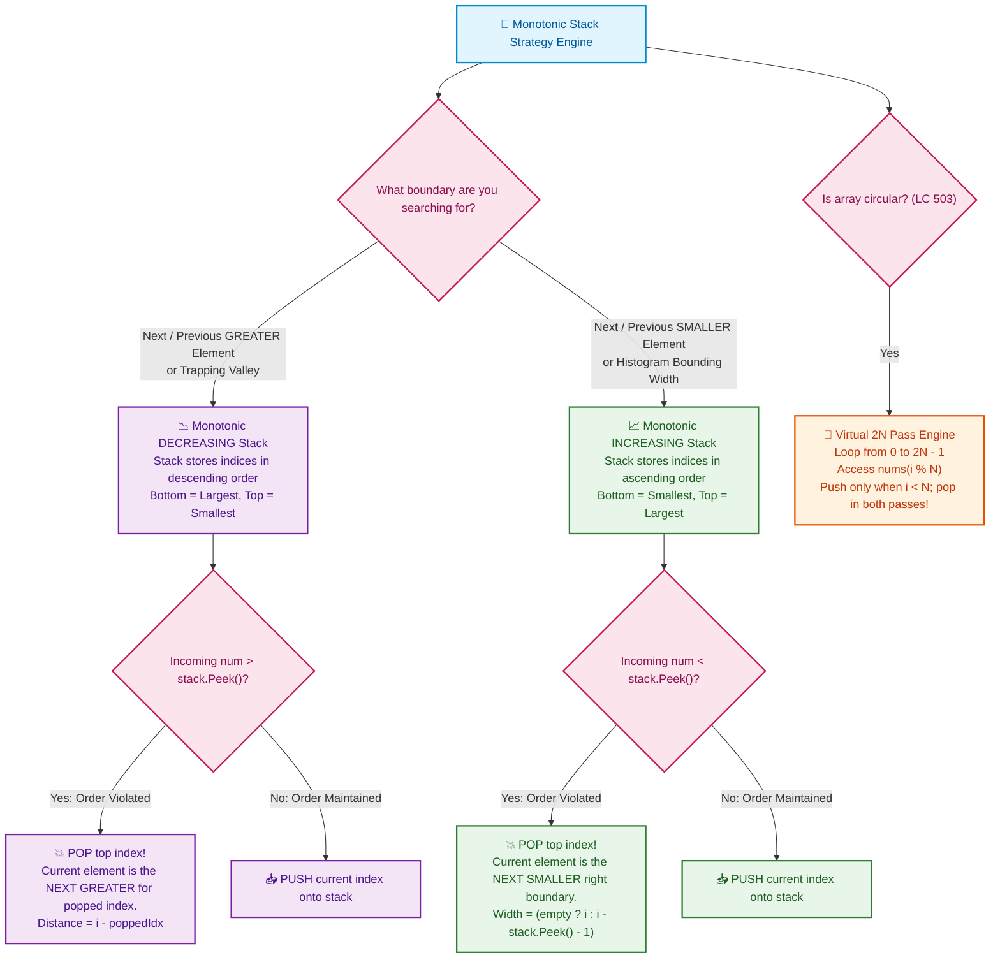

# 📘 Week 05 Day 02: Monotonic Stack Patterns — Engineering Guide

> 🧭 **Navigation:** [← Previous Day](Week_05_Day_01_Hash_Map_Hash_Set_Patterns_Instructional_EXPANDED.md) • [🏠 Week Overview](README.md) • [📘 Curriculum Syllabus](../COMPLETE_SYLLABUS.md) • [Next Day →](Week_05_Day_03_Merge_Operations_Interval_Patterns_Instructional.md)
> 
> 💡 **Instructor Note:** *Not all sections or topics are mandatory. Adapt your pace and skim or focus based on your target interview timeline.*

---

## 🎯 LEARNING OBJECTIVES

By the end of this module, you will be able to:

- 🎬 **Internalize** the "Line of Sight / Skyline" mental model and why monotonic stacks eliminate redundant searches by retiring eclipsed elements.
- ⚙️ **Prove** why a nested `while` loop within a `for` loop runs in strict amortized `O(N)` time using the Push/Pop Token Invariant.
- 🎨 **Master** both Monotonic Decreasing (Next Greater Element) and Monotonic Increasing (Histogram Bounding / Next Smaller) stacks.
- 🛑 **Defuse** the three classic interview traps: storing values instead of indices, confusing increasing vs decreasing orders, and forgetting sentinel flushes.
- 🎙️ **Articulate** a polished 3-sentence talk track in live 45-minute FAANG interviews before writing code.
- ⚡ **Implement** production-grade, zero-allocation C# (.NET 8/9) and clean, idiomatic Python (3.11+) for Daily Temperatures, Circular Next Greater Element II, Largest Rectangle in Histogram, and Trapping Rain Water.

---

## 🎬 PILLAR 1: THE 60-SECOND HOOK & EVERYDAY ANALOGIES

Hey engineers, welcome back to Week 5 Day 2!

Today, we conquer one of the most intellectually satisfying, high-ROI algorithmic patterns in the entire FAANG interview arsenal: **The Monotonic Stack**.

When you first encounter problems like *Next Greater Element*, *Daily Temperatures*, or *Largest Rectangle in Histogram*, your natural instinct is to run a nested loop: for every single element, scan forward until you find a bigger one. It works, but it grinds to an unbearable `O(N^2)` halt whenever the data is sorted against you.

How do top-tier engineers collapse that quadratic grind into a single, lightning-fast `O(N)` pass? 

They exploit a fundamental physical truth: **Line of Sight**.

```
================================================================================
           THE SKYLINE METAPHOR: LINE OF SIGHT ON THE BEACHFRONT BOULEVARD
================================================================================

Imagine you are standing on a coastal highway looking eastward down a straight line
of buildings of various heights:

  Heights:   [ 2,       1,       2,       4,       3 ]
  Indices:     0        1        2        3        4

             │                          [4] 
             │                         ┌───┐
             │        [2]      [2]     │   │     [3]
             │       ┌───┐    ┌───┐    │   │    ┌───┐
             │       │   │[1] │   │    │   │    │   │
             │       │   ┌───┐│   │    │   │    │   │
             └───────┴───┴───┴───┴────┴───┴────┴───┴──► Distance
              Idx:     0   1    2        3        4

Now, look at Building 1 (Height 1):
  - You look rightward down the street.
  - Building 2 (Height 2) IMMEDIATELY blocks your view! 
  - For Building 1, the Next Greater Element is Building 2.

Now, watch what happens when the skyscraper at Index 3 (Height 4) arrives:
  - Skyscraper 4 is so overwhelmingly tall that it towers over Building 2 (Height 2)
    AND Building 0 (Height 2).
  - Skyscraper 4 completely ECLIPSES them!
  - Ask yourself: Can Building 1 or Building 2 EVER be the "Next Greater Element" 
    for anyone standing further to the left?
  - NEVER! Skyscraper 4 blocks everything behind it. Those shorter buildings are
    eclipsed forever.

The Core Secret:
Once an element is eclipsed by a taller newcomer, it can NEVER serve as the next
greater element for future candidates. We can retire (POP) it permanently!
================================================================================
```

### The Core Speedup: Why Testing Every Pair Is `O(N^2)`, But Monotonic Stack Is Strictly `O(N)`

In a naive brute-force search:
- On array `[5, 4, 3, 2, 1]`, searching forward for a larger element for index 0 checks 4 elements; for index 1 checks 3 elements; total checks = `(N - 1) + (N - 2) + ... + 1 = O(N^2)`.

In a **Monotonic Stack**:
- You iterate through the array once: `N` steps.
- At each step, an element enters the stack **exactly once**.
- When an incoming element is taller, it pops shorter elements from the top.
- Once an element is popped, it is gone forever. It can **never be popped again**.
- Total pushes across the entire program: exactly `N`.
- Total pops across the entire program: at most `N`.
- Total operations: at most `2N` stack operations.

> [!IMPORTANT]
> **The Push/Pop Budget Invariant:**
> Even if a single incoming skyscraper causes a `while` loop to pop 10 elements in a row, those 10 elements were paid for in advance when they were pushed. You cannot pop more elements than you push. Therefore, the aggregate time spent across all inner `while` loop iterations over the entire program is bounded by `N`. **Aggregate runtime is strictly `O(N)` amortized.**

---

## 🎨 PILLAR 2: PRAGMATIC VISUAL MODELS

### Increasing vs. Decreasing Monotonic Stack: The Mental Model

The single most confusing hurdle for candidates is: *"Should my stack be increasing or decreasing?"*

Here is the immutable physical rule:

```
================================================================================
                    DECREASING STACK vs. INCREASING STACK
================================================================================

1. MONOTONIC DECREASING STACK (Top is Smallest, Bottom is Largest):
   - Invariant: Elements waiting on the stack are in strictly descending order.
   - Purpose: Looking for the NEXT GREATER element.
   - Mechanism: Incoming tall element violates the decreasing order. It bullies
     and pops all smaller elements off the top!
   - Canonical Use: Daily Temperatures (LC 739), Next Greater Element (LC 496/503).

   Visual Stack:  [ Bottom: 75 | 71 | Top: 69 ] <── Incoming: 72
                  72 > 69 -> POP 69! (72 is the Next Greater for 69)
                  72 > 71 -> POP 71! (72 is the Next Greater for 71)
                  72 < 75 -> STOP. Push 72. Stack: [ 75 | 72 ]

--------------------------------------------------------------------------------

2. MONOTONIC INCREASING STACK (Top is Largest, Bottom is Smallest):
   - Invariant: Elements waiting on the stack are in strictly ascending order.
   - Purpose: Looking for the NEXT SMALLER element or boundary limit.
   - Mechanism: Incoming short element violates the increasing order. It pops
     all taller elements off the top because their horizontal span is cut off!
   - Canonical Use: Largest Rectangle in Histogram (LC 84), Stock Span valley.

   Visual Stack:  [ Bottom: 1 | 5 | Top: 6 ] <── Incoming: 2
                  2 < 6 -> POP 6! (Right boundary for bar 6 is reached)
                  2 < 5 -> POP 5! (Right boundary for bar 5 is reached)
                  2 > 1 -> STOP. Push 2. Stack: [ 1 | 2 ]
================================================================================
```

### The Monotonic Stack Strategy Engine

Use this branching flowchart to instantly select the right stack invariant in an interview:



---

## 🪜 PILLAR 3: THE SCAFFOLDING LADDER & TOY NAPKIN TRACES

Let's walk up the scaffolding ladder: from a napkin trace with 5 elements, to active recall drills, to the FAANG Medium and Hard benchmarks.

### Level 1: The Toy Napkin Trace — Next Greater Element on `[2, 1, 2, 4, 3]`

Problem: For each element in `nums = [2, 1, 2, 4, 3]`, find the value of the next strictly greater element to its right. If none exists, return `-1`.

We maintain a **Monotonic Decreasing Stack** storing **indices**. We initialize `result = [-1, -1, -1, -1, -1]`.

```
================================================================================
            STEP-BY-STEP NAPKIN TRACE: nums = [ 2, 1, 2, 4, 3 ]
================================================================================

Initial State: Stack = [], Result = [ -1, -1, -1, -1, -1 ]

--------------------------------------------------------------------------------
Step 0: i = 0, current = nums[0] = 2
  - Stack is empty.
  - Action: Push index 0.
  - Stack: [ 0(val:2) ]
  - Result: [ -1, -1, -1, -1, -1 ]

--------------------------------------------------------------------------------
Step 1: i = 1, current = nums[1] = 1
  - Compare with stack top: current (1) > nums[0] (2)? FALSE.
  - Monotonic decreasing order preserved!
  - Action: Push index 1.
  - Stack: [ 0(val:2), 1(val:1) ]
  - Result: [ -1, -1, -1, -1, -1 ]

--------------------------------------------------------------------------------
Step 2: i = 2, current = nums[2] = 2
  - Compare with stack top: current (2) > nums[1] (1)? TRUE!
    -> POP index 1!
    -> Result for index 1 resolved: result[1] = current = 2.
  - Compare with new top: current (2) > nums[0] (2)? FALSE (not strictly greater).
  - Stop popping.
  - Action: Push index 2.
  - Stack: [ 0(val:2), 2(val:2) ]
  - Result: [ -1,  2, -1, -1, -1 ]

--------------------------------------------------------------------------------
Step 3: i = 3, current = nums[3] = 4
  - Compare with stack top: current (4) > nums[2] (2)? TRUE!
    -> POP index 2!
    -> Result for index 2 resolved: result[2] = current = 4.
  - Compare with new top: current (4) > nums[0] (2)? TRUE!
    -> POP index 0!
    -> Result for index 0 resolved: result[0] = current = 4.
  - Stack is now empty.
  - Action: Push index 3.
  - Stack: [ 3(val:4) ]
  - Result: [  4,  2,  4, -1, -1 ]

--------------------------------------------------------------------------------
Step 4: i = 4, current = nums[4] = 3
  - Compare with stack top: current (3) > nums[3] (4)? FALSE.
  - Action: Push index 4.
  - Stack: [ 3(val:4), 4(val:3) ]
  - Result: [  4,  2,  4, -1, -1 ]

--------------------------------------------------------------------------------
End of Array:
  - Indices remaining on stack: [ 3, 4 ].
  - No future elements exist to beat them. Their values remain -1.
  - Final Output: [ 4, 2, 4, -1, -1 ]
================================================================================
```

---

### 🧠 PAUSE & PREDICT 1: Micro-Drill (Active Recall)

> **Scenario:** Suppose the input array is strictly decreasing: `nums = [5, 4, 3, 2, 1, 6]`.  
> 1. What does the stack look like right before element `6` (at index 5) is processed?  
> 2. How many elements are popped when element `6` arrives?  
> 3. Does this violate our `O(N)` linear runtime claim?
>
> *Take 15 seconds to answer in your head before revealing the solution below!*

<details>
<summary>🔍 Click to Reveal Answer & Pedagogical Breakdown</summary>

1. **Stack State:** The first 5 elements never trigger a pop because each is smaller than the previous. The stack holds all indices: `[ 0(5), 1(4), 2(3), 3(2), 4(1) ]`.
2. **Pops on element 6:** Element `6` is strictly greater than `1`, `2`, `3`, `4`, and `5`. It triggers **5 consecutive pops** in that single step!
3. **Complexity Guarantee:** This does **NOT** violate `O(N)`. Over all 6 elements, exactly 6 pushes occurred and exactly 5 pops occurred. Total stack operations across the entire algorithm = 11. `11 <= 2N`. The single burst of 5 pops was paid for during the 5 previous steps where 0 pops occurred. **Amortized time is strictly `O(N)`.**

</details>

---

### Level 2: The Boss Level Trace — Largest Rectangle in Histogram (LeetCode 84)

This is one of the most famous Hard problems in FAANG history. Let's make it intuitive.

For any histogram bar of height `H`, what is the widest rectangle you can form using `H` as the bounding height?
It is the distance between the **first smaller bar on the left** and the **first smaller bar on the right**!

```
Heights: [ 2, 1, 5, 6, 2, 3 ]
Indices:   0  1  2  3  4  5
```

We maintain a **Monotonic Increasing Stack** storing indices.
When an incoming bar is shorter than the stack top, the bar at the top has found its right boundary!

```
================================================================================
       NAPKIN TRACE: Largest Rectangle on heights = [ 2, 1, 5, 6, 2, 3 ]
================================================================================

We append a virtual Sentinel bar of height 0 at index 6 (i = 6).
This guarantees every bar left in the stack is cleanly flushed!

Step 0 (i = 0, h = 2): Stack empty -> Push 0. Stack: [ 0(h:2) ]

Step 1 (i = 1, h = 1): 1 < 2 -> POP index 0 (height = 2)!
  - Right boundary is i = 1.
  - Left boundary: Stack is empty -> left boundary is 0.
  - Width = i = 1.
  - Area = height * width = 2 * 1 = 2. MaxArea = 2.
  - Push 1. Stack: [ 1(h:1) ]

Step 2 (i = 2, h = 5): 5 > 1 -> Push 2. Stack: [ 1(h:1), 2(h:5) ]
Step 3 (i = 3, h = 6): 6 > 5 -> Push 3. Stack: [ 1(h:1), 2(h:5), 3(h:6) ]

Step 4 (i = 4, h = 2):
  - 2 < 6 -> POP index 3 (height = 6)!
    - Right boundary = 4. Left boundary = stack.Peek() = 2.
    - Width = right - left - 1 = 4 - 2 - 1 = 1.
    - Area = 6 * 1 = 6. MaxArea = max(2, 6) = 6.
  - 2 < 5 -> POP index 2 (height = 5)!
    - Right boundary = 4. Left boundary = stack.Peek() = 1.
    - Width = 4 - 1 - 1 = 2. (Spans bars at indices 2 and 3!)
    - Area = 5 * 2 = 10. MaxArea = max(6, 10) = 10!  <── PEAK RECTANGLE!
  - 2 > 1 -> Stop popping.
  - Push 4. Stack: [ 1(h:1), 4(h:2) ]

Step 5 (i = 5, h = 3): 3 > 2 -> Push 5. Stack: [ 1(h:1), 4(h:2), 5(h:3) ]

Step 6 (i = 6, h = 0 SENTINEL):
  - 0 < 3 -> POP 5 (h = 3): width = 6 - 4 - 1 = 1 -> Area = 3 * 1 = 3.
  - 0 < 2 -> POP 4 (h = 2): width = 6 - 1 - 1 = 4 -> Area = 2 * 4 = 8.
  - 0 < 1 -> POP 1 (h = 1): stack empty -> width = 6 -> Area = 1 * 6 = 6.

Final Maximum Area = 10!
================================================================================
```

---

### 🧠 PAUSE & PREDICT 2: Micro-Drill (Histogram Boundary Formula)

> **Scenario:** When a bar is popped in LeetCode 84, why is the width formula:
> `width = stack.Count == 0 ? i : i - stack.Peek() - 1`?  
> Why isn't it simply `i - popped_index`?
>
> *Pause and visualize the bars between the popped bar and the new stack top.*

<details>
<summary>🔍 Click to Reveal Answer & Physical Intuition</summary>

**Because intermediate taller bars were already popped!**  
When bar 5 was popped in Step 4, bar 6 had already been popped before it. Bar 5 can extend *rightward* through bar 6 up to index 4, and *leftward* down to index 1 (the new stack top).  
The distance from index 1 to index 4 (exclusive) is `4 - 1 - 1 = 2`.  
If you used `i - popped_index`, you would get `4 - 2 = 2` by accident here, but if there were multiple taller bars to the left, you would underestimate the width! The true left boundary is whatever bar is *currently exposed at the top of the stack*.

</details>

---

## 🛑 PILLAR 4: THE ROOKIE TRAP ZONE

### Trap 1: Storing Raw Values Instead of Array Indices

```csharp
// ❌ ROOKIE BLUNDER: Storing raw temperature values
var stack = new Stack<int>();
for (int i = 0; i < temperatures.Length; i++) {
    while (stack.Count > 0 && temperatures[i] > stack.Peek()) {
        int prevTemp = stack.Pop();
        // CATASTROPHE: How many days elapsed between prevTemp and i?
        // You cannot know! Raw values erase spatial index information!
    }
    stack.Push(temperatures[i]);
}

// ✅ SENIOR ARCHITECT PATTERN: Always store array indices!
var stack = new Stack<int>();
for (int i = 0; i < temperatures.Length; i++) {
    while (stack.Count > 0 && temperatures[i] > temperatures[stack.Peek()]) {
        int prevIndex = stack.Pop();
        result[prevIndex] = i - prevIndex; // Clean, instant O(1) distance!
    }
    stack.Push(i);
}
```

> [!TIP]
> **The Golden Rule:** A stack of indices gives you both *index* AND *value* (via `arr[stack.Peek()]`) in `O(1)` time. A stack of values loses index information forever. **Always store indices.**

---

### Trap 2: Confusing Monotonic Increasing with Decreasing Stack

```
❌ ROOKIE BLUNDER:
"I want the Next GREATER Element, so my stack must be monotonically INCREASING!"
Result: You write an increasing stack. When a bigger element arrives, it gets pushed,
and your smaller elements are never resolved.

✅ SENIOR ARCHITECT PATTERN:
Remember the Line-of-Sight Bully principle:
- To find Next GREATER -> Stack must be DECREASING.
  The stack elements wait quietly in descending order. When a BIGGER element arrives,
  it violates the order and POP-resolves all smaller elements!
- To find Next SMALLER -> Stack must be INCREASING.
  Stack elements wait in ascending order. When a SMALLER element arrives,
  it violates the order and POP-resolves all taller elements!
```

---

### Trap 3: Forgetting the Trailing Sentinel Flush in Histograms

```csharp
// ❌ ROOKIE BLUNDER: Running strictly up to N - 1
for (int i = 0; i < n; i++) {
    while (stack.Count > 0 && heights[i] < heights[stack.Peek()]) {
        // ... pop and calculate
    }
    stack.Push(i);
}
// BUG: If heights = [1, 2, 3, 4, 5], NOTHING IS EVER POPPED!
// The stack finishes holding all indices, maxArea returns 0!

// ✅ SENIOR ARCHITECT PATTERN: Virtual Sentinel at Index N
for (int i = 0; i <= n; i++) {
    // When i == n, currentHeight is virtual 0: strictly smaller than all valid heights!
    int currentHeight = (i == n) ? 0 : heights[i];
    while (stack.Count > 0 && currentHeight < heights[stack.Peek()]) {
        int h = heights[stack.Pop()];
        int w = stack.Count == 0 ? i : i - stack.Peek() - 1;
        maxArea = Math.Max(maxArea, h * w);
    }
    stack.Push(i);
}
// Every single bar is guaranteed to be popped and evaluated before termination!
```

---

### Trap 4: Circular Array Duplication vs. Virtual `2N` Modulo Pass

```csharp
// ❌ ROOKIE BLUNDER: Physically allocating double-sized array for circular search (LC 503)
int[] doubled = new int[2 * n]; // Allocates O(N) extra heap memory!
Array.Copy(nums, 0, doubled, 0, n);
Array.Copy(nums, 0, doubled, n, n);

// ✅ SENIOR ARCHITECT PATTERN: Zero-allocation virtual 2N pass with modulo
for (int i = 0; i < 2 * n; i++) {
    int num = nums[i % n]; // Virtual wrap-around in O(1) space!
    while (stack.Count > 0 && num > nums[stack.Peek()]) {
        result[stack.Pop()] = num;
    }
    if (i < n) stack.Push(i); // Only push during the first real pass!
}
```

---

## 🎙️ PILLAR 5: 45-MINUTE INTERVIEW TALK TRACK

When the interviewer asks: *"How would you find the next greater element for each day in `O(N)` time?"* — do **not** jump straight into coding. Deliver this exact 3-sentence script:

### The 3-Sentence Delivery Script (Next Greater Element / Daily Temperatures)

> **Sentence 1 (Core Invariant & Data Structure):**  
> *"To avoid an `O(N^2)` nested search, I will use a monotonic decreasing stack that stores array indices of temperatures awaiting a warmer day."*
>
> **Sentence 2 (Trigger Condition & Resolution):**  
> *"As we iterate through the array from left to right, whenever the current temperature exceeds the temperature at the stack's top index, the current day serves as the immediate line-of-sight boundary: we pop that index and record the day difference `i - poppedIndex` in our result array."*
>
> **Sentence 3 (Amortized Complexity Proof):**  
> *"Because every index is pushed onto the stack exactly once and popped at most once, the total number of operations across all loop iterations is bounded by `2N`, guaranteeing a strict `O(N)` time complexity with `O(N)` auxiliary space."*

---

## ⚡ PILLAR 6: PRODUCTION DUAL-LANGUAGE IMPLEMENTATIONS

### Problem 1: Daily Temperatures (LeetCode 739) — The Canonical Decreasing Stack

Given an array of integers `temperatures`, return an array `answer` such that `answer[i]` is the number of days you have to wait after the `i`-th day to get a warmer temperature. If there is no future day for which this is possible, keep `answer[i] == 0`.

#### C# Primary Implementation (.NET 8/9 — Production-Grade)

```csharp
using System;
using System.Collections.Generic;

public static class DailyTemperaturesSolver
{
    /// <summary>
    /// Computes waiting days until a warmer temperature using a monotonic decreasing stack.
    /// Time Complexity: O(N) | Auxiliary Space: O(N) | Output Space: O(N)
    /// </summary>
    public static int[] DailyTemperatures(int[] temperatures)
    {
        ArgumentNullException.ThrowIfNull(temperatures);
        int n = temperatures.Length;
        if (n == 0) return [];

        var result = new int[n];
        // Stack stores indices of temperatures in strictly non-increasing order
        var stack = new Stack<int>();

        for (int i = 0; i < n; i++)
        {
            int currentTemp = temperatures[i];

            // When current temperature is warmer, resolve all colder previous days
            while (stack.Count > 0 && currentTemp > temperatures[stack.Peek()])
            {
                int prevDay = stack.Pop();
                result[prevDay] = i - prevDay;
            }

            stack.Push(i);
        }

        // Indices remaining in the stack have no warmer future day and stay 0
        return result;
    }
}
```

#### Python Secondary Implementation (3.11+ — Clean & Idiomatic)

```python
def daily_temperatures(temperatures: list[int]) -> list[int]:
    """Calculates days until a warmer temperature using a monotonic decreasing stack.

    Time Complexity: O(N) | Auxiliary Space: O(N) | Output Space: O(N)
    """
    n = len(temperatures)
    result = [0] * n
    stack: list[int] = []  # Stores indices

    for i, temp in enumerate(temperatures):
        while stack and temp > temperatures[stack[-1]]:
            prev_day = stack.pop()
            result[prev_day] = i - prev_day
        stack.append(i)

    return result
```

#### 📊 Explicit Complexity Deconstruction
* **Time Complexity:** `O(N)` — Single pass over `N` elements. Each index enters the stack once and leaves at most once (`<= 2N` operations).
* **Auxiliary Space:** `O(N)` — In the worst case of strictly decreasing temperatures (e.g., `[90, 80, 70, 60]`), the stack holds `N` indices.
* **Output Space:** `O(N)` — Returns an integer array of size `N`.

---

### Problem 2: Next Greater Element II (LeetCode 503) — Circular Monotonic Stack

Given a circular integer array `nums` (the next element of `nums[n - 1]` is `nums[0]`), return the next greater number for every element. If it doesn't exist, return `-1`.

#### 🎙️ 45-Minute Interview Verbal Script
> *"To handle circular wraparound without allocating a duplicate array in memory, we simulate a virtual array of length `2N` using the modulo operator `i % N`. We iterate from index `0` to `2N - 1`. During the first pass (`i < N`), we push indices onto our monotonic decreasing stack; during the second pass (`i >= N`), we do not push new elements, but we allow future elements to pop and resolve any remaining unresolved elements from the first pass."*

#### C# Primary Implementation (.NET 8/9 — Production-Grade)

```csharp
using System;
using System.Collections.Generic;

public static class NextGreaterElementsCircularSolver
{
    /// <summary>
    /// Finds next greater element in circular array using virtual 2N loop.
    /// Time Complexity: O(N) | Auxiliary Space: O(N) | Output Space: O(N)
    /// </summary>
    public static int[] NextGreaterElements(int[] nums)
    {
        ArgumentNullException.ThrowIfNull(nums);
        int n = nums.Length;
        if (n == 0) return [];

        var result = new int[n];
        Array.Fill(result, -1);
        var stack = new Stack<int>(); // Stores indices

        // Virtual 2N loop simulates circular wrap-around
        int doubleLength = 2 * n;
        for (int i = 0; i < doubleLength; i++)
        {
            int currentNum = nums[i % n];

            while (stack.Count > 0 && currentNum > nums[stack.Peek()])
            {
                int resolvedIndex = stack.Pop();
                result[resolvedIndex] = currentNum;
            }

            // Only push indices during the first real pass
            if (i < n)
            {
                stack.Push(i);
            }
        }

        return result;
    }
}
```

#### Python Secondary Implementation (3.11+ — Clean & Idiomatic)

```python
def next_greater_elements(nums: list[int]) -> list[int]:
    """Finds next greater element in circular array via virtual 2N modulo pass.

    Time Complexity: O(N) | Auxiliary Space: O(N) | Output Space: O(N)
    """
    n = len(nums)
    result = [-1] * n
    stack: list[int] = []  # Indices

    for i in range(2 * n):
        curr = nums[i % n]
        while stack and curr > nums[stack[-1]]:
            resolved_idx = stack.pop()
            result[resolved_idx] = curr
        if i < n:
            stack.append(i)

    return result
```

#### 📊 Explicit Complexity Deconstruction
* **Time Complexity:** `O(N)` — The loop runs `2N` times, pushing at most `N` elements and popping at most `N` elements.
* **Auxiliary Space:** `O(N)` — Stack stores at most `N` indices during the first pass.
* **Output Space:** `O(N)` — Return array of size `N`.

---

### Problem 3: Largest Rectangle in Histogram (LeetCode 84) — Increasing Stack Width Bounding

Given an array of integers `heights` representing the histogram's bar height where the width of each bar is `1`, return the area of the largest rectangle in the histogram.

#### C# Primary Implementation (.NET 8/9 — Production-Grade)

```csharp
using System;
using System.Collections.Generic;

public static class LargestRectangleHistogramSolver
{
    /// <summary>
    /// Computes maximum rectangle area in histogram using a monotonic increasing stack.
    /// Time Complexity: O(N) | Auxiliary Space: O(N) | Output Space: O(1)
    /// </summary>
    public static int LargestRectangleArea(int[] heights)
    {
        ArgumentNullException.ThrowIfNull(heights);
        int n = heights.Length;
        if (n == 0) return 0;

        var stack = new Stack<int>(); // Stores indices of increasing heights
        int maxArea = 0;

        // Iterate up to n inclusive using 0 as a trailing virtual sentinel
        for (int i = 0; i <= n; i++)
        {
            int currentHeight = (i == n) ? 0 : heights[i];

            while (stack.Count > 0 && currentHeight < heights[stack.Peek()])
            {
                int h = heights[stack.Pop()];
                // If stack is empty, popped bar was shortest so far and extends from 0 to i - 1 (width i)
                int w = (stack.Count == 0) ? i : i - stack.Peek() - 1;
                maxArea = Math.Max(maxArea, h * w);
            }

            stack.Push(i);
        }

        return maxArea;
    }
}
```

#### Python Secondary Implementation (3.11+ — Clean & Idiomatic)

```python
def largest_rectangle_area(heights: list[int]) -> int:
    """Finds maximum rectangular area in histogram using an increasing monotonic stack.

    Time Complexity: O(N) | Auxiliary Space: O(N) | Output Space: O(1)
    """
    stack: list[int] = []  # Indices of increasing heights
    max_area = 0
    n = len(heights)

    for i in range(n + 1):
        curr_h = 0 if i == n else heights[i]
        while stack and curr_h < heights[stack[-1]]:
            h = heights[stack.pop()]
            w = i if not stack else i - stack[-1] - 1
            max_area = max(max_area, h * w)
        stack.append(i)

    return max_area
```

#### 📊 Explicit Complexity Deconstruction
* **Time Complexity:** `O(N)` — Exactly `N + 1` pushes and at most `N + 1` pops.
* **Auxiliary Space:** `O(N)` — Stack stores at most `N + 1` indices in strictly increasing profiles.
* **Output Space:** `O(1)` — Returns a single integer scalar.

---

### Problem 4: Trapping Rain Water (LeetCode 42) — Horizontal Slice Monotonic Stack

Given `n` non-negative integers representing an elevation map where the width of each bar is `1`, compute how much water it can trap after raining.

#### 🎙️ 45-Minute Interview Verbal Script
> *"While trapping rain water can be solved with two pointers using vertical columns, a monotonic decreasing stack solves it intuitively by horizontal slices. When heights decrease, we descend into a potential valley. When an incoming height rises, it forms a right bounding wall. We pop the valley floor: the new stack top is the left wall, the current index is the right wall, and the trapped water is `(min(left, right) - valley) * (rightIndex - leftIndex - 1)`. We accumulate these horizontal water layers in `O(N)` time."*

#### C# Primary Implementation (.NET 8/9 — Production-Grade)

```csharp
using System;
using System.Collections.Generic;

public static class TrappingRainWaterSolver
{
    /// <summary>
    /// Calculates trapped rainwater by decomposing basins into horizontal layers using a monotonic stack.
    /// Time Complexity: O(N) | Auxiliary Space: O(N) | Output Space: O(1)
    /// </summary>
    public static int Trap(int[] height)
    {
        ArgumentNullException.ThrowIfNull(height);
        if (height.Length < 3) return 0;

        var stack = new Stack<int>(); // Stores indices in decreasing height order
        int totalWater = 0;

        for (int i = 0; i < height.Length; i++)
        {
            // A rise in height signals a potential right wall
            while (stack.Count > 0 && height[i] > height[stack.Peek()])
            {
                int valleyIdx = stack.Pop();

                // If stack becomes empty, there is no left wall to bound water
                if (stack.Count == 0) break;

                int leftIdx = stack.Peek();
                int width = i - leftIdx - 1;
                int boundedHeight = Math.Min(height[leftIdx], height[i]) - height[valleyIdx];

                totalWater += width * boundedHeight;
            }

            stack.Push(i);
        }

        return totalWater;
    }
}
```

#### Python Secondary Implementation (3.11+ — Clean & Idiomatic)

```python
def trap(height: list[int]) -> int:
    """Computes total trapped water via horizontal slice monotonic stack accumulation.

    Time Complexity: O(N) | Auxiliary Space: O(N) | Output Space: O(1)
    """
    stack: list[int] = []  # Indices
    total_water = 0

    for i, h in enumerate(height):
        while stack and h > height[stack[-1]]:
            valley = stack.pop()
            if not stack:
                break
            left = stack[-1]
            width = i - left - 1
            bounded_height = min(height[left], h) - height[valley]
            total_water += width * bounded_height
        stack.append(i)

    return total_water
```

#### 📊 Explicit Complexity Deconstruction
* **Time Complexity:** `O(N)` — Single pass over `N` elements where each bar index enters and leaves the stack at most once.
* **Auxiliary Space:** `O(N)` — Stack stores at most `N` indices in descending profiles.
* **Output Space:** `O(1)` — Returns a single integer scalar.

---

## 🎯 CHAPTER 7: FAANG PATTERN SIGNALS & VERBAL DRILLS

### 🎯 High-ROI Pattern Recognition Signals

| Problem Phrasing / Signal | Recommended Strategy | Stack Invariant |
| :--- | :--- | :--- |
| *"Find next greater element / warmer day"* | Monotonic Decreasing Stack | Pop when `current > top` |
| *"Find previous greater element / stock span"* | Monotonic Decreasing Stack | Pop when `current >= top` |
| *"Find next smaller element / discount"* | Monotonic Increasing Stack | Pop when `current < top` |
| *"Largest rectangle in histogram"* | Monotonic Increasing Stack + Sentinel | Pop when `current < top`, width = `i - top - 1` |
| *"Trapping water horizontal layers"* | Monotonic Decreasing Stack | Pop valley, bound by `left` and `right` |
| *"Maximal rectangle in 2D binary matrix"* | Dynamic Histogram (Row by Row) | Run LC 84 on running column heights |
| *"Find K-th largest element in array"* | 🛑 **DO NOT USE STACK.** Use Min-Heap (`PriorityQueue`) or Quickselect! |

---

### 🧪 Concrete Edge-Case Checklist

1. **Strictly Decreasing Array (`[5, 4, 3, 2, 1]`):**  
   - Decreasing Stack: Never pops during array iteration. Stack holds all elements. Must verify unresolved elements default to 0 or -1 cleanly.
2. **Strictly Increasing Array (`[1, 2, 3, 4, 5]`):**  
   - Increasing Stack (Histogram): Never pops during normal loop. **Must have sentinel height 0** at index `N` to flush remaining elements.
3. **All Identical Elements (`[3, 3, 3, 3]`):**  
   - Strict inequality (`>`) vs non-strict (`>=`) matters! For Next Greater, identical elements must wait on the stack without popping each other.
4. **Empty Array or Single Element (`N <= 1`):**  
   - Immediate guard clause return (`[]` or `0`). Zero stack allocations.

---

### 🎙️ Live Interview Verbal Drills (Q&A)

1. **Interviewer:** *"Your code has a nested while loop inside a for loop. Isn't that `O(N^2)`?"*  
   - **Your Answer:** *"No, it is strictly `O(N)` amortized. Although any single iteration might pop multiple elements, each index in the array is pushed onto the stack exactly once and popped at most once across the entire program. Therefore, the total number of while loop condition checks and pops across all iterations combined is bounded by `2N`, proving `O(N)` total time."*

2. **Interviewer:** *"Why can't we just store the values in the stack instead of indices?"*  
   - **Your Answer:** *"Storing indices preserves both spatial position and value, because we can always query `nums[stack.Peek()]` in `O(1)` time. However, storing only raw values destroys our ability to calculate day distances (`i - poppedIndex`) or histogram rectangle widths."*

3. **Interviewer:** *"How would you extend your Largest Rectangle in Histogram solution to solve Maximal Rectangle in a 2D binary matrix (LeetCode 85)?"*  
   - **Your Answer:** *"We treat each row of the matrix as the base of a histogram. We maintain an array of heights where `heights[col]` increments by 1 if `matrix[row][col] == '1'`, and resets to 0 if `matrix[row][col] == '0'`. For each row, we run our `O(C)` monotonic increasing stack histogram algorithm. Over `R` rows, this solves the 2D problem in `O(R * C)` time."*

---

## 📌 CLOSING REFLECTION

Monotonic stacks represent algorithmic elegance at its finest. Instead of fruitlessly querying the future with nested quadratic scans, you maintain an ordered waiting room of unresolved candidates. The moment a newcomer arrives that breaks the invariant, you trigger an immediate cascade of resolutions in amortized `O(1)` time.

Internalize the **Line of Sight** mental model, keep your stack filled with **indices**, always remember your **virtual sentinel**, and you will crush any monotonic stack challenge in a FAANG interview.

---

> 🧭 **Navigation:** [← Previous Day](Week_05_Day_01_Hash_Map_Hash_Set_Patterns_Instructional_EXPANDED.md) • [🏠 Week Overview](README.md) • [📘 Curriculum Syllabus](../COMPLETE_SYLLABUS.md) • [Next Day →](Week_05_Day_03_Merge_Operations_Interval_Patterns_Instructional.md)
