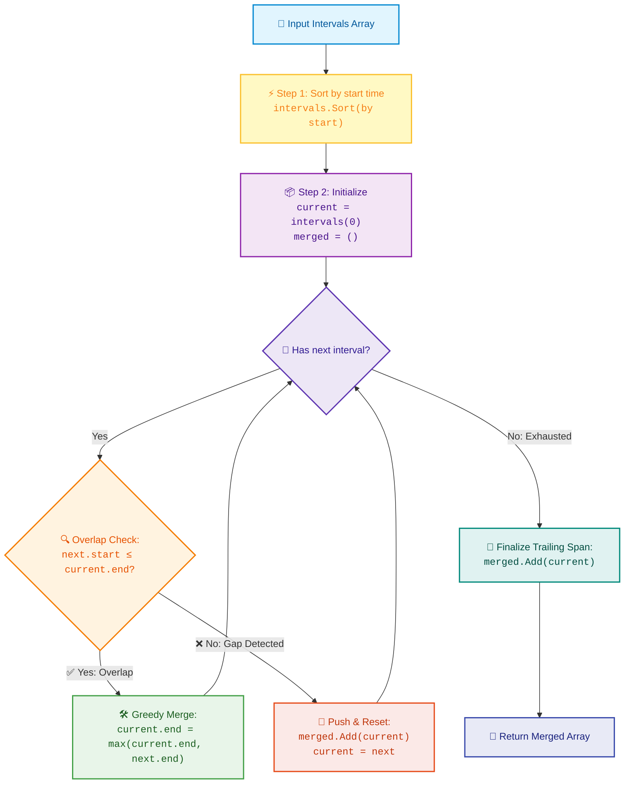

# 📚 Week 05 Day 03: Merge Operations & Interval Patterns — Engineering Guide

> 🧭 **Navigation:** [← Previous Day](Week_05_Day_02_Monotonic_Stack_Patterns_Instructional.md) • [🏠 Week Overview](README.md) • [📘 Curriculum Syllabus](../COMPLETE_SYLLABUS.md) • [Next Day →](Week_05_Day_04_Part_A_Partition_Cyclic_Sort_Instructional.md)
> 
> 💡 **Instructor Note:** *Not all sections or topics are mandatory. Focus on the core interval invariants and the three-phase insertion mechanics according to your interview timeline.*

---

## 🎯 LEARNING OBJECTIVES

By the end of this chapter, you will be able to:

- 🎯 **Internalize** the sorting-as-enabler principle: sorting by interval start time collapses 6 complex geometric overlap cases into 2 deterministic checks, transforming an intractable `O(N^2)` combinatorial problem into an `O(N log N)` sort followed by a greedy `O(N)` linear merge.
- ⚙️ **Implement** Merge Intervals (LC 56), Insert Interval (LC 57), Meeting Rooms II (LC 253), and Merge K Sorted Lists (LC 23) in modern C# (.NET 8/9 using `PriorityQueue<TElement, TPriority>`) and Python (3.11+).
- 🪜 **Master** the 3-phase linear partition pattern for ordered stream insertion without redundant re-sorting.
- 🛑 **Avoid** the 4 classic rookie blunders (unsorted input traps, end-boundary truncation, off-by-one boundary touching, and post-loop trailing interval leaks).
- 🎙️ **Deliver** the exact 3-sentence FAANG interview verbal script that anchors algorithmic justification before writing a single line of code.
- 🏭 **Connect** interval merges to production systems (Google Calendar conflict resolution, AWS hypervisor CPU time slices, Cloudflare CIDR routing, and PostgreSQL GiST transaction lock consolidation).

---

## 🎬 CHAPTER 1: THE 60-SECOND HOOK & EVERYDAY ANALOGY

### Hey Engineers, Welcome Back to Week 5 Day 3!

You and I are building the backbone of temporal scheduling today. Whether you're booking flights, allocating server threads, or dodging overlapping calendar invites, everything boils down to one fundamental entity: an **Interval** `[start, end]`.

### The Real-World Metaphor: The Google Calendar Schedulizer

Imagine opening your Google Calendar on a frantic Monday morning. You glance at your schedule and see two overlapping invites:
- **Meeting A:** Architecture Review from `9:00 AM` to `10:30 AM` (`[9:00, 10:30]`)
- **Meeting B:** Team Sprint Standup from `10:00 AM` to `11:30 AM` (`[10:00, 11:30]`)

What does your brain do automatically? You don't view them as two isolated events that start and stop independently. You instantly synthesize them into one uninterrupted, grueling **block of busy time**: `[9:00 AM, 11:30 AM]`.

Now imagine your calendar is handed to you on 500 loose sticky notes scattered randomly across the floor. If you want to know which meetings conflict, you'd have to pick up every note and compare it against every other note—taking brutal `O(N^2)` time.

How do you fix this in real life? **You line them up by start time!**

```
Raw Unsorted Sticky Notes (Chaos):
  [15, 18], [2, 6], [1, 3], [8, 10]  <-- Quadratic O(N^2) pairwise comparisons

Sorted by Start Time (Order & Predictability):
  [1, 3]  ───>  [2, 6]  ───>  [8, 10]  ───>  [15, 18]
  (t = 1)       (t = 2)       (t = 8)        (t = 15)
```

### The Sacred Invariant

> [!IMPORTANT]
> **The Sacred Interval Invariant:**
> **Always SORT intervals by their `start` time!**
> Once intervals are sorted monotonically such that `intervals[i].start <= intervals[i + 1].start`, interval `B` can **only** overlap with interval `A` if:
> ```
> B.start <= A.end
> ```
> If `B.start > A.end`, then because every future interval `C` has `C.start >= B.start > A.end`, **no future interval can ever touch interval `A` again**. Interval `A` is permanently finalized! You **never have to look backward**.

---

## 🎨 CHAPTER 2: THE MENTAL MODEL & VISUAL GEOMETRY

### The 6 Canonical Overlap Relationships

In 1D Cartesian coordinate space, any two arbitrary intervals `A` and `B` can relate in exactly **6 possible ways**:

```
1. Completely Disjoint Before (A is strictly before B):
   A: [───────]
   B:             [───────]
   Condition: A.end < B.start  ==>  NO OVERLAP

2. Overlapping End (A starts first, B overlaps A's end):
   A: [───────────]
   B:        [───────────]
   Condition: A.start <= B.start <= A.end <= B.end  ==>  OVERLAP (Extend End)

3. Enclosed Within (B is completely inside A):
   A: [─────────────────────]
   B:        [───────]
   Condition: A.start <= B.start and B.end <= A.end  ==>  OVERLAP (A Absorbs B)

4. Spanning Over (A is completely inside B):
   A:        [───────]
   B: [─────────────────────]
   Condition: B.start <= A.start and A.end <= B.end  ==>  OVERLAP (B Absorbs A)

5. Overlapping Start (B starts first, A overlaps B's end):
   A:        [───────────]
   B: [───────────]
   Condition: B.start <= A.start <= B.end <= A.end  ==>  OVERLAP (Extend End)

6. Completely Disjoint After (A is strictly after B):
   A:             [───────]
   B: [───────]
   Condition: B.end < A.start  ==>  NO OVERLAP
```

### The Magic of Sorting: Collapsing 6 Cases into 2

Look closely at the 6 cases above. Why do junior engineers get tangled in messy `if/else` spaghetti? Because they try to handle all 6 permutations simultaneously!

**The moment you sort by start time (`A.start <= B.start`), Cases 4, 5, and 6 are mathematically eliminated!** `B` can never start before `A`.

Your entire algorithm collapses into just **two simple, deterministic checks**:

```
Case 1: Overlap Detected!
Condition: B.start <= A.end
Action:    Merge them!
           merged.start = A.start (unchanged)
           merged.end   = max(A.end, B.end)

Case 2: Gap Detected!
Condition: B.start > A.end
Action:    A is finalized! Commit A to results.
           Set current active interval to B.
```

### Interval Processing Master Engine Flowchart



---

## 🪜 CHAPTER 3: THE SCAFFOLDING LADDER & TOY TRACES

### 1. The Toy Napkin Trace: Merge Intervals (LeetCode 56)

Let's trace our algorithm by hand on a classic input:
`intervals = [[1, 3], [2, 6], [8, 10], [15, 18]]`

```
Timeline Axis:
0   1   2   3   4   5   6   7   8   9  10  11  12  13  14  15  16  17  18
┼───┼───┼───┼───┼───┼───┼───┼───┼───┼───┼───┼───┼───┼───┼───┼───┼───┼───┼───>
    [───]                      (Interval 0: [1, 3])
        [───────────]          (Interval 1: [2, 6])
                                [───────]          (Interval 2: [8, 10])
                                                            [───────────] (Interval 3: [15, 18])
```

#### Step-by-Step Execution:

| Step | Current Candidate | Next Interval | Overlap Check (`next.start <= current.end`) | Action Taken | Active State | Committed to Merged Output |
| :---: | :---: | :---: | :---: | :---: | :---: | :---: |
| **0** | `[1, 3]` | — | Initialization | Pick first element | `current = [1, 3]` | `[]` |
| **1** | `[1, 3]` | `[2, 6]` | `2 <= 3` (TRUE ✅) | **Merge!** `end = max(3, 6) = 6` | `current = [1, 6]` | `[]` |
| **2** | `[1, 6]` | `[8, 10]` | `8 <= 6` (FALSE ❌) | **Gap!** Flush `current`, reset | `current = [8, 10]` | `[[1, 6]]` |
| **3** | `[8, 10]` | `[15, 18]` | `15 <= 10` (FALSE ❌) | **Gap!** Flush `current`, reset | `current = [15, 18]` | `[[1, 6], [8, 10]]` |
| **End** | `[15, 18]` | — | Loop Exhausted | **Post-Loop Flush!** | — | `[[1, 6], [8, 10], [15, 18]]` |

**Final Output:** `[[1, 6], [8, 10], [15, 18]]`

---

### 🧠 Pause & Predict: Insert Interval (LeetCode 57)

Now test your active intuition on **Insert Interval** before looking ahead!

> **The Scenario:**
> You are given a list of non-overlapping intervals, **already pre-sorted** by start time:
> `intervals = [[1, 2], [3, 5], [6, 7], [8, 10], [12, 16]]`
> You need to insert:
> `newInterval = [4, 8]`
>
> **The Active Recall Challenge:**
> 1. Do we need to call `Array.Sort()` here? (Think about the time complexity!)
> 2. Which intervals end *strictly before* `[4, 8]` starts?
> 3. Which intervals *overlap* with `[4, 8]`, and what does `newInterval` mutate into?
> 4. Which intervals start *strictly after* `newInterval` finishes?

<details>
<summary>👉 Click to Reveal the Step-by-Step Breakdown</summary>

**1. No sorting needed!** The input is already sorted and disjoint. Calling `O(N log N)` sort is a rookie mistake; we can solve this in pure `O(N)` linear time.

**2. Phase 1 (Completely Before):**
- Compare each interval's end against `newInterval[0] = 4`:
  - `[1, 2]`: `2 < 4` (TRUE). Push `[1, 2]` to result.
  - `[3, 5]`: `5 < 4` (FALSE). Stop Phase 1!
- Output so far: `[[1, 2]]`

**3. Phase 2 (Overlapping Zone):**
- Condition: `interval.start <= newInterval.end` (`interval[0] <= 8`):
  - `[3, 5]`: `3 <= 8` -> Overlap! `newInterval = [min(4, 3), max(8, 5)] = [3, 8]`
  - `[6, 7]`: `6 <= 8` -> Overlap! `newInterval = [min(3, 6), max(8, 7)] = [3, 8]`
  - `[8, 10]`: `8 <= 8` -> Overlap! `newInterval = [min(3, 8), max(8, 10)] = [3, 10]`
  - `[12, 16]`: `12 <= 10` (FALSE). Stop Phase 2!
- Push merged `newInterval` (`[3, 10]`) to result.
- Output so far: `[[1, 2], [3, 10]]`

**4. Phase 3 (Completely After):**
- Append all remaining intervals from index `i`:
  - `[12, 16]` is pushed directly.
- Final Output: `[[1, 2], [3, 10], [12, 16]]` in pure single-pass `O(N)`!
</details>

---

## 🛑 CHAPTER 4: THE ROOKIE TRAP ZONE

Below are the 4 catastrophic blunders that cost candidates their FAANG offers, paired with the Senior Architect fix:

### Trap 1: Forgetting to Sort by Start Time
```csharp
// ❌ ROOKIE BLUNDER: Assuming intervals arrive in order
public int[][] Merge(int[][] intervals)
{
    // If input is [[1, 4], [0, 4]], iterating without sorting
    // processes [1, 4] first, then sees [0, 4].
    // Since 0 <= 4, it merges to [1, 4] and LOSES the 0 start time!
    var list = new List<int[]>();
    // ... loops through raw array ...
}

// ✅ SENIOR ARCHITECT PATTERN: Explicit sort contract
public int[][] Merge(int[][] intervals)
{
    ArgumentNullException.ThrowIfNull(intervals);
    if (intervals.Length <= 1) return intervals;

    // Sorting by start time guarantees monotonic progression
    Array.Sort(intervals, static (a, b) => a[0].CompareTo(b[0]));
    // ... proceed with single linear scan ...
}
```

---

### Trap 2: Overwriting `end` Instead of Taking `Math.Max`
```csharp
// ❌ ROOKIE BLUNDER: Truncating enclosed intervals
if (next[0] <= current[1])
{
    current[1] = next[1]; // BUG! Fails on [[1, 10], [2, 5]] -> produces [1, 5] instead of [1, 10]!
}

// ✅ SENIOR ARCHITECT PATTERN: Expand greedily to max boundary
if (next[0] <= current[1])
{
    current[1] = Math.Max(current[1], next[1]); // Correctly retains 10!
}
```

---

### Trap 3: Off-By-One Endpoint Inclusivity (`<` vs `<=`)
```csharp
// ❌ ROOKIE BLUNDER: Strict inequality drops touching meetings
if (next[0] < current[1]) // BUG: If meetings are [1, 2] and [2, 3], 2 < 2 is FALSE!
{
    // Treats them as separate when problem contract specifies contiguous blocks touch!
}

// ✅ SENIOR ARCHITECT PATTERN: Understand the problem contract
// In LeetCode 56, intervals touching at endpoints [1, 2] and [2, 3] overlap at t=2.
if (next[0] <= current[1])
{
    current[1] = Math.Max(current[1], next[1]);
}
```

---

### Trap 4: Leaking the Trailing Active Interval
```csharp
// ❌ ROOKIE BLUNDER: Forgetting the last interval in the loop buffer
for (int i = 1; i < intervals.Length; i++)
{
    if (intervals[i][0] <= current[1])
        current[1] = Math.Max(current[1], intervals[i][1]);
    else {
        merged.Add(current);
        current = intervals[i];
    }
}
return merged.ToArray(); // BUG! The final 'current' interval is never added!

// ✅ SENIOR ARCHITECT PATTERN: Always flush active candidate post-loop
merged.Add(current); // Flush final span
return [.. merged];
```

---

## 🎙️ CHAPTER 5: 45-MINUTE INTERVIEW VERBAL SCRIPT

When an interviewer asks LeetCode 56 or any interval variation, **do not jump into typing code immediately**. Deliver this exact 3-sentence script:

```
"Because unsorted intervals require quadratic O(N^2) pairwise comparisons to resolve overlaps, 
 I will first sort the intervals by their start time in O(N log N), which guarantees that any 
 potential overlap must appear immediately adjacent in our linear traversal.

 Next, I'll initialize a running candidate interval and iterate through the sorted list in O(N) time; 
 whenever the next interval's start is less than or equal to the candidate's end, I greedily extend 
 the candidate's end to max(current.end, next.end), otherwise I commit the finalized candidate to my result.

 This guarantees optimal O(N log N) time bounded by sorting, with O(N) auxiliary space, while cleanly 
 handling edge cases like enclosed intervals, duplicate spans, and endpoint-touching boundaries."
```

---

## ⚡ CHAPTER 6: PRODUCTION DUAL-LANGUAGE IMPLEMENTATIONS

### Problem 1: Merge Intervals (LeetCode 56)

#### C# (.NET 8/9 — Production-Grade, Zero-Allocation Awareness)

```csharp
using System;
using System.Collections.Generic;

public static class MergeIntervalsSolver
{
    /// <summary>
    /// Merges all overlapping intervals into contiguous spans after sorting by start boundary.
    /// Time Complexity: O(N log N) | Auxiliary Space: O(N) | Output Space: O(N)
    /// </summary>
    public static int[][] Merge(int[][] intervals)
    {
        // Guard Clause
        ArgumentNullException.ThrowIfNull(intervals);
        if (intervals.Length <= 1) return intervals;

        // Step 1: Sort primarily by start time
        Array.Sort(intervals, static (a, b) => a[0].CompareTo(b[0]));

        var merged = new List<int[]>(intervals.Length);
        int[] current = intervals[0];

        // Step 2: Linear scan and greedy merge
        for (int i = 1; i < intervals.Length; i++)
        {
            int[] next = intervals[i];

            if (next[0] <= current[1])
            {
                // Overlapping: expand current interval's right boundary
                current[1] = Math.Max(current[1], next[1]);
            }
            else
            {
                // Disjoint: commit current interval and advance
                merged.Add(current);
                current = next;
            }
        }

        // Step 3: Flush the trailing active interval
        merged.Add(current);

        return [.. merged];
    }
}
```

#### Python (3.11+ — Idiomatic, Clean)

```python
def merge_intervals(intervals: list[list[int]]) -> list[list[int]]:
  """Merges all overlapping intervals greedily after sorting by start time.

  Time Complexity: O(N log N) | Auxiliary Space: O(N) | Output Space: O(N)
  """
  if not intervals:
    return []

  # Sort by start time in-place
  intervals.sort(key=lambda x: x[0])
  merged: list[list[int]] = [intervals[0][:]]

  for start, end in intervals[1:]:
    # If current start <= previous end, merge them
    if start <= merged[-1][1]:
      merged[-1][1] = max(merged[-1][1], end)
    else:
      merged.append([start, end])

  return merged
```

#### 📊 Explicit Complexity Deconstruction
* **Time Complexity:** `O(N log N)` — Sorting `N` intervals dominates with `O(N log N)`. The subsequent merge pass evaluates each interval exactly once in `O(N)` time.
* **Auxiliary Space:** `O(N)` — Sorting requires `O(log N)` to `O(N)` internal recursion stack/buffer space depending on runtime sort implementation (Timsort in Python, Introsort in .NET).
* **Output Space:** `O(N)` — Returns a new array storing at most `N` non-overlapping merged intervals.

---

### Problem 2: Insert Interval (LeetCode 57)

#### C# (.NET 8/9 — Production-Grade Three-Phase Scan)

```csharp
using System;
using System.Collections.Generic;

public static class InsertIntervalSolver
{
    /// <summary>
    /// Inserts and merges a new interval into a pre-sorted disjoint interval list in O(N) time.
    /// Time Complexity: O(N) | Auxiliary Space: O(1) auxiliary | Output Space: O(N)
    /// </summary>
    public static int[][] Insert(int[][] intervals, int[] newInterval)
    {
        ArgumentNullException.ThrowIfNull(intervals);
        ArgumentNullException.ThrowIfNull(newInterval);

        int n = intervals.Length;
        var result = new List<int[]>(n + 1);
        int i = 0;

        // Phase 1: Append all intervals ending strictly before newInterval starts
        while (i < n && intervals[i][1] < newInterval[0])
        {
            result.Add(intervals[i]);
            i++;
        }

        // Phase 2: Greedily merge all overlapping intervals into newInterval
        while (i < n && intervals[i][0] <= newInterval[1])
        {
            newInterval[0] = Math.Min(newInterval[0], intervals[i][0]);
            newInterval[1] = Math.Max(newInterval[1], intervals[i][1]);
            i++;
        }
        result.Add(newInterval);

        // Phase 3: Append all remaining intervals starting strictly after newInterval ends
        while (i < n)
        {
            result.Add(intervals[i]);
            i++;
        }

        return [.. result];
    }
}
```

#### Python (3.11+ — Idiomatic Three-Phase Scan)

```python
def insert_interval(
    intervals: list[list[int]], new_interval: list[int]
) -> list[list[int]]:
  """Inserts a new interval into sorted non-overlapping intervals in a single linear pass.

  Time Complexity: O(N) | Auxiliary Space: O(1) auxiliary | Output Space: O(N)
  """
  result: list[list[int]] = []
  i = 0
  n = len(intervals)

  # Phase 1: Preceding disjoint intervals
  while i < n and intervals[i][1] < new_interval[0]:
    result.append(intervals[i])
    i += 1

  # Phase 2: Overlapping intervals merged directly into new_interval
  while i < n and intervals[i][0] <= new_interval[1]:
    new_interval[0] = min(new_interval[0], intervals[i][0])
    new_interval[1] = max(new_interval[1], intervals[i][1])
    i += 1
  result.append(new_interval)

  # Phase 3: Trailing disjoint intervals
  while i < n:
    result.append(intervals[i])
    i += 1

  return result
```

#### 📊 Explicit Complexity Deconstruction
* **Time Complexity:** `O(N)` — Single linear pass. The pointer `i` starts at 0 and increments strictly forward to `n` across the 3 non-nested phases.
* **Auxiliary Space:** `O(1)` — Only pointer index `i` and scalar boundaries are tracked outside the output list.
* **Output Space:** `O(N)` — Stores at most `N + 1` intervals in the returned collection.

---

### Problem 3: Meeting Rooms II (LeetCode 253)

#### C# (.NET 8/9 — `PriorityQueue<int, int>` Min-Heap Allocation)

```csharp
using System;
using System.Collections.Generic;

public static class MeetingRoomsSolver
{
    /// <summary>
    /// Computes minimum meeting rooms required using a PriorityQueue min-heap of meeting end times.
    /// Time Complexity: O(N log N) | Auxiliary Space: O(N) | Output Space: O(1)
    /// </summary>
    public static int MinMeetingRooms(int[][] intervals)
    {
        ArgumentNullException.ThrowIfNull(intervals);
        int n = intervals.Length;
        if (n <= 1) return n;

        // Step 1: Sort intervals by start time
        Array.Sort(intervals, static (a, b) => a[0].CompareTo(b[0]));

        // Step 2: Min-heap tracking the earliest release time of rooms currently occupied
        // PriorityQueue<TElement, TPriority>: element is endTime, priority is endTime
        var minHeap = new PriorityQueue<int, int>(n);

        // Seed with the first meeting's end time
        minHeap.Enqueue(intervals[0][1], intervals[0][1]);

        // Step 3: Iterate through remaining meetings
        for (int i = 1; i < n; i++)
        {
            int currentStart = intervals[i][0];
            int currentEnd = intervals[i][1];

            // If the earliest ending meeting finishes before or when this meeting starts,
            // we reuse that room!
            if (minHeap.Peek() <= currentStart)
            {
                minHeap.Dequeue();
            }

            // Assign the room (either reused or newly allocated) with the new end time
            minHeap.Enqueue(currentEnd, currentEnd);
        }

        // Heap size represents peak concurrent rooms required
        return minHeap.Count;
    }
}
```

#### Python (3.11+ — `heapq` Min-Heap)

```python
import heapq


def min_meeting_rooms(intervals: list[list[int]]) -> int:
  """Finds minimum conference rooms required using a min-heap of active end times.

  Time Complexity: O(N log N) | Auxiliary Space: O(N) | Output Space: O(1)
  """
  if not intervals:
    return 0

  # Sort primarily by start time
  intervals.sort(key=lambda x: x[0])

  # Min-heap stores end times of active meetings
  min_heap: list[int] = []
  heapq.heappush(min_heap, intervals[0][1])

  for start, end in intervals[1:]:
    # If the room that frees up earliest finishes before this meeting starts, reuse it
    if min_heap[0] <= start:
      heapq.heappop(min_heap)

    # Allocate/reassign room with the new meeting's end time
    heapq.heappush(min_heap, end)

  return len(min_heap)
```

#### 📊 Staff Engineer Deep Dive: Min-Heap vs. Two-Pointer Sweep Trade-Off

| Dimension | Min-Heap Approach (`PriorityQueue`) | Two-Pointer Coordinate Sweep |
| :--- | :--- | :--- |
| **Time Complexity** | `O(N log N)` (Sort) + `O(N log N)` (Heap ops) | `O(N log N)` (Sort starts & ends) + `O(N)` (Sweep) |
| **Auxiliary Space** | `O(N)` heap buffer | `O(N)` for decoupled `starts[]` and `ends[]` arrays |
| **Room Identity** | ✅ **Can track room assignments** (Room 1 -> Meeting A, Room 2 -> Meeting B) | ❌ **Loses room pairing** (Only measures aggregate concurrency scalar) |
| **Interview Verdict** | Standard FAANG Staff choice when asked to output room assignment IDs | Preferred if interviewer asks for zero heap rebalancing overhead |

---

### Problem 4: Merge K Sorted Lists (LeetCode 23)

#### C# (.NET 8/9 — `PriorityQueue<ListNode, int>`)

```csharp
using System.Collections.Generic;

public class ListNode
{
    public int val;
    public ListNode? next;
    public ListNode(int val = 0, ListNode? next = null)
    {
        this.val = val;
        this.next = next;
    }
}

public static class MergeKListsSolver
{
    /// <summary>
    /// Merges K sorted linked lists into one consolidated sorted list using a Min-Heap.
    /// Time Complexity: O(N log K) | Auxiliary Space: O(K) | Output Space: O(1) auxiliary
    /// </summary>
    public static ListNode? MergeKLists(ListNode?[]? lists)
    {
        if (lists == null || lists.Length == 0) return null;

        var pq = new PriorityQueue<ListNode, int>();

        // Initialize heap with the head of each non-empty list
        foreach (var head in lists)
        {
            if (head != null)
            {
                pq.Enqueue(head, head.val);
            }
        }

        var dummy = new ListNode(0);
        var tail = dummy;

        while (pq.Count > 0)
        {
            var smallest = pq.Dequeue();
            tail.next = smallest;
            tail = tail.next;

            if (smallest.next != null)
            {
                pq.Enqueue(smallest.next, smallest.next.val);
            }
        }

        return dummy.next;
    }
}
```

#### Python (3.11+ — `heapq` K-Way Merge)

```python
import heapq


class ListNode:

  def __init__(self, val: int = 0, next: "ListNode | None" = None) -> None:
    self.val = val
    self.next = next


def merge_k_lists(lists: list[ListNode | None]) -> ListNode | None:
  """Merges K sorted linked lists using a min-heap priority queue.

  Time Complexity: O(N log K) | Auxiliary Space: O(K) | Output Space: O(1)
  auxiliary
  """
  # Store tuple: (node.val, list_index, node) to avoid unorderable type comparisons
  heap: list[tuple[int, int, ListNode]] = []

  for i, head in enumerate(lists):
    if head:
      heapq.heappush(heap, (head.val, i, head))

  dummy = ListNode(0)
  tail = dummy

  while heap:
    _, i, smallest = heapq.heappop(heap)
    tail.next = smallest
    tail = tail.next

    if smallest.next:
      heapq.heappush(heap, (smallest.next.val, i, smallest.next))

  return dummy.next
```

#### 📊 Explicit Complexity Deconstruction
* **Time Complexity:** `O(N log K)` where `N` is the total number of nodes across all lists and `K` is the number of linked lists. Each of the `N` nodes is enqueued and dequeued exactly once from a heap of size at most `K`.
* **Auxiliary Space:** `O(K)` — The heap holds at most `K` elements simultaneously.
* **Output Space:** `O(1)` auxiliary space — Existing node pointers are rewired in-place with zero node allocations.

---

## 🏭 CHAPTER 7: PRODUCTION SYSTEMS & REAL-WORLD ARCHITECTURE

Where does interval merging actually live in high-scale FAANG production?

### 1. Google Calendar & Outlook Free/Busy Federation
When querying user availability across timezones, calendar microservices merge millions of busy intervals across multiple shared calendars using LeetCode 56. The inverse (the gaps between merged intervals) represents **bookable free time slots** (LeetCode 759: Employee Free Time).

### 2. Cloudflare & AWS Route 53 CIDR IP Block Merging
Network firewalls receive thousands of IP range block rules formatted as IP address intervals `[start_ip, end_ip]`. Running packet inspection against overlapping ranges creates redundant firewall rule evaluation. Security gateways sort and merge overlapping IP intervals into contiguous CIDR blocks, reducing router lookup tables by up to 80%.

### 3. PostgreSQL GiST Range Indexing & Lock Consolidation
Relational databases managing transactional time locks merge overlapping row-level lock intervals. When a transaction requests overlapping lock windows on partitioned tables, the lock manager coalesces them into a single parent range lock to prevent lock table memory exhaustion.

### 4. Kubernetes CPU Quota Burst Slices
The Linux CFS (Completely Fair Scheduler) and container runtimes (containerd/Docker) track thread execution windows. Overlapping CPU reservation requests are merged to calculate continuous compute allocations and prevent jitter.

---

## 🎯 CHAPTER 8: FAANG INTERVIEW PATTERN SIGNALS & EDGE CASES

### 🎯 Pattern Recognition Cheat Sheet

| Trigger Phrase in Problem Statement | Underlying Algorithmic Pattern | Time Complexity | Auxiliary Space |
| :--- | :--- | :--- | :--- |
| **"Merge overlapping ranges / time spans"** | Sort by `start` + Greedy merge | `O(N log N)` | `O(N)` |
| **"Insert interval into already sorted list"** | Three-phase partition (`<`, `<=`, `>`) | `O(N)` | `O(1)` auxiliary |
| **"Find minimum conference rooms / simultaneous resources"** | Min-Heap or Two-Pointer sweep | `O(N log N)` | `O(N)` |
| **"Find maximum non-overlapping intervals (remove min)"** | Greedy Interval Scheduling: **Sort by `end` time** | `O(N log N)` | `O(1)` auxiliary |
| **"Combine K sorted streams or linked lists"** | Min-Heap `PriorityQueue` of size `K` | `O(N log K)` | `O(K)` |
| **"Massive static interval point queries"** | **Do NOT merge!** Use Interval Trees or Segment Trees | `O(log N)` query | `O(N)` |

### 🧪 Concrete Edge-Case Checklist

Before declaring your solution complete in an interview, trace these 5 boundary conditions:
1. **Empty Input (`intervals.Length == 0`):** Must return empty array immediately without null reference or index exceptions.
2. **Single Interval (`intervals.Length == 1`):** Must return `intervals` as-is in `O(1)` time.
3. **Completely Enclosed / Nested Intervals (`[[1, 10], [2, 5], [3, 4]]`):** Must correctly yield `[[1, 10]]` (verifying `Math.Max` logic).
4. **Completely Disjoint Intervals (`[[1, 2], [3, 4], [5, 6]]`):** Output must match input exactly, verifying that gap transitions do not lose intervals.
5. **Identical Duplicate Intervals (`[[1, 4], [1, 4]]`):** Must merge down into single interval `[[1, 4]]` without duplicate commits.

---

## ⚔️ SUPPLEMENTARY PRACTICE & VERBAL DRILLS

### 🏋️ High-ROI Practice Problems

| # | Problem | Source | Difficulty | Primary Pattern |
| :--- | :--- | :--- | :--- | :--- |
| 1 | **Merge Intervals** | LeetCode 56 | 🟡 Medium | Sort by start + Greedy merge |
| 2 | **Insert Interval** | LeetCode 57 | 🟡 Medium | Three-phase linear partition |
| 3 | **Meeting Rooms** | LeetCode 252 | 🟢 Easy | Sort by start + adjacent conflict check |
| 4 | **Meeting Rooms II** | LeetCode 253 | 🟡 Medium | Sort + Min-Heap concurrency tracking |
| 5 | **Non-overlapping Intervals** | LeetCode 435 | 🟡 Medium | Greedy interval scheduling (Sort by end time) |
| 6 | **Minimum Number of Arrows to Burst Balloons** | LeetCode 452 | 🟡 Medium | Interval intersection tracking |
| 7 | **Merge K Sorted Lists** | LeetCode 23 | 🔴 Hard | Min-Heap K-way stream merge |
| 8 | **Employee Free Time** | LeetCode 759 | 🔴 Hard | K-way merge + interval gap extraction |

### 🎙️ Verbal Mock Drills

1. **Q: Why do we sort by start time for Merge Intervals, but by end time for Non-Overlapping Intervals (LC 435)?**
   - **Answer:** In Merge Intervals, sorting by start time ensures that any interval that could possibly merge with our active interval must arrive immediately next. In Non-overlapping Intervals, our objective is to maximize the number of compatible meetings; greedily selecting the interval that finishes earliest frees up the maximum remaining timeline for future candidates.
2. **Q: Can Insert Interval (LC 57) be solved using binary search?**
   - **Answer:** We can use binary search (`O(log N)`) to find the insertion index of `newInterval.start` and `newInterval.end`. However, because inserting into an array and shifting elements or slicing requires `O(N)` time, the overall asymptotic time complexity remains `O(N)`. The three-phase linear scan is cleaner, less error-prone, and achieves the same optimal `O(N)` bound.

---

## 📌 CLOSING REFLECTION

Interval algorithms demonstrate the power of **ordering to eliminate combinatorial ambiguity**. An initial `O(N log N)` sort transforms an overwhelming web of mutual overlaps into a single, predictable timeline where greedy local decisions are provably optimal. Master the start-sorted invariant and the three-phase insertion sweep, and you possess the foundational toolkit to solve any temporal scheduling problem in FAANG interviews.

---
> 🧭 **Navigation:** [← Previous Day](Week_05_Day_02_Monotonic_Stack_Patterns_Instructional.md) • [🏠 Week Overview](README.md) • [📘 Curriculum Syllabus](../COMPLETE_SYLLABUS.md) • [Next Day →](Week_05_Day_04_Part_A_Partition_Cyclic_Sort_Instructional.md)
