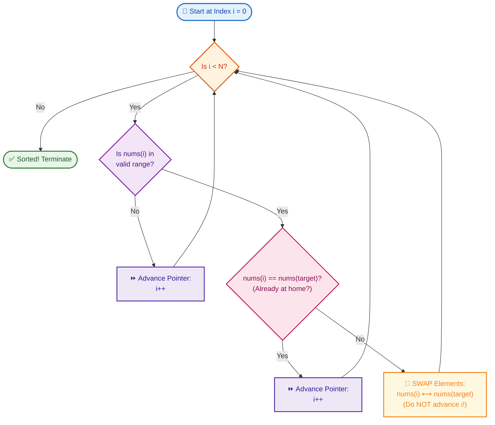

# 📘 Week 05 Day 04 Part A: Partition & Cyclic Sort Patterns — Engineering Guide

> 🧭 **Navigation:** [← Previous Day](Week_05_Day_03_Merge_Operations_Interval_Patterns_Instructional.md) • [🏠 Week Overview](README.md) • [📘 Curriculum Syllabus](../COMPLETE_SYLLABUS.md) • [Next Day →](Week_05_Day_04_Part_B_Kadane_Algorithm_Instructional.md)
> 
> 💡 **Instructor Note:** *Welcome to one of the most high-ROI, high-leverage days of your algorithmic interview prep! Today we deconstruct two of the most elegant in-place array manipulation algorithms ever conceived: Dijkstra's Dutch National Flag 3-Way Partition and Cyclic Sort. Master these invariants, and you will solve array segregation and missing-element problems in strict `O(N)` time with zero auxiliary heap allocations.*

---

## 🎯 LEARNING OBJECTIVES

By the end of this chapter, you will be able to:

- 🎯 **Internalize** the Cyclic Sort Invariant: when values map to array indices, the values themselves act as direct memory pointers, achieving full sorting or missing-element discovery in `O(N)` time and `O(1)` auxiliary space.
- ⚙️ **Implement** Sort Colors (Dutch National Flag), Move Zeroes, Missing Number, First Missing Positive (LeetCode Hard), and Find the Duplicate Number in production C# (.NET 8/9, `Span<int>`) and idiomatic Python (3.11+).
- 🪜 **Execute** flawless toy napkin traces with real pointer fingers, accounting for the aggregate `O(N)` swap budget without getting trapped in infinite loops.
- 🛑 **Identify and avoid** the four lethal rookie blunders: eager pointer advancement, duplicate value infinite swaps, Dutch Flag high-swap premature increments, and Python tuple unpacking evaluation traps.
- 🎙️ **Recite** high-conviction 3-sentence interview verbal scripts explaining the partition and placement invariants before touching the keyboard.
- 🏭 **Connect** partition patterns to real production systems (in-place OS memory compaction, garbage collection compaction phases, Dual-Pivot Quicksort, and columnar database run-length encoding).

---

## 🎬 CHAPTER 1: THE 60-SECOND HOOK & EVERYDAY ANALOGY

Hey engineers, welcome back to Week 5 Day 4 Part A!

Let's cut straight to the chase: whenever an interviewer hands you an array problem where the numbers are bounded within `[1..N]` or `[0..N]` and whispers the golden constraint—*"Do this in `O(N)` time and `O(1)` auxiliary space"*—95% of candidates freeze. 

Why? Because normal comparison sorting (Quicksort, Mergesort) hits a mathematical brick wall at `O(N log N)`. And tracking seen numbers with a `HashSet<int>` or boolean lookup table blows your memory budget to `O(N)`.

So how do FAANG Staff Engineers solve it? **They use Cyclic Sort.**

### The Metaphor: Elementary School Coat Hooks (or Musical Chairs with Assigned Seating)

Imagine walking into an elementary school cloakroom at the end of the day. There are 5 coat hooks on the wall, neatly numbered `0, 1, 2, 3, 4`. Five kindergarteners have coats with large embroidered nametags numbered `1, 2, 3, 4, 5`.

Right now, the coats are hanging in complete chaos:

```
Hook Index:      [ 0 ]    [ 1 ]    [ 2 ]    [ 3 ]    [ 4 ]
Hanging Coat:    [ 3 ]    [ 1 ]    [ 5 ]    [ 4 ]    [ 2 ]
                   ^
            Look at Hook 0:
            Coat #3 is hanging here!
            Where does Coat #3 belong? Hook index 2!
```

Do you gather all the coats, dump them in a giant pile, and run an `O(N log N)` sorting algorithm? **Of course not.** 

Do you run to the storage closet, buy 5 brand new hooks, and copy the coats over (`O(N)` space)? **No way.**

Here is what you do:
1. You stand right at **Hook 0**. You look at the coat hanging there: it is **Coat #3**.
2. Coat #3 belongs on **Hook 2** (`value - 1`).
3. You walk over to Hook 2, take whatever coat is currently on Hook 2 (**Coat #5**), and swap them. Now **Coat #3 is permanently in its rightful home**!
4. You look down at your hand: you are now holding **Coat #5**. You haven't moved past Hook 0 yet! Where does Coat #5 belong? **Hook 4**.
5. You swap Coat #5 with whatever is on Hook 4 (**Coat #2**). Now **Coat #5 is permanently home**!
6. You look at Hook 0 again: it holds **Coat #2**. It belongs on **Hook 1**. You swap with Hook 1 (**Coat #1**).
7. Now Hook 0 holds **Coat #1**. Does Coat #1 belong on Hook 0? **YES!**
8. Only now do you take one step forward to Hook 1. Every coat is already in its assigned chair!

### The Cyclic Sort Superpower

> [!IMPORTANT]
> **The Golden Law of Cyclic Sort:**  
> When an array of length `N` contains numbers from `[1..N]` (or `[0..N]`), **the values themselves are the memory addresses**!  
> By treating `nums[i] - 1` as the element's destination index, each swap places at least one element into its permanent home. Since there are only `N` slots, the algorithm terminates in at most `N - 1` swaps. That is strict `O(N)` time and `O(1)` auxiliary space. Zero hash tables. Zero heap allocations.

### Production Reality: Why FAANG Cares

Why are Google, Meta, and Microsoft obsessed with in-place partition and cyclic sort?
1. **Garbage Collection (Compacting Phase):** When the .NET GC or Java ZGC defragments memory during a Full GC pause, it cannot allocate extra RAM to sort memory blocks. It uses in-place partition algorithms to compact live objects toward low memory addresses and slide free pages to the right.
2. **High-Throughput Storage Engines:** In database kernels (RocksDB, Cassandra, DuckDB), segregating rows by status flags (e.g., active vs. tombstone vs. pending) happens directly in hardware cache lines. Allocating secondary arrays burns memory bandwidth and triggers costly CPU cache evictions.
3. **Dual-Pivot Quicksort Partitioning:** Java's `Arrays.sort()` and .NET's `Array.Sort()` employ three-way partitioning (Dijkstra's Dutch National Flag) to avoid `O(N^2)` catastrophic degradation on arrays with high duplicate density.

---

## 🧠 CHAPTER 2: THE MENTAL MODEL & VISUAL ARCHITECTURE

### 1. Cyclic Sort: The "Value-As-Address" Principle

In standard programming, an array is a lookup table: you provide an `index`, and it yields a `value`.  
In **Cyclic Sort**, the relationship is bijective:

```
Value V  ─── maps to ───>  Target Index: (V - 1)   [for 1-indexed values: 1..N]
Value V  ─── maps to ───>  Target Index: V         [for 0-indexed values: 0..N]
```

```
Contiguous Memory Layout:
========================================================================
Slot Index:     [ 0 ]         [ 1 ]         [ 2 ]         [ 3 ]
Current Value:  nums[0] = 4   nums[1] = 2   nums[2] = 1   nums[3] = 3
Target Index:     3             1             0             2
                  │             │             │             │
                  └─────────────┼─────────────┼─────────────┘
                                └─────────────┘
Each value points directly to its home slot in memory!
========================================================================
```

### 2. The Cyclic Sort Placement Engine (Flowchart)

Here is the exact decision loop executed at every single index:



### 3. Dutch National Flag (3-Way Partition): The 4-Zone Invariant

For three-category segregation (e.g., LeetCode 75 Sort Colors with 0s, 1s, and 2s), we partition the array into **four distinct semantic regions** bounded by three pointers: `low`, `mid`, and `high`.

```
Index:    0      low-1   low     mid-1   mid       high   high+1     N-1
Array:  [ 0  0 ... 0  |  1  1 ... 1  |  ?  ? ... ?  |  2  2 ... 2  ]
          ────────────   ────────────   ────────────   ────────────
          Region 0       Region 1       Unexplored     Region 2
          (All 0s)       (All 1s)       (Frontier)     (All 2s)
```

The mathematical invariants that MUST hold true before and after every loop iteration:
1. `[0 .. low - 1]`: Every element is strictly `0`.
2. `[low .. mid - 1]`: Every element is strictly `1`.
3. `[mid .. high]`: Elements are **uninspected** (the frontier).
4. `[high + 1 .. N - 1]`: Every element is strictly `2`.

---

## 🪜 CHAPTER 3: THE SCAFFOLDING LADDER & TOY NAPKIN TRACES

Let's build mastery step-by-step: starting with a 5-element toy napkin trace, progressing through classic FAANG interview mediums, and tackling a LeetCode Hard.

### Ladder Step 1: The Toy Napkin Trace (Pure Cyclic Sort)

Let's sort `nums = [3, 1, 5, 4, 2]` using Cyclic Sort.
- Values are `[1..5]`.
- Array length `N = 5`.
- Target index for value `X` is `X - 1`.

```
Initial State:
Index:     0    1    2    3    4
Nums:    [ 3,   1,   5,   4,   2 ]
Pointer:   ^ (i = 0)

Trace Iterations:
-----------------------------------------------------------------------------------------------------
Iteration 1: i = 0 | nums[0] = 3. Target index = 3 - 1 = 2.
             Is nums[0] == nums[2]? (3 == 5? False).
             Action: SWAP nums[0] with nums[2]. DO NOT increment i!
             Nums: [ 5,   1,   3,   4,   2 ]
             Note: Value 3 is now PERMANENTLY finalized at index 2!

Iteration 2: i = 0 | nums[0] = 5. Target index = 5 - 1 = 4.
             Is nums[0] == nums[4]? (5 == 2? False).
             Action: SWAP nums[0] with nums[4]. DO NOT increment i!
             Nums: [ 2,   1,   3,   4,   5 ]
             Note: Value 5 is now PERMANENTLY finalized at index 4!

Iteration 3: i = 0 | nums[0] = 2. Target index = 2 - 1 = 1.
             Is nums[0] == nums[1]? (2 == 1? False).
             Action: SWAP nums[0] with nums[1]. DO NOT increment i!
             Nums: [ 1,   2,   3,   4,   5 ]
             Note: Value 2 is now PERMANENTLY finalized at index 1!

Iteration 4: i = 0 | nums[0] = 1. Target index = 1 - 1 = 0.
             Is nums[0] == nums[0]? (1 == 1? True! It is home!).
             Action: i increments to 1.

Iteration 5: i = 1 | nums[1] = 2. Target index = 1. Already home -> i increments to 2.
Iteration 6: i = 2 | nums[2] = 3. Target index = 2. Already home -> i increments to 3.
Iteration 7: i = 3 | nums[3] = 4. Target index = 3. Already home -> i increments to 4.
Iteration 8: i = 4 | nums[4] = 5. Target index = 4. Already home -> i increments to 5.
Iteration 9: i = 5 | i == N. Loop terminates.
-----------------------------------------------------------------------------------------------------
Total Swaps: 3
Total Pointer Advances: 5
Total Operations: 8 <= 2 * N.
Final Array: [ 1, 2, 3, 4, 5 ]
```

> [!TIP]
> **Aggregate Swap Budget Analysis:**
> Notice that `i` stayed at `0` for three consecutive swaps! An interviewer might ask: *"Doesn't that while-loop take `O(N^2)` time if you stay at `i = 0`?"*  
> **Your Senior Answer:** *"No! Each swap places at least one element into its final, permanent home. Once an element reaches its home index, no future swap will ever touch it again. Because there are only `N` elements, at most `N - 1` swaps can ever occur across the entire lifetime of the algorithm. Combined with at most `N` pointer increments, the total operation count is strictly bounded by `2N - 1`, which is `O(N)`."*

---

### 🧠 Pause & Predict: Active Recall Checkpoint 1

Look closely at this input containing a duplicate:
```
nums = [ 2, 1, 2 ]
```
Suppose a junior developer writes the swap condition as:
`if (nums[i] != i + 1)` instead of `if (nums[i] != nums[correctIdx])`.

**Question:** What catastrophe happens on iteration 1 at `i = 0`?
<details>
<summary>👉 Click to reveal the answer</summary>

**Catastrophe: The Infinite Swap Loop!**
- At `i = 0`, `nums[0] = 2`.
- `targetIdx = nums[0] - 1 = 1`.
- The junior check tests: `nums[0] != 0 + 1` (`2 != 1` -> True!).
- The code swaps `nums[0]` with `nums[1]`: `[1, 2, 2]`.
- Next iteration at `i = 0`: `nums[0] = 1`. `1 == 0 + 1`. It advances `i` to 1.
- At `i = 1`: `nums[1] = 2`. Target index = 1. `2 == 1 + 1`. It advances `i` to 2.
- At `i = 2`: `nums[2] = 2`. Target index = 1.
- The junior check tests: `nums[2] != 2 + 1` (`2 != 3` -> True!).
- The code swaps `nums[2]` (2) with `nums[1]` (2).
- The array remains `[1, 2, 2]`. Neither element changed, and `i` was NOT incremented.
- The while loop now runs **infinitely**, swapping 2 with 2 forever!

**The Golden Fix:** ALWAYS check `nums[i] != nums[targetIdx]`.  
If `nums[targetIdx]` already holds the number, the swap is a no-op! We must break out and advance `i`.
</details>

---

### Ladder Step 2: Warm-Up — Missing Number (LeetCode 268)

In LeetCode 268, we are given `N` distinct numbers in range `[0..N]`. Since there are `N + 1` possible values and only `N` slots, exactly one number is missing.

Target mapping: Value `X` belongs at index `X`.  
What about value `N`? It has no slot `N` (valid indices are `0..N-1`). So if `nums[i] == N`, we simply advance past it!

```
Array: [ 3, 0, 1 ], N = 3
---------------------------------------------------------------------------------
i = 0: nums[0] = 3. Target = 3. But 3 == N (out of index range 0..2). Advance i -> 1.
i = 1: nums[1] = 0. Target = 0. nums[1] != nums[0] (0 != 3). Swap nums[1] <-> nums[0]!
       Array becomes: [ 0, 3, 1 ]
i = 1: nums[1] = 3. Target = 3 == N. Advance i -> 2.
i = 2: nums[2] = 1. Target = 1. nums[2] != nums[1] (1 != 3). Swap nums[2] <-> nums[1]!
       Array becomes: [ 0, 1, 3 ]
i = 2: nums[2] = 3. Target = 3 == N. Advance i -> 3. Loop ends!

Second Pass (Find Mismatch):
j = 0: nums[0] == 0 (Match)
j = 1: nums[1] == 1 (Match)
j = 2: nums[2] == 3 != 2 (MISMATCH DETECTED!)
Missing Number = 2!
```

---

### Ladder Step 3: Classic FAANG Medium — Sort Colors (LeetCode 75)

Sort an array of `0`s, `1`s, and `2`s in-place in a single pass.

Let's trace `nums = [2, 0, 2, 1, 1, 0]`:
- Pointers: `low = 0`, `mid = 0`, `high = 5`.

```
Trace:
======================================================================================
Step 0: [ 2,  0,  2,  1,  1,  0 ]  | low=0, mid=0, high=5
        nums[mid] == 2 -> Swap nums[mid] with nums[high], high--
        (Do NOT advance mid! The number arriving from high is uninspected!)
        Array: [ 0,  0,  2,  1,  1,  2 ] | low=0, mid=0, high=4

Step 1: nums[mid] == 0 -> Swap nums[low] with nums[mid], low++, mid++
        Array: [ 0,  0,  2,  1,  1,  2 ] | low=1, mid=1, high=4

Step 2: nums[mid] == 0 -> Swap nums[low] with nums[mid], low++, mid++
        Array: [ 0,  0,  2,  1,  1,  2 ] | low=2, mid=2, high=4

Step 3: nums[mid] == 2 -> Swap nums[mid] with nums[high], high--
        Array: [ 0,  0,  1,  1,  2,  2 ] | low=2, mid=2, high=3

Step 4: nums[mid] == 1 -> Belongs in middle zone! mid++
        Array: [ 0,  0,  1,  1,  2,  2 ] | low=2, mid=3, high=3

Step 5: nums[mid] == 1 -> Belongs in middle zone! mid++
        Array: [ 0,  0,  1,  1,  2,  2 ] | low=2, mid=4, high=3

Termination: mid (4) > high (3). Loop terminates!
Final Array: [ 0, 0, 1, 1, 2, 2 ] in O(N) time and O(1) space!
======================================================================================
```

---

### Ladder Step 4: Classic FAANG Hard — First Missing Positive (LeetCode 41)

This is one of the all-time legendary FAANG Hard questions:  
*"Given an unsorted integer array `nums`, return the smallest missing positive integer in `O(N)` time and `O(1)` auxiliary space."*

#### The Staff Engineer Intuition
An array of length `N` can contain arbitrary positive, negative, zero, or duplicate numbers (e.g., `[-10, 0, 1000, 3]`).  
**The Pigeonhole Principle:** In an array of size `N`, the smallest missing positive integer MUST be in the range `[1 .. N + 1]`.
- If the array contains all integers `1, 2, 3, ..., N`, then the answer is `N + 1`.
- If even a single integer in `[1 .. N]` is missing, the answer is within `[1 .. N]`.
- Any number `<= 0` or `> N` is pure noise! It cannot possibly occupy a valid hook in `[1 .. N]`.

So we run Cyclic Sort with a filter:
- Target index for value `V`: `V - 1`.
- Only swap if `V >= 1` AND `V <= N` AND `nums[i] != nums[V - 1]`.

Let's trace `nums = [3, 4, -1, 1]`, `N = 4`:

```
Trace:
======================================================================================
Initial: [ 3,   4,  -1,   1 ]  | i = 0

Step 0: nums[0] = 3. Target = 3 - 1 = 2.
        nums[0] != nums[2] (3 != -1) -> Swap nums[0] <-> nums[2]!
        Array: [ -1,   4,   3,   1 ]  (Value 3 is home!)

Step 1: nums[0] = -1. Target = -2.
        Is -1 in range [1..4]? NO! Ignore it and advance: i = 1.

Step 2: nums[1] = 4. Target = 4 - 1 = 3.
        nums[1] != nums[3] (4 != 1) -> Swap nums[1] <-> nums[3]!
        Array: [ -1,   1,   3,   4 ]  (Value 4 is home!)

Step 3: nums[1] = 1. Target = 1 - 1 = 0.
        nums[1] != nums[0] (1 != -1) -> Swap nums[1] <-> nums[0]!
        Array: [  1,  -1,   3,   4 ]  (Value 1 is home!)

Step 4: nums[1] = -1. Out of range [1..4]! Ignore and advance: i = 2.

Step 5: nums[2] = 3. Target = 2. Already home! Advance: i = 3.

Step 6: nums[3] = 4. Target = 3. Already home! Advance: i = 4.
        i == N. Placement phase complete!

Final Array: [ 1,  -1,   3,   4 ]

Scan Phase (j = 0 to 3):
j = 0: nums[0] == 0 + 1 (1 == 1) -> OK
j = 1: nums[1] != 1 + 1 (-1 != 2) -> MISMATCH FOUND!
Smallest missing positive is: 2!
======================================================================================
```

---

### 🧠 Pause & Predict: Active Recall Checkpoint 2

Suppose the input to First Missing Positive is:
`nums = [1, 2, 3]` (`N = 3`).
What does the scan pass find, and what must your function return?

<details>
<summary>👉 Click to reveal the answer</summary>

**Answer:**
1. After Cyclic Sort, the array is `[1, 2, 3]`.
2. The scan pass inspects:
   - `j = 0`: `nums[0] == 1`
   - `j = 1`: `nums[1] == 2`
   - `j = 2`: `nums[2] == 3`
3. Every slot from `0` to `N - 1` holds its exact target integer `j + 1`. No mismatch is found inside the loop.
4. Therefore, the smallest missing positive integer is `N + 1`, which is `3 + 1 = 4`!
</details>

---

## 🛑 CHAPTER 4: THE ROOKIE TRAP ZONE

Let's review the four most common code-review blunders and how a Senior Architect writes them instead.

### 🔴 Trap 1: The "Eager Advance" Blunder

A classic beginner reflex is using a standard `for` loop that unconditionally increments `i` on every turn.

```csharp
// ❌ ROOKIE BLUNDER: The for-loop advances i regardless of swap outcome
for (int i = 0; i < nums.Length; i++)
{
    int target = nums[i] - 1;
    if (target >= 0 && target < nums.Length && nums[i] != nums[target])
    {
        (nums[i], nums[target]) = (nums[target], nums[i]);
        // BUG: Next iteration increments i!
        // The newly swapped element sitting at nums[i] is NEVER INSPECTED!
    }
}
```

```csharp
// ✅ SENIOR ARCHITECT PATTERN: while loop with conditional increment
int i = 0;
while (i < nums.Length)
{
    int target = nums[i] - 1;
    if (target >= 0 && target < nums.Length && nums[i] != nums[target])
    {
        (nums[i], nums[target]) = (nums[target], nums[i]);
        // DO NOT INCREMENT i! Re-examine nums[i] in the next iteration.
    }
    else
    {
        i++; // ONLY advance when nums[i] is already home or invalid
    }
}
```

---

### 🔴 Trap 2: The "Duplicate Infinite Swap" Blunder

Testing against the current loop index rather than the target slot's occupant causes an infinite loop whenever duplicate elements exist.

```csharp
// ❌ ROOKIE BLUNDER: Testing against the current index
// If nums = [2, 1, 2], when i = 2, target is 1.
// nums[2] is 2, and 2 != 2 + 1 (2 != 3) is true!
// It repeatedly swaps nums[2] (2) with nums[1] (2) forever.
if (nums[i] != i + 1)
{
    (nums[i], nums[target]) = (nums[target], nums[i]);
}
```

```csharp
// ✅ SENIOR ARCHITECT PATTERN: Idempotent destination guard
// Check if the DESTINATION slot already holds this value.
// If nums[target] == nums[i], the destination is already satisfied!
if (nums[i] != nums[target])
{
    (nums[i], nums[target]) = (nums[target], nums[i]);
}
else
{
    i++; // Destination already has this number; skip duplicate and advance
}
```

---

### 🔴 Trap 3: The Dutch Flag "High-Swap Premature Advance"

In Dutch National Flag (Sort Colors), when `nums[mid] == 2`, swapping with `high` must **NOT** advance `mid`.

```csharp
// ❌ ROOKIE BLUNDER: Advancing mid on high swap
if (nums[mid] == 2)
{
    (nums[mid], nums[high]) = (nums[high], nums[mid]);
    high--;
    mid++; // FATAL BUG: Element from high was uninspected! It could be a 0!
}
```

```csharp
// ✅ SENIOR ARCHITECT PATTERN: Stationary mid pointer on high swap
if (nums[mid] == 2)
{
    (nums[mid], nums[high]) = (nums[high], nums[mid]);
    high--;
    // mid remains unchanged. We inspect the incoming element in the next iteration!
}
```

---

### 🔴 Trap 4: The Python In-Place Tuple Unpacking Hazard

In Python, writing a one-line swap using dynamic indexing can silently corrupt your array due to left-to-right assignment order.

```python
# ❌ ROOKIE BLUNDER: In-place index dependency in Python
# Python evaluates the right-hand tuple first: (nums[nums[i] - 1], nums[i])
# Then it assigns the left-hand targets FROM LEFT TO RIGHT!
# Target 1: nums[i] is overwritten with nums[nums[i] - 1].
# Target 2: nums[nums[i] - 1] evaluates using the NEW, JUST-OVERWRITTEN nums[i]!
nums[i], nums[nums[i] - 1] = nums[nums[i] - 1], nums[i]  # SILENT CORRUPTION!
```

```python
# ✅ SENIOR ARCHITECT PATTERN: Explicit cached target index
target_idx = nums[i] - 1
nums[i], nums[target_idx] = nums[target_idx], nums[i]  # Clean, deterministic, safe!
```

---

## 🎙️ CHAPTER 5: 45-MINUTE LIVE INTERVIEW VERBAL SCRIPTS

When the interviewer presents an in-place partition or missing-number question, do not jump straight to coding. Deliver one of these exact 3-sentence talk tracks out loud:

### 1. The Cyclic Sort Talk Track
> *"Because this array contains `N` integers bounded within the range `[1..N]`, each number's value can serve as its direct target destination index `nums[i] - 1`. I will use Cyclic Sort to swap each displaced element directly into its home slot, advancing our pointer only when the current slot holds its rightful number or an out-of-range value. Because each valid swap permanently places at least one element into its final position, the algorithm executes at most `N - 1` swaps total, guaranteeing `O(N)` linear runtime with `O(1)` auxiliary space."*

### 2. The Dutch National Flag Talk Track
> *"To segregate the array into three distinct regions in a single pass with `O(1)` auxiliary space, I will use Dijkstra's Dutch National Flag partition algorithm. We maintain three pointers—`low`, `mid`, and `high`—dividing the array into four semantic zones: zeroes before `low`, ones between `low` and `mid`, unexamined elements between `mid` and `high`, and twos after `high`. When inspecting `nums[mid]`, zeroes swap with `low` and advance both pointers, ones simply advance `mid`, and twos swap with `high` while decrementing `high` without advancing `mid`, terminating when `mid > high`."*

### 3. The First Missing Positive Talk Track
> *"By the Pigeonhole Principle, an array of size `N` must have its first missing positive integer within the closed range `[1 .. N + 1]`. I will apply Cyclic Sort while filtering out any values that are non-positive or strictly greater than `N`, placing every valid integer `X` at index `X - 1`. A subsequent linear scan will identify the first index `j` where `nums[j] != j + 1`; if all slots `0` through `N - 1` are matched, the answer is `N + 1`."*

---

## ⚡ CHAPTER 6: PRODUCTION-GRADE DUAL-LANGUAGE IMPLEMENTATIONS

### Problem 1: Generic In-Place Cyclic Sort Engine

Sort an array containing unique integers from `1` to `N` in-place.

#### C# (.NET 8/9 — `Span<int>` Zero Allocation)

```csharp
using System;

namespace Week05.PartitionCyclicSort;

public static class CyclicSortEngine
{
    /// <summary>
    /// Sorts an array containing distinct numbers from 1 to N in-place.
    /// Time Complexity: O(N) | Auxiliary Space: O(1) | Output Space: O(1) in-place
    /// </summary>
    public static void Sort(Span<int> nums)
    {
        int i = 0;
        int n = nums.Length;

        while (i < n)
        {
            int targetIdx = nums[i] - 1;

            // Check if value is in valid index range and not already in its target position
            if (targetIdx >= 0 && targetIdx < n && nums[i] != nums[targetIdx])
            {
                (nums[i], nums[targetIdx]) = (nums[targetIdx], nums[i]);
            }
            else
            {
                i++;
            }
        }
    }
}
```

#### Python (3.11+ — Clean & Idiomatic)

```python
def cyclic_sort(nums: list[int]) -> None:
    """Sorts an array containing distinct numbers from 1 to N in-place.

    Time Complexity: O(N) | Auxiliary Space: O(1) | Output Space: O(1) in-place
    """
    i = 0
    n = len(nums)

    while i < n:
        target_idx = nums[i] - 1
        if 0 <= target_idx < n and nums[i] != nums[target_idx]:
            nums[i], nums[target_idx] = nums[target_idx], nums[i]
        else:
            i += 1
```

#### 📊 Explicit Complexity Deconstruction
* **Time Complexity:** `O(N)` — At most `N - 1` swaps occur because each swap places an element in its permanent home. At most `N` pointer increments occur. Total operations `<= 2N - 1`.
* **Auxiliary Space:** `O(1)` — Only two scalar index pointers (`i` and `targetIdx`).
* **Output Space:** `O(1)` in-place — No secondary buffer is allocated.

---

### Problem 2: Sort Colors (LeetCode 75) — Dutch National Flag 3-Way Partition

Given an array `nums` with `n` objects colored red (`0`), white (`1`), or blue (`2`), sort them in-place so that objects of the same color are adjacent.

#### C# (.NET 8/9 — `Span<int>`)

```csharp
using System;

namespace Week05.PartitionCyclicSort;

public static class SortColorsSolver
{
    /// <summary>
    /// Sorts an array of 0s, 1s, and 2s in-place in a single pass using Dijkstra's DNF.
    /// Time Complexity: O(N) | Auxiliary Space: O(1) | Output Space: O(1) in-place
    /// </summary>
    public static void SortColors(Span<int> nums)
    {
        int low = 0;
        int mid = 0;
        int high = nums.Length - 1;

        while (mid <= high)
        {
            if (nums[mid] == 0)
            {
                (nums[low], nums[mid]) = (nums[mid], nums[low]);
                low++;
                mid++;
            }
            else if (nums[mid] == 1)
            {
                mid++;
            }
            else // nums[mid] == 2
            {
                (nums[mid], nums[high]) = (nums[high], nums[mid]);
                high--;
                // Note: Do NOT advance mid! nums[mid] now holds unexamined data from high.
            }
        }
    }
}
```

#### Python (3.11+)

```python
def sort_colors(nums: list[int]) -> None:
    """Sorts array containing 0s, 1s, and 2s in-place using Dutch National Flag.

    Time Complexity: O(N) | Auxiliary Space: O(1) | Output Space: O(1) in-place
    """
    low, mid, high = 0, 0, len(nums) - 1

    while mid <= high:
        if nums[mid] == 0:
            nums[low], nums[mid] = nums[mid], nums[low]
            low += 1
            mid += 1
        elif nums[mid] == 1:
            mid += 1
        else:  # nums[mid] == 2
            nums[mid], nums[high] = nums[high], nums[mid]
            high -= 1
```

#### 📊 Explicit Complexity Deconstruction
* **Time Complexity:** `O(N)` — In each step, either `mid` increments or `high` decrements. The distance `high - mid` strictly shrinks by 1 every iteration.
* **Auxiliary Space:** `O(1)` — Only three scalar integer indices.
* **Output Space:** `O(1)` in-place.

---

### Problem 3: Move Zeroes (LeetCode 283) — Two-Pointer Read/Write Partition

Given an integer array `nums`, move all `0`s to the end while maintaining the relative order of non-zero elements.

#### C# (.NET 8/9 — `Span<int>`)

```csharp
using System;

namespace Week05.PartitionCyclicSort;

public static class MoveZeroesSolver
{
    /// <summary>
    /// Moves zeroes to the end of the array in-place while preserving non-zero element order.
    /// Time Complexity: O(N) | Auxiliary Space: O(1) | Output Space: O(1) in-place
    /// </summary>
    public static void MoveZeroes(Span<int> nums)
    {
        int write = 0;

        for (int read = 0; read < nums.Length; read++)
        {
            if (nums[read] != 0)
            {
                // Optimization: Avoid self-swapping when write and read point to the same index
                if (read != write)
                {
                    (nums[write], nums[read]) = (nums[read], nums[write]);
                }
                write++;
            }
        }
    }
}
```

#### Python (3.11+)

```python
def move_zeroes(nums: list[int]) -> None:
    """Moves all zeroes to end in-place while maintaining relative ordering.

    Time Complexity: O(N) | Auxiliary Space: O(1) | Output Space: O(1) in-place
    """
    write = 0
    for read in range(len(nums)):
        if nums[read] != 0:
            if read != write:
                nums[write], nums[read] = nums[read], nums[write]
            write += 1
```

#### 📊 Explicit Complexity Deconstruction
* **Time Complexity:** `O(N)` — Single pass where `read` visits all `N` elements exactly once.
* **Auxiliary Space:** `O(1)` — Two scalar integer pointers.
* **Output Space:** `O(1)` in-place.

---

### Problem 4: Missing Number (LeetCode 268) — Cyclic Sort In-Place Indexing

Given an array `nums` containing `n` distinct numbers in the range `[0..n]`, return the only number in the range that is missing from the array.

#### C# (.NET 8/9 — `Span<int>`)

```csharp
using System;

namespace Week05.PartitionCyclicSort;

public static class MissingNumberSolver
{
    /// <summary>
    /// Finds the missing number in [0..N] using cyclic sort indexing.
    /// Time Complexity: O(N) | Auxiliary Space: O(1) | Output Space: O(1)
    /// </summary>
    public static int MissingNumber(Span<int> nums)
    {
        int n = nums.Length;
        int i = 0;

        while (i < n)
        {
            int targetIdx = nums[i];

            // If value is within [0..n-1] and not yet at its target index, swap it
            if (targetIdx < n && nums[i] != nums[targetIdx])
            {
                (nums[i], nums[targetIdx]) = (nums[targetIdx], nums[i]);
            }
            else
            {
                i++;
            }
        }

        // Scan for the first index mismatch
        for (int j = 0; j < n; j++)
        {
            if (nums[j] != j)
            {
                return j;
            }
        }

        return n;
    }
}
```

#### Python (3.11+)

```python
def missing_number(nums: list[int]) -> int:
    """Finds missing number in range [0..n] using cyclic sort.

    Time Complexity: O(N) | Auxiliary Space: O(1) | Output Space: O(1)
    """
    i = 0
    n = len(nums)

    while i < n:
        target_idx = nums[i]
        if target_idx < n and nums[i] != nums[target_idx]:
            nums[i], nums[target_idx] = nums[target_idx], nums[i]
        else:
            i += 1

    for j in range(n):
        if nums[j] != j:
            return j

    return n
```

#### 📊 Explicit Complexity Deconstruction
* **Time Complexity:** `O(N)` — The cyclic sort loop executes at most `N` swaps and `N` increments (`2N`). The second verification pass runs in `N` steps. Total: `3N = O(N)`.
* **Auxiliary Space:** `O(1)` — Only loop counter variables.
* **Output Space:** `O(1)` — Scalar integer result.

---

### Problem 5: First Missing Positive (LeetCode 41 — Hard)

Given an unsorted integer array `nums`, return the smallest positive integer that is not present in `nums`. You must implement an algorithm that runs in `O(N)` time and uses `O(1)` auxiliary space.

#### C# (.NET 8/9 — `Span<int>`)

```csharp
using System;

namespace Week05.PartitionCyclicSort;

public static class FirstMissingPositiveSolver
{
    /// <summary>
    /// Finds the smallest missing positive integer in O(N) time and O(1) auxiliary space.
    /// Applies Cyclic Sort to place each positive integer X in [1..N] into index X - 1.
    /// Time Complexity: O(N) | Auxiliary Space: O(1) | Output Space: O(1)
    /// </summary>
    public static int FirstMissingPositive(Span<int> nums)
    {
        int n = nums.Length;
        int i = 0;

        while (i < n)
        {
            int val = nums[i];
            int targetIdx = val - 1;

            // Only place positive values within [1..n] that are not already at their home
            if (val >= 1 && val <= n && nums[i] != nums[targetIdx])
            {
                (nums[i], nums[targetIdx]) = (nums[targetIdx], nums[i]);
            }
            else
            {
                i++;
            }
        }

        // Scan for the first index where nums[j] != j + 1
        for (int j = 0; j < n; j++)
        {
            if (nums[j] != j + 1)
            {
                return j + 1;
            }
        }

        // If all slots 0..n-1 contain 1..n, the smallest missing positive is n + 1
        return n + 1;
    }
}
```

#### Python (3.11+)

```python
def first_missing_positive(nums: list[int]) -> int:
    """Finds smallest missing positive integer in O(N) time and O(1) auxiliary space.

    Time Complexity: O(N) | Auxiliary Space: O(1) | Output Space: O(1)
    """
    n = len(nums)
    i = 0

    while i < n:
        val = nums[i]
        target_idx = val - 1

        # Check if val is in range [1..n] and destination does not already contain val
        if 1 <= val <= n and nums[i] != nums[target_idx]:
            nums[i], nums[target_idx] = nums[target_idx], nums[i]
        else:
            i += 1

    # First index where nums[j] != j + 1 indicates the missing positive
    for j in range(n):
        if nums[j] != j + 1:
            return j + 1

    return n + 1
```

#### 📊 Explicit Complexity Deconstruction
* **Time Complexity:** `O(N)` — The cyclic sort loop performs at most `N` swaps because each valid swap finalizes an integer into its correct index. Non-positive numbers and numbers `> N` are skipped in `O(1)`. The linear scan takes `N` comparisons. Total time: `O(N)`.
* **Auxiliary Space:** `O(1)` — In-place array mutation with zero heap allocations.
* **Output Space:** `O(1)` — Returns a single integer scalar.

---

### Problem 6: Find the Duplicate Number (LeetCode 287) — Implicit Cycle Detection

Given an array of integers `nums` containing `n + 1` integers where each integer is in the range `[1, n]` inclusive. Prove that at least one duplicate number must exist, and find the duplicate number **without modifying the array** and using only `O(1)` extra space.

> [!NOTE]
> **Why Cyclic Sort Fails Here:**  
> If modifying the array were allowed, Cyclic Sort would solve this trivially: during swap, if `nums[i] == nums[targetIdx]`, we found the duplicate!  
> However, LeetCode 287 explicitly enforces a **read-only array constraint**. Therefore, we map indices to values as an **implicit linked list** (`i -> nums[i]`) and apply Floyd's Tortoise and Hare Cycle Detection!

#### C# (.NET 8/9 — `ReadOnlySpan<int>`)

```csharp
using System;

namespace Week05.PartitionCyclicSort;

public static class FindDuplicateSolver
{
    /// <summary>
    /// Finds the duplicate number in an unmodifiable array using Floyd's cycle detection.
    /// Time Complexity: O(N) | Auxiliary Space: O(1) | Output Space: O(1)
    /// </summary>
    public static int FindDuplicate(ReadOnlySpan<int> nums)
    {
        if (nums.Length < 2)
        {
            throw new ArgumentException("Array must contain at least 2 elements.", nameof(nums));
        }

        // Phase 1: Locate meeting point in the cycle
        int slow = nums[0];
        int fast = nums[0];

        do
        {
            slow = nums[slow];
            fast = nums[nums[fast]];
        } while (slow != fast);

        // Phase 2: Locate the entrance to the cycle (the duplicate number)
        slow = nums[0];
        while (slow != fast)
        {
            slow = nums[slow];
            fast = nums[fast];
        }

        return slow;
    }
}
```

#### Python (3.11+)

```python
def find_duplicate(nums: list[int]) -> int:
    """Finds duplicate number without modifying array via Floyd's cycle detection.

    Time Complexity: O(N) | Auxiliary Space: O(1) | Output Space: O(1)
    """
    # Phase 1: Locate intersection in cycle
    slow = fast = nums[0]
    while True:
        slow = nums[slow]
        fast = nums[nums[fast]]
        if slow == fast:
            break

    # Phase 2: Find entrance to cycle
    slow = nums[0]
    while slow != fast:
        slow = nums[slow]
        fast = nums[fast]

    return slow
```

#### 📊 Explicit Complexity Deconstruction
* **Time Complexity:** `O(N)` — The fast pointer traverses the cycle in at most `2N` steps. The convergence phase to find the cycle entrance takes at most `N` steps. Total: `O(N)`.
* **Auxiliary Space:** `O(1)` — Only two scalar pointers (`slow`, `fast`). Completely preserves input immutability.
* **Output Space:** `O(1)`.

---

## ⚖️ CHAPTER 7: PERFORMANCE, TRADE-OFFS & REAL SYSTEMS

### Algorithmic Trade-Off Matrix

| Paradigm | Time Complexity | Auxiliary Space | Mutates Input? | When to Use at FAANG |
| :--- | :--- | :--- | :--- | :--- |
| **Cyclic Sort** | `O(N)` | `O(1)` | **Yes** | Numbers bounded in `[1..N]` or `[0..N]`, mutations permitted. |
| **Hash Set Lookup** | `O(N)` | `O(N)` | No | Read-only input, unconstrained numbers, memory is abundant. |
| **Gauss Sum Formula** | `O(N)` | `O(1)` | No | Exactly ONE missing number, risk of integer overflow on large `N`. |
| **Bit Manipulation (XOR)** | `O(N)` | `O(1)` | No | Exactly ONE missing or duplicate number; cannot find multiple missing values. |
| **Floyd Cycle Detection** | `O(N)` | `O(1)` | **No** | Values in `[1..N]`, duplicates guaranteed, array is strictly read-only. |
| **Comparison Sort (Quick/Merge)** | `O(N log N)` | `O(1)` or `O(N)` | Yes/No | Arbitrary numbers (floats, negative, large gaps), no bounded range. |

### Real Systems Architecture

1. **Dual-Pivot Quicksort (Yaroslavskiy Partitioning):**  
   Modern standard libraries (such as .NET's `Array.Sort` and Java's `Arrays.sort`) do not use classic Lomuto or Hoare single-pivot partitioning. They use a three-way dual-pivot scheme derived directly from Dijkstra's Dutch National Flag:
   - Elements `< Pivot1` go to the left partition.
   - Elements between `Pivot1` and `Pivot2` stay in the middle.
   - Elements `> Pivot2` go to the right partition.  
   Partitioning identical keys into an invariant middle zone skips thousands of redundant recursive calls, protecting against `O(N^2)` denial-of-service degradation.

2. **Garbage Collection (Compacting Phase):**  
   During a major collection in high-performance runtimes (such as the .NET Garbage Collector or Java ZGC), the heap becomes fragmented with dead objects interspersed between live objects. Runtimes execute a **two-pointer read/write compaction pass** (identical to LeetCode 283 Move Zeroes):
   - The `write` pointer tracks the contiguous compacted boundary.
   - The `read` pointer scans for live objects, sliding them down to `write` and updating reference pointers.

3. **Columnar Database Run-Length Encoding (RLE):**  
   Analytical database engines (Apache Parquet, ClickHouse, DuckDB) store column chunks as contiguous arrays. To compress low-cardinality status flags (e.g., `Status: [0, 0, 1, 1, 2, 2]`), engines apply single-pass partition passes before applying RLE compression, maximizing dictionary encoding efficiency.

---

## 🎯 CHAPTER 8: FAANG PATTERN SIGNALS & EDGE-CASE CHECKLIST

### 🎯 Pattern Recognition Signals

| You Hear / Read in Problem Statement | Triggered Algorithmic Pattern |
| :--- | :--- |
| *"Numbers are in the range `1` to `N` (or `0` to `N`)"* | 🎯 **Cyclic Sort** (`target = nums[i] - 1`) |
| *"Find the first missing positive integer in `O(1)` space"* | 🎯 **Cyclic Sort with Range Filter** (`val in [1..N]`) |
| *"Sort array with only 3 distinct values (0, 1, 2) in-place"* | 🎯 **Dutch National Flag 3-Way Partition** (`low`, `mid`, `high`) |
| *"Move all zeroes / specific values to end while preserving order"* | 🎯 **Two-Pointer Read/Write Partition** (`write` and `read`) |
| *"Find duplicate in `1..N` array without modifying array in `O(1)` space"* | 🎯 **Floyd's Tortoise & Hare Cycle Detection** |

### 🧪 Concrete Edge-Case Checklist

Before declaring your code ready for testing, mentally walk through these 5 test cases:

1. **Array Already Perfectly Sorted (`[1, 2, 3, 4, 5]`):**  
   - Every `nums[i] == nums[targetIdx]` check evaluates to True immediately.  
   - Pointer `i` increments monotonically from `0` to `N`.  
   - Zero swaps performed! Total time is `O(N)`.

2. **Array Reversed (`[5, 4, 3, 2, 1]`):**  
   - Maximum number of swaps executed (`N - 1 = 4` swaps).  
   - Verify array terminates in sorted state without index out-of-bounds.

3. **Array with All Identical Duplicates (`[2, 2, 2, 2]`):**  
   - Target index for `2` is `1`. At `i = 0`, `nums[0] != nums[1]` is False (`2 == 2`).  
   - It must enter the `else` branch and increment `i`, preventing an infinite loop.

4. **Negative Numbers, Zeroes, and Huge Values (`[-5, 0, 9999, 2]` for LC 41):**  
   - Filter `val >= 1 && val <= N` must cleanly reject out-of-bounds values and advance `i`.

5. **Single-Element Input (`[1]` or `[0]`):**  
   - Loop runs once and terminates cleanly without boundary violations.

---

## ⚔️ CHAPTER 9: PRACTICE DRILLS & INTERVIEW DRILLS

### 🏋️ Practice Problems Progression

| # | Problem | LeetCode | Difficulty | Core Pattern |
| :--- | :--- | :--- | :--- | :--- |
| 1 | Sort Colors | LC 75 | 🟡 Medium | Dutch National Flag 3-Way Partition |
| 2 | Move Zeroes | LC 283 | 🟢 Easy | Two-Pointer Read/Write Partition |
| 3 | Missing Number | LC 268 | 🟢 Easy | Cyclic Sort In-Place Indexing |
| 4 | Find All Numbers Disappeared | LC 448 | 🟢 Easy | Cyclic Sort across range `[1..N]` |
| 5 | Find the Duplicate Number | LC 287 | 🟡 Medium | Floyd's Cycle Detection (Read-Only) |
| 6 | First Missing Positive | LC 41 | 🔴 Hard | Cyclic Sort with Range Filtering |
| 7 | Find All Duplicates in an Array | LC 442 | 🟡 Medium | Cyclic Sort Collision Collection |
| 8 | Set Mismatch | LC 645 | 🟢 Easy | Cyclic Sort identifying duplicate & missing |

### 🎙️ Rapid-Fire Interview Verbal Drills

#### Drill 1: The Aggregate Time Complexity Trap
- **Interviewer:** *"I see a while-loop where index `i` does not increment on every iteration. Could this degrade to `O(N^2)` in the worst case?"*
- **Candidate:** *"No, it is strictly `O(N)`. We analyze the time complexity using aggregate amortized analysis. Each swap places at least one number into its final, permanent home. Once an element is placed at its correct index, it will never be moved again. Because there are `N` slots, at most `N - 1` swaps can ever occur across the entire lifetime of the algorithm. The only other operation is pointer advancement, which happens at most `N` times. Thus, the total operations cannot exceed `2N - 1`, guaranteeing strict `O(N)` linear runtime."*

#### Drill 2: The Dutch Flag High-Swap Non-Advancement
- **Interviewer:** *"In Dutch National Flag, why do you increment `mid` when swapping with `low`, but hold `mid` stationary when swapping with `high`?"*
- **Candidate:** *"Because `mid` moves strictly from left to right, we have already processed every element between `low` and `mid - 1` (they are guaranteed to be 1s). Therefore, swapping `nums[mid]` with `nums[low]` brings a known 1 into index `mid`, allowing `mid` to safely advance. Conversely, the element arriving from `high` was previously unexamined territory; it could be a 0, 1, or 2. We must keep `mid` stationary so the incoming element is evaluated on the subsequent iteration."*

#### Drill 3: Cyclic Sort vs. Floyd's Algorithm
- **Interviewer:** *"If an array contains numbers `1..N` with a duplicate, when would you choose Cyclic Sort over Floyd's Tortoise and Hare algorithm?"*
- **Candidate:** *"I would choose Cyclic Sort when in-place array mutation is permitted, because Cyclic Sort is more intuitive, directly identifies multiple missing and duplicate numbers in the same pass, and avoids pointer arithmetic. However, if the array is stored in read-only memory, concurrent threads are accessing it, or mutation is strictly forbidden by the problem constraints, Floyd's Cycle Detection is mandatory because it achieves `O(N)` time and `O(1)` space without writing a single byte to memory."*

### ❌ Common Misconceptions Debunked

- **Myth:** *"Cyclic sort works on any array of integers."*  
  **Reality:** Cyclic sort strictly requires that elements map deterministically to valid index ranges (e.g., `[1..N]` or `[0..N]`). You cannot use Cyclic Sort on floating-point numbers, arbitrary strings, or unbounded negative integers.
- **Myth:** *"Partitioning is the same as sorting."*  
  **Reality:** Partitioning only guarantees that elements are segregated into broad categorical regions relative to pivot boundaries. The internal ordering of elements within each region remains unsorted.

---

## 📌 CLOSING REFLECTION

In software engineering, constraints are not limitations—**they are navigational beacons**. When an interviewer eliminates secondary buffers (`O(1)` memory) and comparison sorting (`O(N)` runtime), they are pointing you directly to the physical structure of the array.

By recognizing that contiguous indices are addresses and bounded values are pointers, **Cyclic Sort** turns memory against itself to deliver maximum algorithmic efficiency. Master these region invariants and swap counting mechanics, and you will walk into your FAANG interviews with total confidence.

---
> 🧭 **Navigation:** [← Previous Day](Week_05_Day_03_Merge_Operations_Interval_Patterns_Instructional.md) • [🏠 Week Overview](README.md) • [📘 Curriculum Syllabus](../COMPLETE_SYLLABUS.md) • [Next Day →](Week_05_Day_04_Part_B_Kadane_Algorithm_Instructional.md)
