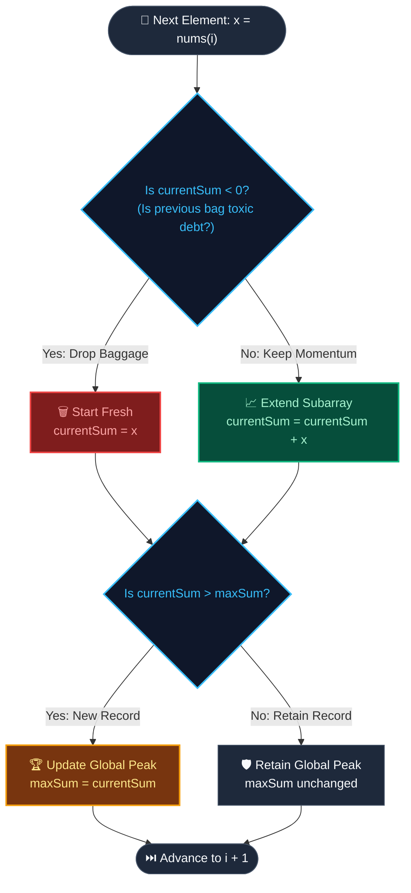

# 📘 Week 05 Day 04 Part B: Kadane's Algorithm & Dynamic Programming — Engineering Guide

> 🧭 **Navigation:** [← Previous Day](Week_05_Day_04_Part_A_Partition_Cyclic_Sort_Instructional.md) • [🏠 Week Overview](README.md) • [📘 Curriculum Syllabus](../COMPLETE_SYLLABUS.md) • [Next Day →](Week_05_Day_05_Fast_Slow_Pointers_Instructional.md)
> 
> 💡 **Instructor Note:** *Kadane's algorithm is the quintessential gateway into Dynamic Programming. Do not treat it as a memorized trick. Master the state invariant: at every index, we decide whether our accumulated past is an asset or toxic luggage.*

---

## 🎯 LEARNING OBJECTIVES

By the end of this masterclass, you will be able to:

- 🎯 **Internalize** the core DP invariant: tracking the optimal contiguous subarray ending at index `i` enables finding the global optimum in strict `O(N)` time and `O(1)` auxiliary space.
- ⚙️ **Implement** Maximum Subarray (LC 53), Maximum Subarray with Indices Reconstruction, Maximum Product Subarray (LC 152), and Maximum Sum Circular Subarray (LC 918) in idiomatic C# (.NET 8/9) and Python (3.11+).
- ⚖️ **Evaluate** computational trade-offs between brute-force search (`O(N^2)`), prefix sums with min-prefix tracking (`O(N)` time and space), and Kadane's space-compressed DP (`O(1)` auxiliary space).
- 🏭 **Connect** Kadane's algorithm to mission-critical distributed systems (financial maximum-drawdown calculations, high-frequency market burst detection, packet queue backpressure spikes).
- 🎙️ **Recite** the 3-sentence interview verbal script explaining state compression and boundary safety with total poise under FAANG interview conditions.

---

## 🎬 CHAPTER 1: THE 60-SECOND HOOK & EVERYDAY METAPHOR

Hey engineers, welcome back to **Week 5 Day 4 Part B!** 

Grab your coffee, pull up a chair, and get ready, because today we are breaking down one of the most famous, elegant, and high-yield algorithms in computer science history: **Kadane's Algorithm**.

### The Toxic Luggage / Relationship Baggage Metaphor

Imagine you are walking down a long road of life, carrying a backpack. As you pass each milestone, you pick up envelopes. Some envelopes contain cash (`+5`, `+10`), while others contain unpaid debt notices (`-3`, `-8`):

```
Milestones:  [ +3 ]  ->  [ +4 ]  ->  [ -2 ]  ->  [ -10 ]  ->  [ +7 ]
Your Pack:   +$3         +$7         +$5          -$5         ???
```

- When you picked up `+3` and `+4`, your bag held `+$7`. Life is great!
- At `-2`, your bag drops to `+$5`. Even though you took a hit, having `+$5` in your bag is **still an asset** to whatever lies ahead. If the next milestone is `+10`, that `+$5` gives you an immediate head start to `+$15`.
- But look at `-10`. Your bag plunges to `-$5`. **Your accumulated total is now below zero.**

Here is the million-dollar realization: **A negative running sum is pure toxic baggage!** 

Why on earth would you drag `-$5` of negative debt into the next milestone? If the next milestone offers you `+$7`, carrying your old bag leaves you with just `+$2`. But if you **drop your toxic luggage right on the curb**, dust your hands off, and start completely fresh from today, you walk away with the full `+$7`!

```
Decision at Milestone +7:
  Option A (Extend Old Bag):   -$5 + $7 = +$2  ❌ (Dragging toxic debt!)
  Option B (Drop & Reset):     +$7             ✅ (Clean slate!)
```

That single, intuitive insight is the entire engine powering Kadane's Algorithm:

```
currentSum = max(nums[i], currentSum + nums[i])
```

If `currentSum` drops below `0`, adding it to `nums[i]` will always produce a smaller number than `nums[i]` alone. So we drop the past and reset!

### The Core Speedup: Crushing `O(N^2)` into `O(N)`

In an array of length `N`, there are `N * (N + 1) / 2` possible contiguous subarrays. 

- **Naive Brute Force:** Check every pair `(i, j)` and compute its sum. That requires `O(N^2)` time (or `O(N^3)` without prefix optimization). For an array of `10^5` elements, `10^10` operations will instantly cause an interview-ending **Time Limit Exceeded (TLE)**.
- **Kadane's Algorithm:** Evaluates all contiguous possibilities in a **single linear pass (`O(N)`)** with **strict `O(1)` auxiliary space**, using just two scalar variables: `currentSum` and `maxSum`.

```
Brute Force:  O(N^2) time | O(1) space  -> 100,000^2 = 10,000,000,000 operations (TLE!)
Kadane's:     O(N)   time | O(1) space  -> 100,000 operations (~0.2 milliseconds!)
```

---

## 🪜 CHAPTER 2: THE TOY NAPKIN TRACE & ACTIVE RECALL

Let's put this mental model to work on a classic napkin example.

### The Input Array

```
Index i:     0    1     2    3     4    5    6     7    8
nums:     [ -2,   1,   -3,   4,   -1,   2,   1,   -5,   4 ]
```

We initialize our two state variables to the very first element:
- `currentSum = nums[0] = -2`
- `maxSum = nums[0] = -2`

### Step-by-Step Execution Trace

| Step `i` | Element `x` | `currentSum + x` | Decision | New `currentSum` | `maxSum` Update | Active Subarray |
| :---: | :---: | :---: | :---: | :---: | :---: | :---: |
| **0** | `-2` | N/A | **Initialize** | `-2` | `-2` | `[-2]` |
| **1** | `1` | `-2 + 1 = -1` | **Drop Baggage!** `1 > -1` | `1` | `max(-2, 1) = 1` | `[1]` |
| **2** | `-3` | `1 + (-3) = -2` | **Extend** `-2 > -3` | `-2` | `max(1, -2) = 1` | `[1, -3]` |
| **3** | `4` | `-2 + 4 = 2` | **Drop Baggage!** `4 > 2` | `4` | `max(1, 4) = 4` | `[4]` |
| **4** | `-1` | `4 + (-1) = 3` | **Extend** `3 > -1` | `3` | `max(4, 3) = 4` | `[4, -1]` |
| **5** | `2` | `3 + 2 = 5` | **Extend** `5 > 2` | `5` | `max(4, 5) = 5` | `[4, -1, 2]` |
| **6** | `1` | `5 + 1 = 6` | **Extend** `6 > 1` | `6` | `max(5, 6) = 6` 🏆 | `[4, -1, 2, 1]` |
| **7** | `-5` | `6 + (-5) = 1` | **Extend** `1 > -5` | `1` | `max(6, 1) = 6` | `[4, -1, 2, 1, -5]` |
| **8** | `4` | `1 + 4 = 5` | **Extend** `5 > 4` | `5` | `max(6, 5) = 6` | `[4, -1, 2, 1, -5, 4]` |

**Result:** Maximum contiguous subarray sum is **`6`**, produced by the window `[4, -1, 2, 1]`.

### ASCII Cumulative Sum Trajectory: Watching the Resets

Notice how the running sum climbs, drops below zero, resets to a clean slate, and peaks at `6`:

```
  Cumulative Sum Trajectory (nums = [-2, 1, -3, 4, -1, 2, 1, -5, 4])

  Sum
   6 |                          * (Global Peak = 6, Subarray [4, -1, 2, 1])
   5 |                       *  |
   4 |              *        |  |        *
   3 |              |  *     |  |        |
   2 |              |  |     |  |        |
   1 |        *     |  |     |  |  *     |
   0 ┼────────┼─────┼──┼─────┼──┼──┼─────┼─────── Zero Line (Toxic Luggage Boundary)
  -1 |        |     |  *     |  |  |     |
  -2 |  *     *     |        |  |  |     |
  -3 |  |           |        |  |  |     |
     └──┴─────┴─────┴──┴─────┴──┴──┴─────┴─── Index i
        0     1     2  3     4  5  6     7   8
  Val: -2     1    -3  4    -1  2  1    -5   4
  Act: Init  Drop  Ext Drop  <-- Extend --> Ext
```

---

> [!IMPORTANT]
> ### 🧠 Pause & Predict: The All-Negative Array Trap
> 
> Stop right here before scrolling. Consider this input:
> ```
> nums = [-7, -3, -9, -2, -8]
> ```
> 1. What is the mathematically correct maximum contiguous subarray sum?
> 2. If a junior developer initializes `maxSum = 0` or resets `currentSum = 0`, what will their function return?
> 
> <details>
> <summary>👉 Click to reveal the FAANG interview answer</summary>
> 
> **1. Correct Answer:** `-2` (the single subarray `[-2]`). LeetCode 53 mandates a **non-empty** subarray.
> 
> **2. The Bug:** If you initialize `maxSum = 0`, the algorithm will compare negative sums against `0` and return `0`. But `0` is not in the array and represents an empty subarray!
> 
> **Architect Rule:** Always initialize `currentSum = nums[0]` and `maxSum = nums[0]`. Never initialize to `0` unless empty subarrays are explicitly permitted by the interviewer.
> </details>

---

## 🎨 CHAPTER 3: VISUAL DECISION ENGINE & PATTERN MECHANICS

### Kadane's Decision Engine (Reset vs. Extend & Global Peak Tracking)

Here is the exact state machine executed at every element:



### The Formal Invariant

At each index `i`:
1. **Local Optimal Substructure:** `currentSum` holds the maximum sum of any contiguous subarray ending **strictly at index `i`**:
   `dp[i] = max(nums[i], dp[i - 1] + nums[i])`
2. **Global Optimal Substructure:** `maxSum` holds the maximum subarray sum found anywhere across `nums[0..i]`:
   `maxSum[i] = max(maxSum[i - 1], dp[i])`
3. **Space Compression Invariant:** Notice `dp[i]` only depends on `dp[i - 1]`. Therefore, allocating an array `int[] dp = new int[N]` is completely wasteful. A single scalar variable `currentSum` compresses `O(N)` memory into `O(1)`.

---

### Variant 1: Maximum Product Subarray (Sign-Flip Duality)

What happens when we multiply instead of add? 

With multiplication, **negative numbers invert polarity**:
- A small negative product multiplied by another negative number becomes a **huge positive product** (`-10 * -5 = +50`).
- A large positive product multiplied by a negative number crashes into a **large negative product** (`+50 * -2 = -100`).

To solve this, Kadane's single tracker expands into a **dual min/max tracker**:
- `maxEnding`: Tracks the maximum contiguous product ending at `i`.
- `minEnding`: Tracks the minimum contiguous product ending at `i`.

When we encounter a negative number `nums[i] < 0`, the maximum and minimum **swap roles** before calculation!

```
Array: [ 2, 3, -2, 4 ]

i = 0 (x = 2):
  maxEnding = 2, minEnding = 2, globalMax = 2

i = 1 (x = 3):
  maxEnding = max(3, 2 * 3) = 6
  minEnding = min(3, 2 * 3) = 3
  globalMax = 6

i = 2 (x = -2): Negative number encountered! SWAP maxEnding and minEnding!
  maxEnding becomes 3, minEnding becomes 6
  maxEnding = max(-2, 3 * -2) = -2
  minEnding = min(-2, 6 * -2) = -12
  globalMax = 6

i = 3 (x = 4):
  maxEnding = max(4, -2 * 4) = 4
  minEnding = min(4, -12 * 4) = -48
  globalMax = 6

Result = 6
```

---

### Variant 2: Maximum Circular Subarray (Complement Reduction)

In a circular array, the subarray is allowed to wrap around the boundary:

```
Index:    0    1    2    3    4
nums:  [  5,  -3,   5 ]  (Array wraps around index 2 -> index 0)
```

The maximum contiguous subarray can take two forms:

```
Case 1: Standard Middle Subarray (Does NOT wrap around)
[ ... [ Positive Contiguous Peak ] ... ]
      ^──────────────────────────^
           Standard Linear Kadane

Case 2: Wrap-Around Subarray (Wraps around both ends)
[ Peak Part 1 ] ... [ Minimum Subarray ] ... [ Peak Part 2 ]
^─────────────^     ^──────────────────^     ^─────────────^
   Take this!           EXCLUDE THIS!           Take this!
```

#### The Duality Breakthrough

Look closely at Case 2. If the optimal subarray wraps around the ends, what is left behind in the middle? **A contiguous subarray!**

To make the elements at the ends as large as possible, the contiguous subarray left in the middle must be **as small as possible**:

```
Wrap-Around Max Sum = Total Array Sum - Minimum Linear Subarray Sum
```

Therefore, the global circular answer is simply:
```
result = max(LinearMaxSubarray, TotalSum - LinearMinSubarray)
```

We compute both `LinearMax` and `LinearMin` simultaneously in a **single pass**!

---

## 🛑 CHAPTER 4: THE ROOKIE TRAP ZONE

Let's examine the three fatal bugs that cost candidates their FAANG offers on Kadane problems.

### Trap 1: Initializing `maxSum = 0` (The All-Negative Blunder)

```csharp
// ❌ ROOKIE BLUNDER: Initializing maxSum to 0
int currentSum = 0;
int maxSum = 0; // 💥 FAILS for all-negative inputs like [-3, -2, -5]!
foreach (int x in nums)
{
    currentSum = Math.Max(x, currentSum + x);
    maxSum = Math.Max(maxSum, currentSum);
}
// Returns 0 instead of -2! An empty subarray was returned.
```

```csharp
// ✅ SENIOR ARCHITECT PATTERN: Initialize to first element or int.MinValue
int currentSum = nums[0];
int maxSum = nums[0]; // 🛡️ Guaranteed safe: correctly returns -2 for [-3, -2, -5]
for (int i = 1; i < nums.Length; i++)
{
    currentSum = Math.Max(nums[i], currentSum + nums[i]);
    maxSum = Math.Max(maxSum, currentSum);
}
```

---

### Trap 2: Circular Subarray All-Negative Edge Case

When all numbers are negative (e.g., `[-3, -2, -3]`):
- `TotalSum = -8`
- `LinearMin = -8`
- Formula gives: `TotalSum - LinearMin = -8 - (-8) = 0`!

Because `0` represents an empty subarray, returning `max(-2, 0)` would return `0`, violating the non-empty constraint!

```csharp
// ❌ ROOKIE BLUNDER: Unconditional max with TotalSum - minSoFar
return Math.Max(maxSoFar, totalSum - minSoFar); // 💥 Returns 0 for [-3, -2, -3]!
```

```csharp
// ✅ SENIOR ARCHITECT PATTERN: Check if all elements are negative
// If maxSoFar < 0, all elements are negative. The wrap-around formula is invalid!
return maxSoFar < 0 ? maxSoFar : Math.Max(maxSoFar, totalSum - minSoFar);
```

---

### Trap 3: Maximum Product Subarray — Forgetting the Sign Swap

In LeetCode 152, junior engineers calculate `maxEnding = Math.Max(x, maxEnding * x)` without tracking `minEnding`. The moment a second negative number appears, the accumulated negative potential is lost forever.

```csharp
// ❌ ROOKIE BLUNDER: Tracking only max product
maxEnding = Math.Max(x, maxEnding * x); // 💥 Loses negative momentum for [-2, 3, -4]!
```

```csharp
// ✅ SENIOR ARCHITECT PATTERN: Swap max and min before multiplying by a negative
if (x < 0)
{
    (maxEnding, minEnding) = (minEnding, maxEnding); // 🛡️ Inverts bounds instantly
}
maxEnding = Math.Max(x, maxEnding * x);
minEnding = Math.Min(x, minEnding * x);
```

---

## 🎙️ CHAPTER 5: 45-MINUTE INTERVIEW TALK TRACK & BATTLE CARD

When your interviewer says: *"Find the contiguous subarray with the largest sum"*, recite this exact 3-sentence script out loud before writing a single line of code.

### The 3-Sentence Live Interview Script

> **Sentence 1 (Problem Frame & Bottleneck):**  
> *"A naive brute-force search over all `O(N^2)` subarray boundaries does redundant summing, but we can solve this in a single `O(N)` pass using Kadane's algorithm by framing it around optimal substructure: at index `i`, the maximum subarray ending at `i` is either `nums[i]` alone or `nums[i]` appended to the optimal subarray ending at `i - 1`."*
> 
> **Sentence 2 (State Compression & Invariant):**  
> *"Because the decision to extend or drop previous negative baggage only depends on the immediately preceding index, we compress the DP table into two scalar variables—`currentSum` and `maxSum`—achieving strict `O(1)` auxiliary space."*
> 
> **Sentence 3 (Boundary Defense):**  
> *"To ensure complete safety against all-negative arrays without returning an invalid empty subarray of zero, I will initialize both `currentSum` and `maxSum` to `nums[0]` and iterate starting from index `1`."*

### Whiteboard Battle Card

| Attribute | Live Interview Value | Notes for Interviewer |
| :--- | :--- | :--- |
| **Pattern Name** | Kadane's Algorithm (Space-Compressed 1D DP) | Mention "local vs. global state" |
| **Time Complexity** | `O(N)` | Single linear sweep over `N` elements |
| **Auxiliary Space** | `O(1)` | Two 32-bit integer scalars |
| **Output Space** | `O(1)` | Scalar sum or 2-element index tuple |
| **Key Invariant** | `currentSum` = optimal subarray ending at `i` | Never drag negative cumulative baggage |
| **Primary Edge Case** | Array of all negative integers | Initializing to `nums[0]` handles this naturally |

---

## ⚡ CHAPTER 6: PRODUCTION-GRADE IMPLEMENTATIONS (C# & PYTHON)

---

### Problem 1: Maximum Subarray (LeetCode 53) — Core Kadane's

#### C# Primary Implementation (.NET 8/9 — Production-Grade)

```csharp
using System;

namespace Week05.Kadane;

public static class MaxSubArraySolver
{
    /// <summary>
    /// Computes the maximum contiguous subarray sum in O(N) time and O(1) auxiliary space.
    /// Uses modern .NET 8 guard clauses and zero heap allocations.
    /// </summary>
    /// <param name="nums">The input array of integers.</param>
    /// <returns>The maximum contiguous subarray sum.</returns>
    /// <exception cref="ArgumentNullException">Thrown when nums is null.</exception>
    /// <exception cref="ArgumentException">Thrown when nums is empty.</exception>
    public static int MaxSubArray(ReadOnlySpan<int> nums)
    {
        if (nums.IsEmpty)
        {
            throw new ArgumentException("Array cannot be empty.", nameof(nums));
        }

        // Invariant: currentSum stores optimal subarray sum ending at current index.
        // maxSum stores the global optimal subarray sum across all evaluated indices.
        int currentSum = nums[0];
        int maxSum = nums[0];

        for (int i = 1; i < nums.Length; i++)
        {
            int x = nums[i];

            // If currentSum is negative, x is strictly greater than currentSum + x.
            // This naturally drops toxic baggage and starts fresh from x.
            currentSum = Math.Max(x, currentSum + x);
            maxSum = Math.Max(maxSum, currentSum);
        }

        return maxSum;
    }
}
```

#### Python Secondary Implementation (3.11+ — Clean & Idiomatic)

```python
def max_sub_array(nums: list[int]) -> int:
    """Computes the maximum contiguous subarray sum using Kadane's algorithm.

    Time Complexity: O(N) | Auxiliary Space: O(1) | Output Space: O(1)
    """
    if not nums:
        raise ValueError("Input array must be non-empty.")

    current_sum = nums[0]
    max_sum = nums[0]

    for x in nums[1:]:
        # Drop negative baggage (start fresh from x) or extend momentum
        current_sum = max(x, current_sum + x)
        max_sum = max(max_sum, current_sum)

    return max_sum
```

#### 📊 Explicit Complexity Deconstruction
- **Time Complexity:** `O(N)` — Exactly `N - 1` iterations. Each iteration performs two additions/comparisons.
- **Auxiliary Space:** `O(1)` — Only two scalar local registers (`currentSum`, `maxSum`).
- **Output Space:** `O(1)` — Single 32-bit integer.

---

### Problem 2: Maximum Subarray with Indices Reconstruction

In FAANG interviews, interviewers frequently ask: *"Great, now return the actual start and end indices of the winning subarray."*

#### C# Primary Implementation (.NET 8/9 — Zero Allocation Struct Return)

```csharp
using System;

namespace Week05.Kadane;

public static class MaxSubArrayWithIndicesSolver
{
    /// <summary>
    /// Returns the maximum subarray sum along with the inclusive [startIndex, endIndex].
    /// Time Complexity: O(N) | Auxiliary Space: O(1) | Output Space: O(1)
    /// </summary>
    public static (int MaxSum, int StartIndex, int EndIndex) FindMaxSubArrayWithIndices(ReadOnlySpan<int> nums)
    {
        if (nums.IsEmpty)
        {
            throw new ArgumentException("Array cannot be empty.", nameof(nums));
        }

        int maxSum = nums[0];
        int currentSum = nums[0];

        int bestStart = 0;
        int bestEnd = 0;
        int currentStart = 0;

        for (int i = 1; i < nums.Length; i++)
        {
            int x = nums[i];

            if (x > currentSum + x)
            {
                // Drop baggage: start a brand new window at index i
                currentSum = x;
                currentStart = i;
            }
            else
            {
                // Extend existing window
                currentSum += x;
            }

            if (currentSum > maxSum)
            {
                maxSum = currentSum;
                bestStart = currentStart;
                bestEnd = i;
            }
        }

        return (maxSum, bestStart, bestEnd);
    }
}
```

#### Python Secondary Implementation (3.11+ — Clean & Idiomatic)

```python
def find_max_sub_array_with_indices(nums: list[int]) -> tuple[int, int, int]:
    """Returns (max_sum, start_index, end_index) for the optimal contiguous subarray.

    Time Complexity: O(N) | Auxiliary Space: O(1) | Output Space: O(1)
    """
    if not nums:
        raise ValueError("Input array must be non-empty.")

    max_sum = current_sum = nums[0]
    best_start = best_end = current_start = 0

    for i in range(1, len(nums)):
        x = nums[i]
        if x > current_sum + x:
            current_sum = x
            current_start = i
        else:
            current_sum += x

        if current_sum > max_sum:
            max_sum = current_sum
            best_start = current_start
            best_end = i

    return (max_sum, best_start, best_end)
```

---

### Problem 3: Maximum Product Subarray (LeetCode 152)

#### C# Primary Implementation (.NET 8/9 — Dual Min/Max Tracking)

```csharp
using System;

namespace Week05.Kadane;

public static class MaxProductSolver
{
    /// <summary>
    /// Computes the maximum contiguous product subarray via sign-flip min/max tracking.
    /// Time Complexity: O(N) | Auxiliary Space: O(1) | Output Space: O(1)
    /// </summary>
    public static int MaxProduct(ReadOnlySpan<int> nums)
    {
        if (nums.IsEmpty)
        {
            throw new ArgumentException("Array cannot be empty.", nameof(nums));
        }

        int maxEnding = nums[0];
        int minEnding = nums[0];
        int globalMax = nums[0];

        for (int i = 1; i < nums.Length; i++)
        {
            int x = nums[i];

            // Multiplying by a negative number inverts the ordering:
            // What was maximum becomes minimum, and what was minimum becomes maximum.
            if (x < 0)
            {
                (maxEnding, minEnding) = (minEnding, maxEnding);
            }

            maxEnding = Math.Max(x, maxEnding * x);
            minEnding = Math.Min(x, minEnding * x);

            globalMax = Math.Max(globalMax, maxEnding);
        }

        return globalMax;
    }
}
```

#### Python Secondary Implementation (3.11+ — Clean & Idiomatic)

```python
def max_product(nums: list[int]) -> int:
    """Computes maximum contiguous product using dual min/max Kadane state tracking.

    Time Complexity: O(N) | Auxiliary Space: O(1) | Output Space: O(1)
    """
    if not nums:
        raise ValueError("Input array must be non-empty.")

    max_ending = min_ending = global_max = nums[0]

    for x in nums[1:]:
        if x < 0:
            max_ending, min_ending = min_ending, max_ending

        max_ending = max(x, max_ending * x)
        min_ending = min(x, min_ending * x)

        global_max = max(global_max, max_ending)

    return global_max
```

---

### Problem 4: Maximum Sum Circular Subarray (LeetCode 918)

#### C# Primary Implementation (.NET 8/9 — Single-Pass Dual Complement)

```csharp
using System;

namespace Week05.Kadane;

public static class MaxSubarrayCircularSolver
{
    /// <summary>
    /// Computes maximum circular subarray sum in a single linear pass with dual min/max Kadane.
    /// Time Complexity: O(N) | Auxiliary Space: O(1) | Output Space: O(1)
    /// </summary>
    public static int MaxSubarraySumCircular(ReadOnlySpan<int> nums)
    {
        if (nums.IsEmpty)
        {
            throw new ArgumentException("Array cannot be empty.", nameof(nums));
        }

        int totalSum = 0;
        int maxEnding = 0;
        int maxSoFar = nums[0];
        int minEnding = 0;
        int minSoFar = nums[0];

        foreach (int x in nums)
        {
            totalSum += x;

            // Standard Kadane for maximum subarray (middle case)
            maxEnding = Math.Max(x, maxEnding + x);
            maxSoFar = Math.Max(maxSoFar, maxEnding);

            // Inverted Kadane for minimum subarray (wrap-around complement)
            minEnding = Math.Min(x, minEnding + x);
            minSoFar = Math.Min(minSoFar, minEnding);
        }

        // CRITICAL DEFENSIVE GUARD:
        // If all elements are negative, totalSum == minSoFar, which means totalSum - minSoFar == 0.
        // Returning 0 would represent an illegal empty subarray!
        // When maxSoFar < 0, all elements are negative, so return the least negative number (maxSoFar).
        return maxSoFar < 0 ? maxSoFar : Math.Max(maxSoFar, totalSum - minSoFar);
    }
}
```

#### Python Secondary Implementation (3.11+ — Clean & Idiomatic)

```python
def max_subarray_sum_circular(nums: list[int]) -> int:
    """Finds maximum circular subarray sum via dual max/min Kadane complement reduction.

    Time Complexity: O(N) | Auxiliary Space: O(1) | Output Space: O(1)
    """
    if not nums:
        raise ValueError("Input array must be non-empty.")

    total_sum = 0
    max_ending = 0
    max_so_far = nums[0]
    min_ending = 0
    min_so_far = nums[0]

    for x in nums:
        total_sum += x
        max_ending = max(x, max_ending + x)
        max_so_far = max(max_so_far, max_ending)
        min_ending = min(x, min_ending + x)
        min_so_far = min(min_so_far, min_ending)

    # If max_so_far < 0, all numbers are negative; return the least negative single element
    return max_so_far if max_so_far < 0 else max(max_so_far, total_sum - min_so_far)
```

---

## ⚖️ CHAPTER 7: ARCHITECTURAL TRADE-OFFS & PRODUCTION SYSTEMS

### The Contiguous Subarray Trade-Off Matrix

| Strategy | Time Complexity | Auxiliary Space | Handles Negatives? | Production Suitability |
| :--- | :--- | :--- | :--- | :--- |
| **Brute Force (Nested Loops)** | `O(N^2)` | `O(1)` | Yes | ❌ Unusable for streaming or `N > 10^4` |
| **Prefix Sums + Min Prefix Tracking** | `O(N)` | `O(N)` | Yes | ⚠️ Requires full array buffer in memory |
| **Kadane's Algorithm (Space Compressed)** | `O(N)` | `O(1)` | Yes | ✅ Production gold standard; streaming ready |
| **Divide and Conquer (Segment Tree)** | `O(N log N)` | `O(log N)` | Yes | ✅ Required when values are dynamically updated (`O(log N)` queries) |

### Real-World Systems Engineering

> [!NOTE]
> ### 🏭 Production Reality: Where FAANG Uses Kadane in the Real World
>
> 1. **High-Frequency Trading (HFT) Drawdown Engines:** Trading gateways process millions of ticks per second. A core risk control is measuring the maximum drawdown or maximum burst profit across continuous tick windows. Kadane's algorithm executes inside FPGA registers and C++ zero-allocation loops with zero heap overhead and optimal L1 CPU cache residency.
> 2. **Distributed Telemetry & Anomaly Detection (Datadog / Prometheus):** Network packet monitoring systems track network packet loss bursts. When packet loss rate spikes above a threshold, engineers treat `lossRate - threshold` as numerical deltas. Running Kadane's across this streaming delta identifies the exact sustained burst window causing cluster degradation.

---

## 🎯 CHAPTER 8: FAANG INTERVIEW PATTERN SIGNALS & DRILLS

### 🎯 Pattern Recognition Signals: When to Use Kadane

Look for these unmistakable cues in the problem statement:

- ✅ **"Maximum/minimum sum of a contiguous subarray"** -> Standard Kadane's (`O(N)` time, `O(1)` space).
- ✅ **"Maximum product of a contiguous subarray"** -> Dual min/max Kadane with negative swap.
- ✅ **"Circular array maximum contiguous sum"** -> Dual Kadane complement (`max(linearMax, total - linearMin)`).
- ✅ **"Best time to buy and sell stock"** -> Single-pass Kadane variant tracking `minPriceSeen`.
- 🛑 **"Maximum sum of a subarray of fixed size K"** -> **Do NOT use Kadane's!** Use a **Fixed-Size Sliding Window**.
- 🛑 **"Subarray sum equals target K"** -> **Do NOT use Kadane's!** Kadane only finds extrema (max/min). Use **Prefix Sum + Hash Map**.

### 🧪 Concrete Edge-Case Checklist

Before declaring your solution complete in a FAANG interview, walk through these 4 edge cases on your whiteboard:

1. **All Negative Numbers (`[-5, -2, -8]`):** Must return `-2` (the least negative number), never `0`.
2. **Single Element Array (`[42]` or `[-7]`):** Must return that single element immediately without out-of-bounds indexing.
3. **Array with Zeroes (`[2, 0, -1, 3]`):** Zeroes must neither cause division errors nor reset positive momentum prematurely.
4. **All Identical Elements (`[-3, -3, -3]` or `[5, 5, 5]`):** Handled gracefully without infinite loops or pointer stagnation.

---

### 🏋️ Practice Problems Matrix

| # | Problem | Source | Difficulty | Key Architectural Invariant |
| :---: | :--- | :---: | :---: | :--- |
| 1 | Maximum Subarray | LeetCode 53 | 🟡 Medium | Drop toxic negative luggage; extend positive momentum |
| 2 | Maximum Product Subarray | LeetCode 152 | 🟡 Medium | Dual min/max tracking with negative sign flip |
| 3 | Maximum Sum Circular Subarray | LeetCode 918 | 🟡 Medium | Duality: `totalSum - minLinearSubarray` with all-negative guard |
| 4 | Best Time to Buy and Sell Stock | LeetCode 121 | 🟢 Easy | One-pass historical minimum prefix tracking |
| 5 | Maximum Absolute Sum of Any Subarray | LeetCode 1749 | 🟡 Medium | Run max Kadane and min Kadane; return `max(abs(maxSum), abs(minSum))` |
| 6 | Maximum Subarray Sum with One Deletion | LeetCode 1186 | 🟡 Medium | 2-state DP: `dp0` (no deletion) and `dp1` (one deletion used) |

---

### 🎙️ Verbal Drills (FAANG Interview Q&A)

**Q1: Why does Kadane's algorithm evaluate all `O(N^2)` subarrays in only `O(N)` time?**  
> *"By grouping all `N * (N + 1) / 2` candidate subarrays by their ending index `i`, we realize optimal substructure: any subarray ending at `i` is formed by taking a subarray ending at `i - 1` and appending `nums[i]`, or starting fresh at `nums[i]`. If the best subarray ending at `i - 1` is negative, extending it is mathematically worse than starting fresh. This eliminates `O(i)` redundant subarray checks at every step, collapsing the work into a single `O(1)` decision per element."*

**Q2: How do you solve Maximum Subarray in a 2D Matrix (LeetCode 363 / 2D Kadane)?**  
> *"We fix two row boundaries `top` and `bottom` (`O(R^2)` pairs). For each pair, we compress the columns into a 1D array of size `C` by summing column elements vertically, and run 1D Kadane's on the compressed array in `O(C)`. This solves 2D Maximum Subarray in `O(R^2 * C)` time."*

---

## 📌 CLOSING REFLECTION

Kadane's algorithm is the purest demonstration of **state compression in Dynamic Programming**. 

You do not need to memorize a 2D table or write recursive functions with memoization to do DP. Whenever a problem asks for an optimum over contiguous sequences and your current decision only relies on the immediate past, you can compress memory down to a couple of scalar registers.

Drop the toxic luggage, keep your momentum, and we will see you tomorrow in **Week 5 Day 5: Fast & Slow Pointers (Floyd's Cycle Detection)!**

---
> 🧭 **Navigation:** [← Previous Day](Week_05_Day_04_Part_A_Partition_Cyclic_Sort_Instructional.md) • [🏠 Week Overview](README.md) • [📘 Curriculum Syllabus](../COMPLETE_SYLLABUS.md) • [Next Day →](Week_05_Day_05_Fast_Slow_Pointers_Instructional.md)
