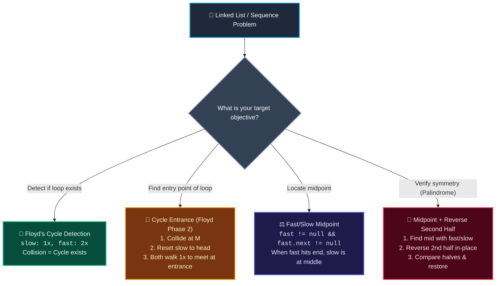

# 📚 Week 05 Day 05: Fast & Slow Pointers (Floyd's Cycle Detection) — The Complete FAANG Engineering Guide

> 🧭 **Navigation:** [← Previous Day](Week_05_Day_04_Part_B_Kadane_Algorithm_Instructional.md) • [🏠 Week Overview](README.md) • [📘 Curriculum Syllabus](../COMPLETE_SYLLABUS.md) • [Week Playbook →](WEEK_05_FULL_PLAYBOOK.md)
> 
> 💡 **Instructor Note:** *Welcome to the grand finale of Week 5! Fast & slow pointers (also known as Floyd's Tortoise and Hare algorithm) is a Tier-1 algorithmic pattern that transforms complex traversal and cycle verification from an `O(N)` memory footprint down to a blazing, zero-allocation `O(1)` space guarantee. Pay special attention to the cycle entrance algebraic derivation — it is one of the most frequently tested whiteboard proofs in FAANG interview loops.*

---

## 🎯 LEARNING OBJECTIVES

By the end of this chapter, you will be able to:

- 🎯 **Internalize** Floyd's Cycle Detection principle (Tortoise and Hare): two pointers advancing at velocities `1x` and `2x` must collide if and only if a closed cycle exists.
- 📐 **Derive on a Whiteboard** the cycle entrance relationship (`L = (k - 1) * C + (C - a)`) with crystal clarity in under 90 seconds without memorizing formulas.
- ⚙️ **Implement** five critical FAANG patterns: Linked List Cycle (LC 141), Find Cycle Entry (LC 142), Middle of Linked List (LC 876), Happy Number (LC 202), and Palindrome Linked List (LC 234) in modern C# (.NET 8/9) and Python (3.11+).
- 🛑 **Avoid** the fatal `NullReferenceException` trap (`while (fast != null && fast.next != null)`) and the even-length midpoint off-by-one bug.
- 🏭 **Connect** relative velocity to real systems: garbage collection mark-phase traversal, OS deadlock detection, and network routing loop prevention.
- 🎙️ **Articulate** the exact 3-sentence FAANG interview talk track with senior-level authority before typing code.

---

## 🎬 CHAPTER 1: THE 60-SECOND HOOK & EVERYDAY METAPHOR

### The High-Energy Hook
Hey engineers, welcome back to Week 5 Day 5 — our **Week 5 grand finale**!

You and I have conquered Two Pointers, Sliding Windows, Prefix Sums, and Kadane's Algorithm. Today, we put the crown jewel on Tier 1 Critical Patterns: **Fast & Slow Pointers** (famously known as *Floyd's Tortoise and Hare Algorithm*).

Here is the situation: You are handed a singly linked list with 10 million nodes. You need to answer a seemingly simple question: **Is there an infinite loop in this list? And if so, where exactly does the loop start?**

The naive instinct of almost every junior developer is to instantiate a `HashSet<ListNode>` and record every node pointer as they walk:
```csharp
// ❌ Junior Instinct: Allocates O(N) heap memory!
var visited = new HashSet<ListNode>();
while (curr != null) {
    if (!visited.Add(curr)) return true; // Found cycle!
    curr = curr.next;
}
```
In an interview or inside a production Linux kernel driver, JVM garbage collector, or .NET CLR runtime mark phase, this is an immediate **rejection**. Why? Because allocating an auxiliary hash set of `10^7` node references costs hundreds of megabytes of RAM and triggers garbage collection overhead. In low-level runtimes trying to diagnose memory corruption or reclaim dead memory, allocating heap memory is strictly forbidden!

Can we detect loops and find their exact entry door with **zero allocations (`O(1)` auxiliary space)**? 

Yes. And the intuition doesn't come from heavy computer science theory — it comes from high school track and field.

---

### The Real-World Metaphor: The Track & Field Loop

Imagine two runners, **Tortoise** (`slow`) and **Hare** (`fast`), lining up on a track:

```
Track Scenario A: Straight Road (Acyclic List)
Start ─────────────────────────────────────────────────────────> Finish Line (null)
🏃 Tortoise (1 m/s)
🏃‍♂️💨 Hare (2 m/s)
Result: Hare reaches the finish line (null) and stops. They never meet again!

Track Scenario B: Closed Circular Loop (Cyclic List)
Start ──────> Entrance ──> [ Circular 400m Track Loop ]
              Tortoise jogs at 1 lap per hour.
              Hare sprints at 2 laps per hour.
```

- **If the track is an open straight path (acyclic list):** The Hare sprints ahead, reaches `null` at the end of the road, and the race terminates. They never cross paths again.
- **If the track leads into a closed circular loop (cyclic list):** Both runners enter the loop. Because the Hare runs twice as fast as the Tortoise, the Hare will eventually "lap" the Tortoise from behind. 

Every tick of the clock, the Hare gains exactly **1 node** on the Tortoise. The distance between them shrinks:
`4 -> 3 -> 2 -> 1 -> 0 (COLLISION!)`

Because the relative gap contracts by strictly `1` node per step, the Hare **can never jump over** the Tortoise! A collision is mathematically inevitable.

---

### The Floyd's Cycle Entrance Miracle

Here is the part that blows candidates' minds during FAANG interviews:

Once `slow` and `fast` collide somewhere inside the loop at Meeting Point `M`, how do you find the **exact node where the cycle begins**?

Most engineers freeze. They think they need to measure the loop, count nodes, or do complex modular arithmetic. 

**The Miracle:**
1. Leave pointer `fast` right where it collided at Meeting Point `M`.
2. Teleport pointer `slow` all the way back to the `head` of the list.
3. Advance **both** pointers at the exact same walking speed: **1 step per tick**.
4. **Boom:** They will collide again at the **EXACT cycle entrance node**!

Why does this magic trick work every single time? Let's prove it with high school algebra in 4 lines:

```
Distance Variables:
  L = Distance from Head to Cycle Entrance (linear prefix)
  C = Total length (node count) of the cycle
  a = Distance from Cycle Entrance to Meeting Point M
  (C - a) = Remaining distance from Meeting Point M back to Cycle Entrance

Head ────────────> Cycle Entrance ───────> Meeting Point M
  [ L steps ]             [ a steps ]
                   ^                         │
                   │                         ▼
                   └───────── [ C - a steps ]
```

1. When `slow` and `fast` collide at `M`:
   - `slow` traveled: `Distance_slow = L + a`
   - `fast` traveled: `Distance_fast = L + n * C + a` (where `n >= 1` is the number of full laps `fast` ran)
2. Because `fast` moves at double speed:
   - `Distance_fast = 2 * Distance_slow`
   - `L + n * C + a = 2 * (L + a)`
   - `L + n * C + a = 2 * L + 2 * a`
   - Subtract `L + a` from both sides:
   - `L + a = n * C`
   - `L = n * C - a`
   - Rewrite `n * C` as `(n - 1) * C + C`:
   - `L = (n - 1) * C + (C - a)`

Look at that final formula:
**`L = (n - 1) * C + (C - a)`**

In plain English:
- The distance from `head` to the cycle entrance is **`L`**.
- The distance from the meeting point `M` around the rest of the cycle back to the entrance is **`(C - a)`**, plus `(n - 1)` optional victory laps!
- Therefore, if pointer 1 starts at `head` and walks `L` steps, and pointer 2 starts at `M` and walks `L` steps, pointer 2 will complete `(n - 1)` full laps, traverse the remaining `(C - a)` steps, and **both pointers will collide at the exact cycle entrance node!**

---

## 🪜 CHAPTER 2: THE SCAFFOLDING LADDER & TOY NAPKIN TRACES

Let's never rely on abstract formulas alone. Let's do a physical napkin dry-run with real nodes.

### 🪜 Toy Napkin Trace 1: Linked List Cycle & Entrance Detection
Consider a 5-node list where node `5` loops back to node `3`:
```
Linear Prefix (L = 2):       1 ──> 2 ──> [3] ──> 4
                                          ▲       │
                                          │       ▼
Cycle (C = 3):                            └─── 5 ─┘
```
- Node values: `1, 2, 3, 4, 5`
- Cycle starts at node `3`.
- Linear prefix `L = 2` (edges `1 -> 2`, `2 -> 3`).
- Cycle length `C = 3` (nodes `3, 4, 5`).

#### Phase 1: Finding Collision (Cycle Detection)
Both `slow` and `fast` start at `head` (node `1`).

| Tick | `slow` (1 step) | `fast` (2 steps) | Relative Gap | Match? |
| :--- | :--- | :--- | :--- | :--- |
| **0 (Start)** | `Node(1)` | `Node(1)` | `0` | Start |
| **1** | `Node(2)` | `Node(3)` | `1` | `2 != 3` |
| **2** | `Node(3)` (enters cycle) | `Node(5)` | `2` | `3 != 5` |
| **3** | `Node(4)` | `Node(4)` (5 -> 3 -> 4) | `0` | `4 == 4` 💥 **COLLISION!** |

Collision occurs at node **`4`** (`Meeting Point M = 4`).

#### Phase 2: Finding Cycle Entrance
Now we test the miracle:
1. Reset `slow = head` (`Node(1)`).
2. Keep `fast` at `Meeting Point M` (`Node(4)`).
3. Advance **both** pointers at speed 1 (`slow = slow.next`, `fast = fast.next`).

| Step | `slow` (starts at `head = 1`) | `fast` (starts at `M = 4`) | Match? |
| :--- | :--- | :--- | :--- |
| **0** | `Node(1)` | `Node(4)` | `1 != 4` |
| **1** | `Node(2)` | `Node(5)` | `2 != 5` |
| **2** | `Node(3)` | `Node(3)` (5 loops to 3) | `3 == 3` 🎯 **CYCLE ENTRY!** |

They meet simultaneously at node **`3`**! The proof works down to the exact pointer tick.

---

### 🪜 Toy Napkin Trace 2: Finding the Midpoint (Odd vs Even Length)

Fast and slow pointers aren't just for cycle loops. They are the standard FAANG technique to find the **exact middle of a linked list in a single pass** without counting the total length first.

When `fast` moves twice as fast as `slow`, by the time `fast` hits the end of the list, `slow` must be sitting right at `N / 2`.

#### Case A: Odd Length (5 nodes: `1 -> 2 -> 3 -> 4 -> 5 -> null`)
Target: Node `3`.

```
Step 0:  [1] -> [2] -> [3] -> [4] -> [5] -> null
         S, F

Step 1:  [1] -> [2] -> [3] -> [4] -> [5] -> null
                 S             F

Step 2:  [1] -> [2] -> [3] -> [4] -> [5] -> null
                        S                    F (fast.next == null -> STOP!)
```
- **Loop condition:** `while (fast != null && fast.next != null)`
- At termination: `fast.next == null`.
- Pointer `slow` is sitting directly on **Node `3`** (the exact midpoint).

#### Case B: Even Length (6 nodes: `1 -> 2 -> 3 -> 4 -> 5 -> 6 -> null`)
Target: In LeetCode 876, for even lengths, the problem requires the **second middle node** (`Node 4`).

```
Step 0:  [1] -> [2] -> [3] -> [4] -> [5] -> [6] -> null
         S, F

Step 1:  [1] -> [2] -> [3] -> [4] -> [5] -> [6] -> null
                 S             F

Step 2:  [1] -> [2] -> [3] -> [4] -> [5] -> [6] -> null
                        S                    F

Step 3:  [1] -> [2] -> [3] -> [4] -> [5] -> [6] -> null
                               S                    F (fast == null -> STOP!)
```
- At termination: `fast == null`.
- Pointer `slow` is sitting directly on **Node `4`** (the second middle node).

> [!TIP]
> **What if the interviewer wants the FIRST middle node for even lengths?**
> (For example, when splitting a linked list in half for Merge Sort or Palindrome checking):
> Simply change the loop termination condition to:
> `while (fast.next != null && fast.next.next != null)`
> On 6 nodes, the loop terminates at Step 2, leaving `slow` at **Node `3`**!

---

### 🧠 Interactive Checkpoints: Pause & Predict Micro-Drills

#### 🧠 Drill 1: Can Fast Ever Jump Over Slow in a Cycle?
**Scenario:** A cycle has length `C = 100`. Inside the cycle, `fast` is sitting 1 step behind `slow`.
**Question:** On the very next tick, will `fast` collide with `slow`, or leapfrog over `slow` and land 1 step ahead?
<details>
<summary>👉 Click to Reveal the Mechanics</summary>

**Answer: It will collide directly!**
Think of relative velocity:
- `slow` moves forward by 1 node.
- `fast` moves forward by 2 nodes.
- Relative change in gap: `+1 - 2 = -1`.
- The distance between `fast` and `slow` decreases by exactly `1` node per tick. A sequence decreasing by 1 (`3 -> 2 -> 1 -> 0`) cannot skip `0`. Therefore, `fast` and `slow` can NEVER jump over each other.
</details>

---

#### 🧠 Drill 2: Happy Number (LeetCode 202) — The State Collapse
**Scenario:** A number is called "happy" if repeatedly replacing it with the sum of the squares of its digits eventually equals `1`.
Let's trace `n = 19`:
- `1^2 + 9^2 = 1 + 81 = 82`
- `8^2 + 2^2 = 64 + 4 = 68`
- `6^2 + 8^2 = 36 + 64 = 100`
- `1^2 + 0^2 + 0^2 = 1` -> **Happy!**

Now let's trace `n = 2`:
- `2 -> 4 -> 16 -> 37 -> 58 -> 89 -> 145 -> 42 -> 20 -> 4` (Loops back to `4`!)

**Active Recall Question:** Why can we be 100% mathematically certain that ANY positive integer will either reach `1` or get trapped in a cycle? Why can't the numbers keep growing toward infinity?
<details>
<summary>👉 Click to Reveal the Senior Architecture Invariant</summary>

**Answer: Finite State Space & The Pigeonhole Principle!**
Consider the largest possible digit-square sum:
- For a 3-digit number (e.g., `999`), the sum of squares is `81 + 81 + 81 = 243`.
- For a 4-digit number (e.g., `9999`), the sum of squares is `4 * 81 = 324` (which is already much smaller than 9999!).
- For any number with `D >= 4` digits, `sum_of_squares(n) < n`.
Therefore, all numbers inevitably drop into the bounded finite range `[1, 243]`. Because there are only 243 possible states, by the **Pigeonhole Principle**, any infinite sequence of transformations MUST repeat a state. Once a state repeats, it is an implicit linked list cycle! We can solve Happy Number with zero memory using Floyd's Tortoise and Hare!
</details>

---

## 🎨 CHAPTER 3: PRAGMATIC VISUAL MODELS

### ASCII Architectural Visual: The Linked List Lasso

```
                        CYCLE SEGMENT (Length C)
                             [ Entrance ]
                            ( Node E ) ──> ( Node )
                               ▲              │
                               │              ▼
LINEAR SEGMENT (Length L)     ( Node ) <── ( Node M: Meeting Point )
Head ──> ( N1 ) ──> ( N2 ) ───┘
| <─────── L steps ────────> |
                             | <── a ───> |
                             | <────────── C - a ─────────> |
```

---

### Fast & Slow Pointer Strategy Selector (Mermaid Architecture)



---

## 🛑 CHAPTER 4: THE ROOKIE TRAP ZONE

### Trap 1: The NullReferenceException Crash
In an odd-length acyclic list, `fast` eventually lands on the final node where `fast.next == null`. If your `while` loop only checks `fast != null`, the statement `fast = fast.next.next` attempts to read `null.next`, immediately throwing a fatal runtime crash!

```csharp
// ❌ Rookie Blunder: Crashes on odd-length lists!
while (fast != null)
{
    slow = slow.next;
    fast = fast.next.next; // NullReferenceException when fast.next is null!
}

// ✅ Senior Architect Pattern: Safe short-circuit evaluation
while (fast != null && fast.next != null)
{
    slow = slow.next;
    fast = fast.next.next;
}
```

---

### Trap 2: The Off-By-One Midpoint in Even Lists
For an even list like `[1, 2, 3, 4]`, there are two middles: `2` (first middle) and `3` (second middle). Standard LeetCode 876 asks for the second middle (`3`), but algorithms like **Merge Sort on Linked Lists** or **Palindrome Linked List** require the first middle (`2`) so the first half can be disconnected cleanly!

```csharp
// Second Middle (LeetCode 876 Standard):
// Terminates when fast hits null. Slow lands on Node 4 for [1, 2, 3, 4, 5, 6].
while (fast != null && fast.next != null)
{
    slow = slow.next;
    fast = fast.next.next;
}

// First Middle (Required for Splitting / In-Place Reversal):
// Terminates when fast.next.next hits null. Slow lands on Node 3 for [1, 2, 3, 4, 5, 6].
while (fast.next != null && fast.next.next != null)
{
    slow = slow.next;
    fast = fast.next.next;
}
```

---

### Trap 3: The Lazy `HashSet<ListNode>` Space Tax
Junior candidates often default to `HashSet<ListNode>` because it takes 3 lines of code. In senior FAANG loops, this signals a lack of memory empathy and zero systems awareness.

```csharp
// ❌ Rookie Blunder: Allocates O(N) memory on the heap!
var seen = new HashSet<ListNode>();
while (head != null)
{
    if (seen.Contains(head)) return head;
    seen.Add(head);
    head = head.next;
}

// ✅ Senior Architect Pattern: Zero allocations, O(1) auxiliary space via Floyd's
ListNode slow = head, fast = head;
while (fast != null && fast.next != null)
{
    slow = slow.next;
    fast = fast.next.next;
    if (slow == fast) /* Cycle detected with 0 heap bytes */;
}
```

---

## 🎙️ CHAPTER 5: 45-MINUTE INTERVIEW TALK TRACK

When the interviewer presents a linked list cycle or midpoint problem, do **not** jump straight into typing code. Recite this exact 3-sentence talk track:

> 🎙️ **The 3-Sentence FAANG Talk Track:**
> 1. *"To solve this problem with optimal `O(1)` auxiliary memory rather than allocating an `O(N)` hash set of visited references, I will apply Floyd's Fast and Slow pointer pattern."*
> 2. *"If the list is acyclic, the fast pointer advancing two steps at a time safely hits null in `N / 2` iterations; if a cycle exists, the relative gap between them contracts by exactly 1 node per iteration once both enter the loop, guaranteeing a collision without skipping."*
> 3. *"For cycle entry detection, the algebraic distance from head to entrance equals the distance from the collision point around the cycle to the entrance (`L = (k - 1) * C + (C - a)`), allowing us to pinpoint the entry node in linear time by resetting one pointer to head and advancing both at 1 step per tick."*

---

## ⚡ CHAPTER 6: PRODUCTION DUAL-LANGUAGE CODE

### Problem 1: Linked List Cycle (LeetCode 141)

> **Interview Problem Statement:** Given `head`, the head of a linked list, determine if the linked list has a cycle in it. Return `true` if there is some node in the list that can be reached again by continuously following the `next` pointer. Otherwise, return `false`. Solve using `O(1)` auxiliary memory.

#### C# Primary Implementation (.NET 8/9 — Production-Grade)
```csharp
public class ListNode
{
    public int val;
    public ListNode next;
    public ListNode(int val = 0, ListNode next = null)
    {
        this.val = val;
        this.next = next;
    }
}

public static class LinkedListCycleSolver
{
    /// <summary>
    /// Determines whether a linked list contains a cycle using Floyd's Tortoise and Hare algorithm.
    /// Time Complexity: O(N) | Auxiliary Space: O(1) | Output Space: O(1)
    /// </summary>
    public static bool HasCycle(ListNode head)
    {
        // Guard clause: empty list or single node with no self-cycle cannot loop
        if (head == null || head.next == null)
        {
            return false;
        }

        ListNode slow = head;
        ListNode fast = head;

        // Traverse: fast advances 2 steps while slow advances 1 step
        while (fast != null && fast.next != null)
        {
            slow = slow.next;
            fast = fast.next.next;

            // Collision check: reference equality proves cycle existence
            if (slow == fast)
            {
                return true;
            }
        }

        return false; // Fast reached null; list is acyclic
    }
}
```

#### Python Secondary Implementation (3.11+ — Clean & Idiomatic)
```python
class ListNode:

  def __init__(self, val: int = 0, next: "ListNode | None" = None) -> None:
    self.val = val
    self.next = next


def has_cycle(head: ListNode | None) -> bool:
  """Determines if a linked list contains a cycle using Floyd's two-pointer method.

  Time Complexity: O(N) | Auxiliary Space: O(1) | Output Space: O(1)
  """
  slow = fast = head

  while fast and fast.next:
    slow = slow.next
    fast = fast.next.next
    if slow is fast:
      return True

  return False
```

#### 📊 Explicit Complexity Deconstruction
* **Time Complexity:** `O(N)` — In an acyclic list, `fast` reaches `null` in at most `N / 2` iterations. In a cyclic list of prefix `L` and loop length `C`, `slow` enters the cycle in `L` steps, and `fast` catches `slow` within `C` steps. Total iterations `<= L + C = N`.
* **Auxiliary Space:** `O(1)` — Exactly two reference pointers are maintained in stack frames with zero heap allocations.
* **Output Space:** `O(1)` — Returns a single boolean.

---

### Problem 2: Linked List Cycle II — Find Cycle Entrance (LeetCode 142)

> **Interview Problem Statement:** Given the `head` of a linked list, return the node where the cycle begins. If there is no cycle, return `null`. Do not modify the linked list. Solve using `O(1)` auxiliary memory.

#### C# Primary Implementation (.NET 8/9 — Production-Grade)
```csharp
public static class DetectCycleStartSolver
{
    /// <summary>
    /// Locates the exact entrance node of a linked list cycle using Floyd's two-phase collision theorem.
    /// Time Complexity: O(N) | Auxiliary Space: O(1) | Output Space: O(1) auxiliary
    /// </summary>
    public static ListNode DetectCycle(ListNode head)
    {
        if (head == null || head.next == null)
        {
            return null;
        }

        ListNode slow = head;
        ListNode fast = head;

        // Phase 1: Locate collision point inside the cycle
        while (fast != null && fast.next != null)
        {
            slow = slow.next;
            fast = fast.next.next;

            if (slow == fast)
            {
                // Phase 2: Teleport one pointer to head and advance both at speed 1
                ListNode ptr1 = head;
                ListNode ptr2 = slow;

                while (ptr1 != ptr2)
                {
                    ptr1 = ptr1.next;
                    ptr2 = ptr2.next;
                }

                return ptr1; // Guaranteed cycle entrance node!
            }
        }

        return null; // Acyclic list
    }
}
```

#### Python Secondary Implementation (3.11+ — Clean & Idiomatic)
```python
def detect_cycle(head: ListNode | None) -> ListNode | None:
  """Locates the entrance node of a linked list cycle in O(N) time and O(1) space.

  Time Complexity: O(N) | Auxiliary Space: O(1) | Output Space: O(1) auxiliary
  """
  slow = fast = head

  # Phase 1: Detect cycle collision
  while fast and fast.next:
    slow = slow.next
    fast = fast.next.next
    if slow is fast:
      # Phase 2: Reset ptr1 to head; advance both 1 step until convergence
      ptr1 = head
      ptr2 = slow
      while ptr1 is not ptr2:
        ptr1 = ptr1.next
        ptr2 = ptr2.next
      return ptr1

  return None
```

#### 📊 Explicit Complexity Deconstruction
* **Time Complexity:** `O(N)` — Phase 1 takes at most `N` iterations to detect collision. Phase 2 takes exactly `L` steps (where `L` is prefix length `< N`). Total runtime is strictly bounded by `2N = O(N)`.
* **Auxiliary Space:** `O(1)` — Only pointer references are used.
* **Output Space:** `O(1)` auxiliary space — Returns an existing node reference without allocating memory.

---

### Problem 3: Middle of the Linked List (LeetCode 876)

> **Interview Problem Statement:** Given the `head` of a singly linked list, return the middle node of the linked list. If there are two middle nodes, return the second middle node. Solve in a single pass.

#### C# Primary Implementation (.NET 8/9 — Zero Allocation)
```csharp
public static class MiddleOfLinkedListSolver
{
    /// <summary>
    /// Finds the second middle node of a linked list in a single pass.
    /// Time Complexity: O(N) | Auxiliary Space: O(1) | Output Space: O(1) auxiliary
    /// </summary>
    public static ListNode MiddleNode(ListNode head)
    {
        ListNode slow = head;
        ListNode fast = head;

        // While fast can advance two steps, slow advances one step
        while (fast != null && fast.next != null)
        {
            slow = slow.next;
            fast = fast.next.next;
        }

        return slow; // Points to middle (or second middle)
    }
}
```

#### Python Secondary Implementation (3.11+ — Clean & Idiomatic)
```python
def middle_node(head: ListNode | None) -> ListNode | None:
  """Finds middle node in a single pass via fast and slow pointers.

  Time Complexity: O(N) | Auxiliary Space: O(1) | Output Space: O(1) auxiliary
  """
  slow = fast = head

  while fast and fast.next:
    slow = slow.next
    fast = fast.next.next

  return slow
```

#### 📊 Explicit Complexity Deconstruction
* **Time Complexity:** `O(N)` — Fast pointer traverses `N` elements in `N / 2` iterations.
* **Auxiliary Space:** `O(1)` — Two scalar pointer references.
* **Output Space:** `O(1)` auxiliary space — Returns reference to middle node.

---

### Problem 4: Happy Number (LeetCode 202)

> **Interview Problem Statement:** Write an algorithm to determine if a number `n` is happy. A happy number is a number defined by the following process: Starting with any positive integer, replace the number by the sum of the squares of its digits. Repeat the process until the number equals 1, or it loops endlessly in a cycle which does not include 1. Those numbers for which this process ends in 1 are happy. Return `true` if `n` is happy, and `false` if not. Solve with `O(1)` auxiliary memory.

#### C# Primary Implementation (.NET 8/9 — Production-Grade)
```csharp
public static class HappyNumberSolver
{
    /// <summary>
    /// Determines whether n is a happy number using Floyd's cycle detection over digit-square states.
    /// Time Complexity: O(log N) | Auxiliary Space: O(1) | Output Space: O(1)
    /// </summary>
    public static bool IsHappy(int n)
    {
        static int GetNext(int num)
        {
            int sum = 0;
            while (num > 0)
            {
                int digit = num % 10;
                sum += digit * digit;
                num /= 10;
            }
            return sum;
        }

        int slow = n;
        int fast = GetNext(n);

        // Floyd's loop: fast moves 2 transitions while slow moves 1 transition
        while (fast != 1 && slow != fast)
        {
            slow = GetNext(slow);
            fast = GetNext(GetNext(fast));
        }

        return fast == 1;
    }
}
```

#### Python Secondary Implementation (3.11+ — Clean & Idiomatic)
```python
def is_happy(n: int) -> bool:
  """Determines if n is a happy number via implicit fast/slow cycle detection.

  Time Complexity: O(log N) | Auxiliary Space: O(1) | Output Space: O(1)
  """

  def get_next(num: int) -> int:
    total = 0
    while num > 0:
      num, digit = divmod(num, 10)
      total += digit * digit
    return total

  slow = n
  fast = get_next(n)

  while fast != 1 and slow != fast:
    slow = get_next(slow)
    fast = get_next(get_next(fast))

  return fast == 1
```

#### 📊 Explicit Complexity Deconstruction
* **Time Complexity:** `O(log N)` — Calculating the sum of squares of digits for an integer `N` takes time proportional to the number of digits: `O(log10 N)`. Once `N` falls below `243`, the sequence traverses at most a constant number of states (`< 243`), taking `O(1)` steps to either reach `1` or enter the cycle `4 -> 16 -> 37 -> 58 -> 89 -> 145 -> 42 -> 20 -> 4`.
* **Auxiliary Space:** `O(1)` — Tracks two integer state variables with zero collections.
* **Output Space:** `O(1)` — Returns a single boolean.

---

### Problem 5: Palindrome Linked List (LeetCode 234)

> **Interview Problem Statement:** Given the `head` of a singly linked list, return `true` if it is a palindrome or `false` otherwise. Follow up: Can you do it in `O(N)` time and `O(1)` auxiliary space without mutating the input list upon return?

#### C# Primary Implementation (.NET 8/9 — Production-Grade with Restoration)
```csharp
public static class PalindromeLinkedListSolver
{
    /// <summary>
    /// Verifies if a linked list is a palindrome in O(N) time and O(1) space,
    /// restoring the original list structure before returning.
    /// Time Complexity: O(N) | Auxiliary Space: O(1) | Output Space: O(1)
    /// </summary>
    public static bool IsPalindrome(ListNode head)
    {
        if (head == null || head.next == null)
        {
            return true;
        }

        // Step 1: Find end of first half using fast/slow pointers
        ListNode slow = head;
        ListNode fast = head;
        while (fast.next != null && fast.next.next != null)
        {
            slow = slow.next;
            fast = fast.next.next;
        }

        // Step 2: Reverse second half in-place
        ListNode secondHalfHead = ReverseList(slow.next);

        // Step 3: Compare first and second half values
        ListNode p1 = head;
        ListNode p2 = secondHalfHead;
        bool isPalindrome = true;

        while (isPalindrome && p2 != null)
        {
            if (p1.val != p2.val)
            {
                isPalindrome = false;
            }
            p1 = p1.next;
            p2 = p2.next;
        }

        // Step 4: Senior Architecture Requirement — Restore original list structure!
        slow.next = ReverseList(secondHalfHead);

        return isPalindrome;
    }

    private static ListNode ReverseList(ListNode head)
    {
        ListNode prev = null;
        ListNode curr = head;

        while (curr != null)
        {
            ListNode nextTemp = curr.next;
            curr.next = prev;
            prev = curr;
            curr = nextTemp;
        }

        return prev;
    }
}
```

#### Python Secondary Implementation (3.11+ — Clean & Idiomatic with Restoration)
```python
def is_palindrome(head: ListNode | None) -> bool:
  """Verifies if a linked list is a palindrome in-place with list restoration.

  Time Complexity: O(N) | Auxiliary Space: O(1) | Output Space: O(1)
  """
  if not head or not head.next:
    return True

  def reverse_list(node: ListNode | None) -> ListNode | None:
    prev = None
    curr = node
    while curr:
      next_temp = curr.next
      curr.next = prev
      prev = curr
      curr = next_temp
    return prev

  # Step 1: Find end of first half
  slow = fast = head
  while fast.next and fast.next.next:
    slow = slow.next
    fast = fast.next.next

  # Step 2: Reverse second half in-place
  second_half_head = reverse_list(slow.next)

  # Step 3: Compare halves
  p1 = head
  p2 = second_half_head
  is_pal = True

  while is_pal and p2:
    if p1.val != p2.val:
      is_pal = False
    p1 = p1.next
    p2 = p2.next

  # Step 4: Restore original list structure
  slow.next = reverse_list(second_half_head)

  return is_pal
```

#### 📊 Explicit Complexity Deconstruction
* **Time Complexity:** `O(N)` — Midpoint search takes `N / 2` steps; reversing second half takes `N / 2` steps; comparison takes `N / 2` steps; restoration takes `N / 2` steps. Total operations `= 2N = O(N)`.
* **Auxiliary Space:** `O(1)` — Only pointer references are manipulated in-place.
* **Output Space:** `O(1)` — Returns a single boolean.

---

## ⚖️ CHAPTER 7: PERFORMANCE, REAL SYSTEMS & ADVANCED CONCEPTS

### Algorithmic Trade-Off Matrix

| Strategy | Time Complexity | Auxiliary Space | Mutates Input? | Thread-Safe Reads? | FAANG Evaluation |
| :--- | :--- | :--- | :--- | :--- | :--- |
| **`HashSet<ListNode>` Visited** | `O(N)` | `O(N)` | No | Yes | ❌ Fails space-optimality criteria |
| **Node Value Inversion (Marking)** | `O(N)` | `O(1)` | **Yes (Destructive)** | ❌ No | ❌ Corrupts data under concurrent reads |
| **Floyd's Tortoise & Hare** | `O(N)` | `O(1)` | **No (Read-Only)** | **Yes** | ✅ **Gold Standard** for production & interviews |
| **Brent's Teleportation Algorithm** | `O(N)` | `O(1)` | No | Yes | 🚀 Advanced alternative (24-36% fewer pointer dereferences) |

---

### Production Reality: Why FAANG Tests This in Real Systems

1. **Garbage Collection Reference Cycle Freeing:**
   Modern managed runtimes (Go runtime, .NET CLR, JVM) and garbage collectors run in environments where available heap memory may be completely exhausted. When checking object graphs for circular references or unanchored island loops during the mark-and-sweep phase, the collector **cannot allocate auxiliary heap memory** (doing so would trigger an Out-Of-Memory panic!). Floyd's pointer algorithm traverses graph paths in `O(1)` auxiliary space.
2. **Operating System Deadlock Graph Detection:**
   In operating system kernels (Linux resource allocation graphs), thread wait-for dependencies form directed functional graphs. When detecting whether a set of mutex locks has formed a deadlocked circular dependency chain, kernel routines must operate entirely within the restricted kernel execution stack.
3. **Network Routing Loop Prevention:**
   Border Gateway Protocol (BGP) and software-defined network (SDN) controllers monitor traceroute paths and next-hop forwarding tables. If a packet hop table contains a cycle, fast/slow packet probe tokens detect the forwarding loop in `O(N)` hops before packets saturate network bandwidth.

---

### 🚀 Advanced Concepts

1. **Brent's Cycle Detection Algorithm:**
   An alternative to Floyd's algorithm developed by Richard Brent. Instead of advancing `fast` by 2 steps every iteration, Brent keeps `slow` stationary while `fast` takes steps in increasing powers of two (`1, 2, 4, 8, 16, ...`). At each power of two boundary, `slow` teleports to `fast`'s position. In practice, Brent's algorithm finds cycles with roughly 24% to 36% fewer pointer dereferences than Floyd's algorithm.
2. **Pollard's Rho Factorization:**
   John Pollard invented an integer factorization algorithm that uses Floyd's cycle detection over pseudo-random sequences `x[i+1] = (x[i]^2 + 1) % N`. By searching for cycles in the sequence modulo an unknown prime factor `p`, it factorizes large integers in `O(N^(1/4))` time — a foundational primitive in computational number theory and cryptography.

---

## 🎯 CHAPTER 8: FAANG INTERVIEW PATTERN SIGNALS & EDGE CASES

### 🎯 Pattern Recognition Signals

| Problem Phrasing | Underlying Pattern | Execution Action |
| :--- | :--- | :--- |
| *"Determine if a linked list contains a loop without extra space"* | Floyd's Cycle Detection | Initialize `slow = head, fast = head`. Advance `1x` and `2x`. |
| *"Find the node where the cycle begins"* | Floyd's Phase 2 Reset | On collision, reset `slow = head`. Advance both `1x` until collision. |
| *"Find the middle of a linked list in a single pass"* | Midpoint Two Pointers | `while (fast != null && fast.next != null) { slow = slow.next; fast = fast.next.next; }` |
| *"Find duplicate number in array of N+1 integers in range [1, N]"* | Implicit Linked List (LC 287) | Model array indices as nodes and values as pointers: `slow = nums[slow]`, `fast = nums[nums[fast]]`. |
| *"Check if repeated sequence of states repeats or reaches 1"* | Happy Number (LC 202) | Run fast/slow transitions over state generator function. |
| *"General directed graph with multiple outgoing edges contains a cycle"* | 🛑 **NOT Floyd's!** | Use DFS with 3-color states (White/Gray/Black) or Kahn's Topological Sort. |

---

### 🧪 Concrete Edge-Case Checklist

Before declaring your solution complete in an interview, trace these 5 edge cases out loud:
1. **Empty List (`head == null`):** Guard clause immediately returns `false` / `null` without throwing `NullReferenceException`.
2. **Single Node without Loop (`head.next == null`):** Guard clause immediately handles this.
3. **Single Node Self-Cycle (`head.next == head`):** `slow` advances to `head`, `fast` advances `head -> head`, immediate collision at Step 1! Correctly detects cycle and entrance.
4. **Two Nodes with Cycle (`1 -> 2 -> 1`):** `slow` moves `1 -> 2`, `fast` moves `1 -> 2 -> 1`. Step 2: `slow` moves `2 -> 1`, `fast` moves `1 -> 2 -> 1`. Collision at `1`!
5. **Even vs. Odd Midpoint Parity:** Verify whether the interviewer requested the first middle node or the second middle node for even list lengths.

---

## ⚔️ SUPPLEMENTARY OUTCOMES & VERBAL DRILLS

### 🏋️ Practice Problem Inventory

| # | Problem | Source | Difficulty | Target Invariant |
| :--- | :--- | :--- | :--- | :--- |
| 1 | **Linked List Cycle** | LeetCode 141 | 🟢 Easy | Two-pointer velocity differential (`O(1)` space) |
| 2 | **Linked List Cycle II** | LeetCode 142 | 🟡 Medium | Two-phase collision & head reset proof |
| 3 | **Middle of the Linked List** | LeetCode 876 | 🟢 Easy | Single-pass `1x` vs `2x` midpoint traversal |
| 4 | **Happy Number** | LeetCode 202 | 🟢 Easy | State space collapse & implicit cycle detection |
| 5 | **Palindrome Linked List** | LeetCode 234 | 🟢 Easy | Midpoint + in-place reverse + list restoration |
| 6 | **Find the Duplicate Number** | LeetCode 287 | 🟡 Medium | Array as functional graph pointer cycle |
| 7 | **Reorder List** | LeetCode 143 | 🟡 Medium | Midpoint + reverse second half + alternating stitch |
| 8 | **Circular Array Loop** | LeetCode 457 | 🟡 Medium | Fast/slow with direction consistency validation |

---

### 🎙️ 45-Minute Interview Verbal Drills (Q&A)

1. **Interviewer:** *"Can the fast and slow pointers miss each other in a cycle?"*
   - **Candidate Answer:** *"No. Once both pointers enter a cycle of length `C`, consider the relative forward distance from `slow` to `fast`. In every iteration, `slow` advances by 1 node and `fast` advances by 2 nodes. The distance between them increases by `(2 - 1) = 1` node per step, or equivalently, the gap behind `slow` closes by exactly 1 node per iteration. Because the gap decreases by strictly 1 node every step modulo `C`, it must hit 0 without skipping over. A collision is mathematically guaranteed within `C` steps of both entering the cycle."*
2. **Interviewer:** *"What if the fast pointer moved 3 steps per tick instead of 2?"*
   - **Candidate Answer:** *"If `fast` moves 3 steps and `slow` moves 1 step, the gap closes by `3 - 1 = 2` nodes per step. If the cycle length `C` is even and the initial gap is odd, subtracting 2 each time could skip over 0 (`1 -> -1 = C - 1`), requiring another lap. While they will eventually collide if `gcd(2, C) == 1`, advancing by 2 guarantees the gap shrinks by exactly 1, which never skips 0 for ANY cycle length."*
3. **Interviewer:** *"What is the absolute maximum number of iterations before fast and slow collide?"*
   - **Candidate Answer:** *"If the linear prefix has length `L` and the cycle has length `C`, `slow` reaches the cycle entrance after `L` iterations. At that moment, `fast` is somewhere inside the cycle, at most `C - 1` steps ahead. Because the gap closes by 1 step per iteration, they will collide in at most `C - 1` additional iterations. The total number of iterations is strictly bounded by `L + (C - 1) < L + C = N` iterations."*

---

### ❌ Common Misconceptions (Debunked)

- **Misconception 1:** *"The meeting point of fast and slow is the cycle entrance."*  
  **Debunked:** The meeting point `M` is almost never the cycle entrance unless the entire list is a pure cycle starting at `head` (`L = 0`) and `C` divides evenly. The meeting point simply serves as the anchor point for Phase 2.
- **Misconception 2:** *"Floyd's algorithm can detect cycles in any general directed graph."*  
  **Debunked:** Floyd's algorithm requires that every node has an out-degree of at most 1 (a functional graph or singly linked list). For arbitrary graphs with branching out-degrees (multiple outgoing edges), DFS with 3-color states or Tarjan's algorithm is required.

---

## 📌 CLOSING REFLECTION

Fast and slow pointers demonstrate a profound software engineering principle: **geometric properties can replace heap memory**. 

When diagnosing cyclical systems, differences in traversal velocity naturally generate synchronization points without allocating a single byte of state tracking. By mastering relative velocity, the algebraic cycle entrance proof, and midpoint traversal, you have completed the foundation of Tier 1 Critical Patterns.

You are now fully prepared for Week 6!

---
> 🧭 **Navigation:** [← Previous Day](Week_05_Day_04_Part_B_Kadane_Algorithm_Instructional.md) • [🏠 Week Overview](README.md) • [📘 Curriculum Syllabus](../COMPLETE_SYLLABUS.md) • [Week Playbook →](WEEK_05_FULL_PLAYBOOK.md)
