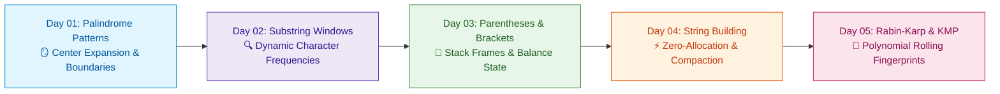

# 📘 Week 06: String Manipulation Patterns

> 🧭 **Navigation:** [← Previous: Week 05](../week_05_tier_1_critical_patterns/README.md) • [🏠 Curriculum Overview](../README.md) • [📘 Complete Syllabus](../COMPLETE_SYLLABUS.md) • [Next: Week 07 →](../week_07_trees_and_balanced_search_trees/README.md)

---

## 🎬 Welcome to Week 06: The String Alchemist's Masterclass!

Strings appear deceptive in technical interviews. Under the hood, characters are contiguous byte or character arrays, yet standard string operations silently allocate memory, trigger hidden quadratic `O(N^2)` copy costs, and trip up candidates on subtle off-by-one indices.

This week transforms you from writing naive character concatenations to mastering **zero-allocation window tracking**, **expanding symmetric boundaries**, **stack-driven bracket validation**, and **rolling hash fingerprinting**.

---

## 📅 Day-by-Day Learning Path

| Day | Instructional Masterclass | Core Mental Model & Intuition | Key Pattern / Invariant |
| :--- | :--- | :--- | :--- |
| **Day 01** | [Palindrome Patterns](Week_06_Day_01_Palindrome_Patterns_Instructional.md) | **The Mirror Caliper:** Expanding from 2N-1 odd/even centers. | Center expansion, boundary pruning, Manacher intuition. |
| **Day 02** | [Substring Sliding Window Patterns](Week_06_Day_02_Substring_Sliding_Window_Patterns_Instructional.md) | **The Flexible Magnifying Glass:** Tracking dynamic character counts. | Variable-length window, character frequency map, min window substring. |
| **Day 03** | [Parentheses & Bracket Matching](Week_06_Day_03_Parentheses_Bracket_Matching_Instructional.md) | **The Russian Nesting Doll:** Matching outer containers to inner scopes. | LIFO stack matching, balance counter, index offset sentinel. |
| **Day 04** | [String Transformations & Building](Week_06_Day_04_String_Transformations_Building_Instructional.md) | **The Construction Site:** Zero-allocation in-place writing. | Two-pointer read/write heads, `StringBuilder` capacity, run-length compression. |
| **Day 05** | [Advanced String Matching: Rabin-Karp & KMP](Week_06_Day_05_Advanced_String_Matching_Rabin_Karp_Rolling_Hash_Instructional.md) | **The Digital Fingerprint:** O(1) rolling polynomial hash slide. | Modulo arithmetic, collision defense, Knuth-Morris-Pratt failure table. |

---

## 📚 Consolidated Playbooks & Reference Guides

*   📖 **Comprehensive Week Playbook:** [WEEK_06_FULL_PLAYBOOK.md](WEEK_06_FULL_PLAYBOOK.md) — High-density synthesis of all invariants, theorems, and pattern triggers for this week.
*   📊 **Visual Concepts Playbook (Hybrid):** [Week_06_Visual_Concepts_Playbook_HYBRID.md](Week_06_Visual_Concepts_Playbook_HYBRID.md) — Compact Mermaid diagrams, state transitions, and complexity reference tables.
*   💻 **Production C# Reference (.NET 8/9):** [Week_06_Extended_CSharp_Complete.md](Week_06_Extended_CSharp_Complete.md) — Idiomatic, zero-allocation memory-aware implementations (`ReadOnlySpan<char>`) and problem ladders.
*   🐍 **Production Python Reference (Python 3.11+):** [Week_06_Extended_Python_Complete.md](Week_06_Extended_Python_Complete.md) — Clean, pythonic reference implementations for rapid whiteboard prototyping.

---

## 🛠️ The 5 Core Support Files (`support files/`)

1.  📋 [Daily Progress Checklist](support%20files/Week_06_Daily_Progress_Checklist.md) — Step-by-step accountability tracker for theory, coding, and variants.
2.  🧭 [Weekly Guidelines & Mental Models](support%20files/Week_06_Guidelines.md) — Strategic roadmap, common pitfalls, and conceptual anchors.
3.  🎙️ [Interview Q&A Comprehensive Reference](support%20files/Week_06_Interview_QA_Reference.md) — High-frequency senior technical questions with verbal response frameworks.
4.  🗺️ [Problem-Solving Roadmap](support%20files/Week_06_Problem_Solving_Roadmap.md) — Tier-1 problem progression ladder from warm-up to advanced.
5.  📑 [Summary & Key Concepts Synthesis](support%20files/Week_06_Summary_Key_Concepts.md) — Fast-revision cheat sheet covering all governing invariants and system trade-offs.

---

> 🧭 **Navigation:** [← Previous: Week 05](../week_05_tier_1_critical_patterns/README.md) • [🏠 Curriculum Overview](../README.md) • [📘 Complete Syllabus](../COMPLETE_SYLLABUS.md) • [Next: Week 07 →](../week_07_trees_and_balanced_search_trees/README.md)
