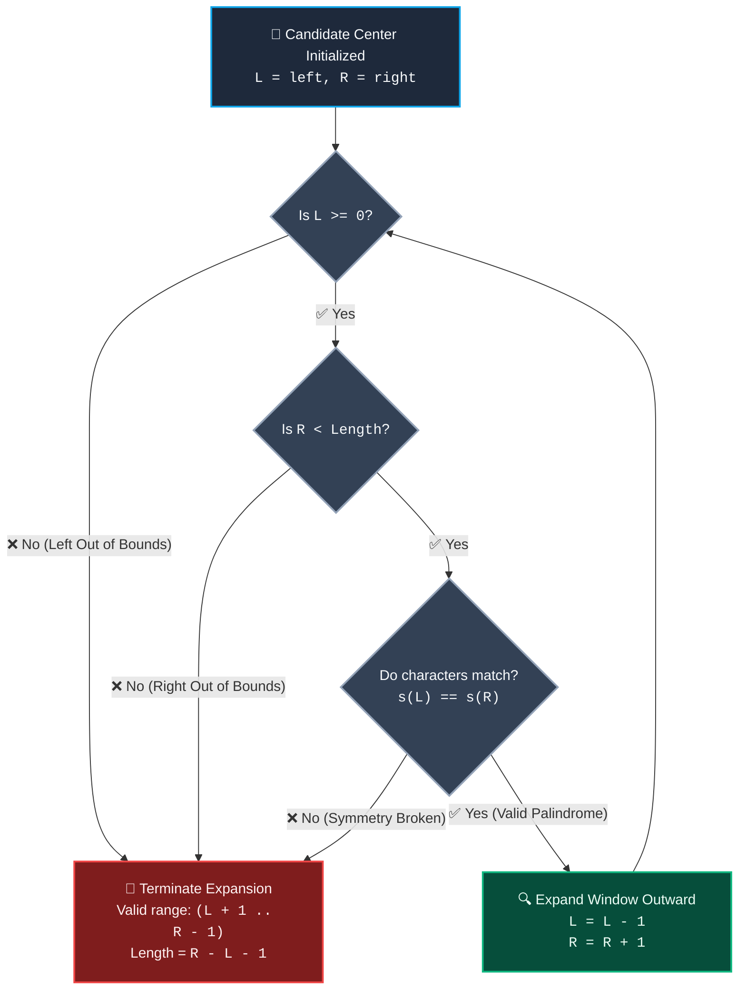

# 📚 Week 06 Day 01: Palindrome Patterns — The Complete FAANG Engineering Guide

> 🧭 **Navigation:** [← Week Overview](README.md) • [🏠 Week Overview](README.md) • [📘 Curriculum Syllabus](../COMPLETE_SYLLABUS.md) • [Next Day →](Week_06_Day_02_Substring_Sliding_Window_Patterns_Instructional.md)
> 
> 💡 **Instructor Note:** *Welcome to Week 6! Strings in FAANG interviews are not just character arrays; they test your memory empathy, cache-line awareness, and pointer mastery. Master the bilateral symmetry invariant: `s[i] == s[N - 1 - i]`. Today, we master the two foundational mechanics: two-pointer inward convergence for validation and outward expansion around 2N - 1 candidate centers for substring discovery.*

---

## 🎯 LEARNING OBJECTIVES

By the end of this chapter, you will be able to:

- 🎯 **Internalize** the bilateral symmetry invariant (`s[i] == s[N - 1 - i]`) and why two-pointer inward convergence delivers `O(N)` validation with strictly `O(1)` auxiliary space.
- 🦋 **Derive** the Expand-Around-Center pattern using the Mirror / Butterfly Wing intuition, eliminating the disastrous `O(N^3)` brute-force substring check.
- 📐 **Prove** mechanically why any string of length `N` contains exactly `2N - 1` candidate symmetry centers (`N` character centers and `N - 1` inter-character gaps).
- 🛑 **Avoid** the fatal Rookie Blunders: inner-loop string slicing (`O(N^3)` GC heap churn), missing even-length centers, and off-by-one span boundary extraction.
- ⚙️ **Implement** production-grade, zero-allocation C# (.NET 8/9 with `ReadOnlySpan<char>`) and idiomatic Python (3.11+) across 4 core FAANG problems: Valid Palindrome (LC 125), Longest Palindromic Substring (LC 5), Palindromic Substrings Count (LC 647), and Valid Palindrome II (LC 680).
- 🎙️ **Recite** the exact 3-sentence live interview talk track with Senior Architect poise before writing a single line of code.

---

## 🎬 CHAPTER 1: THE 60-SECOND HOOK & EVERYDAY METAPHOR (PILLAR 1)

### The High-Energy Hook: The 1,000,000,000 Operation String Disaster

Hey engineers, welcome to **Week 6: String Manipulation Patterns**!

You and I are sitting across from a Senior Staff Bar Raiser at Meta or Google. They smile and hand you a deceptively simple prompt:
> *"Given a string `s`, find the longest palindromic substring."*

Your junior instincts whisper: *"Easy! I'll generate every possible substring, reverse each one, and check if it equals itself."*

Let's pause right there. Let's do the math on a napkin:
1. A string of length `N` has `N * (N + 1) / 2 = O(N^2)` substrings.
2. For each substring, you reverse it and perform a character-by-character comparison. That takes `O(N)` time.
3. Total Time Complexity: `O(N^2) * O(N) = O(N^3)`!
4. Even worse: every time you slice and reverse a substring, you allocate memory on the managed heap. For an input string of just `N = 10,000` characters (a tiny JSON payload or DNA fragment):
   - Number of operations: `(10^4)^3 = 1,000,000,000,000` operations (`10^12`).
   - Your program runs for hours, triggers relentless Garbage Collection pauses, and your FAANG interview is over before it even begins.

Can we solve this in `O(N^2)` worst-case time, near `O(N)` average time, and with **zero heap allocations (`O(1)` auxiliary space)**?

Yes. And you don't need academic dynamic programming tables or PhD-level papers. You just need to look at a butterfly.

---

### The Real-World Metaphor: The Butterfly Wings & The Bathroom Mirror

Imagine standing in front of a mirror, or looking down at a butterfly pinned to an entomologist's board:

```
               🦋 THE BUTTERFLY WINGS METAPHOR 🦋
                     
                     Left Wing   Spine   Right Wing
                       [ a ]      [ b ]     [ a ]
                         \          │         /
                          \         │        /
                       <- Left      │     Right ->
                       Expands      │     Expands
                       Outward      │     Outward
```

- When you check if a butterfly's wings are symmetrical, do you cut off the left wing, photocopy it, rotate it 180 degrees, and superimpose it on the right wing? **Of course not.** That's what `s == s[::-1]` does!
- Instead, your eyes naturally lock onto the **spine** (the center) and glance outward simultaneously:
  - 1 millimeter left matches 1 millimeter right.
  - 2 millimeters left matches 2 millimeters right.
  - The instant one wing has a yellow spot and the other has a black spot: **STOP**. Symmetry is broken.

A palindrome is simply a string with a mirror spine! 

Instead of searching from the outside in over trillions of substrings, **we pick a spine (center) and blossom outward**. The second the characters don't match, we stop instantly. On natural language text, most expansions terminate on step 1!

---

### Real-World Systems Context: Why FAANG Cares About Zero Allocations

Why do top tech companies obsess over palindromes in string interviews?

1. **Bioinformatics & Genomic Sequencing:** Restriction enzymes (like *EcoRI*) cut DNA at palindromic inverted repeat sites (e.g., `5'-GAATTC-3'` pairing with `3'-CTTAAG-5'`). When scanning a genome with 3 billion base pairs, allocating strings crashes the server with Out-Of-Memory exceptions. Traversal must be zero-allocation `O(1)` space.
2. **Network Packet Inspection & Intrusion Detection:** Deep Packet Inspection (DPI) firewalls inspect symmetric byte patterns to detect obfuscated exploit payloads and reverse-shell beacons at 40 Gbps line rate. Heap allocation per packet would introduce microsecond latency spikes that saturate network buffers.
3. **High-Throughput Token Parsers:** Real-time IDE syntax highlighting engines and query parsers (e.g., Roslyn compiler in C# or V8 in Node.js) scan multi-megabyte source buffers using stack-allocated `ReadOnlySpan<char>` to avoid GC pressure.

---

## 🪜 CHAPTER 2: THE SCAFFOLDING LADDER & TOY NAPKIN TRACES (PILLAR 2)

Let's never jump straight into full algorithms without scaffolding our mental model first.

### The Invariant & Parity Mystery: Why `2N - 1` Centers?

A string `s` of length `N` is symmetric if `s[i] == s[N - 1 - i]`. But where is the center spine?

There is a subtle catch: **string parity**.
- **Odd-length palindromes (e.g., `"aba"`, `"racecar"`):** The spine is centered on an actual character (the `'b'` in `"aba"`, or `'e'` in `"racecar"`). There are `N` characters, so there are **`N` single-character centers**.
- **Even-length palindromes (e.g., `"bb"`, `"abba"`):** The spine is centered in the **inter-character gap** between two characters (between `b` and `b`). In a string of length `N`, there are exactly `N - 1` gaps between adjacent characters, giving **`N - 1` boundary centers**.

```
Total Candidate Centers = N (odd) + (N - 1) (even) = 2N - 1 centers!
```

---

### 🪜 Toy Napkin Trace 1: Odd-Length Center Expansion (`"babad"`)

Let's trace LeetCode 5 on `s = "babad"` (Length `N = 5`).
We want to find the longest palindromic substring.

```
String:   [ b ]   [ a ]   [ b ]   [ a ]   [ d ]
Indices:    0       1       2       3       4
```

Let's step through the centers where interesting expansions happen:

#### Center `i = 1` (Character `'a'`, Odd Expansion: `left = 1, right = 1`)
1. **Start:** `L = 1 ('a')`, `R = 1 ('a')`. Match! Length = 1 (`"a"`).
2. **Step outward:** `L = 0 ('b')`, `R = 2 ('b')`. `s[0] == s[2]` ('b' == 'b')! Match! Length = 3 (`"bab"`).
3. **Step outward:** `L = -1`, `R = 3`. `L < 0` (Out of bounds!). **STOP.**
4. **Valid Palindrome:** Extracted from `L + 1 = 0` to `R - 1 = 2`. Substring: `"bab"`, Length: `3`.

#### Center `i = 2` (Character `'b'`, Odd Expansion: `left = 2, right = 2`)
1. **Start:** `L = 2 ('b')`, `R = 2 ('b')`. Match! Length = 1 (`"b"`).
2. **Step outward:** `L = 1 ('a')`, `R = 3 ('a')`. `s[1] == s[3]` ('a' == 'a')! Match! Length = 3 (`"aba"`).
3. **Step outward:** `L = 0 ('b')`, `R = 4 ('d')`. `s[0] != s[4]` ('b' != 'd')! Mismatch! **STOP.**
4. **Valid Palindrome:** Extracted from `L + 1 = 1` to `R - 1 = 3`. Substring: `"aba"`, Length: `3`.

Both `"bab"` and `"aba"` are valid answers of maximum length 3!

---

### 🪜 Toy Napkin Trace 2: Even-Length Center Expansion (`"cbbd"`)

Now consider `s = "cbbd"` (Length `N = 4`). Notice the palindrome is `"bb"` of even length 2.

```
String:   [ c ]   [ b ]   [ b ]   [ d ]
Indices:    0       1       2       3
```

What happens if an engineer only checks odd centers?
- Center `0 ('c')`: `"c"` (len 1)
- Center `1 ('b')`: `"b"` (len 1)
- Center `2 ('b')`: `"b"` (len 1)
- Center `3 ('d')`: `"d"` (len 1)
- ❌ **Result:** Returns `"c"` of length 1! The algorithm completely missed `"bb"`!

Now watch how the **even center** catches it:
#### Center `i = 1` (Between `1` and `2`, Even Expansion: `left = 1, right = 2`)
1. **Start:** `L = 1 ('b')`, `R = 2 ('b')`. `s[1] == s[2]` ('b' == 'b')! Match! Length = 2 (`"bb"`).
2. **Step outward:** `L = 0 ('c')`, `R = 3 ('d')`. `s[0] != s[3]` ('c' != 'd')! Mismatch! **STOP.**
3. **When the loop stops:** `L = 0`, `R = 3`.
4. **Calculate Valid Bounds:**
   - Valid start: `L + 1 = 0 + 1 = 1`.
   - Valid length: `(R - 1) - (L + 1) + 1 = R - L - 1 = 3 - 0 - 1 = 2`.
5. ✅ **Result:** Substring `"bb"` of length 2 correctly found!

---

### 🪜 Toy Napkin Trace 3: Palindromic Substrings Count (`"aaa"`)

In LeetCode 647, we must return the **total number of palindromic substrings**.
Let's trace `s = "aaa"` (Length `N = 3`, Total Centers = `2(3) - 1 = 5`).

Every time an expansion comparison matches, we increment our counter by `1`!

```
String:   [ a ]   [ a ]   [ a ]
Indices:    0       1       2
```

| Center Type | Initial `(L, R)` | Expansion Sequence & Matches | Count Added | Palindromes Found |
| :--- | :--- | :--- | :--- | :--- |
| **Odd (i=0)** | `(0, 0)` | `s[0]=='a'` (Match) -> `L=-1` (Stop) | `+1` | `"a"` (at 0) |
| **Even (i=0)**| `(0, 1)` | `s[0]=='a' == s[1]=='a'` (Match) -> `L=-1` (Stop) | `+1` | `"aa"` (at 0..1) |
| **Odd (i=1)** | `(1, 1)` | `s[1]=='a'` (Match) -> `s[0]=='a' == s[2]=='a'` (Match) -> `L=-1` (Stop) | `+2` | `"a"` (at 1), `"aaa"` (at 0..2) |
| **Even (i=1)**| `(1, 2)` | `s[1]=='a' == s[2]=='a'` (Match) -> `R=3` (Stop) | `+1` | `"aa"` (at 1..2) |
| **Odd (i=2)** | `(2, 2)` | `s[2]=='a'` (Match) -> `R=3` (Stop) | `+1` | `"a"` (at 2) |

**Total Palindromic Substrings = `1 + 1 + 2 + 1 + 1 = 6`.**
Every match is counted in `O(1)` time without generating any intermediate strings!

---

### 🧠 Interactive Checkpoints: Pause & Predict Micro-Drills

#### 🧠 Drill 1: The Span Length Math After Loop Exit
**Scenario:** Your expansion while loop is written as:
```csharp
while (left >= 0 && right < s.Length && s[left] == s[right])
{
    left--;
    right++;
}
```
When this while loop terminates, `left` and `right` have each taken one extra step into invalid territory (either out of bounds or a mismatch).
**Active Recall Question:** If the loop terminates with `left = 2` and `right = 7`, what was the actual length of the palindrome, and what is its starting index?
<details>
<summary>👉 Click to Reveal the Mechanics</summary>

**Answer: Starting Index = 3, Length = 4!**
- The last valid matching character on the left was at index `left + 1 = 2 + 1 = 3`.
- The last valid matching character on the right was at index `right - 1 = 7 - 1 = 6`.
- The length of an inclusive range `[start .. end]` is `end - start + 1`.
- Substituting: `(right - 1) - (left + 1) + 1 = right - left - 1`.
- For `left = 2, right = 7`: `Length = 7 - 2 - 1 = 4`.
- The valid characters are indices `3, 4, 5, 6` (length 4).
</details>

---

#### 🧠 Drill 2: Best-Case vs Worst-Case Execution Time
**Scenario:** You run Expand-Around-Center on two strings of length `N = 10,000`:
- String A: `"abcdefghijklmnop..."` (all distinct characters).
- String B: `"aaaaaaaaaaaaaaaa..."` (all identical characters).

**Active Recall Question:** What is the exact Big-O runtime for String A versus String B?
<details>
<summary>👉 Click to Reveal the Senior Architecture Invariant</summary>

**Answer: String A runs in `O(N)` time; String B runs in `O(N^2)` time!**
- **String A (All distinct):**
  - For each odd center, `s[i] == s[i]` takes 1 check, then `s[i-1] != s[i+1]` fails on the very first expansion step.
  - For each even center, `s[i] != s[i+1]` fails immediately.
  - Each center does at most 1–2 operations. Total operations `= 2N = O(N)`.
- **String B (All identical):**
  - Every expansion continues until hitting the edge of the string.
  - Expansions take `1 + 2 + 3 + ... + N/2 = O(N^2)` operations.
- **Key Takeaway:** Unlike 2D Dynamic Programming which *always* performs quadratic `N^2 / 2` table writes, Expand-Around-Center is adaptive: it runs in near `O(N)` time on real-world natural language strings!
</details>

---

## 🎨 CHAPTER 3: PRAGMATIC VISUAL MODELS (PILLAR 3)

### ASCII Architectural Visual 1: The 2N - 1 Centers Grid

Let's visualize exactly how all `2N - 1` centers map onto a 4-character string `"cbbd"`:

```
VISUALIZING 2N - 1 CENTERS ON "cbbd" (Length N = 4, Centers = 2 * 4 - 1 = 7)

Character Indices:       0               1               2               3
Contiguous Memory:    [  c  ]         [  b  ]         [  b  ]         [  d  ]
                         │               │               │               │
Center ID:              (0)     (1)     (2)     (3)     (4)     (5)     (6)
                         │       │       │       │       │       │       │
Center Type:            Odd    Even     Odd    Even     Odd    Even     Odd
                         │       │       │       │       │       │       │
Center Pivot:          On 'c'   Gap    On 'b'   Gap    On 'b'   Gap    On 'd'
Initial (L, R):        (0, 0)  (0, 1)  (1, 1)  (1, 2)  (2, 2)  (2, 3)  (3, 3)
Longest Palindrome:     "c"     None    "b"     "bb"    "b"     None    "d"
                         ▲                       ▲
                     Single char            Mirror Gap!
```

---

### ASCII Architectural Visual 2: Inward Convergence vs Outward Expansion

```
1. INWARD CONVERGENCE (Validation: LC 125, O(N) Time, O(1) Space)
   Goal: Check if the ENTIRE string is a palindrome.
   
   [ r ] ─── [ a ] ─── [ c ] ─── [ e ] ─── [ c ] ─── [ a ] ─── [ r ]
     👉 L                                                    👈 R
   
   Rule: Advance L inward (L++) and R inward (R--) while s[L] == s[R].
   Terminate early on first mismatch. Pointers cross at the center.


2. OUTWARD EXPANSION (Discovery: LC 5 / LC 647, O(N^2) Time, O(1) Space)
   Goal: Discover arbitrary palindromic SUBSTRINGS.
   
   [ r ] ─── [ a ] ─── [ c ] ─── [ e ] ─── [ c ] ─── [ a ] ─── [ r ]
                                   🎯 Center Pivot
                                 👈 L     R 👉
   
   Rule: Start L and R at the center spine.
   Blossom outward (L--, R++) as long as characters match and bounds hold.
```

---

### Expand-Around-Center Loop Termination (Mermaid Flowchart)

The following flowchart models the exact conditional loop of the outward expansion engine:



---

## 🛑 CHAPTER 4: THE ROOKIE TRAP ZONE (PILLAR 4)

Let's dissect the 4 most common interview-failing blunders and contrast them directly with Senior Architect patterns.

### Trap 1: The String Reverse & Inner Slicing Memory Churn

Junior engineers love expressive one-liners, but in a 45-minute FAANG loop, allocating substrings inside nested loops signals a lack of memory empathy.

| Metric | ❌ Rookie Blunder | ✅ Senior Architect Pattern |
| :--- | :--- | :--- |
| **Strategy** | Slicing substrings and reversing | Expanding pointers and tracking integer bounds |
| **Time Complexity** | `O(N^3)` | `O(N^2)` worst-case, `O(N)` average |
| **Auxiliary Space** | `O(N^3)` GC heap churn | Strictly `O(1)` zero heap allocations |
| **Evaluation** | 🛑 Immediate failure in Staff/Senior rounds | 🌟 FAANG Bar Raiser standard |

```csharp
// ❌ Rookie Blunder: Allocates millions of string objects on the managed heap!
for (int i = 0; i < s.Length; i++) {
    for (int j = i; j < s.Length; j++) {
        string sub = s.Substring(i, j - i + 1); // Heap allocation O(N)
        char[] arr = sub.ToCharArray();          // Array allocation O(N)
        Array.Reverse(arr);                      // O(N)
        if (sub == new string(arr)) {            // Third allocation!
            if (sub.Length > maxLen) maxStr = sub;
        }
    }
}

// ✅ Senior Architect Pattern: Zero heap allocations using Span / primitive indices!
ReadOnlySpan<char> span = s.AsSpan();
int bestStart = 0, maxLength = 1;

for (int i = 0; i < span.Length; i++) {
    Expand(span, i, i, ref bestStart, ref maxLength);     // Odd center
    Expand(span, i, i + 1, ref bestStart, ref maxLength); // Even center
}
return s.Substring(bestStart, maxLength); // Exactly ONE single allocation at return!
```

---

### Trap 2: The Forgotten Even-Length Center

A classic mistake is assuming all palindromes have an odd length like `"racecar"`. If you only expand `(i, i)`, your code fails on `"abba"`, `"cbbd"`, and `"noon"`.

```csharp
// ❌ Rookie Blunder: Only checks odd centers! Misses 50% of palindromes!
for (int i = 0; i < s.Length; i++) {
    Expand(s, i, i); // What about even palindromes like "abba"?!
}

// ✅ Senior Architect Pattern: Explicitly sweeps both odd and even centers
for (int i = 0; i < s.Length; i++) {
    Expand(span, i, i, ref bestStart, ref maxLength);     // Odd center (pivot on s[i])
    Expand(span, i, i + 1, ref bestStart, ref maxLength); // Even center (pivot between s[i] & s[i+1])
}
```

---

### Trap 3: The Off-By-One Span Extraction Bug

When the `while (left >= 0 && right < s.Length && s[left] == s[right])` loop breaks, `left` has been decremented by 1 and `right` has been incremented by 1.

```csharp
// ❌ Rookie Blunder: Off-by-one bounds! Slices invalid outer mismatched chars!
int length = right - left + 1; // WRONG! Both pointers took 1 step too far!
string sub = s.Substring(left, length); // Crashes with out of bounds or wrong text!

// ✅ Senior Architect Pattern: Mechanically unwind the overstep
// Last valid left was (left + 1). Last valid right was (right - 1).
// Length = (right - 1) - (left + 1) + 1 = right - left - 1.
int currentLength = right - left - 1;
if (currentLength > maxLength) {
    maxLength = currentLength;
    bestStart = left + 1;
}
```

---

### Trap 4: Linq / Regex Filtering Allocation in Valid Palindrome (LC 125)

When asked to validate a palindrome ignoring non-alphanumeric characters, juniors allocate filtered intermediate strings.

```python
# ❌ Rookie Blunder: Allocates 2 new strings of length N!
clean_s = "".join(c.lower() for c in s if c.isalnum())
return clean_s == clean_s[::-1]

# ✅ Senior Architect Pattern: Two pointers in-place, O(1) auxiliary space!
left, right = 0, len(s) - 1
while left < right:
  while left < right and not s[left].isalnum():
    left += 1
  while left < right and not s[right].isalnum():
    right -= 1
  if s[left].lower() != s[right].lower():
    return False
  left += 1
  right -= 1
return True
```

---

## 🎙️ CHAPTER 5: 45-MINUTE INTERVIEW TALK TRACK (PILLAR 5)

When your interviewer asks you to find the longest palindromic substring, do **not** touch the keyboard immediately. Look them in the eye and deliver this exact 3-sentence script:

> 🎙️ **The 3-Sentence FAANG Talk Track:**
> 1. *"To avoid the disastrous `O(N^3)` time and memory overhead of checking all `O(N^2)` substrings via reversal, I will exploit the bilateral symmetry invariant by expanding outward from candidate centers."*
> 2. *"Because palindromes have either a single-character center for odd lengths or an inter-character boundary for even lengths, there are exactly `2N - 1` candidate centers across the string."*
> 3. *"By expanding outward from each center and maintaining running integer indices for the maximum window, we achieve `O(N^2)` worst-case time, near `O(N)` average time on natural text, with strictly `O(1)` auxiliary space and zero heap allocations."*

---

### The 4-Phase Live Interview Walkthrough

#### Phase 1: Clarification & Bounds (0–5 Mins)
- **Candidate:** "Before writing code, let me clarify constraints: What is the maximum length of `s`? Can `s` contain whitespace, punctuation, or Unicode, or is it ASCII? Is an empty string or single character considered a palindrome?"
- **Interviewer:** "`1 <= s.length <= 1000`, lowercase English letters only."
- **Candidate:** "Understood. With `N <= 1000`, an `O(N^2)` center expansion will execute in under 1 millisecond with zero memory overhead, whereas a dynamic programming matrix would needlessly allocate a 1-megabyte boolean table."

#### Phase 2: Approach & Trade-Off Pitch (5–12 Mins)
- **Candidate:** "I will avoid allocating substrings in the inner loop. Instead, I'll write a helper method that accepts the center pointers `left` and `right`. As it expands outward while characters match, it computes the length mathematically as `right - left - 1`. We update a global `bestStart` and `maxLength`. Only after evaluating all `2N - 1` centers will I slice the final string once."

#### Phase 3: Live Coding (12–30 Mins)
- *Write clean, modular code with guard clauses, meaningful variable names, and zero allocations.*

#### Phase 4: Edge Cases & Verification (30–40 Mins)
- **Candidate:** "Let's dry-run edge cases:
  1. Single character `"a"`: Loops once, returns `"a"`.
  2. All identical characters `"aaaa"`: Expands fully on even center `(1, 2)` to length 4.
  3. No palindromes longer than 1 `"abcdef"`: Returns `"a"` (length 1).
  4. Even palindrome at the very boundary `"baab"`: Discovered on center `(1, 2)`."

---

## ⚡ CHAPTER 6: PRODUCTION DUAL-LANGUAGE CODE (PILLAR 6)

### Problem 1: Valid Palindrome (LeetCode 125)

> **Interview Problem Statement:** A phrase is a palindrome if, after converting all uppercase letters into lowercase letters and removing all non-alphanumeric characters, it reads the same forward and backward. Given a string `s`, return `true` if it is a palindrome, or `false` otherwise. Must achieve `O(1)` auxiliary space.

#### C# (.NET 8/9 — Zero Allocation with `ReadOnlySpan<char>`)

```csharp
using System;

public static class ValidPalindromeSolver
{
    /// <summary>
    /// Validates palindrome symmetry in-place ignoring non-alphanumeric characters.
    /// Time Complexity: O(N) | Auxiliary Space: O(1) (Zero GC Allocations)
    /// </summary>
    public static bool IsPalindrome(string s)
    {
        // Guard clause: null or empty/single char strings are trivially valid
        if (string.IsNullOrEmpty(s) || s.Length <= 1)
        {
            return true;
        }

        ReadOnlySpan<char> span = s.AsSpan();
        int left = 0;
        int right = span.Length - 1;

        while (left < right)
        {
            // Skip non-alphanumeric characters from left
            while (left < right && !char.IsLetterOrDigit(span[left]))
            {
                left++;
            }

            // Skip non-alphanumeric characters from right
            while (left < right && !char.IsLetterOrDigit(span[right]))
            {
                right--;
            }

            // Case-insensitive ASCII comparison without string allocations
            if (char.ToLowerInvariant(span[left]) != char.ToLowerInvariant(span[right]))
            {
                return false;
            }

            left++;
            right--;
        }

        return true;
    }
}
```

#### Python (3.11+ — Idiomatic & In-Place)

```python
class ValidPalindromeSolver:

  @staticmethod
  def is_palindrome(s: str) -> bool:
    """Validates palindrome symmetry in-place ignoring non-alphanumeric characters.

    Time Complexity: O(N) | Auxiliary Space: O(1)
    """
    if not s or len(s) <= 1:
      return True

    left = 0
    right = len(s) - 1

    while left < right:
      while left < right and not s[left].isalnum():
        left += 1
      while left < right and not s[right].isalnum():
        right -= 1

      if s[left].lower() != s[right].lower():
        return False

      left += 1
      right -= 1

    return True
```

---

### Problem 2: Longest Palindromic Substring (LeetCode 5)

> **Interview Problem Statement:** Given a string `s`, return the longest palindromic substring in `s`. Must execute in `O(N^2)` worst-case time with `O(1)` auxiliary space.

#### C# (.NET 8/9 — Zero Inner-Loop Allocation)

```csharp
using System;

public static class LongestPalindromeSolver
{
    /// <summary>
    /// Finds the longest palindromic substring using 2N - 1 center expansions.
    /// Time Complexity: O(N^2) | Auxiliary Space: O(1) | Output Space: O(K)
    /// </summary>
    public static string LongestPalindrome(string s)
    {
        // Guard clause: empty or single-character string
        if (string.IsNullOrEmpty(s) || s.Length <= 1)
        {
            return s ?? string.Empty;
        }

        ReadOnlySpan<char> span = s.AsSpan();
        int bestStart = 0;
        int maxLength = 1;

        for (int i = 0; i < span.Length; i++)
        {
            // Center Type 1: Odd-length expansion (pivot on character at i)
            Expand(span, i, i, ref bestStart, ref maxLength);

            // Center Type 2: Even-length expansion (pivot on gap between i and i + 1)
            Expand(span, i, i + 1, ref bestStart, ref maxLength);
        }

        // Exactly one heap allocation at the very end of execution
        return s.Substring(bestStart, maxLength);
    }

    private static void Expand(ReadOnlySpan<char> span, int left, int right, ref int bestStart, ref int maxLength)
    {
        while (left >= 0 && right < span.Length && span[left] == span[right])
        {
            left--;
            right++;
        }

        // Loop oversteps: last valid indices were (left + 1) and (right - 1)
        // Length = (right - 1) - (left + 1) + 1 = right - left - 1
        int currentLength = right - left - 1;

        if (currentLength > maxLength)
        {
            maxLength = currentLength;
            bestStart = left + 1;
        }
    }
}
```

#### Python (3.11+ — Clean Whiteboard Prototyping)

```python
class LongestPalindromeSolver:

  @staticmethod
  def longest_palindrome(s: str) -> str:
    """Discovers the longest palindromic substring via expand-around-center.

    Time Complexity: O(N^2) | Auxiliary Space: O(1) | Output Space: O(K)
    """
    if not s or len(s) <= 1:
      return s

    best_start = 0
    max_length = 1

    def expand(left: int, right: int) -> None:
      nonlocal best_start, max_length
      while left >= 0 and right < len(s) and s[left] == s[right]:
        left -= 1
        right += 1

      # Overstepped: valid length is right - left - 1
      current_length = right - left - 1
      if current_length > max_length:
        max_length = current_length
        best_start = left + 1

    for i in range(len(s)):
      expand(i, i)  # Odd-length center
      expand(i, i + 1)  # Even-length center

    return s[best_start : best_start + max_length]
```

---

### Problem 3: Palindromic Substrings Count (LeetCode 647)

> **Interview Problem Statement:** Given a string `s`, return the number of palindromic substrings in it. A substring is a contiguous sequence of characters within the string.

#### C# (.NET 8/9 — Expansion Accumulator)

```csharp
using System;

public static class PalindromicSubstringsCounter
{
    /// <summary>
    /// Counts all valid palindromic substrings by accumulating expansions across 2N - 1 centers.
    /// Time Complexity: O(N^2) | Auxiliary Space: O(1) | Output Space: O(1)
    /// </summary>
    public static int CountSubstrings(string s)
    {
        if (string.IsNullOrEmpty(s))
        {
            return 0;
        }

        ReadOnlySpan<char> span = s.AsSpan();
        int totalPalindromes = 0;

        for (int i = 0; i < span.Length; i++)
        {
            // Odd-length centers (i, i)
            totalPalindromes += CountExpansions(span, i, i);

            // Even-length centers (i, i + 1)
            totalPalindromes += CountExpansions(span, i, i + 1);
        }

        return totalPalindromes;
    }

    private static int CountExpansions(ReadOnlySpan<char> span, int left, int right)
    {
        int count = 0;

        while (left >= 0 && right < span.Length && span[left] == span[right])
        {
            count++; // Each successful expansion step is a new distinct palindrome!
            left--;
            right++;
        }

        return count;
    }
}
```

#### Python (3.11+ — Idiomatic Accumulator)

```python
class PalindromicSubstringsCounter:

  @staticmethod
  def count_substrings(s: str) -> int:
    """Counts all valid palindromic substrings using expand-around-center.

    Time Complexity: O(N^2) | Auxiliary Space: O(1) | Output Space: O(1)
    """
    if not s:
      return 0

    total_palindromes = 0

    def count_expansions(left: int, right: int) -> int:
      count = 0
      while left >= 0 and right < len(s) and s[left] == s[right]:
        count += 1
        left -= 1
        right += 1
      return count

    for i in range(len(s)):
      total_palindromes += count_expansions(i, i)  # Odd centers
      total_palindromes += count_expansions(i, i + 1)  # Even centers

    return total_palindromes
```

---

### Problem 4: Valid Palindrome II (LeetCode 680 — One Deletion Tolerance)

> **Interview Problem Statement:** Given a string `s`, return `true` if the `s` can be palindrome after deleting at most one character from it.

#### C# (.NET 8/9 — Greedy Two-Pointer with Single Branch)

```csharp
using System;

public static class ValidPalindromeIISolver
{
    /// <summary>
    /// Checks if a string can form a palindrome with at most one character deletion.
    /// Time Complexity: O(N) | Auxiliary Space: O(1)
    /// </summary>
    public static bool ValidPalindrome(string s)
    {
        if (string.IsNullOrEmpty(s) || s.Length <= 2)
        {
            return true;
        }

        ReadOnlySpan<char> span = s.AsSpan();
        int left = 0;
        int right = span.Length - 1;

        while (left < right)
        {
            if (span[left] != span[right])
            {
                // On mismatch, branch greedily: skip either left char OR right char
                return IsStrictPalindrome(span, left + 1, right) ||
                       IsStrictPalindrome(span, left, right - 1);
            }

            left++;
            right--;
        }

        return true;
    }

    private static bool IsStrictPalindrome(ReadOnlySpan<char> span, int left, int right)
    {
        while (left < right)
        {
            if (span[left] != span[right])
            {
                return false;
            }
            left++;
            right--;
        }
        return true;
    }
}
```

#### Python (3.11+ — Branching Verification)

```python
class ValidPalindromeIISolver:

  @staticmethod
  def valid_palindrome(s: str) -> bool:
    """Verifies palindrome validity allowing at most 1 deletion.

    Time Complexity: O(N) | Auxiliary Space: O(1)
    """

    def is_strict(left: int, right: int) -> bool:
      while left < right:
        if s[left] != s[right]:
          return False
        left += 1
        right -= 1
      return True

    left = 0
    right = len(s) - 1

    while left < right:
      if s[left] != s[right]:
        # Branch: skip left character OR skip right character
        return is_strict(left + 1, right) or is_strict(left, right - 1)
      left += 1
      right -= 1

    return True
```

---

## ⚖️ CHAPTER 7: PERFORMANCE, REAL SYSTEMS & ADVANCED CONCEPTS

### Algorithmic Trade-Off Matrix

| Strategy | Time (Best) | Time (Worst) | Auxiliary Space | Cache Locality | Interview Viability |
| :--- | :--- | :--- | :--- | :--- | :--- |
| **Brute Force Substrings** | `O(N^3)` | `O(N^3)` | `O(N)` heap churn | Terrible | 🛑 Immediate Rejection |
| **2D Dynamic Programming** | `O(N^2)` | `O(N^2)` | `O(N^2)` matrix | Poor (matrix jumping) | ⚠️ Acceptable, but memory-heavy |
| **Expand-Around-Center** | `O(N)` | `O(N^2)` | Strictly `O(1)` | Excellent (L1 cache contiguous) | ✅ **Gold Standard (FAANG Best Practice)** |
| **Manacher's Algorithm** | `O(N)` | `O(N)` | `O(N)` sentinel array | Moderate | 🚀 Staff/Senior bonus discussion |

---

### Why Expand-Around-Center Beats 2D DP in Production Systems

Many candidates memorize the 2D Dynamic Programming solution:
`dp[i][j] = (s[i] == s[j]) && (j - i < 3 || dp[i + 1][j - 1])`

In a live interview, proposing 2D DP over Expand-Around-Center is a subtle yellow flag for Staff/Lead roles. Here is why:
1. **Memory Allocation Overhead:** For `N = 2,000`, a 2D boolean array allocates `2,000 * 2,000 = 4,000,000` bytes (4 MB) of heap memory. Expand-Around-Center allocates **0 bytes**.
2. **Deterministic Quadratic Penalty:** 2D DP *always* performs `N * (N + 1) / 2` iterations, even if the string has zero palindromes (e.g., `"abcdefg"`). Expand-Around-Center terminates on the very first character comparison, finishing in blazing `O(N)` time.
3. **L1 CPU Cache Hits:** Inward/outward pointer dereferencing on contiguous string spans stays hot inside the CPU's L1 data cache. Matrix indexing causes frequent CPU cache misses.

---

### 🚀 Advanced Horizon: Manacher's Algorithm (Linear Time Substring Discovery)

If an interviewer asks: *"Can we find the longest palindromic substring in strictly `O(N)` worst-case time?"*

Your response should be:
> *"Yes, using **Manacher's Algorithm**. Manacher transforms the string by inserting sentinels (e.g., transforming `'aba'` into `'#a#b#a#'`) so that every palindrome has an odd length. It then maintains the current rightmost palindrome boundary `R` and its center `C`. For any new index `i`, it mirrors `i` across `C` to index `i' = 2C - i` and reuses previously computed radii to skip redundant comparisons, achieving `O(N)` time. However, due to its complex implementation overhead and `O(N)` sentinel memory, Expand-Around-Center is universally preferred for `N <= 2,000` in production."*

---

## 🎯 CHAPTER 8: FAANG PATTERN SIGNALS & EDGE CASES

### 🎯 Pattern Recognition Signals

| Problem Phrasing | Underlying Pattern | Execution Action |
| :--- | :--- | :--- |
| *"Check if string reads identical forwards & backwards ignoring spaces"* | Inward Two Pointers (LC 125) | `left = 0, right = N - 1`, skip non-alphanumeric, compare in-place. |
| *"Find longest contiguous symmetric substring"* | Outward Expansion (LC 5) | Sweep `2N - 1` centers (`(i, i)` and `(i, i + 1)`), track start & maxLen. |
| *"Count all symmetric substrings"* | Expansion Accumulator (LC 647) | Sweep `2N - 1` centers, count successful expansion steps. |
| *"Verify palindrome after at most 1 removal"* | Two Pointers with Branch (LC 680)| Sweep inward; on first mismatch, test `[L+1, R]` OR `[L, R-1]`. |
| *"Partition string such that every substring is a palindrome"* | Backtracking + Palindrome Verification (LC 131) | DFS recursion exploring palindrome prefix cuts. |

---

### 🧪 Concrete Edge-Case Checklist

Before declaring your solution complete in an interview, trace these 5 edge cases out loud:
1. **Empty String (`""`) or Single Character (`"a"`):** Guard clause immediately returns input; maximum length is `1`.
2. **All Identical Characters (`"aaaa"`):** Expansion continues to the boundary on even center `(1, 2)`, correctly capturing length 4.
3. **No Palindromes Larger Than 1 (`"abcdef"`):** Returns any single character of length 1 without out-of-bounds exceptions.
4. **Even-Length Palindromes at String Boundaries (`"cbbd"`, `"baab"`):** Even center correctly captures boundary mirrors.
5. **Special Characters & Whitespace Only (`"   ,.:; "`):** Inward pointers skip all invalid characters; `left` crosses `right` and correctly returns `true`.

---

## 🏋️ PRACTICE LADDER

| # | Problem | LeetCode # | Difficulty | Target Invariant | Key Mechanism |
| :--- | :--- | :--- | :--- | :--- | :--- |
| 1 | **Valid Palindrome** | #125 | 🟢 Easy | Symmetry ignoring non-alphanumeric | Two-pointer inward sweep (`O(N)`, `O(1)`) |
| 2 | **Valid Palindrome II** | #680 | 🟢 Easy | Symmetry with 1 deletion allowance | Inward sweep with single greedy branch |
| 3 | **Palindrome Number** | #9 | 🟢 Easy | Mathematical digit symmetry | Reverse integer half without string allocation |
| 4 | **Longest Palindromic Substring** | #5 | 🟡 Medium | Contiguous bilateral symmetry | Expand outward from `2N - 1` centers |
| 5 | **Palindromic Substrings** | #647 | 🟡 Medium | Substring symmetry accumulation | Expand across `2N - 1` centers and sum counts |
| 6 | **Palindrome Partitioning** | #131 | 🟡 Medium | Exhaustive symmetric partitioning | Backtracking DFS + palindrome prefix check |
| 7 | **Shortest Palindrome** | #214 | 🔴 Hard | Longest palindromic prefix | KMP Prefix Function / Rolling Hash |
| 8 | **Longest Palindromic Subsequence** | #516 | 🟡 Medium | Non-contiguous bilateral symmetry | 2D Dynamic Programming (`dp[i][j]`) |

---

## 📌 CLOSING REFLECTION

String algorithms reveal an engineer's true technical depth. 

Anyone can write a string reversal one-liner. But an elite engineer understands how physical mirror symmetry collapses an `O(N^3)` brute-force search into an `O(N^2)` zero-allocation pointer sweep that executes directly in CPU cache lines.

Take this intuition into Day 2, where we combine pointers with hash sets to conquer the **Sliding Window Substring Patterns**!

---

> 🧭 **Navigation:** [← Week Overview](README.md) • [🏠 Week Overview](README.md) • [📘 Curriculum Syllabus](../COMPLETE_SYLLABUS.md) • [Next Day →](Week_06_Day_02_Substring_Sliding_Window_Patterns_Instructional.md)
