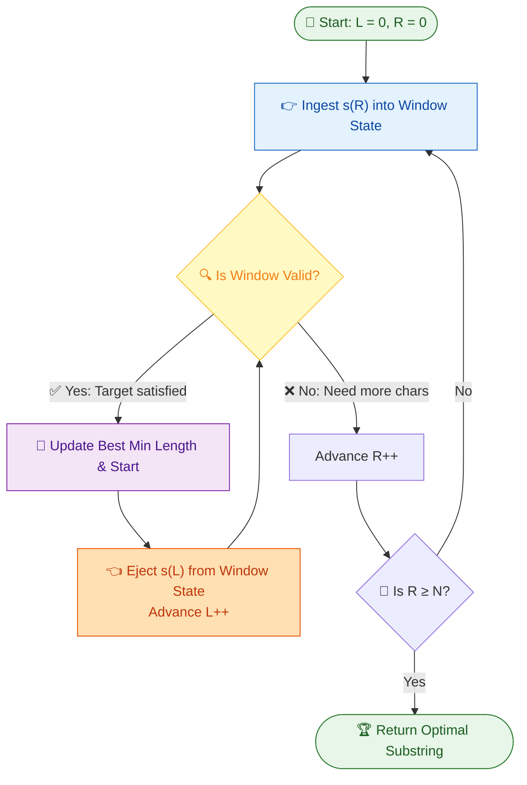
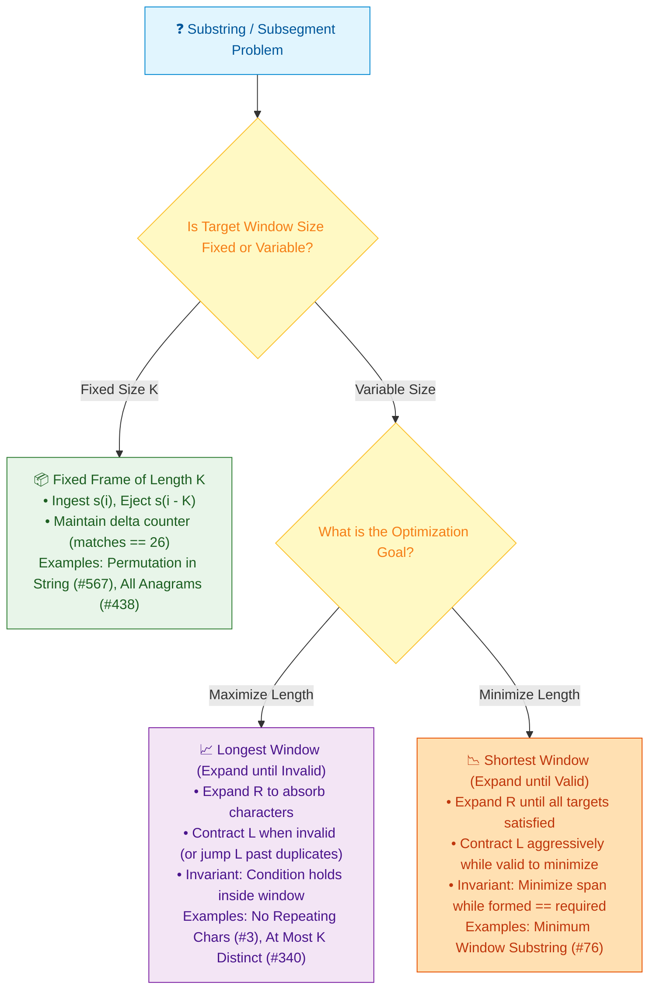

# 📘 Week 06 Day 2: Substring Sliding Window Patterns — Engineering Guide

> 🧭 **Navigation:** [← Previous Day](Week_06_Day_01_Palindrome_Patterns_Instructional.md) • [🏠 Week Overview](README.md) • [📘 Curriculum Syllabus](../COMPLETE_SYLLABUS.md) • [Next Day →](Week_06_Day_03_Parentheses_Bracket_Matching_Instructional.md)
> 
> 💡 **Instructor Note:** *Sliding window collapses quadratic substring searches into amortized linear time. The superpower of string windows over numeric subarrays is the finite alphabet bound (`Sigma <= 128`). We can replace heavy heap-allocated hash tables with flat, zero-allocation stack vectors (`int[128]`) and jump pointers.*

---

## 🎯 LEARNING OBJECTIVES

By the end of this chapter, you will be able to:

- **Internalize** the variable-size sliding window invariant and physically prove why two pointers moving monotonically right execute in strictly amortized `O(N)` time.
- **Implement** dynamic expanding/contracting windows (Longest Substring Without Repeating Characters, Minimum Window Substring) and fixed-frame windows (Permutation in String).
- **Eliminate** inner contraction loops using index-jump memoization (`lastSeen[c] + 1`) and prevent left-pointer regression bugs with `Math.Max`.
- **Architect** zero-allocation C# (.NET 8/9) with `Span<int>` stack buffers alongside idiomatic Python (3.11+).
- **Deliver** the exact 3-sentence FAANG interview talk track defending amortized pointer progression.

---

## 🎬 PILLAR 1: THE 60-SECOND HOOK & EVERYDAY METAPHOR

### The Flexible Caterpillar & The Zoom Lens

Imagine watching an inchworm (a caterpillar) inch across a leaf, or operating a high-end telephoto zoom lens on a DSLR camera:

```
  [ Head stretches forward to explore ]       [ Tail scrunches up to tighten ]
       L -------------> R                           L --------> R
      (Window Expands: Gain state)                 (Window Contracts: Optimize)
```

- When the caterpillar wants to explore new territory, its **head** (`right` pointer) stretches forward while its **tail** (`left` pointer) stays anchored. The caterpillar gets longer and longer.
- But there is a catch: if the caterpillar eats a poisonous leaf (a duplicate character), or if it has swallowed everything it needs and wants to pack light (minimizing window length), its **tail** (`left` pointer) rapidly scrunches forward to discard unnecessary sections.

Notice the physical reality: **Neither the head nor the tail ever moves backward!** Both inch relentlessly forward from the left edge of the branch to the right. Because each character is visited at most twice (once when the head arrives, once when the tail leaves), the entire journey is strictly linear.

---

### The Fundamental Divide: Subarray Sums vs. Character Substrings

You might wonder: *"We already studied sliding windows for integer arrays. Why do string substrings need their own dedicated masterclass?"*

Here is the architectural distinction that separates senior engineers from junior memorizers:

| Dimension | Numeric Subarrays (e.g., Subarray Sum = K) | String Substrings (e.g., Min Window, No Repeats) |
| :--- | :--- | :--- |
| **Domain Space** | Infinite integers (`-2^31` to `2^31 - 1`). Negative numbers can break window monotonicity. | Finite character sets (Standard ASCII = 128, Lowercase English = 26). |
| **State Tracking** | Running arithmetic sum (`currentSum += nums[R]`). Prefix sum hash map if negatives exist. | Frequency multiset vector (`windowFreq[c]++`). |
| **Monotonicity** | Adding numbers does **not** guarantee increase if negative values exist. | Adding characters **strictly increases** frequency; removing strictly decreases it. Window validity is monotonic! |
| **Memory Allocation** | Often requires `Dictionary<long, int>` for prefix sums (`O(N)` heap space). | **Zero heap allocation!** Fits in a 128-integer stack buffer (`stackalloc int[128]`, `O(1)` space). |

Because standard ASCII contains only 128 distinct byte values, you **never** need a heavy heap-allocated hash table. A flat 128-element integer vector placed directly on the stack gives you instant `O(1)` memory lookups, zero garbage collection pauses, and flawless CPU L1 cache locality!

---

## 🪜 PILLAR 2: THE SCAFFOLDING LADDER & TOY NAPKIN TRACES

Let us climb the ladder from a gentle warm-up to the most notorious FAANG hard problem.

---

### Level 1: The Core Invariant Engine

Every variable-size sliding window operates on a simple two-phase loop:

```
For each step where Right advances from 0 to N - 1:
  1. INGEST: Add s[Right] to current window state.
  2. CONTRACT: While the window is INVALID (for max length) or VALID (for min length):
     - Record / update best answer.
     - EJECT: Remove s[Left] from current window state.
     - Advance Left by 1.
  3. RECORD: Update global metric if applicable.
```

---

### Level 2: Warm-Up Hand Trace — Longest Substring Without Repeating Characters (LeetCode #3)

Given `s = "abcabcbb"`, find the length of the longest substring without duplicate characters.

Instead of shrinking `left` one step at a time with a while loop, a senior engineer uses the **Index Jump Optimization**: maintain an array `lastSeen` where `lastSeen[c]` stores the 1-based index where character `c` was last observed.

When we encounter character `c` at index `right`, if `lastSeen[c]` is already inside our active window, we instantly jump `left` past that previous occurrence:

```
Jump Rule: left = Math.Max(left, lastSeen[c])
Window Length: right - left + 1
```

#### Step-by-Step Napkin Trace: `s = "abcabcbb"`

| Step (`R`) | Char `s[R]` | `lastSeen[c]` Before | `left` Pointer | Active Window `s[left..R]` | Length (`R - L + 1`) | `maxLen` | Action Taken |
| :---: | :---: | :---: | :---: | :---: | :---: | :---: | :--- |
| **0** | `'a'` | `0` (unseen) | `0` | `"a"` | `0 - 0 + 1 = 1` | **1** | Record `'a'` at pos 1 |
| **1** | `'b'` | `0` (unseen) | `0` | `"ab"` | `1 - 0 + 1 = 2` | **2** | Record `'b'` at pos 2 |
| **2** | `'c'` | `0` (unseen) | `0` | `"abc"` | `2 - 0 + 1 = 3` | **3** | Record `'c'` at pos 3 |
| **3** | `'a'` | `1` (seen at 0) | `max(0, 1) = 1` | `"bca"` | `3 - 1 + 1 = 3` | **3** | Jump `left` past index 0! Update `'a'` -> pos 4 |
| **4** | `'b'` | `2` (seen at 1) | `max(1, 2) = 2` | `"cab"` | `4 - 2 + 1 = 3` | **3** | Jump `left` past index 1! Update `'b'` -> pos 5 |
| **5** | `'c'` | `3` (seen at 2) | `max(2, 3) = 3` | `"abc"` | `5 - 3 + 1 = 3` | **3** | Jump `left` past index 2! Update `'c'` -> pos 6 |
| **6** | `'b'` | `5` (seen at 4) | `max(3, 5) = 5` | `"cb"` | `6 - 5 + 1 = 2` | **3** | Jump `left` past index 4! Update `'b'` -> pos 7 |
| **7** | `'b'` | `7` (seen at 6) | `max(5, 7) = 7` | `"b"` | `7 - 7 + 1 = 1` | **3** | Jump `left` past index 6! Update `'b'` -> pos 8 |

Final Answer = **3** (representing substrings `"abc"`, `"bca"`, or `"cab"`).

> 🧠 **Pause & Predict Micro-Drill #1:**
> Look closely at Step 3 where `s[3] = 'a'`. Why must we use `left = Math.Max(left, lastSeen[c])` rather than simply `left = lastSeen[c]`?
> *Prediction:* Consider string `"abba"`. At `R = 3` (`'a'`), `lastSeen['a']` is `1`. But at `R = 2` (`'b'`), `left` was already moved to index `2`. If you did not take `Math.Max(2, 1)`, `left` would travel backward in time to `1`, erroneously pulling the duplicate `'b'` back into the window!

---

### Level 3: Classic FAANG Hard Hand Trace — Minimum Window Substring (LeetCode #76)

Given string `s = "ADOBECODEBANC"` and target `t = "ABC"`, find the shortest contiguous window in `s` that contains all characters of `t` (including frequency duplicates).

#### The State Engine: The `formed` Delta Counter

Checking whether our window contains all characters of `t` by comparing frequency maps on every step would cost `O(128)` or `O(26)` per iteration. That is amateur code.

Instead, we use a single integer variable: `formed`.
- Let `requiredUnique` = number of unique characters in `t`. For `t = "ABC"`, `requiredUnique = 3`.
- `targetCounts`: `{'A': 1, 'B': 1, 'C': 1}`.
- As `right` ingests a character: if `windowCounts[c] == targetCounts[c]`, we increment `formed++`.
- Whenever `formed == requiredUnique`, our window is **100% valid**! We immediately try to shrink `left` to minimize the window.
- When `left` ejects a character: if `windowCounts[c] < targetCounts[c]`, our window just became invalid, so we decrement `formed--` and resume expanding `right`.

#### Step-by-Step Napkin Trace: `s = "ADOBECODEBANC"`, `t = "ABC"`

```
Index:    0   1   2   3   4   5   6   7   8   9  10  11  12
String:   A   D   O   B   E   C   O   D   E   B   A   N   C
          ^                   ^
          L                   R
```

1. **Expand `R` from 0 to 5:**
   - Ingest `'A'`, `'D'`, `'O'`, `'B'`, `'E'`, `'C'`.
   - Window contains `'A': 1, 'B': 1, 'C': 1`.
   - `formed = 3 == requiredUnique`. First valid window found!
   - Window: `s[0..5] = "ADOBEC"`, length = **6**. Best min: `[0, 6]`.
2. **Contract `L` from 0:**
   - Eject `s[0] = 'A'`. `windowCounts['A']` drops from 1 to 0 (`< targetCounts['A']`).
   - `formed` drops to 2. Window is now invalid. Increment `L` to 1. Stop contracting.
3. **Expand `R` from 6 to 9:**
   - Ingest `'O'`, `'D'`, `'E'`, `'B'`.
   - Still missing `'A'`. `formed` remains 2.
4. **Expand `R` to 10 (`'A'`):**
   - Ingest `'A'`. `windowCounts['A'] = 1 == targetCounts['A']`. `formed` reaches 3!
   - Valid window: `s[1..10] = "DOBECODEBA"`, length = 10.
5. **Contract `L` aggressively from 1 to 5:**
   - Eject `'D'`, `'O'`, `'B'`? Wait: `windowCounts['B']` was 2 (from index 3 and index 9). Ejecting `'B'` at index 3 leaves `windowCounts['B'] = 1 >= targetCounts['B']`, so `formed` stays 3!
   - Eject `'E'`, `'C'`? Ejecting `'C'` at index 5 drops `windowCounts['C']` to 0. `formed` drops to 2. `L` stops at 6.
   - Window before dropping `'C'` was `s[5..10] = "CODEBA"`, length = **6**.
6. **Expand `R` from 11 to 12 (`'C'`):**
   - Ingest `'N'`, `'C'`. `windowCounts['C'] = 1`. `formed` reaches 3 again!
   - Window: `s[6..12] = "ODEBANC"`.
7. **Contract `L` from 6 to 9:**
   - Eject `'O'`, `'D'`, `'E'`. None are needed by `t`!
   - `L` reaches 9 (`'B'`). Window is `s[9..12] = "BANC"`, length = **4**!
   - Eject `'B'` at index 9: `formed` drops to 2. Loop finishes.

Global Minimum Window: `s[9..12] = "BANC"` (Length 4).

> 🧠 **Pause & Predict Micro-Drill #2:**
> When the window has two `'B'` characters and we eject one `'B'` from the left, does `formed` decrement?
> *Prediction:* **No!** We only decrement `formed` when `windowCounts[c] < targetCounts[c]`. If target needs 1 `'B'` and the window had 2, dropping to 1 still completely satisfies target requirements!

---

## 🎨 PILLAR 3: PRAGMATIC VISUAL MODELS

### 1. ASCII Window Anatomy: The Caterpillar on the Memory Wire

Here is what contiguous memory looks like as the two pointers advance:

```
Index:    0     1     2     3     4     5     6     7     8     9    10    11    12
Chars:  [ A ] [ D ] [ O ] [ B ] [ E ] [ C ] [ O ] [ D ] [ E ] [ B ] [ A ] [ N ] [ C ]
          |                       |
          +--- Active Window -----+
          L = 0                   R = 5
          Window: "ADOBEC" (Length = 6) -> Target {'A','B','C'} all satisfied!

Contract Left:
Chars:  [ A ] [ D ] [ O ] [ B ] [ E ] [ C ] ... [ B ] [ A ] [ N ] [ C ]
                |                 |
                L = 1             R = 5
                Window: "DOBEC" (Missing 'A') -> Broken! Head (R) must expand again!
```

---

### 2. ASCII Memory Topology: Direct Vector vs Heap-Allocated Map

Compare the CPU cache and memory footprints of the two approaches:

```
❌ Generic Hash Table (Heap Allocated, Cache Hostile):
   Heap Reference -> Hash Table Bucket Array -> Linked Node [Key='A' | Value=1 | Next]
                     (Multiple pointer dereferences, heap allocations, GC pressure)

✅ Direct Fixed Vector (Zero Heap Allocation, Cache Line Friendly):
   Stack Buffer: Span<int> freq = stackalloc int[128];
   [ 0 | 0 | ... | freq['A'=65] = 1 | ... | freq['B'=66] = 1 | ... | freq['C'=67] = 1 | ... ]
   (Contiguous 512 bytes on stack. Fits entirely in single L1 CPU cache line. Zero GC.)
```

---

### 3. Mermaid State Machine: The Sliding Window Decision Engine

This flowchart models the exact branching logic used across all variable-size sliding window problems:



---

## 🛑 PILLAR 4: THE ROOKIE TRAP ZONE

### Blunders vs. Senior Architect Patterns

| Dimension | ❌ Rookie Blunder | ✅ Senior Architect Pattern |
| :--- | :--- | :--- |
| **Data Structure** | Instantiating `new Dictionary<char, int>()` or `HashMap<Character, Integer>`. Incurs hashing overhead, boxing allocations, and cache misses. | Using `Span<int> freq = stackalloc int[128];` in C# or a flat `[0] * 128` list. Zero GC allocations, lightning-fast stack indexing. |
| **Window Metric** | Using `right - left` for window length, introducing subtle off-by-one errors when computing character spans. | Rigorously using `right - left + 1` for inclusive 0-indexed bounds `[L ... R]`. |
| **Left Pointer Update** | Blindly setting `left = lastSeen[c] + 1`, causing `left` to jump backward when encountering duplicates outside the active window. | Enforcing monotonicity with `left = Math.Max(left, lastSeen[c] + 1)`. |
| **Multi-Char Validation** | Iterating across all 26 or 128 characters on every single loop iteration (`O(26 * N)`). | Maintaining an incremental `formed` or `matches` integer counter, making validity checks strictly `O(1)`. |

---

### Side-by-Side Code Contrast

#### Trap: Regressing the Left Pointer (The Time Machine Bug)

```csharp
// ❌ ROOKIE BLUNDER: Blindly jumps left pointer backward
public int LengthOfLongestSubstring_Broken(string s)
{
    Dictionary<char, int> map = new();
    int left = 0, maxLen = 0;
    for (int right = 0; right < s.Length; right++)
    {
        if (map.ContainsKey(s[right]))
        {
            // BUG: In "abba", at index 3 ('a'), map['a'] is 0.
            // left jumps from 2 BACKWARD to 1! It re-includes 'b'!
            left = map[s[right]] + 1;
        }
        map[s[right]] = right;
        maxLen = Math.Max(maxLen, right - left + 1);
    }
    return maxLen;
}

// ✅ SENIOR ARCHITECT PATTERN: Monotonic guard with zero allocations
public int LengthOfLongestSubstring_Architect(ReadOnlySpan<char> s)
{
    Span<int> lastSeen = stackalloc int[128]; // Stack buffer, 0 bytes heap
    int left = 0, maxLen = 0;
    for (int right = 0; right < s.Length; right++)
    {
        char c = s[right];
        if (c < 128)
        {
            // Math.Max guarantees left NEVER moves backward
            left = Math.Max(left, lastSeen[c]);
            lastSeen[c] = right + 1; // 1-based index (0 means unseen)
        }
        maxLen = Math.Max(maxLen, right - left + 1);
    }
    return maxLen;
}
```

---

## 🎙️ PILLAR 5: THE 45-MINUTE INTERVIEW TALK TRACK

When interviewing at Google, Meta, or Microsoft, do not start typing code silently. Speak this verbatim 3-sentence script to immediately demonstrate senior clarity:

### 📢 The 3-Sentence Golden Verbal Script

> 1. *"A brute-force search over all `O(N^2)` substrings would recompute character frequencies from scratch, leading to an unacceptable `O(N^3)` or `O(N^2)` runtime."*
> 2. *"Because character frequency is strictly monotonic as we expand and contract contiguous boundaries, I will use a two-pointer sliding window where `right` expands to ingest state and `left` contracts to optimize the window."*
> 3. *"Since we are processing standard ASCII characters, I will back our window state with a fixed-size 128-element integer buffer and an incremental `formed` counter, guaranteeing `O(1)` state transitions with zero heap allocations and an amortized `O(N)` runtime."*

---

### The 4-Phase Live Interview Playbook

```
[ Phase 1: Clarify Constraints (3 mins) ]
  • "Are we handling standard ASCII (128 chars) or full UTF-16 / Unicode?"
  • "Is the search case-sensitive ('A' != 'a')?"
  • "If multiple minimum windows exist, does any valid one suffice?"

[ Phase 2: Formulate Invariants & State (5 mins) ]
  • Define the expansion condition: when does 'right' advance?
  • Define the contraction condition: when does 'left' advance?
  • Name the delta tracker: `formed` counter vs `matches` count.

[ Phase 3: Zero-Allocation Implementation (20 mins) ]
  • Write the loop using stack-allocated buffers (`stackalloc int[128]` in C#).
  • Record `minStart` and `minLen` instead of slicing strings inside the loop.
  • Slice once at the very end.

[ Phase 4: Edge Case Defense & Amortized Proof (7 mins) ]
  • Walk through: s is empty, t is longer than s, t has duplicate letters, no matching window.
  • Defend the amortized proof: "Even though there is a nested while loop, `left` can only increment up to N times across the entire algorithm. Total pointer operations are bounded by 2N, proving strict O(N) time."
```

---

## ⚡ PILLAR 6: PRODUCTION DUAL-LANGUAGE IMPLEMENTATIONS

### 1. C# (.NET 8/9 — Zero Allocation, High Throughput)

```csharp
using System;

namespace StringManipulation.SlidingWindow;

public static class ProductionSlidingWindow
{
    /// <summary>
    /// Longest Substring Without Repeating Characters (LeetCode #3)
    /// Invariant: At every step, the window s[left..right] contains only unique characters.
    /// Memory: Zero GC heap allocations using Span and stackalloc.
    /// Time Complexity: O(N) amortized | Auxiliary Space: O(1) (128 ints on stack)
    /// </summary>
    public static int LengthOfLongestSubstring(ReadOnlySpan<char> s)
    {
        if (s.IsEmpty) return 0;

        // Stores 1-based index of last seen character position (0 means unseen)
        Span<int> lastSeen = stackalloc int[128];
        int maxLength = 0;
        int left = 0;

        for (int right = 0; right < s.Length; right++)
        {
            char current = s[right];
            if (current < 128)
            {
                // Invariant: left must NEVER move backward
                left = Math.Max(left, lastSeen[current]);
                lastSeen[current] = right + 1; // 1-based index
            }

            maxLength = Math.Max(maxLength, right - left + 1);
        }

        return maxLength;
    }

    /// <summary>
    /// Minimum Window Substring (LeetCode #76)
    /// Invariant: When formed == requiredUnique, the window s[left..right] contains all characters of t.
    /// Memory: Zero GC allocations for state tracking. Slices final string exactly once.
    /// Time Complexity: O(N + M) | Auxiliary Space: O(1) (fixed 128-element buffers)
    /// </summary>
    public static string MinWindow(string s, string t)
    {
        // Guard clauses
        if (string.IsNullOrEmpty(s) || string.IsNullOrEmpty(t) || s.Length < t.Length)
        {
            return string.Empty;
        }

        // Direct ASCII frequency tables on stack
        Span<int> targetCounts = stackalloc int[128];
        Span<int> windowCounts = stackalloc int[128];

        int requiredUnique = 0;
        foreach (char c in t)
        {
            if (c < 128)
            {
                if (targetCounts[c] == 0) requiredUnique++;
                targetCounts[c]++;
            }
        }

        int formed = 0;
        int left = 0;
        int minLen = int.MaxValue;
        int minStart = 0;

        // Phase 1: Expand right pointer
        for (int right = 0; right < s.Length; right++)
        {
            char c = s[right];
            if (c < 128)
            {
                windowCounts[c]++;
                // Crucial: Increment formed ONLY when count matches target count exactly
                if (targetCounts[c] > 0 && windowCounts[c] == targetCounts[c])
                {
                    formed++;
                }
            }

            // Phase 2: Contract left pointer while window is fully valid
            while (left <= right && formed == requiredUnique)
            {
                int currentLen = right - left + 1;
                if (currentLen < minLen)
                {
                    minLen = currentLen;
                    minStart = left;
                }

                char leftChar = s[left];
                if (leftChar < 128)
                {
                    windowCounts[leftChar]--;
                    // Crucial: Decrement formed ONLY when count drops strictly below target count
                    if (targetCounts[leftChar] > 0 && windowCounts[leftChar] < targetCounts[leftChar])
                    {
                        formed--;
                    }
                }
                left++;
            }
        }

        return minLen == int.MaxValue ? string.Empty : s.Substring(minStart, minLen);
    }

    /// <summary>
    /// Permutation in String (LeetCode #567) — Fixed-Size Window Pattern
    /// Invariant: Window size is fixed at s1.Length. Matches tracks count of identical character frequencies.
    /// Time Complexity: O(N) | Auxiliary Space: O(1) (fixed 26-element stack buffers)
    /// </summary>
    public static bool CheckInclusion(string s1, string s2)
    {
        if (string.IsNullOrEmpty(s1) || string.IsNullOrEmpty(s2) || s1.Length > s2.Length)
        {
            return false;
        }

        Span<int> s1Freq = stackalloc int[26];
        Span<int> winFreq = stackalloc int[26];

        int k = s1.Length;
        for (int i = 0; i < k; i++)
        {
            s1Freq[s1[i] - 'a']++;
            winFreq[s2[i] - 'a']++;
        }

        int matches = 0;
        for (int i = 0; i < 26; i++)
        {
            if (s1Freq[i] == winFreq[i]) matches++;
        }

        // Slide the fixed-size window across s2
        for (int i = k; i < s2.Length; i++)
        {
            if (matches == 26) return true;

            int rightIdx = s2[i] - 'a';
            int leftIdx = s2[i - k] - 'a';

            // Ingest incoming character at right
            winFreq[rightIdx]++;
            if (winFreq[rightIdx] == s1Freq[rightIdx]) matches++;
            else if (winFreq[rightIdx] == s1Freq[rightIdx] + 1) matches--;

            // Eject outgoing character at left
            winFreq[leftIdx]--;
            if (winFreq[leftIdx] == s1Freq[leftIdx]) matches++;
            else if (winFreq[leftIdx] == s1Freq[leftIdx] - 1) matches--;
        }

        return matches == 26;
    }
}
```

---

### 2. Python (3.11+ — Idiomatic, Clean & Production-Grade)

```python
from collections import Counter


class ProductionSlidingWindow:
    @staticmethod
    def length_of_longest_substring(s: str) -> int:
        """
        Longest Substring Without Repeating Characters (LeetCode #3).
        Maintains last_seen mapping to jump 'left' pointer in O(1).
        Time: O(N) | Space: O(min(N, Sigma))
        """
        last_seen: dict[str, int] = {}
        left = 0
        max_length = 0

        for right, ch in enumerate(s):
            # If ch was seen inside the current active window, jump left past it
            if ch in last_seen and last_seen[ch] >= left:
                left = last_seen[ch] + 1

            last_seen[ch] = right
            max_length = max(max_length, right - left + 1)

        return max_length

    @staticmethod
    def min_window(s: str, t: str) -> str:
        """
        Minimum Window Substring (LeetCode #76).
        Uses a 'formed' delta counter to verify all character requirements in O(1).
        Time: O(N + M) | Space: O(Sigma)
        """
        if not s or not t or len(s) < len(t):
            return ""

        target_counts = Counter(t)
        required_unique = len(target_counts)
        window_counts: dict[str, int] = {}

        formed = 0
        left = 0
        min_len = float("inf")
        best_start = 0

        for right, char in enumerate(s):
            # Phase 1: Ingest character at right
            window_counts[char] = window_counts.get(char, 0) + 1
            if (
                char in target_counts
                and window_counts[char] == target_counts[char]
            ):
                formed += 1

            # Phase 2: Contract from left while window satisfies all target characters
            while left <= right and formed == required_unique:
                current_len = right - left + 1
                if current_len < min_len:
                    min_len = current_len
                    best_start = left

                left_char = s[left]
                window_counts[left_char] -= 1
                if (
                    left_char in target_counts
                    and window_counts[left_char] < target_counts[left_char]
                ):
                    formed -= 1
                left += 1

        return (
            ""
            if min_len == float("inf")
            else s[best_start : best_start + min_len]
        )

    @staticmethod
    def check_inclusion(s1: str, s2: str) -> bool:
        """
        Permutation in String (LeetCode #567) — Fixed-size window of len(s1).
        Tracks 'matches' delta to achieve strict O(1) comparison per shift.
        Time: O(N) | Space: O(1) (26-element integer lists)
        """
        n1, n2 = len(s1), len(s2)
        if n1 > n2:
            return False

        c1, c2 = [0] * 26, [0] * 26
        for i in range(n1):
            c1[ord(s1[i]) - 97] += 1
            c2[ord(s2[i]) - 97] += 1

        matches = sum(1 for i in range(26) if c1[i] == c2[i])

        # Slide fixed frame across s2
        for i in range(n1, n2):
            if matches == 26:
                return True

            r_idx = ord(s2[i]) - 97
            l_idx = ord(s2[i - n1]) - 97

            # Ingest right character
            c2[r_idx] += 1
            if c2[r_idx] == c1[r_idx]:
                matches += 1
            elif c2[r_idx] == c1[r_idx] + 1:
                matches -= 1

            # Eject left character
            c2[l_idx] -= 1
            if c2[l_idx] == c1[l_idx]:
                matches += 1
            elif c2[l_idx] == c1[l_idx] - 1:
                matches -= 1

        return matches == 26
```

---

## ⚖️ COMPLEXITY DECONSTRUCTION & AMORTIZATION PROOF

### Physical & Mathematical Proof of `O(N)` Amortized Runtime

Interview candidates often panic when seeing a `while` loop nested directly inside a `for` loop:

```csharp
for (int right = 0; right < s.Length; right++)
{
    while (left <= right && formed == requiredUnique)
    {
        left++;
    }
}
```

*"Doesn't a while loop inside a for loop mean `O(N^2)`?"*

**The Senior Proof:**
1. Focus on the physical pointer movement:
   - The `right` pointer increments **exactly once** per iteration of the outer for-loop: total operations = `N`.
   - The `left` pointer **only increments** inside the inner while-loop (`left++`). It **never** resets to 0. It **never** moves backward.
   - Across the **entire lifetime** of the algorithm, `left` can start at index `0` and travel at most to index `N - 1`. Therefore, the body of the `while` loop executes **at most `N` times in total across all iterations combined**!
2. Aggregate operations:
   - Total operations across both pointers = `N (advances of right) + N (advances of left) = 2N`.
   - Therefore, the amortized cost per character is `2N / N = O(1)`, and total runtime is strictly `O(N)`.

---

### Comprehensive Complexity Matrix

| Algorithm / Pattern | Time (Amortized) | Time (Worst Case) | Auxiliary Space | Output Space | Pointer Movement Bound |
| :--- | :--- | :--- | :--- | :--- | :--- |
| **Longest Substring No Repeats** | `O(N)` | `O(N)` | `O(Sigma)` (`128` stack ints) | `O(1)` | `R` moves `N` times, `L` jumps monotonically `<= N` times |
| **Minimum Window Substring** | `O(N + M)` | `O(N + M)` | `O(Sigma)` (`128` stack ints) | `O(K)` substring | `R` advances `N` times, `L` advances at most `N` times (`<= 2N`) |
| **Permutation in String** | `O(N)` | `O(N)` | `O(1)` (`26` stack ints) | `O(1)` bool | Fixed slide: exactly `N - M` single-step shifts |
| **Brute Force Substring Search** | `O(N^2)` | `O(N^3)` | `O(Sigma)` | `O(K)` | Scans all `N * (N + 1) / 2` possible windows from scratch |

---

## 🗺️ SUBSTRING SLIDING WINDOW DECISION FRAMEWORK

When faced with an unfamiliar string substring problem in an interview, use this visual triage tree:



---

## 🏋️ PRACTICE LADDER

Master these problems in sequence to build complete sliding window muscle memory:

| Priority | Problem | LeetCode # | Difficulty | Window Flavor | Key State Invariant |
| :---: | :--- | :---: | :---: | :---: | :--- |
| **P0** | **Longest Substring Without Repeating Characters** | #3 | 🟡 Medium | Variable (Max) | `left = Math.Max(left, lastSeen[c])` |
| **P0** | **Minimum Window Substring** | #76 | 🔴 Hard | Variable (Min) | `formed == requiredUnique` delta tracker |
| **P0** | **Permutation in String** | #567 | 🟡 Medium | Fixed (`|s1|`) | `matches == 26` delta tracker |
| **P1** | **Find All Anagrams in a String** | #438 | 🟡 Medium | Fixed (`|p|`) | Sliding difference vector over `int[26]` |
| **P1** | **Longest Substring with At Most K Distinct Characters** | #340 | 🟡 Medium | Variable (Max) | Unique character count `<= K` |
| **P2** | **Longest Repeating Character Replacement** | #424 | 🟡 Medium | Variable (Max) | `(R - L + 1) - maxFreq <= K` |
| **P2** | **Minimum Size Subarray Sum** | #209 | 🟡 Medium | Variable (Min) | `currentSum >= target` |

---

> 🧭 **Navigation:** [← Previous Day](Week_06_Day_01_Palindrome_Patterns_Instructional.md) • [🏠 Week Overview](README.md) • [📘 Curriculum Syllabus](../COMPLETE_SYLLABUS.md) • [Next Day →](Week_06_Day_03_Parentheses_Bracket_Matching_Instructional.md)
