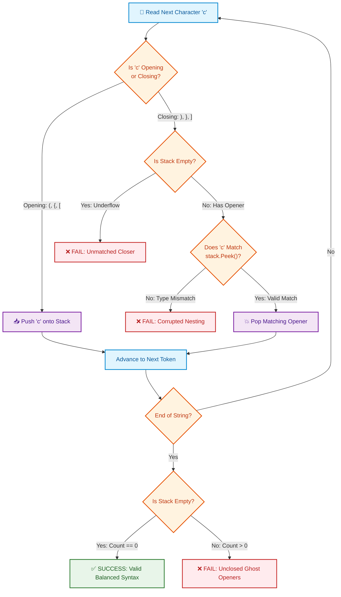

# 📘 Week 06 Day 3: Parentheses & Bracket Matching — Engineering Guide

> 🧭 **Navigation:** [← Previous Day](Week_06_Day_02_Substring_Sliding_Window_Patterns_Instructional.md) • [🏠 Week Overview](README.md) • [📘 Curriculum Syllabus](../COMPLETE_SYLLABUS.md) • [Next Day →](Week_06_Day_04_String_Transformations_Building_Instructional.md)
> 
> 💡 **Instructor Note:** *Parentheses and bracket problems model hierarchical syntax and balanced context-free grammars. The core mechanism is Last-In-First-Out (LIFO) stack discipline: each closing token must immediately cancel the most recent unmatched opening token of the identical category. Master the sentinel index stack (`stack.Push(-1)`) to transition from simple validation to linear-time span discovery.*

---

## 🎯 LEARNING OBJECTIVES

By the end of this module, you will be able to:

- 🎬 **Internalize** the "Russian Matryoshka Nesting Doll" and "Compiler Syntax Checker" mental models to see why a single counter works for single-type brackets `()` but fails catastrophically for mixed brackets `()[]{}`.
- 🪜 **Trace** bracket validation and sentinel index stacks on a napkin with zero ambiguity, calculating valid substring lengths via `i - stack.Peek()`.
- 🎨 **Master** both the Sentinel Index Stack (`O(N)` space) and the Two-Pass Dual Counter (`O(1)` space) for Longest Valid Parentheses.
- 🛑 **Defuse** the four classic interview blunders: stack underflow on leading close brackets, silent "ghost opener" leakage, quadratic string replacement loops (`s.Replace()`), and single-pass counter reset fallacies.
- 🎙️ **Articulate** a polished 3-sentence interview talk track out loud before typing a single line of code.
- ⚡ **Implement** production-grade, zero-allocation C# (.NET 8/9) with `ReadOnlySpan<char>` and clean, idiomatic Python (3.11+) for Valid Parentheses (LC 20), Longest Valid Parentheses (LC 32), Generate Parentheses (LC 22), Decode String (LC 394), and Basic Calculator II (LC 227).

---

## 🎬 PILLAR 1: THE 60-SECOND HOOK & EVERYDAY ANALOGIES

Hey engineers! Welcome back to Week 6 Day 3.

Today, we conquer one of the most foundational patterns in computer science and top-tier FAANG interviews: **Parentheses & Bracket Matching**.

Whether you realize it or not, your IDE (like VS Code or Rider) runs this exact algorithm dozens of times every second. Every time you type an opening curly brace `{`, a method parenthesis `(`, or an array bracket `[`, the language compiler (like Roslyn for C# or Clang for C++) opens a new syntactic universe. If you close them out of order, you don't get a polite warning—you get an immediate red squiggly syntax error.

To understand why this pattern works, let's step away from code for 60 seconds and look at two physical mental models.

```
================================================================================
          METAPHOR 1: THE RUSSIAN MATRYOSHKA NESTING DOLLS
================================================================================

Imagine you are holding a classic Russian Matryoshka nesting doll:

       ┌───────────────┐
       │   OUTER { }   │
       │  ┌─────────┐  │
       │  │ MID [ ] │  │
       │  │  ┌───┐  │  │
       │  │  │( )│  │  │   <── Tiny Baby Doll opened LAST!
       │  │  └───┘  │  │
       │  └─────────┘  │
       └───────────────┘

1. You pop open the giant outer doll '{'.
2. Inside, you pop open the middle doll '['.
3. Inside that, you pop open the tiny innermost doll '('.

Now, ask yourself: How do you pack them back together?
- Can you snap the giant outer shell '{' shut over the middle doll while the tiny 
  baby doll is still split open on the table?
- ABSOLUTELY NOT! 

Physical Reality:
The doll you opened LAST must be the doll you close FIRST.
This is pure, unadulterated LIFO (Last-In, First-Out) discipline.
================================================================================
```

### The Big Question: Why Does a Counter Work for `()`, But Fail Catastrophically for `()[]{}`?

When solving single-type parentheses `()`, you don't need a stack. You can maintain a single integer `balance`:
* See `(` -> `balance++`
* See `)` -> `balance--`
* If `balance < 0` at any point -> return `false` (closing bracket without an opener).
* At the end -> return `balance == 0`.
* **Runtime:** `O(N)` | **Auxiliary Space:** `O(1)`.

Why does this work for `()`? Because every `(` is **fungible** (identical). An open parenthesis does not care *which* close parenthesis cancels it, as long as it happens after it.

Now, look what happens the instant you introduce mixed bracket varieties (`()`, `{}`, `[]`):

```
================================================================================
       THE CATASTROPHIC FAILURE OF MULTIPLE COUNTERS ON "([)]"
================================================================================

Input String: " ( [ ) ] "

Suppose we use three integer counters: parenCount, bracketCount, braceCount.

Step 1: Read '(' -> parenCount = 1
Step 2: Read '[' -> bracketCount = 1
Step 3: Read ')' -> parenCount = 0   (parenCount was >= 0, so counter says "Valid!")
Step 4: Read ']' -> bracketCount = 0 (bracketCount was >= 0, so counter says "Valid!")

End of string:
parenCount == 0, bracketCount == 0, braceCount == 0.
All counters are zero! None ever dropped below zero!
The counters scream: "SUCCESS! VALID STRING!"

BUT LOOK AT THE STRING:
"([)]" is HORRIBLY MALFORMED!
The array bracket '[' was opened LAST, but the parenthesis ')' attempted to close 
FIRST! They interleave across scoping boundaries, corrupting the syntax tree.
================================================================================
```

> [!IMPORTANT]
> **The Scoping Horizon Invariant:**
> Counters track **quantities**, but bracket syntax requires tracking **chronological scoping horizons**. When multiple bracket types exist, the closing bracket must match the *most recently opened, unclosed bracket*. That requires remembering historical arrival order in reverse—which is the definition of a **LIFO Stack**.

---

## 🪜 PILLAR 2: THE SCAFFOLDING LADDER & TOY NAPKIN TRACES

Let's climb the ladder step-by-step: from a 4-element napkin trace to active recall micro-drills, up to the classic FAANG Hard benchmark: **Longest Valid Parentheses**.

---

### Level 1: The Toy Napkin Trace — Valid Parentheses on `"{[()]}"`

Let's hand-trace the validation algorithm on string `s = "{[()]}"`.  
Our stack will store characters waiting for their matching closer.

```
================================================================================
            STEP-BY-STEP NAPKIN TRACE: s = "{ [ ( ) ] }"
================================================================================

Initial State: Stack = []

--------------------------------------------------------------------------------
Step 0: i = 0, char = '{'
  - It is an opening token.
  - Action: Push '{'.
  - Stack: [ '{' ]  <-- Top

--------------------------------------------------------------------------------
Step 1: i = 1, char = '['
  - Opening token.
  - Action: Push '['.
  - Stack: [ '{', '[' ]  <-- Top

--------------------------------------------------------------------------------
Step 2: i = 2, char = '('
  - Opening token.
  - Action: Push '('.
  - Stack: [ '{', '[', '(' ]  <-- Top

--------------------------------------------------------------------------------
Step 3: i = 3, char = ')'
  - Closing token!
  - Inspect Stack Top: Is it '('? YES!
  - Action: Pop '('.
  - Stack: [ '{', '[' ]  <-- Top

--------------------------------------------------------------------------------
Step 4: i = 4, char = ']'
  - Closing token!
  - Inspect Stack Top: Is it '['? YES!
  - Action: Pop '['.
  - Stack: [ '{' ]  <-- Top

--------------------------------------------------------------------------------
Step 5: i = 5, char = '}'
  - Closing token!
  - Inspect Stack Top: Is it '{'? YES!
  - Action: Pop '{'.
  - Stack: []  (Empty)

--------------------------------------------------------------------------------
Loop Finished:
  - Is stack empty? YES (`stack.Count == 0`).
  - Return: TRUE (Strictly Balanced).
================================================================================
```

Now, contrast this with what happens on the invalid sequence `s = "{[(])}"`:
* At `i = 3`, char is `']'`.
* We peek at the stack top: it is `'('`!
* We expected a matching `')'`, but received a square bracket `']'`.
* **Immediate failure:** Return `false` on the spot in `O(1)` time without scanning the rest of the string.

---

### 🧠 PAUSE & PREDICT 1: Micro-Drill (Active Recall)

> **Scenario:** Suppose you are given the string `s = "())(()"`.  
> 1. At what index does the algorithm detect that this string cannot be balanced?  
> 2. What exact condition in your code catches this failure?  
> 3. Does the stack end up empty or non-empty?  
>
> *Take 15 seconds to visualize this in your head before clicking to reveal!*

<details>
<summary>🔍 Click to Reveal Answer & Pedagogical Breakdown</summary>

1. **Failure Index:** Index `2` (the second `')'`).
2. **Condition Triggered:**  
   - At `i = 0`, `'('` is pushed. Stack: `['(']`.  
   - At `i = 1`, `')'` pops `'('`. Stack: `[]`.  
   - At `i = 2`, `')'` arrives. We attempt to match with the stack top, but **`stack.Count == 0` (Stack Underflow)**! There is no opening bracket to match this closer. Return `false` immediately!
3. **Stack State:** The stack is empty when the failure occurs, proving why checking `stack.Count == 0` alone at the end is insufficient—you must guard against underflow *during* the traversal.

</details>

---

### Level 2: The Boss Level Trace — Longest Valid Parentheses on `")(()())"` (LeetCode 32)

Finding the length of the longest contiguous valid parentheses substring is a FAANG favorite. 

The breakthrough senior insight: **Store INDICES instead of characters, and initialize the stack with a sentinel `-1`**.

Why `-1`? Because `-1` represents the virtual boundary barrier *before* the array begins! Whenever a valid substring starts at index `0`, the distance `i - (-1)` yields the correct length `i + 1`.

Let's hand-trace string `s = " ) ( ( ) ( ) ) "` of length `7`:

```
================================================================================
       STEP-BY-STEP NAPKIN TRACE: s = " ) ( ( ) ( ) ) "  (Indices 0 to 6)
================================================================================

Indices:      0    1    2    3    4    5    6
Chars:        )    (    (    )    (    )    )

Initial State: Stack = [ -1 ] (Sentinel Base), maxLen = 0

--------------------------------------------------------------------------------
Step 0: i = 0, char = ')'
  - Closing bracket encountered -> Pop top!
  - Popped: -1.
  - Stack is now EMPTY!
  - What does this mean? Index 0 is an unmatched closing bracket. It can NEVER be 
    part of any future valid substring. It is a solid stone wall!
  - Action: Push current index 0 as the NEW BASE SENTINEL.
  - Stack: [ 0 ]
  - maxLen = 0

--------------------------------------------------------------------------------
Step 1: i = 1, char = '('
  - Opening bracket -> Push index 1.
  - Stack: [ 0, 1 ]
  - maxLen = 0

--------------------------------------------------------------------------------
Step 2: i = 2, char = '('
  - Opening bracket -> Push index 2.
  - Stack: [ 0, 1, 2 ]
  - maxLen = 0

--------------------------------------------------------------------------------
Step 3: i = 3, char = ')'
  - Closing bracket -> Pop top!
  - Popped index 2 (matched with index 3, substring s[2..3] = "()").
  - Stack is NOT empty! Current top is index 1.
  - Valid substring length = i - stack.Peek() = 3 - 1 = 2.
  - maxLen = max(0, 2) = 2.
  - Stack: [ 0, 1 ]

--------------------------------------------------------------------------------
Step 4: i = 4, char = '('
  - Opening bracket -> Push index 4.
  - Stack: [ 0, 1, 4 ]
  - maxLen = 2

--------------------------------------------------------------------------------
Step 5: i = 5, char = ')'
  - Closing bracket -> Pop top!
  - Popped index 4 (matched with index 5, substring s[4..5] = "()").
  - Stack is NOT empty! Current top is index 1.
  - Valid substring length = i - stack.Peek() = 5 - 1 = 4 (substring s[2..5] = "()()").
  - Notice how the stack automatically bridged across the two adjacent pairs!
  - maxLen = max(2, 4) = 4.
  - Stack: [ 0, 1 ]

--------------------------------------------------------------------------------
Step 6: i = 6, char = ')'
  - Closing bracket -> Pop top!
  - Popped index 1 (matched with index 6, outer pair enclosing the entire interior!).
  - Stack is NOT empty! Current top is the base sentinel 0.
  - Valid substring length = i - stack.Peek() = 6 - 0 = 6 (substring s[1..6] = "((())())").
  - maxLen = max(4, 6) = 6.
  - Stack: [ 0 ]

--------------------------------------------------------------------------------
Final Result:
  - Longest Valid Parentheses Substring Length = 6!
================================================================================
```

---

### 🧠 PAUSE & PREDICT 2: Micro-Drill (Active Recall)

> **Scenario:** Look at Step 3 above where index 2 was popped and the valid length was computed as `i - stack.Peek()` (`3 - 1 = 2`).  
> Why do we subtract `stack.Peek()` (the element *below* the popped element) instead of the popped index itself?  
>
> *Think about what `stack.Peek()` represents in memory!*

<details>
<summary>🔍 Click to Reveal Answer & Pedagogical Breakdown</summary>

**The Last Unmatched Barrier Principle:**  
`stack.Peek()` is the index of the **last unmatched barrier** that has *not* been closed yet.  
Everything strictly between `stack.Peek()` and our current index `i` has been completely resolved and matched!  
Therefore, the length of that contiguous valid block is:  
`current_index - last_unmatched_barrier_index = i - stack.Peek()`.  
If we had subtracted the popped index itself, we would only measure the innermost single pair (`3 - 2 = 1`), completely blinding us to nested and concatenated outer structures!

</details>

---

### Level 3: The `O(1)` Space Scaffolding — Two-Pass Dual Counter

Can we find the longest valid parentheses in `O(N)` time with **`O(1)` auxiliary space** without allocating a stack?

Yes! By using two counters: `left` (for `'('`) and `right` (for `')'`).

```
================================================================================
                THE TWO-PASS DUAL COUNTER INVARIANT
================================================================================

Pass 1 (Left to Right):
- Walk forwards from index 0 to N - 1.
- See '(' -> left++
- See ')' -> right++
- If right == left: We have a balanced prefix! Valid length = 2 * right. Update maxLen.
- If right > left: Too many closing brackets! The chain is broken. Reset left = right = 0.

Wait! Why do we need Pass 2?
Consider the input string: " ( ( ( ) "
- left = 3, right = 1.
- Because left is always greater than right, 'right == left' NEVER triggers!
- Pass 1 outputs 0, which is WRONG (the correct answer is 2 for "()").

Pass 2 (Right to Left):
- Walk backwards from index N - 1 down to 0.
- See ')' -> right++
- See '(' -> left++
- If left == right: Balanced suffix! Valid length = 2 * left. Update maxLen.
- If left > right: Too many opening brackets! Reset left = right = 0.

By combining both passes, we catch balanced substrings bounded by excess ')' 
in Pass 1, and balanced substrings bounded by excess '(' in Pass 2!
Runtime: O(N) | Auxiliary Space: O(1) strictly!
================================================================================
```

---

## 🎨 PILLAR 3: PRAGMATIC VISUAL MODELS

### 1. ASCII Contiguous Memory & Sentinel Index Barrier

Here is the exact visual memory model of how the sentinel index stack tracks boundaries during `Longest Valid Parentheses`:

```
Indices:      -1      0      1      2      3      4      5      6
Stream:    [SENTINEL] )      (      (      )      (      )      )
               │      │      │      │      │      │      │      │
               ▼      ▼      ▼      ▼      ▼      ▼      ▼      ▼
Stack:      [ -1 ]  [ 0 ]  [ 0 ]  [ 0 ]  [ 0 ]  [ 0 ]  [ 0 ]  [ 0 ]
                           [ 1 ]  [ 1 ]  [ 1 ]  [ 1 ]  [ 1 ]
                                  [ 2 ]         [ 4 ]

Action:      INIT    RESET   PUSH   PUSH   MATCH  PUSH   MATCH  MATCH
                                           Len=2         Len=4  Len=6
                                          (3 - 1)       (5 - 1)(6 - 0)
```

---

### 2. Mermaid State Transition: Bracket Parsing Engine

Below is the state machine executed for every incoming character in bracket parsing:



---

## 🛑 PILLAR 4: THE ROOKIE TRAP ZONE

### Side-by-Side Architectural Comparisons

```
================================================================================
TRAP 1: THE STACK UNDERFLOW CRASH ON LEADING CLOSERS
================================================================================
❌ ROOKIE BLUNDER:
Calling Pop() blindly when encountering a closing bracket on string s = ")":

    if (c == ')') {
        char top = stack.Pop(); // 💥 CRASH! System.InvalidOperationException: Stack empty!
        if (top != '(') return false;
    }

✅ SENIOR ARCHITECT PATTERN:
Guard against underflow atomically before popping:

    if (c == ')') {
        if (stack.Count == 0 || stack.Pop() != '(') return false;
    }
================================================================================
```

```
================================================================================
TRAP 2: THE "GHOST OPENERS" SILENT BUG
================================================================================
❌ ROOKIE BLUNDER:
Only verifying that closing brackets match, but forgetting to check the stack 
at the end. On string s = "(((", no closing bracket ever arrives to trigger a 
mismatch, so the function returns true!

    foreach (char c in s) {
        // ... match logic ...
    }
    return true; // ❌ FAILS on "(((", "()(", "{}"

✅ SENIOR ARCHITECT PATTERN:
Every opened scope must be fully resolved. The stack MUST be empty:

    return stack.Count == 0; // ✅ Returns false for leftover openers
================================================================================
```

```
================================================================================
TRAP 3: THE STRING REPLACEMENT "HACK" (O(N^2) ALLOCATION TRASH)
================================================================================
❌ ROOKIE BLUNDER:
Attempting to be clever in Python by repeatedly replacing matched pairs:

    def isValid(s: str) -> bool:
        while "()" in s or "[]" in s or "{}" in s:
            s = s.replace("()", "").replace("[]", "").replace("{}", "")
        return s == ""

Why this is catastrophic:
- On string "((((...))))" of length 10^5, each replace scans the entire string 
  and allocates a brand-new string on the managed heap.
- Total runtime: O(N^2). Total memory allocated: O(N^2).
- Result: Instant Time Limit Exceeded (TLE) and Out Of Memory in production!

✅ SENIOR ARCHITECT PATTERN:
Single linear scan with a LIFO stack. Each character enters and leaves the 
stack at most once. Strictly O(N) time and O(N) auxiliary space.
================================================================================
```

```
================================================================================
TRAP 4: THE SINGLE-PASS COUNTER RESET FALLACY FOR LONGEST VALID
================================================================================
❌ ROOKIE BLUNDER:
Assuming a single forward pass counting left and right parentheses solves 
Longest Valid Parentheses.

On input s = "(()":
- Forward pass: left = 2, right = 1.
- Because right never equals left, the counter NEVER records a valid length.
- Rookie code returns 0 instead of 2!

✅ SENIOR ARCHITECT PATTERN:
Either use an Index Stack with sentinel -1 (O(N) space), OR run a Dual-Pass 
(Left-to-Right AND Right-to-Left) counter to catch asymmetric prefixes and suffixes 
in O(1) space!
================================================================================
```

---

## 🎙️ PILLAR 5: 45-MINUTE INTERVIEW TALK TRACK

In a FAANG live technical interview, do NOT immediately start hacking code. Speak this exact 3-sentence script out loud to signal senior architectural maturity:

### 🎙️ The 3-Sentence Script for Valid Parentheses (LeetCode 20)

> *"Because brackets enforce hierarchical nesting where the most recently opened scope must close first, a simple counter fails on mixed brackets and we must use a LIFO stack.*  
> *We process each character in a single linear pass: pushing opening brackets, and on closing brackets, verifying the stack is non-empty and the top matches before popping.*  
> *The string is valid if and only if no mismatch occurs and our stack is completely empty at the end, running in `O(N)` time and `O(N)` auxiliary space with an immediate `O(1)` rejection if the string length is odd."*

---

### 🎙️ The 3-Sentence Script for Longest Valid Parentheses (LeetCode 32)

> *"To find the longest valid parentheses substring in linear time, we push indices onto a stack initialized with a sentinel base of `-1` representing the boundary before the string starts.*  
> *When we encounter an open bracket we push its index, and when we encounter a close bracket we pop the stack; if the stack remains non-empty, the distance `i - stack.Peek()` gives the length of the contiguous valid substring.*  
> *If the stack becomes empty upon popping, the current close bracket has no opener, so we push its index as the new sentinel base barrier, achieving `O(N)` time in a single pass."*

---

## ⚡ PILLAR 6: PRODUCTION DUAL-LANGUAGE IMPLEMENTATIONS

---

### Problem 1: Valid Parentheses (LeetCode 20) — Classic Easy/Medium

Given a string `s` containing just the characters `'('`, `')'`, `'{'`, `'}'`, `'['` and `']'`, determine if the input string is valid.

#### C# Primary Implementation (.NET 8/9 — Zero Allocation Awareness)

```csharp
using System;
using System.Collections.Generic;

public static class ValidParenthesesSolver
{
    /// <summary>
    /// Validates balanced brackets across (), {}, and [] using a LIFO stack.
    /// Time Complexity: O(N) | Auxiliary Space: O(N) | Output Space: O(1)
    /// </summary>
    public static bool IsValid(ReadOnlySpan<char> s)
    {
        // Odd length strings can never be fully paired
        if (s.Length % 2 != 0)
        {
            return false;
        }

        // Allocate stack with initial capacity bounded by s.Length / 2
        var stack = new Stack<char>(s.Length / 2);

        foreach (char c in s)
        {
            switch (c)
            {
                case '(' or '{' or '[':
                    stack.Push(c);
                    break;

                case ')':
                    if (stack.Count == 0 || stack.Pop() != '(') return false;
                    break;

                case '}':
                    if (stack.Count == 0 || stack.Pop() != '{') return false;
                    break;

                case ']':
                    if (stack.Count == 0 || stack.Pop() != '[') return false;
                    break;

                default:
                    // Reject any unexpected non-bracket characters
                    return false;
            }
        }

        // All opened scopes must be completely closed
        return stack.Count == 0;
    }
}
```

#### Python Secondary Implementation (3.11+ — Clean & Idiomatic)

```python
class Solution:
    def isValid(self, s: str) -> bool:
        """Validates balanced brackets across multiple types using a dictionary map and stack.

        Time Complexity: O(N) | Auxiliary Space: O(N) | Output Space: O(1)
        """
        # Odd-length strings cannot be paired
        if len(s) % 2 != 0:
            return False

        matching: dict[str, str] = {")": "(", "}": "{", "]": "["}
        stack: list[str] = []

        for char in s:
            if char in matching:
                # Closing bracket: stack must be non-empty and top must match
                if not stack or stack.pop() != matching[char]:
                    return False
            else:
                # Opening bracket: push onto stack
                stack.append(char)

        return len(stack) == 0
```

#### 📊 Explicit Complexity Deconstruction
* **Time Complexity:** `O(N)` — Single pass over `N` characters. Push and Pop are `O(1)` amortized. Early rejection on odd lengths runs in `O(1)`.
* **Auxiliary Space:** `O(N)` — In the worst case of all opening brackets (e.g., `"(((((("`), the stack holds `N` characters.
* **Output Space:** `O(1)` — Returns a single boolean scalar.

---

### Problem 2: Longest Valid Parentheses (LeetCode 32) — FAANG Hard Benchmark

Given a string containing just the characters `'('` and `')'`, return the length of the longest valid (well-formed) parentheses substring.

#### Approach A: Sentinel Index Stack (`O(N)` Time, `O(N)` Space)

##### C# Primary Implementation (.NET 8/9)

```csharp
using System;
using System.Collections.Generic;

public static class LongestValidParenthesesStackSolver
{
    /// <summary>
    /// Computes length of longest valid parentheses substring using sentinel index stack.
    /// Time Complexity: O(N) | Auxiliary Space: O(N) | Output Space: O(1)
    /// </summary>
    public static int LongestValidParentheses(ReadOnlySpan<char> s)
    {
        if (s.Length < 2) return 0;

        var indexStack = new Stack<int>();
        indexStack.Push(-1); // Virtual sentinel barrier before index 0
        int maxLength = 0;

        for (int i = 0; i < s.Length; i++)
        {
            if (s[i] == '(')
            {
                indexStack.Push(i);
            }
            else // s[i] == ')'
            {
                indexStack.Pop();

                if (indexStack.Count == 0)
                {
                    // No matching opener; current index becomes the new barrier wall
                    indexStack.Push(i);
                }
                else
                {
                    // Contiguous valid length = current index - last unmatched barrier index
                    int currentLength = i - indexStack.Peek();
                    maxLength = Math.Max(maxLength, currentLength);
                }
            }
        }

        return maxLength;
    }
}
```

##### Python Secondary Implementation (3.11+)

```python
class Solution:
    def longestValidParentheses(self, s: str) -> int:
        """Computes longest valid parentheses substring using sentinel index stack.

        Time Complexity: O(N) | Auxiliary Space: O(N) | Output Space: O(1)
        """
        if len(s) < 2:
            return 0

        stack: list[int] = [-1]  # Sentinel base barrier
        max_length = 0

        for i, char in enumerate(s):
            if char == "(":
                stack.append(i)
            else:
                stack.pop()
                if not stack:
                    # Current ')' is an unmatched barrier
                    stack.append(i)
                else:
                    max_length = max(max_length, i - stack[-1])

        return max_length
```

---

#### Approach B: Two-Pass Dual Counter (`O(N)` Time, `O(1)` Space Optimization)

##### C# Primary Implementation (.NET 8/9)

```csharp
using System;

public static class LongestValidParenthesesTwoPassSolver
{
    /// <summary>
    /// Computes longest valid parentheses substring using bidirectional dual counters.
    /// Time Complexity: O(N) | Auxiliary Space: O(1) | Output Space: O(1)
    /// </summary>
    public static int LongestValidParentheses(ReadOnlySpan<char> s)
    {
        int left = 0;
        int right = 0;
        int maxLength = 0;

        // Pass 1: Forward scan (Left to Right)
        for (int i = 0; i < s.Length; i++)
        {
            if (s[i] == '(') left++;
            else right++;

            if (left == right)
            {
                maxLength = Math.Max(maxLength, 2 * right);
            }
            else if (right > left)
            {
                // Chain broken by excess closing brackets
                left = 0;
                right = 0;
            }
        }

        // Pass 2: Backward scan (Right to Left)
        left = 0;
        right = 0;
        for (int i = s.Length - 1; i >= 0; i--)
        {
            if (s[i] == '(') left++;
            else right++;

            if (left == right)
            {
                maxLength = Math.Max(maxLength, 2 * left);
            }
            else if (left > right)
            {
                // Chain broken by excess opening brackets
                left = 0;
                right = 0;
            }
        }

        return maxLength;
    }
}
```

##### Python Secondary Implementation (3.11+)

```python
class Solution:
    def longestValidParentheses(self, s: str) -> int:
        """Bidirectional two-pass counter for O(1) auxiliary space optimization.

        Time Complexity: O(N) | Auxiliary Space: O(1) | Output Space: O(1)
        """
        left = right = max_length = 0

        # Pass 1: Left-to-Right
        for char in s:
            if char == "(":
                left += 1
            else:
                right += 1

            if left == right:
                max_length = max(max_length, 2 * right)
            elif right > left:
                left = right = 0

        # Pass 2: Right-to-Left
        left = right = 0
        for char in reversed(s):
            if char == "(":
                left += 1
            else:
                right += 1

            if left == right:
                max_length = max(max_length, 2 * left)
            elif left > right:
                left = right = 0

        return max_length
```

#### 📊 Explicit Complexity Deconstruction
* **Time Complexity:** `O(N)` — Approach A visits each element once; Approach B visits each element twice (`2N` total operations). Both are strictly linear.
* **Auxiliary Space:**
  * **Approach A (Stack):** `O(N)` in the worst case of all open brackets.
  * **Approach B (Two-Pass):** `O(1)` — Only two scalar integers (`left`, `right`) and zero heap allocations!
* **Output Space:** `O(1)` — Returns a single integer scalar.

---

### Problem 3: Generate Parentheses (LeetCode 22) — Catalan Backtracking

Given `n` pairs of parentheses, write a function to generate all combinations of well-formed parentheses.

#### C# Primary Implementation (.NET 8/9 — StringBuilder Backtracking)

```csharp
using System;
using System.Collections.Generic;
using System.Text;

public static class GenerateParenthesesSolver
{
    /// <summary>
    /// Generates all valid parentheses combinations using bounded backtracking.
    /// Time Complexity: O(4^N / sqrt(N)) (Catalan Number) | Auxiliary Space: O(N)
    /// </summary>
    public static IList<string> GenerateParenthesis(int n)
    {
        var result = new List<string>();
        var sb = new StringBuilder(2 * n);
        Backtrack(result, sb, 0, 0, n);
        return result;
    }

    private static void Backtrack(List<string> result, StringBuilder sb, int openCount, int closeCount, int maxPairs)
    {
        // Base case: string reached full length 2 * n
        if (sb.Length == maxPairs * 2)
        {
            result.Add(sb.ToString());
            return;
        }

        // Branch 1: Append '(' if we haven't reached maxPairs
        if (openCount < maxPairs)
        {
            sb.Append('(');
            Backtrack(result, sb, openCount + 1, closeCount, maxPairs);
            sb.Length--; // Revert state (backtrack)
        }

        // Branch 2: Append ')' ONLY if doing so does not exceed openCount
        if (closeCount < openCount)
        {
            sb.Append(')');
            Backtrack(result, sb, openCount, closeCount + 1, maxPairs);
            sb.Length--; // Revert state (backtrack)
        }
    }
}
```

#### Python Secondary Implementation (3.11+)

```python
class Solution:
    def generateParenthesis(self, n: int) -> list[str]:
        """Generates well-formed parentheses combinations using Catalan backtracking.

        Time Complexity: O(4^N / sqrt(N)) | Auxiliary Space: O(N)
        """
        result: list[str] = []

        def backtrack(current: list[str], open_count: int, close_count: int) -> None:
            if len(current) == 2 * n:
                result.append("".join(current))
                return

            if open_count < n:
                current.append("(")
                backtrack(current, open_count + 1, close_count)
                current.pop()  # Backtrack

            if close_count < open_count:
                current.append(")")
                backtrack(current, open_count, close_count + 1)
                current.pop()  # Backtrack

        backtrack([], 0, 0)
        return result
```

#### 📊 Explicit Complexity Deconstruction
* **Time Complexity:** `O(4^N / sqrt(N))` — The total number of valid parentheses combinations is given by the `n`-th Catalan number `C_n = (2n)! / ((n + 1)! * n!)`, asymptotically bounded by `4^N / (N * sqrt(N))`. Each string takes `2n` time to copy into results.
* **Auxiliary Space:** `O(N)` — The recursion call stack depth is strictly bounded by `2n`.
* **Output Space:** `O(C_n * 2N)` — Stores all generated valid strings.

---

### Problem 4: Multi-Stack Scope Parsing — Decode String (LeetCode 394)

Given an encoded string like `3[a2[c]]`, return its decoded string (`accaccacc`).

#### C# Primary Implementation (.NET 8/9 — Dual Context Stacks)

```csharp
using System;
using System.Collections.Generic;
using System.Text;

public static class StringDecoderSolver
{
    /// <summary>
    /// Decodes nested repeat brackets using dual stacks for counts and string buffers.
    /// Time Complexity: O(Output Length) | Auxiliary Space: O(N)
    /// </summary>
    public static string DecodeString(string s)
    {
        if (string.IsNullOrEmpty(s)) return string.Empty;

        var countStack = new Stack<int>();
        var stringStack = new Stack<StringBuilder>();
        var currentStr = new StringBuilder();
        int currentCount = 0;

        foreach (char c in s)
        {
            if (char.IsDigit(c))
            {
                currentCount = currentCount * 10 + (c - '0');
            }
            else if (c == '[')
            {
                // Freeze current outer context into stacks and enter inner scope
                countStack.Push(currentCount);
                stringStack.Push(currentStr);
                currentStr = new StringBuilder();
                currentCount = 0;
            }
            else if (c == ']')
            {
                // Pop outer context and append current inner string repeated K times
                int repeatTimes = countStack.Pop();
                StringBuilder decodedPrefix = stringStack.Pop();

                for (int i = 0; i < repeatTimes; i++)
                {
                    decodedPrefix.Append(currentStr);
                }

                currentStr = decodedPrefix;
            }
            else
            {
                currentStr.Append(c);
            }
        }

        return currentStr.ToString();
    }
}
```

#### Python Secondary Implementation (3.11+)

```python
class Solution:
    def decodeString(self, s: str) -> str:
        """Decodes nested strings using a single tuple stack: (previous_string, repeat_count).

        Time Complexity: O(Output Length) | Auxiliary Space: O(N)
        """
        stack: list[tuple[str, int]] = []
        current_str: list[str] = []
        current_num = 0

        for char in s:
            if char.isdigit():
                current_num = current_num * 10 + int(char)
            elif char == "[":
                # Push outer scope into stack and reset inner scope
                stack.append(("".join(current_str), current_num))
                current_str = []
                current_num = 0
            elif char == "]":
                prev_str, repeat_times = stack.pop()
                current_str = [prev_str + ("".join(current_str) * repeat_times)]
            else:
                current_str.append(char)

        return "".join(current_str)
```

---

### Problem 5: Operator Precedence Stack — Basic Calculator II (LeetCode 227)

Given a string `s` representing an expression with `+`, `-`, `*`, `/`, evaluate it with standard operator precedence.

#### C# Primary Implementation (.NET 8/9 — Zero-Recursion Precedence Stack)

```csharp
using System;
using System.Collections.Generic;

public static class BasicCalculatorSolver
{
    /// <summary>
    /// Evaluates arithmetic string respecting operator precedence (+, -, *, /).
    /// Time Complexity: O(N) | Auxiliary Space: O(N) | Output Space: O(1)
    /// </summary>
    public static int Calculate(string s)
    {
        if (string.IsNullOrWhiteSpace(s)) return 0;

        var stack = new Stack<int>();
        int currentNumber = 0;
        char operation = '+';
        int length = s.Length;

        for (int i = 0; i < length; i++)
        {
            char c = s[i];

            if (char.IsDigit(c))
            {
                currentNumber = currentNumber * 10 + (c - '0');
            }

            // Trigger evaluation on encountering an operator or end of string
            if ((!char.IsDigit(c) && c != ' ') || i == length - 1)
            {
                if (operation == '+')
                {
                    stack.Push(currentNumber);
                }
                else if (operation == '-')
                {
                    stack.Push(-currentNumber);
                }
                else if (operation == '*')
                {
                    stack.Push(stack.Pop() * currentNumber);
                }
                else if (operation == '/')
                {
                    stack.Push(stack.Pop() / currentNumber); // Truncates towards zero in C#
                }

                operation = c;
                currentNumber = 0;
            }
        }

        int result = 0;
        while (stack.Count > 0)
        {
            result += stack.Pop();
        }

        return result;
    }
}
```

#### Python Secondary Implementation (3.11+)

```python
class Solution:
    def calculate(self, s: str) -> int:
        """Evaluates +, -, *, / expressions using an operator precedence stack.

        Time Complexity: O(N) | Auxiliary Space: O(N) | Output Space: O(1)
        """
        stack: list[int] = []
        current_num = 0
        operator = "+"
        s = s.strip()

        for i, char in enumerate(s):
            if char.isdigit():
                current_num = current_num * 10 + int(char)

            if (not char.isdigit() and char != " ") or i == len(s) - 1:
                if operator == "+":
                    stack.append(current_num)
                elif operator == "-":
                    stack.append(-current_num)
                elif operator == "*":
                    stack.append(stack.pop() * current_num)
                elif operator == "/":
                    # Python // truncates towards -infinity; use int(a / b) to truncate towards 0
                    stack.append(int(stack.pop() / current_num))

                operator = char
                current_num = 0

        return sum(stack)
```

---

## ⚖️ MASTER COMPLEXITY & PATTERN REFERENCE

| Algorithm / Problem | LeetCode | Time (Best) | Time (Worst) | Auxiliary Space | Output Space | Algorithmic Core |
| :--- | :--- | :--- | :--- | :--- | :--- | :--- |
| **Valid Parentheses** | #20 | `O(1)` (`N % 2 != 0`) | `O(N)` | `O(N)` | `O(1)` | LIFO cancellation; stack empty check |
| **Longest Valid (Stack)** | #32 | `O(N)` | `O(N)` | `O(N)` | `O(1)` | Sentinel index `-1`; `i - stack.Peek()` |
| **Longest Valid (Two-Pass)** | #32 | `O(N)` | `O(N)` | `O(1)` | `O(1)` | Forward + backward balance scans |
| **Generate Parentheses** | #22 | `O(4^N / sqrt(N))` | `O(4^N / sqrt(N))` | `O(N)` | `O(C_n * 2N)` | Catalan-bounded backtracking (`close < open`) |
| **Decode String** | #394 | `O(N)` | `O(Output Length)` | `O(N)` | `O(Output Length)` | Dual stacks: counts and prefix buffers |
| **Basic Calculator II** | #227 | `O(N)` | `O(N)` | `O(N)` | `O(1)` | Collapse `*`, `/` immediately; defer `+`, `-` |

---

## 🏋️ PRACTICE LADDER & CONCRETE EDGE CASES

### 🎯 Recommended Practice Progression

| Problem | LeetCode # | Difficulty | Key Pattern | Stack Content |
| :--- | :--- | :--- | :--- | :--- |
| **Valid Parentheses** | #20 | 🟢 Easy | LIFO Stack Cancellation | Characters (`char`) |
| **Minimum Add to Make Valid** | #921 | 🟡 Medium | Left/Right Balance Tracking | Balance counters or `char` |
| **Minimum Remove to Make Valid** | #1249 | 🟡 Medium | Two-Pass Index Masking | Indices (`int`) |
| **Score of Parentheses** | #856 | 🟡 Medium | Layered Depth Accumulation | Numerical scores (`int`) |
| **Decode String** | #394 | 🟡 Medium | Nested Scope Context Stacks | Multipliers & Buffers |
| **Basic Calculator II** | #227 | 🟡 Medium | Operator Precedence Stack | Operands (`int`) |
| **Longest Valid Parentheses** | #32 | 🔴 Hard | Sentinel Index Stack / Two-Pass | Indices (`int`) |

---

### 🧪 Concrete Edge-Case Checklist

Before declaring your solution complete in an interview, verify against this 6-point checklist:

1. **Empty String (`s = ""`):**  
   - Valid Parentheses returns `true`.
   - Longest Valid Parentheses returns `0`.
2. **Odd Length (`s.Length % 2 != 0`):**  
   - Valid Parentheses must exit immediately with `false` via guard clause in `O(1)` time.
3. **Leading Closing Bracket (`s = ")("` or `s = "}"`):**  
   - Must avoid stack underflow exception; properly return `false` or push new sentinel boundary.
4. **All Open Brackets (`s = "((((("`):**  
   - Must fail Valid Parentheses because `stack.Count > 0` at termination.
   - Longest Valid returns `0`.
5. **Disconnected Balanced Pairs (`s = "()()"`):**  
   - Longest Valid stack must bridge across adjacent pairs via sentinel to compute `4`.
6. **Nested Balanced Structures (`s = "((()))"`):**  
   - Longest Valid stack must measure from outer index `0` back to sentinel `-1` to compute `6`.

---

## 📌 CLOSING REFLECTION

Parentheses matching is the gateway to syntactic compilation, tree evaluation, and recursive grammar parsing. Remember the physical rule of the Russian nesting doll: **The last scope opened must be the first scope closed**. Master the sentinel `-1` index pattern to calculate spatial distances, guard against stack underflow, and you will command the interview room with staff-level confidence.

---

> 🧭 **Navigation:** [← Previous Day](Week_06_Day_02_Substring_Sliding_Window_Patterns_Instructional.md) • [🏠 Week Overview](README.md) • [📘 Curriculum Syllabus](../COMPLETE_SYLLABUS.md) • [Next Day →](Week_06_Day_04_String_Transformations_Building_Instructional.md)
