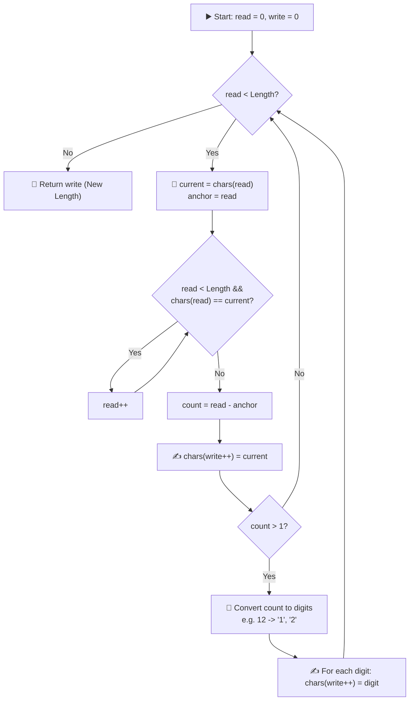
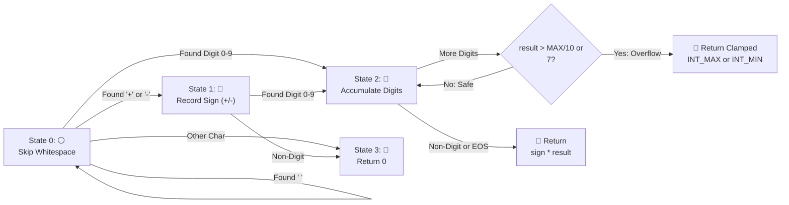

# 📘 Week 06 Day 4: String Transformations & Building — Engineering Guide

> 🧭 **Navigation:** [← Previous Day](Week_06_Day_03_Parentheses_Bracket_Matching_Instructional.md) • [🏠 Week Overview](README.md) • [📘 Curriculum Syllabus](../COMPLETE_SYLLABUS.md) • [Next Day →](Week_06_Day_05_Advanced_String_Matching_Rabin_Karp_Rolling_Hash_Instructional.md)
> 
> 💡 **Instructor Note:** *In modern managed runtimes (.NET CLR, Python CPython, Java JVM), strings are immutable heap objects. Every single string concatenation in a loop destroys and re-allocates contiguous memory. Mastering in-place read/write heads, pre-allocated buffers, and proactive boundary checks is the dividing line between junior scripts and senior systems engineering.*

---

## 🎯 LEARNING OBJECTIVES

By the end of this chapter, you will be able to:

- **Internalize** the mechanical cost of string immutability and why repeated concatenation in loops creates catastrophic `O(N^2)` garbage collection churn.
- **Master** the dual read/write pointer technique for zero-allocation, in-place string compaction and run-length compression (LeetCode 443).
- **Execute** the classic three-step reverse-and-compact pattern for word transformation without extra heap arrays (LeetCode 151).
- **Construct** deterministic finite-state machine parsers (`my_atoi`, LeetCode 8) that proactively detect 32-bit integer overflow *before* arithmetic execution without relying on 64-bit casting crutches.
- **Deliver** a polished, 3-sentence FAANG interview talk track defending buffer allocation, pointer invariants, and memory layout.

---

## 🎬 PILLAR 1: THE 60-SECOND HOOK & EVERYDAY METAPHOR

### The Bricklayer vs. The Demolition Crew

Imagine you hire a builder to lay a brick wall of 10,000 bricks.

- **The Senior Bricklayer (`StringBuilder` / In-Place Pointer):**  
  Lays brick 1 on the foundation. When brick 2 arrives, they place it right next to brick 1. When brick 3 arrives, it goes right next to brick 2. Every single brick takes `O(1)` constant time. The wall grows smoothly in place. Total time: `O(N)`.

- **The Demolition Crew (`s += c` in a loop):**  
  Lays brick 1. When brick 2 arrives, they **dynamically demolish the entire wall**, purchase a brand-new plot of land, carry over a duplicate copy of brick 1, and cement brick 2 next to it. When brick 3 arrives, they demolish the second lot, buy a third lot, copy bricks 1 and 2, and add brick 3.

```
Loop Concatenation (s += c):
Iteration 1:  [a]                     -> Allocates 1 char
Iteration 2:  [a, b]                  -> Copies 1, Allocates 2 chars
Iteration 3:  [a, b, c]               -> Copies 2, Allocates 3 chars
Iteration 4:  [a, b, c, d]            -> Copies 3, Allocates 4 chars
...
Iteration N:  [a, b, c, ... N]        -> Copies N-1, Allocates N chars

Total Copies = 1 + 2 + 3 + ... + (N - 1) = N * (N - 1) / 2 = O(N^2) bytes copied!
Total Heap Churn = O(N^2) bytes of dead objects abandoned to the Garbage Collector!
```

If `N = 100,000`, the Demolition Crew allocates and copies **5,000,000,000 characters** (approx. 10 GB of heap memory in C# or Java where characters are UTF-16 2-byte primitives). Your application freezes under stop-the-world Garbage Collection pauses, and your FAANG interviewer immediately writes down: *"Candidate lacks basic memory awareness."*

In this chapter, you will master the two mechanical tools that eliminate this waste forever:
1. **The In-Place Read/Write Head:** Mutating existing character arrays with dual pointers in `O(1)` auxiliary space.
2. **The Pre-Sized Mutable Buffer:** Sizing `StringBuilder` or list capacity upfront to achieve pure `O(N)` linear throughput.

---

## 🪜 PILLAR 2: THE SCAFFOLDING LADDER & TOY NAPKIN TRACES

Let's ascend from a raw array walk to a production-grade in-place compressor.

```
              [ LEVEL 4: Multi-Pass In-Place Reversal (LC 151) ]
                                    ▲
              [ LEVEL 3: Proactive Boundary Parser (LC 8 atoi) ]
                                    ▲
              [ LEVEL 2: Multi-Digit Run-Length Compressor (LC 443) ]
                                    ▲
              [ LEVEL 1: Toy Napkin Trace (Read vs Write Heads) ]
```

---

### Level 1: Toy Napkin Trace — Run-Length Compression (LC 443)

**The Objective:** Given an array of characters `chars`, compress it in-place such that runs of consecutive identical characters are replaced by the character followed by its count. If the count is 1, only write the character. Return the new length of the compressed array.

**Toy Input:** `chars = ['a', 'a', 'b', 'b', 'c', 'c', 'c']` (Length = 7)

We maintain two pointers:
- `write`: Points to the slot where our next compressed token must be written.
- `read`: Scans forward to detect the boundary of the current identical run.

#### Step-by-Step Napkin Walkthrough

```
Initial State:
  write = 0
  read  = 0
  Array: [ 'a', 'a', 'b', 'b', 'c', 'c', 'c' ]
            ▲
          read, write

--------------------------------------------------------------------------------
Pass 1: Run of 'a'
- read starts at 0 ('a').
- Scans forward while chars[read] == 'a': advances read to 2.
- Run length = 2 - 0 = 2.
- Action:
    1. chars[write++] = 'a'       -> Array: [ 'a', 'a', 'b', 'b', 'c', 'c', 'c' ] (write = 1)
    2. Count > 1: write '2'
       chars[write++] = '2'       -> Array: [ 'a', '2', 'b', 'b', 'c', 'c', 'c' ] (write = 2)

Array State after Pass 1:
  [ 'a', '2', | 'b', 'b', 'c', 'c', 'c' ]
               ▲           ▲
             write        read (at index 2)

--------------------------------------------------------------------------------
Pass 2: Run of 'b'
- read starts at 2 ('b').
- Scans forward while chars[read] == 'b': advances read to 4.
- Run length = 4 - 2 = 2.
- Action:
    1. chars[write++] = 'b'       -> Array: [ 'a', '2', 'b', 'b', 'c', 'c', 'c' ] (write = 3)
    2. Count > 1: write '2'
       chars[write++] = '2'       -> Array: [ 'a', '2', 'b', '2', 'c', 'c', 'c' ] (write = 4)

Array State after Pass 2:
  [ 'a', '2', 'b', '2', | 'c', 'c', 'c' ]
                         ▲  ▲
                     write  read (at index 4)

--------------------------------------------------------------------------------
Pass 3: Run of 'c'
- read starts at 4 ('c').
- Scans forward while chars[read] == 'c': advances read to 7 (end of array).
- Run length = 7 - 4 = 3.
- Action:
    1. chars[write++] = 'c'       -> Array: [ 'a', '2', 'b', '2', 'c', 'c', 'c' ] (write = 5)
    2. Count > 1: write '3'
       chars[write++] = '3'       -> Array: [ 'a', '2', 'b', '2', 'c', '3', 'c' ] (write = 6)

Final State:
  Compressed Prefix: [ 'a', '2', 'b', '2', 'c', '3' ]
  Return new length: write = 6.
```

> [!NOTE]
> Notice index 6 still holds the residual old character `'c'`. The caller only inspects the first `write = 6` elements. In-place algorithms never need to "delete" the unused tail; returning the boundary index defines the valid slice.

---

### 🧠 Pause & Predict Micro-Drill 1

> **Scenario:** Suppose the input array is `['a', 'b', 'c']` (all run counts are equal to 1).  
> **Question:** Does the algorithm write any digits? What will `write` be, and how does `write` compare to `read` throughout the execution?  
>
> <details>
> <summary>👉 Click to Reveal Answer & Invariant</summary>
>
> **Answer:** No digits are written! When `count == 1`, only the character itself is stamped: `chars[write++] = current`.  
> For `['a', 'b', 'c']`, `write` and `read` march in exact lockstep at each step (`write = 1, read = 1`, then `2, 2`, then `3, 3`). The returned length is `3`, and the array remains `['a', 'b', 'c']`.  
> **Key Invariant:** `write <= read` is guaranteed at all times. A compressed run is always shorter than or equal to the uncompressed run (e.g., 2 chars `'a', 'a'` compress to 2 chars `'a', '2'`; 1 char `'a'` compresses to 1 char `'a'`; 12 chars compress to 3 chars `'a', '1', '2'`). Therefore, the write head *never* overwrites unread source data!
> </details>

---

### 🧠 Pause & Predict Micro-Drill 2

> **Scenario:** Suppose an array contains 12 consecutive `'a'`s: `['a', 'a', ..., 'a']` (`count = 12`).  
> **Question:** If you write `chars[write++] = (char)(count + '0')`, what catastrophic bug occurs? How many character slots should `12` consume?  
>
> <details>
> <summary>👉 Click to Reveal Answer & Invariant</summary>
>
> **Answer:** Disaster! In ASCII, `'0'` is code 48. Doing `(char)(12 + 48)` produces character code 60, which is the `'<'` symbol! The array becomes `['a', '<']`.  
> `12` is two separate decimal digits: `'1'` and `'2'`. You must write each digit individually into successive slots: `chars[write++] = '1'`, then `chars[write++] = '2'`, taking a total of 3 slots (`'a'`, `'1'`, `'2'`).
> </details>

---

### Level 2: Warm-Up — Reverse Words in a String (LC 151)

**The Objective:** Given an input string `s = "  the   sky  is  blue  "`, reverse the order of the words while:
1. Stripping all leading and trailing whitespace.
2. Reducing multiple contiguous spaces between words down to a single space.
3. Returning `"blue is sky the"`.

#### The 3-Step Physical Reversal Magic

Instead of allocating an array of strings via `s.Split(' ')`, consider how this works mechanically on a mutable character array in-place:

```
Source: "  the   sky  is  blue  "

Step 1: Clean & Compact Spaces In-Place
  Read through array with write/read heads. Skip leading spaces, copy non-spaces,
  and collapse multiple internal spaces to a single ' '.
  Cleaned: "the sky is blue" (Length: 15)

Step 2: Reverse the Entire String
  Swap left and right pointers from ends toward the middle.
  Reversed: "eulb si yks eht"
  Notice: The words are now in the correct global positions, but each word is mirrored!

Step 3: Reverse Each Individual Word Back
  Scan for word boundaries:
  - Reverse "eulb" -> "blue"
  - Reverse "si"   -> "is"
  - Reverse "yks"  -> "sky"
  - Reverse "eht"  -> "the"
  Final: "blue is sky the"
```

Every step runs in `O(N)` time and `O(1)` auxiliary space. This is the hallmark of senior systems engineering: transforming complex grammar using simple symmetry reversals.

---

### 🧠 Pause & Predict Micro-Drill 3

> **Scenario:** Why does reversing the entire sequence followed by reversing each token produce the correctly ordered sentence?  
> **Question:** If sentence is `A B C`, what does Step 2 produce, and what does Step 3 produce?  
>
> <details>
> <summary>👉 Click to Reveal Mathematical Proof</summary>
>
> **Answer:**  
> Let the sentence be composed of words `A`, `B`, `C`, where `A_R` is the reverse of `A`.  
> - Original: `A B C`  
> - Step 2 (Global Reverse): `(A B C)^R = C_R B_R A_R`  
>   Notice that the word order is now `C`, `B`, `A` (exactly the reverse order we want!). However, each internal word is backwards.  
> - Step 3 (Word-Level Reverse): `(C_R)^R (B_R)^R (A_R)^R = C B A`  
> Because `(X^R)^R = X`, reversing twice restores the characters of each word to their natural reading direction while permanently preserving the reversed word order!
> </details>

---

### Level 3: Classic FAANG Medium — String to Integer (`my_atoi`, LC 8)

The challenge in string parsing is not parsing digits; it is **guaranteeing that 32-bit signed integer boundaries cannot be breached before arithmetic happens**.

A 32-bit signed integer spans `[-2,147,483,648 to 2,147,483,647]`.  
Notice the boundaries:
- `int.MaxValue = 2147483647` (`214748364 * 10 + 7`)
- `int.MinValue = -2147483648` (`-214748364 * 10 - 8`)

If your accumulator currently equals `214748364` (`int.MaxValue / 10`), appending an incoming digit `d`:
- If `d > 7` and sign is positive: multiplication will overflow `2147483647`!
- If `d > 8` and sign is negative: multiplication will underflow `-2147483648`! (In practice, checking `d > 7` safely guards both boundaries).

```
Proactive Guard Formula:
const int maxThreshold = int.MaxValue / 10; // 214,748,364

if (result > maxThreshold || (result == maxThreshold && digit > 7))
{
    return sign == 1 ? int.MaxValue : int.MinValue;
}
```

---

## 🎨 PILLAR 3: PRAGMATIC VISUAL MODELS

### ASCII Model 1: In-Place Read/Write Heads (Run-Length Compression)

Below is the physical memory tape showing how the `write` head lags behind the `read` head, ensuring safe overwrite without a secondary buffer:

```
Initial:
+-----+-----+-----+-----+-----+-----+-----+
| 'a' | 'a' | 'b' | 'b' | 'c' | 'c' | 'c' |
+-----+-----+-----+-----+-----+-----+-----+
   ▲
 [W, R]

After 'a' run (2 chars read -> writes 'a', '2'):
+-----+-----+-----+-----+-----+-----+-----+
| 'a' | '2' | 'b' | 'b' | 'c' | 'c' | 'c' |
+-----+-----+-----+-----+-----+-----+-----+
               ▲     ▲
              [W]   [R]

After 'b' run (2 chars read -> writes 'b', '2'):
+-----+-----+-----+-----+-----+-----+-----+
| 'a' | '2' | 'b' | '2' | 'c' | 'c' | 'c' |
+-----+-----+-----+-----+-----+-----+-----+
                           ▲     ▲
                          [W]   [R]

After 'c' run (3 chars read -> writes 'c', '3'):
+-----+-----+-----+-----+-----+-----+-----+
| 'a' | '2' | 'b' | '2' | 'c' | '3' | 'c' |
+-----+-----+-----+-----+-----+-----+-----+
                                       ▲     ▲
                                      [W]   [R] (End of array)

Returned Length: W = 6. Active valid slice: chars[0..5] = ['a','2','b','2','c','3'].
```

---

### ASCII Model 2: Three-Step In-Place Word Reversal (LC 151)

```
Input: "  the   sky  is  blue  "

Pass 1 (Space compaction into buffer):
[ 't' | 'h' | 'e' | ' ' | 's' | 'k' | 'y' | ' ' | 'i' | 's' | ' ' | 'b' | 'l' | 'u' | 'e' ]
Length = 15

Pass 2 (Global array reverse):
 L                                                                                       R
 ▼                                                                                       ▼
[ 'e' | 'u' | 'l' | 'b' | ' ' | 's' | 'i' | ' ' | 'y' | 'k' | 's' | ' ' | 'e' | 'h' | 't' ]

Pass 3 (Local word reversal):
 [  eulb  ]        [ si ]        [  yks   ]        [   eht  ]
     ▼               ▼               ▼                 ▼
   Reverse         Reverse         Reverse           Reverse
     ▼               ▼               ▼                 ▼
 [  blue  ]   +   [  is  ]   +   [  sky   ]   +    [   the  ]

Result: "blue is sky the"
```

---

### Mermaid Flowchart: Deterministic Run-Length Encoding Logic

The branching logic for grouping, count formatting, and in-place writing:



---

### Mermaid State Machine: `my_atoi` Lexical Parser

Deterministic parsing with strict state isolation:



---

## 🛑 PILLAR 4: THE ROOKIE TRAP ZONE

### Trap 1: Repeated String Concatenation in Loops

```csharp
// ❌ ROOKIE BLUNDER: O(N^2) Time & Megabytes of GC Churn
string result = "";
for (int i = 0; i < n; i++)
{
    result += chars[i]; // Demolition crew! Copies 1 + 2 + ... + i bytes every iteration!
}

// ✅ SENIOR ARCHITECT PATTERN: O(N) Time & Zero Garbage Churn
// Pre-allocate the exact or estimated capacity to prevent internal buffer doubling
var sb = new StringBuilder(capacity: n);
for (int i = 0; i < n; i++)
{
    sb.Append(chars[i]); // Writes directly to contiguous heap buffer in O(1) amortized
}
string result = sb.ToString();
```

---

### Trap 2: Single-Digit Assumption in Array Compression

```csharp
// ❌ ROOKIE BLUNDER: Breaks when count >= 10!
if (count > 1)
{
    chars[write++] = (char)(count + '0'); // If count = 12, writes ASCII 60 ('<')!
}

// ✅ SENIOR ARCHITECT PATTERN: Iterate all decimal digits safely
if (count > 1)
{
    // Zero-heap allocation in C# using Span:
    Span<char> digitBuffer = stackalloc char[10];
    int digitCount = 0;
    int temp = count;
    while (temp > 0)
    {
        digitBuffer[digitCount++] = (char)('0' + (temp % 10));
        temp /= 10;
    }
    // Digits were extracted least-significant first; write them in forward order
    for (int d = digitCount - 1; d >= 0; d--)
    {
        chars[write++] = digitBuffer[d];
    }
}
```

---

### Trap 3: Lazy 64-Bit Casting in `atoi`

```csharp
// ❌ ROOKIE BLUNDER: Using 'long' as a crutch (Fails interview bar at Google/Meta)
long total = 0;
while (i < s.Length && char.IsDigit(s[i]))
{
    total = total * 10 + (s[i] - '0');
    if (total > int.MaxValue) break; // Lazy check after the fact! What if asked to parse 64-bit int?
}

// ✅ SENIOR ARCHITECT PATTERN: Mathematical Pre-Check within 32-bit registers
const int maxThreshold = int.MaxValue / 10; // 214748364
while (i < s.Length && char.IsDigit(s[i]))
{
    int digit = s[i] - '0';
    if (result > maxThreshold || (result == maxThreshold && digit > 7))
    {
        return sign == 1 ? int.MaxValue : int.MinValue;
    }
    result = result * 10 + digit;
    i++;
}
```

---

### Trap 4: Forgetting the Final Run at Array Boundary

```python
# ❌ ROOKIE BLUNDER: Checking chars[i] != chars[i-1] leaves the final group unwritten!
for i in range(1, len(chars)):
    if chars[i] == chars[i - 1]:
        count += 1
    else:
        # Writes previous group, but who writes the last group when loop terminates?
        chars[write] = chars[i - 1]
        ...

# ✅ SENIOR ARCHITECT PATTERN: Two-pointer while-loop with lookahead anchor
read = 0
write = 0
while read < len(chars):
    anchor = read
    while read < len(chars) and chars[read] == chars[anchor]:
        read += 1
    # Group [anchor .. read-1] is guaranteed to be processed, including the end of the array!
    count = read - anchor
    chars[write] = chars[anchor]
    write += 1
    if count > 1:
        for ch in str(count):
            chars[write] = ch
            write += 1
```

---

## 🎙️ PILLAR 5: 45-MINUTE INTERVIEW TALK TRACK

In a FAANG coding round, memorizing code is useless if you cannot articulate your architectural invariants. Here is the exact 3-sentence verbal script to speak aloud *before* writing code:

### The 3-Sentence Interview Verbal Script

> 1. *"Because strings are immutable heap objects in modern managed languages, naive string concatenation in a loop degenerates into `O(N^2)` runtime due to repeated buffer copying and garbage collection pressure."*
> 2. *"To achieve true `O(1)` auxiliary space, I will use a dual read-write pointer technique: the read pointer measures the length of identical runs, while the write pointer stamps characters and multi-digit counts in-place without ever overtaking unread data."*
> 3. *"For numerical conversions, I will guard against 32-bit integer overflow proactively by validating `result > int.MaxValue / 10` before arithmetic execution, avoiding lazy 64-bit casting."*

---

### The 4-Phase Live Interview Playbook

```
+---------------------------------------------------------------------------------------+
| PHASE 1: Clarify & Bounds (0 - 5 Mins)                                                |
| - "Is the input array mutable in-place, or must we return a new string?"               |
| - "What should happen on integer overflow: wrap around or clamp to INT_MAX / INT_MIN?"|
| - "Can numbers have multiple leading spaces, mixed signs, or trailing non-digits?"    |
+---------------------------------------------------------------------------------------+
                                           |
                                           v
+---------------------------------------------------------------------------------------+
| PHASE 2: Verbal Invariant Defense (5 - 12 Mins)                                       |
| - State the Invariant: "Since a compressed run of length K >= 1 always consumes <= K  |
|   slots, write <= read is guaranteed at all times. Safe in-place mutation."           |
| - Hand-trace toy case: ['a', 'a', 'b', 'b', 'c', 'c', 'c'] -> write = 6.             |
| - Agree on multi-digit handling (e.g., count = 12 consumes 2 digit slots).            |
+---------------------------------------------------------------------------------------+
                                           |
                                           v
+---------------------------------------------------------------------------------------+
| PHASE 3: Live Clean Implementation (12 - 30 Mins)                                     |
| - Write guard clauses first (null, empty).                                            |
| - Structure outer `while (read < n)` loop with inner run-length counter.              |
| - Write character, then write digit sequence.                                         |
+---------------------------------------------------------------------------------------+
                                           |
                                           v
+---------------------------------------------------------------------------------------+
| PHASE 4: Edge-Case Verification (30 - 40 Mins)                                        |
| - Single element: ['a'] -> returns 1.                                                 |
| - All unique: ['a', 'b', 'c'] -> write == read throughout, returns 3.                |
| - Large run >= 10: ['a'] * 12 -> returns 3 (['a', '1', '2']).                         |
| - String overflow: "2147483648" -> correctly clamps to 2147483647.                    |
+---------------------------------------------------------------------------------------+
```

---

## ⚡ PILLAR 6: PRODUCTION DUAL-LANGUAGE IMPLEMENTATIONS

### Problem 1: In-Place String Compression (LeetCode 443)

#### C# (.NET 8/9 — Zero Heap Allocation with `stackalloc`)

```csharp
using System;

public static class StringCompressor
{
    /// <summary>
    /// Compresses a character array in-place using Run-Length Encoding.
    /// Time Complexity: O(N) — single pass where each character is read once and written once.
    /// Auxiliary Space: O(1) — zero heap allocations using stackalloc for digit formatting.
    /// </summary>
    public static int Compress(char[] chars)
    {
        ArgumentNullException.ThrowIfNull(chars);
        if (chars.Length <= 1) return chars.Length;

        int write = 0;
        int read = 0;

        while (read < chars.Length)
        {
            char current = chars[read];
            int anchor = read;

            // Advance read pointer to find end of identical run
            while (read < chars.Length && chars[read] == current)
            {
                read++;
            }

            int count = read - anchor;

            // 1. Write the character token
            chars[write++] = current;

            // 2. If run length > 1, write count digits in-place
            if (count > 1)
            {
                // Stack-allocated scratch buffer for digit extraction (max 10 digits for 32-bit int)
                Span<char> digits = stackalloc char[10];
                int digitLength = 0;
                int temp = count;

                while (temp > 0)
                {
                    digits[digitLength++] = (char)('0' + (temp % 10));
                    temp /= 10;
                }

                // Digits are in reverse order in scratch buffer; write them forward
                for (int i = digitLength - 1; i >= 0; i--)
                {
                    chars[write++] = digits[i];
                }
            }
        }

        return write;
    }
}
```

#### Python (3.11+ — Idiomatic Two-Pointer Compaction)

```python
class StringCompressor:
    @staticmethod
    def compress(chars: list[str]) -> int:
        """In-place Run-Length Encoding on a list of characters.

        Time Complexity: O(N) - each character visited O(1) times.
        Auxiliary Space: O(1) - strictly mutates the input list in-place.
        """
        if not chars:
            return 0

        write = 0
        read = 0
        n = len(chars)

        while read < n:
            current_char = chars[read]
            anchor = read

            # Advance read to discover contiguous run length
            while read < n and chars[read] == current_char:
                read += 1

            count = read - anchor

            # 1. Write the character token
            chars[write] = current_char
            write += 1

            # 2. Write multi-digit count if count > 1
            if count > 1:
                for digit_char in str(count):
                    chars[write] = digit_char
                    write += 1

        return write
```

---

### Problem 2: Reverse Words in a String (LeetCode 151)

#### C# (.NET 8/9 — In-Place Array Reversal & Space Compaction)

```csharp
using System;

public static class WordReverser
{
    /// <summary>
    /// Reverses words in a string, stripping extraneous whitespace in O(N) time and O(1) auxiliary space (excluding output string).
    /// </summary>
    public static string ReverseWords(string s)
    {
        if (string.IsNullOrWhiteSpace(s)) return string.Empty;

        // Convert to mutable char array for in-place manipulation
        char[] chars = s.ToCharArray();
        int n = chars.Length;

        // Step 1: Clean and compact spaces in-place using two pointers
        int write = 0;
        int read = 0;

        while (read < n)
        {
            // Skip leading spaces or multiple consecutive spaces
            while (read < n && chars[read] == ' ') read++;

            // If we reached the end after spaces, stop
            if (read >= n) break;

            // Insert single separating space before words (except before the very first word)
            if (write > 0)
            {
                chars[write++] = ' ';
            }

            // Copy word characters
            while (read < n && chars[read] != ' ')
            {
                chars[write++] = chars[read++];
            }
        }

        // Active valid characters are now within chars[0 .. write - 1]
        Span<char> span = chars.AsSpan(0, write);

        // Step 2: Reverse the entire compacted span
        ReverseSpan(span, 0, span.Length - 1);

        // Step 3: Reverse each individual word back
        int wordStart = 0;
        for (int i = 0; i <= span.Length; i++)
        {
            if (i == span.Length || span[i] == ' ')
            {
                ReverseSpan(span, wordStart, i - 1);
                wordStart = i + 1;
            }
        }

        return span.ToString();
    }

    private static void ReverseSpan(Span<char> span, int left, int right)
    {
        while (left < right)
        {
            (span[left], span[right]) = (span[right], span[left]);
            left++;
            right--;
        }
    }
}
```

#### Python (3.11+ — Idiomatic & In-Place Deque / Reversal)

```python
class WordReverser:
    @staticmethod
    def reverse_words_idiomatic(s: str) -> str:
        """Pythonic approach using built-in string primitives.

        Time: O(N) | Space: O(N)
        """
        # split() with no arguments splits on any whitespace and discards empty tokens
        return " ".join(reversed(s.split()))

    @staticmethod
    def reverse_words_two_pointer(s: str) -> str:
        """Low-level two-pointer algorithm mirroring C# systems logic.

        Time: O(N) | Space: O(N)
        """
        # Step 1: Convert to list and compact spaces
        chars = list(s)
        n = len(chars)
        read, write = 0, 0

        while read < n:
            while read < n and chars[read] == " ":
                read += 1
            if read >= n:
                break
            if write > 0:
                chars[write] = " "
                write += 1
            while read < n and chars[read] != " ":
                chars[write] = chars[read]
                write += 1
                read += 1

        chars = chars[:write]

        # Step 2: Reverse entire array
        chars.reverse()

        # Step 3: Reverse each word
        def reverse_sub(start: int, end: int) -> None:
            while start < end:
                chars[start], chars[end] = chars[end], chars[start]
                start += 1
                end -= 1

        word_start = 0
        for i in range(len(chars) + 1):
            if i == len(chars) or chars[i] == " ":
                reverse_sub(word_start, i - 1)
                word_start = i + 1

        return "".join(chars)
```

---

### Problem 3: String to Integer (`my_atoi`, LeetCode 8)

#### C# (.NET 8/9 — State Machine with Proactive Guarding)

```csharp
using System;

public static class AtoiParser
{
    /// <summary>
    /// Parses string to a 32-bit signed integer with proactive overflow prevention.
    /// Time Complexity: O(N) | Auxiliary Space: O(1)
    /// </summary>
    public static int MyAtoi(ReadOnlySpan<char> s)
    {
        if (s.IsEmpty) return 0;

        int i = 0;
        int n = s.Length;

        // Step 1: Skip leading whitespace
        while (i < n && s[i] == ' ')
        {
            i++;
        }

        if (i >= n) return 0;

        // Step 2: Parse optional sign
        int sign = 1;
        if (s[i] == '+' || s[i] == '-')
        {
            sign = (s[i] == '-') ? -1 : 1;
            i++;
        }

        // Step 3: Accumulate digits with proactive boundary guard
        int result = 0;
        const int maxThreshold = int.MaxValue / 10; // 214748364

        while (i < n && char.IsDigit(s[i]))
        {
            int digit = s[i] - '0';

            // Proactively guard BEFORE multiplication:
            // int.MaxValue = 2147483647 (ends with 7)
            // int.MinValue = -2147483648 (ends with 8)
            if (result > maxThreshold || (result == maxThreshold && digit > 7))
            {
                return sign == 1 ? int.MaxValue : int.MinValue;
            }

            result = result * 10 + digit;
            i++;
        }

        return sign * result;
    }
}
```

#### Python (3.11+ — Explicit 32-Bit Arithmetic Clamping)

```python
class AtoiParser:
    @staticmethod
    def my_atoi(s: str) -> int:
        """Parses string to a 32-bit signed integer.

        Time Complexity: O(N) | Auxiliary Space: O(1)
        """
        s = s.lstrip()
        if not s:
            return 0

        sign = 1
        idx = 0

        if s[0] in ("-", "+"):
            sign = -1 if s[0] == "-" else 1
            idx = 1

        result = 0
        int_max = 2**31 - 1
        int_min = -(2**31)
        max_threshold = int_max // 10

        while idx < len(s) and s[idx].isdigit():
            digit = ord(s[idx]) - ord("0")

            # Check overflow boundary before multiplication
            if result > max_threshold or (
                result == max_threshold and digit > 7
            ):
                return int_max if sign == 1 else int_min

            result = result * 10 + digit
            idx += 1

        return sign * result
```

---

### Problem 4: Integer to Roman & Roman to Integer (LeetCode 12 & 13)

#### C# (.NET 8/9 — Dual Representations)

```csharp
using System;
using System.Text;

public static class RomanNumerals
{
    private static readonly int[] Values = [1000, 900, 500, 400, 100, 90, 50, 40, 10, 9, 5, 4, 1];
    private static readonly string[] Symbols = ["M", "CM", "D", "CD", "C", "XC", "L", "XL", "X", "IX", "V", "IV", "I"];

    /// <summary>
    /// Converts integer to Roman numeral using greedy descending value matching.
    /// Time Complexity: O(1) | Auxiliary Space: O(1)
    /// </summary>
    public static string IntToRoman(int num)
    {
        if (num <= 0 || num > 3999) return string.Empty;

        // Longest standard Roman numeral below 4000 is MMMDCCCLXXXVIII (15 chars)
        var sb = new StringBuilder(capacity: 16);

        for (int i = 0; i < Values.Length; i++)
        {
            while (num >= Values[i])
            {
                sb.Append(Symbols[i]);
                num -= Values[i];
            }
        }

        return sb.ToString();
    }

    /// <summary>
    /// Converts Roman numeral to integer using lookahead subtraction.
    /// Time Complexity: O(N) | Auxiliary Space: O(1)
    /// </summary>
    public static int RomanToInt(ReadOnlySpan<char> s)
    {
        int total = 0;
        int prevValue = 0;

        // Scan from right to left: if current < prev, subtract; otherwise, add
        for (int i = s.Length - 1; i >= 0; i--)
        {
            int currentValue = GetValue(s[i]);
            if (currentValue < prevValue)
            {
                total -= currentValue;
            }
            else
            {
                total += currentValue;
                prevValue = currentValue;
            }
        }

        return total;
    }

    private static int GetValue(char c) => c switch
    {
        'I' => 1,
        'V' => 5,
        'X' => 10,
        'L' => 50,
        'C' => 100,
        'D' => 500,
        'M' => 1000,
        _ => 0
    };
}
```

#### Python (3.11+ — Roman Dual Mapping)

```python
class RomanNumerals:
    MAPPING: list[tuple[int, str]] = [
        (1000, "M"),
        (900, "CM"),
        (500, "D"),
        (400, "CD"),
        (100, "C"),
        (90, "XC"),
        (50, "L"),
        (40, "XL"),
        (10, "X"),
        (9, "IX"),
        (5, "V"),
        (4, "IV"),
        (1, "I"),
    ]

    ROMAN_MAP: dict[str, int] = {
        "I": 1,
        "V": 5,
        "X": 10,
        "L": 50,
        "C": 100,
        "D": 500,
        "M": 1000,
    }

    @classmethod
    def int_to_roman(cls, num: int) -> str:
        """Greedy subtraction matching."""
        result: list[str] = []
        for val, sym in cls.MAPPING:
            while num >= val:
                result.append(sym)
                num -= val
        return "".join(result)

    @classmethod
    def roman_to_int(cls, s: str) -> int:
        """Right-to-left lookahead subtraction."""
        total = 0
        prev_val = 0
        for char in reversed(s):
            val = cls.ROMAN_MAP.get(char, 0)
            if val < prev_val:
                total -= val
            else:
                total += val
                prev_val = val
        return total
```

---

## ⚖️ COMPLEXITY DECONSTRUCTION

### Explicit Complexity Breakdown

| Algorithm / Problem | Best Case Time | Worst Case Time | Auxiliary Space | Output Space | Key Engineering Driver |
| :--- | :--- | :--- | :--- | :--- | :--- |
| **In-Place Compression (LC 443)** | `O(N)` | `O(N)` | `O(1)` | `O(1)` (in-place) | Dual read/write heads; zero heap allocations |
| **Reverse Words (LC 151)** | `O(N)` | `O(N)` | `O(1)` | `O(N)` (final string) | Compact spaces -> Global reverse -> Word reverse |
| **String to Integer (LC 8)** | `O(1)` | `O(N)` | `O(1)` | `O(1)` | Proactive boundary checks before multiplication |
| **Integer to Roman (LC 12)** | `O(1)` (<= 15 loops) | `O(1)` | `O(1)` | `O(1)` (<= 15 chars) | Descending greedy denomination subtraction |
| **Roman to Integer (LC 13)** | `O(N)` (<= 15 chars) | `O(N)` | `O(1)` | `O(1)` | Right-to-left reverse lookahead subtraction |
| **Loop Concatenation (`s += c`)** | `O(N)` | `O(N^2)` | `O(N^2)` | `O(N)` | **ANTIPATTERN:** Reallocates buffer on every append |

---

## 🏋️ PRACTICE LADDER

| Problem | LeetCode # | Difficulty | Core Pattern | Crucial Verification Milestone |
| :--- | :--- | :--- | :--- | :--- |
| **String Compression** | #443 | 🟡 Medium | In-Place Read/Write Pointers | Multi-digit run lengths (e.g., 12 `'a'`s -> `'a','1','2'`) |
| **Reverse Words in a String** | #151 | 🟡 Medium | 3-Step Array Reversal | Trimming multiple spaces and leading/trailing blanks |
| **String to Integer (atoi)** | #8 | 🟡 Medium | Lexical State Machine | Proactive 32-bit overflow check (`maxThreshold`) |
| **Integer to Roman** | #12 | 🟡 Medium | Greedy Mapping | Subtractive notation handling (900, 400, 90, etc.) |
| **Roman to Integer** | #13 | 🟢 Easy | Lookahead Reduction | Right-to-left subtractive traversal |
| **Zigzag Conversion** | #6 | 🟡 Medium | Buffer Simulation | Multi-row `StringBuilder` step direction switching |

---

> 🧭 **Navigation:** [← Previous Day](Week_06_Day_03_Parentheses_Bracket_Matching_Instructional.md) • [🏠 Week Overview](README.md) • [📘 Curriculum Syllabus](../COMPLETE_SYLLABUS.md) • [Next Day →](Week_06_Day_05_Advanced_String_Matching_Rabin_Karp_Rolling_Hash_Instructional.md)
