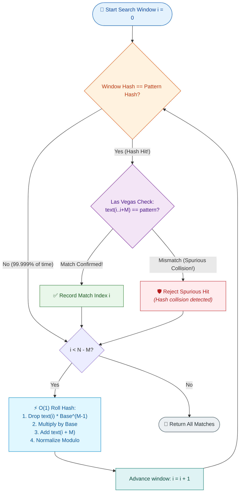
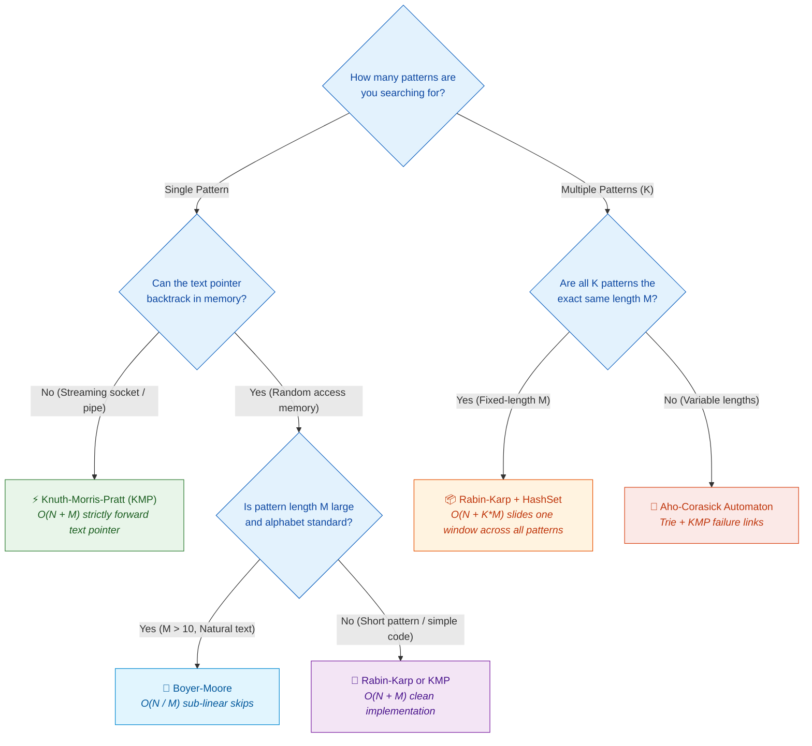

# 📘 Week 06 Day 5: Advanced String Matching — Rabin-Karp & Rolling Hash — Engineering Guide

> 🧭 **Navigation:** [← Previous Day](Week_06_Day_04_String_Transformations_Building_Instructional.md) • [🏠 Week Overview](README.md) • [📘 Curriculum Syllabus](../COMPLETE_SYLLABUS.md) • [Week Playbook →](WEEK_06_FULL_PLAYBOOK.md)
> 
> 💡 **Instructor Note:** *String matching is the backbone of grep, DNA sequence alignment, and intrusion detection systems. While naive substring search degrades to quadratic time O(N * M), rolling hashes turn string comparison into O(1) arithmetic updates. Today, we deconstruct both Rabin-Karp and Knuth-Morris-Pratt (KMP) from physical intuition to production-grade C# and Python.*

---

## 🎯 LEARNING OBJECTIVES

By the end of this chapter, you will be able to:

- 🎯 **Internalize** the polynomial rolling hash mechanism as an incremental base-B sliding window evaluated in `O(1)` time per slide.
- ⚙️ **Construct** the KMP Longest Proper Prefix which is also Suffix (LPS) array and explain why the text pointer never backtracks.
- 🛡️ **Defend** against modular arithmetic pitfalls, negative remainders in C# and Python, integer overflow, and hash collisions (Las Vegas vs. Monte Carlo).
- 🎨 **Visualize** hash eviction, base scaling, and character induction through ASCII memory diagrams and Mermaid decision flowcharts.
- 💬 **Articulate** a crisp 3-sentence script in FAANG interviews contrasting Rabin-Karp, KMP, and Boyer-Moore.
- ⚡ **Implement** production-ready, zero-allocation C# (.NET 8/9 with `ReadOnlySpan<char>`) and idiomatic Python (3.11+) for LeetCode 28 (`strStr`) and LeetCode 187 (Repeated DNA Sequences).

---

## 🎬 PILLAR 1: THE 60-SECOND HOOK & EVERYDAY ANALOGY

### Hey Engineers, Welcome to Day 5!

Imagine you are a security engineer tasked with scanning a streaming 10-gigabyte network payload against 50,000 known malware signatures, or an engineer at Google Docs building real-time plagiarism detection across millions of research papers.

If you use the naive substring search algorithm, you slide a pattern of length `M` across a text of length `N`. At every single one of the `(N - M + 1)` positions, you compare up to `M` characters one by one:

```
Naive Substring Search:
Text:     [ A   A   A   A   A   A   A   A   B ]   (N = 9)
Pattern:  [ A   A   A   B ]                       (M = 4)

Position 0: Compare A==A, A==A, A==A, A!=B -> Mismatch at char 4 (4 ops)
Position 1: Compare A==A, A==A, A==A, A!=B -> Mismatch at char 4 (4 ops)
Position 2: Compare A==A, A==A, A==A, A!=B -> Mismatch at char 4 (4 ops)
...
Total Work: (N - M + 1) * M = O(N * M) operations!
```

If `N = 1,000,000` (1 MB of text) and `M = 10,000` (a medium document), naive search executes **10,000,000,000 character comparisons**. Your CPU stalls, throughput drops to zero, and your server crashes under load.

```
Algorithmic Latency Cliff:
+---------------------------------------------------------------------------------+
|  Naive Search:       O(N * M)   --> 10^10 operations  (~15.0 seconds of CPU)    |
|  Rabin-Karp Rolling: O(N + M)   --> 10^6 operations   (~0.003 seconds / 3 ms!)  |
|  Performance Leap:   5,000x faster by turning string checks into integer math!  |
+---------------------------------------------------------------------------------+
```

---

### The Everyday Analogy: The DNA Barcode Scanner

Imagine you are looking for a specific suspect in a crowded soccer stadium holding 80,000 fans.

1. **The Naive Way (Exhaustive Inspection):**
   You walk up to fan #1. You check their eye color, inspect their fingerprints, measure their exact height, run their dental records, and swab their DNA (checking all `M` attributes). If the 5th attribute fails, you step over to fan #2 and repeat the entire medical check from scratch. You will never finish before the game ends!

2. **The Rabin-Karp Way (The Digital Barcode Badge):**
   Every fan wears a digital wristband emitting a single integer ID—a **hash fingerprint**.
   - Your suspect has barcode number `42,891`.
   - As you scan past rows of fans, your handheld scanner glances at each wristband in **1 microsecond** (`O(1)` integer equality).
   - Wristband `12,044`? No. Wristband `88,210`? No. Wristband `31,500`? No.
   - Suddenly: wristband `42,891`!
   - Only now do you stop and run the full fingerprint and facial scan (character verification) to ensure two fans didn't accidentally share the same barcode number (a hash collision).

3. **The "Rolling" Magic:**
   How do you compute the barcode for a group of `M` consecutive characters without reading all `M` characters every time?
   Think of an old-fashioned bus:
   - When the bus moves one stop forward, one passenger gets off at the front door (subtract high-order term).
   - Everyone on the bus slides forward one row (multiply by base).
   - Exactly one new passenger steps in through the rear door (add low-order term).
   
You update the entire bus's weight in **strictly constant time `O(1)`**, regardless of whether the bus holds 5 passengers or 50,000 passengers!

```
The Core Invariant:
Sliding a window of length M by 1 position requires:
  1. Evicting 1 leftmost character.
  2. Multiplying the existing hash by base B.
  3. Injecting 1 rightmost character.
Time Complexity: Exactly O(1) arithmetic operations, independent of M!
```

---

### What About Knuth-Morris-Pratt (KMP)?

What if your system cannot tolerate even the theoretical risk of a hash collision, or cannot afford modular arithmetic overhead on streaming network bytes?

That is where **Knuth-Morris-Pratt (KMP)** comes in:
- Naive search has amnesia: when a mismatch occurs after 9 matching characters, it throws away all 9 matches and restarts at the next index.
- KMP introduces the **LPS (Longest Proper Prefix which is also Suffix)** table. It asks: *"What part of what I just matched can serve as the head of my next attempt?"*
- By precomputing the self-symmetry of the pattern, KMP **never backtracks the text pointer**. The text pointer marches strictly forward from `0` to `N - 1`, delivering guaranteed deterministic `O(N + M)` runtime in pure integer jumps.

---

## 🪜 PILLAR 2: THE SCAFFOLDING LADDER & THE TOY NAPKIN TRACE

Let's build your mental model step-by-step from elementary school arithmetic to FAANG interview mastery.

```
       [ Level 4: Dual-Prime Rolling Hashes & Hard LC 1044 / LC 214 ]
                              ^
       [ Level 3: KMP LPS Construction & State Jumps ]
                              ^
       [ Level 2: Polynomial Base-B Rolling Hash with Modulo ]
                              ^
       [ Level 1: The Base-10 Toy Napkin Trace ]
```

---

### Level 1: The Base-10 Toy Napkin Trace

Before writing polynomial formulas, let's understand rolling math using base-10 numbers you have known since childhood.

Suppose our text is the number stream `1 2 3 4 5`, and our pattern is `2 3 4` (window length `M = 3`).

```
Text:     1   2   3   4   5
Window 0: [ 1   2   3 ]           -> Value: 123
Window 1:     [ 2   3   4 ]       -> Value: 234
Window 2:         [ 3   4   5 ]   -> Value: 345
```

How do we transform `123` into `234` without re-reading the `2` and the `3`?

```text
Step 1: Evict Leftmost Digit (1):
        123 - (1 * 10^2) = 123 - 100 = 23

Step 2: Shift Remaining Digits Left (Multiply by Base 10):
        23 * 10 = 230

Step 3: Inject Rightmost Incoming Digit (4):
        230 + 4 = 234
```

In 3 arithmetic operations, we obtained the new window value `234`!

---

### Level 2: The Polynomial Base-B Rolling Hash with Modulo

Strings are sequences of characters. If we assign each character a numeric value (e.g., ASCII code or `A=1, B=2, C=3, ...`), any string of length `M` can be represented as a polynomial in base `B`:

```
H = (S[0] * B^(M-1) + S[1] * B^(M-2) + ... + S[M-1] * B^0) % MOD
```

Where:
- `B` (Base): A prime or integer larger than the size of our alphabet (e.g., `256` for extended ASCII, `26` for lowercase letters, `4` for DNA).
- `MOD`: A large prime (e.g., `1_000_000_007` or `2^61 - 1`) to keep values within machine integer limits and minimize collisions.

#### The Slide Equation:
To slide from window `S[i .. i + M - 1]` to `S[i + 1 .. i + M]`:

```
1. Remove outgoing char S[i]:
   H_temp = (H_prev - S[i] * B^(M-1)) % MOD

2. Shift left by base B:
   H_shifted = (H_temp * B) % MOD

3. Add incoming char S[i + M]:
   H_next = (H_shifted + S[i + M]) % MOD
```

#### Complete Hand-Trace with Real Numbers:
Let:
- Alphabet: `'A'=1, 'B'=2, 'C'=3, 'D'=4, 'E'=5`
- Base: `B = 10`
- Modulo: `MOD = 97` (small prime for easy human calculation)
- Window Length: `M = 3`
- Precomputed Multiplier: `highPow = B^(M - 1) % MOD = 10^2 % 97 = 100 % 97 = 3`

**Target Pattern:** `"BCD"` -> values `[2, 3, 4]`
```text
H("BCD") = (2 * 10^2 + 3 * 10^1 + 4 * 10^0) % 97
         = (200 + 30 + 4) % 97
         = 234 % 97
         = 40
```
Target hash is **40**.

**Text:** `"ABCDE"` -> values `[1, 2, 3, 4, 5]`

```text
Window 0: "ABC" -> values [1, 2, 3]
  H("ABC") = (1 * 100 + 2 * 10 + 3) % 97
           = 123 % 97
           = 26
  Compare: 26 != 40 -> Mismatch!

Slide to Window 1: Drop 'A' (val 1), Add 'D' (val 4)
  1. Remove 'A': 
     Removed contribution = (1 * highPow) % MOD = (1 * 3) = 3
     H_diff = (26 - 3) = 23
  2. Shift Base:
     H_scaled = (23 * 10) = 230
  3. Add 'D' (4):
     H_new = (230 + 4) = 234
  4. Modulo:
     H_new % 97 = 234 % 97 = 40!

Compare: 40 == 40 -> HASH MATCH!
Verification (Las Vegas check):
  Does text.Slice(1, 3) == "BCD"?
  text[1]='B', text[2]='C', text[3]='D' == "BCD" -> TRUE POSITIVE!
  Match confirmed at index 1!
```

---

### 🧠 PAUSE & PREDICT: MICRO-DRILL 1

> Suppose `H_prev = 2`, `MOD = 97`, and the outgoing term `(S[i] * highPow) % MOD = 15`.
> You compute: `H_temp = (H_prev - outgoing) % MOD = (2 - 15) % 97 = (-13) % 97`.
> 
> **Question:** What is the result of `(-13) % 97` in C#? What is it in Python? What bug will this cause if unhandled?

<details>
<summary>🔍 Click to Reveal the Architectural Solution</summary>

**The Behavior:**
- In **C#** (and C/C++/Java), `%` is the *remainder* operator, not mathematical modulo. `(-13) % 97` evaluates to **`-13`**!
- In **Python**, `%` is mathematical modulo. `(-13) % 97` evaluates to **`84`**.

**The Danger:**
In C#, a negative hash will never equal the positive pattern hash, causing the algorithm to silently miss valid matches!

**The Senior Fix:**
Normalize the negative remainder:
```csharp
// C# Idiom:
hash = (hash - removedCharContribution) % Mod;
if (hash < 0) hash += Mod;
```
</details>

---

### Level 3: KMP LPS Construction & State Jumps

The **Knuth-Morris-Pratt (KMP)** algorithm precomputes an array called **LPS** (`Longest Proper Prefix which is also Suffix`) for the pattern `P`.

#### What is a "Proper Prefix" and a "Suffix"?
Take the string `"ABA"`:
- **Proper Prefixes:** Substrings starting at index 0, strictly shorter than the whole string: `{"A", "AB"}`.
- **Suffixes:** Substrings ending at the last index: `{"A", "BA", "ABA"}`.
- **Common:** `"A"` is both a proper prefix and a suffix.
- **Longest Length:** `1`.

#### Step-by-Step LPS Hand-Trace for Pattern `"ABABD"`
Let's build the LPS table for `P = "ABABD"` (length 5):

```text
Indices:     0    1    2    3    4
Pattern:     A    B    A    B    D
LPS Array: [ ?    ?    ?    ?    ? ]
```

We use two pointers:
- `i`: Current character we are evaluating in `P` (starts at 1).
- `len`: Length of the previous longest prefix-suffix match (starts at 0).
- Invariant: `LPS[0] = 0` always (a 1-character string has no proper prefix).

```text
Initialization:
  LPS[0] = 0, len = 0, i = 1

Iteration 1 (i = 1):
  Compare P[i] ('B') with P[len] ('A'):
  'B' != 'A' -> Mismatch!
  Since len == 0: LPS[1] = 0, increment i -> i = 2.
  LPS state: [ 0, 0, _, _, _ ]

Iteration 2 (i = 2):
  Compare P[i] ('A') with P[len] ('A'):
  'A' == 'A' -> Match!
  len = len + 1 = 1
  LPS[2] = len = 1
  Increment i -> i = 3.
  LPS state: [ 0, 0, 1, _, _ ]

Iteration 3 (i = 3):
  Compare P[i] ('B') with P[len] (P[1] = 'B'):
  'B' == 'B' -> Match!
  len = len + 1 = 2
  LPS[3] = len = 2
  Increment i -> i = 4.
  LPS state: [ 0, 0, 1, 2, _ ]

Iteration 4 (i = 4):
  Compare P[i] ('D') with P[len] (P[2] = 'A'):
  'D' != 'A' -> Mismatch!
  Crucial KMP Step: len != 0, so fallback len to LPS[len - 1] = LPS[2 - 1] = LPS[1] = 0.
  (Notice i does NOT increment!)
  
Iteration 4 Retry (i = 4, len = 0):
  Compare P[i] ('D') with P[len] (P[0] = 'A'):
  'D' != 'A' -> Mismatch!
  Since len == 0: LPS[4] = 0, increment i -> i = 5 (loop terminates).

Final LPS Array:
Index:    0   1   2   3   4
Char:     A   B   A   B   D
LPS:    [ 0,  0,  1,  2,  0 ]
```

#### How KMP Uses LPS to Search in Pure `O(N)`
Suppose we match against `Text = "ABABABD"`:

```text
Text:      A   B   A   B   A   B   D
Pattern:   A   B   A   B   D
Match:     ^   ^   ^   ^   X  (Mismatch at index 4: Text has 'A', Pattern has 'D')
```

Instead of backtracking the text pointer to index 1 (like naive search does), KMP inspects `LPS[3] = 2`:
- It knows `"AB"` matched immediately before the mismatch.
- It shifts the pattern pointer `j` directly to `2`!
- The text pointer stays at index 4!

```text
Text:      A   B   A   B   A   B   D
                           ^ (Text pointer i stays at 4!)
Pattern:           A   B   A   B   D
                           ^ (Pattern pointer j jumps to 2!)
Match:                     ^   ^   ^ -> MATCH FOUND AT INDEX 2!
```

Zero text backtracking. Guaranteed linear time `O(N)`.

---

### 🧠 PAUSE & PREDICT: MICRO-DRILL 2

> Look at this repetitive pattern: `P = "AABAACAABAA"`.
> 
> **Question:** What is the value of `LPS[10]` (the very last element)? What does that number physically represent?

<details>
<summary>🔍 Click to Reveal the Architectural Solution</summary>

**The Answer:**
`LPS[10] = 5`.

**Physical Meaning:**
The prefix of length 5 is `"AABAA"`, and the suffix of length 5 is `"AABAA"`.
Because they are identical, if a mismatch occurs right after index 10, the search pointer `j` jumps straight to index 5 without ever re-evaluating the first 5 characters!
</details>

---

## 🎨 PILLAR 3: PRAGMATIC VISUAL MODELS

### 1. ASCII Art: The Sliding Window Rolling Hash

Here is the mechanical layout of the sliding window moving through contiguous memory. Notice how the hash update requires only two boundaries: the **evicted** char on the left and the **injected** char on the right:

```text
Text Memory:
Index:     0     1     2     3     4     5     6     7
Chars:  [ 'A' | 'B' | 'C' | 'D' | 'E' | 'F' | 'G' | 'H' ]
        +-----------------+
Window 0|  A     B     C  |         H_0 = ('A'*B^2 + 'B'*B^1 + 'C'*B^0) % MOD
        +-----------------+
           \                 /
            \   SLIDE BY 1  /
             v             v
Text Memory:
Index:     0     1     2     3     4     5     6     7
Chars:  [ 'A' | 'B' | 'C' | 'D' | 'E' | 'F' | 'G' | 'H' ]
          ---   +-----------------+
          EVICT |  B     C     D  | INJECT
         ('A')  +-----------------+ ('D')
                
Math Update:
  H_1 = ( ( (H_0 - 'A' * B^2) * B ) + 'D' ) % MOD
          |________________|   |      |
             1. EVICT OLD      2.SHIFT 3. INJECT NEW
```

---

### 2. Mermaid Flowchart: Rabin-Karp Verification & Spurious Hit Defense

In technical interviews, interviewers listen intently for whether you understand **Monte Carlo vs. Las Vegas** algorithms. Rabin-Karp is a Las Vegas algorithm: when hashes match, you *must* verify the actual characters to defend against hash collisions.



---

## 🛑 PILLAR 4: THE ROOKIE TRAP ZONE

### Trap 1: The Negative Modulo Disaster (`(-5) % MOD`)

In C#, Java, and C++, `%` is the remainder operator, not mathematical modulo. When subtracting the high-order term, the result can become negative.

```csharp
// ❌ ROOKIE BLUNDER: Negative remainder corrupts hash comparison
long diff = (textHash - text[i] * highPow) % Mod; 
// If textHash was 3 and (text[i] * highPow) % Mod was 10:
// diff is -7!
textHash = (diff * Base + text[i + m]) % Mod; 
// textHash remains negative or invalid, missing all subsequent matches!
```

```csharp
// ✅ SENIOR ARCHITECT PATTERN: Canonical Remainder Normalization
long removedContribution = (text[i] * highPow) % Mod;
textHash = (textHash - removedContribution) % Mod;
if (textHash < 0)
{
    textHash += Mod; // Guarantees 0 <= textHash < Mod
}
textHash = (textHash * Base + text[i + m]) % Mod;
```

---

### Trap 2: 32-Bit Integer Overflow During Exponentiation & Rolling

In base-256 rolling hash, multiplying by `Base` can easily exceed `2^31 - 1` (`2,147,483,647`).

```csharp
// ❌ ROOKIE BLUNDER: 32-bit integer arithmetic overflows into negative numbers
int textHash = 0;
int Base = 256;
int Mod = 1_000_000_007;

// textHash * Base can reach 10^9 * 256 = 2.56 * 10^11!
// In 32-bit int, this overflows silently into negative garbage!
textHash = (textHash * Base + text[i]) % Mod; 
```

```csharp
// ✅ SENIOR ARCHITECT PATTERN: Strict 64-bit Long Accumulators
long textHash = 0;
const long Base = 256;
const long Mod = 1_000_000_007;

// 64-bit long can hold up to ~9 * 10^18. 
// Maximum intermediate: (10^9 * 256) + 255 ≈ 2.56 * 10^11. Fits safely inside long!
textHash = ((textHash * Base) + text[i]) % Mod;
```

---

### Trap 3: The Monte Carlo Gambler (Skipping Character Verification)

Assuming that matching hashes guarantee identical strings is a fatal interview error.

```csharp
// ❌ ROOKIE BLUNDER: Assuming zero collisions (Monte Carlo Mistake)
if (textHash == patternHash)
{
    matches.Add(i); // 💥 BUG: Spurious collisions will corrupt output!
}
```

```csharp
// ✅ SENIOR ARCHITECT PATTERN: Las Vegas Verification with Zero-Allocation Spans
if (textHash == patternHash)
{
    // Fast path: SequenceEqual on ReadOnlySpan<char> costs 0 heap allocations
    if (text.Slice(i, m).SequenceEqual(pattern))
    {
        matches.Add(i); // 100% mathematically verified match!
    }
}
```

---

### Trap 4: `O(M)` Substring Extraction Inside the Sliding Loop

```python
# ❌ ROOKIE BLUNDER: Recalculating hash from scratch or slicing inside loop
for i in range(n - m + 1):
    sub = text[i : i + m]  # 💥 Allocates new string of length M every iteration!
    if hash(sub) == pattern_hash:  # Recalculates hash in O(M), destroying O(1) roll!
        matches.append(i)
```

```python
# ✅ SENIOR ARCHITECT PATTERN: Strict O(1) Arithmetic Rolling
for i in range(n - m):
    # O(1) rolling update without creating substring objects
    text_hash = (text_hash - ord(text[i]) * high_pow) % mod
    text_hash = (text_hash * base + ord(text[i + m])) % mod
    if text_hash == pattern_hash:
        if text[i + 1 : i + 1 + m] == pattern:  # Verify ONLY on hash hit
            matches.append(i + 1)
```

---

### 🛑 Side-by-Side Summary Matrix

| Trap | Rookie Manifestation | Senior Production Safeguard |
| :--- | :--- | :--- |
| **Negative Modulo** | `(-5) % MOD` yields `-5` in C#/Java | `if (h < 0) h += MOD;` normalization |
| **Integer Overflow** | Using `int` (32-bit), causing silent wrap | Use `long` (64-bit) for intermediate math |
| **Collision Blindness** | Returning match based purely on hash | Las Vegas check with `Span<T>.SequenceEqual` |
| **Accidental `O(M)` Slide** | Calling `.Substring()` or re-hashing | Rolling formula updating in pure `O(1)` |
| **KMP Pointer Rewind** | Rewinding text pointer on mismatch | Freeze text pointer, slide pattern pointer via `LPS` |

---

## 🎙️ PILLAR 5: 45-MINUTE INTERVIEW TALK TRACK

### The 3-Sentence Live Interview Script

When the interviewer asks: *"How would you efficiently locate all occurrences of a pattern of length M inside a text of length N?"*, **speak this exact 3-sentence script out loud before typing a single line of code**:

> 1. *"While naive substring search requires quadratic time `O(N * M)` due to redundant character re-comparisons, we can achieve `O(N + M)` average time using Rabin-Karp's polynomial rolling hash."*
> 2. *"By treating the pattern and text windows as base-256 polynomials modulo `10^9 + 7`, each window slide costs strictly `O(1)` arithmetic by evicting the high-order term and injecting the new low-order character."*
> 3. *"To guarantee correctness against adversarial hash collisions, I will implement a Las Vegas character verification whenever hashes match, while using 64-bit integers and negative remainder guards to prevent overflow."*

---

### The 3-Minute Architectural Monologue (Staff/Principal Level)

If the interviewer leans back and asks: *"How would you decide between Rabin-Karp, KMP, and Boyer-Moore in a real-world production search service?"*

> *"In production systems, algorithm selection is driven by pattern cardinality and memory access patterns.
> 
> **Rabin-Karp** shines when we have **multiple patterns of the same length `M`** (such as looking for 10,000 virus signatures of length 32). We precompute the hash of all 10,000 patterns into a hash set in `O(K * M)` time. Then, we slide a single rolling hash across the document in `O(N)`. At each step, a single `O(1)` hash set lookup checks all 10,000 patterns simultaneously. Neither KMP nor Boyer-Moore can do that without constructing a complex Aho-Corasick automaton.
> 
> For **single-pattern streaming search** with zero lookahead (like searching an incoming network socket), **KMP** is ideal because the text pointer never backtracks, requiring only `O(M)` auxiliary space for the LPS table.
> 
> However, for **large static texts with long patterns in natural language**, **Boyer-Moore** is the industry standard (used by GNU `grep`). By scanning characters from right to left within the window, Boyer-Moore can skip up to `M` text characters in a single stride, achieving sub-linear `O(N / M)` average runtime.
> 
> In our implementation today, I will use Rabin-Karp for its clean extensibility to multi-pattern matching and rolling hash deduplication."*

---

### Proactive Clarifying Questions to Ask the Interviewer

1. **Alphabet & Encoding:** *"Is the text strictly ASCII (base 256), lowercase English letters (base 26), or arbitrary UTF-16 / Unicode?"*
2. **Cardinality:** *"Are we searching for a single pattern, or will this be extended to a dictionary of patterns of length `M`?"*
3. **Collision Tolerance:** *"Can we use a Las Vegas guarantee (exact verification on hit) to ensure zero false positives, or is this an approximate stream filter?"*
4. **Memory Constraints:** *"Can we process text in-place using zero-allocation `ReadOnlySpan<char>` to avoid garbage collection pressure?"*

---

## ⚡ PILLAR 6: PRODUCTION DUAL-LANGUAGE IMPLEMENTATIONS

### Implementation 1: Rabin-Karp Substring Search (LeetCode 28: `strStr`)

#### C# (.NET 8/9 — Zero-Allocation `ReadOnlySpan<char>`, Guard Clauses, Safe Modulo)

```csharp
namespace StringAlgorithms;

using System;
using System.Collections.Generic;

public static class RabinKarp
{
    // Prime base greater than extended ASCII (256)
    private const long Base = 256;
    
    // Large 64-bit prime that prevents overflow when (Mod * Base) fits in long
    private const long Mod = 1_000_000_007;

    /// <summary>
    /// Searches for all zero-based starting indices of pattern in text.
    /// Time Complexity: O(N + M) average, O(N * M) worst-case (pathological collisions)
    /// Auxiliary Space: O(1)
    /// </summary>
    public static List<int> FindAllOccurrences(ReadOnlySpan<char> text, ReadOnlySpan<char> pattern)
    {
        List<int> results = new();

        int n = text.Length;
        int m = pattern.Length;

        // Guard clauses
        if (m == 0 || n < m)
        {
            return results;
        }

        // Step 1: Precompute highPow = (Base^(m - 1)) % Mod
        long highPow = 1;
        for (int i = 0; i < m - 1; i++)
        {
            highPow = (highPow * Base) % Mod;
        }

        // Step 2: Compute initial polynomial hash for pattern and first window
        long patternHash = 0;
        long windowHash = 0;

        for (int i = 0; i < m; i++)
        {
            patternHash = ((patternHash * Base) + pattern[i]) % Mod;
            windowHash = ((windowHash * Base) + text[i]) % Mod;
        }

        // Step 3: Slide window across text
        for (int i = 0; i <= n - m; i++)
        {
            // Las Vegas Check: verify characters ONLY when hashes collide/match
            if (windowHash == patternHash)
            {
                if (text.Slice(i, m).SequenceEqual(pattern))
                {
                    results.Add(i);
                }
            }

            // Step 4: Roll the hash forward to position i + 1
            if (i < n - m)
            {
                // Evict leftmost character: text[i] * highPow
                long removedTerm = (text[i] * highPow) % Mod;
                windowHash = (windowHash - removedTerm) % Mod;

                // Normalize negative remainder (critical in C#)
                if (windowHash < 0)
                {
                    windowHash += Mod;
                }

                // Shift left by Base and inject incoming character text[i + m]
                windowHash = ((windowHash * Base) + text[i + m]) % Mod;
            }
        }

        return results;
    }

    /// <summary>
    /// Solves LeetCode 28: Find the Index of the First Occurrence in a String.
    /// </summary>
    public static int StrStr(string haystack, string needle)
    {
        if (string.IsNullOrEmpty(needle)) return 0;
        if (haystack.Length < needle.Length) return -1;

        List<int> occurrences = FindAllOccurrences(haystack.AsSpan(), needle.AsSpan());
        return occurrences.Count > 0 ? occurrences[0] : -1;
    }
}
```

---

#### Python (3.11+ — Idiomatic, Built-In `pow()`, Type-Annotated)

```python
class RabinKarp:
    BASE: int = 256
    MOD: int = 1_000_000_007

    @classmethod
    def find_all_occurrences(cls, text: str, pattern: str) -> list[int]:
        """
        Locates all starting indices of pattern in text using rolling hash.
        Time: O(N + M) average | Auxiliary Space: O(1)
        """
        n, m = len(text), len(pattern)
        if m == 0 or n < m:
            return []

        # Step 1: Precompute high_pow = (Base^(m - 1)) % Mod using Python's 3-arg pow
        high_pow = pow(cls.BASE, m - 1, cls.MOD)

        # Step 2: Compute initial hash values
        pattern_hash = 0
        window_hash = 0

        for i in range(m):
            pattern_hash = (pattern_hash * cls.BASE + ord(pattern[i])) % cls.MOD
            window_hash = (window_hash * cls.BASE + ord(text[i])) % cls.MOD

        matches: list[int] = []

        # Step 3: Slide window across text
        for i in range(n - m + 1):
            # Las Vegas verification: defend against spurious hash collisions
            if window_hash == pattern_hash:
                if text[i : i + m] == pattern:
                    matches.append(i)

            # Step 4: Roll the hash forward to window i + 1
            if i < n - m:
                # Evict leftmost character
                removed_term = (ord(text[i]) * high_pow) % cls.MOD
                window_hash = (window_hash - removed_term) % cls.MOD
                
                # Shift by base and inject incoming character
                window_hash = (window_hash * cls.BASE + ord(text[i + m])) % cls.MOD

        return matches

    @classmethod
    def str_str(cls, haystack: str, needle: str) -> int:
        """LeetCode 28: Find the Index of the First Occurrence in a String."""
        if not needle:
            return 0
        if len(haystack) < len(needle):
            return -1

        results = cls.find_all_occurrences(haystack, needle)
        return results[0] if results else -1
```

---

### Implementation 2: Knuth-Morris-Pratt (KMP) Algorithm (LeetCode 28)

#### C# (.NET 8/9 — Linear `O(N + M)` Deterministic String Matching)

```csharp
namespace StringAlgorithms;

using System;

public static class KmpAlgorithm
{
    /// <summary>
    /// Computes the Longest Proper Prefix which is also Suffix (LPS) table.
    /// Time Complexity: O(M) | Auxiliary Space: O(M)
    /// </summary>
    public static int[] BuildLpsTable(ReadOnlySpan<char> pattern)
    {
        int m = pattern.Length;
        int[] lps = new int[m];

        int len = 0; // Length of previous longest prefix-suffix
        int i = 1;

        while (i < m)
        {
            if (pattern[i] == pattern[len])
            {
                len++;
                lps[i] = len;
                i++;
            }
            else
            {
                if (len != 0)
                {
                    // Fall back to previous longest valid prefix
                    len = lps[len - 1];
                }
                else
                {
                    lps[i] = 0;
                    i++;
                }
            }
        }

        return lps;
    }

    /// <summary>
    /// Searches for first occurrence of pattern in text using KMP.
    /// Invariant: Text pointer 'i' NEVER moves backward.
    /// Time Complexity: O(N + M) strictly deterministic | Auxiliary Space: O(M)
    /// </summary>
    public static int SearchFirst(ReadOnlySpan<char> text, ReadOnlySpan<char> pattern)
    {
        int n = text.Length;
        int m = pattern.Length;

        if (m == 0) return 0;
        if (n < m) return -1;

        int[] lps = BuildLpsTable(pattern);

        int i = 0; // Pointer for text
        int j = 0; // Pointer for pattern

        while (i < n)
        {
            if (text[i] == pattern[j])
            {
                i++;
                j++;

                // Entire pattern matched
                if (j == m)
                {
                    return i - j; // Starting index
                }
            }
            else
            {
                if (j != 0)
                {
                    // Slide pattern pointer using LPS table; text pointer i stays frozen!
                    j = lps[j - 1];
                }
                else
                {
                    // No prefix can match; advance text pointer
                    i++;
                }
            }
        }

        return -1;
    }
}
```

---

#### Python (3.11+ — KMP with Clean Type Annotations)

```python
class KmpAlgorithm:
    @staticmethod
    def build_lps(pattern: str) -> list[int]:
        """Precomputes Longest Proper Prefix which is also Suffix array in O(M)."""
        m = len(pattern)
        lps = [0] * m
        length = 0
        i = 1

        while i < m:
            if pattern[i] == pattern[length]:
                length += 1
                lps[i] = length
                i += 1
            else:
                if length != 0:
                    length = lps[length - 1]
                else:
                    lps[i] = 0
                    i += 1

        return lps

    @classmethod
    def search_first(cls, text: str, pattern: str) -> int:
        """
        Finds first occurrence of pattern in text.
        Guaranteed strictly O(N + M) time with zero text backtracking.
        """
        n, m = len(text), len(pattern)
        if m == 0:
            return 0
        if n < m:
            return -1

        lps = cls.build_lps(pattern)
        i = 0  # Text pointer
        j = 0  # Pattern pointer

        while i < n:
            if text[i] == pattern[j]:
                i += 1
                j += 1
                if j == m:
                    return i - j  # Found match at index (i - m)
            else:
                if j != 0:
                    j = lps[j - 1]
                else:
                    i += 1

        return -1
```

---

### Implementation 3: Classic FAANG Application — Repeated DNA Sequences (LeetCode 187)

In genomic analysis, DNA consists of four nucleotides: `'A'`, `'C'`, `'G'`, and `'T'`.
The problem asks for all 10-letter substrings (10-mers) that appear more than once in a given DNA molecule.

Because the alphabet size is 4, we can set `Base = 4` (or use a 2-bit bitmask `20-bit sliding window` in constant space).

#### C# (.NET 8/9 — Rolling Hash with HashSet Deduplication)

```csharp
namespace StringAlgorithms;

using System;
using System.Collections.Generic;

public static class RepeatedDnaSequences
{
    private const int SequenceLength = 10;
    private const int Base = 4;
    private const long Mod = 1_000_000_007;

    private static int MapChar(char c) => c switch
    {
        'A' => 0,
        'C' => 1,
        'G' => 2,
        'T' => 3,
        _ => 0
    };

    /// <summary>
    /// Finds all 10-letter DNA sequences appearing more than once.
    /// Time Complexity: O(N) | Auxiliary Space: O(N)
    /// </summary>
    public static IList<string> FindRepeatedDnaSequences(string s)
    {
        List<string> result = new();
        if (string.IsNullOrEmpty(s) || s.Length <= SequenceLength)
        {
            return result;
        }

        // highPow = Base^(10 - 1) % Mod = 4^9 % Mod = 262,144
        long highPow = 1;
        for (int i = 0; i < SequenceLength - 1; i++)
        {
            highPow = (highPow * Base) % Mod;
        }

        long currentHash = 0;
        for (int i = 0; i < SequenceLength; i++)
        {
            currentHash = (currentHash * Base + MapChar(s[i])) % Mod;
        }

        HashSet<long> seenHashes = new() { currentHash };
        HashSet<string> addedSequences = new();

        for (int i = 0; i < s.Length - SequenceLength; i++)
        {
            // Roll hash: drop s[i], add s[i + 10]
            long removed = (MapChar(s[i]) * highPow) % Mod;
            currentHash = (currentHash - removed) % Mod;
            if (currentHash < 0) currentHash += Mod;

            currentHash = (currentHash * Base + MapChar(s[i + SequenceLength])) % Mod;

            if (seenHashes.Contains(currentHash))
            {
                string sequence = s.Substring(i + 1, SequenceLength);
                if (addedSequences.Add(sequence))
                {
                    result.Add(sequence);
                }
            }
            else
            {
                seenHashes.Add(currentHash);
            }
        }

        return result;
    }
}
```

---

#### Python (3.11+ — Fast Set-Based Rolling Hash)

```python
class RepeatedDna:
    @staticmethod
    def find_repeated_dna_sequences(s: str) -> list[str]:
        """
        Finds all 10-letter DNA sequences appearing > 1 time (LeetCode 187).
        Time: O(N) | Auxiliary Space: O(N)
        """
        if len(s) <= 10:
            return []

        m = 10
        base = 4
        mod = 1_000_000_007
        to_int = {"A": 0, "C": 1, "G": 2, "T": 3}

        high_pow = pow(base, m - 1, mod)
        curr_hash = 0

        for i in range(m):
            curr_hash = (curr_hash * base + to_int[s[i]]) % mod

        seen: set[int] = {curr_hash}
        output: set[str] = set()

        for i in range(len(s) - m):
            # Rolling hash update
            curr_hash = (curr_hash - to_int[s[i]] * high_pow) % mod
            curr_hash = (curr_hash * base + to_int[s[i + m]]) % mod

            if curr_hash in seen:
                output.add(s[i + 1 : i + 1 + m])
            else:
                seen.add(curr_hash)

        return list(output)
```

---

## ⚖️ PERFORMANCE, TRADE-OFFS & COMPARISONS

### Explicit Complexity Deconstruction

| Algorithm | Preprocessing Time | Search Time (Avg) | Search Time (Worst) | Auxiliary Space | Mechanical Trade-Off |
| :--- | :--- | :--- | :--- | :--- | :--- |
| **Naive Search** | `O(1)` | `O(N * M)` | `O(N * M)` | `O(1)` | Simple, but stalls with repetitive patterns (`"AAAAAB"`). |
| **Rabin-Karp** | `O(M)` | `O(N + M)` | `O(N * M)` (collisions) | `O(1)` | Best for multi-pattern search. Requires prime modulo and Las Vegas checks. |
| **Knuth-Morris-Pratt (KMP)** | `O(M)` | `O(N + M)` | `O(N + M)` (guaranteed) | `O(M)` (LPS table) | Deterministic linear time. Text pointer never backtracks; ideal for streams. |
| **Boyer-Moore** | `O(M + Sigma)` | `O(N / M)` (sub-linear) | `O(N * M)` | `O(Sigma)` | Scans right-to-left. Fastest for long patterns in natural language. |

---

### Collision Probability & Prime Modulus Mathematics

Why is `MOD = 1_000_000_007` safe for single searches, but risky for millions of comparisons?

- **The Uniform Distribution Assumption:**
  Assuming our rolling hash distributes strings uniformly across `[0, MOD - 1]`, the probability of two arbitrary non-matching strings colliding is:
  `P(collision) = 1 / MOD ≈ 10^(-9)`.

- **The Birthday Paradox in High-Throughput Search:**
  If you hash `K` substrings of length `M`, the probability of at least one collision reaches `50%` when `K ≈ sqrt(MOD)`.
  For `MOD = 10^9`, `sqrt(10^9) ≈ 31,622`.
  If you slide across a document of `100,000` characters, you will almost certainly experience a hash collision!

```text
Collision Defense Spectrum:
+---------------------------------------------------------------------------------+
|  Level 1: 32-bit Modulo (10^9 + 7) + Las Vegas Verification (STANDARD FAANG)    |
|           Verify substring text.Slice(i, m).SequenceEqual(pattern) on hash hit.  |
|                                                                                 |
|  Level 2: Dual Rolling Hash (Mod1 = 10^9 + 7, Mod2 = 10^9 + 9)                  |
|           Collision probability drops to 1 / (Mod1 * Mod2) ≈ 10^(-18).           |
|           Enables Monte Carlo without string verification (Competitive / Hard). |
|                                                                                 |
|  Level 3: Mersenne 61 Prime (2^61 - 1) with Fast Bitwise Modulo                  |
|           Single 64-bit hash with zero collision risk in practice.              |
+---------------------------------------------------------------------------------+
```

---

## 🛠️ ARCHITECTURAL DECISION MATRIX

Use this flowchart to select the optimal string-matching algorithm in your system design and coding interviews:



---

## 🏋️ PRACTICE LADDER

| # | Problem | LeetCode # | Difficulty | Core Pattern | Target Skill |
| :-: | :--- | :---: | :---: | :--- | :--- |
| **1** | **Find the Index of the First Occurrence in a String** | #28 | 🟢 Easy | Rabin-Karp / KMP | Rolling hash basics & LPS table construction |
| **2** | **Repeated DNA Sequences** | #187 | 🟡 Medium | Rolling Hash (Base 4) | Multi-substring deduplication with HashSet |
| **3** | **Repeated String Match** | #686 | 🟡 Medium | Rabin-Karp | Cyclic text wrapping & minimum repeat bounds |
| **4** | **Longest Happy Prefix** | #1392 | 🔴 Hard | KMP (LPS Table) | Finding longest proper prefix which is also suffix |
| **5** | **Shortest Palindrome** | #214 | 🔴 Hard | KMP / Rolling Hash | Finding longest palindrome prefix via reverse match |
| **6** | **Longest Duplicate Substring** | #1044 | 🔴 Hard | Binary Search + Rabin-Karp | Dual rolling hash to eliminate collisions on `N = 10^5` |

---

## 🔬 REAL-WORLD FAANG CASE STUDIES

> [!NOTE]
> **Git Packfile Compression & Delta Matching:**
> When Git packs repository objects, it uses a rolling hash (libXDiff, derived from Rabin-Karp) to find matching chunks of files across different commits. By rolling a 16-byte window, Git detects code that was copied or moved to a different line number without re-compressing the entire file from scratch.

> [!NOTE]
> **Rsync Network Synchronization:**
> The `rsync` utility synchronizes large files across low-bandwidth network pipes by computing two hashes for fixed-size blocks of the target file: a fast 32-bit rolling checksum (Alder-32 / Rabin-Karp style) and an MD5 cryptographic checksum. The sender rolls the fast checksum byte-by-byte across the local file. Only when the rolling checksum matches a remote block does it verify the MD5 hash, minimizing network transmission by up to 99%.

---

## 💡 KEY TAKEAWAYS & CHEAT SHEET

1. **Rabin-Karp turns string matching into polynomial math:** Drop the leftmost character contribution, scale by base `B`, add the rightmost incoming character, and take `% MOD`.
2. **Modulo in C# is a remainder:** Always guard against negative remainders using `if (h < 0) h += MOD;`.
3. **Always use Las Vegas verification:** In interviews, matching hashes only flag candidate positions. Always run `text.Slice(i, m).SequenceEqual(pattern)` to prevent false positives.
4. **KMP freezes the text pointer:** The text pointer `i` never moves backward. When a mismatch occurs, the LPS table tells the pattern pointer `j` where to resume.
5. **Multi-pattern scaling:** Rabin-Karp checks `K` patterns of length `M` in `O(N + K * M)` time by putting pattern hashes into a hash set.

---

> 🧭 **Navigation:** [← Previous Day](Week_06_Day_04_String_Transformations_Building_Instructional.md) • [🏠 Week Overview](README.md) • [📘 Curriculum Syllabus](../COMPLETE_SYLLABUS.md) • [Week Playbook →](WEEK_06_FULL_PLAYBOOK.md)
