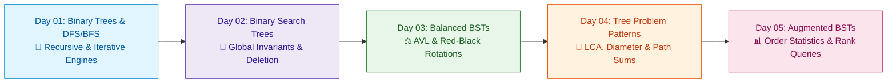

# 📘 Week 07: Trees & Balanced Search Trees

> 🧭 **Navigation:** [← Previous: Week 06](../week_06_string_manipulation_patterns/README.md) • [🏠 Curriculum Overview](../README.md) • [📘 Complete Syllabus](../COMPLETE_SYLLABUS.md) • [Next: Week 08 →](../week_08_graph_fundamentals/README.md)

---

## 🎬 Welcome to Week 07: The Hierarchical Architect's Masterclass!

In technical interviews, trees are the ultimate bridge between recursive mathematical induction and practical systems programming (file systems, database B-Trees, DOM trees, and syntax parsers).

While arrays force linear `O(N)` scans, properly balanced hierarchical structures partition search spaces into lightning-fast `O(log N)` logarithmic tiers. This week transforms you from writing fragile recursive traversals that crash on deep trees into mastering **call stack invariants**, **iterative stack/queue engines**, **BST boundary invariants**, **AVL/Red-Black rotation physics**, and **subtree bottom-up state propagation**.

---

## 📅 Day-by-Day Learning Path

| Day | Instructional Masterclass | Core Mental Model & Intuition | Key Pattern / Invariant |
| :--- | :--- | :--- | :--- |
| **Day 01** | [Binary Trees & Traversals](Week_07_Day_01_Binary_Trees_And_Traversals_Instructional.md) | **The Executive Delegation:** Pre/In/Post-order dispatch & BFS waves. | Call stack frames, iterative stack tracking, level-order FIFO queue. |
| **Day 02** | [Binary Search Trees](Week_07_Day_02_Binary_Search_Trees_Instructional.md) | **The Sorted Highway:** Strict `(min < root.val < max)` boundaries. | Range propagation invariant, in-order monotonicity, 3-case node deletion. |
| **Day 03** | [Balanced BSTs: AVL & Red-Black](Week_07_Day_03_Balanced_BSTs_AVL_And_RedBlack_Instructional.md) | **The Mechanical Gyroscope:** Constant-time pointer pivots & rotations. | Balance factor `[-1, 0, 1]`, single vs double rotations, color-flip invariants. |
| **Day 04** | [Tree Patterns: LCA & Diameter](Week_07_Day_04_Tree_Patterns_Instructional.md) | **The Subtree Contract:** Bubble up depths, solve global maximums. | Post-order return values, Lowest Common Ancestor convergence, tree diameter. |
| **Day 05** | [Augmented BSTs: Order Statistics](Week_07_Day_05_Augmented_BSTs_OrderStatistics_Instructional.md) | **The Subtree Census:** Maintaining subtree sizes for `O(log N)` rank. | `size = left.size + right.size + 1`, select-kth element, rank query. |

---

## 📚 Consolidated Playbooks & Reference Guides

*   📖 **Comprehensive Week Playbook:** [WEEK_07_FULL_PLAYBOOK.md](WEEK_07_FULL_PLAYBOOK.md) — High-density synthesis of all invariants, theorems, and pattern triggers for this week.
*   📊 **Visual Concepts Playbook (Hybrid):** [Week_07_Visual_Concepts_Playbook_HYBRID.md](Week_07_Visual_Concepts_Playbook_HYBRID.md) — Compact Mermaid diagrams, state transitions, and complexity reference tables.
*   💻 **Production C# Reference (.NET 8/9):** [Week_07_Extended_CSharp_Complete.md](Week_07_Extended_CSharp_Complete.md) — Idiomatic, zero-allocation memory-aware implementations and problem ladders.
*   🐍 **Production Python Reference (Python 3.11+):** [Week_07_Extended_Python_Complete.md](Week_07_Extended_Python_Complete.md) — Clean, pythonic reference implementations for rapid whiteboard prototyping.

---

## 🛠️ The 5 Core Support Files (`support files/`)

1.  📋 [Daily Progress Checklist](support%20files/Week_07_Daily_Progress_Checklist.md) — Step-by-step accountability tracker for theory, coding, and variants.
2.  🧭 [Weekly Guidelines & Mental Models](support%20files/Week_07_Guidelines.md) — Strategic roadmap, common pitfalls, and conceptual anchors.
3.  🎙️ [Interview Q&A Comprehensive Reference](support%20files/Week_07_Interview_QA_Reference.md) — High-frequency senior technical questions with verbal response frameworks.
4.  🗺️ [Problem-Solving Roadmap](support%20files/Week_07_Problem_Solving_Roadmap.md) — Tier-1 problem progression ladder from warm-up to advanced.
5.  📑 [Summary & Key Concepts Synthesis](support%20files/Week_07_Summary_Key_Concepts.md) — Fast-revision cheat sheet covering all governing invariants and system trade-offs.

---

> 🧭 **Navigation:** [← Previous: Week 06](../week_06_string_manipulation_patterns/README.md) • [🏠 Curriculum Overview](../README.md) • [📘 Complete Syllabus](../COMPLETE_SYLLABUS.md) • [Next: Week 08 →](../week_08_graph_fundamentals/README.md)
