# 📚 Week 07 Day 01: Binary Trees & Traversals — The Complete FAANG Engineering Guide

> 🧭 **Navigation:** [← Week Overview](README.md) • [🏠 Week Overview](README.md) • [📘 Curriculum Syllabus](../COMPLETE_SYLLABUS.md) • [Next Day →](Week_07_Day_02_Binary_Search_Trees_Instructional.md)
> 
> 💡 **Instructor Note:** *Welcome to Week 7! Binary trees mark the quantum leap from linear data structures (arrays, linked lists) into hierarchical, non-linear computer science. Today, we master the fundamental mechanics of navigating branched memory: Recursive & Iterative DFS (Pre-order, In-order, Post-order) and Iterative BFS (Level-order). We dismantle the physical memory model, explain why naive recursion crashes in production on skewed trees, and engineer bulletproof, zero-crash implementations in C# (.NET 8/9) and Python (3.11+).*

---

## 🎯 LEARNING OBJECTIVES

By the end of this chapter, you will be able to:

- 🎯 **Internalize** how binary trees generalize linear pointers into hierarchical branching, modeling real-world organizational data from Abstract Syntax Trees (ASTs) to game engine scene graphs.
- 🪜 **Master** all four canonical traversal disciplines (Pre-order, In-order, Post-order, Level-order BFS) through physical mental models and exact hand traces.
- 🎨 **Deconstruct** physical memory anatomy: 32-byte heap node layouts, pointer-chasing CPU cache misses, and runtime call stack frames vs. explicit heap-allocated stacks.
- 🛑 **Eliminate** fatal Rookie Blunders: confusing Pre-order vs In-order execution timing, missing null base cases, mutating `queue.Count` mid-loop in BFS, and thread stack exhaustion on skewed trees (`H = N`).
- 🎙️ **Articulate** the exact 3-sentence live FAANG interview talk track with Senior Architect poise before writing a single line of code.
- ⚡ **Implement** production-grade, overflow-safe C# (.NET 8/9) and idiomatic Python (3.11+) across 5 essential FAANG problems: In-Order Traversal (LC 94, recursive, iterative, & Morris), Level-Order Traversal (LC 102), Maximum Depth (LC 104), Pre-Order Traversal (LC 144), and Post-Order Traversal (LC 145).

---

## 🎬 CHAPTER 1: THE 60-SECOND HOOK & EVERYDAY METAPHOR (PILLAR 1)

### The High-Energy Hook: The 100,000-Node Production Outage

Hey engineers, welcome to **Week 7: Trees & Balanced Search Trees**!

Imagine you are a Senior Engineer at Microsoft or Amazon. Your team manages an identity and access management service that parses corporate reporting hierarchies. A junior developer writes a textbook recursive function to traverse a company org tree and calculate total department headcount:

```csharp
public int CalculateHeadcount(EmployeeNode? root)
{
    if (root is null) return 0;
    return 1 + CalculateHeadcount(root.LeftReport) + CalculateHeadcount(root.RightReport);
}
```

It looks spotless. It passes all unit tests on 10-node mock trees in CI/CD. 

Then comes Monday morning. An enterprise client onboard their directory with **100,000 employees**. In their organization, managers report sequentially in a long, single-chain hierarchy: Director A reports to VP B, who reports to Senior VP C, creating a degenerate skewed tree of depth `N = 100,000`.

The service starts processing the request. Two milliseconds later, the entire production pod crashes violently:
```
Process terminated due to StackOverflowException.
```

No clean log entry. No catch block caught it. Why?

In modern operating systems (Linux, Windows x64), each operating system thread is allocated a fixed, tiny call stack—typically **1 MB to 4 MB**. Every recursive function call pushes a new stack frame containing return addresses, function arguments, and register spills (~128 to 256 bytes per call). At a recursion depth of just ~8,000 to 10,000 frames, the thread blows right past its stack guard page.

A flat array can hold 10,000,000 elements effortlessly on the gigabyte-scale heap. But navigating a binary tree recursively bets the stability of your service on the microscopic thread call stack. 

Mastering binary trees is not just about knowing "Left-Root-Right." It is about mastering **traversal disciplines, call stack versus heap mechanics, and knowing when to replace recursion with explicit data structures**.

---

### The Real-World Metaphor: The Executive Delegation & Family Tree

Think of a binary tree as an **Executive Delegation Hierarchy** or a **Multi-Generational Family Tree**:

```
                  [ CEO / Matriarch (1) ]
                        /          \
                       /            \
        [ VP Engineering (2) ]     [ VP Product (3) ]
                 /
                /
     [ Lead Architect (4) ]
```

When leadership needs to inspect the health of the entire enterprise, there are two diametrically opposed organizational philosophies:

#### 1. Recursive DFS: The "Drilling Down the Rabbit Hole" Investigator
- Imagine an auditor who meets the CEO (Root `1`).
- The CEO says, *"Before you look at Product, go audit Engineering (Node `2`)."*
- The auditor walks into Engineering. The VP of Engineering says, *"Before you audit my department, inspect our Lead Architect (Node `4`)."*
- The auditor drills straight down the rabbit hole to the deepest leaf before ever surfacing to inspect Node `3`.
- **DFS is laser-focused and deep.** It explores one branch entirely to its bitter end before backtracking.
- If the chain of command is 100,000 levels deep, the auditor's notebook (the call stack) runs out of pages and bursts into flames.

#### 2. Iterative BFS: The "Rippling Waves" / Flood Fill in a Lake
- Imagine tossing a pebble into the center of a calm lake.
- The water does not shoot straight down to the lake bed. Instead, it forms **concentric rippling waves expanding outward**:
  - **Wave 0 (Depth 0):** The CEO (Node `1`).
  - **Wave 1 (Depth 1):** All immediate Vice Presidents simultaneously (Nodes `2` and `3`).
  - **Wave 2 (Depth 2):** All next-level managers (Node `4`).
- **BFS explores level-by-level, breadth-first.** Nobody at Level `k + 1` is ever touched until every single executive at Level `k` has been completely processed.
- BFS avoids the call stack entirely by maintaining a **FIFO Queue** allocated on the heap, making it immune to thread stack exhaustion.

---

### The Call Stack Overflow Risk on Skewed Trees

Why does tree shape dictate algorithmic safety?

```
    Balanced Tree (Height H = log2 N)          Degenerate Skewed Tree (Height H = N)
                 [ 1 ]                                       [ 1 ]
                /     \                                       \
             [ 2 ]   [ 3 ]                                   [ 2 ]
             /   \   /   \                                     \
           [ 4 ][ 5 ][ 6 ][ 7 ]                               [ 3 ]
                                                                 \
                                                                 [ 4 ]
    N = 1,000,000 Nodes                                            \
    Height H = log2(10^6) ≈ 20 frames!                            ...
    Stack Space: 20 * 128B ≈ 2.5 KB (Safe!)                       [ 10^5 ]
                                                       Height H = 100,000 frames!
                                                       Stack Space: 100,000 * 128B ≈ 12.8 MB
                                                       Result: FATAL StackOverflowException!
```

- In a **balanced tree**, tree height `H = log2(N)`. For one million nodes, the call stack grows to just 20 frames (~2.5 KB). Recursion is virtually free.
- In a **skewed tree**, tree height `H = N`. The tree degenerates into a singly linked list. Recursion attempts to push `N` frames, detonating the 1 MB thread stack limit.

---

## 🪜 CHAPTER 2: THE SCAFFOLDING LADDER & TOY NAPKIN TRACES (PILLAR 2)

Never attempt complex tree algorithms until you can hand-trace the core traversal disciplines on a napkin with zero hesitation.

### The Canonical 4-Node Scaffold Tree

To build absolute clarity, we hand-trace all four major traversals against this asymmetric 4-node tree:

```
           [ 1 ]
          /     \
       [ 2 ]   [ 3 ]
       /
    [ 4 ]
```

- **Node 1:** Root with Left Child `2` and Right Child `3`.
- **Node 2:** Internal node with Left Child `4` and Right Child `null`.
- **Node 3:** Leaf node with Left Child `null` and Right Child `null`.
- **Node 4:** Leaf node with Left Child `null` and Right Child `null`.

---

### 🪜 Napkin Trace 1: Pre-Order Traversal (`Root -> Left -> Right`)

- **Discipline:** Visit the parent node **immediately upon arrival** before descending into its subtrees.
- **Mental Trigger:** *"Stamp your passport as soon as you enter the building."*
- **Sequence:** `[1, 2, 4, 3]`

```
Step 1: Arrive at Root 1. Process 1.                     Accumulator: [ 1 ]
Step 2: Descend Left to Node 2. Process 2.               Accumulator: [ 1, 2 ]
Step 3: Descend Left to Node 4. Process 4.               Accumulator: [ 1, 2, 4 ]
Step 4: Node 4 has no children. Backtrack to Node 2.
Step 5: Node 2 has no right child. Backtrack to Root 1.
Step 6: Descend Right from Root 1 to Node 3. Process 3.  Accumulator: [ 1, 2, 4, 3 ]
Step 7: Node 3 has no children. Traversal Complete!
```

---

### 🪜 Napkin Trace 2: In-Order Traversal (`Left -> Root -> Right`)

- **Discipline:** Drill down the entire left spine first. Process the parent **between** resolving the left subtree and descending into the right subtree.
- **Mental Trigger:** *"On a Binary Search Tree (BST), this produces strictly sorted order."*
- **Sequence:** `[4, 2, 1, 3]`

```
Step 1: Arrive at Root 1. Left exists -> recurse Left to Node 2.
Step 2: Arrive at Node 2. Left exists -> recurse Left to Node 4.
Step 3: Arrive at Node 4. Left is null -> Process 4!     Accumulator: [ 4 ]
Step 4: Node 4 right is null -> unwind to Node 2.
Step 5: Left subtree of Node 2 is resolved -> Process 2! Accumulator: [ 4, 2 ]
Step 6: Node 2 right is null -> unwind to Root 1.
Step 7: Left subtree of Root 1 is resolved -> Process 1! Accumulator: [ 4, 2, 1 ]
Step 8: Recurse Right from Root 1 to Node 3.
Step 9: Node 3 left is null -> Process 3!                Accumulator: [ 4, 2, 1, 3 ]
Step 10: Node 3 right is null -> unwind. Traversal Complete!
```

---

### 🪜 Napkin Trace 3: Post-Order Traversal (`Left -> Right -> Root`)

- **Discipline:** Process all children **before** visiting their parent.
- **Mental Trigger:** *"Bottom-up evaluation: You cannot compute a folder's total disk size until you sum all files and subfolders inside it."*
- **Sequence:** `[4, 2, 3, 1]`

```
Step 1: Arrive at Root 1 -> Recurse Left to 2 -> Recurse Left to 4.
Step 2: Node 4 children are both null -> Process 4!     Accumulator: [ 4 ]
Step 3: Unwind to Node 2 -> Right child is null -> Process 2! Accumulator: [ 4, 2 ]
Step 4: Unwind to Root 1 -> Right subtree NOT yet resolved!
Step 5: Recurse Right from Root 1 to Node 3.
Step 6: Node 3 children are both null -> Process 3!     Accumulator: [ 4, 2, 3 ]
Step 7: Unwind to Root 1 -> Both subtrees resolved -> Process 1! Accumulator: [ 4, 2, 3, 1 ]
```

---

### 🪜 Napkin Trace 4: Level-Order Traversal (Breadth-First Search)

- **Discipline:** Process nodes horizontally, layer-by-layer, left-to-right.
- **Mental Trigger:** *"Concentric ripples expanding outward from the root."*
- **Sequence:** `[[1], [2, 3], [4]]`

```
Queue Initial State: [ 1 ]

Wave 0 (Level 0):
- Snapshot levelSize = 1.
- Dequeue 1. Process 1. Enqueue children 2 and 3.
- Level 0 Output: [ 1 ]
- Queue State: [ 2, 3 ]

Wave 1 (Level 1):
- Snapshot levelSize = 2.
- Dequeue 2. Process 2. Enqueue child 4.
- Dequeue 3. Process 3. Enqueue no children (null).
- Level 1 Output: [ 2, 3 ]
- Queue State: [ 4 ]

Wave 2 (Level 2):
- Snapshot levelSize = 1.
- Dequeue 4. Process 4. Enqueue no children (null).
- Level 2 Output: [ 4 ]
- Queue State: [ ] (Empty -> Loop terminates)

Final 2D Output: [ [1], [2, 3], [4] ]
```

---

### 🪜 Iterative Stack Simulation: In-Order Traversal Step-by-Step

How do we simulate the recursive call stack using an explicit heap-allocated `Stack<TreeNode>` and a pointer `curr`?

**The Invariant Rule:**
1. While `curr is not null`, push `curr` onto the stack and drill left (`curr = curr.left`).
2. When `curr hits null`, pop from the stack, record the popped node's value, and pivot right (`curr = popped.right`).

Let's trace our 4-node tree step-by-step:

| Step | `curr` Pointer | Stack State (Top -> Bottom) | Action Taken | Node Popped | Output Appended | Result List |
| :---: | :---: | :--- | :--- | :---: | :---: | :--- |
| **0** | `1` | `[ ]` | Initialize pointer at root | - | - | `[ ]` |
| **1** | `1` | `[ 1 ]` | Push `1`, drill left (`curr = 2`) | - | - | `[ ]` |
| **2** | `2` | `[ 2, 1 ]` | Push `2`, drill left (`curr = 4`) | - | - | `[ ]` |
| **3** | `4` | `[ 4, 2, 1 ]` | Push `4`, drill left (`curr = null`) | - | - | `[ ]` |
| **4** | `null` | `[ 2, 1 ]` | Hit null! Pop top node `4`. Pivot `curr = 4.right (null)` | `4` | `4` | `[ 4 ]` |
| **5** | `null` | `[ 1 ]` | Hit null! Pop top node `2`. Pivot `curr = 2.right (null)` | `2` | `2` | `[ 4, 2 ]` |
| **6** | `null` | `[ ]` | Hit null! Pop top node `1`. Pivot `curr = 1.right (3)` | `1` | `1` | `[ 4, 2, 1 ]` |
| **7** | `3` | `[ 3 ]` | `curr` not null! Push `3`, drill left (`curr = null`) | - | - | `[ 4, 2, 1 ]` |
| **8** | `null` | `[ ]` | Hit null! Pop top node `3`. Pivot `curr = 3.right (null)` | `3` | `3` | `[ 4, 2, 1, 3 ]` |
| **9** | `null` | `[ ]` | `curr == null` AND `stack.Count == 0` -> **TERMINATE** | - | - | `[ 4, 2, 1, 3 ]` |

Notice how the explicit stack faithfully replicates the exact memory unwinding of runtime recursion, but does so entirely on the heap!

---

### 🧠 Pause & Predict Micro-Drills

Before moving to visual memory models, test your intuition with these active recall micro-drills:

#### 🧠 Drill 1: The Reversed Post-Order Mystery
**Scenario:** Suppose you implement a traversal that processes `Root -> Right -> Left` (Pre-order with children reversed).
**Question:** If you reverse the final resulting list, what standard traversal sequence do you obtain?
<details>
<summary>👉 Click to Reveal the Architectural Proof</summary>

**Answer: Post-Order (`Left -> Right -> Root`)!**
- Pre-order is: `Root -> Left -> Right`.
- Swapping child order gives: `Root -> Right -> Left`.
- Reversing that entire sequence gives: `Left -> Right -> Root`!
- **Engineering Application:** This is the famous "2-Stack" or "Reverse Pre-order" trick for implementing iterative Post-order traversal without tracking parent-revisit states!
</details>

---

#### 🧠 Drill 2: Call Stack Exhaustion Threshold
**Scenario:** A .NET web application runs on a Linux container with the default thread stack size of 1 MB (~1,048,576 bytes). Each recursive call frame occupies roughly 160 bytes.
**Question:** At approximately what tree depth will a recursive traversal trigger a fatal `StackOverflowException`?
<details>
<summary>👉 Click to Reveal the Math</summary>

**Answer: Approximately 6,500 levels deep!**
- `1,048,576 bytes / 160 bytes per frame ≈ 6,553 frames`.
- Operating systems also reserve guard pages at the stack boundary, triggering stack overflow even earlier (~6,000 calls).
- **Takeaway:** For balanced trees of 1,000,000 nodes (`Height = 20`), recursion is 100% safe. But for user-generated or unvalidated trees that can be degenerate (`N > 10,000`), recursive algorithms are a critical vulnerability!
</details>

---

#### 🧠 Drill 3: BFS Peak Memory on a Perfect Tree
**Scenario:** You execute a Level-Order BFS on a perfect binary tree containing `N = 1,023` nodes (Height `H = 9`).
**Question:** What is the maximum number of nodes simultaneously held in the BFS `Queue` at its peak?
<details>
<summary>👉 Click to Reveal the Width Proof</summary>

**Answer: 512 nodes (over 50% of the entire tree)!**
- In a perfect binary tree, the last level (depth `H`) contains `2^H` leaves.
- For `N = 1,023`, `H = 9`, so the leaf level contains `2^9 = 512` nodes.
- When BFS dequeues the penultimate level, all 512 leaves sit inside the queue simultaneously.
- **Architectural Rule:** While DFS auxiliary space is bounded by tree height `O(H)`, BFS auxiliary space is bounded by tree maximum width `O(W)`. On a balanced tree, `W = O(N)`.
</details>

---

## 🎨 CHAPTER 3: PRAGMATIC VISUAL MODELS (PILLAR 3)

### ASCII Memory Visual 1: 64-Bit Heap Layout & Pointer Chasing

To write high-performance tree code, you must understand how binary trees physically exist inside computer RAM.

#### The 32-Byte Object Overhead in Managed Runtimes (.NET CLR / JVM)
In a language like C#, an object is not just its payload:

```
                      Node Anatomy (Logical vs Physical Layout)
                      
       Logical View                           Physical 64-bit Heap Layout (.NET CLR)
    +-----------------+                     +---------------------------------------------+
    |      [Val]      |                     | 0x00: Object Header / SyncBlock (8 bytes)   |
    |      (Key)      |                     | 0x08: TypeHandle / MethodTable Pointer (8B) |
    +--------+--------+                     | 0x10: int val (4 bytes) + 4-byte padding    |
    |  Left  | Right  |                     | 0x18: TreeNode* left  (8-byte pointer)      |
    | Pointer| Pointer|                     | 0x20: TreeNode* right (8-byte pointer)      |
    +---+----+----+---+                     +---------------------------------------------+
        |         |                         Total Memory Footprint: 32 bytes per node!
        v         v                         Payload Efficiency: 4 bytes data / 32 bytes = 12.5%!
    [Left Node] [Right Node]
```

#### Contiguous Array Cache Locality vs Scattered Pointer Chasing

```
Contiguous Array (High Cache Locality - Spatial Pre-fetching):
Address:   [ 0x1000 ] [ 0x1004 ] [ 0x1008 ] [ 0x100C ] [ 0x1010 ]
Elements:  |  arr[0] |  arr[1] |  arr[2] |  arr[3] |  arr[4] |
Cache:     <--------------- 64-Byte CPU Cache Line ----------------> (1 fetch loads ~16 ints!)

Scattered Binary Tree (Low Cache Locality - Pointer Chasing):
Address:   0x1040                 0x4080                     0x9200
Node:      [ Node 1 (Root) ] ---> [ Node 2 (Left) ] -------> [ Node 4 (Leaf) ]
           (Heap Block 1)         (Heap Block 2)             (Heap Block 3)
Cache:     Each pointer dereference may trigger a separate L1/L2/L3 CPU cache miss!
```

---

### ASCII Memory Visual 2: Call Stack Frames vs Heap Memory

```
  THREAD CALL STACK (Fixed: 1 MB - 4 MB)           MANAGED HEAP (Gigabytes Available)
  +-------------------------------------+          +------------------------------------+
  | Frame 3: Inorder(Node 4)            |          | TreeNode(1) @ 0x1040               |
  | - Return address, locals (4 bytes)  |          | - val: 1, left: 0x2080, right: ... |
  +-------------------------------------+          +------------------------------------+
  | Frame 2: Inorder(Node 2)            |          | TreeNode(2) @ 0x2080               |
  | - Return address, locals (4 bytes)  |          | - val: 2, left: 0x4000, right: null|
  +-------------------------------------+          +------------------------------------+
  | Frame 1: Inorder(Node 1)            |          | TreeNode(4) @ 0x4000               |
  | - Return address, locals (4 bytes)  |          | - val: 4, left: null, right: null  |
  +-------------------------------------+          +------------------------------------+
  | Frame 0: Main() Caller Frame        |          | Stack<TreeNode> Internal Array     |
  +-------------------------------------+          | [ 0x1040 | 0x2080 | 0x4000 ]       |
  | STACK OVERFLOW DANGER ZONE!         |          | (Can grow to millions of entries!) |
  v (Exhausts page guard at depth 8,000)v          +------------------------------------+
```

---

### Mermaid Architectural Visual: DFS Call Stack vs BFS FIFO Queue Waves

The following diagram directly contrasts how memory processes our 4-node tree under Depth-First Search versus Breadth-First Search:

```mermaid
%%{init: {"flowchart": {"htmlLabels": true, "padding": 20}, "themeCSS": "foreignObject { overflow: visible !important; }"}}%%
flowchart TD
    subgraph DFS["🌲 RECURSIVE DFS (LIFO CALL STACK)"]
        D1["1️⃣ Push Frame <code>Node 1</code><br/>Recurse Left"] --> D2["2️⃣ Push Frame <code>Node 2</code><br/>Recurse Left"]
        D2 --> D3["3️⃣ Push Frame <code>Node 4</code><br/>Base Case Hit (null)"]
        D3 -->|"Unwind &amp; Pop 4"| D4["4️⃣ Resume <code>Node 2</code><br/>Right is null -&gt; Pop 2"]
        D4 -->|"Unwind &amp; Pop 2"| D5["5️⃣ Resume <code>Node 1</code><br/>Recurse Right"]
        D5 --> D6["6️⃣ Push Frame <code>Node 3</code><br/>Pop 3 -&gt; Complete"]
    end

    subgraph BFS["🌊 ITERATIVE BFS (FIFO HEAP QUEUE WAVES)"]
        B1["🌊 Wave 0 (Level 0)<br/>Queue: <code>( 1 )</code><br/>Dequeue 1 -&gt; Output <code>(1)</code>"]
        B1 -->|"Enqueue Children 2, 3"| B2["🌊 Wave 1 (Level 1)<br/>Queue: <code>( 2, 3 )</code><br/>Dequeue 2, 3 -&gt; Output <code>(2, 3)</code>"]
        B2 -->|"Enqueue Child 4"| B3["🌊 Wave 2 (Level 2)<br/>Queue: <code>( 4 )</code><br/>Dequeue 4 -&gt; Output <code>(4)</code>"]
        B3 -->|"Queue Empty"| B4["🏁 Complete 2D Output:<br/><code>((1), (2, 3), (4))</code>"]
    end

    style D1 fill:#1e293b,stroke:#38bdf8,stroke-width:2px,color:#f8fafc
    style D2 fill:#1e293b,stroke:#38bdf8,stroke-width:2px,color:#f8fafc
    style D3 fill:#1e293b,stroke:#38bdf8,stroke-width:2px,color:#f8fafc
    style D4 fill:#064e3b,stroke:#10b981,stroke-width:2px,color:#ecfdf5
    style D5 fill:#064e3b,stroke:#10b981,stroke-width:2px,color:#ecfdf5
    style D6 fill:#064e3b,stroke:#10b981,stroke-width:2px,color:#ecfdf5

    style B1 fill:#1e1b4b,stroke:#818cf8,stroke-width:2px,color:#e0e7ff
    style B2 fill:#1e1b4b,stroke:#818cf8,stroke-width:2px,color:#e0e7ff
    style B3 fill:#1e1b4b,stroke:#818cf8,stroke-width:2px,color:#e0e7ff
    style B4 fill:#064e3b,stroke:#10b981,stroke-width:2px,color:#ecfdf5
```



---

## 🛑 CHAPTER 4: THE ROOKIE TRAP ZONE (PILLAR 4)

Let's dissect the 4 fatal blunders that destroy candidates in FAANG technical screens, contrasted directly with Senior Architect patterns.

---

### Trap 1: Confusing In-Order vs Pre-Order Execution Timing

A classic mistake is executing business logic or recording a node's value before descending left when the problem specifically demands In-order evaluation (e.g. validating a Binary Search Tree).

| Metric | ❌ Rookie Blunder | ✅ Senior Architect Pattern |
| :--- | :--- | :--- |
| **Execution Point** | Adding to output before `Traverse(node.left)` | Adding to output strictly between `node.left` and `node.right` |
| **BST Consequence** | Emits unsorted preorder sequence; breaks validation | Emits strictly sorted keys in non-decreasing order |
| **Mental Bug** | Conflating "reaching a node" with "processing a node" | Respecting the exact subtree resolution invariant |

```csharp
// ❌ Rookie Blunder: Accidental Pre-order in an In-order problem!
void BadInorder(TreeNode? node, List<int> result)
{
    if (node is null) return;
    result.Add(node.val); // WRONG! This is Pre-order! Emits parent before left subtree!
    BadInorder(node.left, result);
    BadInorder(node.right, result);
}

// ✅ Senior Architect Pattern: Invariant-disciplined Left -> Root -> Right
void GoodInorder(TreeNode? node, List<int> result)
{
    if (node is null) return;
    GoodInorder(node.left, result);
    result.Add(node.val); // CORRECT: Processed only after entire left subtree completes
    GoodInorder(node.right, result);
}
```

---

### Trap 2: Forgetting the Null Base Case (`NullReferenceException`)

Junior engineers often check children before recursing (`if (node.left != null) Traverse(node.left)`), but forget to guard the initial `root` argument or right child, leading to runtime null dereferences.

```python
# ❌ Rookie Blunder: Messy child-checking; crashes when root is None!
def bad_max_depth(root: Optional[TreeNode]) -> int:
    # Missing if not root check!
    left_depth = bad_max_depth(root.left) if root.left else 0 # Crashes if root is None!
    right_depth = bad_max_depth(root.right) if root.right else 0
    return 1 + max(left_depth, right_depth)

# ✅ Senior Architect Pattern: Clean Top-of-Function Guard Clause
def good_max_depth(root: Optional[TreeNode]) -> int:
    if not root:
        return 0  # The height of an empty tree is 0. Base case handles everything!
    return 1 + max(good_max_depth(root.left), good_max_depth(root.right))
```

---

### Trap 3: The Dynamic BFS Queue Size Evaluation Bug

In Breadth-First Search, you must group nodes by level. A fatal blunder is putting `queue.Count` directly inside the loop condition:

```csharp
// ❌ Rookie Blunder: queue.Count mutates during iteration! Levels get scrambled!
while (queue.Count > 0)
{
    var currentLevel = new List<int>();
    for (int i = 0; i < queue.Count; i++) // DANGER! queue.Count changes when children are enqueued!
    {
        TreeNode node = queue.Dequeue();  // queue.Count decreases by 1
        currentLevel.Add(node.val);
        if (node.left != null) queue.Enqueue(node.left);   // queue.Count increases!
        if (node.right != null) queue.Enqueue(node.right); // Loop boundary is corrupt!
    }
    result.Add(currentLevel);
}

// ✅ Senior Architect Pattern: Snapshot levelSize prior to inner dequeue loop
while (queue.Count > 0)
{
    int levelSize = queue.Count; // IMMUTABLE SNAPSHOT of current level capacity!
    var currentLevel = new List<int>(levelSize); // Zero-reallocation pre-sizing!
    
    for (int i = 0; i < levelSize; i++)
    {
        TreeNode node = queue.Dequeue();
        currentLevel.Add(node.val);
        if (node.left is not null) queue.Enqueue(node.left);
        if (node.right is not null) queue.Enqueue(node.right);
    }
    result.Add(currentLevel);
}
```

---

### Trap 4: Thread Stack Exhaustion vs Heap Stack Allocation

| Metric | ❌ Recursive DFS (Unchecked) | ✅ Explicit Iterative Stack |
| :--- | :--- | :--- |
| **Allocation Memory** | Thread Call Stack (1 MB limit) | Managed Heap (Gigabytes available) |
| **Skewed Tree (`N=10^5`)** | 💥 `StackOverflowException` (Crashes Process) | 🛡️ Seamlessly succeeds in `O(N)` time |
| **Production Resilience**| Vulnerable to malicious/unbalanced user inputs | Staff/Principal Architect production grade |

```csharp
// ✅ Senior Architect Pattern: Iterative Inorder with explicit heap stack
public static IList<int> InorderIterative(TreeNode? root)
{
    var result = new List<int>();
    if (root is null) return result;

    var stack = new Stack<TreeNode>();
    TreeNode? current = root;

    while (current is not null || stack.Count > 0)
    {
        // Drill down left spine
        while (current is not null)
        {
            stack.Push(current);
            current = current.left;
        }

        // Pop and process
        current = stack.Pop();
        result.Add(current.val);

        // Pivot right
        current = current.right;
    }

    return result;
}
```

---

## 🎙️ CHAPTER 5: 45-MINUTE INTERVIEW TALK TRACK (PILLAR 5)

When an interviewer asks you to traverse a binary tree or calculate properties like height or level order, do **not** jump straight into coding. Look them in the eye and deliver this exact 3-sentence script:

> 🎙️ **The 3-Sentence FAANG Talk Track:**
> 1. *"To solve this problem, I will choose between depth-first search (DFS) for hierarchical subtree aggregation and breadth-first search (BFS) if we require layer-by-layer horizontal grouping."*
> 2. *"While a recursive DFS is clean and intuitive, a production system must guard against `StackOverflowException` on degenerate skewed trees with depth up to `10^5`; therefore, I will implement an iterative solution using an explicit heap-allocated stack with a left-spine descent pointer."*
> 3. *"This guarantees deterministic `O(N)` time complexity while strictly bounding auxiliary space to tree height `O(H)`, scaling safely up to millions of nodes without risking thread stack exhaustion."*

---

### The 4-Phase Live Interview Walkthrough

#### Phase 1: Clarification & Boundaries (0–5 Mins)
- **Candidate:** "Before writing code, let me clarify the constraints:
  - Can the input `root` be `null`? (Yes, handle empty tree returning empty list or 0).
  - What is the maximum number of nodes `N`? (Up to `10^5`).
  - Is the tree guaranteed to be balanced, or can it be degenerate/skewed? (It can be skewed, which confirms why an iterative approach or explicit stack is required).
  - Are node values unique, and can they be negative? (Standard 32-bit signed integers)."

#### Phase 2: Approach & Trade-Off Pitch (5–12 Mins)
- **Candidate:** "For In-order traversal, the recursive solution requires `O(H)` call stack space. On a skewed tree where `H = N = 10^5`, recursion exhausts thread stack memory. I will implement the iterative approach using an explicit `Stack<TreeNode>` and a pointer `curr`. We drill down to the leftmost child, pushing ancestors onto our stack. When `curr` reaches `null`, we pop, process the node, and pivot to its right child. This ensures `O(N)` time and `O(H)` heap space."

#### Phase 3: Live Coding (12–30 Mins)
- *Write clean, modular code with guard clauses, meaningful variable names, and explicit type contracts.*

#### Phase 4: Edge Cases & Verification (30–40 Mins)
- **Candidate:** "Let's dry-run our implementation against edge cases:
  1. `root == null`: Guard clause triggers immediately, returns empty result.
  2. Single node `[1]`: Pushed to stack, popped, output `[1]`, right is null, stack empty, terminates cleanly.
  3. Left-skewed tree (`1 -> 2 -> 4`): Drills all nodes onto stack, pops in reverse `4 -> 2 -> 1`, exactly matching In-order.
  4. Right-skewed tree (`1 -> 2 -> 3`): Pushes 1, pops 1, pivots to 2, pushes 2, pops 2, pivots to 3, outputs `1 -> 2 -> 3`."

---

## ⚡ CHAPTER 6: PRODUCTION DUAL-LANGUAGE IMPLEMENTATIONS (PILLAR 6)

Here are the complete, production-grade implementations in both **C# (.NET 8/9)** and **Python (3.11+)** across the 5 core FAANG traversal problems.

---

### Common Tree Node Definition

#### C# Definition (.NET 8/9)
```csharp
public sealed class TreeNode
{
    public int val;
    public TreeNode? left;
    public TreeNode? right;

    public TreeNode(int val = 0, TreeNode? left = null, TreeNode? right = null)
    {
        this.val = val;
        this.left = left;
        this.right = right;
    }
}
```

#### Python Definition (Python 3.11+)
```python
from typing import Optional

class TreeNode:
    def __init__(self, val: int = 0, left: Optional['TreeNode'] = None, right: Optional['TreeNode'] = None):
        self.val = val
        self.left = left
        self.right = right
```

---

### Problem 1: Binary Tree In-Order Traversal (LeetCode 94)

Given the `root` of a binary tree, return the in-order traversal of its nodes' values.

#### C# Production Implementation (.NET 8/9)
```csharp
using System;
using System.Collections.Generic;

public static class InorderTraversals
{
    /// <summary>
    /// Recursive Inorder Traversal: Left -> Root -> Right
    /// Time Complexity: O(N) | Auxiliary Space: O(H) Call Stack
    /// </summary>
    public static IList<int> InorderRecursive(TreeNode? root)
    {
        var result = new List<int>();
        Traverse(root, result);
        return result;

        static void Traverse(TreeNode? node, List<int> list)
        {
            if (node is null) return;
            Traverse(node.left, list);
            list.Add(node.val);
            Traverse(node.right, list);
        }
    }

    /// <summary>
    /// Iterative Inorder Traversal using an explicit Stack.
    /// Eliminates call stack overflow risk on deep skewed trees.
    /// Time Complexity: O(N) | Auxiliary Space: O(H) Explicit Heap Stack
    /// </summary>
    public static IList<int> InorderIterative(TreeNode? root)
    {
        var result = new List<int>();
        if (root is null) return result;

        var stack = new Stack<TreeNode>();
        TreeNode? current = root;

        while (current is not null || stack.Count > 0)
        {
            // Step 1: Reach leftmost node of current subtree
            while (current is not null)
            {
                stack.Push(current);
                current = current.left;
            }

            // Step 2: Pop and process node
            current = stack.Pop();
            result.Add(current.val);

            // Step 3: Transition to right child
            current = current.right;
        }

        return result;
    }

    /// <summary>
    /// Morris Inorder Traversal using temporary pointer threading.
    /// Achieves O(1) auxiliary space without altering original tree topology permanently.
    /// Time Complexity: O(N) Amortized | Auxiliary Space: O(1)
    /// </summary>
    public static IList<int> InorderMorris(TreeNode? root)
    {
        var result = new List<int>();
        TreeNode? current = root;

        while (current is not null)
        {
            if (current.left is null)
            {
                // No left child -> process current and advance right
                result.Add(current.val);
                current = current.right;
            }
            else
            {
                // Find inorder predecessor (rightmost node in left subtree)
                TreeNode predecessor = current.left;
                while (predecessor.right is not null && predecessor.right != current)
                {
                    predecessor = predecessor.right;
                }

                if (predecessor.right is null)
                {
                    // Thread creation: build bridge back to current
                    predecessor.right = current;
                    current = current.left;
                }
                else
                {
                    // Thread teardown: left subtree completed, restore original null pointer
                    predecessor.right = null;
                    result.Add(current.val);
                    current = current.right;
                }
            }
        }

        return result;
    }
}
```

#### Python Production Implementation (3.11+)
```python
from typing import Optional

def inorder_recursive(root: Optional[TreeNode]) -> list[int]:
    """Recursive Inorder Traversal.
    
    Time Complexity: O(N) | Auxiliary Space: O(H) Call Stack
    """
    result: list[int] = []

    def traverse(node: Optional[TreeNode]) -> None:
        if not node:
            return
        traverse(node.left)
        result.append(node.val)
        traverse(node.right)

    traverse(root)
    return result

def inorder_iterative(root: Optional[TreeNode]) -> list[int]:
    """Iterative Inorder Traversal using explicit stack.
    
    Time Complexity: O(N) | Auxiliary Space: O(H) Explicit Stack
    """
    result: list[int] = []
    stack: list[TreeNode] = []
    current = root

    while current or stack:
        while current:
            stack.append(current)
            current = current.left
        
        current = stack.pop()
        result.append(current.val)
        current = current.right

    return result

def inorder_morris(root: Optional[TreeNode]) -> list[int]:
    """Morris Inorder Traversal with O(1) Auxiliary Space.
    
    Time Complexity: O(N) Amortized | Auxiliary Space: O(1)
    """
    result: list[int] = []
    current = root

    while current:
        if current.left is None:
            result.append(current.val)
            current = current.right
        else:
            predecessor = current.left
            while predecessor.right and predecessor.right is not current:
                predecessor = predecessor.right

            if predecessor.right is None:
                # Build thread bridge
                predecessor.right = current
                current = current.left
            else:
                # Destroy thread bridge and visit current
                predecessor.right = None
                result.append(current.val)
                current = current.right

    return result
```

#### 📊 Explicit Complexity Deconstruction
- **Recursive & Iterative Stack Traversal:**
  - **Time Complexity:** `O(N)` — Every node is visited a constant number of times (pushed and popped once).
  - **Auxiliary Space:** `O(H)` — Call stack or explicit stack depth equals tree height `H` (`O(log N)` balanced, `O(N)` degenerate).
- **Morris Traversal:**
  - **Time Complexity:** `O(N)` Amortized — Each tree edge is traversed at most 3 times.
  - **Auxiliary Space:** `O(1)` — Zero recursion, zero heap stack, zero queues. Only 2 pointer references (`current`, `predecessor`).
- **Output Space:** `O(N)` — Array holding the serialized node values.

---

### Problem 2: Binary Tree Level Order Traversal (LeetCode 102)

Given the `root` of a binary tree, return the level order traversal of its nodes' values (i.e., from left to right, level by level).

#### C# Production Implementation (.NET 8/9)
```csharp
using System.Collections.Generic;

public static class LevelOrderTraversal
{
    /// <summary>
    /// Level-Order Traversal (BFS) grouping nodes by depth.
    /// Time Complexity: O(N) | Auxiliary Space: O(W) where W = max level width
    /// </summary>
    public static IList<IList<int>> LevelOrder(TreeNode? root)
    {
        var result = new List<IList<int>>();
        if (root is null) return result;

        var queue = new Queue<TreeNode>();
        queue.Enqueue(root);

        while (queue.Count > 0)
        {
            // CRITICAL: Snapshot queue count before inner dequeue loop
            int levelSize = queue.Count;
            var currentLevel = new List<int>(levelSize);

            for (int i = 0; i < levelSize; i++)
            {
                TreeNode node = queue.Dequeue();
                currentLevel.Add(node.val);

                if (node.left is not null) queue.Enqueue(node.left);
                if (node.right is not null) queue.Enqueue(node.right);
            }

            result.Add(currentLevel);
        }

        return result;
    }
}
```

#### Python Production Implementation (3.11+)
```python
from collections import deque
from typing import Optional

def level_order(root: Optional[TreeNode]) -> list[list[int]]:
    """Level-Order Traversal grouping nodes by depth.
    
    Time Complexity: O(N) | Auxiliary Space: O(W)
    """
    if not root:
        return []

    result: list[list[int]] = []
    queue: deque[TreeNode] = deque([root])

    while queue:
        level_size = len(queue)
        current_level: list[int] = []

        for _ in range(level_size):
            node = queue.popleft()
            current_level.append(node.val)

            if node.left:
                queue.append(node.left)
            if node.right:
                queue.append(node.right)

        result.append(current_level)

    return result
```

#### 📊 Explicit Complexity Deconstruction
- **Time Complexity:** `O(N)` — Every node is enqueued once and dequeued once.
- **Auxiliary Space:** `O(W)` — In a complete binary tree, the maximum queue width `W = N / 2 = O(N)`.
- **Output Space:** `O(N)` — Nested lists containing all `N` node values.

---

### Problem 3: Maximum Depth of Binary Tree (LeetCode 104)

Given the `root` of a binary tree, return its maximum depth. A binary tree's maximum depth is the number of nodes along the longest path from the root node down to the farthest leaf node.

#### C# Production Implementation (.NET 8/9)
```csharp
using System;
using System.Collections.Generic;

public static class MaxDepthSolutions
{
    /// <summary>
    /// Recursive DFS (Divide and Conquer): 1 + Max(Left, Right)
    /// Time Complexity: O(N) | Auxiliary Space: O(H) Call Stack
    /// </summary>
    public static int MaxDepthRecursive(TreeNode? root)
    {
        if (root is null) return 0;
        return 1 + Math.Max(MaxDepthRecursive(root.left), MaxDepthRecursive(root.right));
    }

    /// <summary>
    /// Iterative BFS (Level Counting) using Queue.
    /// Time Complexity: O(N) | Auxiliary Space: O(W)
    /// </summary>
    public static int MaxDepthIterativeBfs(TreeNode? root)
    {
        if (root is null) return 0;

        var queue = new Queue<TreeNode>();
        queue.Enqueue(root);
        int depth = 0;

        while (queue.Count > 0)
        {
            int levelSize = queue.Count;
            depth++;

            for (int i = 0; i < levelSize; i++)
            {
                TreeNode node = queue.Dequeue();
                if (node.left is not null) queue.Enqueue(node.left);
                if (node.right is not null) queue.Enqueue(node.right);
            }
        }

        return depth;
    }
}
```

#### Python Production Implementation (3.11+)
```python
from collections import deque
from typing import Optional

def max_depth_recursive(root: Optional[TreeNode]) -> int:
    """Recursive DFS: 1 + max(left, right).
    
    Time Complexity: O(N) | Auxiliary Space: O(H)
    """
    if not root:
        return 0
    return 1 + max(max_depth_recursive(root.left), max_depth_recursive(root.right))

def max_depth_iterative_bfs(root: Optional[TreeNode]) -> int:
    """Iterative BFS level counting.
    
    Time Complexity: O(N) | Auxiliary Space: O(W)
    """
    if not root:
        return 0

    queue: deque[TreeNode] = deque([root])
    depth = 0

    while queue:
        level_size = len(queue)
        depth += 1

        for _ in range(level_size):
            node = queue.popleft()
            if node.left:
                queue.append(node.left)
            if node.right:
                queue.append(node.right)

    return depth
```

#### 📊 Explicit Complexity Deconstruction
- **Time Complexity:** `O(N)` — Every node is inspected once.
- **Auxiliary Space:**
  - Recursive DFS: `O(H)` call stack space (`O(log N)` balanced, `O(N)` skewed).
  - Iterative BFS: `O(W)` queue space (`O(N)` worst-case balanced leaf level).
- **Output Space:** `O(1)` — Returns a single primitive integer.

---

### Problem 4: Binary Tree Pre-Order Traversal (LeetCode 144)

Given the `root` of a binary tree, return the pre-order traversal of its nodes' values.

#### C# Production Implementation (.NET 8/9)
```csharp
using System.Collections.Generic;

public static class PreorderTraversal
{
    /// <summary>
    /// Iterative Preorder Traversal: Root -> Left -> Right
    /// Time Complexity: O(N) | Auxiliary Space: O(H)
    /// </summary>
    public static IList<int> PreorderIterative(TreeNode? root)
    {
        var result = new List<int>();
        if (root is null) return result;

        var stack = new Stack<TreeNode>();
        stack.Push(root);

        while (stack.Count > 0)
        {
            TreeNode node = stack.Pop();
            result.Add(node.val);

            // CRITICAL: Push RIGHT first so that LEFT is on top and popped next!
            if (node.right is not null) stack.Push(node.right);
            if (node.left is not null) stack.Push(node.left);
        }

        return result;
    }
}
```

#### Python Production Implementation (3.11+)
```python
from typing import Optional

def preorder_traversal(root: Optional[TreeNode]) -> list[int]:
    """Iterative Preorder Traversal using explicit stack.
    
    Time Complexity: O(N) | Auxiliary Space: O(H)
    """
    if not root:
        return []

    result: list[int] = []
    stack: list[TreeNode] = [root]

    while stack:
        node = stack.pop()
        result.append(node.val)

        # Push right first so left is popped first (LIFO)
        if node.right:
            stack.append(node.right)
        if node.left:
            stack.append(node.left)

    return result
```

---

### Problem 5: Binary Tree Post-Order Traversal (LeetCode 145)

Given the `root` of a binary tree, return the post-order traversal of its nodes' values.

#### C# Production Implementation (.NET 8/9)
```csharp
using System.Collections.Generic;

public static class PostorderTraversal
{
    /// <summary>
    /// Iterative Postorder Traversal using a single stack and previous pointer.
    /// Time Complexity: O(N) | Auxiliary Space: O(H)
    /// </summary>
    public static IList<int> PostorderIterative(TreeNode? root)
    {
        var result = new List<int>();
        if (root is null) return result;

        var stack = new Stack<TreeNode>();
        TreeNode? current = root;
        TreeNode? prev = null;

        while (current is not null || stack.Count > 0)
        {
            // Step 1: Drill down left spine
            while (current is not null)
            {
                stack.Push(current);
                current = current.left;
            }

            TreeNode peekNode = stack.Peek();

            // Step 2: If right child exists and hasn't been visited yet, traverse right
            if (peekNode.right is not null && peekNode.right != prev)
            {
                current = peekNode.right;
            }
            else
            {
                // Step 3: Both left and right subtrees have been processed
                stack.Pop();
                result.Add(peekNode.val);
                prev = peekNode;
            }
        }

        return result;
    }
}
```

#### Python Production Implementation (3.11+)
```python
from typing import Optional

def postorder_traversal(root: Optional[TreeNode]) -> list[int]:
    """Iterative Postorder Traversal using single stack and previous pointer.
    
    Time Complexity: O(N) | Auxiliary Space: O(H)
    """
    result: list[int] = []
    stack: list[TreeNode] = []
    current = root
    prev: Optional[TreeNode] = None

    while current or stack:
        while current:
            stack.append(current)
            current = current.left
        
        peek = stack[-1]
        if peek.right and peek.right is not prev:
            current = peek.right
        else:
            stack.pop()
            result.append(peek.val)
            prev = peek

    return result
```

---

## 🏭 CHAPTER 7: PRODUCTION ARCHITECTURE & REAL-WORLD SYSTEMS CONTEXT

Why do FAANG companies scrutinize binary tree traversals in Senior and Staff loops? Because hierarchical data structures are foundational to enterprise infrastructure:

### 1. Compilers & Abstract Syntax Trees (Roslyn C#, Clang, GCC)
Compilers translate source code into Abstract Syntax Trees (ASTs):
- **Pre-order Traversal:** Used in semantic analysis to build lexical symbol tables (a class or function scope must be registered before analyzing statement nodes within it).
- **Post-order Traversal:** Used in code generation and expression evaluation (operands must be evaluated and loaded into CPU registers before applying arithmetic operators).
- Infix expression `(3 + 4) * (2 + 5)` parses into an AST where post-order yields Reverse Polish Notation: `3 4 + 2 5 + *`.

### 2. Game Engines & Scene Graphs (Unreal Engine, Unity)
In game engines, cameras, character rigs, weapons, and particle emitters exist in a parent-child scene graph:
- **Pre-order Traversal:** Propagates parent transformation matrices (world positions, rotations, scales) down to child meshes.
- **Post-order Traversal:** Computes hierarchical bounding volumes for frustum culling. If a parent's bounding sphere is completely outside the camera view frustum, the engine prunes the entire subtree, skipping thousands of GPU draw calls.

### 3. Database Indexes & B+ Trees (PostgreSQL, MySQL InnoDB, SQL Server)
Relational databases generalize binary trees into wide multi-way B+ trees:
- Disk I/O is slow (milliseconds for spinning disks, microseconds for NVMe SSDs).
- Instead of 2 children per node with height 20–30, a B+ tree node matches an 8 KB or 16 KB disk page with hundreds of keys (fan-out of 100+).
- Tree height is restricted to 3–4 levels, transforming random disk seeks into sequential memory block operations.

---

## 📊 CHAPTER 8: COMPLEXITY RECAP & SPRINT ROADMAP

### Master Complexity Reference Table

| Traversal | Algorithm Mode | Time Complexity | Auxiliary Space (Balanced) | Auxiliary Space (Skewed) | Output Space | Key Strengths & Use Cases |
| :--- | :--- | :---: | :---: | :---: | :---: | :--- |
| **Pre-Order** | Recursive / Stack | `O(N)` | `O(log N)` | `O(N)` | `O(N)` | Tree cloning, serialization, prefix math |
| **In-Order** | Recursive / Stack | `O(N)` | `O(log N)` | `O(N)` | `O(N)` | Sorted keys in BST, symmetric projections |
| **Post-Order** | Recursive / Stack | `O(N)` | `O(log N)` | `O(N)` | `O(N)` | Bottom-up metrics (height, diameter, free memory) |
| **Level-Order** | Iterative Queue | `O(N)` | `O(N)` (Width `W`) | `O(1)` | `O(N)` | Shortest path, layer snapshots, horizontal views |
| **Morris In-Order**| Pointer Threading | `O(N)` Amortized | `O(1)` | `O(1)` | `O(N)` | Strictly zero heap/stack memory overhead |

---

### Curated Practice Problem Matrix

| # | Problem | Source | Difficulty | Target Pattern & Key Takeaway |
| :---: | :--- | :--- | :---: | :--- |
| 1 | **Binary Tree Inorder Traversal** | LeetCode #94 | 🟢 Easy | Iterative stack simulation with left spine descent |
| 2 | **Binary Tree Preorder Traversal** | LeetCode #144 | 🟢 Easy | Stack LIFO: push right child before left child |
| 3 | **Binary Tree Postorder Traversal** | LeetCode #145 | 🟢 Easy | Single stack with `prev` pointer tracking |
| 4 | **Binary Tree Level Order Traversal** | LeetCode #102 | 🟡 Medium | BFS queue with `levelSize` snapshotting |
| 5 | **Maximum Depth of Binary Tree** | LeetCode #104 | 🟢 Easy | Divide-and-conquer DFS `1 + Max(L, R)` vs BFS |
| 6 | **Binary Tree Zigzag Level Order** | LeetCode #103 | 🟡 Medium | BFS with alternating directional inserts |
| 7 | **Construct Tree from Preorder & Inorder** | LeetCode #105 | 🟡 Medium | Divide-and-conquer topological index reconstruction |
| 8 | **Populating Next Right Pointers** | LeetCode #116 | 🟡 Medium | Level-order pointer stitching using existing tree links |
| 9 | **Binary Tree Right Side View** | LeetCode #199 | 🟡 Medium | BFS last element per level / DFS reverse preorder |
| 10 | **Recover Binary Search Tree** | LeetCode #99 | 🟡 Medium | In-order traversal detecting swapped out-of-order nodes |

---

### 🎙️ Socratic Interview Follow-ups

1. **Q: How would you traverse a binary tree in `O(1)` auxiliary space without modifying the node class definition?**
   - *Follow-up Answer:* Use **Morris Traversal**. By temporarily setting the `right` pointer of each node's in-order predecessor back to the current node, we build temporary return threads. When encountering a node whose predecessor's thread already points to it, we sever the thread (restoring tree topology) and advance right.
2. **Q: Given Pre-order and In-order traversals, why can you uniquely reconstruct a binary tree, whereas given Pre-order and Post-order you cannot?**
   - *Follow-up Answer:* Pre-order reveals the root (first element). In-order partitions elements strictly into the left subtree (left of root) and right subtree (right of root). Knowing the partition sizes allows recursive reconstruction. With Pre-order and Post-order, if a node has only one child, you cannot determine whether that child is on the left or right unless the tree is guaranteed to be a *Full Binary Tree* (every node has 0 or 2 children).

---

> 🧭 **Navigation:** [← Week Overview](README.md) • [🏠 Week Overview](README.md) • [📘 Curriculum Syllabus](../COMPLETE_SYLLABUS.md) • [Next Day →](Week_07_Day_02_Binary_Search_Trees_Instructional.md)
