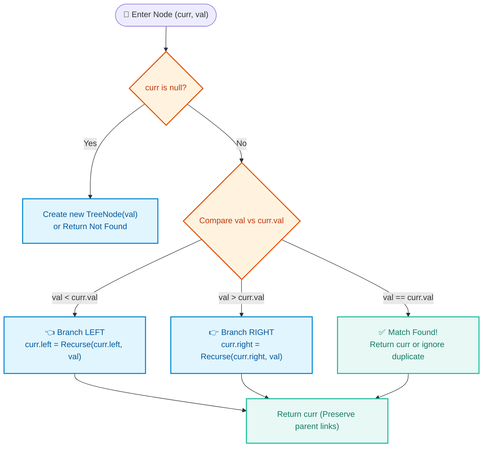

# 📘 WEEK 7 DAY 2: Binary Search Trees (BSTs) — Engineering Guide

> 🧭 **Navigation:** [← Previous Day](Week_07_Day_01_Binary_Trees_And_Traversals_Instructional.md) • [🏠 Week Overview](README.md) • [📘 Curriculum Syllabus](../COMPLETE_SYLLABUS.md) • [Next Day →](Week_07_Day_03_Balanced_BSTs_AVL_And_RedBlack_Instructional.md)
> 
> 💡 **Instructor Note:** *Not all sections or topics are mandatory. Feel free to adapt your pace and skim or skip sections based on your current focus and interview timeline.*

---

## 🎯 LEARNING OBJECTIVES

*By the end of this chapter, you will be able to:*

- 🎯 **Internalize** the global BST invariant (`all left < node.val < all right`) as a strict contract that transforms linear scanning into logarithmic binary branching.
- 🪜 **Trace and debug** interval propagation `(min, max)` for BST validation, pinpointing why local parent-child checks fail catastrophically.
- ⚙️ **Implement and articulate** BST search, insertion, and the three distinct deletion cases (leaf, single child, two children with in-order successor replacement) from scratch in modern C# (.NET 8/9) and Python 3.11+.
- 🛑 **Dodge the 4 classic FAANG traps:** the sneak-behind child bug, integer boundary overflow on `int.MinValue` / `int.MaxValue`, orphaned subtrees from unassigned returns, and pointer spaghetti on two-child deletion.
- 🎙️ **Deliver** crisp 3-sentence verbal talk tracks for any BST problem in a live 45-minute technical interview.
- 🏭 **Connect** BST invariants to production infrastructure: database B-tree secondary indexes, compiler symbol tables, and Redis Skip Lists.

---

## 🎬 PILLAR 1: THE 60-SECOND HOOK & REAL-WORLD METAPHOR

### The Sorted Highway & The Dictionary Index

Imagine you are driving down a massive interstate highway with exits labeled sequentially from Mile 1 to Mile 1,000. You are looking for **Exit 420**.

You do not drive past every single exit sign from 1 to 419 one by one — that would be a linear scan (`O(N)`), and your commute would take all day. Instead, at the first major cloverleaf interchange (Root: Mile 500), an overhead sign gives you an unambiguous choice:
- **Left Fork:** Exits 1 through 499.
- **Right Fork:** Exits 501 through 1,000.

Because `420 < 500`, you steer into the **Left Fork**. In that single physical steering decision, you permanently discard 500 potential exits from your universe. At the next fork (Mile 250), `420 > 250`, so you steer **Right**, cutting the remaining search space in half again.

```
                         [ Exit 500 ]  <-- Root
                        /            \
          [ Exits 1 - 499 ]        [ Exits 501 - 1000 ]
             (Steer Left!)             (Discarded!)
                  |
             [ Exit 250 ]
            /            \
    [ Exits 1 - 249 ]   [ Exits 251 - 499 ]
      (Discarded!)        (Steer Right!)
```

This is the power of a **Binary Search Tree (BST)**: it is the structural embodiment of binary search, but unlike a static sorted array, it consists of dynamically allocated pointer nodes that can grow, shrink, and re-wire without shifting gigabytes of memory.

---

### The Illusion of Local Checks: The Catastrophic "Sneak-Behind" Bug

Here is where 70% of candidates wash out in their first 15 minutes of a FAANG interview.

Suppose your interviewer draws this small tree on the whiteboard and asks: *"Is this a valid Binary Search Tree?"*

```
          [ 5 ]
         /     \
       [ 1 ]   [ 7 ]
              /
            [ 4 ]
```

A rookie looks at each node individually:
- Node `5`: Left child `1 < 5` (Valid!), Right child `7 > 5` (Valid!).
- Node `7`: Left child `4 < 7` (Valid!).
- Node `1`: Leaf node (Valid!).
- Node `4`: Leaf node (Valid!).

The rookie enthusiastically blurts out: *"Yes! Every left child is smaller than its parent, and every right child is greater!"*

**Wrong. Catastrophically wrong.**

Look at Node `4`. It is sitting in the **right subtree of 5**. By the fundamental definition of a BST, **every single node in the right subtree of 5 must be strictly greater than 5**. But `4 < 5`!

If an engineer attempts to search for key `4` in this tree starting at the root:
1. `4 < 5` -> The search algorithm branches **LEFT** towards `1`.
2. The search algorithm explores Node `1`, finds nothing, hits `null`, and reports: *"Key 4 does not exist."*
3. Meanwhile, Node `4` is hiding in plain sight over in the right wing, completely unreachable!

```
Interviewer: "Where does key 4 belong?"
You:         "Because 4 < 5, any search algorithm must go Left.
             Placing 4 in 5's right subtree breaks the search contract entirely."
```

> [!CAUTION]
> **The Core Invariant Rule:** A Binary Search Tree does **not** assert `left < node < right` for immediate children. It asserts that **every descendant in the left subtree is strictly less than `node.val`**, and **every descendant in the right subtree is strictly greater than `node.val`**. The constraint is **global and inherited**, not local!

---

## 🪜 PILLAR 2: THE SCAFFOLDING LADDER & TOY NAPKIN TRACES

Let's build mastery systematically: from hand-tracing interval propagation on a napkin, to search, insertion, and the three surgical deletion cases.

---

### Level 1: Toy Napkin Trace — BST Validation via Interval Propagation `(min, max)`

How do we enforce global constraints recursively? We pass down an **allowable interval `(min, max)`** from parent to child like a legal passport.

- **Initial State at Root:** Range is completely open: `(-inf, +inf)`.
- **When Branching Left:** The current node becomes the new **upper bound**: `(min, curr.val)`.
- **When Branching Right:** The current node becomes the new **lower bound**: `(curr.val, max)`.

#### Hand-Tracing the Violation:

```
                  [ 5 ]  Range: (-inf, +inf)
                 /     \
   Range:       /       \      Range:
   (-inf, 5)  [ 1 ]     [ 7 ]  (5, +inf)
                       /
        Range:       /
        (5, 7)     [ 4 ] <--- FATAL VIOLATION! (4 is NOT in (5, 7))
```

1. **Root `5`:** Permissible range is `(-inf, +inf)`. Node value `5` is valid.
2. **Left Child `1`:** Inherits lower bound `-inf`, parent `5` sets upper bound: permissible range is `(-inf, 5)`. Node value `1` is valid.
3. **Right Child `7`:** Parent `5` sets lower bound `5`, inherits upper bound `+inf`: permissible range is `(5, +inf)`. Node value `7` is valid.
4. **Left Child of `7` (Node `4`):** Inherits lower bound `5` from ancestor `5`, parent `7` sets upper bound: permissible range is `(5, 7)`.
   - We inspect node value: Is `5 < 4 < 7`? **FALSE!**
   - Immediate early return: `false`. The entire tree is disqualified in `O(N)` time with zero redundant scans.

---

#### 🧠 Pause & Predict #1
**Question:** Suppose Node `7` had a right child with value `6`. What allowable range `(min, max)` would that child inherit? Is `6` valid there?

<details>
<summary>👉 Click to Reveal Answer & Intuition</summary>

**Answer:** 
The child is in the right subtree of `7`, which itself is in the right subtree of `5`.
- Inherited lower bound: `7` (from parent `7`).
- Inherited upper bound: `+inf` (inherited from ancestor `5`).
- Permissible interval: `(7, +inf)`.
- Node value `6`: Is `7 < 6 < +inf`? **No! `6 <= 7`**, which violates the lower bound. A right child of `7` must be strictly greater than `7`.
</details>

---

### Level 2: BST Search Mechanics & Napkin Trace

Searching in a BST is identical to binary search on an array, but driven by pointers:

```
Target: 7
Tree: [10, 5, 15, 2, 7, 12, 20]

Step 1: curr = 10. Is 7 == 10? No. 7 < 10 -> branch LEFT.
Step 2: curr = 5.  Is 7 == 5?  No. 7 > 5  -> branch RIGHT.
Step 3: curr = 7.  Is 7 == 7?  YES! Match found. Return node reference.
```

If we hit a `null` reference, the key does not exist. Notice the algorithmic elegance: at no point did we visit `15`, `12`, `20`, or `2`. Half the tree was ignored at each branch.

---

### Level 3: BST Insertion Mechanics & Napkin Trace

Inserting into a BST is straightforward: **a new node is always inserted as a new leaf**. You simply search for the key until you fall off the tree at `null`, and attach the new node right where the search failed!

#### Trace: Inserting `6` into Tree `[8, 3, 10, 1]`

```
Insert 6:
Step 1: Compare 6 with Root (8)  --> 6 < 8  --> Branch Left to [ 3 ]
Step 2: Compare 6 with Node (3)  --> 6 > 3  --> Branch Right to [ 3 ].right
Step 3: [ 3 ].right is null!      --> Allocate new TreeNode(6) and link it.

         [ 8 ]                         [ 8 ]
        /     \                       /     \
     [ 3 ]   [ 10 ]     ── Insert 6 ──> [ 3 ]   [ 10 ]
     /                                  /   \
   [ 1 ]                              [ 1 ] [ 6 ]  <-- Attached as new leaf!
```

---

#### 🧠 Pause & Predict #2
**Question:** If we insert the sequence `[1, 2, 3, 4, 5]` into an initially empty raw BST in that exact order, what does the tree look like? What does the search time complexity become?

<details>
<summary>👉 Click to Reveal Answer & Intuition</summary>

**Answer:** 
Every incoming node is strictly greater than its predecessor, so every node becomes a `right` child of the previous one:
`1 -> right: 2 -> right: 3 -> right: 4 -> right: 5`.
The tree degenerates into a **singly linked list**! The height `H` degrades from `log2(N)` to `N`, and search complexity deteriorates from `O(log N)` to `O(N)`. This is why balanced BSTs (AVL, Red-Black) exist!
</details>

---

### Level 4: BST Deletion Mechanics & The 3 Structural Cases

Deletion is the most intricate BST operation because removing a node threatens to break the connectivity of its subtrees. There are **three mutually exclusive cases**:

```
                       [ Node to Delete: Z ]
                                |
        +-----------------------+-----------------------+
        |                       |                       |
     Case 1                  Case 2                  Case 3
  Zero Children            One Child              Two Children
  (Leaf Node)         (Single Subtree)         (Both Subtrees)
        |                       |                       |
  Return null to         Return child to        1. Find in-order successor S
  sever link             bypass Z                  (min of right subtree)
                                                2. Copy S.val into Z.val
                                                3. Delete S from right subtree
```

#### Case 1: Node Z has ZERO Children (Leaf Node)
- **Mechanic:** The easiest case. Simply return `null` to the parent to dissolve the link. The garbage collector reclaims `Z`.

#### Case 2: Node Z has ONE Child
- **Mechanic:** Bypass `Z`. Reconnect `Z`'s parent directly to `Z`'s single child (whether left or right).

#### Case 3: Node Z has TWO Children (The In-Order Successor Substitution)
- **The Dilemma:** `Z` has both a left subtree and a right subtree. You cannot simply delete `Z`, or you would orphan two entire branches.
- **The Physical Insight:** We need a replacement key that is:
  1. Greater than everything in `Z`'s left subtree.
  2. Smaller than everything in `Z`'s remaining right subtree.
- **Who fits this description perfectly?** The **In-Order Successor** (`S`): the absolute smallest node in `Z`'s right subtree (`FindMin(Z.right)`).
- **The 3-Step Execution:**
  1. Find `S = FindMin(Z.right)`.
  2. Overwrite `Z.val = S.val` (the target node takes on the successor's identity).
  3. Recursively delete `S.val` from `Z.right`.
- **Why this is brilliant:** Because `S` is the minimum in the right subtree, **`S` cannot have a left child** (`S.left == null`). Therefore, deleting `S` from the right subtree is guaranteed to fall into **Case 1 (leaf) or Case 2 (one child)**! It never recurses into another two-child case!

---

#### 🧠 Pause & Predict #3
**Question:** Instead of the in-order successor, could we use the **in-order predecessor** to replace `Z`? Where is the in-order predecessor located?

<details>
<summary>👉 Click to Reveal Answer & Intuition</summary>

**Answer:** 
Yes, absolutely! The in-order predecessor is the largest element in `Z`'s left subtree (`FindMax(Z.left)`). It is strictly greater than all other elements in `Z`'s left subtree and strictly less than all elements in `Z`'s right subtree. It is guaranteed to have no right child (`pred.right == null`), so deleting it also strictly reduces to Case 1 or Case 2.
</details>

---

## 🎨 PILLAR 3: PRAGMATIC VISUAL MODELS

### 1. ASCII Diagram: The Three Deletion Scenarios

```
=============================================================================
CASE 1: DELETE LEAF NODE (Node 2)
=============================================================================
Before:                                After:
       [ 5 ]                                  [ 5 ]
      /     \                                /     \
    [ 2 ]   [ 8 ]      ── Delete 2 ──>     null    [ 8 ]
    /   \
  null  null
Action: Parent's left pointer (5.left) is set to null.

=============================================================================
CASE 2: DELETE NODE WITH ONE CHILD (Node 2 has right child 3)
=============================================================================
Before:                                After:
       [ 5 ]                                  [ 5 ]
      /     \                                /     \
    [ 2 ]   [ 8 ]      ── Delete 2 ──>     [ 3 ]   [ 8 ]
        \
        [ 3 ]
Action: Parent's left pointer (5.left) bypasses Node 2 and links directly to 3.

=============================================================================
CASE 3: DELETE NODE WITH TWO CHILDREN (Delete Node 5)
=============================================================================
Step A: Find in-order successor S (minimum of right subtree = 6)
            [ 5 ] <--- Target to delete
           /     \
        [ 3 ]   [ 8 ]
               /     \
             [ 6 ]   [ 9 ]
             ^-- Successor S = FindMin(8)

Step B: Overwrite target's payload with successor's value (5 becomes 6)
            [ 6 ] <--- Overwritten!
           /     \
        [ 3 ]   [ 8 ]
               /     \
             [ 6 ]   [ 9 ] <--- Temporary duplicate to be pruned

Step C: Recursively delete successor (6) from right subtree (Reduces to Case 1/2)
            [ 6 ]
           /     \
        [ 3 ]   [ 8 ]
               /     \
             null    [ 9 ]
Invariant Confirmed: 3 < 6 < 8 < 9. Valid BST preserved!
=============================================================================
```

---

### 2. Mermaid Decision Flowchart: Search & Insertion Routing



---

### 3. Contiguous Memory vs Scattered Pointers

```
Contiguous Array (High Cache Locality - Spatial Pre-fetching):
Address:   [ 0x1000 ] [ 0x1004 ] [ 0x1008 ] [ 0x100C ] [ 0x1010 ]
Elements:  |  arr[0] |  arr[1] |  arr[2] |  arr[3] |  arr[4] |
Cache:     <--------------- 64-Byte CPU Cache Line ----------------> (1 fetch brings ~16 ints)

Scattered Binary Tree (Low Cache Locality - Pointer Chasing):
Address:   0x1040                 0x4080                     0x9200
Node:      [ Node A (Root) ] ----> [ Node B (Left) ] -------> [ Node D (Leaf) ]
           (Heap Block 1)         (Heap Block 2)             (Heap Block 3)
Cache:     Each pointer dereference may trigger a separate L1/L2/L3 cache miss!
```

---

## 🛑 PILLAR 4: THE ROOKIE TRAP ZONE

### Side-by-Side: Blunder vs Architect Pattern

#### ❌ Trap 1: The Local Child Check vs ✅ The Global Range Invariant

```csharp
// ❌ ROOKIE BLUNDER: Only checks immediate children
// Fails catastrophically on trees like: 5 -> right: 7 -> left: 4
public bool IsValidBST(TreeNode? root)
{
    if (root is null) return true;
    
    if (root.left is not null && root.left.val >= root.val) return false;
    if (root.right is not null && root.right.val <= root.val) return false;
    
    return IsValidBST(root.left) && IsValidBST(root.right); // ❌ Sneak-behind bug!
}
```

```csharp
// ✅ SENIOR ARCHITECT PATTERN: Propagates tightening bounds down recursion
public bool IsValidBST(TreeNode? root)
{
    return Validate(root, null, null);

    static bool Validate(TreeNode? node, long? min, long? max)
    {
        if (node is null) return true;
        if ((min.HasValue && node.val <= min.Value) || 
            (max.HasValue && node.val >= max.Value))
        {
            return false;
        }

        return Validate(node.left, min, node.val) &&
               Validate(node.right, node.val, max);
    }
}
```

---

#### ❌ Trap 2: Integer Boundary Overflow on `int.MinValue` / `int.MaxValue`

```csharp
// ❌ ROOKIE BLUNDER: Using int.MinValue and int.MaxValue as bounds
// If tree contains a node with value int.MinValue, `node.val <= min` evaluates to true!
// If candidate does `min - 1`, integer underflow wraps to +2,147,483,647!
public bool IsValidBST(TreeNode? root)
{
    return Validate(root, int.MinValue, int.MaxValue); // ❌ Breaks on edge-case nodes
}
```

```csharp
// ✅ SENIOR ARCHITECT PATTERN: Use 64-bit long or nullable long? (long.MinValue / long.MaxValue)
// Since 32-bit int.MinValue (-2^31) is strictly greater than long.MinValue (-2^63),
// boundary comparison never overflows or false-triggers.
public bool IsValidBST(TreeNode? root)
{
    return Validate(root, long.MinValue, long.MaxValue);

    static bool Validate(TreeNode? node, long min, long max)
    {
        if (node is null) return true;
        if (node.val <= min || node.val >= max) return false;
        return Validate(node.left, min, node.val) && Validate(node.right, node.val, max);
    }
}
```

---

#### ❌ Trap 3: Orphaned Subtrees / Forgetting to Re-link Returned Pointers

```csharp
// ❌ ROOKIE BLUNDER: Calling recursive delete without re-assigning parent pointer
public TreeNode? DeleteNode(TreeNode? root, int key)
{
    if (root is null) return null;
    if (key < root.val) DeleteNode(root.left, key);   // ❌ Discards returned pointer!
    else if (key > root.val) DeleteNode(root.right, key); // ❌ Child deletion is lost!
    // ...
    return root;
}
```

```csharp
// ✅ SENIOR ARCHITECT PATTERN: Functional pointer re-linking
// Always re-assign the return value of the recursive call to root.left / root.right.
// When a child is deleted or replaced, the parent immediately receives the updated reference!
public TreeNode? DeleteNode(TreeNode? root, int key)
{
    if (root is null) return null;
    if (key < root.val)
    {
        root.left = DeleteNode(root.left, key); // ✅ Re-links parent.left
    }
    else if (key > root.val)
    {
        root.right = DeleteNode(root.right, key); // ✅ Re-links parent.right
    }
    // ...
    return root;
}
```

---

#### ❌ Trap 4: Direct Pointer Rewiring on Two-Child Deletion

```csharp
// ❌ ROOKIE BLUNDER: Attempting to rewire 4 pointers simultaneously during deletion
// Trying to splice successor's parent, successor's right child, and target's children
// directly leads to pointer loops, cyclic references, and memory leaks.
```

```csharp
// ✅ SENIOR ARCHITECT PATTERN: Value copy + recursive sub-deletion
// 1. Copy successor's value into current node: root.val = successor.val;
// 2. Delegate the physical pointer unlinking to a recursive call:
//    root.right = DeleteNode(root.right, successor.val);
// The recursive call is guaranteed to encounter only Case 1 or Case 2, keeping code clean!
```

---

## 🎙️ PILLAR 5: 45-MINUTE INTERVIEW TALK TRACKS

When your interviewer says, *"Walk me through your approach before coding,"* use these exact 3-sentence battle-tested scripts:

### 1. Talk Track: Validate Binary Search Tree (LeetCode 98)
> *"A frequent trap in BST validation is verifying only local parent-child relations; in reality, every node must satisfy a global allowable interval `(min, max)` inherited from all its ancestors. I will implement a recursive validation function where branching left tightens the upper bound to the current node's value, and branching right tightens the lower bound. By using 64-bit `long` boundaries, we prevent integer overflow on `int.MinValue` and `int.MaxValue`, terminating in `O(N)` time and `O(H)` call-stack space."*

### 2. Talk Track: Insert into a BST (LeetCode 701)
> *"In a BST, every new key can always be inserted as a new leaf without restructuring existing subtrees. I will traverse down the tree comparing the insert value against each node to branch left or right until reaching a null reference. Upon hitting null, I will allocate the new `TreeNode` and re-link it to its parent during recursive unwinding, completing in `O(H)` time and `O(H)` space."*

### 3. Talk Track: Delete Node in a BST (LeetCode 450)
> *"Deleting a node requires locating the target and handling three structural cases: returning null for leaves, returning the non-null child to bypass single-child nodes, or handling two-child nodes via in-order successor replacement. For two children, I will find the minimum node in the right subtree, copy its value into the target node, and recursively delete that successor from the right subtree. Because the successor has at most one child, the recursive deletion is guaranteed to terminate simply, preserving all BST invariants in `O(H)` time."*

### 4. Talk Track: Search in a BST (LeetCode 700)
> *"To find a target value in a BST, I will exploit the ordering invariant iteratively: if the target matches the current node's value, I return it immediately; if the target is smaller, any match must reside in the left subtree; otherwise, it must reside in the right subtree. This iterative pointer descent eliminates half the remaining subtree at each step, consuming strictly `O(1)` auxiliary space and running in `O(H)` time."*

### 5. Talk Track: Inorder Successor in a BST (LeetCode 285)
> *"To find the in-order successor of node `p`, we evaluate two structural scenarios: if `p` has a right subtree, the successor is unequivocally the minimum node in that right subtree. If `p` has no right subtree, the successor must be the deepest ancestor where `p` lies in its left branch, which we discover by descending from the root and recording the candidate whenever we branch left. This iterative strategy executes in `O(H)` time and `O(1)` auxiliary space without requiring parent pointers."*

---

## ⚡ PILLAR 6: PRODUCTION DUAL-LANGUAGE IMPLEMENTATIONS

---

### Problem 1: Validate Binary Search Tree (LeetCode 98)

#### Problem Contract
- **Input:** `TreeNode? root` (Root of binary tree)
- **Output:** `bool` (`true` if valid BST, `false` otherwise)
- **Constraints:** Number of nodes in `[1, 10^4]`, node values in `[-2^31, 2^31 - 1]`.

#### C# Primary Implementation (.NET 8/9 — Range Bounded with `long`)

```csharp
namespace TreesAndBst.Production;

public static class BstValidator
{
    /// <summary>
    /// Validates whether a binary tree satisfies the global BST invariant.
    /// Time Complexity: O(N) | Auxiliary Space: O(H) call stack
    /// </summary>
    public static bool IsValidBST(TreeNode? root)
    {
        // Guard against integer overflow by using 64-bit long bounds
        return Validate(root, long.MinValue, long.MaxValue);

        static bool Validate(TreeNode? node, long min, long max)
        {
            if (node is null)
            {
                return true;
            }

            // Invariant violation: node value outside open interval (min, max)
            if (node.val <= min || node.val >= max)
            {
                return false;
            }

            // Branch left: upper bound tightens to node.val
            // Branch right: lower bound tightens to node.val
            return Validate(node.left, min, node.val) &&
                   Validate(node.right, node.val, max);
        }
    }
}
```

#### Python Secondary Implementation (3.11+ — Idiomatic Float Bounds)

```python
from typing import Optional

class TreeNode:
    def __init__(self, val: int = 0, left: Optional['TreeNode'] = None, right: Optional['TreeNode'] = None):
        self.val = val
        self.left = left
        self.right = right

def is_valid_bst(root: Optional[TreeNode]) -> bool:
    """Validates if a binary tree satisfies the global BST property.
    
    Time Complexity: O(N) | Auxiliary Space: O(H)
    """
    def validate(node: Optional[TreeNode], min_val: float, max_val: float) -> bool:
        if not node:
            return True
        
        # Check strict inequality: min_val < node.val < max_val
        if not (min_val < node.val < max_val):
            return False
            
        return validate(node.left, min_val, node.val) and validate(node.right, node.val, max_val)

    return validate(root, float('-inf'), float('inf'))
```

#### 📊 Explicit Complexity Deconstruction
- **Time Complexity:** `O(N)` — Every node is visited at most once; early termination occurs on the very first detected invariant violation.
- **Auxiliary Space:** `O(H)` — Call-stack depth equals the height of the tree (`O(log N)` balanced, `O(N)` degenerate).
- **Output Space:** `O(1)` — Returns a single boolean flag.

#### 🧪 Edge-Case Dry Run
- **Single Node `[2147483647]`:** With `long` bounds `long.MinValue < 2147483647 < long.MaxValue`, returns `true` safely without overflow.
- **Duplicates `[2, 2, 2]`:** `node.val <= min` or `node.val >= max` catches duplicates immediately, correctly returning `false` for strict BSTs.
- **The Sneak-Behind Tree `[5, 1, 7, null, null, 4]`:** Catches Node `4` in range `(5, 7)`, returns `false`.

---

### Problem 2: Insert into a Binary Search Tree (LeetCode 701)

#### Problem Contract
- **Input:** `TreeNode? root`, `int val`
- **Output:** `TreeNode` (Root of the modified BST)
- **Constraints:** Number of nodes in `[0, 10^4]`, node values unique.

#### C# Primary Implementation (.NET 8/9 — Functional Recursive & Iterative Zero-Allocation)

```csharp
namespace TreesAndBst.Production;

public static class BstInserter
{
    /// <summary>
    /// Recursive approach: Re-links parent pointers on unwinding.
    /// Time Complexity: O(H) | Auxiliary Space: O(H) call stack
    /// </summary>
    public static TreeNode InsertIntoBST(TreeNode? root, int val)
    {
        if (root is null)
        {
            return new TreeNode(val);
        }

        if (val < root.val)
        {
            root.left = InsertIntoBST(root.left, val);
        }
        else if (val > root.val)
        {
            root.right = InsertIntoBST(root.right, val);
        }

        return root;
    }

    /// <summary>
    /// Iterative approach: Zero-allocation, O(1) auxiliary memory.
    /// Time Complexity: O(H) | Auxiliary Space: O(1)
    /// </summary>
    public static TreeNode InsertIntoBSTIterative(TreeNode? root, int val)
    {
        if (root is null)
        {
            return new TreeNode(val);
        }

        TreeNode current = root;
        while (true)
        {
            if (val < current.val)
            {
                if (current.left is null)
                {
                    current.left = new TreeNode(val);
                    break;
                }
                current = current.left;
            }
            else
            {
                if (current.right is null)
                {
                    current.right = new TreeNode(val);
                    break;
                }
                current = current.right;
            }
        }

        return root;
    }
}
```

#### Python Secondary Implementation (3.11+ — Idiomatic)

```python
def insert_into_bst(root: Optional[TreeNode], val: int) -> TreeNode:
    """Inserts a new value into a BST recursively.
    
    Time Complexity: O(H) | Auxiliary Space: O(H)
    """
    if not root:
        return TreeNode(val)

    if val < root.val:
        root.left = insert_into_bst(root.left, val)
    elif val > root.val:
        root.right = insert_into_bst(root.right, val)

    return root

def insert_into_bst_iterative(root: Optional[TreeNode], val: int) -> TreeNode:
    """Inserts a new value into a BST iteratively with O(1) auxiliary space."""
    if not root:
        return TreeNode(val)

    curr = root
    while True:
        if val < curr.val:
            if not curr.left:
                curr.left = TreeNode(val)
                break
            curr = curr.left
        else:
            if not curr.right:
                curr.right = TreeNode(val)
                break
            curr = curr.right

    return root
```

#### 📊 Explicit Complexity Deconstruction
- **Time Complexity:** `O(H)` — Follows a single downward path from root to leaf. On balanced trees: `O(log N)`; on skewed trees: `O(N)`.
- **Auxiliary Space:** `O(H)` for recursive version; `O(1)` for iterative version.
- **Output Space:** `O(1)` — Allocates exactly one new `TreeNode`.

---

### Problem 3: Delete Node in a BST (LeetCode 450)

#### Problem Contract
- **Input:** `TreeNode? root`, `int key`
- **Output:** `TreeNode?` (Root of the modified BST)
- **Constraints:** Number of nodes in `[0, 10^4]`, all node values unique.

#### C# Primary Implementation (.NET 8/9 — Production-Grade 3-Case Deletion)

```csharp
namespace TreesAndBst.Production;

public static class BstDeleter
{
    /// <summary>
    /// Deletes a key from a BST, handling 0, 1, and 2-child cases.
    /// Time Complexity: O(H) | Auxiliary Space: O(H) call stack
    /// </summary>
    public static TreeNode? DeleteNode(TreeNode? root, int key)
    {
        if (root is null)
        {
            return null;
        }

        // Navigate to the target node
        if (key < root.val)
        {
            root.left = DeleteNode(root.left, key);
        }
        else if (key > root.val)
        {
            root.right = DeleteNode(root.right, key);
        }
        else
        {
            // Case 1: Leaf node (0 children) -> return null to parent
            // Case 2: One child -> bypass root by returning non-null child
            if (root.left is null)
            {
                return root.right;
            }
            if (root.right is null)
            {
                return root.left;
            }

            // Case 3: Two children
            // Find in-order successor (minimum node in right subtree)
            TreeNode successor = FindMin(root.right);
            
            // Overwrite current node's payload with successor's value
            root.val = successor.val;
            
            // Recursively delete successor from right subtree (guaranteed Case 1 or 2)
            root.right = DeleteNode(root.right, successor.val);
        }

        return root;
    }

    private static TreeNode FindMin(TreeNode node)
    {
        while (node.left is not null)
        {
            node = node.left;
        }
        return node;
    }
}
```

#### Python Secondary Implementation (3.11+ — Idiomatic)

```python
def delete_node(root: Optional[TreeNode], key: int) -> Optional[TreeNode]:
    """Deletes a node with the given key from a BST.
    
    Time Complexity: O(H) | Auxiliary Space: O(H)
    """
    if not root:
        return None

    if key < root.val:
        root.left = delete_node(root.left, key)
    elif key > root.val:
        root.right = delete_node(root.right, key)
    else:
        # Case 1 & 2: 0 or 1 child
        if not root.left:
            return root.right
        if not root.right:
            return root.left

        # Case 3: 2 children
        # Find in-order successor (minimum in right subtree)
        successor = root.right
        while successor.left:
            successor = successor.left
        
        # Copy successor value to current node
        root.val = successor.val
        # Recursively delete successor from right subtree
        root.right = delete_node(root.right, successor.val)

    return root
```

#### 📊 Explicit Complexity Deconstruction
- **Time Complexity:** `O(H)` — Finding the target node takes `O(H)`. Finding the successor takes `O(H)`. Deleting the successor takes `O(H)`. Total time is strictly bounded by `O(H)`.
- **Auxiliary Space:** `O(H)` — Call-stack depth bounded by tree height.
- **Output Space:** `O(1)` — In-place pointer modifications.

#### 🧪 Edge-Case Dry Run
- **Deleting the Root of a Single-Node Tree `[5]`, key = 5:** Hits `root.left is null`, returns `root.right` (`null`). Tree becomes empty.
- **Deleting a Node with Only Left Child:** Returns `root.left` directly to parent; deleted node is cleanly bypassed.
- **Deleting Node with Two Children where Successor is Immediate Right Child:** Successor `root.right` has no left child; recursive deletion replaces `root.right` with `successor.right`. Perfectly handled.

---

### Problem 4: Search in a Binary Search Tree (LeetCode 700)

#### C# Primary Implementation (.NET 8/9 — Iterative Zero-Allocation)

```csharp
namespace TreesAndBst.Production;

public static class BstSearcher
{
    /// <summary>
    /// Searches for a target value in a BST iteratively.
    /// Time Complexity: O(H) | Auxiliary Space: O(1)
    /// </summary>
    public static TreeNode? SearchBST(TreeNode? root, int val)
    {
        TreeNode? current = root;

        while (current is not null)
        {
            if (current.val == val)
            {
                return current;
            }

            current = val < current.val ? current.left : current.right;
        }

        return null;
    }
}
```

#### Python Secondary Implementation (3.11+ — Idiomatic)

```python
def search_bst(root: Optional[TreeNode], val: int) -> Optional[TreeNode]:
    """Iterative search in a Binary Search Tree.
    
    Time Complexity: O(H) | Auxiliary Space: O(1)
    """
    current = root
    while current:
        if current.val == val:
            return current
        current = current.left if val < current.val else current.right
    return None
```

#### 📊 Explicit Complexity Deconstruction
- **Time Complexity:** `O(H)` — In each iteration, we descend one level (`O(log N)` balanced, `O(N)` skewed).
- **Auxiliary Space:** `O(1)` — Exactly one reference pointer maintained on stack.

---

### Problem 5: Inorder Successor and Predecessor in BST (LeetCode 285)

#### Problem Contract
- **Input:** `TreeNode? root`, `TreeNode p`
- **Output:** `TreeNode?` (The in-order successor node, or `null` if none exists)
- **Constraints:** Number of nodes in `[1, 10^4]`, all node values unique.

#### C# Primary Implementation (.NET 8/9 — Iterative Zero-Allocation)

```csharp
namespace TreesAndBst.Production;

public static class BstNavigation
{
    /// <summary>
    /// Finds the minimum node in a BST subtree by walking the leftmost spine.
    /// Time Complexity: O(H) | Auxiliary Space: O(1)
    /// </summary>
    public static TreeNode? FindMin(TreeNode? node)
    {
        if (node is null) return null;
        while (node.left is not null)
        {
            node = node.left;
        }
        return node;
    }

    /// <summary>
    /// Finds the maximum node in a BST subtree by walking the rightmost spine.
    /// Time Complexity: O(H) | Auxiliary Space: O(1)
    /// </summary>
    public static TreeNode? FindMax(TreeNode? node)
    {
        if (node is null) return null;
        while (node.right is not null)
        {
            node = node.right;
        }
        return node;
    }

    /// <summary>
    /// Finds the in-order successor (smallest key strictly greater than p.val).
    /// Time Complexity: O(H) | Auxiliary Space: O(1)
    /// </summary>
    public static TreeNode? InorderSuccessor(TreeNode? root, TreeNode p)
    {
        // Scenario A: Right subtree exists -> min of right subtree
        if (p.right is not null)
        {
            return FindMin(p.right);
        }

        // Scenario B: No right subtree -> lowest ancestor where p is in left branch
        TreeNode? successor = null;
        TreeNode? current = root;

        while (current is not null)
        {
            if (p.val < current.val)
            {
                successor = current; // Candidate successor!
                current = current.left;
            }
            else if (p.val > current.val)
            {
                current = current.right;
            }
            else
            {
                break;
            }
        }

        return successor;
    }

    /// <summary>
    /// Finds the in-order predecessor (largest key strictly smaller than p.val).
    /// Time Complexity: O(H) | Auxiliary Space: O(1)
    /// </summary>
    public static TreeNode? InorderPredecessor(TreeNode? root, TreeNode p)
    {
        // Scenario A: Left subtree exists -> max of left subtree
        if (p.left is not null)
        {
            return FindMax(p.left);
        }

        // Scenario B: No left subtree -> lowest ancestor where p is in right branch
        TreeNode? predecessor = null;
        TreeNode? current = root;

        while (current is not null)
        {
            if (p.val > current.val)
            {
                predecessor = current; // Candidate predecessor!
                current = current.right;
            }
            else if (p.val < current.val)
            {
                current = current.left;
            }
            else
            {
                break;
            }
        }

        return predecessor;
    }
}
```

#### Python Secondary Implementation (3.11+ — Idiomatic)

```python
def inorder_successor(root: Optional[TreeNode], p: TreeNode) -> Optional[TreeNode]:
    """Finds the in-order successor of node p in a BST without parent pointers.
    
    Time Complexity: O(H) | Auxiliary Space: O(1)
    """
    if p.right:
        curr = p.right
        while curr.left:
            curr = curr.left
        return curr

    successor: Optional[TreeNode] = None
    curr = root

    while curr:
        if p.val < curr.val:
            successor = curr
            curr = curr.left
        elif p.val > curr.val:
            curr = curr.right
        else:
            break

    return successor

def inorder_predecessor(root: Optional[TreeNode], p: TreeNode) -> Optional[TreeNode]:
    """Finds the in-order predecessor of node p in a BST without parent pointers.
    
    Time Complexity: O(H) | Auxiliary Space: O(1)
    """
    if p.left:
        curr = p.left
        while curr.right:
            curr = curr.right
        return curr

    predecessor: Optional[TreeNode] = None
    curr = root

    while curr:
        if p.val > curr.val:
            predecessor = curr
            curr = curr.right
        elif p.val < curr.val:
            curr = curr.left
        else:
            break

    return predecessor
```

#### 📊 Explicit Complexity Deconstruction
- **Time Complexity:** `O(H)` — In both scenarios, we walk down a single path from root to leaf or from node to leaf.
- **Auxiliary Space:** `O(1)` — Completely iterative; zero stack frames or auxiliary data structures allocated.
- **Output Space:** `O(1)` — Returns reference to existing tree node or `null`.

---

## ⚖️ CHAPTER 7: PERFORMANCE, TRADE-OFFS & FAANG PATTERN SIGNALS

### ⚖️ Comprehensive Data Structure Trade-Off Matrix

| Dimension / Operation | Unsorted Dynamic Array | Sorted Dynamic Array | Singly Linked List | Hash Table (Chaining) | Unbalanced BST | AVL Tree (Strict) | Red-Black Tree (Relaxed) |
| :--- | :---: | :---: | :---: | :---: | :---: | :---: | :---: |
| **Random Access `arr[i]`** | `O(1)` | `O(1)` | `O(N)` | N/A | `O(H)` (augmented) | `O(log N)` (augmented) | `O(log N)` (augmented) |
| **Search Key (Average)** | `O(N)` | `O(log N)` | `O(N)` | `O(1)` | `O(log N)` | `O(log N)` | `O(log N)` |
| **Search Key (Worst-Case)**| `O(N)` | `O(log N)` | `O(N)` | `O(N)` (collisions) | `O(N)` (skewed) | `O(log N)` | `O(log N)` |
| **Insert (Average)** | `O(1)` amortized | `O(N)` (shifting) | `O(1)` (at head) | `O(1)` amortized | `O(log N)` | `O(log N)` | `O(log N)` |
| **Insert (Worst-Case)** | `O(N)` (realloc) | `O(N)` | `O(1)` | `O(N)` (rehash) | `O(N)` | `O(log N)` | `O(log N)` |
| **Delete (Average)** | `O(N)` | `O(N)` | `O(1)` (given node)| `O(1)` amortized | `O(log N)` | `O(log N)` | `O(log N)` |
| **Delete (Worst-Case)** | `O(N)` | `O(N)` | `O(1)` | `O(N)` | `O(N)` | `O(log N)` | `O(log N)` |
| **Find Min / Max** | `O(N)` | `O(1)` | `O(N)` | `O(N)` | `O(H)` | `O(log N)` | `O(log N)` |
| **Inorder Successor** | `O(N)` | `O(log N)` | `O(N)` | `O(N)` | `O(H)` | `O(log N)` | `O(log N)` |
| **Range Query `[L, R]`** | `O(N)` | `O(log N + K)` | `O(N)` | `O(N)` | `O(H + K)` | `O(log N + K)` | `O(log N + K)` |
| **Memory Overhead** | Lowest (Dense array)| Lowest (Dense array)| Low (1 pointer/node)| High (Bucket array + entries)| Medium (2 pointers/node)| Medium (2 pointers + height)| Medium (2 pointers + 1-bit color)|
| **CPU Cache Locality** | Outstanding (L1/L2) | Outstanding (L1/L2) | Poor (Pointer chasing)| Poor (Pointer chasing)| Poor (Scattered heap nodes)| Poor (Scattered heap nodes)| Poor (Scattered heap nodes)|

---

### Beyond Big-O: Pointer Chasing, CPU Cache & Memory Bloat

1. **The Sorted Input Achilles Heel:** Inserting `1, 2, 3, ..., N` into a raw BST creates an `O(N)` tall stick. Binary search degrades into a linear scan. Self-balancing trees (AVL, Red-Black) were invented precisely to guarantee `O(log N)` height through automated tree rotations.
2. **Memory Layout Overhead:** In 64-bit .NET CLR, an object header is 16 bytes, plus two 8-byte pointer references (`left`, `right`) and a 4-byte integer payload (padded to 8 bytes). Storing 4 bytes of integer data costs **40 bytes of heap memory** per node!
3. **Cache Line Thrashing:** Contiguous arrays load 16 consecutive integers into a single 64-byte L1 CPU cache line. Tree nodes are scattered across the heap; traversing each pointer can incur a separate cache miss.

---

### 🏭 Real-World Systems Context

> [!NOTE]
> **Language Standard Libraries (C# `SortedDictionary`, Java `TreeMap`, C++ `std::map`):** Standard libraries avoid raw, unbalanced BSTs because a malicious or naturally sorted input produces `O(N)` latency spikes. Instead, they implement Red-Black trees to enforce strict `O(log N)` worst-case guarantees.

> [!NOTE]
> **Database B+ Tree Secondary Indexes (PostgreSQL, MySQL InnoDB):** Relational engines use multi-way search trees (B+ Trees) for indexes. Range queries like `WHERE price BETWEEN 50 AND 150` use the BST branching invariant to locate key `50` in `O(log N)` disk block reads, then sequentially scan leaf sibling pointers for blazing performance.

> [!NOTE]
> **Redis Sorted Sets & Skip Lists:** Redis sorted sets (`ZADD`, `ZRANGE`) require sorted dynamic mutations. Instead of balanced BSTs that require complex multi-node tree rotations under concurrent mutations, Redis utilizes Skip Lists — a probabilistic balanced structure that enables lock-free concurrent reads and simplified slicing.

---

### FAANG Pattern Recognition Decision Matrix

```
When to use a BST:
- Need dynamic insertions and deletions with sorted ordering preserved?
    └── Yes -> BST / Balanced BST (Day 2 & Day 3)
- Need only O(1) key-value lookups with zero range queries?
    └── Yes -> Hash Table (Dictionary / HashMap)
- Need to find kth smallest or dynamic rank in O(log N)?
    └── Yes -> Order Statistic Tree (Augmented BST)
- Need concurrent multi-thread range scans?
    └── Yes -> Skip List or B+ Tree
```

---

## ⚔️ SUPPLEMENTARY OUTCOMES & INTERVIEW DRILLS

### 🏋️ Practice Problems

| # | Problem | Source | Difficulty | Target Pattern |
| :---: | :--- | :--- | :---: | :--- |
| 1 | Search in a Binary Search Tree | LeetCode #700 | 🟢 Easy | Iterative pointer descent |
| 2 | Insert into a Binary Search Tree | LeetCode #701 | 🟡 Medium | Leaf position attachment |
| 3 | Delete Node in a BST | LeetCode #450 | 🟡 Medium | 3-case deletion with in-order successor |
| 4 | Validate Binary Search Tree | LeetCode #98 | 🟡 Medium | Range-bounded interval propagation |
| 5 | Lowest Common Ancestor of a BST | LeetCode #235 | 🟡 Medium | Directional split decision |
| 6 | Kth Smallest Element in a BST | LeetCode #230 | 🟡 Medium | Inorder traversal early termination |
| 7 | Convert Sorted Array to BST | LeetCode #108 | 🟢 Easy | Divide-and-conquer midpoint root |
| 8 | BST Iterator | LeetCode #173 | 🟡 Medium | Controlled iterative stack state |
| 9 | Trim a Binary Search Tree | LeetCode #669 | 🟡 Medium | Recursive pruning of subtrees |
| 10 | Two Sum IV - Input is a BST | LeetCode #653 | 🟢 Easy | Inorder + Two-Pointer / Hash Set |

---

### 🎙️ Advanced FAANG Follow-up Questions & Answers

1. **Q: How does finding the Lowest Common Ancestor (LCA) in a BST differ from a general Binary Tree?**
   - *Follow-up:* In a general binary tree, LCA requires post-order traversal exploring both subtrees (`O(N)`). In a BST, we exploit the invariant: if both `p` and `q` are smaller than `root`, LCA must lie in the left subtree; if both are larger, it lies in the right subtree. The very first node where `p` and `q` diverge (or where one equals the current node) is guaranteed to be the LCA! This runs in `O(H)` time and `O(1)` auxiliary space.

2. **Q: Why do we replace a deleted two-child node with its in-order successor rather than an arbitrary descendant?**
   - *Follow-up:* The in-order successor is the smallest value in the right subtree. Placing it in the deleted node's slot guarantees it remains strictly greater than all nodes in the left subtree, and strictly smaller than all remaining nodes in the right subtree. Furthermore, because it is the minimum in the right subtree, it cannot possess a left child (`left == null`), which guarantees that deleting it from the right subtree strictly reduces to Case 1 (leaf) or Case 2 (single child).

---

## 📊 COMPLEXITY RECAP

| Operation | Average Case (Balanced) | Worst Case (Degenerate Chain) | Auxiliary Space |
| :--- | :---: | :---: | :---: |
| **Search** | `O(log N)` | `O(N)` | `O(1)` (Iterative) |
| **Insert** | `O(log N)` | `O(N)` | `O(H)` (Recursive) / `O(1)` (Iterative) |
| **Delete** | `O(log N)` | `O(N)` | `O(H)` (Recursive) / `O(1)` (Iterative) |
| **Validate BST** | `O(N)` | `O(N)` | `O(H)` (Call Stack) |
| **Inorder Traversal** | `O(N)` | `O(N)` | `O(H)` (Call Stack) |
| **Inorder Successor** | `O(log N)` | `O(N)` | `O(1)` (Iterative) |

---

> 🧭 **Navigation:** [← Previous Day](Week_07_Day_01_Binary_Trees_And_Traversals_Instructional.md) • [🏠 Week Overview](README.md) • [📘 Curriculum Syllabus](../COMPLETE_SYLLABUS.md) • [Next Day →](Week_07_Day_03_Balanced_BSTs_AVL_And_RedBlack_Instructional.md)
