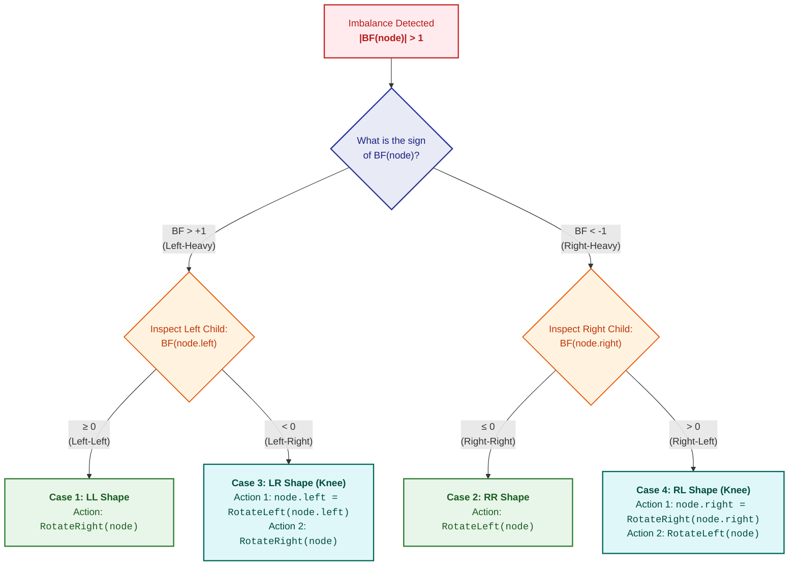

# 📘 WEEK 7 DAY 3: Balanced BSTs — AVL & Red-Black Trees — Engineering Guide

> 🧭 **Navigation:** [← Previous Day](Week_07_Day_02_Binary_Search_Trees_Instructional.md) • [🏠 Week Overview](README.md) • [📘 Curriculum Syllabus](../COMPLETE_SYLLABUS.md) • [Next Day →](Week_07_Day_04_Tree_Patterns_Instructional.md)
> 
> 💡 **Instructor Note:** *Not all sections or topics are mandatory. Feel free to adapt your pace and skim or skip sections based on your current focus and interview timeline.*

---

## 🎯 LEARNING OBJECTIVES

*By the end of this chapter, you will be able to:*

- 🎬 **Internalize** the mechanical necessity of self-balancing trees using the Gyroscope/Steadicam mental model, understanding how rotations permanently stop `O(N)` degradation.
- 🪜 **Master** the 4 fundamental AVL rotation cases—Left-Left (LL), Right-Right (RR), Left-Right (LR), and Right-Left (RL)—by tracing 3-element toy sequences and tracking the orphan middle subtree.
- 🎨 **Navigate** rotation decisions with a clean branching flowchart, contrasting AVL strict height balance with Red-Black tree black-height relaxation.
- 🛑 **Evade** critical rookie traps: stale height caching, lost orphan subtrees during pointer rewiring, and blind memorization.
- 🎙️ **Deliver** the exact 3-sentence interview talk track to explain self-balancing invariants with FAANG-level executive clarity.
- ⚡ **Implement** production-grade AVL tree operations (`Insert`, `RotateLeft`, `RotateRight`, height recalculation) and `O(N)` balance validation in modern C# (.NET 8/9) and Python 3.11+.

---

## 🎬 PILLAR 1: THE 60-SECOND HOOK & REAL-WORLD METAPHOR

### The Mechanical Gyroscope / Self-Balancing Steadicam

Picture a Hollywood camera operator sprinting through an obstacle course while holding a high-end 3-axis motorized gimbal—a **Steadicam**. 

The operator's body is lurching wildly, boots slamming into rocks, arms tilting left and right. Yet the camera lens remains uncannily, glass-smooth level. Why? Because inside the gimbal housing, tiny mechanical gyroscopes measure angular tilt hundreds of times per second. The instant the camera frame tilts even two degrees off-axis, brushless servo motors counter-rotate in the opposite direction. The frame stays level in real time.

Now look at a standard, unassisted Binary Search Tree (BST) without a stabilizer.

```
Inserting Chronological Stream: [1, 2, 3, 4, 5]

[ 1 ]
   \
   [ 2 ]
      \
      [ 3 ]
         \
         [ 4 ]
            \
            [ 5 ]   <-- Disaster: 5-level deep linked list!
```

If your production telemetry service feeds in database auto-increment IDs or chronological timestamps (`timestamp1 < timestamp2 < timestamp3`), an ordinary BST doesn't fan out. It leans entirely to the right. 

In minutes, your elegant `O(log N)` binary search tree degenerates into a pathetic `O(N)` linked list. 

Under a load of 25,000 queries per second, instead of taking 17 CPU comparisons (`log2(100000)`), every single read must chase 100,000 distinct memory pointers across your L3 cache. Your database query thread pool saturates, latencies spike from 2 milliseconds to 8 seconds, and your microservice crashes under an out-of-memory cascading failure.

**Balanced BSTs are algorithmic gyroscopes.** 

Every single time an `Insert` or `Delete` mutates the structure, the tree measures its localized tilt (the **Balance Factor**). If any node tilts more than one unit off-center, the tree triggers a micro-adjustment—a **tree rotation**—in strictly `O(1)` time. 

By paying at most `O(log N)` localized pointer swaps on writes, we guarantee that search depth remains strictly pinned to `O(log N)` forever—regardless of whether the input stream is perfectly random, completely inverted, or monotonically sorted.

---

## 🪜 PILLAR 2: THE SCAFFOLDING LADDER & TOY NAPKIN TRACES

Let's dismantle tree rebalancing from the ground up: starting with the fundamental math of a single node, climbing through hand-drawn 3-element napkin traces for all 4 rotation scenarios, and finishing with the architectural trade-offs between AVL and Red-Black trees.

### Step 1: The AVL Balance Factor Contract

In an AVL Tree (named after inventors Adelson-Velsky and Landis, 1962), every node tracks its own **Height**:
- A `null` child has `Height = 0`.
- A leaf node has `Height = 1`.
- Any internal node has: `Height = 1 + max(Height(left), Height(right))`.

The localized tilt at any node is captured by its **Balance Factor (BF)**:

```
Balance Factor (BF) = Height(node.left) - Height(node.right)
```

```
           [ 10 ] (Height: 3, BF: +1)
          /      \
(H: 2) [ 5 ]    [ 15 ] (H: 1, BF: 0)
       /
(H: 1)[ 2 ]
```

> [!IMPORTANT]
> **The AVL Invariant:** For every single node in the entire tree, its Balance Factor must remain strictly within the set `{-1, 0, +1}`:
> - `BF = 0`: Perfectly symmetrical.
> - `BF = +1`: Left subtree is one level taller (left-leaning, but legal).
> - `BF = -1`: Right subtree is one level taller (right-leaning, but legal).
> - `|BF| > 1`: **Invariant violated!** Gyroscopic rotation must trigger immediately.

---

### Step 2: The 4 Rotation Cases (Hand-Traced with 3 Elements)

Whenever an insertion pushes a node's balance factor to `+2` or `-2`, exactly one of four physical shapes caused it. Let's hand-trace each using the minimal 3-element sequence of keys: `{1, 2, 3}`.

#### 1. Left-Left (LL) Shape -> Resolved by Single Right Rotation
- **Input sequence:** `[3, 2, 1]`
- **The Imbalance:** Node `3` has left child `2`, and node `2` has left child `1`.
- **Measurement:** Node `3` has `Height(left) = 2` and `Height(right) = 0` -> `BF(3) = +2` (Left-Heavy). Left child `2` has `BF(2) = +1` (Left-Heavy).
- **Physical Action:** Grab node `2` (the pivot) and pull it upward. Node `3` swings down like a pendulum to become `2`'s right child. Node `1` remains `2`'s left child.

```
       Before Rotation                      After Single Right-Rotate(3)
         [ 3 ] (BF: +2)                                [ 2 ] (BF: 0)
        /                                             /     \
     [ 2 ] (BF: +1)          ── Right-Rotate(3) ──> [ 1 ]   [ 3 ] (BF: 0)
     /
  [ 1 ] (BF: 0)
```
- **In-Order Check:** Before: `1 < 2 < 3`. After: `1 < 2 < 3`. The BST invariant is preserved!

---

#### 2. Right-Right (RR) Shape -> Resolved by Single Left Rotation
- **Input sequence:** `[1, 2, 3]`
- **The Imbalance:** Node `1` has right child `2`, and node `2` has right child `3`.
- **Measurement:** Node `1` has `Height(left) = 0` and `Height(right) = 2` -> `BF(1) = -2` (Right-Heavy). Right child `2` has `BF(2) = -1` (Right-Heavy).
- **Physical Action:** Grab node `2` (the pivot) and pull it upward. Node `1` swings down to become `2`'s left child. Node `3` remains `2`'s right child.

```
       Before Rotation                      After Single Left-Rotate(1)
         [ 1 ] (BF: -2)                                [ 2 ] (BF: 0)
          \                                           /     \
          [ 2 ] (BF: -1)     ── Left-Rotate(1) ──>  [ 1 ]   [ 3 ] (BF: 0)
             \
             [ 3 ] (BF: 0)
```
- **In-Order Check:** Before: `1 < 2 < 3`. After: `1 < 2 < 3`. Symmetrical and balanced!

---

#### 3. Left-Right (LR) Shape -> Resolved by Double Rotation (Left on Child, Right on Root)
- **Input sequence:** `[3, 1, 2]`
- **The Imbalance:** Node `3` has left child `1`, and node `1` has right child `2`.
- **Measurement:** `BF(3) = +2` (Left-Heavy), but `BF(1) = -1` (Right-Heavy). The path forms a jagged **knee** or zig-zag!
- **Why a single right rotation fails:** If you right-rotate on `3` immediately, node `1` becomes the root, and node `3` becomes its right child. But node `2` is greater than `1` and less than `3`. It remains trapped in an awkward crooked shape!
- **The Two-Step Remedy:**
  - **Step A (Straighten the Knee):** Perform a **Left Rotation on child `1`**. This transforms the zig-zag into a straight LL line `[3 -> 2 -> 1]`.
  - **Step B (Balance the Line):** Perform a **Right Rotation on root `3`**. Node `2` becomes the root.

```
Step 1: Left-Rotate on Child (1)             Step 2: Right-Rotate on Root (3)
       [ 3 ] (BF: +2)                              [ 3 ] (BF: +2)                     [ 2 ] (BF: 0)
      /                                           /                                  /     \
   [ 1 ] (BF: -1)    ── Left-Rotate(1) ──>     [ 2 ]             ── Right-Rotate(3) ──> [ 1 ]   [ 3 ]
      \                                       /
      [ 2 ]                                [ 1 ]
  (Bent Knee)                           (Straight LL Line)                         (Balanced)
```

---

#### 4. Right-Left (RL) Shape -> Resolved by Double Rotation (Right on Child, Left on Root)
- **Input sequence:** `[1, 3, 2]`
- **The Imbalance:** Node `1` has right child `3`, and node `3` has left child `2`.
- **Measurement:** `BF(1) = -2` (Right-Heavy), but `BF(3) = +1` (Left-Heavy). A jagged right-to-left knee!
- **The Two-Step Remedy:**
  - **Step A (Straighten the Knee):** Perform a **Right Rotation on child `3`**. This transforms `[1 -> 3 -> 2]` into a straight RR line `[1 -> 2 -> 3]`.
  - **Step B (Balance the Line):** Perform a **Left Rotation on root `1`**. Node `2` becomes the root.

```
Step 1: Right-Rotate on Child (3)            Step 2: Left-Rotate on Root (1)
   [ 1 ] (BF: -2)                              [ 1 ] (BF: -2)                         [ 2 ] (BF: 0)
      \                                           \                                  /     \
      [ 3 ] (BF: +1) ── Right-Rotate(3) ──>       [ 2 ]          ── Left-Rotate(1) ──>  [ 1 ]   [ 3 ]
      /                                              \
   [ 2 ]                                             [ 3 ]
  (Bent Knee)                           (Straight RR Line)                         (Balanced)
```

---

### 🧠 Pause & Predict: Micro-Drills

> **Drill 1:** You insert the keys `[10, 5, 8]` in that order into an empty AVL tree. 
> 1. What is the Balance Factor of node `10`?
> 2. What rotation shape is this, and what is the exact 2-step rotation sequence?
> 
> *Think for 10 seconds before checking below!*
> 
> > **Answer:** 
> > 1. Node `10` has left child `5` (height 2) and right child `null` (height 0), so `BF(10) = +2`. Node `5` has right child `8`, so `BF(5) = -1`.
> > 2. This is a **Left-Right (LR)** knee. The sequence is: `RotateLeft(node.left)` (turns `5 -> 8` into `8 -> 5`), followed by `RotateRight(node)` (promotes `8` to root, with `5` as left child and `10` as right child).

---

### Step 3: Architectural Face-Off — AVL vs. Red-Black Trees

Why do we have two famous balanced search trees? Why didn't one completely eliminate the other?

```
+-------------------------------------------------------------------------------------------+
|                                    AVL TREE vs RED-BLACK TREE                             |
+-----------------------------+-----------------------------+-------------------------------+
| Dimension                   | AVL Tree                    | Red-Black Tree                |
+-----------------------------+-----------------------------+-------------------------------+
| Balance Criterion           | Strict: |H(L) - H(R)| <= 1  | Loose: Longest <= 2 * Shortest|
| Maximum Tree Height         | ~1.44 * log2(N)             | ~2.00 * log2(N)               |
| Lookup Speed                | Faster (~1.01 * log2 N)     | Slightly slower (~1.3-1.5 log)|
| Rotations on Insert         | <= 2 rotations              | <= 2 rotations                |
| Rotations on Delete         | Up to O(log N) cascading    | Strictly <= 3 rotations!      |
| Memory Overhead             | 4 bytes per node (height)   | 1 bit (color, often stolen)   |
| Primary Industry Standard   | Read-heavy lookup caches    | C# SortedDictionary, Java     |
|                             |                             | TreeMap, C++ std::map, Linux  |
+-----------------------------+-----------------------------+-------------------------------+
```

#### Why Production Standard Libraries Choose Red-Black Trees:
Notice the **Delete** row in the table above:
- In an AVL tree, deleting a node can trigger a rotation at the parent, which reduces the parent's height, which triggers another rotation at the grandparent, all the way up to the root—an `O(log N)` cascade of pointer writes.
- In a Red-Black tree, deletion requires at most **3 rotations**—guaranteed! The rest of the rebalancing is done via pure O(1) bit-flipping (recoloring).
- Because writes and mutations are common in real-world collections, .NET (`SortedDictionary<TKey, TValue>`), Java (`java.util.TreeMap`), C++ (`std::map`), and the Linux kernel scheduler (`rbtree`) all chose the Red-Black tree.

---

## 🎨 PILLAR 3: PRAGMATIC VISUAL MODELS & DECISION LOGIC

### 1. The Anatomy of a Single Rotation: The "Orphan Subtree" Handoff

The biggest hurdle for engineers learning rotations is understanding what happens to the middle subtree. Let's trace it with explicit labels:

#### Single Right Rotation on Node `y` (LL Case)
- **Node `y`** is the imbalanced parent (`BF = +2`).
- **Node `x`** is `y`'s left child (`BF >= 0`). It will become the new root.
- **Subtree `T1`** is smaller than `x`. It stays attached as `x.left`.
- **Subtree `T2`** is the **orphan subtree**! Notice: `T2` is greater than `x`, but smaller than `y`.
- **Subtree `T3`** is greater than `y`. It stays attached as `y.right`.

```
                    BEFORE ROTATION                                     AFTER ROTATION
                    
                     [ y ] (BF: +2)                                     [ x ] (BF: 0)
                    /     \                                            /     \
      (Pivot) --> [ x ]   [ T3 ]          ── Right-Rotate(y) ──>     [ T1 ]  [ y ] (BF: 0)
                 /     \                                                     /     \
               [ T1 ]  [ T2 ] <── Orphan Subtree                           [ T2 ]  [ T3 ]
                                  (x < T2 < y)                             (Grafted to y.left!)

In-Order Sequence Before: T1 < x < T2 < y < T3
In-Order Sequence After:  T1 < x < T2 < y < T3  (100% IDENTICAL!)
```

#### The 3-Step Pointer Swap:
1. `AVLNode x = y.left;` (Identify pivot)
2. `y.left = x.right;`   (Graft orphan `T2` onto `y`'s vacant left slot)
3. `x.right = y;`        (Swing `y` down to become `x`'s right child)

---

#### Single Left Rotation on Node `x` (RR Case)
- **Node `x`** is the imbalanced parent (`BF = -2`).
- **Node `y`** is `x`'s right child (`BF <= 0`). It will become the new root.
- **Subtree `T2`** is the **orphan subtree**! Notice: `T2` is greater than `x`, but smaller than `y`.

```
                    BEFORE ROTATION                                     AFTER ROTATION
                    
                     [ x ] (BF: -2)                                     [ y ] (BF: 0)
                    /     \                                            /     \
                  [ T1 ]  [ y ] <-- (Pivot)   ── Left-Rotate(x) ──>  [ x ]   [ T3 ]
                         /     \                                     /     \
         Orphan -->    [ T2 ]  [ T3 ]                              [ T1 ]  [ T2 ] (Grafted to x.right!)
         Subtree       (x < T2 < y)

In-Order Sequence Before: T1 < x < T2 < y < T3
In-Order Sequence After:  T1 < x < T2 < y < T3  (100% IDENTICAL!)
```

---

### 2. The 4-Rotation Decision Flowchart

When unwinding from a recursive insertion, use this exact decision matrix to determine which rotation to apply:



---

## 🛑 PILLAR 4: THE ROOKIE TRAP ZONE

### Trap 1: Forgetting to Update Heights (or Inverting the Update Order)

> [!WARNING]
> **The Failure:** After rewiring pointers, the heights of both the demoted node and the promoted node are completely out of date. Worse, updating the new root before the rotated child produces invalid, stale heights that corrupt every ancestor up the call stack!

| ❌ Rookie Blunder (Inverted Order / Missing Update) | ✅ Senior Architect Pattern (Child First, Then Root) |
| :--- | :--- |
| ```csharp<br>// BUG: Updating root before child!<br>x.height = 1 + Math.Max(H(x.left), H(x.right));<br>y.height = 1 + Math.Max(H(y.left), H(y.right));<br>// y is a child of x! x just read y's stale height!<br>``` | ```csharp<br>// CORRECT: Update child y first, then new root x!<br>y.height = 1 + Math.Max(GetHeight(y.left), GetHeight(y.right));<br>x.height = 1 + Math.Max(GetHeight(x.left), GetHeight(x.right));<br>return x;<br>``` |

---

### Trap 2: The "Orphan Subtree" Amnesia

> [!WARNING]
> **The Failure:** Writing `x.right = y` before saving `x.right`. The orphan subtree `T2` is severed from the tree and instantly garbage collected, corrupting the dataset and losing keys permanently!

| ❌ Rookie Blunder (Lost Subtree) | ✅ Senior Architect Pattern (Cache Orphan First) |
| :--- | :--- |
| ```csharp<br>private static AVLNode RotateRight(AVLNode y)<br>{<br>    AVLNode x = y.left!;<br>    x.right = y; // BUG: x.right previously held T2!<br>    y.left = null; // T2 is now permanently lost!<br>    return x;<br>}<br>``` | ```csharp<br>private static AVLNode RotateRight(AVLNode y)<br>{<br>    AVLNode x = y.left!;<br>    AVLNode? T2 = x.right; // 1. Save orphan T2<br>    x.right = y;           // 2. Swing y into right child<br>    y.left = T2;           // 3. Re-graft T2 onto y.left<br>    // 4. Recalculate heights<br>    return x;<br>}<br>``` |

---

### Trap 3: Blind Mechanical Memorization vs. The In-Order Invariant

Under 45-minute live interview pressure, candidates who attempt to memorize raw pointer lines invariably confuse `left` and `right`. 

**The Senior Architect Mental Model:**
Remember that rotations **never change in-order traversal**. 
Write down the 5 components in ascending order on your whiteboard:
`T1 < x < T2 < y < T3`

Now look at your rotated tree:
- `x` is the new root.
- Its left child must be `T1`.
- Its right child is `y`.
- For `y`, its left child must be `T2` (because `T2 < y`).
- Its right child must be `T3` (because `y < T3`).

If your pointer assignment places `T2` anywhere other than `y.left`, your whiteboard check immediately tells you that you made a mechanical slip before you even run the code!

---

## 🎙️ PILLAR 5: 45-MINUTE INTERVIEW TALK TRACK

When asked to explain or implement self-balancing search trees in a FAANG interview, do not waffle with abstract mathematical proofs. Deliver this exact 3-sentence script:

### 1. When Asked About Balanced Trees & AVL Rotations:
> *"An AVL tree enforces logarithmic height by tracking the height difference—the balance factor—between each node's left and right subtrees, guaranteeing it remains within -1 to +1. During recursive insertion unwind, if a node's balance factor exceeds 1, we identify whether the insertion fell on the outer branch (resolved by a single O(1) rotation) or an inner knee (resolved by a double rotation that straightens the zig-zag before rotating the root). Because every rotation preserves the in-order binary search invariant and takes O(1) time, we achieve strictly bounded O(log N) lookup and insertion times."*

### 2. When Asked to Validate Tree Balance (LeetCode 110):
> *"A naive top-down verification recalculates subtree heights repeatedly, resulting in an O(N^2) quadratic runtime. We optimize to O(N) linear time using a bottom-up postorder DFS: our recursive helper returns the true subtree height if balanced, or immediately bubbles up a sentinel value of -1 the moment any subtree's balance factor exceeds 1. This guarantees that every node is visited exactly once with early exit on first violation."*

---

## ⚡ PILLAR 6: PRODUCTION DUAL-LANGUAGE IMPLEMENTATIONS

### Problem 1: Complete Production-Grade AVL Tree

A fully self-contained, production-grade AVL tree supporting `Insert`, `RotateLeft`, `RotateRight`, and dynamic height recalculation.

#### C# Primary Implementation (.NET 8/9 — Production Grade)

```csharp
using System;

namespace AdvancedDataStructures;

/// <summary>
/// Represents a self-balancing AVL Tree node.
/// Stores value, subtree height, and child references.
/// </summary>
public sealed class AVLNode
{
    public int Value { get; set; }
    public int Height { get; set; }
    public AVLNode? Left { get; set; }
    public AVLNode? Right { get; set; }

    public AVLNode(int value)
    {
        Value = value;
        Height = 1; // Newly allocated leaf node has height 1
    }
}

/// <summary>
/// Production-grade AVL Tree providing guaranteed O(log N) insertion, search, and deletion.
/// </summary>
public sealed class AVLTree
{
    public AVLNode? Root { get; private set; }

    /// <summary>
    /// Inserts a new value into the AVL tree while maintaining height balance.
    /// Time Complexity: O(log N) | Auxiliary Space: O(log N) stack
    /// </summary>
    public void Insert(int value)
    {
        Root = InsertRecursive(Root, value);
    }

    private AVLNode InsertRecursive(AVLNode? node, int value)
    {
        // Step 1: Standard BST recursive descent
        if (node is null)
        {
            return new AVLNode(value);
        }

        if (value < node.Value)
        {
            node.Left = InsertRecursive(node.Left, value);
        }
        else if (value > node.Value)
        {
            node.Right = InsertRecursive(node.Right, value);
        }
        else
        {
            return node; // Duplicate keys are ignored in this implementation
        }

        // Step 2: Update height of current ancestor node during unwind
        UpdateHeight(node);

        // Step 3: Compute Balance Factor
        int balance = GetBalanceFactor(node);

        // Step 4: If imbalanced, execute one of the 4 rotation cases
        
        // Case 1: Left-Left (LL) -> Single Right Rotation
        if (balance > 1 && value < node.Left!.Value)
        {
            return RotateRight(node);
        }

        // Case 2: Right-Right (RR) -> Single Left Rotation
        if (balance < -1 && value > node.Right!.Value)
        {
            return RotateLeft(node);
        }

        // Case 3: Left-Right (LR) -> Double Rotation (Left on child, Right on root)
        if (balance > 1 && value > node.Left!.Value)
        {
            node.Left = RotateLeft(node.Left);
            return RotateRight(node);
        }

        // Case 4: Right-Left (RL) -> Double Rotation (Right on child, Left on root)
        if (balance < -1 && value < node.Right!.Value)
        {
            node.Right = RotateRight(node.Right);
            return RotateLeft(node);
        }

        return node;
    }

    private static int GetHeight(AVLNode? node) => node?.Height ?? 0;

    private static int GetBalanceFactor(AVLNode? node) =>
        node is null ? 0 : GetHeight(node.Left) - GetHeight(node.Right);

    private static void UpdateHeight(AVLNode node)
    {
        node.Height = 1 + Math.Max(GetHeight(node.Left), GetHeight(node.Right));
    }

    /// <summary>
    /// Executes a single right rotation around node y.
    /// Preserves invariant: T1 < x < T2 < y < T3.
    /// </summary>
    private static AVLNode RotateRight(AVLNode y)
    {
        AVLNode x = y.Left!;
        AVLNode? T2 = x.Right;

        // Perform rotation pointer rewiring
        x.Right = y;
        y.Left = T2;

        // Update heights: child y first, then new root x!
        UpdateHeight(y);
        UpdateHeight(x);

        return x; // New root of rotated subtree
    }

    /// <summary>
    /// Executes a single left rotation around node x.
    /// Preserves invariant: T1 < x < T2 < y < T3.
    /// </summary>
    private static AVLNode RotateLeft(AVLNode x)
    {
        AVLNode y = x.Right!;
        AVLNode? T2 = y.Left;

        // Perform rotation pointer rewiring
        y.Left = x;
        x.Right = T2;

        // Update heights: child x first, then new root y!
        UpdateHeight(x);
        UpdateHeight(y);

        return y; // New root of rotated subtree
    }
}
```

---

#### Python Secondary Implementation (3.11+ — Idiomatic & Type-Hinted)

```python
from typing import Optional

class AVLNode:
    """A self-balancing binary search tree node with height tracking."""
    def __init__(self, value: int):
        self.value: int = value
        self.height: int = 1
        self.left: Optional['AVLNode'] = None
        self.right: Optional['AVLNode'] = None


class AVLTree:
    """Complete AVL Tree with guaranteed O(log N) mutations and lookups."""
    def __init__(self):
        self.root: Optional[AVLNode] = None

    def insert(self, value: int) -> None:
        """Public API to insert a value into the AVL tree."""
        self.root = self._insert_recursive(self.root, value)

    def _insert_recursive(self, node: Optional[AVLNode], value: int) -> AVLNode:
        # Step 1: Standard BST insertion
        if not node:
            return AVLNode(value)

        if value < node.value:
            node.left = self._insert_recursive(node.left, value)
        elif value > node.value:
            node.right = self._insert_recursive(node.right, value)
        else:
            return node  # Duplicate keys ignored

        # Step 2: Update height of current node
        self._update_height(node)

        # Step 3: Check Balance Factor
        balance = self._get_balance(node)

        # Step 4: Rebalance via the 4 rotation cases
        # Case 1: Left-Left (LL)
        if balance > 1 and node.left and value < node.left.value:
            return self._rotate_right(node)

        # Case 2: Right-Right (RR)
        if balance < -1 and node.right and value > node.right.value:
            return self._rotate_left(node)

        # Case 3: Left-Right (LR)
        if balance > 1 and node.left and value > node.left.value:
            node.left = self._rotate_left(node.left)
            return self._rotate_right(node)

        # Case 4: Right-Left (RL)
        if balance < -1 and node.right and value < node.right.value:
            node.right = self._rotate_right(node.right)
            return self._rotate_left(node)

        return node

    def _get_height(self, node: Optional[AVLNode]) -> int:
        return node.height if node else 0

    def _get_balance(self, node: Optional[AVLNode]) -> int:
        return self._get_height(node.left) - self._get_height(node.right) if node else 0

    def _update_height(self, node: AVLNode) -> None:
        node.height = 1 + max(self._get_height(node.left), self._get_height(node.right))

    def _rotate_right(self, y: AVLNode) -> AVLNode:
        x = y.left
        assert x is not None, "RotateRight requires a non-null left child"
        T2 = x.right

        # Rewire pointers
        x.right = y
        y.left = T2

        # Update heights: child y first, then new root x!
        self._update_height(y)
        self._update_height(x)

        return x

    def _rotate_left(self, x: AVLNode) -> AVLNode:
        y = x.right
        assert y is not None, "RotateLeft requires a non-null right child"
        T2 = y.left

        # Rewire pointers
        y.left = x
        x.right = T2

        # Update heights: child x first, then new root y!
        self._update_height(x)
        self._update_height(y)

        return y
```

#### 📊 Explicit Complexity Deconstruction
- **Time Complexity:** `O(log N)` — Tree height is strictly bounded by `1.44 * log2(N + 2)`. Descent takes `O(log N)` steps. Rotations and height calculations take `O(1)` operations per ancestor.
- **Auxiliary Space:** `O(log N)` — Call stack space during recursive insertion is proportional to tree height.
- **Output Space:** `O(1)` — Allocates exactly one `AVLNode` per unique insertion.

---

### Problem 2: Balanced Binary Tree Verification (LeetCode #110)

Given a binary tree, determine if it is height-balanced (for every node, depth difference between left and right subtrees never exceeds 1).

#### C# Primary Implementation (.NET 8/9 — Optimal Bottom-Up DFS)

```csharp
namespace LeetCode;

public class TreeNode
{
    public int val;
    public TreeNode? left;
    public TreeNode? right;
    public TreeNode(int val = 0, TreeNode? left = null, TreeNode? right = null)
    {
        this.val = val;
        this.left = left;
        this.right = right;
    }
}

public static class BalancedTreeValidator
{
    /// <summary>
    /// Validates whether a binary tree is height-balanced in optimal O(N) time.
    /// Returns true if balanced; otherwise false.
    /// </summary>
    public static bool IsBalanced(TreeNode? root)
    {
        return CheckHeight(root) != -1;

        // Static local function to eliminate closure allocation
        static int CheckHeight(TreeNode? node)
        {
            if (node is null) return 0;

            // Postorder: check left subtree first
            int leftHeight = CheckHeight(node.left);
            if (leftHeight == -1) return -1; // Early exit: left is unbalanced

            // Check right subtree next
            int rightHeight = CheckHeight(node.right);
            if (rightHeight == -1) return -1; // Early exit: right is unbalanced

            // Check balance invariant at current node
            if (Math.Abs(leftHeight - rightHeight) > 1)
            {
                return -1; // Sentinel -1 signals imbalance
            }

            return 1 + Math.Max(leftHeight, rightHeight);
        }
    }
}
```

---

#### Python Secondary Implementation (3.11+ — Idiomatic Postorder)

```python
from typing import Optional

class TreeNode:
    def __init__(self, val: int = 0, left: Optional['TreeNode'] = None, right: Optional['TreeNode'] = None):
        self.val = val
        self.left = left
        self.right = right


def is_balanced(root: Optional[TreeNode]) -> bool:
    """Determines if a binary tree is height-balanced using bottom-up postorder DFS.
    
    Time Complexity: O(N) | Auxiliary Space: O(H) call stack
    """
    def check_height(node: Optional[TreeNode]) -> int:
        if not node:
            return 0

        left_height = check_height(node.left)
        if left_height == -1:
            return -1  # Early prune

        right_height = check_height(node.right)
        if right_height == -1:
            return -1  # Early prune

        if abs(left_height - right_height) > 1:
            return -1  # Imbalance found at this node

        return 1 + max(left_height, right_height)

    return check_height(root) != -1
```

#### 📊 Explicit Complexity Deconstruction
- **Time Complexity:** `O(N)` — In the worst-case balanced tree, we inspect all `N` nodes once during postorder traversal. If an imbalance occurs, it prunes execution early without visiting remaining branches.
- **Auxiliary Space:** `O(H)` — Call stack space bounded by tree height `H` (`O(log N)` for balanced trees, `O(N)` for pathological lines).
- **Output Space:** `O(1)` — Returns a single boolean flag.

---

## ⚖️ CHAPTER 5: PERFORMANCE, TRADE-OFFS & FAANG PATTERN SIGNALS

### Comprehensive BST Variant Matrix

| Data Structure | Height Bound | Search Time | Insert Time | Delete Time | Rebalancing Mechanism | Best Production Use Case |
| :--- | :--- | :---: | :---: | :---: | :--- | :--- |
| **Unbalanced BST** | `O(N)` | `O(N)` | `O(N)` | `O(N)` | None | Toy educational demos only |
| **AVL Tree** | `1.44 * log2(N)` | `O(log N)` | `O(log N)` | `O(log N)` | Up to `O(log N)` rotations | Read-heavy static in-memory lookup |
| **Red-Black Tree** | `2.00 * log2(N)` | `O(log N)` | `O(log N)` | `O(log N)` | Recoloring + `<= 3` rotations | Dynamic collections in standard libraries |
| **B-Tree / B+ Tree** | `log_M(N)` | `O(log N)` | `O(log N)` | `O(log N)` | Multi-way page splits/merges | Disk-based DBMS (Postgres, MySQL InnoDB) |
| **Treap** | `O(log N)` avg | `O(log N)` | `O(log N)` | `O(log N)` | Random heap priority rotations | Concurrent sets, randomized indexing |

---

### 🏭 Real-World Systems Deep Dives

#### 1. Linux Kernel Completely Fair Scheduler (`rbtree`)
The Linux CFS scheduler manages millions of CPU scheduling decisions per second using a Red-Black tree (`struct rb_node`):
- Keys represent `vruntime` (virtual runtime—how much CPU time a process has consumed).
- The task most starved of CPU is always the leftmost node.
- The kernel caches a direct pointer to this leftmost node (`rb_leftmost`), allowing the next task to be selected in **`O(1)` time**.
- When a process completes its quantum, its `vruntime` increases, and it is re-inserted into the tree in deterministic `O(log N)` time without any heap allocation (using an intrusive struct pattern).

#### 2. .NET Runtime: `SortedDictionary<TKey, TValue>` vs. `Dictionary<TKey, TValue>`
- `Dictionary<TKey, TValue>` uses an open-addressed hash table with buckets: `O(1)` lookup, but completely destroys ordering.
- `SortedDictionary<TKey, TValue>` is implemented internally as a Red-Black tree. Use it when:
  1. You must iterate through keys in guaranteed ascending or descending order.
  2. You need predecessor/successor range queries (`Find keys between 100 and 500`).
  3. You must prevent worst-case hash collision attacks on user-supplied keys.

#### 3. Database Storage Engines: Why B+ Trees Beat Binary Trees on Disk
Why don't PostgreSQL or SQL Server use Red-Black trees for on-disk tables?
- A binary tree has a branching factor of 2. For `N = 100,000,000` records, height is ~27. Each pointer dereference translates to an independent random disk seek. At 10 ms per seek, one query takes 270 ms!
- A B+ Tree has a branching factor equal to a 4KB or 16KB disk page (typically 100 to 500 children per node). For `100,000,000` records, tree height is only **3 or 4 levels**. The entire top 2 levels stay permanently cached in RAM, requiring only 1 disk I/O per query!

---

## ⚔️ SUPPLEMENTARY OUTCOMES

### 🏋️ Practice Problems Matrix

| # | Problem | LeetCode # | Difficulty | Target Invariant / Core Pattern |
| :---: | :--- | :---: | :---: | :--- |
| 1 | Balanced Binary Tree | #110 | 🟢 Easy | Bottom-up postorder DFS with `-1` early exit |
| 2 | Convert Sorted Array to Balanced BST | #108 | 🟢 Easy | Divide-and-conquer: Pick median as root |
| 3 | Convert Sorted List to BST | #109 | 🟡 Medium | Fast & slow pointers or simulated inorder traversal |
| 4 | Maximum Depth of Binary Tree | #104 | 🟢 Easy | Postorder height induction: `1 + max(left, right)` |
| 5 | Balance a Binary Search Tree | #1382 | 🟡 Medium | Inorder traversal to sorted array + median reconstruction |
| 6 | My Calendar I (Booking System) | #729 | 🟡 Medium | Balanced tree floor/ceiling interval validation |
| 7 | Count of Smaller Numbers After Self | #315 | 🔴 Hard | Augmented BST (size tracking) or Fenwick Tree |
| 8 | Data Stream as Disjoint Intervals | #352 | 🔴 Hard | Balanced BST range floor/ceiling interval merging |

---

### 🎙️ Senior FAANG Follow-Up Questions

1. **Q: Could we implement an AVL tree without storing the `height` integer in each node?**
   - *Senior Answer:* Yes. Since the Balance Factor in an AVL tree can only ever be `-1`, `0`, or `+1`, we only need 2 bits per node to encode the balance state rather than a 32-bit integer. However, in C# and Java, object field alignment pads structs to 4 or 8 bytes anyway, so standard production code stores a readable integer unless memory packing is manually optimized via bitmasks.

2. **Q: What is the minimum number of nodes in an AVL tree of height H?**
   - *Senior Answer:* It follows the Fibonacci-like recurrence: `N(0) = 0`, `N(1) = 1`, and `N(H) = 1 + N(H - 1) + N(H - 2)`. This Fibonacci recurrence is the exact mathematical proof why AVL tree height can never exceed `1.44 * log2(N)`.

3. **Q: How does modern hardware cache locality impact AVL trees vs. B-Trees in pure RAM?**
   - *Senior Answer:* Because pointer-based binary tree nodes (`AVLNode`) are allocated independently on the heap, traversing an AVL tree causes CPU cache misses on modern 64-byte cache lines. In-memory B-Trees (or cache-conscious B-Trees like `BTreeSet` in Rust) store multiple keys contiguously in cache-line-sized chunks, often beating AVL trees even in pure RAM due to SIMD vectorization and cache prefetching.

---

## 📊 COMPLEXITY RECAP

| Tree Structure | Search Time | Insert Time | Delete Time | Auxiliary Space | Max Rotations on Mutation |
| :--- | :---: | :---: | :---: | :---: | :---: |
| **Unbalanced BST** | `O(N)` | `O(N)` | `O(N)` | `O(H)` | `0` |
| **AVL Tree** | `O(log N)` | `O(log N)` | `O(log N)` | `O(log N)` | `<= 2` (Insert), `O(log N)` (Delete) |
| **Red-Black Tree** | `O(log N)` | `O(log N)` | `O(log N)` | `O(log N)` | `<= 2` (Insert), `<= 3` (Delete) |

---

> 🧭 **Navigation:** [← Previous Day](Week_07_Day_02_Binary_Search_Trees_Instructional.md) • [🏠 Week Overview](README.md) • [📘 Curriculum Syllabus](../COMPLETE_SYLLABUS.md) • [Next Day →](Week_07_Day_04_Tree_Patterns_Instructional.md)
