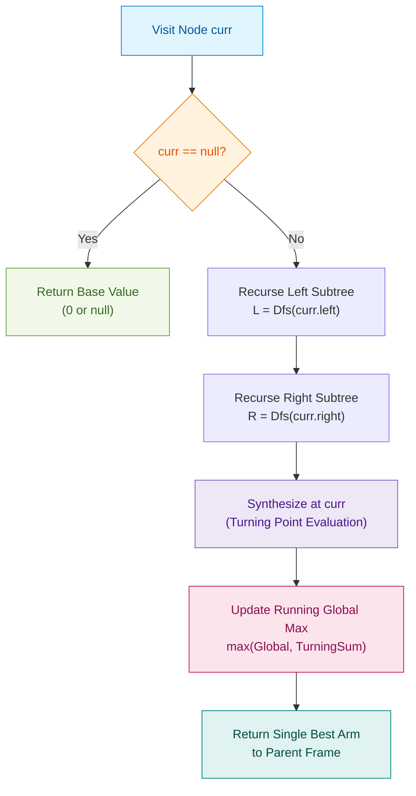

# 📘 WEEK 7 DAY 4: Tree Patterns — Subtree Delegation, Diameter, Max Path Sum & LCA — Engineering Guide

> 🧭 **Navigation:** [← Previous Day](Week_07_Day_03_Balanced_BSTs_AVL_And_RedBlack_Instructional.md) • [🏠 Week Overview](README.md) • [📘 Curriculum Syllabus](../COMPLETE_SYLLABUS.md) • [Next Day →](Week_07_Day_05_Augmented_BSTs_OrderStatistics_Instructional.md)
> 
> 💡 **Instructor Note:** *Not all sections or topics are mandatory. Feel free to adapt your pace and skim or skip sections based on your current focus and interview timeline.*

---

## 🎯 LEARNING OBJECTIVES

*By the end of this chapter, you will be able to:*

- 🎯 **Internalize** the **Subtree Delegation Contract**: delegating subproblems bottom-up via post-order traversal to eliminate redundant recalculation and achieve strictly `O(N)` linear runtime.
- ⚙️ **Implement** the core FAANG tree patterns from scratch in both C# and Python:
  1. **Lowest Common Ancestor (LCA)** (LeetCode 236)
  2. **Diameter of Binary Tree** (LeetCode 543)
  3. **Binary Tree Maximum Path Sum** (LeetCode 124)
  4. **Path Sum with Backtracking** (LeetCode 113)
  5. **Tree Serialization & Deserialization** (LeetCode 297)
  6. **Morris Inorder Traversal** (Zero-Stack `O(1)` Space Walking)
- ⚖️ **Evaluate** trade-offs between bottom-up post-order synthesis (single pass `O(N)`) versus top-down pre-order re-evaluation (degenerative `O(N^2)`).
- 🛑 **Avoid** the classic rookie blunders: inheriting negative debt in path sums, confusing diameter edge counts with node counts, and attempting BST pruning on general binary trees.
- 🏭 **Connect** tree decomposition to production systems: `git merge-base` three-way merge resolution, peer-to-peer network packet hop limits, and distributed AST RPC marshalling.

---

## 🎬 PILLAR 1: 60-SECOND HOOK & EVERYDAY ANALOGY

### The Subtree Delegation Contract: Why Pre-Order Crumbles to `O(N^2)`

Imagine you are the Vice President of Engineering at an enterprise tech organization with 10,000 engineers arranged in a strict hierarchical reporting tree.

One morning, the CEO bursts into your office with a high-stakes request:  
> *"What is the longest communication chain between any two employees in our entire company?"*

How do you find the answer?

#### The Rookie Approach: Top-Down Pre-Order (`O(N^2)` Chaos)
The rookie VP emails every single manager in the company: *"What is your deepest reporting chain?"*
- To answer, Manager A walks down all their sub-teams and counts.
- Then, Manager A's director asks Manager A again to calculate their own team's diameter.
- Then, the Senior VP asks the director again.

Every single employee at depth `d` is queried, recounted, and traversed by **every single one of their ancestors**. On a skewed organizational tree, this recalculation storm degrades to:

```text
T(N) = (N - 1) + (N - 2) + (N - 3) + ... + 1  ==>  O(N^2) Time Complexity!
```

If `N = 10^5`, `N^2 = 10^{10}` operations. Your system locks up, your server times out, and your FAANG interview ends before you write a single line of working code.

```csharp
// ❌ NAIVE O(N^2) DISASTER: Recalculating depth at every single node!
public int NaiveDiameter(TreeNode? root)
{
    if (root is null) return 0;

    int leftH = MaxDepth(root.left);    // O(N) traversal!
    int rightH = MaxDepth(root.right);  // O(N) traversal!

    // Redundantly recurses down left and right subtrees
    int leftDia = NaiveDiameter(root.left);
    int rightDia = NaiveDiameter(root.right);

    return Math.Max(leftH + rightH, Math.Max(leftDia, rightDia));
}
```

#### The Senior Architect Approach: Bottom-Up Post-Order (`O(N)` Brilliance)
The Senior Architect VP institutes a single, elegant policy: **The Subtree Delegation Contract**.

> *"Listen managers: do NOT report to me until your subordinate teams have completely finished reporting to you. When you report up to me, hand me an envelope containing two simple pieces of data:*
> 1. *The single longest branch inside your team (so I can extend it to report to my superior).*
> 2. *The record-breaking metric discovered entirely within your team (the turning point).*

In post-order traversal (`Left -> Right -> Root`), the parent node does not lift a finger until both children have finished their evaluations. The children **bubble up** their heights in the return value. In the exact same function call, the parent combines those two arms to check if a new global record was set at this node!

```text
Every node is visited exactly ONCE:
Time Complexity drops from O(N^2) to strictly O(N)!
```

> [!TIP]
> **The Subtree Delegation Rule:**  
> - **Return Value to Parent:** The best **single downward arm** that the parent can extend.
> - **Global State Update (Side Effect):** The best **turning point path** that connects the left arm and right arm through the current node.

---

## 🪜 PILLAR 2: THE SCAFFOLDING LADDER & TOY NAPKIN TRACES

Let's ascend the ladder step-by-step: from basic pointer splitting to managing positive/negative contributions under interview pressure.

---

### Ladder Rung 1: Lowest Common Ancestor (LCA) in a Binary Tree (LeetCode 236)

#### The Problem Statement
Given a binary tree and two nodes `p` and `q`, find the lowest node in the tree that has both `p` and `q` as descendants (a node may be a descendant of itself).

#### The Subtree Delegation Contract for LCA
At any node `curr`:
1. If `curr == null`, return `null`.
2. If `curr == p` or `curr == q`, return `curr` immediately.
3. Query left child: `left = LCA(curr.left, p, q)`.
4. Query right child: `right = LCA(curr.right, p, q)`.
5. **The Turning Point Decision:**
   - If both `left != null` AND `right != null`, it means `p` is in one subtree and `q` is in the other. **`curr` is the LCA!** Return `curr`.
   - If only one child is non-null, bubble that non-null node up to the parent.
   - If both are null, return `null`.

#### Toy Napkin Trace (4 Nodes)
Let's trace tree:
```text
         [ 3 ]
        /     \
     [ 5 ]   [ 1 ]
    /
  [ 6 ]
```

##### Case A: Find LCA of `p = 6` and `q = 1`
1. Start at `Root 3`: recurse left to `Node 5`.
2. At `Node 5`: recurse left to `Node 6`.
3. At `Node 6`: `curr == p (6)`. Base case hit! Return `Node 6`.
4. Back at `Node 5`: `left = Node 6`. Recurse right (`null`) -> returns `null`.
   - `left != null`, `right == null` -> Node 5 bubbles up `Node 6`.
5. Back at `Root 3`: `left = Node 6`. Now recurse right to `Node 1`.
6. At `Node 1`: `curr == q (1)`. Base case hit! Return `Node 1`.
7. Back at `Root 3`:
   - `left = Node 6` (non-null)
   - `right = Node 1` (non-null)
   - Both are non-null! **Root 3 is the LCA!** Returns `Node 3`.

##### Case B: Find LCA of `p = 5` and `q = 6` (One node is an ancestor of the other)
1. Start at `Root 3`: recurse left to `Node 5`.
2. At `Node 5`: `curr == p (5)`. Base case hit! **Immediately return `Node 5`!**
3. Notice: we do NOT even need to search below `Node 5`!
4. Back at `Root 3`: `left = Node 5`. Recurse right (`Node 1`): returns `null` (neither `p` nor `q` found).
5. At `Root 3`: `left = Node 5`, `right = null`. Root 3 bubbles up `Node 5`.
6. Result is `Node 5`! Because `q` is located in `p`'s subtree, `p` is by definition the LCA of both!

```text
🧠 PAUSE & PREDICT Micro-Drill #1
Question: What if node 'p' exists in the tree, but node 'q' does NOT exist anywhere in the tree?
Does this algorithm return the correct result?

Think for 10 seconds before reading the answer below...
```

> [!WARNING]
> **Drill #1 Answer:**  
> If `q` is absent from the tree, this standard algorithm will return `p` instead of `null`! Because when it hits `p`, it assumes `q` is either in `p`'s subtree or will be found in the other branch. LeetCode 236 guarantees both `p` and `q` exist in the tree. In a real-world FAANG interview, you win massive bonus points by asking: *"Can I assume both p and q are guaranteed to exist in the tree, or must I perform a two-pass validation?"*

---

### Ladder Rung 2: Diameter of Binary Tree (LeetCode 543)

#### The Problem Statement
The diameter of a binary tree is the length of the longest path between any two nodes in a tree. This path may or may not pass through the root. The length is measured by the number of **edges** between them.

#### The Subtree Delegation Contract for Diameter
At each node `curr`:
- **Child Contract:** Left and right children calculate their maximum downward depth (measured in nodes or edges).
- **Turning Point Check:** The longest path that turns at `curr` is:
  ```text
  PathThroughCurr = leftDepth + rightDepth (in edges)
  ```
- **Global Tracker Update:** `maxDiameter = max(maxDiameter, leftDepth + rightDepth)`
- **Return Value to Parent:** `1 + max(leftDepth, rightDepth)` (extending the single longest arm by 1 edge).

#### Toy Napkin Trace (5 Nodes)
```text
           [ 1 ]
          /     \
       [ 2 ]   [ 3 ]
      /     \
   [ 4 ]   [ 5 ]
```

| Step | Node | Left Depth | Right Depth | Turning Path (`L + R`) | Global Max Diameter | Returns Upward (`1 + max(L, R)`) |
| :---: | :---: | :---: | :---: | :---: | :---: | :---: |
| 1 | `Leaf 4` | 0 | 0 | 0 | 0 | 1 |
| 2 | `Leaf 5` | 0 | 0 | 0 | 0 | 1 |
| 3 | `Node 2` | 1 | 1 | `1 + 1 = 2` | `max(0, 2) = 2` | `1 + max(1, 1) = 2` |
| 4 | `Leaf 3` | 0 | 0 | 0 | 2 | 1 |
| 5 | `Root 1` | 2 | 1 | `2 + 1 = 3` | `max(2, 3) = 3` | `1 + max(2, 1) = 3` |

Final Diameter = `3` edges (Path: `4 -> 2 -> 1 -> 3` or `5 -> 2 -> 1 -> 3`).

```text
🧠 PAUSE & PREDICT Micro-Drill #2
Question: Does the longest diameter path ALWAYS pass through the root of the tree?
What happens if Node 2 has depth 10 on its left and depth 10 on its right, while Root 1 has no right child?

Think for 10 seconds before reading the answer below...
```

> [!TIP]
> **Drill #2 Answer:**  
> **NO!** The diameter does NOT need to pass through the root! If Node 2 has left depth 10 and right depth 10, the path through Node 2 has length `10 + 10 = 20`. Meanwhile, Root 1 only has left depth 11 and right depth 0, giving a path length through Root 1 of `11 + 0 = 11`. The global diameter is `20`, completely inside Node 2's subtree! This is why keeping a running global maximum during bottom-up post-order is mandatory.

---

### Ladder Rung 3: Binary Tree Maximum Path Sum (LeetCode 124 — FAANG Hard)

#### The Problem Statement
A path in a binary tree is a sequence of nodes where each pair of adjacent nodes has an edge connecting them. A node can only appear at most once in the path. The path does not need to pass through the root. Find the maximum path sum of any non-empty path.

#### The Big Leap: Values Can Be NEGATIVE!
In Tree Diameter, every branch has a positive length (`>= 0`). But in Maximum Path Sum, node values can be `-10`, `-500`, or all negative!

If a child subtree returns a negative sum (e.g., `-5`), should the parent include that subtree in its path?  
**ABSOLUTELY NOT!** Including a negative subtree only drags down the parent's total sum.

#### The Negative Gain Clamping Invariant:
```text
LeftGain  = max(0, MaxGain(curr.left))
RightGain = max(0, MaxGain(curr.right))
```
If a child returns a negative number, we clamp it to `0` (meaning: *"We choose NOT to extend the path down that child"*).

#### The Subtree Delegation Contract for Max Path Sum:
- **Turning Point Path at `curr`:**
  ```text
  LocalTurningSum = curr.val + LeftGain + RightGain
  maxGlobalSum = max(maxGlobalSum, LocalTurningSum)
  ```
- **Return Value to Parent:**
  A path cannot fork in both directions when continuing upward to a parent! The parent can only link to **ONE single arm**:
  ```text
  ReturnValue = curr.val + max(LeftGain, RightGain)
  ```

#### Toy Napkin Trace (5 Nodes with Negatives)
```text
          [-10]
          /    \
        [ 9 ]  [ 20 ]
               /    \
            [ 15 ]  [ 7 ]
```

Let's trace step-by-step:
1. `Leaf 9`:
   - `LeftGain = 0`, `RightGain = 0`.
   - Local Turning Sum: `9 + 0 + 0 = 9`.
   - `maxGlobalSum = max(-inf, 9) = 9`.
   - Returns to parent: `9 + max(0, 0) = 9`.
2. `Leaf 15`:
   - Local Turning Sum: `15 + 0 + 0 = 15`.
   - `maxGlobalSum = max(9, 15) = 15`.
   - Returns to parent: `15`.
3. `Leaf 7`:
   - Local Turning Sum: `7 + 0 + 0 = 7`.
   - `maxGlobalSum` remains `15`.
   - Returns to parent: `7`.
4. `Node 20`:
   - `LeftGain = max(0, 15) = 15`.
   - `RightGain = max(0, 7) = 7`.
   - Local Turning Sum: `20 + 15 + 7 = 42`!
   - `maxGlobalSum = max(15, 42) = 42`!
   - Returns to parent: `20 + max(15, 7) = 20 + 15 = 35`.
5. `Root -10`:
   - `LeftGain = max(0, 9) = 9`.
   - `RightGain = max(0, 35) = 35`.
   - Local Turning Sum: `-10 + 9 + 35 = 34`.
   - `maxGlobalSum = max(42, 34) = 42` (42 wins!).
   - Returns to parent: `-10 + max(9, 35) = 25`.

Final Maximum Path Sum = `42` (Path: `15 -> 20 -> 7`).

```text
🧠 PAUSE & PREDICT Micro-Drill #3
Question: What if every single node in the tree is negative, e.g. [-3, -5, -2]?
If you initialize maxGlobalSum = 0, what bug occurs?

Think for 10 seconds before reading the answer below...
```

> [!CAUTION]
> **Drill #3 Answer:**  
> If you initialize `maxGlobalSum = 0`, the function will return `0`! But `0` is not in the tree, and the problem requires a non-empty path! The maximum path in `[-3, -5, -2]` is the single node `[-2]`. You MUST initialize `maxGlobalSum = int.MinValue` (in C#) or `float('-inf')` (in Python) so that single negative nodes can properly establish the baseline!

---

## 🎨 PILLAR 3: PRAGMATIC VISUAL MODELS

### Visual 1: Tree Diameter Paths (Passing through Root vs Turning in Subtree)

```text
================================================================================
CASE A: Diameter Passes Through Root           CASE B: Diameter Isolated in Subtree
================================================================================

              [ 1 ] <--- Turning Point                     [ 1 ] (Root)
             /     \                                      /
          [ 2 ]   [ 3 ]                                [ 2 ] <--- Turning Point!
         /             \                              /     \
      [ 4 ]           [ 5 ]                        [ 4 ]   [ 5 ]
                                                  /           \
                                               [ 8 ]         [ 9 ]

Path: 4 -> 2 -> 1 -> 3 -> 5                  Path: 8 -> 4 -> 2 -> 5 -> 9
Length: 4 edges                              Length: 4 edges
Turning Point = Root (Node 1)                Turning Point = Internal Node (Node 2)
                                             Root path length is only 3 edges!
```

### Visual 2: Maximum Path Sum — Turning Point V-Junction vs Single Arm

```text
                   (Parent)
                      ^
                      |   Single Arm Return:
                      |   node.val + max(LeftGain, RightGain)
                      |
                 +----+----+
                 | [ Node ]|
                 +----+----+
                     /   \
  Left Arm          /     \          Right Arm
  LeftGain         /       \         RightGain
                  v         v
             [Left]         [Right]

  ==============================================================
  CRITICAL RULE:
  - Local Turning Point (V-Junction): Uses BOTH arms!
    TurningSum = node.val + LeftGain + RightGain
  - Return to Parent: Can only pick ONE arm!
    Path cannot branch both ways and continue upward!
  ==============================================================
```

### Visual 3: Post-Order Bubble-Up State Machine (Mermaid Flowchart)



---

## 🛑 PILLAR 4: THE ROOKIE TRAP ZONE

### Side-by-Side: Common Failure Modes vs Senior Architect Patterns

#### Trap 1: Allowing Negative Branch Gains in Max Path Sum (LeetCode 124)

```text
❌ ROOKIE BLUNDER                                      ✅ SENIOR ARCHITECT PATTERN
--------------------------------------------------    --------------------------------------------------
int left = Dfs(node.left);                             // Clamp negative branches to zero!
int right = Dfs(node.right);                           int leftGain = Math.Max(0, Dfs(node.left));
                                                       int rightGain = Math.Max(0, Dfs(node.right));
// If left is -100, we add -100 to our sum!
int local = node.val + left + right;                   int local = node.val + leftGain + rightGain;
maxSum = Math.Max(maxSum, local);                      maxSum = Math.Max(maxSum, local);

return node.val + Math.Max(left, right);               return node.val + Math.Max(leftGain, rightGain);
```

#### Trap 2: Confusing Diameter Edges vs Nodes Count (LeetCode 543)

```text
❌ ROOKIE BLUNDER                                      ✅ SENIOR ARCHITECT PATTERN
--------------------------------------------------    --------------------------------------------------
// Returning number of nodes instead of edges!        // Invariant: Depth returns node count.
int leftH = Height(node.left);                         int leftH = Height(node.left);
int rightH = Height(node.right);                       int rightH = Height(node.right);

// Bug: counting nodes on path (e.g. 3 nodes = 2 edges) // Edges between deepest leaves = leftH + rightH!
maxDiameter = Math.Max(maxDiameter, leftH + rightH + 1); maxDiameter = Math.Max(maxDiameter, leftH + rightH);
```

#### Trap 3: Returning a Forking V-Path to Parent

```text
❌ ROOKIE BLUNDER                                      ✅ SENIOR ARCHITECT PATTERN
--------------------------------------------------    --------------------------------------------------
// Attempting to bubble up both arms to parent:        // A path cannot visit any node twice!
return node.val + leftGain + rightGain;                // Parent can only connect to ONE branch:
                                                       return node.val + Math.Max(leftGain, rightGain);
```

#### Trap 4: Assuming BST Order in a General Binary Tree LCA (LeetCode 236 vs 235)

```text
❌ ROOKIE BLUNDER                                      ✅ SENIOR ARCHITECT PATTERN
--------------------------------------------------    --------------------------------------------------
// Trying to use BST pruning on general Binary Tree:   // Must search BOTH branches unconditionally!
if (p.val < root.val && q.val < root.val)              TreeNode? left = LCA(root.left, p, q);
    return LCA(root.left, p, q);                       TreeNode? right = LCA(root.right, p, q);
// General binary trees have NO key order!              if (left != null && right != null) return root;
// Nodes can appear anywhere!                          return left ?? right;
```

---

## 🎙️ PILLAR 5: 45-MINUTE INTERVIEW TALK TRACKS

Deliver these exact 3-sentence verbal scripts before touching the keyboard to signal Staff-level algorithmic clarity.

### Verbal Script 1: Lowest Common Ancestor (LeetCode 236)
> *"We find the Lowest Common Ancestor using post-order divide-and-conquer. At each node, if the current node matches either target `p` or `q`, we bubble it up immediately; otherwise, we search left and right subtrees independently. If both recursive searches return non-null values, the targets reside on opposite sides of the current node—making this node their lowest common ancestor—while a single non-null return propagates that branch's target upward, running in `O(N)` time and `O(H)` auxiliary stack space."*

### Verbal Script 2: Diameter of Binary Tree (LeetCode 543)
> *"The diameter of a binary tree represents the longest path between any two nodes, which may or may not pass through the root. We implement a bottom-up post-order traversal where each node returns its single maximum subtree depth to its parent while simultaneously updating a running global diameter with `leftDepth + rightDepth`. This evaluates every node as a potential turning point in a single `O(N)` pass without redundant `O(N^2)` depth recomputations."*

### Verbal Script 3: Binary Tree Maximum Path Sum (LeetCode 124)
> *"To find the maximum path sum across arbitrary integer node values, we perform post-order traversal with negative-gain pruning. Each node computes its maximum downward branch contribution, clamping negative returns to zero so unprofitable subtrees do not drag down the path sum. At each node, we evaluate the turning point sum of `node.val + leftGain + rightGain` against a global maximum initialized to negative infinity, while returning only the single best arm `node.val + max(leftGain, rightGain)` to the parent in `O(N)` time."*

---

## ⚡ PILLAR 6: PRODUCTION DUAL-LANGUAGE IMPLEMENTATIONS

---

### Problem 1: Lowest Common Ancestor of a Binary Tree (LeetCode 236)

#### C# Primary Implementation (.NET 8/9 — Production-Grade)

```csharp
namespace DSA.TreePatterns;

public sealed class TreeNode
{
    public int val;
    public TreeNode? left;
    public TreeNode? right;

    public TreeNode(int val = 0, TreeNode? left = null, TreeNode? right = null)
    {
        this.val = val;
        this.left = left;
        this.right = right;
    }
}

public static class LcaSolver
{
    /// <summary>
    /// Finds the Lowest Common Ancestor of nodes p and q in a general binary tree.
    /// Time Complexity: O(N) | Auxiliary Space: O(H) call stack
    /// </summary>
    public static TreeNode? LowestCommonAncestor(TreeNode? root, TreeNode? p, TreeNode? q)
    {
        // Guard against null parameters
        if (root is null || p is null || q is null) return null;

        return Search(root, p, q);

        static TreeNode? Search(TreeNode? node, TreeNode p, TreeNode q)
        {
            // Base Case: Hit null leaf or matched one of the targets
            if (node is null || node == p || node == q)
            {
                return node;
            }

            // Post-order: Search both children independently
            TreeNode? left = Search(node.left, p, q);
            TreeNode? right = Search(node.right, p, q);

            // Turning Point: Both subtrees contain one of the target nodes
            if (left is not null && right is not null)
            {
                return node;
            }

            // Bubble up whichever branch found a target (or null if neither)
            return left ?? right;
        }
    }
}
```

#### Python Secondary Implementation (3.11+ — Idiomatic)

```python
from typing import Optional

class TreeNode:
    def __init__(self, val: int = 0, left: Optional['TreeNode'] = None, right: Optional['TreeNode'] = None):
        self.val = val
        self.left = left
        self.right = right

class Solution:
    def lowestCommonAncestor(self, root: Optional[TreeNode], p: TreeNode, q: TreeNode) -> Optional[TreeNode]:
        """
        Finds the Lowest Common Ancestor of p and q in a binary tree.
        Time Complexity: O(N) | Auxiliary Space: O(H)
        """
        if not root or root is p or root is q:
            return root

        left = self.lowestCommonAncestor(root.left, p, q)
        right = self.lowestCommonAncestor(root.right, p, q)

        # Both targets found in opposite subtrees -> current node is the LCA
        if left and right:
            return root

        # Propagate non-null target upward
        return left or right
```

#### 📊 Explicit Complexity Deconstruction
- **Time Complexity:** `O(N)` — Every node is visited at most once. In the worst case where both targets are at the bottom leaves, all `N` nodes are traversed.
- **Auxiliary Space:** `O(H)` — Bounded by the recursion stack height (`O(log N)` for balanced trees, `O(N)` for completely skewed chains).
- **Output Space:** `O(1)` — Returns a single node reference without allocating collections.

#### 🧪 Concrete Edge-Case Dry Run
1. **Target is an ancestor of the other (`p = 5`, `q = 4` where 4 is under 5):** When `curr == 5`, it returns `5` immediately. The right branch returns `null`. The parent receives `5` and `null`, bubbling `5` to the root. Correctly identifies `5` as LCA!
2. **Targets in opposite subtrees (`p` in left, `q` in right):** `left` returns `p`, `right` returns `q`. Both non-null condition triggers at the common ancestor. Returns the correct common ancestor.
3. **Skewed tree (Linked List shape):** Recursion proceeds down the chain. Base case hits, call stack unwinds in `O(N)` time without stack overflow for standard tree depths.

---

### Problem 2: Diameter of Binary Tree (LeetCode 543)

#### C# Primary Implementation (.NET 8/9 — Production-Grade)

```csharp
namespace DSA.TreePatterns;

public static class TreeDiameterSolver
{
    /// <summary>
    /// Computes the diameter (longest path in edges between any two nodes) of a binary tree.
    /// Time Complexity: O(N) | Auxiliary Space: O(H)
    /// </summary>
    public static int DiameterOfBinaryTree(TreeNode? root)
    {
        if (root is null) return 0;

        int maxDiameter = 0;
        ComputeDepth(root, ref maxDiameter);
        return maxDiameter;

        static int ComputeDepth(TreeNode? node, ref int maxDiameter)
        {
            if (node is null) return 0;

            int leftDepth = ComputeDepth(node.left, ref maxDiameter);
            int rightDepth = ComputeDepth(node.right, ref maxDiameter);

            // Turning Point Check: Longest edge path through current node
            maxDiameter = Math.Max(maxDiameter, leftDepth + rightDepth);

            // Return single longest arm height to parent
            return 1 + Math.Max(leftDepth, rightDepth);
        }
    }
}
```

#### Python Secondary Implementation (3.11+ — Idiomatic)

```python
from typing import Optional

def diameter_of_binary_tree(root: Optional[TreeNode]) -> int:
    """
    Computes the diameter (number of edges on longest path) in O(N) time.
    Time Complexity: O(N) | Auxiliary Space: O(H)
    """
    max_diameter = 0

    def get_depth(node: Optional[TreeNode]) -> int:
        nonlocal max_diameter
        if not node:
            return 0

        left_d = get_depth(node.left)
        right_d = get_depth(node.right)

        # Turning point update: path length in edges
        max_diameter = max(max_diameter, left_d + right_d)

        # Return single longest arm to parent
        return 1 + max(left_d, right_d)

    get_depth(root)
    return max_diameter
```

#### 📊 Explicit Complexity Deconstruction
- **Time Complexity:** `O(N)` — Exactly one post-order visit per node. No redundant depth computations.
- **Auxiliary Space:** `O(H)` — Call stack depth bounded by tree height `H`.
- **Output Space:** `O(1)` — Single primitive integer.

#### 🧪 Concrete Edge-Case Dry Run
1. **Single Node Tree (`[1]`):** `leftDepth = 0`, `rightDepth = 0`. `maxDiameter = 0 + 0 = 0`. Returns 1. Correct (a single node has 0 edges).
2. **Two-Node Tree (`[1, 2]`):** `Node 2` has `L = 0, R = 0`, returns 1. `Node 1` has `L = 1, R = 0`. `maxDiameter = 1 + 0 = 1`. Correct (1 edge).
3. **Deep Asymmetric Subtree (Diameter does not pass through root):** Left subtree has turning diameter `10 + 10 = 20`. Root has right child `null`. `maxDiameter` retains `20`. Correct!

---

### Problem 3: Binary Tree Maximum Path Sum (LeetCode 124 — FAANG Hard)

#### C# Primary Implementation (.NET 8/9 — Production-Grade)

```csharp
namespace DSA.TreePatterns;

public static class MaxPathSumSolver
{
    /// <summary>
    /// Computes the maximum path sum of any non-empty path in the binary tree.
    /// Handles negative values via branch gain clamping.
    /// Time Complexity: O(N) | Auxiliary Space: O(H)
    /// </summary>
    public static int MaxPathSum(TreeNode? root)
    {
        ArgumentNullException.ThrowIfNull(root);

        // Initialize with MinValue to correctly handle trees with all negative values
        int globalMaxSum = int.MinValue;
        ComputeMaxGain(root, ref globalMaxSum);
        return globalMaxSum;

        static int ComputeMaxGain(TreeNode? node, ref int globalMaxSum)
        {
            if (node is null) return 0;

            // Clamping: If a subtree's gain is negative, drop it by taking max(0, gain)
            int leftGain = Math.Max(0, ComputeMaxGain(node.left, ref globalMaxSum));
            int rightGain = Math.Max(0, ComputeMaxGain(node.right, ref globalMaxSum));

            // Turning Point Check: Path that uses current node as the apex
            int localTurningSum = node.val + leftGain + rightGain;
            globalMaxSum = Math.Max(globalMaxSum, localTurningSum);

            // Single Arm Return: Parent can only connect to ONE branch upward
            return node.val + Math.Max(leftGain, rightGain);
        }
    }
}
```

#### Python Secondary Implementation (3.11+ — Idiomatic)

```python
from typing import Optional

def max_path_sum(root: Optional[TreeNode]) -> int:
    """
    Finds the maximum path sum across any non-empty path in a binary tree.
    Time Complexity: O(N) | Auxiliary Space: O(H)
    """
    if not root:
        return 0

    # Initialize to -inf to correctly handle trees consisting entirely of negative values
    global_max = float('-inf')

    def get_max_gain(node: Optional[TreeNode]) -> int:
        nonlocal global_max
        if not node:
            return 0

        # Negative Gain Clamping: Ignore branches that contribute debt
        left_gain = max(0, get_max_gain(node.left))
        right_gain = max(0, get_max_gain(node.right))

        # Turning point sum at this apex
        local_turning = node.val + left_gain + right_gain
        global_max = max(global_max, local_turning)

        # Single arm return to parent
        return node.val + max(left_gain, right_gain)

    get_max_gain(root)
    return int(global_max)
```

#### 📊 Explicit Complexity Deconstruction
- **Time Complexity:** `O(N)` — Single post-order traversal visiting each node once.
- **Auxiliary Space:** `O(H)` — Call stack space bounded by tree height `H` (`O(log N)` balanced, `O(N)` worst-case skewed).
- **Output Space:** `O(1)` — Single integer return value.

#### 🧪 Concrete Edge-Case Dry Run
1. **All Negative Nodes (`[-3, -5, -2]`):**
   - Leaf `-5`: `left = 0, right = 0`. Local turning = `-5`. Global max = `-5`. Returns `max(0, -5)`? Wait: it returns `-5 + 0 = -5`.
   - Leaf `-2`: Local turning = `-2`. Global max = `max(-5, -2) = -2`. Returns `-2`.
   - Root `-3`: `leftGain = max(0, -5) = 0`, `rightGain = max(0, -2) = 0`.
   - Local turning = `-3 + 0 + 0 = -3`. Global max = `max(-2, -3) = -2`.
   - Correctly returns `-2`!
2. **Zig-zag with Positive & Negative nodes (`[10, -5, 20]`):**
   - Left child `-5`: clamped to `0` by parent!
   - Root includes only positive arm `20`. Sum is `10 + 20 = 30`. Correct!

---

### Problem 4: Path Sum II with Backtracking (LeetCode 113)

#### C# Primary Implementation (.NET 8/9 — Backtracking Buffer)

```csharp
namespace DSA.TreePatterns;

public static class PathSumSolver
{
    /// <summary>
    /// Finds all root-to-leaf paths that sum to targetSum.
    /// Time Complexity: O(N * H) | Auxiliary Space: O(H) path buffer
    /// </summary>
    public static IList<IList<int>> PathSum(TreeNode? root, int targetSum)
    {
        var result = new List<IList<int>>();
        var currentPath = new List<int>();
        Dfs(root, targetSum, currentPath, result);
        return result;

        static void Dfs(TreeNode? node, int remainingSum, List<int> path, List<IList<int>> result)
        {
            if (node is null) return;

            path.Add(node.val);
            remainingSum -= node.val;

            // Check if leaf node matches target sum
            if (node.left is null && node.right is null && remainingSum == 0)
            {
                result.Add(new List<int>(path)); // Snapshot copy
            }
            else
            {
                Dfs(node.left, remainingSum, path, result);
                Dfs(node.right, remainingSum, path, result);
            }

            // BACKTRACK: Remove current node before returning to parent frame
            path.RemoveAt(path.Count - 1);
        }
    }
}
```

#### Python Secondary Implementation (3.11+ — Idiomatic)

```python
from typing import Optional

def path_sum(root: Optional[TreeNode], target_sum: int) -> list[list[int]]:
    """
    Finds all root-to-leaf paths matching target_sum using a backtracking path buffer.
    Time Complexity: O(N * H) | Auxiliary Space: O(H)
    """
    result: list[list[int]] = []
    current_path: list[int] = []

    def dfs(node: Optional[TreeNode], remaining: int) -> None:
        if not node:
            return

        current_path.append(node.val)
        remaining -= node.val

        if not node.left and not node.right and remaining == 0:
            result.append(list(current_path))  # Snapshot copy
        else:
            dfs(node.left, remaining)
            dfs(node.right, remaining)

        current_path.pop()  # Backtrack

    dfs(root, target_sum)
    return result
```

#### 📊 Explicit Complexity Deconstruction
- **Time Complexity:** `O(N * H)` — In the worst case (complete binary tree where every path sums to target), there are `O(N)` leaves, and allocating a snapshot copy of each path takes `O(H)` time.
- **Auxiliary Space:** `O(H)` — Call stack and the single shared `currentPath` buffer both consume `O(H)` space.
- **Output Space:** `O(N * H)` — Holds the matched path lists.

---

### Problem 5: Serialize and Deserialize Binary Tree (LeetCode 297)

#### C# Primary Implementation (.NET 8/9 — Pre-Order Stream)

```csharp
using System.Text;

namespace DSA.TreePatterns;

public sealed class Codec
{
    private const string NullMarker = "#";
    private const char Delimiter = ',';

    /// <summary>
    /// Serializes a binary tree to a single comma-separated string.
    /// Time Complexity: O(N) | Auxiliary Space: O(N)
    /// </summary>
    public string serialize(TreeNode? root)
    {
        var sb = new StringBuilder();
        BuildString(root, sb);
        return sb.ToString();

        static void BuildString(TreeNode? node, StringBuilder sb)
        {
            if (node is null)
            {
                sb.Append(NullMarker).Append(Delimiter);
                return;
            }

            sb.Append(node.val).Append(Delimiter);
            BuildString(node.left, sb);
            BuildString(node.right, sb);
        }
    }

    /// <summary>
    /// Deserializes a string back to the original binary tree.
    /// Time Complexity: O(N) | Auxiliary Space: O(N)
    /// </summary>
    public TreeNode? deserialize(string data)
    {
        if (string.IsNullOrEmpty(data)) return null;

        string[] tokens = data.Split(Delimiter, StringSplitOptions.RemoveEmptyEntries);
        var queue = new Queue<string>(tokens);
        return BuildTree(queue);

        static TreeNode? BuildTree(Queue<string> queue)
        {
            if (queue.Count == 0) return null;

            string token = queue.Dequeue();
            if (token == NullMarker)
            {
                return null;
            }

            var node = new TreeNode(int.Parse(token));
            node.left = BuildTree(queue);
            node.right = BuildTree(queue);
            return node;
        }
    }
}
```

#### Python Secondary Implementation (3.11+ — Idiomatic)

```python
from typing import Optional

class Codec:
    def serialize(self, root: Optional[TreeNode]) -> str:
        """
        Encodes a tree to a single string using pre-order traversal with null sentinels.
        Time Complexity: O(N) | Auxiliary Space: O(N)
        """
        tokens: list[str] = []

        def build(node: Optional[TreeNode]) -> None:
            if not node:
                tokens.append("#")
                return
            tokens.append(str(node.val))
            build(node.left)
            build(node.right)

        build(root)
        return ",".join(tokens)

    def deserialize(self, data: str) -> Optional[TreeNode]:
        """
        Decodes string data back to the original binary tree using an iterator queue.
        Time Complexity: O(N) | Auxiliary Space: O(N)
        """
        if not data:
            return None

        tokens = iter(data.split(","))

        def parse() -> Optional[TreeNode]:
            val = next(tokens)
            if val == "#":
                return None
            node = TreeNode(int(val))
            node.left = parse()
            node.right = parse()
            return node

        return parse()
```

---

### 🧠 Senior Bar-Raiser Pattern: Morris Inorder Traversal — Zero-Stack `O(1)` Space Walking

> [!IMPORTANT]
> **The Senior Bar-Raiser Curveball:**
> *"Can you traverse a binary tree in-order in `O(N)` time and strictly `O(1)` auxiliary space without recursion and without allocating an explicit `Stack` object?"*
> 
> Standard DFS requires `O(H)` call-stack space. Morris Traversal eliminates the call stack entirely by temporarily threading the **right pointer of the inorder predecessor** back to the current node.

```text
Tree Threading Visual:
        4 (curr)                         4 (curr)
       /                                /
      2                                2
     / \                              / \
    1   3 (predecessor)              1   3 ----+ (Thread pointing back to 4!)
                                               |
                                               v
                                               4
```

#### Dual-Language Implementation (Morris Inorder Traversal)

##### C# (.NET 8/9 Strictly `O(1)` Auxiliary Memory)

```csharp
using System.Collections.Generic;

namespace DSA.TreePatterns;

public static class MorrisTraversalSolver
{
    /// <summary>
    /// Traverses binary tree in-order in O(N) time and O(1) auxiliary space using Morris Threading.
    /// Restores original tree structure before returning.
    /// </summary>
    public static IList<int> MorrisInorder(TreeNode? root)
    {
        var result = new List<int>();
        var curr = root;

        while (curr != null)
        {
            if (curr.left == null)
            {
                result.Add(curr.val);
                curr = curr.right;
            }
            else
            {
                // Find inorder predecessor: rightmost node in left subtree
                var predecessor = curr.left;
                while (predecessor.right != null && predecessor.right != curr)
                {
                    predecessor = predecessor.right;
                }

                if (predecessor.right == null)
                {
                    // Create temporary thread back to current node
                    predecessor.right = curr;
                    curr = curr.left;
                }
                else
                {
                    // Thread already exists: left subtree finished! Remove thread and visit curr
                    predecessor.right = null;
                    result.Add(curr.val);
                    curr = curr.right;
                }
            }
        }

        return result;
    }
}
```

##### Python 3.11+ Idiomatic Implementation

```python
from typing import Optional, List

class Solution:
    def morrisInorderTraversal(self, root: Optional[TreeNode]) -> List[int]:
        """
        Inorder traversal in O(N) time and O(1) auxiliary memory using Morris threading.
        """
        result = []
        curr = root

        while curr:
            if not curr.left:
                result.append(curr.val)
                curr = curr.right
            else:
                # Find inorder predecessor
                pre = curr.left
                while pre.right and pre.right is not curr:
                    pre = pre.right

                if not pre.right:
                    # Construct temporary thread
                    pre.right = curr
                    curr = curr.left
                else:
                    # Dissolve thread and visit current node
                    pre.right = None
                    result.append(curr.val)
                    curr = curr.right

        return result
```

#### 📊 Explicit Complexity Deconstruction
- **Time Complexity:** `O(N)` amortized. Every edge is traversed at most 3 times (once to find the predecessor, once to traverse downward, once to dissolve the thread).
- **Auxiliary Space:** `O(1)` strictly! No call stack frames, no explicit `Stack` object. The tree is temporarily modified and completely restored to its original state.
- **Output Space:** `O(N)` for the returned sequence.

---

## ⚖️ PRODUCTION SYSTEMS CONTEXT & FAILURE MODES

### 🏭 Real-World Systems Context

> [!NOTE]
> **Production Context — Git Commit History & `git merge-base`:**  
> Git's commit history forms a Directed Acyclic Graph (DAG). When you execute `git merge feature-branch`, git must locate the exact common ancestor where your branch split from `main`. It calls `git merge-base A B`, which solves the **Lowest Common Ancestor** problem. The diff between that LCA commit and the two branch tips forms the clean base for a three-way merge.

> [!NOTE]
> **Production Context — Network Diameter & Packet Routing Limits:**  
> In peer-to-peer mesh networks and distributed routing overlays, the tree diameter dictates the **worst-case packet propagation latency**. If the diameter exceeds acceptable SLA hop limits, routing algorithms trigger a topology re-balancing to select a more central root node.

> [!NOTE]
> **Production Context — Microservice RPC Marshalling & AST Caching:**  
> When compiling distributed queries (e.g., GraphQL or SQL engine ASTs) or persisting configuration hierarchies in Redis, raw memory pointers cannot cross process boundaries. Compact pre-order serialization with delimiter sentinels minimizes wire payloads and ensures deterministic streaming deserialization.

### Failure Modes & Defensive Engineering

| Failure Mode | Root Cause | Engineering Mitigation |
| :--- | :--- | :--- |
| **All-Negative Max Path Sum Bug** | Initializing `globalMaxSum = 0` | Initialize `globalMaxSum = int.MinValue` or `float('-inf')` |
| **Sibling Path Contamination** | Reusing a mutable `path` list without popping during backtrack | Ensure `path.RemoveAt(path.Count - 1)` / `path.pop()` runs after both child visits |
| **Missing Snapshot Allocation** | Appending the mutable `path` reference directly into `result` | Always snapshot: `result.Add(new List<int>(path))` |
| **Diameter Root Assumption** | Assuming the longest path must pass through the tree root | Test every node as a turning point; track global max separately from height |
| **Malformed Serialization Tokens** | Using string concatenation (`+`) in a loop causing `O(N^2)` memory allocations | Use `StringBuilder` in C# or `",".join()` in Python |

---

## ⚔️ PRACTICE PROBLEMS & INTERVIEW LADDER

| # | Problem | Source | Difficulty | Target Pattern |
| :---: | :--- | :--- | :---: | :--- |
| 1 | Diameter of Binary Tree | LeetCode #543 | 🟢 Easy | Post-order bottom-up height & diameter |
| 2 | Path Sum | LeetCode #112 | 🟢 Easy | Top-down subtraction to leaf |
| 3 | Path Sum II | LeetCode #113 | 🟡 Medium | Backtracking path buffer snapshot |
| 4 | Lowest Common Ancestor of Binary Tree | LeetCode #236 | 🟡 Medium | Post-order target split propagation |
| 5 | Lowest Common Ancestor of a BST | LeetCode #235 | 🟢 Easy | Key ordering directional pruning |
| 6 | Binary Tree Maximum Path Sum | LeetCode #124 | 🔴 Hard | Diameter pattern with negative value clamping |
| 7 | Serialize and Deserialize Binary Tree | LeetCode #297 | 🔴 Hard | Pre-order null sentinel streaming |
| 8 | All Nodes Distance K in Binary Tree | LeetCode #863 | 🟡 Medium | Parent mapping + BFS graph conversion |
| 9 | Flatten Binary Tree to Linked List | LeetCode #114 | 🟡 Medium | Reverse post-order pointer rewriting |
| 10 | Step-By-Step Directions Between Nodes | LeetCode #2096 | 🟡 Medium | LCA + path prefix pruning |

### 🎙️ Senior Architect Follow-ups
1. **Q: How would you perform LCA queries in `O(log N)` time if given 100,000 queries on a static tree?**
   - *Follow-up Answer:* Preprocess the tree using **Binary Lifting** (storing `2^k` ancestors for each node) in `O(N log N)` time and space, reducing each LCA query to `O(log N)` binary steps.
2. **Q: How does Binary Tree Maximum Path Sum (LeetCode 124) differ from Tree Diameter (LeetCode 543)?**
   - *Follow-up Answer:* In diameter, edge lengths are strictly positive (`1` each). In Max Path Sum, node values can be negative. When computing subtree gains, we must clamp negative gains to zero: `Math.Max(0, leftGain)` so unprofitable subtrees are pruned.

---

## 📊 PATTERN COMPLEXITY RECAP

| Pattern | Time Complexity | Auxiliary Space | Output Space | Key Mechanics |
| :--- | :---: | :---: | :---: | :--- |
| **Tree Diameter (LC 543)** | `O(N)` | `O(H)` | `O(1)` | Height return + max diameter side-effect |
| **Max Path Sum (LC 124)** | `O(N)` | `O(H)` | `O(1)` | Clamped arm return + local turning update |
| **Lowest Common Ancestor (LC 236)** | `O(N)` | `O(H)` | `O(1)` | Divide-and-conquer target bubbling |
| **Path Sum II (LC 113)** | `O(N * H)` | `O(H)` | `O(N * H)` | Backtracking dynamic buffer + snapshot |
| **Serialization (LC 297)** | `O(N)` | `O(N)` | `O(N)` | Pre-order sentinel queue + string stream |
| **Morris Traversal** | `O(N)` | `O(1)` strictly | `O(N)` | Predecessor right-pointer temporary threading |

---

> 🧭 **Navigation:** [← Previous Day](Week_07_Day_03_Balanced_BSTs_AVL_And_RedBlack_Instructional.md) • [🏠 Week Overview](README.md) • [📘 Curriculum Syllabus](../COMPLETE_SYLLABUS.md) • [Next Day →](Week_07_Day_05_Augmented_BSTs_OrderStatistics_Instructional.md)
