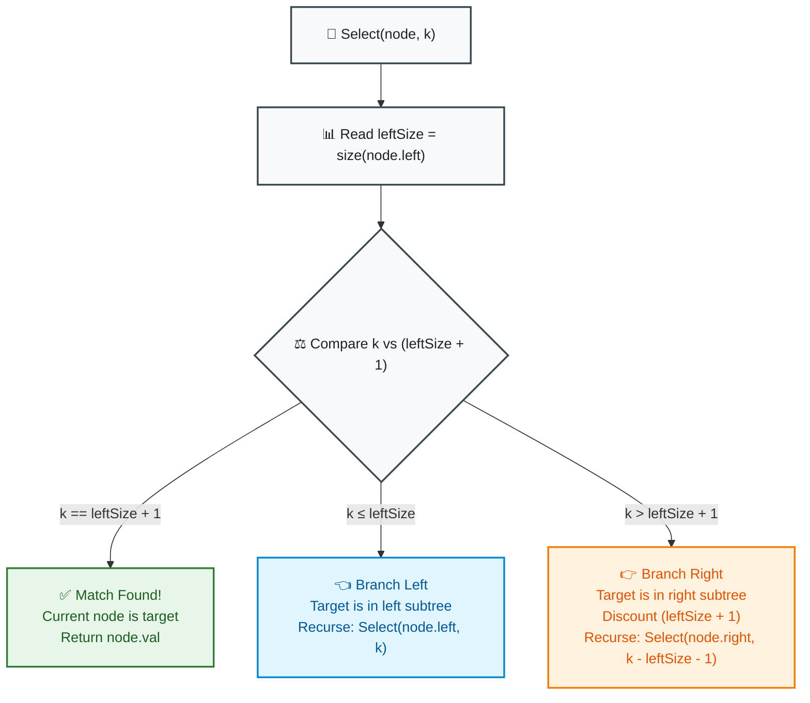

# 📘 WEEK 7 DAY 5: Augmented BSTs & Order-Statistics Trees — Engineering Guide

> 🧭 **Navigation:** [← Previous Day](Week_07_Day_04_Tree_Patterns_Instructional.md) • [🏠 Week Overview](README.md) • [📘 Curriculum Syllabus](../COMPLETE_SYLLABUS.md) • [Week Playbook →](WEEK_07_FULL_PLAYBOOK.md)
> 
> 💡 **Instructor Note:** *Not all sections or topics are mandatory. Feel free to adapt your pace and skim or skip sections based on your current focus and interview timeline.*

---

## 🎯 LEARNING OBJECTIVES

*By the end of this chapter, you will be able to:*

- 🎯 **Internalize** the Augmentation Principle: embedding localized subtree aggregates (such as `size` or `sum`) into tree nodes to convert linear scans into pure logarithmic binary searches.
- ⚙️ **Implement** a production-grade Order-Statistic Tree (OST) from scratch, executing `Insert`, `Delete`, `Select(k)` (find `k`-th smallest element), and `Rank(x)` (count elements `<= x`) in `O(log N)` time.
- ⚖️ **Evaluate** trade-offs between dynamic augmented trees (`O(log N)` updates + queries) versus static sorted arrays (`O(1)` select, `O(N)` insert) and Fenwick / Segment Trees.
- 🏭 **Connect** augmented BSTs to mission-critical systems: real-time gaming leaderboards, database multi-column range selectivity estimators, and financial percentile risk engines.

---

## 🎬 PILLAR 1: THE 60-SECOND HOOK & REAL-WORLD METAPHOR

### The Real-World Engineering Problem: The Live Esports Leaderboard

Imagine you and I are lead engineers building the live matchmaking and leaderboard engine for an esports title like *Valorant* or *League of Legends*. We have 10 million active players worldwide, and their skill ratings (ELO) update 10,000 times every second.

Players constantly hammer our API with two mission-critical questions:
1. **Positional Rank Query:** *"I have 1850 ELO points. What is my exact global rank right now?"* (`Rank(1850)`)
2. **Percentile Tier Query:** *"Who is the player holding the 500th spot or the 99th percentile cutoff?"* (`Select(k)`)

Let's look at why conventional data structures fail under this workload:

| Data Structure | `Select(k)` (Find `k`-th element) | `Rank(x)` (Count elements `<= x`) | Score Update / Insert | Why It Fails in Production |
| :--- | :---: | :---: | :---: | :--- |
| **Sorted Array** | `O(1)` | `O(log N)` (Binary Search) | `O(N)` | Inserting a new score requires shifting up to 10M elements in memory. At 10,000 RPS, the CPU cache melts. |
| **Hash Table** | `O(N log N)` | `O(N)` | `O(1)` | Blazing fast updates, but zero ordering. Answering rank forces sorting all 10M players on every request. |
| **Standard BST** | `O(H + k)` | `O(N)` | `O(H)` (`O(log N)`) | Fast updates, but finding the `k`-th element requires an in-order traversal visiting `k` nodes one by one. |

We are caught in a classic engineering trap: arrays give us instant rank queries but sluggish writes; trees give us fast writes but sluggish rank queries.

---

### The Metaphor: The Subtree Census Bureau

How does a national census bureau count populations without knocking on 300 million doors every time the President asks: *"How many citizens live in regions with populations under threshold X?"*

They don't do a full linear count! Instead, they set up a **hierarchy of regional plaques**:
- The national government office holds the total population of the whole country.
- Each state capitol office maintains a plaque showing the total population of its counties.
- Each county courthouse holds a plaque showing the total population of its towns.

```
                    [ Federal Capitol ]
                    Plaque: 300,000,000
                       /           \
           [ West Region ]       [ East Region ]
           Plaque: 120,000,000   Plaque: 180,000,000
```

When an analyst queries: *"Find the 50,000,000th citizen in alphabetical order"*:
1. The federal director checks the **West Region plaque**: *"There are 120,000,000 citizens in the West."*
2. Because `50,000,000 <= 120,000,000`, the director knows with 100% mathematical certainty that the target citizen lives in the West.
3. **They completely bypass all 180,000,000 citizens in the East!** Not a single clerk visits the East.

In a Binary Search Tree, we do the exact same thing: **we mount a census plaque (`size`) on every single node**, storing the total count of nodes in that node's subtree:

```
node.size = 1 + size(node.left) + size(node.right)
```

By reading `node.left.size` in `O(1)` time, we instantly know how many elements are smaller than `node.val`. We can skip entire subtrees during queries without visiting individual descendant nodes, turning rank selection into pure `O(log N)` binary search!

> [!TIP]
> **The Augmentation Theorem (CLRS):** Any field `f` can be maintained at each node in `O(1)` time per mutation or rotation without increasing the asymptotic `O(log N)` tree operation cost, provided `f(node)` depends **only** on `node.val` and the stored values of its immediate children `node.left` and `node.right`.

---

## 🪜 PILLAR 2: THE SCAFFOLDING LADDER & TOY NAPKIN TRACES

Let's build our mental model step-by-step from an atomic node up to a full self-balancing tree.

```
   Level 0: The Atomic Census Plaque (val + size)
       │
       ▼
   Level 1: The 3-Node Napkin Trace (Toy Tree Mechanics)
       │
       ▼
   Level 2: The Canonical 7-Node Balanced Order-Statistic Tree
       │
       ▼
   Level 3: Mutation Invariant Maintenance & Rotation Surgery
```

---

### Level 0: The Atomic Augmented Node

Every node in our tree carries its key and its local census plaque:

```
+-------------------------------------------------------------+
|                      Augmented BST Node                     |
|                                                             |
|  int val   = 10                                             |
|  int size  = 1 + left.size + right.size                     |
|                                                             |
|  Node? left  ──────────> [ Subtree with keys < 10 ]        |
|  Node? right ──────────> [ Subtree with keys > 10 ]        |
+-------------------------------------------------------------+
```

**The Subtree Size Contract:**
- For any `node`: `size(node) = 1 + GetSize(node.left) + GetSize(node.right)`.
- Base Case: A `null` reference has `size = 0`.
- A leaf node has `size = 1 + 0 + 0 = 1`.

---

### Level 1: The 3-Node Napkin Trace (The 3-Way Branch Decision)

Let's draw a simple 3-node balanced tree on a napkin and trace how `Select(k)` finds the `k`-th smallest element (using 1-based indexing).

```
          [ 10 (size: 3) ]
          /              \
    [ 5 (size: 1) ]    [ 15 (size: 1) ]
```

Ascending sorted order of keys: `[5, 10, 15]`.

At the root (`10`), look at the left child's plaque: `leftSize = size(5) = 1`.
What is the root's own rank among all keys in this subtree?
It is strictly `leftSize + 1 = 1 + 1 = 2`! Node `10` is the **2nd smallest element**.

Now examine the three possible cases for any query `k`:

```
Case 1: k == leftSize + 1  ==> k == 2
        Match! The current root (10) IS the 2nd smallest element. Return 10.

Case 2: k <= leftSize      ==> k == 1
        Since k (1) <= leftSize (1), our target is inside the left subtree.
        Recurse: Select(node.left, k = 1) --> returns 5.

Case 3: k > leftSize + 1   ==> k == 3
        Since k (3) > 2, our target is inside the right subtree.
        We have already eliminated the left subtree (1 element) AND the root (1 element).
        We subtract (leftSize + 1 = 2) from k:
        Recurse: Select(node.right, k = 3 - 2 = 1) --> returns 15.
```

> [!IMPORTANT]
> **Why do we subtract `leftSize + 1` when branching right?**
> When you walk into the right subtree, you are entering a whole new local universe where the smallest element in that right subtree has local rank `1`. Because you skipped `leftSize` smaller elements in the left subtree plus `1` for the root itself, you must discount those `leftSize + 1` elements from your global target rank `k`!

#### 🧠 Pause & Predict Micro-Drill #1
> **Scenario:** Suppose you are at a root node with `val = 40`. Its left subtree has `size = 6`, and its right subtree has `size = 8`.
> You are searching for the **9th smallest element** (`k = 9`).
> 
> *Pause for 10 seconds. Write down: Which branch do you take, and what is the new `k` value?*
> 
> **Answer:**
> - `leftSize = 6`.
> - Root's rank = `leftSize + 1 = 7`.
> - Since `k = 9 > 7`, we take the **Right Branch**.
> - New `k = k - (leftSize + 1) = 9 - 7 = 2`.
> - We now search for the 2nd smallest element in the right subtree!

---

### Level 2: The Canonical 7-Node Balanced Order-Statistic Tree

Let's expand our tree to 7 nodes to trace both `Select` and `Rank` across multiple levels:

```
                        [ 10 (size: 7) ]
                       /                \
               [ 5 (size: 3) ]      [ 15 (size: 3) ]
               /             \      /              \
        [ 2 (sz: 1) ] [ 7 (sz: 1) ][ 12 (sz: 1) ]  [ 20 (sz: 1) ]
```

Sorted key sequence: `[2, 5, 7, 10, 12, 15, 20]`.

#### Trace 1: `Select(k = 5)` (Find the 5th smallest element)
Expected Result: `12` (at index `4` in sorted order: `2, 5, 7, 10, 12`).

| Step | Current Node | `leftSize` | Root Rank (`leftSize + 1`) | Comparison with `k` | Action Taken & Updated `k` |
| :---: | :---: | :---: | :---: | :---: | :--- |
| **1** | `10 (sz: 7)` | `size(5) = 3` | `3 + 1 = 4` | `k (5) > 4` | Target is in right subtree. Subtract `4`. Recurse right with `k = 5 - 4 = 1`. |
| **2** | `15 (sz: 3)` | `size(12) = 1` | `1 + 1 = 2` | `k (1) <= 1` | Target is in left subtree (`k <= leftSize`). Recurse left with `k = 1`. |
| **3** | `12 (sz: 1)` | `size(null) = 0` | `0 + 1 = 1` | `k (1) == 1` | **Match!** `k == leftSize + 1`. Return `12`. |

Total node visits: 3 steps (logarithmic depth `H`), instead of scanning 5 nodes linearly!

---

#### Trace 2: `Rank(x = 12)` (Count elements `<= 12`)
Expected Result: `5` elements (`2, 5, 7, 10, 12`).

```
Algorithm Rank(node, x):
  If node is null: return 0.
  
  Case 1: x == node.val
    All left subtree nodes + current node are <= x.
    Return size(node.left) + 1.
    
  Case 2: x < node.val
    x is smaller than current node; no right subtree elements can be <= x.
    Recurse left: Rank(node.left, x).
    
  Case 3: x > node.val
    Current node AND all left subtree nodes are guaranteed <= x!
    Accumulate (size(node.left) + 1) and search right:
    Return size(node.left) + 1 + Rank(node.right, x).
```

| Step | Node Visited | `val` | Comparison (`x vs val`) | Subtree Count Accumulated | Next Recursive Call |
| :---: | :---: | :---: | :---: | :---: | :--- |
| **1** | `10` | `10` | `12 > 10` (Case 3) | `size(node.left) + 1 = 3 + 1 = 4` | Recurse Right: `Rank(15, 12)` |
| **2** | `15` | `15` | `12 < 15` (Case 2) | `0` (do not add right branch) | Recurse Left: `Rank(12, 12)` |
| **3** | `12` | `12` | `12 == 12` (Case 1) | `size(node.left) + 1 = 0 + 1 = 1` | Base match: Return `1` |
| **Unwind** | - | - | - | **Total:** `4 + 0 + 1 = 5` | **Final Rank: 5** |

---

#### Trace 3: `CountInRange(low = 5, high = 15)` via Prefix Difference
How many elements fall in the closed interval `[5, 15]`?

Using prefix sums:
```
CountInRange(5, 15) = Rank(15) - Rank(5 - 1)
                    = Rank(15) - Rank(4)
```
- `Rank(15)` counts elements `<= 15`: `{2, 5, 7, 10, 12, 15}` = `6`.
- `Rank(4)` counts elements `<= 4`: `{2}` = `1`.
- `CountInRange(5, 15) = 6 - 1 = 5` elements (`[5, 7, 10, 12, 15]`).

#### 🧠 Pause & Predict Micro-Drill #2
> **Scenario:** Why must we evaluate `Rank(low - 1)` instead of `Rank(low)` when calculating range counts?
> What happens if an element equal to `low` exists in the tree (e.g., `low = 5`)?
> 
> *Pause for 10 seconds. Trace both calculations.*
> 
> **Answer:**
> If we did `Rank(15) - Rank(5)`, `Rank(5)` would count element `5` as being `<= 5` and subtract it out!
> We would accidentally exclude `5` from our closed interval `[5, 15]`.
> By querying `Rank(low - 1) = Rank(4)`, we only subtract elements that are strictly less than `low`, preserving all elements `>= low`.

---

### Level 3: Mutation Invariant Maintenance & Rotation Surgery

An augmented BST is only as good as its maintenance discipline. If a single node's `size` plaque goes out of date, all downstream rank queries return garbage.

#### 1. Insertion Maintenance (Recursive Unwind)
When inserting a new key:
1. Descend standard BST paths until reaching a `null` spot.
2. Allocate the new leaf with `size = 1`.
3. **During the recursive unwind (postorder step):** Every ancestor recomputes its plaque from its children:
   ```csharp
   node.size = 1 + GetSize(node.left) + GetSize(node.right);
   ```

```
Inserting 6 into subtree:

       [ 5 (sz: 1) ]                      [ 5 (sz: 2) ]  <-- Unwind: size becomes 1 + 0 + 1 = 2
             \               ───>               \
            null                               [ 6 (sz: 1) ]  <-- New Leaf
```

---

#### 2. Balancing Rotation Maintenance (Strict Bottom-Up Dependency)
When balancing an AVL or Red-Black Tree, pointers change. How do we update sizes during a rotation?

Look at a Right Rotation around node `y`:

```
           y (size: A + B + C + 2)                          x (size: A + B + C + 2)
          / \                                              / \
         x   C           ── Rotate Right(y) ──>           A   y (size: B + C + 1)
        / \                                                  / \
       A   B                                                B   C
```

Notice what happened to node relationships:
- Subtrees `A`, `B`, and `C` never changed their internal structure; their sizes remain completely untouched!
- Node `y` was demoted: it is now a **child** of `x`.
- Node `x` was promoted: it is now the **root** of this subtree.

> [!WARNING]
> **The Rotation Update Order Rule:**
> You **MUST** update the demoted child `y` first, and the promoted parent `x` second!
> If you update `x` first, `x.size` will read `y`'s obsolete, pre-rotation size, corrupting the tree!
> 
> ```csharp
> // Step 1: Update demoted child FIRST
> y.size = 1 + GetSize(y.left) + GetSize(y.right);
> 
> // Step 2: Update promoted parent SECOND
> x.size = 1 + GetSize(x.left) + GetSize(x.right);
> ```

---

## 🎨 PILLAR 3: PRAGMATIC VISUAL MODELS

### 1. ASCII Structural Layout: Order-Statistic Tree Mapping

Here is how the augmented tree structure maps directly to sorted array indices and 1-based ranks:

```
Sorted Index:     0       1       2        3        4        5        6
1-Based Rank:   Rank 1  Rank 2  Rank 3   Rank 4   Rank 5   Rank 6   Rank 7
Values:         [ 2 ]   [ 5 ]   [ 7 ]   [ 10 ]   [ 12 ]   [ 15 ]   [ 20 ]

Augmented Tree Representation:

                             +------------------+
                             |   val:  10       |
                             |   size: 7        |
                             +------------------+
                             /                  \
                            /                    \
           +------------------+                +------------------+
           |   val:  5        |                |   val:  15       |
           |   size: 3        |                |   size: 3        |
           +------------------+                +------------------+
           /                  \                /                  \
          /                    \              /                    \
+------------------+  +------------------+  +------------------+  +------------------+
|   val:  2        |  |   val:  7        |  |   val:  12       |  |   val:  20       |
|   size: 1        |  |   size: 1        |  |   size: 1        |  |   size: 1        |
+------------------+  +------------------+  +------------------+  +------------------+
```

---

### 2. Mermaid Decision Flowchart: The 3-Way Branch for `Select(k)`

This flowchart captures the exact conditional logic executed at every single node during `Select(k)`:



---

## 🛑 PILLAR 4: THE ROOKIE TRAP ZONE

When interviewing at FAANG or writing high-performance C# / Python libraries, these are the four most common bugs that destroy candidate implementations.

---

### Trap 1: The "Forgetful Unwind" (Stale Subtree Sizes)

Candidates remember to set `node.size = 1` when creating a new leaf, but forget to update ancestor nodes on the return path of the recursive call.

```csharp
// ❌ ROOKIE BLUNDER: Forgetting to recalculate size on return
private OrderStatisticNode Insert(OrderStatisticNode? node, int val)
{
    if (node is null) return new OrderStatisticNode(val); // size = 1
    
    if (val < node.val)
        node.left = Insert(node.left, val);
    else if (val > node.val)
        node.right = Insert(node.right, val);
        
    // BUG: Returning node without updating its size! 
    // Ancestor size remains completely stale!
    return node;
}
```

```csharp
// ✅ SENIOR ARCHITECT PATTERN: Consistent postorder invariant update
private OrderStatisticNode Insert(OrderStatisticNode? node, int val)
{
    if (node is null) return new OrderStatisticNode(val);
    
    if (val < node.val)
        node.left = Insert(node.left, val);
    else if (val > node.val)
        node.right = Insert(node.right, val);
    else
        return node; // Duplicate key policy: ignore or count

    // Recalculate size from scratch based on immediate children
    node.size = 1 + GetSize(node.left) + GetSize(node.right);
    return node;
}
```

---

### Trap 2: Rotation Desynchronization (Updating in the Wrong Order)

During balancing rotations, updating the promoted node before the demoted node copies garbage sizes.

```csharp
// ❌ ROOKIE BLUNDER: Updating promoted parent before demoted child
private OrderStatisticNode RotateRight(OrderStatisticNode y)
{
    OrderStatisticNode x = y.left!;
    y.left = x.right;
    x.right = y;
    
    // BUG: x depends on y's NEW size, but y hasn't been updated yet!
    x.size = 1 + GetSize(x.left) + GetSize(x.right); 
    y.size = 1 + GetSize(y.left) + GetSize(y.right);
    
    return x;
}
```

```csharp
// ✅ SENIOR ARCHITECT PATTERN: Strict bottom-up dependency ordering
private OrderStatisticNode RotateRight(OrderStatisticNode y)
{
    OrderStatisticNode x = y.left!;
    y.left = x.right;
    x.right = y;
    
    // 1. Update the demoted child FIRST (its children are already valid)
    y.size = 1 + GetSize(y.left) + GetSize(y.right);
    
    // 2. Update the promoted parent SECOND (using y's freshly computed size)
    x.size = 1 + GetSize(x.left) + GetSize(x.right);
    
    return x;
}
```

---

### Trap 3: The 1-Indexed vs 0-Indexed "Off-by-One" Heartbreak

When branching right in `Select(k)`, forgetting that the current root itself also accounts for 1 element.

```python
# ❌ ROOKIE BLUNDER: Subtracting only left_size instead of (left_size + 1)
def select(node, k):
    left_size = get_size(node.left)
    if k <= left_size:
        return select(node.left, k)
    elif k == left_size + 1:
        return node.val
    else:
        # BUG: Forgot that the root itself accounted for 1 element!
        return select(node.right, k - left_size)
```

```python
# ✅ SENIOR ARCHITECT PATTERN: Explicit rank reduction
def select(node, k):
    left_size = get_size(node.left)
    if k <= left_size:
        return select(node.left, k)
    elif k == left_size + 1:
        return node.val
    else:
        # Subtract both the left subtree AND the root (left_size + 1)
        return select(node.right, k - (left_size + 1))
```

---

### Trap 4: Boundary Omission in Range Queries

Subtracting `Rank(low)` instead of `Rank(low - 1)` removes elements matching `low`.

```csharp
// ❌ ROOKIE BLUNDER: Incorrect boundary subtraction
public int CountInRange(int low, int high)
{
    // BUG: If low = 5 and key 5 exists, Rank(5) includes 5!
    // 5 is subtracted away and missing from the count!
    return Rank(high) - Rank(low); 
}
```

```csharp
// ✅ SENIOR ARCHITECT PATTERN: Closed interval prefix difference
public int CountInRange(int low, int high)
{
    if (low > high) return 0;
    // Elements >= low are preserved by subtracting elements <= (low - 1)
    return Rank(high) - Rank(low - 1);
}
```

---

## 🎙️ PILLAR 5: 45-MINUTE INTERVIEW TALK TRACKS

When asked about order statistics in a live FAANG interview, do not start typing silently. Deliver these exact scripts out loud:

### Talk Track 1: LeetCode 230 (K-th Smallest Element in a Standard BST)
> *"On a standard unaugmented BST, an in-order traversal naturally yields elements in ascending order. Rather than buffering all N elements into a list or recursing the entire tree, I will use an iterative DFS with an explicit stack, traversing down the left spine and decrementing `k` upon each node pop. The instant `k` reaches zero, that popped node is our answer, achieving an optimal early exit in `O(H + k)` time and `O(H)` auxiliary space without touching the remaining `N - k` nodes."*

### Talk Track 2: Designing an Order-Statistic Tree (Augmented BST)
> *"When rank queries and mutations interleave heavily, an `O(H + k)` scan is too slow. I will augment each node with a `size` field representing the count of nodes in its subtree, satisfying the invariant `size = 1 + left.size + right.size`. This census plaque allows `Select(k)` and `Rank(x)` to prune an entire subtree at each step by comparing `k` against `left.size`, yielding optimal `O(H)` rank operations while maintaining the `size` invariant in `O(1)` time per insertion unwind."*

### Talk Track 3: The System Trade-Off Defense
> *"If our universe of keys is static or read-heavy, a sorted dynamic array gives instant `O(1)` select via index access. If the universe of keys is bounded and discrete, a Fenwick Tree offers better CPU cache locality with zero pointer chasing. But for an unbounded, dynamic key stream requiring frequent inserts, deletes, and quantile lookups, an Augmented Balanced BST is the optimal structure, executing both mutations and order queries in predictable `O(log N)` time."*

---

## ⚡ PILLAR 6: PRODUCTION DUAL-LANGUAGE IMPLEMENTATIONS

### Warm-up: LeetCode 230 — Kth Smallest Element in a BST

Let's begin with the classic unaugmented problem to ground the in-order early termination baseline.

#### C# Implementation (.NET 8/9 — Iterative In-Order with Early Exit)

```csharp
using System;
using System.Collections.Generic;

public sealed class TreeNode
{
    public int val;
    public TreeNode? left;
    public TreeNode? right;

    public TreeNode(int val = 0, TreeNode? left = null, TreeNode? right = null)
    {
        this.val = val;
        this.left = left;
        this.right = right;
    }
}

public static class KthSmallestSolver
{
    /// <summary>
    /// Finds the k-th smallest element in a BST using iterative in-order traversal.
    /// Time Complexity: O(H + k) | Auxiliary Space: O(H)
    /// </summary>
    /// <param name="root">The root of the BST.</param>
    /// <param name="k">1-indexed rank target.</param>
    /// <returns>The value of the k-th smallest node.</returns>
    public static int KthSmallest(TreeNode? root, int k)
    {
        ArgumentOutOfRangeException.ThrowIfNegativeOrZero(k);
        ArgumentNullException.ThrowIfNull(root);

        var stack = new Stack<TreeNode>();
        TreeNode? current = root;

        while (current is not null || stack.Count > 0)
        {
            // Drill down the left spine to find the next smallest candidate
            while (current is not null)
            {
                stack.Push(current);
                current = current.left;
            }

            current = stack.Pop();
            k--;

            // Early exit: the k-th popped node is our exact answer
            if (k == 0)
            {
                return current.val;
            }

            // Move to right subtree
            current = current.right;
        }

        throw new ArgumentException("k is larger than the total number of nodes in the tree.");
    }
}
```

#### Python Implementation (3.11+ — Idiomatic Generator with Early Exit)

```python
from typing import Optional

class TreeNode:
    def __init__(self, val: int = 0, left: Optional['TreeNode'] = None, right: Optional['TreeNode'] = None):
        self.val = val
        self.left = left
        self.right = right

def kth_smallest(root: Optional[TreeNode], k: int) -> int:
    """Finds the 1-indexed k-th smallest element in a BST with O(H + k) early exit.
    
    Time Complexity: O(H + k) | Auxiliary Space: O(H)
    """
    if not root or k <= 0:
        raise ValueError("Invalid root or k argument")

    stack: list[TreeNode] = []
    current = root

    while current or stack:
        while current:
            stack.append(current)
            current = current.left

        current = stack.pop()
        k -= 1
        if k == 0:
            return current.val

        current = current.right

    raise ValueError("k exceeds total node count in tree")
```

#### 📊 Explicit Complexity Deconstruction (LeetCode 230)
- **Time Complexity:** `O(H + k)` — We spend `O(H)` descending to the minimum leaf, then pop `k` elements in `O(k)` steps. Worst case on skewed tree: `O(N)`. Balanced tree: `O(log N + k)`.
- **Auxiliary Space:** `O(H)` — Stack depth never exceeds the height of the tree.
- **Output Space:** `O(1)` — Returns a single primitive scalar.

---

### Flagship FAANG Implementation: Complete Order-Statistic Tree (Augmented BST)

Now, let's build the full production-grade Augmented Order-Statistic Tree supporting:
1. `Insert(val)`: Inserts a key and updates subtree sizes on the return path.
2. `Select(k)`: Finds the 1-indexed `k`-th smallest element in `O(H)` time.
3. `Rank(val)`: Counts how many elements in the tree are `<= val` in `O(H)` time.
4. `CountInRange(low, high)`: Counts keys in `[low, high]` via prefix difference in `O(H)` time.
5. `Delete(val)`: Removes a key and updates subtree sizes on the return path.

#### C# Primary Implementation (.NET 8/9 — Production Order-Statistic Tree)

```csharp
using System;

public sealed class OrderStatisticNode
{
    public int Val { get; set; }
    public int Size { get; set; }
    public OrderStatisticNode? Left { get; set; }
    public OrderStatisticNode? Right { get; set; }

    public OrderStatisticNode(int val)
    {
        Val = val;
        Size = 1;
    }
}

public sealed class OrderStatisticTree
{
    public OrderStatisticNode? Root { get; private set; }

    /// <summary>
    /// Total number of elements currently stored in the tree.
    /// </summary>
    public int Count => GetSize(Root);

    /// <summary>
    /// Inserts a unique value into the tree while maintaining subtree sizes.
    /// Time Complexity: O(H) | Auxiliary Space: O(H) recursion stack
    /// </summary>
    public void Insert(int val)
    {
        Root = InsertNode(Root, val);
    }

    private OrderStatisticNode InsertNode(OrderStatisticNode? node, int val)
    {
        if (node is null)
        {
            return new OrderStatisticNode(val);
        }

        if (val < node.Val)
        {
            node.Left = InsertNode(node.Left, val);
        }
        else if (val > node.Val)
        {
            node.Right = InsertNode(node.Right, val);
        }
        else
        {
            return node; // Duplicate keys ignored under distinct set policy
        }

        // Maintain Subtree Size Invariant: size = 1 + left.size + right.size
        node.Size = 1 + GetSize(node.Left) + GetSize(node.Right);
        return node;
    }

    /// <summary>
    /// Deletes a value from the tree while preserving subtree sizes.
    /// Time Complexity: O(H) | Auxiliary Space: O(H)
    /// </summary>
    public void Delete(int val)
    {
        Root = DeleteNode(Root, val);
    }

    private OrderStatisticNode? DeleteNode(OrderStatisticNode? node, int val)
    {
        if (node is null) return null;

        if (val < node.Val)
        {
            node.Left = DeleteNode(node.Left, val);
        }
        else if (val > node.Val)
        {
            node.Right = DeleteNode(node.Right, val);
        }
        else
        {
            // Node with only one child or no child
            if (node.Left is null) return node.Right;
            if (node.Right is null) return node.Left;

            // Node with two children: obtain in-order successor (smallest in right subtree)
            OrderStatisticNode successor = FindMin(node.Right);
            node.Val = successor.Val;
            node.Right = DeleteNode(node.Right, successor.Val);
        }

        node.Size = 1 + GetSize(node.Left) + GetSize(node.Right);
        return node;
    }

    private static OrderStatisticNode FindMin(OrderStatisticNode node)
    {
        OrderStatisticNode current = node;
        while (current.Left is not null)
        {
            current = current.Left;
        }
        return current;
    }

    /// <summary>
    /// Finds the 1-indexed k-th smallest element.
    /// Time Complexity: O(H) | Auxiliary Space: O(H)
    /// </summary>
    public int Select(int k)
    {
        if (Root is null || k < 1 || k > Root.Size)
        {
            throw new ArgumentOutOfRangeException(nameof(k), $"k must be between 1 and {Count}.");
        }

        return SelectNode(Root, k);
    }

    private static int SelectNode(OrderStatisticNode node, int k)
    {
        int leftSize = GetSize(node.Left);

        // Case 1: Match found at current node
        if (k == leftSize + 1)
        {
            return node.Val;
        }

        // Case 2: Target lies within the left subtree
        if (k <= leftSize)
        {
            return SelectNode(node.Left!, k);
        }

        // Case 3: Target lies within the right subtree; discount (leftSize + 1) elements
        return SelectNode(node.Right!, k - leftSize - 1);
    }

    /// <summary>
    /// Computes the rank of val: total count of elements <= val.
    /// Time Complexity: O(H) | Auxiliary Space: O(H)
    /// </summary>
    public int Rank(int val)
    {
        return RankNode(Root, val);
    }

    private static int RankNode(OrderStatisticNode? node, int val)
    {
        if (node is null) return 0;

        if (val == node.Val)
        {
            return GetSize(node.Left) + 1;
        }

        if (val < node.Val)
        {
            return RankNode(node.Left, val);
        }

        // val > node.Val: accumulate left subtree + current node, then explore right
        return GetSize(node.Left) + 1 + RankNode(node.Right, val);
    }

    /// <summary>
    /// Counts total elements residing in the closed interval [low, high].
    /// Time Complexity: O(H) | Auxiliary Space: O(H)
    /// </summary>
    public int CountInRange(int low, int high)
    {
        if (low > high) return 0;
        return Rank(high) - Rank(low - 1);
    }

    /// <summary>
    /// Helper to safely retrieve size of a potentially null node reference.
    /// </summary>
    public static int GetSize(OrderStatisticNode? node) => node?.Size ?? 0;
}
```

---

#### Python Implementation (3.11+ — Idiomatic Order-Statistic Tree)

```python
from typing import Optional

class OrderStatisticNode:
    def __init__(self, val: int):
        self.val: int = val
        self.size: int = 1
        self.left: Optional['OrderStatisticNode'] = None
        self.right: Optional['OrderStatisticNode'] = None

class OrderStatisticTree:
    def __init__(self):
        self.root: Optional[OrderStatisticNode] = None

    @property
    def count(self) -> int:
        return self._get_size(self.root)

    def insert(self, val: int) -> None:
        """Inserts a unique key and recalculates subtree sizes."""
        self.root = self._insert_node(self.root, val)

    def _insert_node(self, node: Optional[OrderStatisticNode], val: int) -> OrderStatisticNode:
        if not node:
            return OrderStatisticNode(val)

        if val < node.val:
            node.left = self._insert_node(node.left, val)
        elif val > node.val:
            node.right = self._insert_node(node.right, val)
        else:
            return node  # Duplicate key ignored

        node.size = 1 + self._get_size(node.left) + self._get_size(node.right)
        return node

    def delete(self, val: int) -> None:
        """Deletes a key while preserving subtree sizes."""
        self.root = self._delete_node(self.root, val)

    def _delete_node(self, node: Optional[OrderStatisticNode], val: int) -> Optional[OrderStatisticNode]:
        if not node:
            return None

        if val < node.val:
            node.left = self._delete_node(node.left, val)
        elif val > node.val:
            node.right = self._delete_node(node.right, val)
        else:
            if not node.left:
                return node.right
            if not node.right:
                return node.left

            successor = self._find_min(node.right)
            node.val = successor.val
            node.right = self._delete_node(node.right, successor.val)

        node.size = 1 + self._get_size(node.left) + self._get_size(node.right)
        return node

    def _find_min(self, node: OrderStatisticNode) -> OrderStatisticNode:
        current = node
        while current.left:
            current = current.left
        return current

    def select(self, k: int) -> int:
        """Returns the 1-indexed k-th smallest element. Raises IndexError if out of bounds."""
        if not self.root or k < 1 or k > self.root.size:
            raise IndexError(f"k={k} is out of bounds for tree of size {self.count}")
        return self._select_node(self.root, k)

    def _select_node(self, node: OrderStatisticNode, k: int) -> int:
        left_size = self._get_size(node.left)

        if k == left_size + 1:
            return node.val
        if k <= left_size:
            assert node.left is not None
            return self._select_node(node.left, k)

        assert node.right is not None
        return self._select_node(node.right, k - left_size - 1)

    def rank(self, val: int) -> int:
        """Returns total count of elements <= val."""
        return self._rank_node(self.root, val)

    def _rank_node(self, node: Optional[OrderStatisticNode], val: int) -> int:
        if not node:
            return 0

        if val == node.val:
            return self._get_size(node.left) + 1
        if val < node.val:
            return self._rank_node(node.left, val)

        return self._get_size(node.left) + 1 + self._rank_node(node.right, val)

    def count_in_range(self, low: int, high: int) -> int:
        """Returns total count of elements in closed range [low, high]."""
        if low > high:
            return 0
        return self.rank(high) - self.rank(low - 1)

    def _get_size(self, node: Optional[OrderStatisticNode]) -> int:
        return node.size if node else 0
```

---

#### 📊 Explicit Complexity Deconstruction (Order-Statistic Tree)

| Operation | Time Complexity (Balanced) | Time Complexity (Skewed) | Auxiliary Space | Output Space | Mechanical Bottleneck |
| :--- | :---: | :---: | :---: | :---: | :--- |
| **`Insert(val)`** | `O(log N)` | `O(N)` | `O(H)` | `O(1)` | Path descent + `O(1)` additions on recursive unwind |
| **`Delete(val)`** | `O(log N)` | `O(N)` | `O(H)` | `O(1)` | Descending to key/successor + size recalculation |
| **`Select(k)`** | `O(log N)` | `O(N)` | `O(H)` | `O(1)` | Exactly 1 comparison against `left.size` per level |
| **`Rank(val)`** | `O(log N)` | `O(N)` | `O(H)` | `O(1)` | Accumulating `left.size + 1` along right branches |
| **`CountInRange(L, R)`** | `O(log N)` | `O(N)` | `O(H)` | `O(1)` | Two independent rank calls: `O(H) + O(H) = O(H)` |

---

## ⚖️ CHAPTER 5: PERFORMANCE, TRADE-OFFS & FAANG PATTERN SIGNALS

### ⚖️ Comprehensive Data Structure Comparison Matrix

| Data Structure | Search Key | Insert / Delete | `Select(k)` | `Rank(x)` | Range Count `[L, R]` | Memory Footprint | Cache Locality | Best Suited For |
| :--- | :---: | :---: | :---: | :---: | :---: | :---: | :---: | :--- |
| **Sorted Dynamic Array** | `O(log N)` | `O(N)` | `O(1)` | `O(log N)` | `O(log N)` | Minimal (dense buffer) | Outstanding (L1/L2) | Read-heavy or write-once datasets |
| **Hash Table** | `O(1)` | `O(1)` | `O(N log N)` | `O(N)` | `O(N)` | High (buckets + hashes) | Poor (pointer chasing) | Exact key lookup with zero rank needs |
| **Standard BST** | `O(log N)` | `O(log N)` | `O(H + k)` | `O(N)` | `O(N)` | Moderate (2 pointers/node) | Poor (scattered heap) | Simple BST operations with rare rank needs |
| **Augmented Balanced OST** | `O(log N)` | `O(log N)` | `O(log N)` | `O(log N)` | `O(log N)` | Moderate (2 ptrs + size) | Poor (scattered heap) | Dynamic leaderboards, live quantiles |
| **Fenwick Tree (BIT)** | N/A | `O(log M)` | `O(log M)` | `O(log M)` | `O(log M)` | Minimal (`M` element array) | Outstanding (contiguous) | Bounded or compressed integer universe |
| **Segment Tree** | N/A | `O(log M)` | `O(log M)` | `O(log M)` | `O(log M)` | High (`4M` element array) | Moderate (array-backed) | Range min/max combined with rank queries |

---

### 🏭 Real-World Systems Context

> [!NOTE]
> **Production Context — Live Gaming Leaderboards & Tier Placement:**
> In multiplayer titles (Valorant, Rocket League), millions of player ratings fluctuate continuously. Storing player ratings in an augmented balanced BST allows players to see their exact leaderboard rank (`Rank(rating)`) and percentile tier (`Select(k)`) in sub-millisecond `O(log N)` time under massive concurrent write loads.

> [!NOTE]
> **Production Context — Database Multi-Column Range Indexes:**
> Relational query planners (PostgreSQL, SQL Server) utilize augmented B-Tree statistics to estimate query selectivity. When executing `SELECT COUNT(*) WHERE age BETWEEN 25 AND 35`, the engine reads augmented page counts to estimate row selectivity in `O(log N)` time, deciding between index scans and table scans without touching disk data pages.

> [!NOTE]
> **Production Context — Financial Real-Time Risk Analytics:**
> Quantitative trading platforms compute real-time Value-at-Risk (VaR) by tracking the 95th and 99th percentile loss across streaming transactions. Augmented order-statistic trees provide instant percentile extraction (`Select(0.99 * TotalTrades)`) without sorting full event buffers.

---

### Failure Modes & Edge-Case Playbook

| Edge Case / Failure Mode | Why It Occurs | Defense / Engineering Mitigation |
| :--- | :--- | :--- |
| **`k` Out of Bounds (`k <= 0` or `k > total`)** | Caller passes `0`, negative index, or `k > Root.size` | Guard clause at tree root: throw `ArgumentOutOfRangeException` before traversal begins. |
| **Duplicate Keys** | Same rating inserted twice; default BST behavior ambiguous | Choose policy explicitly: either increment a `count` field on the existing node or route duplicates to the right branch. |
| **Single-Node Tree** | Tree consists only of root (`size = 1`); deleting root leads to null reference | Null checks on both child pointers; verify `Root` becomes `null`. |
| **Unbalanced Insertion Chain** | Sorted input degrades plain BST height to `O(N)` | Pair subtree size augmentation with AVL or Red-Black rotations to guarantee `O(log N)` height. |
| **Boundary Subtraction Error** | `Rank(high) - Rank(low)` accidentally excludes elements equal to `low` | Always use prefix difference: `Rank(high) - Rank(low - 1)`. |

---

## ⚔️ SUPPLEMENTARY OUTCOMES & INTERVIEW FOLLOW-UPS

### 🏋️ Practice Problems

| # | Problem | Source | Difficulty | Target Pattern |
| :---: | :--- | :--- | :---: | :--- |
| 1 | Kth Smallest Element in a BST | LeetCode #230 | 🟡 Medium | In-order early termination baseline |
| 2 | Count of Smaller Numbers After Self | LeetCode #315 | 🔴 Hard | Augmented BST insertion / Fenwick Tree |
| 3 | Reverse Pairs | LeetCode #493 | 🔴 Hard | Dynamic rank counting |
| 4 | Range Sum of BST | LeetCode #938 | 🟢 Easy | Subtree pruning search |
| 5 | Find Median from Data Stream | LeetCode #295 | 🔴 Hard | Dual heaps vs Order-Statistic Tree |
| 6 | My Calendar Three | LeetCode #732 | 🔴 Hard | Boundary sweep line in augmented BST |
| 7 | Create Sorted Array through Instructions | LeetCode #1649 | 🔴 Hard | Cost computation via `Rank(x)` |
| 8 | Online Majority Element In Subarray | LeetCode #1157 | 🔴 Hard | Range frequency / Segment Tree |

---

### 🎙️ Interview Questions & Follow-ups

1. **Q: How does the GNU C++ PBDS (`policy_based_data_structures`) `tree` support order statistics out of the box?**
   - *Follow-up:* In GCC libstdc++, `__gnu_pbds::tree` supports `tree_order_statistics_node_update`, augmenting an underlying Red-Black tree with subtree sizes to provide `find_by_order(k)` (`Select`) and `order_of_key(x)` (`Rank`) in `O(log N)` time out-of-the-box.

2. **Q: When would you choose a Fenwick Tree (Binary Indexed Tree) over an Augmented BST for order statistics?**
   - *Follow-up:* If the universe of values `M` is bounded (e.g., coordinates `<= 10^5` or coordinates can be offline coordinate-compressed), a Fenwick tree has much smaller memory overhead, zero pointer chasing, and superior CPU cache locality compared to pointer-based trees. If values arrive online without prior knowledge of bounds, an Augmented BST is strictly superior.

---

## 📊 COMPLEXITY RECAP

| Method | Target Goal | Time Complexity | Auxiliary Space | Key Mechanics |
| :--- | :--- | :---: | :---: | :--- |
| **In-Order Early Exit** | Unaugmented `k`-th smallest | `O(H + k)` | `O(H)` | Iterative stack decrementing `k` until 0 |
| **Augmented `Select(k)`** | `k`-th smallest | `O(H)` (`O(log N)`) | `O(H)` | 3-way branch based on `k vs (left.size + 1)` |
| **Augmented `Rank(val)`** | Count `<= val` | `O(H)` (`O(log N)`) | `O(H)` | Accumulate `left.size + 1` going right |
| **`CountInRange(L, R)`** | Closed range count | `O(H)` (`O(log N)`) | `O(H)` | Prefix difference: `Rank(R) - Rank(L - 1)` |
| **Augmented `Insert / Delete`** | Update tree & plaques | `O(H)` (`O(log N)`) | `O(H)` | Recalculate `1 + left.size + right.size` on unwind |

---

> 🧭 **Navigation:** [← Previous Day](Week_07_Day_04_Tree_Patterns_Instructional.md) • [🏠 Week Overview](README.md) • [📘 Curriculum Syllabus](../COMPLETE_SYLLABUS.md) • [Week Playbook →](WEEK_07_FULL_PLAYBOOK.md)
