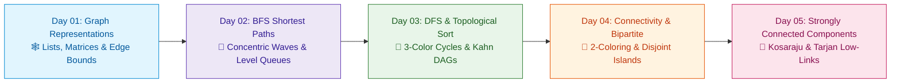

# 📘 Week 08: Graph Fundamentals & Traversals

> 🧭 **Navigation:** [← Previous: Week 07](../week_07_trees_and_balanced_search_trees/README.md) • [🏠 Curriculum Overview](../README.md) • [📘 Complete Syllabus](../COMPLETE_SYLLABUS.md) • [Next: Week 09 →](../week_09_graph_algorithms_i/README.md)

---

## 🎬 Welcome to Week 08: The Network Architect's Masterclass!

Trees have a peaceful property: there is exactly one path between any two nodes and cycles are physically impossible. But in real-world distributed architectures—social networks, microservice dependency graphs, route planning, and build systems—nodes connect arbitrarily, cycles lurk everywhere, and disconnected components isolate data.

This week bridges you from linear/tree thinking to arbitrary network topology: **adjacency lists vs adjacency matrices**, **FIFO wave shortest-path BFS**, **LIFO 3-color cycle detection DFS**, **dependency scheduling with Kahn's topological sort**, **2-coloring bipartite validation**, and **Kosaraju/Tarjan Strongly Connected Components (SCCs)**.

---

## 📅 Day-by-Day Learning Path

| Day | Instructional Masterclass | Core Mental Model & Intuition | Key Pattern / Invariant |
| :--- | :--- | :--- | :--- |
| **Day 01** | [Graph Models & Representations](Week_08_Day_01_Graph_Models_and_Representations_Instructional.md) | **The Flight Route Map:** Dense hubs vs sparse routes. | Sparse `O(V + E)` adjacency list vs dense `O(V^2)` matrix, directed vs undirected. |
| **Day 02** | [Breadth-First Search (BFS)](Week_08_Day_02_Breadth_First_Search_Instructional.md) | **The Ripple in a Pond:** Unweighted equidistant shortest paths. | FIFO queue, distance array, marking visited on enqueue to prevent duplicates. |
| **Day 03** | [DFS & Topological Sort](Week_08_Day_03_DFS_Topological_Sort_Instructional.md) | **The University Curriculum:** Pre-requisite scheduling in DAGs. | Kahn's in-degree queue, 3-color DFS (White/Gray/Black), cycle detection. |
| **Day 04** | [Connectivity & Bipartite Graphs](Week_08_Day_04_Connectivity_and_Bipartite_Graphs_Instructional.md) | **The Two-Party Negotiation:** 2-coloring without conflict. | Connected components count, odd-length cycle detection, 2-coloring conflict. |
| **Day 05** | [Strongly Connected Components (SCC)](Week_08_Day_05_Strongly_Connected_Components_Instructional.md) | **The Roundabout Interchange:** Mutual reachability in directed networks. | Kosaraju two-pass DFS on transposed graph, Tarjan `low_link` discovery stack. |

---

## 📚 Consolidated Playbooks & Reference Guides

*   📖 **Comprehensive Week Playbook:** [WEEK_08_FULL_PLAYBOOK.md](WEEK_08_FULL_PLAYBOOK.md) — High-density synthesis of all invariants, theorems, and pattern triggers for this week.
*   📊 **Visual Concepts Playbook (Hybrid):** [Week_08_Visual_Concepts_Playbook_HYBRID.md](Week_08_Visual_Concepts_Playbook_HYBRID.md) — Compact Mermaid diagrams, state transitions, and complexity reference tables.
*   💻 **Production C# Reference (.NET 8/9):** [Week_08_Extended_CSharp_Complete.md](Week_08_Extended_CSharp_Complete.md) — Idiomatic, zero-allocation memory-aware implementations and problem ladders.
*   🐍 **Production Python Reference (Python 3.11+):** [Week_08_Extended_Python_Complete.md](Week_08_Extended_Python_Complete.md) — Clean, pythonic reference implementations for rapid whiteboard prototyping.

---

## 🛠️ The 5 Core Support Files (`support files/`)

1.  📋 [Daily Progress Checklist](support%20files/Week_08_Daily_Progress_Checklist.md) — Step-by-step accountability tracker for theory, coding, and variants.
2.  🧭 [Weekly Guidelines & Mental Models](support%20files/Week_08_Guidelines.md) — Strategic roadmap, common pitfalls, and conceptual anchors.
3.  🎙️ [Interview Q&A Comprehensive Reference](support%20files/Week_08_Interview_QA_Reference.md) — High-frequency senior technical questions with verbal response frameworks.
4.  🗺️ [Problem-Solving Roadmap](support%20files/Week_08_Problem_Solving_Roadmap.md) — Tier-1 problem progression ladder from warm-up to advanced.
5.  📑 [Summary & Key Concepts Synthesis](support%20files/Week_08_Summary_Key_Concepts.md) — Fast-revision cheat sheet covering all governing invariants and system trade-offs.

---

> 🧭 **Navigation:** [← Previous: Week 07](../week_07_trees_and_balanced_search_trees/README.md) • [🏠 Curriculum Overview](../README.md) • [📘 Complete Syllabus](../COMPLETE_SYLLABUS.md) • [Next: Week 09 →](../week_09_graph_algorithms_i/README.md)
