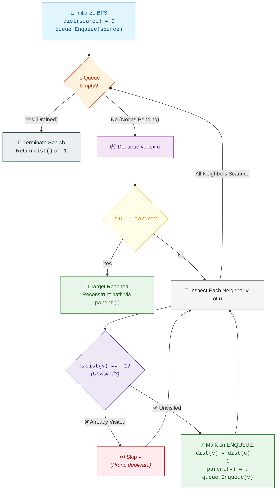

# 📘 Week 8 Day 2: Breadth-First Search (BFS) — Engineering Guide

> 🧭 **Navigation:** [← Previous Day: Graph Models & Representations](Week_08_Day_01_Graph_Models_and_Representations_Instructional.md) • [🏠 Week Overview](README.md) • [📘 Curriculum Syllabus](../COMPLETE_SYLLABUS.md) • [Next Day: DFS & Topological Sort →](Week_08_Day_03_DFS_Topological_Sort_Instructional.md)
> 
> 💡 **Instructor Note:** *The single deadliest bug in graph traversal interviews is marking a node as visited when it is **dequeued** rather than when it is **enqueued**. Marking upon dequeue allows multiple neighbors to enqueue the identical vertex repeatedly, exploding queue memory from `O(V)` to exponential `O(4^D)` or `O(E)` and causing catastrophic TLE/MLE crashes. Master the enqueue-marking invariant today, and your BFS solutions will be bulletproof.*

---

## 🎯 LEARNING OBJECTIVES

By the end of this chapter, you will be able to:

- **Internalize** Breadth-First Search (BFS) as a radial wavefront expansion enforcing strictly monotonic distance ordering across unweighted topologies.
- **Formulate** the physical reason why BFS guarantees the shortest path in unweighted graphs and why it fundamentally fails on weighted graphs.
- **Trace** BFS executions step-by-step using visual wavefront tables showing queue evolution, `dist[]` array transitions, `parent[]` pointers, and visited sets.
- **Master** multi-source BFS by seeding multiple wavefront origins simultaneously to solve spreading and proximity problems in linear time.
- **Implement** production-grade Single-Source Shortest Path with Parent Reconstruction, Multi-Source Grid BFS (Rotting Oranges — LeetCode 994), and Implicit State Space BFS (Word Ladder — LeetCode 127) in modern C# (.NET 8/9) and idiomatic Python (3.11+).
- **Diagnose & eliminate** the top 4 rookie traps: deferred visited marking (enqueue vs dequeue), dynamic queue count mutation in level loops, disconnected graph omission, and applying BFS to weighted graphs.
- **Deliver** a crisp 3-sentence verbal script and high-level architectural talk track that commands the room in a 45-minute FAANG interview.

---

## 🎬 PILLAR 1: THE 60-SECOND HOOK & EVERYDAY ANALOGY

### Hey Engineers, Welcome to Day 2!

Imagine you are standing on the shore of a glassy, mirror-still mountain lake on a windless morning. You pick up a smooth pebble and toss it straight into the water.

What happens the instant the pebble breaks the surface?

```
Concentric Ripple Waves Expanding Outward:

              ~ ~ ~ ( Ring 2: dist = 2 ) ~ ~ ~
          ~ ~                                 ~ ~
        ~          ( Ring 1: dist = 1 )           ~
       ~        ~                       ~          ~
      ~        ~       ( Splash: 0 )     ~          ~
       ~        ~                       ~          ~
        ~          ( Ring 1: dist = 1 )           ~
          ~ ~                                 ~ ~
              ~ ~ ~ ( Ring 2: dist = 2 ) ~ ~ ~
```

A circular ripple explodes outward in concentric rings.
- At `t = 0`, the splash occurs at the exact point of impact (Distance 0).
- At `t = 1`, every water particle exactly 1 foot away gets disturbed simultaneously (Distance 1).
- At `t = 2`, every particle 2 feet away gets disturbed (Distance 2).

Here is the immutable physical truth:
**Water particles 2 feet away can NEVER get wet before water particles 1 foot away.** 

The ripple cannot skip ahead. It cannot leap across space. It expands radially, layer by layer, frontier by frontier.

This is **Breadth-First Search (BFS)** in its purest physical form.

---

### The Cellular Broadcast Analogy

Now consider a telecommunications network during an emergency broadcast:

```
Cell Tower Alert Transmission (1 Hop per Broadcast Cycle):

      [ Tower B ] (1 hop) ─────────── [ Tower E ] (2 hops)
     /
[ Tower S ] (Origin)
     \
      [ Tower C ] (1 hop) ─────────── [ Tower F ] (2 hops)
                                     /
                                [ Tower G ] (3 hops)
```

Tower `S` transmits an alert packet. In the first transmission cycle, all towers directly connected to `S` receive the message (1 hop). In the second cycle, those towers retransmit to their unvisited neighbors (2 hops). Tower `G` (3 hops away) cannot possibly receive the broadcast before Tower `E` or Tower `F` (2 hops away).

---

### Why BFS Guarantees Shortest Paths (The Monotonic Invariant)

When every edge in a graph represents a uniform unit cost (exactly 1 hop), finding the minimum number of steps between a starting node and any destination is solved optimally by Breadth-First Search.

Why? Because a **First-In, First-Out (FIFO) Queue** mechanically enforces that vertices are processed in strictly non-decreasing order of their distance from the source:

```
Distance:   0           1,  1,  1           2,  2,  2,  2           3,  3, ...
Queue:   [ S ]  -->  [ A,  B,  C ]  -->  [ D,  E,  F,  G ]  -->  [ H, ... ]
```

> [!IMPORTANT]
> **The Shortest Path Invariant:**
> When destination vertex `target` is first reached and enqueued from the frontier, **no path with fewer hops can possibly exist**. If a shorter path existed, the target would have been reached during an earlier concentric layer.

---

### The Enqueue vs. Dequeue Life-or-Death Rule

Here is the difference between a Junior Developer who fails the interview and a Senior Architect who passes with flying colors:

> 🔥 **The Cardinal Law of BFS:**
> **You MUST mark a node as visited IMMEDIATELY when it is ENQUEUED, NEVER when it is DEQUEUED.**

Look at what happens in a dense network or a 2D grid if you wait to mark visited upon dequeue:

```
THE DEFERRED MARKING DISASTER (Marking on Dequeue):

Four neighbors (A, B, C, D) all share a common neighbor (X):

  ( A ) ──┐
  ( B ) ──┼──> [ X ]
  ( C ) ──┤
  ( D ) ──┘

Time t=1: A is dequeued. It sees X is unvisited. It pushes X into Queue.  Queue: [ X ]
Time t=2: B is dequeued. X is STILL not marked visited! B pushes X.     Queue: [ X, X ]
Time t=3: C is dequeued. X is STILL not marked visited! C pushes X.     Queue: [ X, X, X ]
Time t=4: D is dequeued. X is STILL not marked visited! D pushes X.     Queue: [ X, X, X, X ]
```

In a grid where every cell has 4 neighbors, deferring the visited mark causes the queue to re-enqueue identical coordinates repeatedly. At depth `D`, the queue size explodes by a branching factor of 4:
`4^1, 4^2, 4^3, ..., 4^D`!

An algorithm that should take linear time `O(V + E)` degenerates into exponential time `O(4^D)`, crashing with **Memory Limit Exceeded (MLE)** or **Time Limit Exceeded (TLE)**.

When you mark on **enqueue**:
- Node `A` discovers `X`, immediately marks `visited[X] = true`, and pushes `X` to the queue.
- When `B, C, D` look at `X`, `visited[X]` is ALREADY true. They skip `X` in `O(1)` time.
- Every node enters the queue **exactly once**. Time is strictly `O(V + E)`. Memory is strictly `O(V)`.

---

## 🪜 PILLAR 2: THE SCAFFOLDING LADDER & TOY NAPKIN TRACE

We will ascend our algorithmic ladder step-by-step, starting with a napkin trace on a simple 5-node graph, advancing through multi-source grid expansions, and reaching complex state-space word ladders.

```
       [ Level 4: Implicit State Spaces & Bidirectional BFS ] <-- Word Ladder (LeetCode 127)
                      ^
       [ Level 3: Multi-Source Grid Wavefront Expansion ]     <-- Rotting Oranges (LeetCode 994)
                      ^
       [ Level 2: Shortest Path with Parent Reconstruction ]   <-- Full path retrieval backwards
                      ^
       [ Level 1: The 5-Node Toy Napkin Trace ]                <-- 0 -> 1,2; 1 -> 3; 2 -> 3,4
```

---

### Level 1: The 5-Node Toy Napkin Trace

Let us execute BFS on a simple 5-node directed graph:
- Vertex Set: `V = {0, 1, 2, 3, 4}`
- Source Vertex: `0`
- Directed Adjacency Structure:
  - `0 -> 1, 2`
  - `1 -> 3`
  - `2 -> 3, 4`
  - `3 -> (none)`
  - `4 -> (none)`

```
5-Node Directed Trace Graph:

          ( 0 ) [Source]
         /     \
        v       v
      ( 1 )   ( 2 )
        |    /     \
        v   v       v
        ( 3 )     ( 4 )
```

Notice the convergence: Node `3` can be reached from both Node `1` and Node `2`. Watch how the visited check handles this convergence without duplicate processing.

#### Initial State Setup
- `dist` array of size 5 initialized to `[-1, -1, -1, -1, -1]`
- `parent` array of size 5 initialized to `[-1, -1, -1, -1, -1]`
- `visited` status tracked by `dist[v] != -1`
- Seed Source `0`: `dist[0] = 0`, `Queue = [ 0 ]`

```
Initial Memory State:
Queue:    [ 0 ]
dist:     [  0, -1, -1, -1, -1 ]
parent:   [ -1, -1, -1, -1, -1 ]
             0   1   2   3   4
```

#### Step-by-Step Execution Trace

```
========================================================================================================
STEP 1: Dequeue 0 (dist[0] = 0)
--------------------------------------------------------------------------------------------------------
Inspect Neighbor 1:
  Check: dist[1] == -1? -> YES (Unvisited)
  Action: dist[1] = dist[0] + 1 = 1, parent[1] = 0, Enqueue 1
  Queue: [ 1 ]

Inspect Neighbor 2:
  Check: dist[2] == -1? -> YES (Unvisited)
  Action: dist[2] = dist[0] + 1 = 1, parent[2] = 0, Enqueue 2
  Queue: [ 1, 2 ]

End of Step 1:
  Queue:  [ 1, 2 ]
  dist:   [ 0,  1,  1, -1, -1 ]
  parent: [-1,  0,  0, -1, -1 ]
========================================================================================================

STEP 2: Dequeue 1 (dist[1] = 1)
--------------------------------------------------------------------------------------------------------
Inspect Neighbor 3:
  Check: dist[3] == -1? -> YES (Unvisited)
  Action: dist[3] = dist[1] + 1 = 2, parent[3] = 1, Enqueue 3
  Queue: [ 2, 3 ]

End of Step 2:
  Queue:  [ 2, 3 ]
  dist:   [ 0,  1,  1,  2, -1 ]
  parent: [-1,  0,  0,  1, -1 ]
========================================================================================================

STEP 3: Dequeue 2 (dist[2] = 1)
--------------------------------------------------------------------------------------------------------
Inspect Neighbor 3:
  Check: dist[3] == -1? -> NO! (dist[3] is ALREADY 2, visited via node 1!)
  Action: 🔥 SKIP! Do NOT enqueue 3 again! No duplicate work!

Inspect Neighbor 4:
  Check: dist[4] == -1? -> YES (Unvisited)
  Action: dist[4] = dist[2] + 1 = 2, parent[4] = 2, Enqueue 4
  Queue: [ 3, 4 ]

End of Step 3:
  Queue:  [ 3, 4 ]
  dist:   [ 0,  1,  1,  2,  2 ]
  parent: [-1,  0,  0,  1,  2 ]
========================================================================================================

STEP 4: Dequeue 3 (dist[3] = 2)
--------------------------------------------------------------------------------------------------------
Neighbors of 3: None.
Queue: [ 4 ]
========================================================================================================

STEP 5: Dequeue 4 (dist[4] = 2)
--------------------------------------------------------------------------------------------------------
Neighbors of 4: None.
Queue: [ ] (Empty -> Algorithm terminates)
========================================================================================================
```

#### Complete Trace Table Summary

| Step | Dequeued `u` | `dist[u]` | Inspect Neighbor `v` | Unvisited? (`dist[v] == -1`) | Action Taken | FIFO Queue State | `dist[]` Array `[0,1,2,3,4]` | `parent[]` Array `[0,1,2,3,4]` |
| :---: | :---: | :---: | :---: | :---: | :---: | :---: | :---: | :---: |
| **0** | — | — | — | — | Seed source `0` | `[ 0 ]` | `[0, -1, -1, -1, -1]` | `[-1, -1, -1, -1, -1]` |
| **1** | **0** | 0 | 1 | Yes (`-1`) | Enqueue 1, `dist[1]=1`, `parent[1]=0` | `[ 1 ]` | `[0, 1, -1, -1, -1]` | `[-1, 0, -1, -1, -1]` |
| | | | 2 | Yes (`-1`) | Enqueue 2, `dist[2]=1`, `parent[2]=0` | `[ 1, 2 ]` | `[0, 1, 1, -1, -1]` | `[-1, 0, 0, -1, -1]` |
| **2** | **1** | 1 | 3 | Yes (`-1`) | Enqueue 3, `dist[3]=2`, `parent[3]=1` | `[ 2, 3 ]` | `[0, 1, 1, 2, -1]` | `[-1, 0, 0, 1, -1]` |
| **3** | **2** | 1 | 3 | **No (`dist[3]=2`)** | **SKIP (Already enqueued via 1)** | `[ 3 ]` | `[0, 1, 1, 2, -1]` | `[-1, 0, 0, 1, -1]` |
| | | | 4 | Yes (`-1`) | Enqueue 4, `dist[4]=2`, `parent[4]=2` | `[ 3, 4 ]` | `[0, 1, 1, 2, 2]` | `[-1, 0, 0, 1, 2]` |
| **4** | **3** | 2 | None | — | Leaf node reached | `[ 4 ]` | `[0, 1, 1, 2, 2]` | `[-1, 0, 0, 1, 2]` |
| **5** | **4** | 2 | None | — | Leaf node reached | `[ ]` | `[0, 1, 1, 2, 2]` | `[-1, 0, 0, 1, 2]` |

#### Path Reconstruction Walkthrough
Suppose target is `3`:
1. Start at `curr = 3`: Add `3` to path. Jump to `curr = parent[3] = 1`.
2. At `curr = 1`: Add `1` to path. Jump to `curr = parent[1] = 0`.
3. At `curr = 0`: Add `0` to path. Jump to `curr = parent[0] = -1`. Terminate!
4. Backwards path: `[3, 1, 0]`. Reverse it: **`[0, 1, 3]`**. Shortest distance = `2` hops.

Suppose target is `4`:
1. `curr = 4` -> `curr = parent[4] = 2` -> `curr = parent[2] = 0` -> `parent[0] = -1`.
2. Reverse: **`[0, 2, 4]`**. Shortest distance = `2` hops.

---

> [!TIP]
> ### 🧠 Pause & Predict #1
> **Scenario:** Suppose an additional directed edge is added from `3 -> 0`, creating a cycle.
> 1. When Node `3` is dequeued at Step 4, what happens when it inspects neighbor `0`?
> 2. Does Node `0` get re-added to the queue?
> 3. Does the algorithm terminate or loop infinitely?

<details>
<summary>🔍 Click to Reveal the Architectural Breakdown</summary>

**Answers:**
1. Node `3` inspects neighbor `0` and checks `dist[0] == -1`. Because `dist[0] == 0 != -1`, `0` is marked as already visited!
2. **No.** Node `0` is immediately skipped.
3. The algorithm **terminates cleanly**. The `dist` (or `visited`) array acts as an impermeable barrier against cycles. BFS handles cyclic graphs with zero modifications as long as the visited check is enforced.
</details>

---

### Level 2: Multi-Source BFS Napkin Trace (Rotting Oranges / 01 Matrix)

What if you have multiple starting points spreading outward simultaneously?
Consider a 3x3 grid where:
- `2` = Rotten Orange (Contagion Source)
- `1` = Fresh Orange
- `0` = Empty Cell

```
Grid at Time t = 0 Minutes:
     Col 0   Col 1   Col 2
Row 0 [ 2  |   1   |   0   ]   <-- Rotten orange at (0, 0)
Row 1 [ 1  |   1   |   0   ]
Row 2 [ 0  |   1   |   2   ]   <-- Rotten orange at (2, 2)

Fresh oranges count = 4: at (0,1), (1,0), (1,1), (2,1)
```

#### The Multi-Source Secret
Instead of running BFS from `(0, 0)` and then running BFS from `(2, 2)` separately, **we seed BOTH rotten oranges into the queue at Minute 0 before starting the loop!**

```
Queue at t = 0: [ (0, 0), (2, 2) ]
Fresh Count = 4
```

Now watch the simultaneous wavefront propagate minute by minute:

```
========================================================================================================
MINUTE 1 (Processing level 0: size = 2)
--------------------------------------------------------------------------------------------------------
- Pop (0, 0):
    Infects neighbor (0, 1): grid[0][1] = 2, freshCount = 3, Enqueue (0, 1)
    Infects neighbor (1, 0): grid[1][0] = 2, freshCount = 2, Enqueue (1, 0)
- Pop (2, 2):
    Infects neighbor (2, 1): grid[2][1] = 2, freshCount = 1, Enqueue (2, 1)

Queue after Minute 1: [ (0, 1), (1, 0), (2, 1) ]
Fresh Count Remaining = 1 (only cell (1, 1) remains fresh!)

Grid at t = 1:
[ 2 , 2 , 0 ]
[ 2 , 1 , 0 ]
[ 0 , 2 , 2 ]
========================================================================================================

MINUTE 2 (Processing level 1: size = 3)
--------------------------------------------------------------------------------------------------------
- Pop (0, 1):
    Neighbor (1, 1) is fresh! Infect: grid[1][1] = 2, freshCount = 0, Enqueue (1, 1)
- Pop (1, 0):
    Neighbor (1, 1) is ALREADY rotten (grid[1][1] == 2)! SKIP!
- Pop (2, 1):
    Neighbor (1, 1) is ALREADY rotten (grid[1][1] == 2)! SKIP!

Queue after Minute 2: [ (1, 1) ]
Fresh Count Remaining = 0 (ALL ORANGES ROTTED!)

Grid at t = 2:
[ 2 , 2 , 0 ]
[ 2 , 2 , 0 ]
[ 0 , 2 , 2 ]
========================================================================================================

MINUTE 3 (Processing level 2: size = 1)
--------------------------------------------------------------------------------------------------------
- Pop (1, 1):
    All 4 neighbors are either out of bounds, empty, or already rotten. No new cells enqueued.

Queue after Minute 3: [ ] (Empty)
Algorithm terminates!
========================================================================================================
Total Minutes Required: 2
```

---

> [!TIP]
> ### 🧠 Pause & Predict #2
> **Scenario:** Suppose orange `(1, 1)` was an empty cell `0`, and instead cell `(0, 2)` had a fresh orange `1`.
> 1. Can the contagion from `(0, 0)` or `(2, 2)` ever reach `(0, 2)`?
> 2. What will `freshCount` equal when the queue empties?
> 3. What should the algorithm return?

<details>
<summary>🔍 Click to Reveal the Architectural Breakdown</summary>

**Answers:**
1. **No.** Cell `(0, 2)` is completely partitioned by empty `0` cells (diagonal spread is not permitted in 4-directional grid BFS).
2. When the queue runs dry, `freshCount` will be `1` (greater than 0).
3. The function returns **`-1`**, signaling that it is impossible for all fresh oranges to rot. Tracking `freshCount` as an integer counter gives an `O(1)` instant answer without scanning the 2D grid a second time at the end!
</details>

---

## 🎨 PILLAR 3: PRAGMATIC VISUAL MODELS

### 1. ASCII Concentric Distance Wavefronts

```
Radial Wavefront Distance Contours:

                Distance 0 (Origin)
                       ( 0 )
                      /     \
             Distance 1      Distance 1
                ( 1 )           ( 2 )
                 |             /     \
             Distance 2   Distance 2  Distance 2
                ( 3 )        ( 3 )       ( 4 )
                              ^
                              |
                    [Discovered via 1 first;
                     skipped when scanned via 2!]
```

```
Physical FIFO Queue Memory Slice:

Queue Buffer:
Head ──> [ (1, d=1) | (2, d=1) | (3, d=2) | (4, d=2) ] <── Tail
         │<────── Layer d ─────>│<──── Layer d+1 ────>│

===================================================================================
THE TWO-DISTANCE QUEUE INVARIANT:
At any given moment during BFS execution, all vertices residing in the queue
have distance values differing by AT MOST 1:
               { d, d, ..., d,  d+1, d+1, ..., d+1 }
===================================================================================
```

---

### 2. Clean Mermaid Flowchart: The BFS Engine & Queue Progression



---

## 🛑 PILLAR 4: THE ROOKIE TRAP ZONE

### Trap 1: Deferred Visited Marking (Enqueue vs. Dequeue)

This is the #1 reason candidates fail graph interviews at Google, Meta, and Amazon.

```csharp
// ❌ ROOKIE BLUNDER: Marking visited when DEQUEUING
while (queue.Count > 0)
{
    int u = queue.Dequeue();
    visited[u] = true; // 💥 DISASTER: Node is marked AFTER sitting in queue!

    foreach (int v in adj[u])
    {
        if (!visited[v])
        {
            queue.Enqueue(v); // BUG: If 10 neighbors link to v, v is enqueued 10 TIMES!
        }
    }
}
```

```csharp
// ✅ SENIOR ARCHITECT PATTERN: Marking visited immediately upon ENQUEUE
while (queue.Count > 0)
{
    int u = queue.Dequeue();

    foreach (int v in adj[u])
    {
        if (!visited[v])
        {
            visited[v] = true; // 🛡️ BULLETPROOF: Marked immediately upon discovery!
            dist[v] = dist[u] + 1;
            parent[v] = u;
            queue.Enqueue(v);
        }
    }
}
```

#### Why It Matters Mathematically:
- **Enqueue Marking:** Every vertex is marked visited before it is pushed. A vertex can NEVER exist in the queue more than once. Peak queue size <= `V`. Total runtime = `O(V + E)`.
- **Dequeue Marking:** If a vertex has in-degree `K`, all `K` parents can push it into the queue before it is dequeued. In a grid or dense graph, queue size balloons to `O(4^D)` or `O(E)`, causing instant **Out Of Memory (OOM)**.

---

### Trap 2: Dynamic Queue Count Mutation in Level-Order BFS

When counting discrete steps (e.g. Word Ladder, Rotting Oranges, Shortest Path in Binary Matrix), you must process the queue level-by-level.

```csharp
// ❌ ROOKIE BLUNDER: Reading queue.Count dynamically in loop condition
int steps = 0;
while (queue.Count > 0)
{
    // 💥 BUG: queue.Count is re-evaluated on EVERY iteration!
    // As children are enqueued inside the loop, queue.Count grows,
    // mixing current level nodes with next level nodes!
    for (int i = 0; i < queue.Count; i++)
    {
        int u = queue.Dequeue();
        // ... enqueue children ...
    }
    steps++;
}
```

```csharp
// ✅ SENIOR ARCHITECT PATTERN: Snapshotting the level size upfront
int steps = 0;
while (queue.Count > 0)
{
    int levelSize = queue.Count; // 🛡️ SNAPSHOT: Locks the exact population of THIS wave!

    for (int i = 0; i < levelSize; i++)
    {
        int u = queue.Dequeue();
        foreach (int v in adj[u])
        {
            if (dist[v] == -1)
            {
                dist[v] = dist[u] + 1;
                queue.Enqueue(v);
            }
        }
    }
    steps++;
}
```

---

### Trap 3: Disconnected Component Blindness

Many candidates assume the entire graph is reachable from node `0`.

```csharp
// ❌ ROOKIE BLUNDER: Single-source traversal assuming full connectivity
public int CountConnectedComponentsBad(List<int>[] adj)
{
    var visited = new bool[adj.Length];
    RunBfs(0, adj, visited); // 💥 If graph has isolated islands, nodes are missed!
    return 1;
}
```

```csharp
// ✅ SENIOR ARCHITECT PATTERN: Outer frontier loop over all vertices
public int CountConnectedComponentsGood(List<int>[] adj)
{
    int n = adj.Length;
    var visited = new bool[n];
    int componentCount = 0;

    for (int i = 0; i < n; i++)
    {
        if (!visited[i])
        {
            componentCount++;
            RunBfs(i, adj, visited); // 🛡️ Sweeps every independent island
        }
    }

    return componentCount;
}
```

---

### Trap 4: Applying BFS to Weighted Graphs

Candidates frequently attempt to use BFS for shortest paths on weighted graphs because BFS is `O(V + E)`.

```
Why BFS Fails on Weighted Graphs:

        ( 0 ) [Source]
       /     \
  w=1 /       \ w=10
     v         v
   ( 1 )     ( 2 ) [Target]
     |
 w=1 |
     v
   ( 2 ) [Target reached via 0 -> 1 -> 2 with cost 1 + 1 = 2]

BFS Exploration Order:
1. Pop 0: Enqueues 1 (cost 1) and 2 (cost 10) in the SAME wave (1 hop)!
2. Pop 2: BFS claims shortest path to 2 is cost 10 (1 hop)!
3. REALITY: Path 0 -> 1 -> 2 takes 2 hops, but costs only 2!
```

> [!CAUTION]
> **The Algorithmic Selection Rule:**
> - **Unweighted (all edge costs = 1):** Use **BFS** (`O(V + E)`).
> - **Binary Weights (edge costs are 0 or 1):** Use **0-1 BFS** with a double-ended queue (`std::deque` / `LinkedList` / `collections.deque`) (`O(V + E)`).
> - **Non-Negative Arbitrary Weights:** Use **Dijkstra's Algorithm** with a Min-Heap (`O((V + E) log V)`).
> - **Negative Weights:** Use **Bellman-Ford** (`O(V * E)`).

---

> [!TIP]
> ### 🧠 Pause & Predict #3
> **Scenario:** In 0-1 BFS (where edge weights are either 0 or 1), why do we push weight-0 transitions to the **front** of the deque and weight-1 transitions to the **back** of the deque?
> 
> *Hint: Think about the Two-Distance Queue Invariant.*

<details>
<summary>🔍 Click to Reveal the Architectural Breakdown</summary>

**Answer:**
Traversing an edge of weight 0 means reaching a neighbor at distance `d + 0 = d` (the identical distance as the current node). Pushing to the **front** of the deque ensures that all nodes at distance `d` are processed before any nodes at distance `d + 1`.

Traversing an edge of weight 1 reaches a node at distance `d + 1`. Pushing to the **back** of the deque ensures it waits behind the current layer. This strictly preserves the monotonic `{ d, d, ..., d+1, d+1 }` property in `O(V + E)` time without paying the `O(log V)` priority queue overhead of Dijkstra!
</details>

---

## 🎙️ PILLAR 5: 45-MINUTE INTERVIEW TALK TRACK

### The Golden 3-Sentence Script (Deliver Before Writing Code)

When the interviewer presents a shortest path or level-spread problem, look at them with total confidence and say:

> 🗣️ *"Because all edge transitions carry uniform unit cost, I will model the state space as a graph and apply Breadth-First Search, which guarantees finding the shortest path via radial wavefront expansion in strictly non-decreasing distance order.*
> 
> *I will maintain a FIFO queue alongside a distance array initialized to -1, which acts simultaneously as our shortest-path tracker and visited guard, marking each vertex immediately upon enqueue to prevent redundant queue insertions.*
> 
> *This bounds the time complexity to strictly `O(V + E)` and peak auxiliary space to `O(V)`, while avoiding any recursion stack overflow risks associated with deep search paths."*

---

### The 4-Phase Interview Breakdown

#### Phase 1: Clarification & Edge Contracts (0–5 Mins)
1. **Edge Weights:** *"Are all transitions or edges unweighted (unit cost 1)? If edge weights vary, we must use Dijkstra rather than BFS."*
2. **Graph Topologies:** *"Can the graph contain cycles or disconnected components? Are self-loops or parallel edges possible?"*
3. **Unreachable Contract:** *"If the destination is unreachable from the source, what should be returned (`-1`, empty list, `int.MaxValue`)?"*
4. **Input Constraints:** *"What are the bounds on `V` and `E`? For `V, E <= 10^5`, an adjacency list and `O(V)` queue fits comfortably within 50 MB of memory."*

#### Phase 2: High-Level Approach & Invariant (5–12 Mins)
- Explicitly state the **Two-Distance Queue Invariant**: *"At any point, elements in our queue have distances `d` or `d + 1`. This guarantees optimal discovery."*
- State the data structures: `Queue<int>`, `int[] dist`, `int[] parent`.
- Highlight the **enqueue-marking pattern**: *"I will stamp `dist[neighbor] = dist[curr] + 1` before pushing to the queue to guarantee each node is enqueued at most once."*

#### Phase 3: Live Coding Walkthrough (12–32 Mins)
- Write guard clauses for `source == target` and null/out-of-bounds inputs.
- Initialize `dist` and `parent` arrays with sentinel `-1`.
- Seed the source and enqueue it.
- Implement the while loop with neighbor checks and parent pointers.
- Implement the backwards path reconstruction loop from `target` to `source`.

#### Phase 4: Edge-Case Dry Run & Verification (32–40 Mins)
Walk the interviewer through these 4 boundary cases:
1. **Source equals Target (`source == target`):** Handled by guard clause returning distance `0` and `[source]`.
2. **Disconnected Target:** Queue empties, `dist[target]` remains `-1`, correctly returns `-1` and empty path.
3. **Graph with Cycles (`0 -> 1 -> 2 -> 0`):** Visited guard skips back-edges cleanly, preventing infinite loops.
4. **Star Graph (`0` connected to 10,000 leaves):** Step 1 enqueues all 10,000 leaves in a single wave, then empties with zero child additions.

---

## ⚡ PILLAR 6: PRODUCTION DUAL-LANGUAGE IMPLEMENTATIONS

### Problem 1: Standard Shortest Path BFS with Parent Reconstruction

Given an unweighted directed graph, find the minimum distance and reconstruct the full sequence of vertices from `source` to `target`.

#### C# (.NET 8/9) Implementation

```csharp
namespace GraphFundamentals.Day02;

using System;
using System.Collections.Generic;

public static class BfsShortestPath
{
    /// <summary>
    /// Computes the unweighted shortest path distance and reconstructs the path.
    /// Time Complexity: O(V + E) | Auxiliary Space: O(V)
    /// </summary>
    public static (int Distance, List<int> Path) FindShortestPath(
        List<int>[] adj, int source, int target)
    {
        // Guard clauses
        ArgumentNullException.ThrowIfNull(adj);
        int n = adj.Length;
        if (source < 0 || source >= n || target < 0 || target >= n)
            throw new ArgumentOutOfRangeException("Source or target vertex index is out of bounds.");

        // Trivial case: source is already the target
        if (source == target)
            return (0, [source]);

        // dist[i] stores shortest distance from source; -1 represents unvisited
        var dist = new int[n];
        var parent = new int[n];
        Array.Fill(dist, -1);
        Array.Fill(parent, -1);

        var queue = new Queue<int>();

        // STEP 1: Seed source node
        dist[source] = 0;
        queue.Enqueue(source);

        // STEP 2: Radial wavefront exploration
        while (queue.Count > 0)
        {
            int u = queue.Dequeue();

            // Early exit: First time target is dequeued, shortest path is guaranteed!
            if (u == target)
                break;

            foreach (int v in adj[u])
            {
                // CRITICAL RULE: Check visited status BEFORE enqueuing
                if (dist[v] != -1) continue;

                // Mark visited IMMEDIATELY upon enqueue
                dist[v] = dist[u] + 1;
                parent[v] = u;
                queue.Enqueue(v);
            }
        }

        // Target unreachable
        if (dist[target] == -1)
            return (-1, []);

        // STEP 3: Reconstruct path backwards via parent pointers
        var path = new List<int>();
        for (int curr = target; curr != -1; curr = parent[curr])
        {
            path.Add(curr);
        }
        path.Reverse();

        return (dist[target], path);
    }
}
```

#### Python (3.11+) Implementation

```python
from collections import deque
from typing import List, Tuple

def find_shortest_path(
    adj: List[List[int]], source: int, target: int
) -> Tuple[int, List[int]]:
    """
    Computes unweighted shortest path and reconstructs node sequence via parent pointers.
    Time Complexity: O(V + E) | Auxiliary Space: O(V)
    """
    n = len(adj)
    if not (0 <= source < n and 0 <= target < n):
        raise ValueError("Source or target vertex index out of bounds.")

    if source == target:
        return 0, [source]

    dist = [-1] * n
    parent = [-1] * n
    queue: deque[int] = deque([source])
    dist[source] = 0

    while queue:
        u = queue.popleft()

        if u == target:
            break

        for v in adj[u]:
            if dist[v] == -1:  # Unvisited
                # Mark visited immediately upon enqueue!
                dist[v] = dist[u] + 1
                parent[v] = u
                queue.append(v)

    if dist[target] == -1:
        return -1, []

    # Reconstruct path backwards from target to source
    path: List[int] = []
    curr = target
    while curr != -1:
        path.append(curr)
        curr = parent[curr]
    path.reverse()

    return dist[target], path
```

---

### Problem 2: Multi-Source Grid BFS — Rotting Oranges (LeetCode 994)

You are given an `m x n` grid where each cell has one of three values:
- `0`: Empty cell
- `1`: Fresh orange
- `2`: Rotten orange

Every minute, any fresh orange that is 4-directionally adjacent to a rotten orange becomes rotten. Return the minimum number of minutes that must elapse until no cell has a fresh orange. If this is impossible, return `-1`.

#### C# (.NET 8/9) Implementation

```csharp
namespace GraphFundamentals.Day02;

using System;
using System.Collections.Generic;

public static class RottingOranges
{
    private static readonly int[] Dr = [-1, 1, 0, 0];
    private static readonly int[] Dc = [0, 0, -1, 1];

    /// <summary>
    /// Multi-source simultaneous BFS across 2D grid cells.
    /// Time Complexity: O(R * C) | Auxiliary Space: O(R * C)
    /// </summary>
    public static int OrangesRotting(int[][] grid)
    {
        ArgumentNullException.ThrowIfNull(grid);
        int rows = grid.Length;
        int cols = grid[0].Length;

        var queue = new Queue<(int R, int C)>();
        int freshCount = 0;

        // STEP 1: Multi-source seeding at t = 0
        for (int r = 0; r < rows; r++)
        {
            for (int c = 0; c < cols; c++)
            {
                if (grid[r][c] == 2)
                {
                    queue.Enqueue((r, c));
                }
                else if (grid[r][c] == 1)
                {
                    freshCount++;
                }
            }
        }

        // Trivial case: no fresh oranges to begin with
        if (freshCount == 0) return 0;

        int minutesElapsed = 0;

        // STEP 2: Simultaneous layer-by-layer wavefront expansion
        while (queue.Count > 0 && freshCount > 0)
        {
            int levelSize = queue.Count; // SNAPSHOT: Process exact current wave

            for (int i = 0; i < levelSize; i++)
            {
                var (r, c) = queue.Dequeue();

                for (int d = 0; d < 4; d++)
                {
                    int nr = r + Dr[d];
                    int nc = c + Dc[d];

                    // Check bounds and fresh status
                    if (nr >= 0 && nr < rows && nc >= 0 && nc < cols && grid[nr][nc] == 1)
                    {
                        // Infect cell IMMEDIATELY upon enqueue
                        grid[nr][nc] = 2;
                        freshCount--;
                        queue.Enqueue((nr, nc));
                    }
                }
            }

            minutesElapsed++;
        }

        return freshCount == 0 ? minutesElapsed : -1;
    }
}
```

#### Python (3.11+) Implementation

```python
from collections import deque
from typing import List

def oranges_rotting(grid: List[List[int]]) -> int:
    """
    Multi-source BFS spreading infection simultaneously across grid cells.
    Time Complexity: O(R * C) | Auxiliary Space: O(R * C)
    """
    rows, cols = len(grid), len(grid[0])
    queue: deque[tuple[int, int]] = deque()
    fresh_count = 0

    # Step 1: Seed all contagion origins simultaneously at t = 0
    for r in range(rows):
        for c in range(cols):
            if grid[r][c] == 2:
                queue.append((r, c))
            elif grid[r][c] == 1:
                fresh_count += 1

    if fresh_count == 0:
        return 0

    minutes = 0
    directions = ((-1, 0), (1, 0), (0, -1), (0, 1))

    # Step 2: Wavefront propagation
    while queue and fresh_count > 0:
        level_size = len(queue)  # Snapshot level size

        for _ in range(level_size):
            r, c = queue.popleft()

            for dr, dc in directions:
                nr, nc = r + dr, c + dc
                if 0 <= nr < rows and 0 <= nc < cols and grid[nr][nc] == 1:
                    grid[nr][nc] = 2  # Mark infected immediately upon enqueue!
                    fresh_count -= 1
                    queue.append((nr, nc))

        minutes += 1

    return minutes if fresh_count == 0 else -1
```

---

### Problem 3: Implicit State Space BFS — Word Ladder (LeetCode 127)

A transformation sequence from word `beginWord` to word `endWord` using a dictionary `wordList` is a sequence of words `beginWord -> s1 -> s2 -> ... -> sk` such that:
- Every adjacent pair of words differs by exactly one letter.
- Every `si` for `1 <= i <= k` is in `wordList`.
- Return the number of words in the shortest transformation sequence, or `0` if no such sequence exists.

Here, the graph is **implicit**: vertices are valid words, and an edge exists between two words if they differ by exactly 1 character.

#### C# (.NET 8/9) Implementation

```csharp
namespace GraphFundamentals.Day02;

using System;
using System.Collections.Generic;

public static class WordLadder
{
    /// <summary>
    /// Computes the shortest transformation sequence length via implicit state-space BFS.
    /// Time Complexity: O(N * M^2) where N = wordList length, M = word length
    /// Auxiliary Space: O(N * M)
    /// </summary>
    public static int LadderLength(string beginWord, string endWord, IList<string> wordList)
    {
        ArgumentNullException.ThrowIfNull(beginWord);
        ArgumentNullException.ThrowIfNull(endWord);
        ArgumentNullException.ThrowIfNull(wordList);

        // Put all dictionary words into a HashSet for O(1) membership lookups
        var wordSet = new HashSet<string>(wordList);
        if (!wordSet.Contains(endWord))
            return 0; // Target word impossible to reach

        var queue = new Queue<string>();
        queue.Enqueue(beginWord);
        wordSet.Remove(beginWord); // Remove to act as visited set!

        int level = 1; // Sequence includes beginWord

        while (queue.Count > 0)
        {
            int levelSize = queue.Count;

            for (int i = 0; i < levelSize; i++)
            {
                string curr = queue.Dequeue();

                if (curr == endWord)
                    return level;

                // Generate all 1-character mutations: M * 26 possibilities
                char[] chars = curr.ToCharArray();
                for (int pos = 0; pos < chars.Length; pos++)
                {
                    char originalChar = chars[pos];

                    for (char c = 'a'; c <= 'z'; c++)
                    {
                        if (c == originalChar) continue;

                        chars[pos] = c;
                        string mutated = new string(chars);

                        if (wordSet.Contains(mutated))
                        {
                            // Enqueue immediately and remove from set to prevent duplicate visits
                            queue.Enqueue(mutated);
                            wordSet.Remove(mutated);
                        }
                    }

                    chars[pos] = originalChar; // Restore for next position
                }
            }

            level++;
        }

        return 0; // No valid ladder found
    }
}
```

#### Python (3.11+) Implementation

```python
from collections import deque
from typing import List

def ladder_length(begin_word: str, end_word: str, word_list: List[str]) -> int:
    """
    Computes shortest transformation sequence length via implicit state-space BFS.
    Time Complexity: O(N * M^2) | Auxiliary Space: O(N * M)
    """
    word_set = set(word_list)
    if end_word not in word_set:
        return 0

    queue: deque[str] = deque([begin_word])
    if begin_word in word_set:
        word_set.remove(begin_word)

    level = 1

    while queue:
        level_size = len(queue)

        for _ in range(level_size):
            curr = queue.popleft()

            if curr == end_word:
                return level

            # Generate all 1-character variations: M positions * 26 letters
            chars = list(curr)
            for pos in range(len(chars)):
                original_char = chars[pos]

                for code in range(ord('a'), ord('z') + 1):
                    char = chr(code)
                    if char == original_char:
                        continue

                    chars[pos] = char
                    mutated = "".join(chars)

                    if mutated in word_set:
                        # Enqueue immediately and remove from set
                        queue.append(mutated)
                        word_set.remove(mutated)

                chars[pos] = original_char  # Backtrack character

        level += 1

    return 0
```

---

### Executable Verification Harness

#### C# Program Runner
```csharp
public static class Program
{
    public static void Main()
    {
        // 1. Shortest Path Test
        var adj = new List<int>[5];
        for (int i = 0; i < 5; i++) adj[i] = [];
        adj[0].AddRange([1, 2]);
        adj[1].AddRange([3]);
        adj[2].AddRange([3, 4]);

        var (dist, path) = BfsShortestPath.FindShortestPath(adj, 0, 3);
        Console.WriteLine($"Shortest Path 0->3: Dist={dist}, Path=[{string.Join(" -> ", path)}]");
        // Output: Shortest Path 0->3: Dist=2, Path=[0 -> 1 -> 3]

        // 2. Rotting Oranges Test
        int[][] grid = [
            [2, 1, 1],
            [1, 1, 0],
            [0, 1, 1]
        ];
        int minutes = RottingOranges.OrangesRotting(grid);
        Console.WriteLine($"Rotting Oranges Minutes: {minutes}"); // Output: 4

        // 3. Word Ladder Test
        string begin = "hit";
        string end = "cog";
        string[] words = ["hot", "dot", "dog", "lot", "log", "cog"];
        int steps = WordLadder.LadderLength(begin, end, words);
        Console.WriteLine($"Word Ladder Length: {steps}"); // Output: 5 ("hit"->"hot"->"dot"->"dog"->"cog")
    }
}
```

#### Python Script Runner
```python
if __name__ == "__main__":
    # 1. Shortest Path Test
    adj = [[1, 2], [3], [3, 4], [], []]
    d, p = find_shortest_path(adj, 0, 3)
    print(f"Shortest Path 0->3: Dist={d}, Path={p}")
    # Output: Shortest Path 0->3: Dist=2, Path=[0, 1, 3]

    # 2. Rotting Oranges Test
    grid = [
        [2, 1, 1],
        [1, 1, 0],
        [0, 1, 1]
    ]
    print(f"Rotting Oranges Minutes: {oranges_rotting(grid)}")  # Output: 4

    # 3. Word Ladder Test
    words = ["hot", "dot", "dog", "lot", "log", "cog"]
    print(f"Word Ladder Length: {ladder_length('hit', 'cog', words)}")  # Output: 5
```

---

## 📊 COMPLEXITY DECONSTRUCTION

| BFS Variation | Time Complexity | Auxiliary Space | Output Space | Frontier Queue Peak Width |
| :--- | :--- | :--- | :--- | :--- |
| **Standard Graph BFS** | `O(V + E)` | `O(V)` (`dist` + queue) | `O(V)` (`dist` array) | `O(W)` where `W <= V` is max layer width |
| **Shortest Path + Parent** | `O(V + E)` | `O(V)` (`dist` + `parent`) | `O(L)` where `L <= V` is path length | `O(W)` |
| **Connected Components BFS**| `O(V + E)` | `O(V)` (`visited` + queue) | `O(V)` (component lists) | `O(W)` |
| **Multi-Source Grid BFS** | `O(R * C)` | `O(R * C)` (queue + in-place) | `O(1)` (scalar minute count) | `O(min(R, C))` (diagonal frontier) |
| **Word Ladder (Implicit)** | `O(N * M^2)` | `O(N * M)` (`wordSet` + queue)| `O(1)` (scalar step count) | `O(N)` |
| **Bidirectional BFS** | `O(b^(d/2))` | `O(b^(d/2))` | `O(1)` or `O(L)` | `O(b^(d/2))` vs `O(b^d)` unidirectional |

### Frontier Queue Peak Width Analysis
Auxiliary space in BFS is dictated by the maximum number of nodes residing simultaneously in the queue:
- **Degenerate Chain Graph (`0 -> 1 -> 2 -> ... -> V-1`):** Peak queue width is `1`. Auxiliary space is `O(1)`.
- **Star Graph (Center node connected to `V - 1` leaves):** At step 1, all `V - 1` nodes enter the queue simultaneously. Peak queue width is `O(V)`.
- **Complete Binary Tree (Depth `D`, `V = 2^D - 1` nodes):** The leaf layer contains `(V + 1) / 2` nodes. Peak queue width is `O(V / 2) = O(V)`.
- **2D Grid of size `R * C`:** Wavefront expands diagonally. Peak queue width is bounded by the perimeter `O(min(R, C))`.

---

## 🏋️ CURATED FAANG PRACTICE LADDER

| # | Problem | LeetCode # | Difficulty | BFS Pattern | Key Invariant |
| :-: | :--- | :---: | :---: | :--- | :--- |
| **1** | **Shortest Path in Binary Matrix** | #1091 | 🟡 Medium | 8-Directional Grid BFS | Mark visited upon enqueue; early exit when reaching `(n-1, n-1)`. |
| **2** | **01 Matrix** | #542 | 🟡 Medium | Multi-Source Grid BFS | Seed all `0` cells as initial sources; expand outward to compute distance to nearest `0`. |
| **3** | **Rotting Oranges** | #994 | 🟡 Medium | Multi-Source Level BFS | Seed all rotten oranges at `t=0`; decrement fresh counter upon enqueue. |
| **4** | **Word Ladder** | #127 | 🔴 Hard | Implicit State Space BFS | Mutate characters `'a'..'z'`; remove visited words from `HashSet` to eliminate separate visited memory. |
| **5** | **Open the Lock** | #752 | 🟡 Medium | State Space BFS | 8 adjacent dial states per lock configuration; deadends pre-seeded into visited set. |
| **6** | **Bus Routes** | #815 | 🔴 Hard | Dual-Level Graph BFS | Nodes are buses (not stops) to minimize transfers; prevents `O(N^2)` stop explosions. |
| **7** | **Minimum Genetic Mutation** | #433 | 🟡 Medium | Implicit BFS (Nucleotides) | Mutate 8-character string with `A, C, G, T`; search shortest path in gene bank. |
| **8** | **Shortest Path Visiting All Nodes**| #847 | 🔴 Hard | BFS with Bitmask State | State is `(current_node, visited_bitmask)`; permits revisiting nodes with different masks. |

---

> 🧭 **Navigation:** [← Previous Day: Graph Models & Representations](Week_08_Day_01_Graph_Models_and_Representations_Instructional.md) • [🏠 Week Overview](README.md) • [📘 Curriculum Syllabus](../COMPLETE_SYLLABUS.md) • [Next Day: DFS & Topological Sort →](Week_08_Day_03_DFS_Topological_Sort_Instructional.md)
