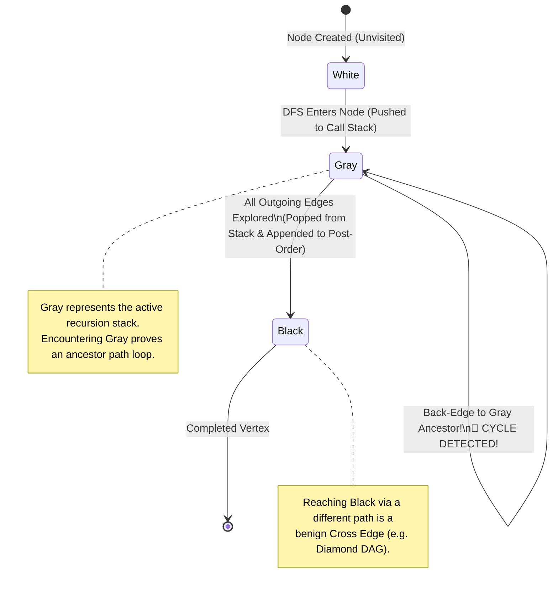
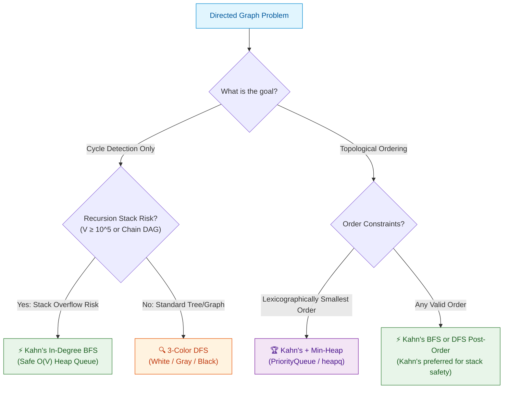

# 📘 Week 8 Day 3: DFS & Topological Sort — The Engineering Masterclass

> 🧭 **Navigation:** [← Previous Day: Breadth-First Search (BFS)](Week_08_Day_02_Breadth_First_Search_Instructional.md) • [🏠 Week Overview](README.md) • [📘 Curriculum Syllabus](../COMPLETE_SYLLABUS.md) • [Next Day: Connectivity & Bipartite Graphs →](Week_08_Day_04_Connectivity_and_Bipartite_Graphs_Instructional.md)
> 
> 💡 **Instructor Note:** *Topological sorting is the algorithmic backbone of build systems (Bazel, CMake, MSBuild), package orchestrators (npm, NuGet, pip), task schedulers (Airflow), and database transaction deadlock engines. In Tier-1 FAANG interviews, you must master two foundational paradigms: **Kahn's BFS In-Degree Algorithm** and **3-Color DFS Post-Order Reversal**. You must be able to derive both from first principles, explain their call stack safety trade-offs, and debug subtle cycle-detection edge cases on the whiteboard under live interview pressure.*

---

## 🎯 LEARNING OBJECTIVES

By the end of this masterclass, you will be able to:

- **Deconstruct** Directed Acyclic Graphs (DAGs) and formulate the exact linear ordering invariant that governs dependency resolution.
- **Implement Kahn's In-Degree Algorithm** from scratch, understanding how in-degree tracking mechanically peels zero-dependency layers like an onion.
- **Master DFS 3-Color State Transitions** (`White` = 0 / Unvisited, `Gray` = 1 / Active in Call Stack, `Black` = 2 / Fully Processed), and explain why naive 2-state boolean flags fail on diamond graphs.
- **Differentiate** all four directed edge classes: Tree Edges, Back Edges (cycles!), Forward Edges, and Cross Edges using discovery and finish timestamps.
- **Deliver** production-grade implementations for **LeetCode 207 (Course Schedule)** and **LeetCode 210 (Course Schedule II)** in modern C# (.NET 8/9) and clean Python (3.11+).
- **Eliminate** the top 6 rookie blunders: reversed prerequisite edge parsing, corrupted partial orders on cycles, call stack overflow on deep linear chains, and missing forest outer loops.
- **Articulate** the exact 3-sentence FAANG interview talk track that commands the room before you write a single line of code.

---

## 🎬 PILLAR 1: THE 60-SECOND HOOK & EVERYDAY ANALOGY

### The University Degree Nightmare & The Package Build Engine

Imagine you and I enroll at Stanford to study Computer Science. On Day 1, the academic advisor hands us a prerequisite handbook:
- To take **CS 107 (Computer Organization)**, you must first complete **CS 106B (Data Structures)**.
- To take **CS 110 (Operating Systems)**, you must complete **CS 107**.
- But suppose a clerical typo occurs in the course catalog: **CS 106B** now lists **CS 110** as its prerequisite!

```
Circular Prerequisite Deadlock:
    [ CS 106B ]  ======> requires ======>  [ CS 107 ]
         ^                                     |
         |                                     | requires
     requires                                  v
         +================================= [ CS 110 ]
```

What happens to our graduation date? It is delayed **infinitely**. You cannot take 106B without 110, you cannot take 110 without 107, and you cannot take 107 without 106B. The registrar has trapped you in a **circular dependency deadlock**.

This is not just academic trivia. Every time you type `npm install`, `dotnet restore`, `pip install`, or compile a multi-million-line monorepo in **Bazel** or **MSBuild**, the engine builds a dependency graph:
- Package `React-DOM` depends on `React`.
- Package `Redux-Toolkit` depends on `Immer` and `Redux`.
- If Package `A` imports Package `B`, and Package `B` imports Package `A`, your compiler crashes with an unresolvable cyclic import error.

### The Topological Invariant in Plain English

A **Topological Sort** of a directed graph is a linear ordering of its vertices such that for every directed edge `u -> v`, vertex `u` comes strictly before vertex `v` in the sequence.

```
The Physical Invariant:
For every directed edge:   ( u ) ------------> ( v )
Linear Execution Sequence: [ ... u ... ... ... v ... ]
                           (Prerequisite)     (Dependent)
```

> [!IMPORTANT]
> **The Golden Law of Topological Sorting:**
> A topological ordering exists **if and only if** the graph contains **NO directed cycles**. A directed graph with no cycles is called a **Directed Acyclic Graph (DAG)**. If a cycle exists, at least one dependency is physically impossible to satisfy, and no valid sequence exists.

---

## 🪜 PILLAR 2: THE SCAFFOLDING LADDER & TOY NAPKIN TRACE

Let's build intuition by hand-tracing both canonical approaches on the identical 4-node DAG.

### The Canonical 4-Node Diamond DAG

We have 4 courses (`0, 1, 2, 3`) and the following prerequisites:
- Course `0` is a foundation with zero prerequisites.
- Taking `0` unlocks Course `1` and Course `2`.
- Course `3` requires **both** Course `1` and Course `2` to be completed.

```
       Canonical 4-Node Diamond DAG:
                 ( 0 )
                /     \
               v       v
             ( 1 )   ( 2 )
               \       /
                v     v
                 ( 3 )

Directed Edges:
  0 -> 1
  0 -> 2
  1 -> 3
  2 -> 3
```

---

### Approach A: Kahn's Algorithm (BFS-based In-Degree Draining)

**The Intuitive Mental Model:** Think of an onion. 
1. Find all courses that have **zero prerequisites** (in-degree = 0). These are ready to take immediately.
2. Complete those courses (put them in our graduation sequence).
3. "Erase" them from the university catalog along with all their outgoing requirements (decrement the in-degrees of their direct downstream neighbors).
4. Any neighbor whose in-degree drops to 0 is now unlocked! Repeat until all courses are taken.

#### Step 1: Compute Initial In-Degrees
- Node `0`: 0 incoming edges -> `inDegree[0] = 0`
- Node `1`: 1 incoming edge (from `0`) -> `inDegree[1] = 1`
- Node `2`: 1 incoming edge (from `0`) -> `inDegree[2] = 1`
- Node `3`: 2 incoming edges (from `1` and `2`) -> `inDegree[3] = 2`

```
Initial In-Degree Table:
+------------+---+---+---+---+
| Vertex     | 0 | 1 | 2 | 3 |
+------------+---+---+---+---+
| In-Degree  | 0 | 1 | 1 | 2 |
+------------+---+---+---+---+
Queue: [ 0 ] (Only nodes with inDegree == 0 enter!)
Processed Count = 0
Order = []
```

#### Step-by-Step Draining Execution:

| Step | Action Taken | Dequeued `u` | Neighbors Updated | New In-Degrees `[0, 1, 2, 3]` | Queue State | Output Order `order` |
| :---: | :--- | :---: | :---: | :---: | :---: | :--- |
| **0** | Seed Queue with `inDegree == 0` | — | — | `[0, 1, 1, 2]` | `[ 0 ]` | `[ ]` |
| **1** | Dequeue `0`, increment count to 1 | **0** | `1`: `1 - 1 = 0`<br/>`2`: `1 - 1 = 0` | `[0, 0, 0, 2]` | `[ 1, 2 ]` | `[ 0 ]` |
| **2** | Dequeue `1`, increment count to 2 | **1** | `3`: `2 - 1 = 1` | `[0, 0, 0, 1]` | `[ 2 ]` | `[ 0, 1 ]` |
| **3** | Dequeue `2`, increment count to 3 | **2** | `3`: `1 - 1 = 0` | `[0, 0, 0, 0]` | `[ 3 ]` | `[ 0, 1, 2 ]` |
| **4** | Dequeue `3`, increment count to 4 | **3** | None | `[0, 0, 0, 0]` | `[ ]` | `[ 0, 1, 2, 3 ]` |

Queue is empty. `processedCount = 4 == V (4)`.
**Valid Topological Sort Found:** `[ 0, 1, 2, 3 ]` (or `[ 0, 2, 1, 3 ]` depending on queue order).

```
Why Kahn's Detects Cycles:
If there is a cycle (e.g. 3 -> 0), the in-degrees in the cycle will NEVER reach 0.
They can never enter the queue!
When the queue runs dry, processedCount < V.
Cycle detected in O(V + E) time with zero recursion!
```

---

> [!TIP]
> ### 🧠 Pause & Predict #1
> **Scenario:** Suppose an additional edge is added: `3 -> 0`.
> 1. What would `inDegree[0]` become initially?
> 2. What would the queue contain at Step 0?
> 3. What would the algorithm return?
>
> *Take 10 seconds to trace this in your head before reading the answer below!*
>
> **Answer:**
> 1. `inDegree[0]` becomes `1` (edge `3 -> 0`).
> 2. Initial in-degrees: `[0: 1, 1: 1, 2: 1, 3: 2]`. **NO vertex has in-degree 0!**
> 3. The initial queue is completely **EMPTY** (`[]`). The `while` loop never executes!
> 4. `processedCount = 0 != 4`. Kahn's instantly identifies a cycle and returns an empty list `[]`.

---

### Approach B: DFS with 3-Color State Transitions (Post-Order Reversal)

**The Intuitive Mental Model:** Imagine you are a deep explorer walking a maze of dependencies.
- You can't graduate a course until you've explored **all** courses that depend on it down the rabbit hole.
- To detect cycles, think of holding a **red yarn string** behind you back to your current ancestors. If you turn a corner and bump into your own active yarn string, you walked in a circle!

#### The 3 Colors:
- **`0 = White (UNVISITED)`**: Completely unexplored territory.
- **`1 = Gray (VISITING)`**: Currently on the active recursion call stack (your yarn string is tied here).
- **`2 = Black (VISITED)`**: Completely explored; all outgoing branches are finished and popped. Safe!

```
The 3-Color Lifecycle:
   ( White: 0 )  ======> Enter DFS ======>  ( Gray: 1 )
   [Unvisited]                              [On Call Stack]
                                                   |
                             Encounter Gray again? |
                             ===> CYCLE DETECTED!  | All outgoing edges explored
                                                   v
                                            ( Black: 2 )
                                            [Finished & Added to Post-Order]
```

#### Step-by-Step Execution on the 4-Node Diamond:

1. **Start `Dfs(0)`:**
   - Mark `state[0] = Gray (1)`. Active call stack: `[0]`.
   - Inspect edge `0 -> 1`. Node `1` is `White`. Call `Dfs(1)`.
2. **Inside `Dfs(1)`:**
   - Mark `state[1] = Gray (1)`. Active call stack: `[0, 1]`.
   - Inspect edge `1 -> 3`. Node `3` is `White`. Call `Dfs(3)`.
3. **Inside `Dfs(3)`:**
   - Mark `state[3] = Gray (1)`. Active call stack: `[0, 1, 3]`.
   - Node `3` has **no outgoing edges** (leaf/sink).
   - Exploration of `3` complete! Mark `state[3] = Black (2)`.
   - Append `3` to `postOrder`: `postOrder = [ 3 ]`.
   - Return from `Dfs(3)` back to `Dfs(1)`.
4. **Back in `Dfs(1)`:**
   - All outgoing edges of `1` explored. Mark `state[1] = Black (2)`.
   - Append `1` to `postOrder`: `postOrder = [ 3, 1 ]`.
   - Return from `Dfs(1)` back to `Dfs(0)`.
5. **Back in `Dfs(0)`:**
   - Next neighbor of `0`: inspect edge `0 -> 2`. Node `2` is `White`. Call `Dfs(2)`.
6. **Inside `Dfs(2)`:**
   - Mark `state[2] = Gray (1)`. Active call stack: `[0, 2]`.
   - Inspect edge `2 -> 3`. Node `3` is **Black (2)**!
   - Is `3` a cycle? **NO!** `3` is `Black`, not `Gray`. It is finished, not an ancestor on our active call stack! This is a **Cross Edge**. Safely ignore!
   - All outgoing edges of `2` explored. Mark `state[2] = Black (2)`.
   - Append `2` to `postOrder`: `postOrder = [ 3, 1, 2 ]`.
   - Return from `Dfs(2)` back to `Dfs(0)`.
7. **Back in `Dfs(0)`:**
   - All outgoing edges of `0` explored. Mark `state[0] = Black (2)`.
   - Append `0` to `postOrder`: `postOrder = [ 3, 1, 2, 0 ]`.
8. **Final Step: Reverse Post-Order!**
   - Reverse `[ 3, 1, 2, 0 ]` -> **`[ 0, 2, 1, 3 ]`** (A perfectly valid topological ordering!).

```
Why Post-Order Reversal Works:
A node only turns Black AFTER all its downstream dependencies turn Black.
Therefore, a dependent (e.g. 3) ALWAYS enters postOrder BEFORE its prerequisite (e.g. 0).
Reversing the list puts prerequisites first!
```

---

> [!TIP]
> ### 🧠 Pause & Predict #2
> **Scenario:** Look closely at Step 6 above. When `Dfs(2)` visited `3`, `state[3]` was already `Black (2)`.
> What would happen if we used a simple 2-state boolean array `bool[] visited` where `visited[3] == true` simply meant "already seen"?
>
> *Why does standard undirected cycle detection crash and burn here?*
>
> **Answer:**
> With a simple `bool[] visited`, when path `0 -> 2 -> 3` encounters `3`, it would see `visited[3] == true`. If the algorithm treats `visited == true` as a cycle, it will **falsely flag a cycle on a completely valid DAG!**
> This is why directed graphs strictly require **3 states**:
> - `White`: Unvisited
> - `Gray`: Currently on the call stack (Ancestor) -> **CYCLE!**
> - `Black`: Finished in an earlier branch -> **Harmless cross/forward edge!**

---

## 🎨 PILLAR 3: PRAGMATIC VISUAL MODELS

### 1. ASCII In-Degree Queue Draining Waves

Observe how Kahn's algorithm processes vertices in concentric waves of zero-dependency frontiers:

```
                      KAHN'S BFS IN-DEGREE DRAINING WAVES
                      
Wave 0 (In-Degree = 0):                 [ 0 ]              <-- Ready to take immediately
                                       /     \
                                      v       v
Wave 1 (In-Degree = 0 after W0):    [ 1 ]   [ 2 ]          <-- Unlocked simultaneously
                                      \       /
                                       v     v
Wave 2 (In-Degree = 0 after W1):        [ 3 ]              <-- Unlocked only after BOTH 1 & 2 finish

Memory Buffer Snapshots:
-----------------------------------------------------------------------------
Timestamp    Active Queue       In-Degree Array [0,1,2,3]    Output Order
-----------------------------------------------------------------------------
T0 (Init)    [ 0 ]              [ 0, 1, 1, 2 ]               [ ]
T1 (Pop 0)   [ 1, 2 ]           [ -, 0, 0, 2 ]               [ 0 ]
T2 (Pop 1)   [ 2 ]              [ -, -, 0, 1 ]               [ 0, 1 ]
T3 (Pop 2)   [ 3 ]              [ -, -, -, 0 ]               [ 0, 1, 2 ]
T4 (Pop 3)   [ ]                [ -, -, -, - ]               [ 0, 1, 2, 3 ]
-----------------------------------------------------------------------------
Total Processed: 4 / 4 Nodes. Status: VALID DAG (No Cycles).
```

---

### 2. State Machine: 3-Color DFS State Transitions

This state transition diagram illustrates when a cycle is proven versus when an edge is simply a benign cross edge:



---

### 3. Architectural Decision Flowchart: Kahn's vs. DFS

When should you use Kahn's vs. 3-Color DFS in an actual interview? Follow this battle-tested decision tree:



---

## 🛑 PILLAR 4: THE ROOKIE TRAP ZONE

### Side-by-Side Architectural Blunder Comparisons

#### Trap 1: The 2-State Boolean Visited Trap (Diamond False Alarm)

> [!WARNING]
> In undirected graphs, checking `visited[v] == true && v != parent` detects cycles. In directed graphs, this completely breaks on diamond graphs (`0 -> 1 -> 3` and `0 -> 2 -> 3`). Node `3` is visited twice along valid, acyclic paths!

```csharp
// ❌ ROOKIE BLUNDER: 2-State Boolean visited flags cross-edges as cycles
bool[] visited = new bool[n];
bool HasCycle(int u) {
    visited[u] = true;
    foreach (int v in adj[u]) {
        if (visited[v]) return true; // BUG! Flags diamond cross-edges as cycles!
        if (HasCycle(v)) return true;
    }
    return false;
}

// ✅ SENIOR ARCHITECT PATTERN: 3-State coloring strictly isolates back-edges
int[] state = new int[n]; // 0: White, 1: Gray, 2: Black
bool HasCycle(int u) {
    state[u] = 1; // Gray: on active call stack
    foreach (int v in adj[u]) {
        if (state[v] == 1) return true; // TRUE CYCLE: back-edge to active ancestor!
        if (state[v] == 0 && HasCycle(v)) return true;
        // If state[v] == 2 (Black), it's a finished cross-edge; safely ignore!
    }
    state[u] = 2; // Black: finished exploring all downstream paths
    return false;
}
```

---

#### Trap 2: Inverted Prerequisite Edge Direction

> [!CAUTION]
> In LeetCode 207 & 210, the input is given as pairs `[a, b]`, which explicitly states: *"To take course `a`, you must first take course `b`"*.
> - **The Prerequisite is `b`**.
> - **The Dependent is `a`**.
> - Therefore, the directed dependency edge is **`b -> a`**, NOT `a -> b`!
>
> If you add edge `a -> b`, you invert the entire graph, compute the reverse dependencies, and produce an invalid schedule.

```csharp
// ❌ ROOKIE BLUNDER: Reading [a, b] as edge a -> b
foreach (var edge in prerequisites) {
    int a = edge[0];
    int b = edge[1];
    adj[a].Add(b);      // WRONG: Inverts the dependency flow!
    inDegree[b]++;     // WRONG: Prerequisite gets inflated in-degree!
}

// ✅ SENIOR ARCHITECT PATTERN: Clarify u -> v semantics upfront
foreach (var edge in prerequisites) {
    int course = edge[0];
    int prereq = edge[1];
    adj[prereq].Add(course); // CORRECT: Prerequisite unlocks the course
    inDegree[course]++;     // CORRECT: Course waits for its prerequisite
}
```

---

#### Trap 3: Returning a Corrupted Partial Order on Cycle

> [!WARNING]
> If a graph contains both a cycle AND acyclic components (e.g. `0 -> 1 -> 0` and `2 -> 3`), Kahn's algorithm will successfully process nodes `2` and `3`. If you simply return the accumulated list without checking its length, you return a partial schedule for a broken graph!

```csharp
// ❌ ROOKIE BLUNDER: Returns partial array even when cycle exists
return order; // BUG: Might only have 2 elements when numCourses = 4!

// ✅ SENIOR ARCHITECT PATTERN: Invariant validation against total vertex count
return processedCount == numCourses ? order : Array.Empty<int>();
```

---

#### Trap 4: Forgetting the Outer Loop (Disconnected Forests)

> [!WARNING]
> Real-world dependency graphs are rarely single connected components. They are forests containing multiple disconnected islands. Calling `Dfs(0)` once leaves isolated components completely unvisited. If an isolated component contains a cycle, you will fail to detect it!

```csharp
// ❌ ROOKIE BLUNDER: Assumes node 0 reaches everything
Dfs(0); // BUG: Misses disconnected component cycles (e.g., 2 -> 3 -> 2)!

// ✅ SENIOR ARCHITECT PATTERN: Sweep every vertex through an outer loop
for (int i = 0; i < numCourses; i++) {
    if (state[i] == 0) {
        if (Dfs(i)) return false; // Cycle found in some component!
    }
}
```

---

## 🎙️ PILLAR 5: 45-MINUTE INTERVIEW TALK TRACK

### The Golden 3-Sentence Script (Deliver Before Writing Code)

When the interviewer asks: *"There are `numCourses` courses labeled `0` to `numCourses - 1`. Given prerequisite pairs `[a, b]`, can a student finish all courses? If so, return the order."*

Look at them and say:

> 🗣️ *"We can model this as a Directed Acyclic Graph where each prerequisite pair `[a, b]` represents a directed dependency edge from prerequisite `b` to course `a`. A valid course sequence exists if and only if the graph has no directed cycles, which is the exact definition of a topological sort. I will use Kahn's in-degree BFS algorithm because it operates in `O(V + E)` time, requires `O(V)` auxiliary space, and completely avoids the recursion stack overflow risks associated with deep linear graphs in production."*

---

### The 4-Phase Interview Breakdown

#### Phase 1: Clarification & Edge Contracts (0–5 Mins)
- **Edge Direction:** "To confirm: `[a, b]` means `b` is the prerequisite of `a`, so our edge is `b -> a`?"
- **Output Contract:** "If a cycle is detected, should I return an empty array `[]`?"
- **Multiple Valid Orders:** "If multiple valid topological sorts exist, is any valid sequence acceptable?"
- **Constraints:** "What are the bounds on `numCourses` (`V`) and prerequisites (`E`)? If `V = 10^5`, Kahn's BFS is strongly preferred over recursive DFS to avoid thread stack exhaustion."

#### Phase 2: High-Level Approach & Invariant (5–12 Mins)
- State the Kahn's Invariant: *"Nodes with `inDegree == 0` have no pending prerequisites and can be scheduled immediately. Processing a node decrements the in-degrees of its children. If our processed count matches `numCourses`, we have a valid topological order. Otherwise, a cycle exists."*
- Propose the data structures: `int[] inDegree`, `List<int>[] adj`, and `Queue<int> queue`.

#### Phase 3: Live Coding Walkthrough (12–32 Mins)
- Write the input parsing cleanly, guard against edge inversion.
- Seed the queue with all initial `inDegree == 0` nodes.
- Run the standard BFS queue draining loop while populating the output array.
- Validate `processedCount == numCourses`.

#### Phase 4: Edge-Case Dry Run & Verification (32–40 Mins)
Walk the interviewer through these 4 boundary cases:
1. **Empty / No Prerequisites (`E = 0`):** Every node starts with `inDegree = 0`. All enter the queue in wave 0. Returns `[0, 1, ..., V-1]`.
2. **Mutual Deadlock Cycle (`0 -> 1` and `1 -> 0`):** Initial in-degrees are `[1, 1]`. Queue starts empty. `processedCount = 0 != 2`. Returns `[]`.
3. **Disconnected Components (`0 -> 1` and `2 -> 3`):** Nodes `0` and `2` both start with `inDegree = 0`. Queue processes both components smoothly.
4. **Self-Loop (`0 -> 0`):** `inDegree[0] = 1`. Node `0` never enters the queue. Returns `[]`.

---

## ⚡ PILLAR 6: PRODUCTION DUAL-LANGUAGE IMPLEMENTATIONS

### Problem 1: LeetCode 207 — Course Schedule (Cycle Detection)

Return `true` if you can finish all courses; otherwise return `false`.

#### Approach 1A: Kahn's BFS In-Degree Draining (Industry Standard)

##### C# (.NET 8/9) Implementation
```csharp
using System;
using System.Collections.Generic;

public sealed class CourseScheduleKahn
{
    /// <summary>
    /// Determines if all courses can be finished using Kahn's In-Degree BFS.
    /// Time Complexity: O(V + E) - Visits every vertex and traverses every edge once.
    /// Auxiliary Space: O(V + E) - Adjacency list plus in-degree array and queue.
    /// </summary>
    public static bool CanFinish(int numCourses, int[][] prerequisites)
    {
        // Guard clause: Single course or non-existent constraints are trivially valid
        if (numCourses <= 1 || prerequisites == null || prerequisites.Length == 0)
        {
            return true;
        }

        // 1. Build Adjacency List and compute In-Degrees
        var adj = new List<int>[numCourses];
        for (int i = 0; i < numCourses; i++)
        {
            adj[i] = new List<int>();
        }

        var inDegree = new int[numCourses];
        foreach (var edge in prerequisites)
        {
            int course = edge[0];
            int prereq = edge[1];

            // Prerequisite must come before the course: prereq -> course
            adj[prereq].Add(course);
            inDegree[course]++;
        }

        // 2. Seed Queue with all zero-dependency courses
        var queue = new Queue<int>();
        for (int i = 0; i < numCourses; i++)
        {
            if (inDegree[i] == 0)
            {
                queue.Enqueue(i);
            }
        }

        // 3. Process BFS frontier
        int processedCount = 0;
        while (queue.Count > 0)
        {
            int current = queue.Dequeue();
            processedCount++;

            foreach (int neighbor in adj[current])
            {
                inDegree[neighbor]--;
                if (inDegree[neighbor] == 0)
                {
                    queue.Enqueue(neighbor);
                }
            }
        }

        // Invariant: If processedCount == numCourses, the graph is a DAG (no cycles)
        return processedCount == numCourses;
    }
}
```

##### Python (3.11+) Implementation
```python
from collections import deque
from typing import List

def can_finish_kahns(num_courses: int, prerequisites: List[List[int]]) -> bool:
    """
    Determines if all courses can be finished using Kahn's algorithm (BFS In-Degree).
    Time Complexity: O(V + E)
    Auxiliary Space: O(V + E)
    """
    if num_courses <= 1 or not prerequisites:
        return True

    # 1. Build Adjacency List and In-Degree counts
    adj: List[List[int]] = [[] for _ in range(num_courses)]
    in_degree = [0] * num_courses

    for course, prereq in prerequisites:
        adj[prereq].append(course)
        in_degree[course] += 1

    # 2. Seed Queue with all in-degree == 0 courses
    queue = deque([i for i in range(num_courses) if in_degree[i] == 0])
    processed_count = 0

    # 3. Drain frontier
    while queue:
        curr = queue.popleft()
        processed_count += 1

        for neighbor in adj[curr]:
            in_degree[neighbor] -= 1
            if in_degree[neighbor] == 0:
                queue.append(neighbor)

    # Invariant: Acycle graph iff all vertices were processed
    return processed_count == num_courses
```

---

#### Approach 1B: 3-Color State DFS (Cycle Detection)

##### C# (.NET 8/9) Implementation
```csharp
using System;
using System.Collections.Generic;

public sealed class CourseScheduleDfs
{
    private const int Unvisited = 0; // White: Unexplored
    private const int Visiting = 1;  // Gray: On active recursion call stack
    private const int Visited = 2;   // Black: Fully explored, safe

    /// <summary>
    /// Detects directed cycles using 3-color DFS state transitions.
    /// Time Complexity: O(V + E)
    /// Auxiliary Space: O(V + E) - Recursion stack up to O(V).
    /// </summary>
    public static bool CanFinish(int numCourses, int[][] prerequisites)
    {
        if (numCourses <= 1 || prerequisites == null || prerequisites.Length == 0)
        {
            return true;
        }

        var adj = new List<int>[numCourses];
        for (int i = 0; i < numCourses; i++)
        {
            adj[i] = new List<int>();
        }

        foreach (var edge in prerequisites)
        {
            adj[edge[1]].Add(edge[0]);
        }

        var state = new int[numCourses];

        // Local function for recursive DFS traversal
        bool HasCycle(int u)
        {
            state[u] = Visiting; // Mark Gray (on active call stack)

            foreach (int v in adj[u])
            {
                if (state[v] == Visiting)
                {
                    return true; // Back-edge to active ancestor found -> CYCLE!
                }

                if (state[v] == Unvisited && HasCycle(v))
                {
                    return true;
                }
            }

            state[u] = Visited; // Mark Black (fully explored)
            return false;
        }

        // Outer loop guarantees coverage across disconnected forests
        for (int i = 0; i < numCourses; i++)
        {
            if (state[i] == Unvisited)
            {
                if (HasCycle(i))
                {
                    return false; // Cycle detected: cannot finish all courses
                }
            }
        }

        return true;
    }
}
```

##### Python (3.11+) Implementation
```python
from typing import List

def can_finish_dfs(num_courses: int, prerequisites: List[List[int]]) -> bool:
    """
    Detects directed cycles using 3-color DFS state transitions.
    Time Complexity: O(V + E)
    Auxiliary Space: O(V + E)
    """
    if num_courses <= 1 or not prerequisites:
        return True

    UNVISITED, VISITING, VISITED = 0, 1, 2
    adj: List[List[int]] = [[] for _ in range(num_courses)]
    for course, prereq in prerequisites:
        adj[prereq].append(course)

    state = [UNVISITED] * num_courses

    def has_cycle(u: int) -> bool:
        state[u] = VISITING  # Mark Gray: on current call stack

        for v in adj[u]:
            if state[v] == VISITING:
                return True  # Back-edge to an active ancestor -> CYCLE!
            if state[v] == UNVISITED:
                if has_cycle(v):
                    return True

        state[u] = VISITED   # Mark Black: finished
        return False

    # Outer loop to handle disconnected components
    for i in range(num_courses):
        if state[i] == UNVISITED:
            if has_cycle(i):
                return False

    return True
```

---

### Problem 2: LeetCode 210 — Course Schedule II (Ordering Output)

Return the ordering of courses you should take to finish all courses. If impossible, return an empty array.

#### Approach 2A: Kahn's BFS In-Degree Ordering (Production Preferred)

##### C# (.NET 8/9) Implementation
```csharp
using System;
using System.Collections.Generic;

public sealed class CourseScheduleOrderKahn
{
    /// <summary>
    /// Returns a valid course sequence using Kahn's algorithm.
    /// Time Complexity: O(V + E)
    /// Auxiliary Space: O(V + E)
    /// </summary>
    public static int[] FindOrder(int numCourses, int[][] prerequisites)
    {
        if (numCourses <= 0) return Array.Empty<int>();

        var adj = new List<int>[numCourses];
        for (int i = 0; i < numCourses; i++)
        {
            adj[i] = new List<int>();
        }

        var inDegree = new int[numCourses];
        foreach (var edge in prerequisites)
        {
            int course = edge[0];
            int prereq = edge[1];
            adj[prereq].Add(course);
            inDegree[course]++;
        }

        var queue = new Queue<int>();
        for (int i = 0; i < numCourses; i++)
        {
            if (inDegree[i] == 0)
            {
                queue.Enqueue(i);
            }
        }

        var order = new int[numCourses];
        int writeIdx = 0;

        while (queue.Count > 0)
        {
            int current = queue.Dequeue();
            order[writeIdx++] = current;

            foreach (int neighbor in adj[current])
            {
                inDegree[neighbor]--;
                if (inDegree[neighbor] == 0)
                {
                    queue.Enqueue(neighbor);
                }
            }
        }

        // Return ordering only if ALL courses were successfully scheduled
        return writeIdx == numCourses ? order : Array.Empty<int>();
    }
}
```

##### Python (3.11+) Implementation
```python
from collections import deque
from typing import List

def find_order_kahns(num_courses: int, prerequisites: List[List[int]]) -> List[int]:
    """
    Returns valid topological ordering using Kahn's BFS algorithm.
    Time Complexity: O(V + E)
    Auxiliary Space: O(V + E)
    """
    if num_courses <= 0:
        return []

    adj: List[List[int]] = [[] for _ in range(num_courses)]
    in_degree = [0] * num_courses

    for course, prereq in prerequisites:
        adj[prereq].append(course)
        in_degree[course] += 1

    queue = deque([i for i in range(num_courses) if in_degree[i] == 0])
    order: List[int] = []

    while queue:
        curr = queue.popleft()
        order.append(curr)

        for neighbor in adj[curr]:
            in_degree[neighbor] -= 1
            if in_degree[neighbor] == 0:
                queue.append(neighbor)

    return order if len(order) == num_courses else []
```

---

#### Approach 2B: DFS Post-Order Reversal with 3-Color States

##### C# (.NET 8/9) Implementation
```csharp
using System;
using System.Collections.Generic;

public sealed class CourseScheduleOrderDfs
{
    private const int Unvisited = 0; // White
    private const int Visiting = 1;  // Gray
    private const int Visited = 2;   // Black

    /// <summary>
    /// Generates topological order by reversing post-order DFS finish sequence.
    /// Time Complexity: O(V + E)
    /// Auxiliary Space: O(V + E)
    /// </summary>
    public static int[] FindOrder(int numCourses, int[][] prerequisites)
    {
        if (numCourses <= 0) return Array.Empty<int>();

        var adj = new List<int>[numCourses];
        for (int i = 0; i < numCourses; i++)
        {
            adj[i] = new List<int>();
        }

        foreach (var edge in prerequisites)
        {
            adj[edge[1]].Add(edge[0]);
        }

        var state = new int[numCourses];
        var postOrder = new List<int>(numCourses);
        bool hasCycle = false;

        void Dfs(int u)
        {
            if (hasCycle) return;
            state[u] = Visiting;

            foreach (int v in adj[u])
            {
                if (state[v] == Visiting)
                {
                    hasCycle = true; // Cycle detected
                    return;
                }
                if (state[v] == Unvisited)
                {
                    Dfs(v);
                }
            }

            state[u] = Visited;
            postOrder.Add(u); // Finish node: append to post-order list
        }

        for (int i = 0; i < numCourses; i++)
        {
            if (state[i] == Unvisited)
            {
                Dfs(i);
                if (hasCycle) return Array.Empty<int>();
            }
        }

        // Reverse post-order to obtain valid topological sequence
        postOrder.Reverse();
        return postOrder.ToArray();
    }
}
```

##### Python (3.11+) Implementation
```python
from typing import List

def find_order_dfs(num_courses: int, prerequisites: List[List[int]]) -> List[int]:
    """
    Generates topological order by reversing DFS post-order finish sequence.
    Time Complexity: O(V + E)
    Auxiliary Space: O(V + E)
    """
    if num_courses <= 0:
        return []

    UNVISITED, VISITING, VISITED = 0, 1, 2
    adj: List[List[int]] = [[] for _ in range(num_courses)]
    for course, prereq in prerequisites:
        adj[prereq].append(course)

    state = [UNVISITED] * num_courses
    post_order: List[int] = []
    has_cycle = False

    def dfs(u: int) -> None:
        nonlocal has_cycle
        if has_cycle:
            return

        state[u] = VISITING
        for v in adj[u]:
            if state[v] == VISITING:
                has_cycle = True
                return
            if state[v] == UNVISITED:
                dfs(v)

        state[u] = VISITED
        post_order.append(u)

    for i in range(num_courses):
        if state[i] == UNVISITED:
            dfs(i)
            if has_cycle:
                return []

    post_order.reverse()
    return post_order
```

---

### Staff-Level Bonus: Lexicographically Smallest Order (Kahn's + Min-Heap)

In FAANG interviews (e.g. Google Alien Dictionary or tie-breaking task scheduling), you may be instructed: *"If multiple valid topological sorts exist, return the lexicographically smallest order."*

Kahn's algorithm handles this with zero algorithmic changes—simply replace the FIFO `Queue` with a **Min-Heap** (`PriorityQueue<int, int>` in C# / `heapq` in Python)!

#### C# (.NET 8/9) Min-Heap Implementation
```csharp
using System;
using System.Collections.Generic;

public static class LexicographicalTopologicalSort
{
    public static int[] FindSmallestOrder(int numCourses, int[][] prerequisites)
    {
        var adj = new List<int>[numCourses];
        for (int i = 0; i < numCourses; i++) adj[i] = new List<int>();

        var inDegree = new int[numCourses];
        foreach (var edge in prerequisites)
        {
            adj[edge[1]].Add(edge[0]);
            inDegree[edge[0]]++;
        }

        // Min-Heap ensures we always pick the lowest numerical course ID among ready courses
        var minHeap = new PriorityQueue<int, int>();
        for (int i = 0; i < numCourses; i++)
        {
            if (inDegree[i] == 0) minHeap.Enqueue(i, i);
        }

        var order = new int[numCourses];
        int writeIdx = 0;

        while (minHeap.Count > 0)
        {
            int current = minHeap.Dequeue();
            order[writeIdx++] = current;

            foreach (int neighbor in adj[current])
            {
                inDegree[neighbor]--;
                if (inDegree[neighbor] == 0)
                {
                    minHeap.Enqueue(neighbor, neighbor);
                }
            }
        }

        return writeIdx == numCourses ? order : Array.Empty<int>();
    }
}
```

#### Python (3.11+) Min-Heap Implementation
```python
import heapq
from typing import List

def find_smallest_order(num_courses: int, prerequisites: List[List[int]]) -> List[int]:
    """Topological sort returning lexicographically smallest order via Min-Heap."""
    adj: List[List[int]] = [[] for _ in range(num_courses)]
    in_degree = [0] * num_courses

    for course, prereq in prerequisites:
        adj[prereq].append(course)
        in_degree[course] += 1

    # Min-Heap of all currently available courses
    pq = [i for i in range(num_courses) if in_degree[i] == 0]
    heapq.heapify(pq)
    order: List[int] = []

    while pq:
        curr = heapq.heappop(pq)
        order.append(curr)

        for neighbor in adj[curr]:
            in_degree[neighbor] -= 1
            if in_degree[neighbor] == 0:
                heapq.heappush(pq, neighbor)

    return order if len(order) == num_courses else []
```

---

## 📊 COMPLEXITY DECONSTRUCTION

| Paradigm | Time Complexity | Auxiliary Space | Output Space | Stack Safety (`V = 10^5`) | Lexicographical Suitability |
| :--- | :--- | :--- | :--- | :--- | :--- |
| **Kahn's BFS (FIFO Queue)** | `O(V + E)` | `O(V + E)` | `O(V)` | ✅ **Zero Risk** (Heap memory) | Natural via Min-Heap swap |
| **Kahn's + Min-Heap** | `O((V + E) log V)` | `O(V + E)` | `O(V)` | ✅ **Zero Risk** (Heap memory) | 🏆 **Gold Standard** |
| **DFS 3-Color (Recursive)** | `O(V + E)` | `O(V + E)` | `O(V)` | ❌ **High Risk** (Thread stack crash) | Unnatural (requires sorting adj in reverse) |
| **DFS (Explicit Stack)** | `O(V + E)` | `O(V + E)` | `O(V)` | ✅ **Safe** (Simulated call stack on heap)| Complex boilerplate |

### Key Mechanical Insights:
1. **Adjacency Construction:** Building `adj` requires traversing all `E` edges -> `O(E)`.
2. **Vertex Draining:** Every vertex enters the queue or DFS call stack at most once -> `O(V)`.
3. **Edge Examination:** Every directed edge is traversed exactly once -> `O(E)`.
4. **Total Time:** `O(V + E)` linear time. Optimal because any algorithm must at least inspect all edges and vertices.

---

## 🏋️ CURATED FAANG PRACTICE LADDER

| Problem | LeetCode # | Difficulty | Target Time | Core Pattern & Invariant |
| :--- | :--- | :--- | :--- | :--- |
| **Course Schedule** | #207 | 🟡 Medium | 15 mins | Cycle detection in directed graph (Kahn's or 3-color DFS) |
| **Course Schedule II** | #210 | 🟡 Medium | 15 mins | Kahn's queue draining or DFS post-order reversal |
| **Alien Dictionary** | #269 | 🔴 Hard | 25 mins | Build DAG from lexicographical word comparisons + Topo Sort |
| **Minimum Height Trees** | #310 | 🟡 Medium | 20 mins | Reverse Kahn's: trim degree-1 leaf nodes inward until <= 2 roots remain |
| **Sequence Reconstruction**| #444 | 🟡 Medium | 20 mins | Unique Topo Sort: Queue size must remain strictly 1 at every step |
| **Sort Items by Groups** | #1203 | 🔴 Hard | 35 mins | Hierarchical Double Topo Sort: Group-level and item-level DAGs |

---

> 🧭 **Navigation:** [← Previous Day: Breadth-First Search (BFS)](Week_08_Day_02_Breadth_First_Search_Instructional.md) • [🏠 Week Overview](README.md) • [📘 Curriculum Syllabus](../COMPLETE_SYLLABUS.md) • [Next Day: Connectivity & Bipartite Graphs →](Week_08_Day_04_Connectivity_and_Bipartite_Graphs_Instructional.md)
