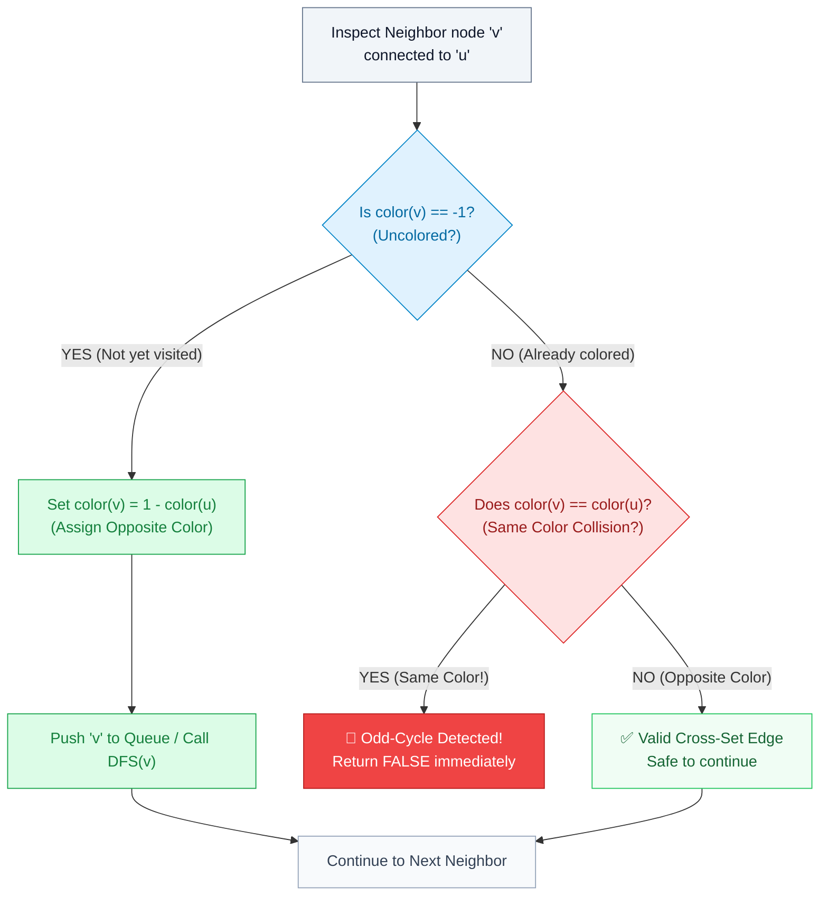

# 📘 Week 8 Day 4: Connectivity & Bipartite Graphs — Engineering Guide

> 🧭 **Navigation:** [← Previous Day](Week_08_Day_03_DFS_Topological_Sort_Instructional.md) • [🏠 Week Overview](README.md) • [📘 Curriculum Syllabus](../COMPLETE_SYLLABUS.md) • [Next Day →](Week_08_Day_05_Strongly_Connected_Components_Instructional.md)
> 
> 💡 **Instructor Note:** *The two most common reasons senior candidates fail connectivity and bipartite interview questions are: (1) assuming the graph is a single connected piece and forgetting the outer vertex loop `0..V-1`, and (2) confusing bipartite graphs with DAGs or trees. A bipartite graph can have cycles—as long as those cycles have an **even** number of edges. Keep your color states crisp (`-1` = uncolored, `0` = Team Red, `1` = Team Blue) and use `1 - color[u]` to toggle states without branching.*

---

## 🎯 LEARNING OBJECTIVES

By the end of this chapter, you will be able to:

- **Partition** undirected graphs into connected components using both multi-pass traversals (`O(V + E)`) and Disjoint Set Union (`O(E * alpha(V))`).
- **Deconstruct** Bipartiteness through the physical lens of 2-coloring and the Odd-Cycle Obstruction Invariant.
- **Trace** state transitions on even cycles (valid) and odd cycles (parity collision conflict) with toy napkin diagrams.
- **Implement** BFS and DFS 2-coloring solutions that guarantee 100% component coverage over disconnected archipelagos.
- **Model** abstract constraint satisfaction problems (e.g., enemy dislike lists in LeetCode 886) as bipartite graph verification problems.
- **Deliver** production-ready C# (.NET 8/9) and Python (3.11+) implementations for LeetCode 323, LeetCode 785 (both BFS & DFS), and LeetCode 886.
- **Recite** a 3-sentence verbal script in live FAANG interviews that anchors the algorithm before writing a single line of code.

---

## 🎬 PILLAR 1: THE 60-SECOND HOOK & REAL-WORLD METAPHORS

### The Two-Party Peace Summit
Imagine you are the chief diplomat organizing an emergency international peace summit. Attendees include world delegates who have bitter rivalries (represented by an undirected edge connecting two enemies). 

Your mission:
Divide all delegates into **two separate breakout rooms** (Room 0 and Room 1) such that **no two people in the same room have a conflict**.

Can you do it? 

If yes, your attendee network is **Bipartite** (or 2-colorable). If any two delegates sharing an edge are forced into the same room, a brawl breaks out, and bipartition is impossible.

```
       Room 0 (Red)                    Room 1 (Blue)
   +-------------------+          +-------------------+
   |  [ Alice ]        |          |  [ Bob ]          |
   |                   | <======> |                   |
   |  [ Charlie ]      | (Peace)  |  [ Dave ]         |
   +-------------------+          +-------------------+
             ^                              ^
             |                              |
             +-------- All Edges Cross -----+
                   (No internal edges!)
```

### The Dating App / Job Marketplace Analogy
Think of Tinder or LinkedIn Recruiter:
- **Two Distinct Sets:** Job Seekers (`U`) and Open Job Roles (`V`).
- **Legal Edges:** A candidate applies for a job (`U <-> V`).
- **Illegal Edges:** Candidates never interview each other (`U <-> U` does not exist), and job postings do not hire other job postings (`V <-> V` does not exist).

Whenever a problem asks you to divide a group into two mutually exclusive sets where relationships only exist *between* sets and never *within* a set, you are dealing with a **Bipartite Graph**.

---

### Why Odd-Length Cycles Mathematically Destroy Bipartiteness
Let's see why some graphs simply *cannot* be split into two conflict-free rooms.

Take the simplest conflict: three mutual enemies—Alice, Bob, and Charlie—forming a **3-cycle triangle**:
```
        Alice (0)
        /       \
       /         \
   Bob (1) ----- Charlie (2)
```

Let's step through the room assignments:
1. We place **Alice** in **Room 0 (Red)**.
2. Alice hates **Bob**, so Bob **must** go to **Room 1 (Blue)**.
3. Bob hates **Charlie**, so Charlie **must** go to **Room 0 (Red)**.
4. Now examine the closing edge between **Charlie** and **Alice**:
   - Charlie is in **Room 0 (Red)**.
   - Alice is in **Room 0 (Red)**.
   - But Charlie hates Alice! They are both in Room 0! **BOOM! Conflict!**

```
              Alice: Room 0 (Red)
                 /          \
                /            \
               v              v
     Bob: Room 1 (Blue) ----> Charlie: Room 0 (Red)
                                    ^^
          CONFLICT: Edge between Alice (Red) and Charlie (Red)!
```

This is not a coincidence—it is a physical law of graph parity:
- **Even-Length Cycles (`4, 6, 8...` edges):** You alternate `Red -> Blue -> Red -> Blue -> Red`. When you loop back to the start, the colors alternate cleanly. Even cycles are **100% Bipartite**.
- **Odd-Length Cycles (`3, 5, 7...` edges):** You take an odd number of color flips. The final edge is guaranteed to connect two vertices of the **exact same color**.

> 🔑 **The Bipartite Core Invariant:**
> A graph is bipartite **if and only if** it contains **NO odd-length cycles**. A single triangle anywhere in a graph of 100,000 nodes disqualifies the entire graph!

---

## 🪜 PILLAR 2: THE SCAFFOLDING LADDER & TOY NAPKIN TRACES

Let's build our intuition step by step, from disconnected islands to alternating color waves.

---

### Rung 1: The Disconnected Archipelago & The Outer-Loop Scan
Graphs in FAANG interviews are almost never a single connected component. They often consist of separate, detached islands (an "archipelago").

#### Toy Graph: 5 Vertices, 2 Disconnected Islands + 1 Isolated Node
- Vertices: `V = {0, 1, 2, 3, 4}`
- Edges: `(0 - 1)` and `(2 - 3)`. Vertex `4` has no edges at all.

```
Island 0:          Island 1:          Isolated:
 ( 0 ) --- ( 1 )    ( 2 ) --- ( 3 )     ( 4 )
```

If you start a BFS or DFS only at vertex `0`:
1. You visit `0` and `1`.
2. The queue/stack empties.
3. Your algorithm stops! It never even inspected vertices `2`, `3`, or `4`!

To guarantee complete coverage, we wrap our traversal in an **outer loop across all vertices**:

```
for i = 0 to V - 1:
    if node i is not yet visited:
        launch BFS / DFS from node i
        increment component count
```

#### Step-by-Step Execution Table (Outer Loop Component Scan):

| Outer Loop `i` | State of `visited[i]` | Traversal Action | Newly Visited Nodes | Component Count |
| :---: | :---: | :---: | :---: | :---: |
| `i = 0` | `false` | Launch BFS(0) | Marks `0, 1` | `count = 1` |
| `i = 1` | `true` | Skip (already in Island 0) | None | `count = 1` |
| `i = 2` | `false` | Launch BFS(2) | Marks `2, 3` | `count = 2` |
| `i = 3` | `true` | Skip (already in Island 1) | None | `count = 2` |
| `i = 4` | `false` | Launch BFS(4) | Marks `4` | `count = 3` |

Total Connected Components = **3**.

```
🧠 Pause & Predict 1:
Question: If an undirected graph has V = 6 vertices and E = 0 edges, what does the component counter return, and what does the outer loop do?
Answer: It returns 6! Every single vertex is an isolated component of size 1. The outer loop launches a BFS/DFS of length 1 for every vertex i from 0 to 5.
```

---

### Rung 2: Hand-Tracing 2-Coloring on a 4-Cycle (Even Cycle -> VALID)
Let's trace a 4-cycle square graph with vertices `0, 1, 2, 3`:
- Edges: `(0-1), (1-2), (2-3), (3-0)`
- Adjacency List:
  - `0: [1, 3]`
  - `1: [0, 2]`
  - `2: [1, 3]`
  - `3: [0, 2]`

We initialize `color = [-1, -1, -1, -1]` where `-1` means uncolored.
Color palette: `0 = Red`, `1 = Blue`.

```
        (0: ?) ----------- (1: ?)
           |                  |
           |                  |
        (3: ?) ----------- (2: ?)
```

#### Napkin Trace Execution:

1. **Seed:** `color[0] = 0 (Red)`. Enqueue `0`. `Queue = [ 0 ]`.
2. **Dequeue `0` (`color[0] = 0 (Red)`):**
   - Inspect neighbor `1`: `color[1] == -1` (uncolored). Assign opposite color: `color[1] = 1 - 0 = 1 (Blue)`. Enqueue `1`.
   - Inspect neighbor `3`: `color[3] == -1` (uncolored). Assign opposite color: `color[3] = 1 - 0 = 1 (Blue)`. Enqueue `3`.
   - `Queue = [ 1, 3 ]`.
3. **Dequeue `1` (`color[1] = 1 (Blue)`):**
   - Inspect neighbor `0`: `color[0] == 0 (Red)`. Opposite color? Yes (`0 != 1`). Valid!
   - Inspect neighbor `2`: `color[2] == -1` (uncolored). Assign opposite color: `color[2] = 1 - 1 = 0 (Red)`. Enqueue `2`.
   - `Queue = [ 3, 2 ]`.
4. **Dequeue `3` (`color[3] = 1 (Blue)`):**
   - Inspect neighbor `0`: `color[0] == 0 (Red)`. Opposite color? Yes (`0 != 1`). Valid!
   - Inspect neighbor `2`: `color[2] == 0 (Red)`. Opposite color? Yes (`0 != 1`). Valid!
   - `Queue = [ 2 ]`.
5. **Dequeue `2` (`color[2] = 0 (Red)`):**
   - Inspect neighbor `1`: `color[1] == 1 (Blue)`. Valid!
   - Inspect neighbor `3`: `color[3] == 1 (Blue)`. Valid!
   - `Queue = [ ]`.

**Conclusion:** All nodes colored without conflict. Graph is **Bipartite** (`true`)!
- Partition Set 0 (Red): `{0, 2}`
- Partition Set 1 (Blue): `{1, 3}`

---

### Rung 3: Hand-Tracing 2-Coloring on a 3-Cycle (Odd Cycle -> INVALID)
Now let's trace a triangle with vertices `0, 1, 2`:
- Edges: `(0-1), (1-2), (2-0)`
- Adjacency List:
  - `0: [1, 2]`
  - `1: [0, 2]`
  - `2: [0, 1]`

Initialize `color = [-1, -1, -1]`.

#### Napkin Trace Execution:

1. **Seed:** `color[0] = 0 (Red)`. Enqueue `0`. `Queue = [ 0 ]`.
2. **Dequeue `0` (`color[0] = 0 (Red)`):**
   - Inspect neighbor `1`: uncolored -> `color[1] = 1 (Blue)`. Enqueue `1`.
   - Inspect neighbor `2`: uncolored -> `color[2] = 1 (Blue)`. Enqueue `2`.
   - `Queue = [ 1, 2 ]`.
3. **Dequeue `1` (`color[1] = 1 (Blue)`):**
   - Inspect neighbor `0`: `color[0] == 0 (Red)`. Different color, OK.
   - Inspect neighbor `2`: `color[2] == 1 (Blue)`.
   - **EVALUATE:** `color[2] == color[1]` (both are `1 / Blue`)!
   - **PARITY COLLISION!** Neighbor has the SAME color!
   - **Immediately return `false`!**

```
🧠 Pause & Predict 2:
Question: Can a tree (an acyclic connected undirected graph) ever be non-bipartite?
Answer: NEVER! A tree contains zero cycles. Since it has zero cycles, it has zero odd cycles. Therefore, EVERY tree is bipartite! You can 2-color any tree by simply alternating colors between even and odd depths.
```

---

## 🎨 PILLAR 3: PRAGMATIC VISUAL MODELS

### 1. ASCII Diagram: Even Cycle vs. Odd Cycle Parity

```
========================================================================================
   EVEN CYCLE (Length = 4) : PEACEFUL ALTERNATION          ODD CYCLE (Length = 3) : CONFLICT
========================================================================================

           [ Node 0 ] (Color 0: RED)                               [ Node 0 ] (Color 0: RED)
           /        \                                              /        \
     Edge /          \ Edge                                  Edge /          \ Edge
         v            v                                          v            v
  [ Node 3 ]        [ Node 1 ]                            [ Node 1 ] <=====> [ Node 2 ]
 (Color 1: BLUE)   (Color 1: BLUE)                       (Color 1: BLUE)     (Color 1: BLUE)
         \            /                                           \               /
     Edge \          / Edge                                        \== EDGE ==/
           v        v                                               BOTH ENDPOINTS
           [ Node 2 ]                                               HAVE COLOR 1!
       (Color 0: RED)                                               [CONFLICT DETECTED!]
                                                                    ==> NOT BIPARTITE
   Opposite colors on all 4 edges!
   ==> VALID BIPARTITE GRAPH
========================================================================================
```

---

### 2. Mermaid Decision Flowchart: Neighbor 2-Coloring Logic

When traversing from current vertex `u` to adjacent neighbor `v`:



---

## 🛑 PILLAR 4: THE ROOKIE TRAP ZONE

| Anti-Pattern Trap | ❌ Rookie Blunder | ✅ Senior Architect Pattern |
| :--- | :--- | :--- |
| **Component Coverage** | Running BFS/DFS starting only at node `0`: `return Bfs(0);` (misses odd cycles hidden in disconnected islands). | Outer loop: `for (int i = 0; i < n; i++) if (color[i] == -1) if (!Bfs(i)) return false;` |
| **Color Inversion** | Verbose branching: `if (c == 0) return 1; else return 0;` (easy to typo or mess up with 3 branches). | Pure arithmetic: `1 - color[u]` or bitwise XOR: `color[u] ^ 1`. |
| **Conceptual Confusion** | Thinking "A bipartite graph cannot have cycles" and running cycle detection. | Recognizing that **even cycles are 100% valid**. Only **odd cycles** break bipartiteness. |
| **Index Off-by-One (LC 886)**| Using `new int[n]` when people/nodes are indexed `1..n`, causing an `IndexOutOfRangeException`. | Sizing arrays as `n + 1` or subtracting 1 from all edge endpoints upon ingestion. |
| **Visited vs. Colored State**| Maintaining two separate arrays: `bool[] visited` and `int[] color` (state synchronization bug risk). | Merging both into a single `int[] color` initialized to `-1` (`-1` = unvisited, `0` = Red, `1` = Blue). |

### Code Comparison: The Disconnected Island Bug

#### ❌ Rookie Blunder: The Single-Source Oversight
```csharp
// DANGEROUS: Fails LeetCode 785 on disconnected graphs like [[],[2,4,6],[1,4,8,9],...]
public bool IsBipartite(int[][] graph)
{
    int[] color = new int[graph.Length];
    Array.Fill(color, -1);
    
    // Only starts at vertex 0! If vertex 0 has no edges, it immediately returns true,
    // ignoring an odd cycle sitting on vertices 1, 2, 3!
    return BfsCheck(0, graph, color); 
}
```

#### ✅ Senior Architect Pattern: Total Island Sweep
```csharp
public bool IsBipartite(int[][] graph)
{
    int n = graph.Length;
    int[] color = new int[n];
    Array.Fill(color, -1);

    // SENIOR INVARIANT: Every disconnected component must be discovered and colored!
    for (int i = 0; i < n; i++)
    {
        if (color[i] == -1)
        {
            if (!BfsCheck(i, graph, color))
            {
                return false; // Odd cycle detected in this component!
            }
        }
    }

    return true; // All components successfully 2-colored
}
```

---

## 🎙️ PILLAR 5: 45-MINUTE INTERVIEW TALK TRACK

When asked LeetCode 785 (*Is Graph Bipartite?*) or LeetCode 886 (*Possible Bipartition*) in a live 45-minute FAANG interview, do not start writing code immediately. Deliver this **3-sentence verbal script** to command the room:

```
"A graph is bipartite if and only if it contains no odd-length cycles, meaning all vertices can be partitioned into two independent sets with every edge crossing between them."

"I will model this using a 2-coloring traversal—either BFS with a queue or recursive DFS—where vertices are assigned alternating states 0 and 1, and any edge connecting two vertices of identical color immediately flags an odd-cycle conflict."

"Because the graph may consist of multiple disconnected components or isolated nodes, I will wrap the traversal in an outer loop from 0 to V - 1 so that every uncolored component is fully validated."
```

### Complete 45-Minute Interview Progression Map

```
[00:00 - 05:00] Clarify & Bounds
  - Ask: "Can the graph contain self-loops or parallel edges?" (Self-loop = length 1 cycle -> instantly false).
  - Ask: "Is the graph guaranteed to be connected?" (Almost never -> establish need for outer loop).
  - Confirm node indexing (0-based vs 1-based).

[05:00 - 12:00] State Invariants & Algorithm Choice
  - State the Odd-Cycle Obstruction Theorem.
  - Propose 2-coloring via BFS (queue) or DFS (recursion). Mention BFS avoids stack overflow on deep linear chains.
  - Present state definition: -1 = Unvisited, 0 = Team A, 1 = Team B.

[12:00 - 30:00] Clean Implementation
  - Write guard clauses.
  - Initialize color array to -1.
  - Implement outer loop for components.
  - Implement inner BFS/DFS with 1 - color[u].

[30:00 - 40:00] Edge-Case Verification
  - Trace single isolated node (V = 1, E = 0 -> true).
  - Trace 3-cycle triangle -> false.
  - Trace 4-cycle square -> true.
  - Trace disconnected graph with 1 valid component and 1 invalid component.

[40:00 - 45:00] Complexity Summary
  - Time: O(V + E) since every vertex is enqueued once and every edge is traversed twice.
  - Space: O(V) for the color array and BFS queue / DFS recursion stack.
```

---

## ⚡ PILLAR 6: PRODUCTION DUAL-LANGUAGE IMPLEMENTATIONS

Here are the 3 canonical FAANG interview questions on connectivity and bipartite graphs, fully implemented in idiomatic C# (.NET 8/9) and Python (3.11+).

---

### Problem 1: Number of Connected Components in an Undirected Graph (LeetCode 323)

Given `n` nodes labeled from `0` to `n - 1` and a list of undirected edges, return the total number of connected components.

#### Approach A: Multi-Pass BFS (`O(V + E)`)

##### C# (.NET 8/9) Implementation
```csharp
using System;
using System.Collections.Generic;

public static class ConnectedComponentsBfs
{
    public static int CountComponents(int n, int[][] edges)
    {
        ArgumentOutOfRangeException.ThrowIfNegative(n);
        ArgumentNullException.ThrowIfNull(edges);

        if (n <= 1) return n;

        // Step 1: Build Adjacency List
        var adj = new List<int>[n];
        for (int i = 0; i < n; i++)
        {
            adj[i] = [];
        }

        foreach (var edge in edges)
        {
            int u = edge[0];
            int v = edge[1];
            adj[u].Add(v);
            adj[v].Add(u);
        }

        // Step 2: Outer-loop BFS over all vertices
        var visited = new bool[n];
        int componentCount = 0;
        var queue = new Queue<int>();

        for (int i = 0; i < n; i++)
        {
            if (visited[i]) continue;

            // Discovered a new component
            componentCount++;
            visited[i] = true;
            queue.Enqueue(i);

            while (queue.Count > 0)
            {
                int curr = queue.Dequeue();
                foreach (int neighbor in adj[curr])
                {
                    if (!visited[neighbor])
                    {
                        visited[neighbor] = true;
                        queue.Enqueue(neighbor);
                    }
                }
            }
        }

        return componentCount;
    }
}
```

##### Python (3.11+) Implementation
```python
from collections import deque

def count_components_bfs(n: int, edges: list[list[int]]) -> int:
    """
    Counts connected components in an undirected graph via BFS.
    Time Complexity: O(V + E)
    Auxiliary Space: O(V + E) for adjacency list + O(V) for visited and queue
    """
    if n <= 1:
        return n

    # Step 1: Build adjacency list
    adj: list[list[int]] = [[] for _ in range(n)]
    for u, v in edges:
        adj[u].append(v)
        adj[v].append(u)

    # Step 2: Outer-loop BFS
    visited: list[bool] = [False] * n
    component_count = 0
    queue: deque[int] = deque()

    for i in range(n):
        if visited[i]:
            continue

        component_count += 1
        visited[i] = True
        queue.append(i)

        while queue:
            curr = queue.popleft()
            for neighbor in adj[curr]:
                if not visited[neighbor]:
                    visited[neighbor] = True
                    queue.append(neighbor)

    return component_count
```

---

#### Approach B: Disjoint Set Union (DSU / Union-Find) (`O(E * alpha(V))`)

DSU is the gold standard for dynamic connectivity when edges arrive in an online stream.

##### C# (.NET 8/9) Implementation
```csharp
using System;

public sealed class UnionFindComponents
{
    private readonly int[] _parent;
    private readonly int[] _rank;
    public int ComponentCount { get; private set; }

    public UnionFindComponents(int n)
    {
        ArgumentOutOfRangeException.ThrowIfNegativeOrZero(n);
        ComponentCount = n;
        _parent = new int[n];
        _rank = new int[n];
        for (int i = 0; i < n; i++)
        {
            _parent[i] = i;
        }
    }

    public int Find(int x)
    {
        // Path compression: points node directly to root
        if (_parent[x] != x)
        {
            _parent[x] = Find(_parent[x]);
        }
        return _parent[x];
    }

    public bool Union(int x, int y)
    {
        int rootX = Find(x);
        int rootY = Find(y);

        if (rootX == rootY) return false; // Already in same component

        // Union by rank: attach smaller tree under taller tree
        if (_rank[rootX] < _rank[rootY])
        {
            _parent[rootX] = rootY;
        }
        else if (_rank[rootX] > _rank[rootY])
        {
            _parent[rootY] = rootX;
        }
        else
        {
            _parent[rootY] = rootX;
            _rank[rootX]++;
        }

        ComponentCount--;
        return true;
    }
}

public static class ConnectedComponentsDsu
{
    public static int CountComponents(int n, int[][] edges)
    {
        if (n <= 1) return n;

        var dsu = new UnionFindComponents(n);
        foreach (var edge in edges)
        {
            dsu.Union(edge[0], edge[1]);
        }

        return dsu.ComponentCount;
    }
}
```

##### Python (3.11+) Implementation
```python
class DisjointSetUnion:
    """DSU with Path Compression and Union by Rank."""
    __slots__ = ("parent", "rank", "component_count")

    def __init__(self, n: int) -> None:
        self.component_count: int = n
        self.parent: list[int] = list(range(n))
        self.rank: list[int] = [0] * n

    def find(self, x: int) -> int:
        if self.parent[x] != x:
            self.parent[x] = self.find(self.parent[x])  # Path compression
        return self.parent[x]

    def union(self, x: int, y: int) -> bool:
        root_x = self.find(x)
        root_y = self.find(y)

        if root_x == root_y:
            return False

        # Union by rank
        if self.rank[root_x] < self.rank[root_y]:
            self.parent[root_x] = root_y
        elif self.rank[root_x] > self.rank[root_y]:
            self.parent[root_y] = root_x
        else:
            self.parent[root_y] = root_x
            self.rank[root_x] += 1

        self.component_count -= 1
        return True


def count_components_dsu(n: int, edges: list[list[int]]) -> int:
    """
    Counts connected components using Disjoint Set Union.
    Time Complexity: O(E * alpha(V)) ≈ O(E)
    Auxiliary Space: O(V)
    """
    if n <= 1:
        return n

    dsu = DisjointSetUnion(n)
    for u, v in edges:
        dsu.union(u, v)

    return dsu.component_count
```

---

### Problem 2: Is Graph Bipartite? (LeetCode 785)

Given an adjacency list `graph` where `graph[u]` is a list of nodes adjacent to `u`, return `true` if and only if the graph is bipartite.

#### Implementation 1: BFS 2-Coloring (Breadth-First Search)

##### C# (.NET 8/9) Implementation
```csharp
using System;
using System.Collections.Generic;

public static class BipartiteBfs
{
    public static bool IsBipartite(int[][] graph)
    {
        ArgumentNullException.ThrowIfNull(graph);
        int n = graph.Length;
        if (n <= 1) return true;

        // -1: Uncolored, 0: Red, 1: Blue
        var color = new int[n];
        Array.Fill(color, -1);

        var queue = new Queue<int>();

        // Outer loop guarantees coverage across all disconnected components
        for (int i = 0; i < n; i++)
        {
            if (color[i] != -1) continue;

            // Seed new component with color 0
            color[i] = 0;
            queue.Enqueue(i);

            while (queue.Count > 0)
            {
                int u = queue.Dequeue();

                foreach (int v in graph[u])
                {
                    if (color[v] == -1)
                    {
                        // Uncolored: Assign opposite color (0 -> 1, 1 -> 0)
                        color[v] = 1 - color[u];
                        queue.Enqueue(v);
                    }
                    else if (color[v] == color[u])
                    {
                        // Conflict: Adjacent nodes share identical color (odd cycle detected)
                        return false;
                    }
                }
            }
        }

        return true;
    }
}
```

##### Python (3.11+) Implementation
```python
from collections import deque

def is_bipartite_bfs(graph: list[list[int]]) -> bool:
    """
    Verifies if an undirected graph is bipartite via BFS 2-coloring.
    Time Complexity: O(V + E)
    Auxiliary Space: O(V) for color array and queue
    """
    n = len(graph)
    if n <= 1:
        return True

    # -1: Uncolored, 0: Color A, 1: Color B
    color = [-1] * n
    queue: deque[int] = deque()

    for i in range(n):
        if color[i] != -1:
            continue

        color[i] = 0
        queue.append(i)

        while queue:
            u = queue.popleft()

            for v in graph[u]:
                if color[v] == -1:
                    color[v] = 1 - color[u]
                    queue.append(v)
                elif color[v] == color[u]:
                    # Odd-length cycle conflict found
                    return False

    return True
```

---

#### Implementation 2: DFS 2-Coloring (Depth-First Search)

##### C# (.NET 8/9) Implementation
```csharp
using System;

public static class BipartiteDfs
{
    public static bool IsBipartite(int[][] graph)
    {
        ArgumentNullException.ThrowIfNull(graph);
        int n = graph.Length;
        if (n <= 1) return true;

        var color = new int[n];
        Array.Fill(color, -1);

        for (int i = 0; i < n; i++)
        {
            if (color[i] == -1)
            {
                if (!DfsCheck(i, 0, graph, color))
                {
                    return false;
                }
            }
        }

        return true;
    }

    private static bool DfsCheck(int u, int assignedColor, int[][] graph, int[] color)
    {
        color[u] = assignedColor;

        foreach (int v in graph[u])
        {
            if (color[v] == -1)
            {
                // Recursive DFS with alternating color
                if (!DfsCheck(v, 1 - assignedColor, graph, color))
                {
                    return false;
                }
            }
            else if (color[v] == assignedColor)
            {
                // Conflict detected
                return false;
            }
        }

        return true;
    }
}
```

##### Python (3.11+) Implementation
```python
def is_bipartite_dfs(graph: list[list[int]]) -> bool:
    """
    Verifies if an undirected graph is bipartite via DFS 2-coloring.
    Time Complexity: O(V + E)
    Auxiliary Space: O(V) for color array and call stack
    """
    n = len(graph)
    if n <= 1:
        return True

    color = [-1] * n

    def dfs(u: int, assigned_color: int) -> bool:
        color[u] = assigned_color

        for v in graph[u]:
            if color[v] == -1:
                if not dfs(v, 1 - assigned_color):
                    return False
            elif color[v] == assigned_color:
                return False

        return True

    for i in range(n):
        if color[i] == -1:
            if not dfs(i, 0):
                return False

    return True
```

---

### Problem 3: Possible Bipartition (LeetCode 886)

We want to split a group of `n` people (labeled `1` to `n`) into two groups of any size. Each person may dislike some other people. Given the integer `n` and the array `dislikes` where `dislikes[i] = [a, b]`, return `true` if it is possible to split everyone into two groups.

#### The Senior Insight:
This is **identical** to LeetCode 785! A dislike between person `a` and person `b` is simply an undirected edge `a <-> b` in a conflict graph. We build the adjacency list and run 2-coloring. Notice that people are labeled `1..n`, so we size our structures to `n + 1` or normalize to 0-based indexing.

##### C# (.NET 8/9) Implementation
```csharp
using System;
using System.Collections.Generic;

public static class PossibleBipartitionSolution
{
    public static bool PossibleBipartition(int n, int[][] dislikes)
    {
        ArgumentOutOfRangeException.ThrowIfNegativeOrZero(n);
        ArgumentNullException.ThrowIfNull(dislikes);

        if (n <= 2 || dislikes.Length == 0) return true;

        // Step 1: Build undirected adjacency list (1-indexed)
        var adj = new List<int>[n + 1];
        for (int i = 1; i <= n; i++)
        {
            adj[i] = [];
        }

        foreach (var dislike in dislikes)
        {
            int u = dislike[0];
            int v = dislike[1];
            adj[u].Add(v);
            adj[v].Add(u);
        }

        // Step 2: 2-Coloring BFS across all components
        var color = new int[n + 1];
        Array.Fill(color, -1);
        var queue = new Queue<int>();

        for (int i = 1; i <= n; i++)
        {
            if (color[i] != -1) continue;

            color[i] = 0;
            queue.Enqueue(i);

            while (queue.Count > 0)
            {
                int curr = queue.Dequeue();

                foreach (int enemy in adj[curr])
                {
                    if (color[enemy] == -1)
                    {
                        color[enemy] = 1 - color[curr];
                        queue.Enqueue(enemy);
                    }
                    else if (color[enemy] == color[curr])
                    {
                        // Mutual enemies placed in the same room!
                        return false;
                    }
                }
            }
        }

        return true;
    }
}
```

##### Python (3.11+) Implementation
```python
from collections import deque

def possible_bipartition(n: int, dislikes: list[list[int]]) -> bool:
    """
    Splits n people (1 to n) into two disjoint groups without internal conflicts.
    Time Complexity: O(V + E) where V = n and E = len(dislikes)
    Auxiliary Space: O(V + E) for adjacency list + O(V) for color array and queue
    """
    if n <= 2 or not dislikes:
        return True

    # Step 1: Build adjacency list (1-indexed for convenience)
    adj: list[list[int]] = [[] for _ in range(n + 1)]
    for u, v in dislikes:
        adj[u].append(v)
        adj[v].append(u)

    # Step 2: BFS 2-coloring
    color: list[int] = [-1] * (n + 1)
    queue: deque[int] = deque()

    for i in range(1, n + 1):
        if color[i] != -1:
            continue

        color[i] = 0
        queue.append(i)

        while queue:
            curr = queue.popleft()

            for enemy in adj[curr]:
                if color[enemy] == -1:
                    color[enemy] = 1 - color[curr]
                    queue.append(enemy)
                elif color[enemy] == color[curr]:
                    # Two enemies forced into the same partition!
                    return False

    return True
```

---

## 📊 CHAPTER 4: COMPLEXITY DECONSTRUCTION

| Algorithm / Approach | Time Complexity | Auxiliary Space | Dynamic Edge Streaming? | Edge Deletions? |
| :--- | :--- | :--- | :--- | :--- |
| **BFS Component Count** | `O(V + E)` | `O(V + E)` | ❌ Re-run full traversal | ❌ Re-run full traversal |
| **DSU (Path Compression + Rank)** | `O(E * alpha(V))` | `O(V)` | ✅ Incremental amortized `O(alpha(V))` | ❌ Not supported |
| **Is Bipartite (BFS 2-Coloring)** | `O(V + E)` | `O(V)` | ❌ Static graph verification | ❌ Static graph verification |
| **Is Bipartite (DFS 2-Coloring)** | `O(V + E)` | `O(V)` call stack | ❌ Static graph verification | ❌ Static graph verification |
| **Possible Bipartition (Graph Build + BFS)** | `O(V + E)` | `O(V + E)` | ❌ Static graph verification | ❌ Static graph verification |

### The Inverse Ackermann Invariant `alpha(V)`
- `alpha(V)` is the functional inverse of the Ackermann function.
- Because the Ackermann function grows at an astronomical rate, `alpha(V) <= 4` for any value of `V` smaller than the estimated number of atoms in the observable universe (`10^80`).
- Therefore, for all real-world distributed architectures and interview problems, `O(alpha(V))` is treated as **effectively `O(1)` amortized time** per operation.

---

## 🛠️ DECISION MATRIX: BFS/DFS VS. DSU

```
                              [ Connectivity Problem ]
                                         |
                +------------------------+------------------------+
                |                                                 |
         [ Static Graph ]                                 [ Dynamic Stream ]
                |                                                 |
         Need 2-Coloring?                                         |
         +------+------+                                          |
         |             |                                          |
        YES            NO                                         |
         |             |                                          |
     BFS / DFS     BFS / DFS                               Disjoint Set Union
    2-Coloring    Components                               (Union-Find with
     (O(V+E))      (O(V+E))                              Rank + Compression)
                                                           (O(E * alpha(V)))
```

- **Use BFS / DFS 2-Coloring when:** The graph is already constructed, and you must check parity / 2-partitions or find explicit paths.
- **Use DSU (Union-Find) when:** Edges arrive one-by-one dynamically (e.g., Kruskal's MST, network wire additions, dynamic friend connections), or when you need fast cycle detection in undirected graphs without building an adjacency list.

---

## 🏋️ FAANG PRACTICE LADDER

| Problem | LeetCode # | Difficulty | Core Pattern | Key Invariant |
| :--- | :--- | :--- | :--- | :--- |
| **Number of Connected Components** | #323 | 🟡 Medium | Outer-Loop BFS / DSU | Count of maximal connected subgraphs |
| **Is Graph Bipartite?** | #785 | 🟡 Medium | BFS / DFS 2-Coloring | Complete absence of odd-length cycles |
| **Possible Bipartition** | #886 | 🟡 Medium | Dislike Graph + 2-Coloring | Splitting conflicting relationships into 2 rooms |
| **Number of Provinces** | #547 | 🟡 Medium | Adjacency Matrix DSU/BFS | Connected components on friendship matrices |
| **Redundant Connection** | #684 | 🟡 Medium | DSU Cycle Detection | First edge where `Find(u) == Find(v)` forms a cycle |
| **Accounts Merge** | #721 | 🟡 Medium | DSU Email Grouping | Union emails sharing identical person accounts |

---

> 🧭 **Navigation:** [← Previous Day](Week_08_Day_03_DFS_Topological_Sort_Instructional.md) • [🏠 Week Overview](README.md) • [📘 Curriculum Syllabus](../COMPLETE_SYLLABUS.md) • [Next Day →](Week_08_Day_05_Strongly_Connected_Components_Instructional.md)
