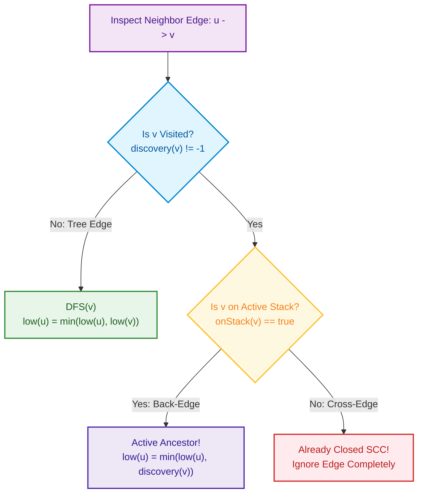

# 📘 Week 8 Day 5: Strongly Connected Components (SCC) — Engineering Guide

> 🧭 **Navigation:** [← Previous Day](Week_08_Day_04_Connectivity_and_Bipartite_Graphs_Instructional.md) • [🏠 Week Overview](README.md) • [📘 Curriculum Syllabus](../COMPLETE_SYLLABUS.md) • [Next Week →](../week_09_graph_algorithms_i/README.md)
> 
> 💡 **Instructor Note:** *Strongly Connected Components (SCCs) are maximal subgraphs in directed graphs where every vertex is mutually reachable from every other vertex. Collapsing SCCs into meta-nodes transforms any cyclic directed graph into a Directed Acyclic Graph (DAG) called the **Condensation Graph**. This unlocks topological sorting and dynamic programming on general directed graphs. Master both Kosaraju's intuitive two-pass algorithm and Tarjan's memory-optimal single-pass algorithm.*

---

## 🎯 LEARNING OBJECTIVES

By the end of this chapter, you will be able to:

- **Deconstruct** directed graph connectivity through the lens of mutual reachability and cycle contraction.
- **Contract** arbitrary directed graphs into an acyclic **Condensation DAG** to run topological sorts and DP.
- **Trace & Implement Kosaraju's Algorithm** (Two-Pass DFS) using finishing time stacks and graph transposition in C# (.NET 8/9) and Python (3.11+).
- **Trace & Implement Tarjan's Algorithm** (Single-Pass DFS) using discovery timestamps, low-link values, and an explicit recursion stack.
- **Differentiate** back-edges within active components from cross-edges leading to closed SCCs, avoiding the classic low-link corruption bug.
- **Generalize** Tarjan's low-link technique to solve **Critical Connections in a Network (Bridges - LeetCode 1192)** in undirected graphs.
- **Deliver** a confident 3-sentence interview anchor and defend runtime, cache locality, and `O(V)` vs `O(V + E)` auxiliary memory trade-offs before a FAANG Bar Raiser.

---

## 🎬 PILLAR 1: THE 60-SECOND HOOK & EVERYDAY ANALOGY

### The City One-Way Traffic System & The Roundabout Interchange

Picture this: You are driving through downtown Boston, Paris, or Rome — an ancient labyrinth of strict **one-way streets**.

You take a right turn onto an avenue, zip through a couple of alleys, and suddenly get that sinking feeling in your stomach: *you can never drive back to where you started.* The one-way arrows strictly forbid it.

```
       [ Neighborhood A ]                    [ Neighborhood B ]
    (Intersection 0) ---> (Intersection 1)      (Intersection 3)
           ^                     |                     |       ^
           |                     v                     v       |
    (Intersection 2) <-----------+              (Intersection 4) --+
           |
           +==========================================> (One-Way Highway)
```

However, as you explore within **Neighborhood A**, you notice something reassuring:
- From Intersection `0`, you can reach `1`.
- From `1`, you can reach `2`.
- From `2`, you can loop right back to `0`.

Within Neighborhood A, you can navigate **mutually** between any two intersections and always find your way back home. The same holds true inside **Neighborhood B** between intersections `3` and `4`.

In directed graphs, those self-contained, mutually reachable zones are called **Strongly Connected Components (SCCs)**.
- **Formal Definition:** An SCC is a *maximal* set of vertices such that every vertex in the set is reachable from every other vertex in the set.
- But between Neighborhood A and Neighborhood B lies a **one-way highway** (`2 -> 3`). Once you cross that bridge into B, **there is no U-turn**. You can never return to Neighborhood A.

### The Architect's Superpower: The Condensation DAG

Here is the secret weapon used by optimizing compilers, distributed database planners, and package managers:

If you collapse every mutual neighborhood (SCC) into a single "meta-node", **all cycles completely vanish**!

```
        +-------------------+                 +-------------------+
        |  Meta-Node SCC A  | ===============>|  Meta-Node SCC B  |
        |    { 0, 1, 2 }    |  One-Way Flow   |      { 3, 4 }     |
        +-------------------+                 +-------------------+
```

The resulting macro-graph between components is **guaranteed to be an acyclic Directed Acyclic Graph (DAG)**. This is known as the **Condensation Graph**.

Once a cyclic directed graph is condensed into a DAG:
1. You can find optimal execution orders via **Topological Sort**.
2. You can compute longest/shortest paths via **Dynamic Programming**.
3. You can detect **deadlock clusters** in distributed microservices by finding components with size `> 1`.

---

## 🪜 PILLAR 2: THE SCAFFOLDING LADDER & TOY NAPKIN TRACE

Let's walk through our canonical 5-node directed graph step-by-step:
- Vertices: `{ 0, 1, 2, 3, 4 }`
- Edges:
  - `0 -> 1`, `1 -> 2`, `2 -> 0` (Cycle: `{0, 1, 2}`)
  - `2 -> 3` (One-way highway bridge from Component 1 to Component 2)
  - `3 -> 4`, `4 -> 3` (Cycle: `{3, 4}`)

Two clear SCCs exist:
- **SCC 1:** `{ 0, 1, 2 }`
- **SCC 2:** `{ 3, 4 }`

```
Canonical 5-Node Graph:
       ( 0 ) ------> ( 1 )
         ^             |
         |             v
         +---------- ( 2 ) ========> ( 3 ) <====> ( 4 )
                      SCC 1            Bridge       SCC 2
```

We will solve this using both canonical FAANG paradigms:
1. **Kosaraju's Algorithm** (Two-Pass DFS via Transposition)
2. **Tarjan's Algorithm** (Single-Pass DFS via Low-Link Values)

---

### Method 1: Kosaraju's Algorithm (Two-Pass DFS)

Kosaraju's algorithm relies on three elegant phases:
1. **Pass 1 (Order by Finish Time):** Run DFS on the original graph. When a node finishes exploring all its neighbors, push it onto a stack.
2. **Transpose Graph:** Reverse the direction of every single edge (`u -> v` becomes `v -> u`).
3. **Pass 2 (Extract Components):** Pop nodes from the stack one by one. If a node is unvisited, launch a DFS on the **transposed** graph. All nodes reached belong to that node's SCC!

#### Hand-Tracing Pass 1 (Finishing Times on Original Graph)

Let's start DFS at node `0`:
1. `Dfs(0)` visits `1`.
2. `Dfs(1)` visits `2`.
3. `Dfs(2)` sees `0` is already visited. It traverses edge `2 -> 3` and calls `Dfs(3)`.
4. `Dfs(3)` traverses edge `3 -> 4` and calls `Dfs(4)`.
5. `Dfs(4)` inspects edge `4 -> 3`. Node `3` is already visited. Node `4` has no other outgoing edges!
   - Node `4` **FINISHES**. Push `4` to stack: `Stack = [ 4 ]`.
6. Backtrack to `3`: all neighbors explored.
   - Node `3` **FINISHES**. Push `3` to stack: `Stack = [ 4, 3 ]`.
7. Backtrack to `2`: all neighbors explored.
   - Node `2` **FINISHES**. Push `2` to stack: `Stack = [ 4, 3, 2 ]`.
8. Backtrack to `1`: all neighbors explored.
   - Node `1` **FINISHES**. Push `1` to stack: `Stack = [ 4, 3, 2, 1 ]`.
9. Backtrack to `0`: all neighbors explored.
   - Node `0` **FINISHES**. Push `0` to stack: `Stack = [ 4, 3, 2, 1, 0 ]`.

Top of the stack is `0`.

---

#### 🧠 Pause & Predict: Micro-Drill 1
**Question:** Look at the top of the stack: node `0` (from SCC 1) finished **after** node `4` (from SCC 2). Why does a node in SCC 1 *always* finish after all nodes in SCC 2 when an edge goes from `SCC 1 -> SCC 2`?

> **The Mechanics:** In the Condensation DAG, `SCC 1` is a **Source** and `SCC 2` is a **Sink**. Because traffic flows strictly from `SCC 1 -> SCC 2`, any DFS that starts in or enters `SCC 1` cannot finish until all downstream nodes in `SCC 2` have completely finished and unwound their call stacks!
> Therefore, **the top of the finish stack is guaranteed to belong to a Source SCC in the Condensation DAG**.

---

#### Hand-Tracing Phase 2 & 3 (Transposition & Extraction)

Now, reverse all edges to create the Transposed Graph `G^T`:
- Original edges: `0->1, 1->2, 2->0, 2->3, 3->4, 4->3`
- Transposed edges: `1->0, 2->1, 0->2, 3->2, 4->3, 3->4`

Notice what happened to the highway edge between components:
- Original: `2 -> 3` (Points from SCC 1 into SCC 2)
- Transposed: `3 -> 2` (Points from SCC 2 into SCC 1)

```
Transposed Graph G^T:
       ( 0 ) <------ ( 1 )
         |             ^
         v             |
         +---------> ( 2 ) <======== ( 3 ) <====> ( 4 )
                      SCC 1      Reversed Highway   SCC 2
```

Now reset the `visited` array and pop from `Stack = [ 4, 3, 2, 1, 0 ]`:

1. **Pop `0` (Unvisited):** Launch `DfsPass2(0)` on `G^T`.
   - From `0`, we can reach `2`.
   - From `2`, we can reach `1`.
   - From `1`, we can reach `0` (already visited).
   - Can `2` reach `3`? **NO!** In `G^T`, the edge is directed `3 -> 2`. Node `2` has no outgoing edge to `3`!
   - DFS terminates!
   - **First SCC Extracted:** `{ 0, 2, 1 }`!
2. **Pop `1`:** Already visited. Skip.
3. **Pop `2`:** Already visited. Skip.
4. **Pop `3` (Unvisited):** Launch `DfsPass2(3)` on `G^T`.
   - From `3`, we can reach `4` and `2`.
   - But node `2` is **ALREADY VISITED** from our first pass! It is blocked!
   - From `4`, we can reach `3` (already visited).
   - DFS terminates!
   - **Second SCC Extracted:** `{ 3, 4 }`!
5. **Pop `4`:** Already visited. Skip.

**Result:** Exactly 2 SCCs detected: `{0, 1, 2}` and `{3, 4}`!

---

#### 🧠 Pause & Predict: Micro-Drill 2
**Question:** Why does reversing all edges prevent the second DFS from leaking into other components?

> **The Mechanics:** In the original graph, `SCC 1` was a Source (it could reach `SCC 2`). When we reverse all edges, `SCC 1` becomes a **Sink** with zero outgoing edges to other components!
> By popping in order of decreasing finish time, we always initiate DFS on a component that has become an isolated sink in `G^T`. The DFS is physically trapped inside that component and cannot leak outward!

---

### Method 2: Tarjan's Algorithm (Single-Pass DFS)

Tarjan's algorithm finds all SCCs in a **single DFS pass** by maintaining an internal recursion stack and tracking two numbers per node:
1. `discovery_time[u]`: Timestamp when node `u` was first visited.
2. `low_link[u]`: The lowest `discovery_time` reachable from `u` through tree edges and at most one back-edge to an active node on the stack.

#### The Core Invariant
If after fully exploring all outgoing edges of vertex `u`, we find:
```
low_link[u] == discovery_time[u]
```
Then vertex `u` is the **Root of a Strongly Connected Component**!
None of its descendants can reach any node discovered earlier than `u`. Therefore, `u` and all nodes pushed onto the stack after `u` form a complete, isolated SCC.

#### Hand-Tracing Tarjan on our 5-Node Graph

Let's maintain `timer = 0`, `Stack = []`, and `on_stack = [F, F, F, F, F]`.

| Step | Action | Node State (`disc / low`) | Stack (bottom -> top) | Active `on_stack` | Notes |
| :--- | :--- | :--- | :--- | :--- | :--- |
| **1** | Visit `0` | `disc[0]=0, low[0]=0` | `[ 0 ]` | `{0}` | Push `0`, advance timer to 1 |
| **2** | Edge `0 -> 1`, Visit `1` | `disc[1]=1, low[1]=1` | `[ 0, 1 ]` | `{0, 1}` | Push `1`, advance timer to 2 |
| **3** | Edge `1 -> 2`, Visit `2` | `disc[2]=2, low[2]=2` | `[ 0, 1, 2 ]` | `{0, 1, 2}` | Push `2`, advance timer to 3 |
| **4** | Inspect edge `2 -> 0` | `disc[0]=0`, `on_stack[0]=True` | `[ 0, 1, 2 ]` | `{0, 1, 2}` | **Back-edge!** `low[2] = min(low[2], disc[0]) = min(2, 0) = 0` |
| **5** | Inspect edge `2 -> 3`, Visit `3` | `disc[3]=3, low[3]=3` | `[ 0, 1, 2, 3 ]` | `{0, 1, 2, 3}` | Tree-edge, push `3`, advance timer to 4 |
| **6** | Edge `3 -> 4`, Visit `4` | `disc[4]=4, low[4]=4` | `[ 0, 1, 2, 3, 4 ]` | `{0, 1, 2, 3, 4}` | Tree-edge, push `4`, advance timer to 5 |
| **7** | Inspect edge `4 -> 3` | `disc[3]=3`, `on_stack[3]=True` | `[ 0, 1, 2, 3, 4 ]` | `{0, 1, 2, 3, 4}` | **Back-edge!** `low[4] = min(low[4], disc[3]) = min(4, 3) = 3` |
| **8** | Node `4` finishes | `low[4] = 3`, `disc[4] = 4` | `[ 0, 1, 2, 3, 4 ]` | `{0, 1, 2, 3, 4}` | `low[4] != disc[4]`. Not a root! Backtrack to `3`. Update `low[3] = min(low[3], low[4]) = 3` |
| **9** | Node `3` finishes | `low[3] = 3`, `disc[3] = 3` | `[ 0, 1, 2, 3, 4 ]` | `{0, 1, 2, 3, 4}` | **ROOT FOUND (`low == disc`)!** Pop until `3`: Pop `4`, Pop `3`. **SCC Extracted: `{4, 3}`!** |
| **10**| Backtrack to `2` | `disc[2]=2, low[2]=0` | `[ 0, 1, 2 ]` | `{0, 1, 2}` | Update `low[2] = min(low[2], low[3]) = min(0, 3) = 0`. Not a root (`0 != 2`). Backtrack to `1`. |
| **11**| Backtrack to `1` | `disc[1]=1, low[1]=0` | `[ 0, 1, 2 ]` | `{0, 1, 2}` | Update `low[1] = min(low[1], low[2]) = min(1, 0) = 0`. Not a root (`0 != 1`). Backtrack to `0`. |
| **12**| Backtrack to `0` | `disc[0]=0, low[0]=0` | `[ 0, 1, 2 ]` | `{0, 1, 2}` | Update `low[0] = min(low[0], low[1]) = 0`. **ROOT FOUND (`low == disc`)!** Pop until `0`: Pop `2, 1, 0`. **SCC Extracted: `{2, 1, 0}`!** |

---

#### 🧠 Pause & Predict: Micro-Drill 3
**Question:** In Step 4, when node `2` encountered edge `2 -> 0`, why did we write `low_link[2] = min(low_link[2], discovery_time[0])` instead of `low_link[0]`?

> **The Mechanics:** In Tarjan's SCC algorithm, back-edges point to ancestors that are already on the stack. Using `discovery_time[v]` guarantees that `low_link` strictly represents reachability through *at most one* back-edge.
> While using `low_link[v]` happens to compute valid SCCs in directed graphs, **it completely breaks bridge and articulation point detection in undirected graphs**! Sticking to `min(low_link[u], discovery_time[v])` is the gold-standard habit for Senior Engineers.

---

## 🎨 PILLAR 3: PRAGMATIC VISUAL MODELS

### 1. ASCII Topology: Graph, Transpose, and Condensation

```
ORIGINAL DIRECTED GRAPH:
    +-----------------+
    |                 |
    v                 |
  ( 0 ) ---> ( 1 ) ---> ( 2 ) ========> ( 3 ) <=====> ( 4 )
  +-------------------------+           +-----------------+
             SCC 1                             SCC 2
      (Mutual Cycle 0-1-2)              (Mutual Cycle 3-4)

KOSARAJU FINISH STACK (Decreasing Finish Time):
  Top -> [ 0 | 1 | 2 | 3 | 4 ] <- Bottom
  (Node 0 finished last because SCC 1 is the Source component)

TRANSPOSED GRAPH G^T (Edges Inverted):
  ( 0 ) <--- ( 1 ) <--- ( 2 ) <======== ( 3 ) <=====> ( 4 )
    |                     ^
    +---------------------+
  (Notice: The inter-SCC bridge now points inward toward SCC 1.
   DFS starting at 0 CANNOT reach SCC 2!)

CONDENSATION DAG (All Cycles Collapsed into Meta-Nodes):
        +-------------------+              +-------------------+
        |  Meta-Node SCC 1  | ===========> |  Meta-Node SCC 2  |
        |    { 0, 1, 2 }    |  Acyclic     |      { 3, 4 }     |
        +-------------------+              +-------------------+
```

---

### 2. Mermaid Workflow: Kosaraju's 3-Step Pipeline


---

### 3. Mermaid Decision Tree: Tarjan's Edge Classification



---

## 🛑 PILLAR 4: THE ROOKIE TRAP ZONE

### Trap 1: The Cross-Edge to Closed SCC Disaster

When inspecting neighbor `v`, checking only whether `v` was visited without verifying `on_stack[v]` is the most common bug in Tarjan's algorithm.

```
❌ ROOKIE BLUNDER (Corrupts Component Boundaries):
if (discovery[v] != -1) {
    // BUG: v might belong to an already CLOSED SCC!
    // Its low-link value will falsely pull node u into a dead component!
    lowLink[u] = Math.Min(lowLink[u], discovery[v]);
}

✅ SENIOR ARCHITECT PATTERN (Strict Membership Guard):
if (discovery[v] == -1) {
    Dfs(v);
    lowLink[u] = Math.Min(lowLink[u], lowLink[v]);
} else if (onStack[v]) {
    // Valid back-edge only if v is actively in the current recursion path
    lowLink[u] = Math.Min(lowLink[u], discovery[v]);
}
// If discovery[v] != -1 and !onStack[v], it's a cross-edge to a finished SCC. DO NOTHING!
```

---

### Trap 2: Leaking the Active Stack Flags

When an SCC root is identified (`lowLink[u] == discovery[u]`), you must pop elements until `u` is removed **and immediately reset `onStack = false`**.

```
❌ ROOKIE BLUNDER:
while (stack.Peek() != u) {
    int w = stack.Pop();
    // BUG: Forgot onStack[w] = false! Future DFS branches will think w is active!
}

✅ SENIOR ARCHITECT PATTERN:
while (true) {
    int w = stack.Pop();
    onStack[w] = false; // Immediately clear membership!
    sccIds[w] = currentSccId;
    if (w == u) break;
}
```

---

### Trap 3: Kosaraju Pass 2 Order Amnesia

In Kosaraju's algorithm, Pass 2 **must** iterate strictly by popping from the `finishStack`. Iterating in natural index order (`0, 1, ..., n-1`) destroys the mathematical guarantee.

| Failure Mode | Rookie Approach | Senior Architect Standard |
| :--- | :--- | :--- |
| **Kosaraju Pass 2** | `for (int i = 0; i < n; i++) if (!visited[i]) Dfs2(i);` | `while (finishStack.Count > 0) { int u = finishStack.Pop(); if (!visited[u]) Dfs2(u); }` |
| **Why It Fails** | Arbitrary index order might start in a non-sink component, leaking into other SCCs! | Popping from stack guarantees you always explore an isolated sink in `G^T`. |

---

## 🎙️ PILLAR 5: 45-MINUTE INTERVIEW TALK TRACK

### The 3-Sentence Verbal Anchor
> *"To partition this directed graph into maximal mutually reachable subgraphs, I will compute its Strongly Connected Components (SCCs), effectively collapsing internal cycles into an acyclic Condensation DAG.*
> *While Kosaraju's algorithm offers an intuitive two-pass approach using graph transposition in `O(V + E)` time and `O(V + E)` space, I will implement Tarjan's single-pass algorithm using discovery timestamps and low-link values to operate strictly in optimal `O(V)` auxiliary space.*
> *During the traversal, each node tracks the earliest ancestor reachable from its subtree; whenever `low_link[u] == discovery_time[u]`, node `u` is the root of an SCC, and we pop the active stack to isolate the entire component."*

---

### Live Interview Dialogue Playbook

#### Phase 1: Clarification & Boundary Invariants (0–5 Mins)
- **Candidate:** "Before selecting an algorithm, let me clarify the graph constraints:
  1. Is the graph strictly directed? (SCC only applies to directed graphs; undirected graphs use standard BFS/DFS connected components).
  2. Can the graph contain self-loops or parallel edges?
  3. Are we asked to return the count of SCCs, the component ID for each vertex, or the materialized Condensation DAG?
  4. What are the constraints on `V` and `E`? (If `V <= 10^5`, we must ensure strict `O(V + E)` time and avoid deep recursion stack overflow)."
- **Interviewer:** "Directed graph, `V <= 10^5, E <= 2 * 10^5`. Return the total count and an array mapping each node to its component ID."

#### Phase 2: High-Level Architecture & Trade-Offs (5–12 Mins)
- **Candidate:** "We have two classical approaches:
  - **Kosaraju's Algorithm:** 2 DFS passes + graph transposition. Easy to reason about, but requires allocating a reverse adjacency list (`O(V + E)` auxiliary memory).
  - **Tarjan's Algorithm:** 1 DFS pass using a stack and `low_link` tracking. Operates in `O(V)` auxiliary memory without any graph transposition overhead.
  I will implement **Tarjan's algorithm** to achieve optimal single-pass cache performance and zero reverse-graph memory allocation."

#### Phase 3: Live Coding Walkthrough (12–32 Mins)
- **Candidate:** "I will structure the implementation:
  1. Initialize `discovery`, `lowLink`, and `onStack` arrays of size `n` with sentinel `-1` / `false`.
  2. In the recursive helper `Dfs(u)`, set `discovery[u] = lowLink[u] = timer++`, push `u` to `stack`, and set `onStack[u] = true`.
  3. Iterate through all outgoing edges `u -> v`:
     - If `v` is unvisited, recurse and update `lowLink[u] = min(lowLink[u], lowLink[v])`.
     - Else if `onStack[v]` is true, this is an active back-edge: update `lowLink[u] = min(lowLink[u], discovery[v])`.
     - If `v` is visited but not on the stack, it belongs to an already closed SCC; ignore it.
  4. Check root condition: if `lowLink[u] == discovery[u]`, pop elements from `stack` until `u` is removed, marking `onStack[w] = false` and recording the SCC ID."

#### Phase 4: Edge Cases & Verification (32–40 Mins)
- **Candidate:** "Let's verify edge cases:
  - **Pure DAG (No cycles):** Every node has `lowLink[u] == discovery[u]`; pops immediately as `n` separate SCCs. Correct.
  - **Single Giant Cycle (`0 -> 1 -> ... -> n-1 -> 0`):** `lowLink` propagates down to `0` for all nodes; pops entire graph as 1 SCC at root `0`. Correct.
  - **Disconnected Forest:** Outer loop across `0 ... n-1` catches every isolated component. Correct."

#### Phase 5: Production & Scale Trade-Offs (40–45 Mins)
- **Candidate:** "In C# .NET production systems with `V = 10^5`, a deep linear graph could exhaust the default thread stack (1 MB). If recursion depth is a concern, we can rewrite the DFS using an explicit heap-allocated stack `Stack<(int node, int edgeIndex)>`."

---

## ⚡ PILLAR 6: PRODUCTION DUAL-LANGUAGE IMPLEMENTATIONS

### Pattern 1: Kosaraju's Two-Pass Algorithm (Graph Transposition)

#### C# (.NET 8/9) Production Implementation

```csharp
using System;
using System.Collections.Generic;

public sealed class KosarajuScc
{
    /// <summary>
    /// Computes Strongly Connected Components using Kosaraju's Two-Pass DFS.
    /// Time Complexity: O(V + E) | Auxiliary Space: O(V + E) for transposed graph.
    /// </summary>
    public static (int SccCount, int[] SccIds) ComputeScc(int n, List<int>[] adj)
    {
        ArgumentOutOfRangeException.ThrowIfNegativeOrZero(n);
        ArgumentNullException.ThrowIfNull(adj);

        // 1. Build transposed graph G^T: reverse every edge u -> v into v -> u
        var revAdj = new List<int>[n];
        for (int i = 0; i < n; i++)
        {
            revAdj[i] = new List<int>();
        }

        for (int u = 0; u < n; u++)
        {
            foreach (int v in adj[u])
            {
                revAdj[v].Add(u);
            }
        }

        var visited = new bool[n];
        var finishStack = new Stack<int>(n);

        // PASS 1: DFS on original graph to determine finish order
        void DfsPass1(int u)
        {
            visited[u] = true;
            foreach (int v in adj[u])
            {
                if (!visited[v])
                {
                    DfsPass1(v);
                }
            }
            // Push to stack after all descendants are fully explored
            finishStack.Push(u);
        }

        for (int i = 0; i < n; i++)
        {
            if (!visited[i])
            {
                DfsPass1(i);
            }
        }

        // PASS 2: DFS on transposed graph in decreasing finish time order
        Array.Fill(visited, false);
        var sccIds = new int[n];
        Array.Fill(sccIds, -1);
        int sccCount = 0;

        void DfsPass2(int u, int currentSccId)
        {
            visited[u] = true;
            sccIds[u] = currentSccId;

            foreach (int v in revAdj[u])
            {
                if (!visited[v])
                {
                    DfsPass2(v, currentSccId);
                }
            }
        }

        while (finishStack.Count > 0)
        {
            int u = finishStack.Pop();
            if (!visited[u])
            {
                DfsPass2(u, sccCount);
                sccCount++;
            }
        }

        return (sccCount, sccIds);
    }
}
```

#### Python (3.11+) Production Implementation

```python
from typing import List, Tuple

def kosaraju_scc(n: int, adj: List[List[int]]) -> Tuple[int, List[int]]:
    """
    Computes Strongly Connected Components using Kosaraju's two-pass DFS.
    Time Complexity: O(V + E) | Auxiliary Space: O(V + E)
    """
    if n <= 0:
        raise ValueError("Node count must be positive.")

    # 1. Build transposed graph G^T
    rev_adj: List[List[int]] = [[] for _ in range(n)]
    for u in range(n):
        for v in adj[u]:
            rev_adj[v].append(u)

    visited = [False] * n
    finish_stack: List[int] = []

    # Pass 1: Record finishing order on original graph
    def dfs1(u: int) -> None:
        visited[u] = True
        for v in adj[u]:
            if not visited[v]:
                dfs1(v)
        finish_stack.append(u)

    for i in range(n):
        if not visited[i]:
            dfs1(i)

    # Pass 2: DFS on transposed graph popping in decreasing finish order
    visited = [False] * n
    scc_ids = [-1] * n
    scc_count = 0

    def dfs2(u: int, scc_id: int) -> None:
        visited[u] = True
        scc_ids[u] = scc_id
        for v in rev_adj[u]:
            if not visited[v]:
                dfs2(v, scc_id)

    while finish_stack:
        u = finish_stack.pop()
        if not visited[u]:
            dfs2(u, scc_count)
            scc_count += 1

    return scc_count, scc_ids
```

---

### Pattern 2: Tarjan's Single-Pass SCC Algorithm (Low-Link & Stack)

#### C# (.NET 8/9) Production Implementation

```csharp
using System;
using System.Collections.Generic;

public sealed class TarjanScc
{
    /// <summary>
    /// Computes Strongly Connected Components using Tarjan's Single-Pass DFS.
    /// Time Complexity: O(V + E) | Auxiliary Space: O(V) (Zero transpose memory)
    /// </summary>
    public static (int SccCount, int[] SccIds) ComputeScc(int n, List<int>[] adj)
    {
        ArgumentOutOfRangeException.ThrowIfNegativeOrZero(n);
        ArgumentNullException.ThrowIfNull(adj);

        var discovery = new int[n];
        var lowLink = new int[n];
        var onStack = new bool[n];
        var sccIds = new int[n];

        Array.Fill(discovery, -1);
        Array.Fill(sccIds, -1);

        var stack = new Stack<int>();
        int timer = 0;
        int sccCount = 0;

        void Dfs(int u)
        {
            discovery[u] = timer;
            lowLink[u] = timer;
            timer++;

            stack.Push(u);
            onStack[u] = true;

            foreach (int v in adj[u])
            {
                if (discovery[v] == -1)
                {
                    // Tree-edge to unvisited node
                    Dfs(v);
                    lowLink[u] = Math.Min(lowLink[u], lowLink[v]);
                }
                else if (onStack[v])
                {
                    // Back-edge to an active ancestor in current SCC
                    lowLink[u] = Math.Min(lowLink[u], discovery[v]);
                }
                // Else: cross-edge to an already closed SCC (ignored)
            }

            // If u is root of an SCC, pop all members
            if (lowLink[u] == discovery[u])
            {
                while (true)
                {
                    int w = stack.Pop();
                    onStack[w] = false;
                    sccIds[w] = sccCount;
                    if (w == u) break;
                }
                sccCount++;
            }
        }

        for (int i = 0; i < n; i++)
        {
            if (discovery[i] == -1)
            {
                Dfs(i);
            }
        }

        return (sccCount, sccIds);
    }
}
```

#### Python (3.11+) Production Implementation

```python
from typing import List, Tuple

def tarjan_scc(n: int, adj: List[List[int]]) -> Tuple[int, List[int]]:
    """
    Computes Strongly Connected Components using Tarjan's single-pass DFS.
    Time Complexity: O(V + E) | Auxiliary Space: O(V)
    """
    if n <= 0:
        raise ValueError("Node count must be positive.")

    discovery = [-1] * n
    low_link = [-1] * n
    on_stack = [False] * n
    scc_ids = [-1] * n

    stack: List[int] = []
    timer = 0
    scc_count = 0

    def dfs(u: int) -> None:
        nonlocal timer, scc_count
        discovery[u] = low_link[u] = timer
        timer += 1

        stack.append(u)
        on_stack[u] = True

        for v in adj[u]:
            if discovery[v] == -1:
                # Tree-edge
                dfs(v)
                low_link[u] = min(low_link[u], low_link[v])
            elif on_stack[v]:
                # Back-edge to an active ancestor on stack
                low_link[u] = min(low_link[u], discovery[v])
            # Else: cross-edge to completed SCC, ignore

        # Root of an SCC identified
        if low_link[u] == discovery[u]:
            while True:
                w = stack.pop()
                on_stack[w] = False
                scc_ids[w] = scc_count
                if w == u:
                    break
            scc_count += 1

    for i in range(n):
        if discovery[i] == -1:
            dfs(i)

    return scc_count, scc_ids
```

---

### Pattern 3: Critical Connections in a Network (LeetCode 1192 — Tarjan's Bridges)

The pinnacle FAANG question evaluating low-link DFS is **LeetCode 1192: Critical Connections in a Network**.

#### The Bridge Invariant
In an undirected graph, an edge `(u, v)` is a **Bridge (Critical Connection)** if and only if:
```
low_link[v] > discovery_time[u]
```
**Why?** If `low_link[v] <= discovery_time[u]`, it proves that `v` or one of its descendants has an alternate back-edge path to `u` or an ancestor of `u`. Removing `(u, v)` would not disconnect the graph. But if `low_link[v] > discovery_time[u]`, the subtree rooted at `v` has **zero back-routes**. Edge `(u, v)` is the sole lifeline, making it a critical bridge!

#### C# (.NET 8/9) Production Implementation

```csharp
using System;
using System.Collections.Generic;

public sealed class CriticalConnectionsFinder
{
    /// <summary>
    /// Finds all critical network connections (bridges) using Tarjan's Bridge Algorithm.
    /// Time Complexity: O(V + E) | Auxiliary Space: O(V + E) for adjacency list.
    /// </summary>
    public static IList<IList<int>> CriticalConnections(int n, IList<IList<int>> connections)
    {
        ArgumentOutOfRangeException.ThrowIfNegativeOrZero(n);
        ArgumentNullException.ThrowIfNull(connections);

        // Build undirected adjacency list
        var adj = new List<int>[n];
        for (int i = 0; i < n; i++)
        {
            adj[i] = new List<int>();
        }

        foreach (var edge in connections)
        {
            int u = edge[0];
            int v = edge[1];
            adj[u].Add(v);
            adj[v].Add(u);
        }

        var discovery = new int[n];
        var lowLink = new int[n];
        Array.Fill(discovery, -1);

        var bridges = new List<IList<int>>();
        int timer = 0;

        void Dfs(int u, int parent)
        {
            discovery[u] = timer;
            lowLink[u] = timer;
            timer++;

            foreach (int v in adj[u])
            {
                if (v == parent)
                {
                    // Do not traverse back directly across the immediate undirected parent edge
                    continue;
                }

                if (discovery[v] != -1)
                {
                    // Back-edge to an already visited ancestor
                    lowLink[u] = Math.Min(lowLink[u], discovery[v]);
                }
                else
                {
                    // Tree-edge
                    Dfs(v, u);
                    lowLink[u] = Math.Min(lowLink[u], lowLink[v]);

                    // Bridge Invariant: If v has no back-route to u or higher
                    if (lowLink[v] > discovery[u])
                    {
                        bridges.Add(new List<int> { u, v });
                    }
                }
            }
        }

        for (int i = 0; i < n; i++)
        {
            if (discovery[i] == -1)
            {
                Dfs(i, -1);
            }
        }

        return bridges;
    }
}
```

#### Python (3.11+) Production Implementation

```python
from typing import List

def critical_connections(n: int, connections: List[List[int]]) -> List[List[int]]:
    """
    Finds all critical network connections (bridges) via Tarjan's low-link DFS.
    Time Complexity: O(V + E) | Auxiliary Space: O(V + E)
    """
    adj: List[List[int]] = [[] for _ in range(n)]
    for u, v in connections:
        adj[u].append(v)
        adj[v].append(u)

    discovery = [-1] * n
    low_link = [-1] * n
    timer = 0
    bridges: List[List[int]] = []

    def dfs(u: int, parent: int) -> None:
        nonlocal timer
        discovery[u] = low_link[u] = timer
        timer += 1

        for v in adj[u]:
            if v == parent:
                continue  # Skip immediate undirected parent edge

            if discovery[v] != -1:
                # Back-edge to an already discovered ancestor
                low_link[u] = min(low_link[u], discovery[v])
            else:
                # Tree-edge
                dfs(v, u)
                low_link[u] = min(low_link[u], low_link[v])

                # Bridge condition: v has no alternate route back to u or above
                if low_link[v] > discovery[u]:
                    bridges.append([u, v])

    for i in range(n):
        if discovery[i] == -1:
            dfs(i, -1)

    return bridges
```

---

## 📊 COMPLEXITY DECONSTRUCTION & HARDWARE REALITIES

| Metric | Kosaraju's Algorithm | Tarjan's Algorithm | Tarjan's Bridges (LC 1192) |
| :--- | :--- | :--- | :--- |
| **Time Complexity** | `O(V + E)` | `O(V + E)` | `O(V + E)` |
| **Auxiliary Memory** | `O(V + E)` (Transposed Graph) | `O(V)` (Stack + Arrays) | `O(V + E)` (Adjacency List) |
| **Output Space** | `O(V)` (Component IDs) | `O(V)` (Component IDs) | `O(B)` (List of Bridges) |
| **DFS Passes** | 2 Passes | 1 Pass | 1 Pass |
| **Graph Mutations**| Requires constructing `G^T` | In-place traversal | In-place traversal |

### Hardware & Cache Trade-Offs

1. **Cache Misses & Memory Footprint:**
   - **Tarjan's algorithm** runs in a single pass. It iterates each edge exactly once and maintains contiguous primitive arrays (`discovery`, `lowLink`, `onStack`). This produces minimal cache misses and zero dynamic memory allocations for graph structures.
   - **Kosaraju's algorithm** allocates `n` brand-new inner lists to store `revAdj`. For a graph with `2 * 10^5` edges, this forces hundreds of thousands of heap pointer dereferences, causing substantial L1/L2 cache thrashing.
2. **Interview Strategy:**
   - If asked on a whiteboard or live coding interview to find SCCs quickly, **Kosaraju** is easier to debug under pressure because it is simply two standard DFS traversals.
   - If asked for optimal memory or asked about **Bridges / Articulation Points**, **Tarjan** is strictly required.

---

## 🏋️ CURATED PRACTICE LADDER

| Problem | LeetCode # | Difficulty | Core Pattern | Key Architectural Invariant |
| :--- | :--- | :--- | :--- | :--- |
| **Critical Connections in a Network** | #1192 | 🔴 Hard | Tarjan Bridges | `lowLink[v] > discovery[u]` isolates bridge lifelines |
| **Strongly Connected Components (Kosaraju)** | GfG | 🟡 Medium | 2-Pass DFS | Reverse graph turns Source SCC into Sink SCC |
| **Find Eventual Safe States** | #802 | 🟡 Medium | 3-State DFS / SCC | Nodes that cannot enter a cycle are eventually safe |
| **Course Schedule II** | #210 | 🟡 Medium | Topological Sort | Detect cycle; if acyclic, return valid ordering |
| **Maximum Employees to Be Invited** | #2127 | 🔴 Hard | Directed Functional Cycles | Contract cycles: length 2 vs length >= 3 components |

---

> 🧭 **Navigation:** [← Previous Day](Week_08_Day_04_Connectivity_and_Bipartite_Graphs_Instructional.md) • [🏠 Week Overview](README.md) • [📘 Curriculum Syllabus](../COMPLETE_SYLLABUS.md) • [Next Week →](../week_09_graph_algorithms_i/README.md)
