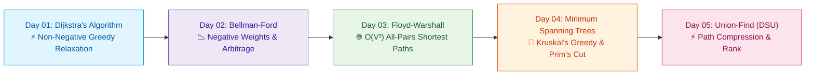

# 📘 Week 09: Graph Algorithms: Shortest Paths & Minimum Spanning Trees

> 🧭 **Navigation:** [← Previous: Week 08](../week_08_graph_fundamentals/README.md) • [🏠 Curriculum Overview](../README.md) • [📘 Complete Syllabus](../COMPLETE_SYLLABUS.md) • [Next: Week 10 →](../week_10_dynamic_programming_i_fundamentals/README.md)

---

## 🎬 Welcome to Week 09: The Route & Infrastructure Engineer's Masterclass!

In real-world networks—Google Maps navigation, packet routing protocols (OSPF, BGP), electrical power grid layouts, and financial currency arbitrage—edges carry non-uniform costs, latency metrics, and even negative weight differentials.

Unweighted BFS collapses here. This week equips you with the heavy artillery of weighted graph theory: **Dijkstra's greedy relaxation with PriorityQueue**, **Bellman-Ford's negative edge relaxation & cycle detection**, **Floyd-Warshall's all-pairs dynamic programming**, **Kruskal & Prim Minimum Spanning Trees (MST)**, and **Disjoint Set Union (DSU) with near-O(1) inverse Ackermann amortized complexity**.

---

## 📅 Day-by-Day Learning Path

| Day | Instructional Masterclass | Core Mental Model & Intuition | Key Pattern / Invariant |
| :--- | :--- | :--- | :--- |
| **Day 01** | [Dijkstra: Single-Source Shortest Paths](Week_09_Day_01_Dijkstra_Single_Source_Shortest_Paths_Instructional.md) | **The GPS Navigator:** Expanding lowest-cost frontier monotonically. | Min-Heap priority queue, relaxation triangle `d[v] = min(d[v], d[u] + w)`, stale entry pruning. |
| **Day 02** | [Bellman-Ford: Negative Weights](Week_09_Day_02_Bellman_Ford_Negative_Weights_Instructional.md) | **The Ripple Wave:** Relaxing all edges V-1 times. | V-1 edge relaxations, V-th relaxation negative cycle detection, currency arbitrage. |
| **Day 03** | [Floyd-Warshall: All-Pairs Shortest Paths](Week_09_Day_03_Floyd_Warshall_All_Pairs_Shortest_Paths_Instructional.md) | **The Intermediate Airport Hub:** DP transition through waypoint k. | Triple loop `d[i, j] = min(d[i, j], d[i, k] + d[k, j])`, `k` as the outermost loop. |
| **Day 04** | [Minimum Spanning Trees: Kruskal & Prim](Week_09_Day_04_Minimum_Spanning_Trees_Kruskal_Prim_Instructional.md) | **The Infrastructure Cable Network:** Connecting all vertices with minimum wire. | Cut property, Kruskal's sort-and-union with DSU, Prim's growing tree priority queue. |
| **Day 05** | [Union-Find (DSU) In-Depth](Week_09_Day_05_Union_Find_DSU_In_Depth_Instructional.md) | **The Corporate Consolidation:** Merging companies under a single CEO. | Path compression (two-pass flatten), union by rank/size, inverse Ackermann `alpha(N) <= 4`. |

---

## 📚 Consolidated Playbooks & Reference Guides

*   📖 **Comprehensive Week Playbook:** [WEEK_09_FULL_PLAYBOOK.md](WEEK_09_FULL_PLAYBOOK.md) — High-density synthesis of all invariants, theorems, and pattern triggers for this week.
*   📊 **Visual Concepts Playbook (Hybrid):** [Week_09_Visual_Concepts_Playbook_HYBRID.md](Week_09_Visual_Concepts_Playbook_HYBRID.md) — Compact Mermaid diagrams, state transitions, and complexity reference tables.
*   💻 **Production C# Reference (.NET 8/9):** [Week_09_Extended_CSharp_Complete.md](Week_09_Extended_CSharp_Complete.md) — Idiomatic, zero-allocation memory-aware implementations (`PriorityQueue<TElement, TPriority>`) and problem ladders.
*   🐍 **Production Python Reference (Python 3.11+):** [Week_09_Extended_Python_Complete.md](Week_09_Extended_Python_Complete.md) — Clean, pythonic reference implementations (`heapq`) for rapid whiteboard prototyping.

---

## 🛠️ The 5 Core Support Files (`support files/`)

1.  📋 [Daily Progress Checklist](support%20files/Week_09_Daily_Progress_Checklist.md) — Step-by-step accountability tracker for theory, coding, and variants.
2.  🧭 [Weekly Guidelines & Mental Models](support%20files/Week_09_Guidelines.md) — Strategic roadmap, common pitfalls, and conceptual anchors.
3.  🎙️ [Interview Q&A Comprehensive Reference](support%20files/Week_09_Interview_QA_Reference.md) — High-frequency senior technical questions with verbal response frameworks.
4.  🗺️ [Problem-Solving Roadmap](support%20files/Week_09_Problem_Solving_Roadmap.md) — Tier-1 problem progression ladder from warm-up to advanced.
5.  📑 [Summary & Key Concepts Synthesis](support%20files/Week_09_Summary_Key_Concepts.md) — Fast-revision cheat sheet covering all governing invariants and system trade-offs.

---

> 🧭 **Navigation:** [← Previous: Week 08](../week_08_graph_fundamentals/README.md) • [🏠 Curriculum Overview](../README.md) • [📘 Complete Syllabus](../COMPLETE_SYLLABUS.md) • [Next: Week 10 →](../week_10_dynamic_programming_i_fundamentals/README.md)
