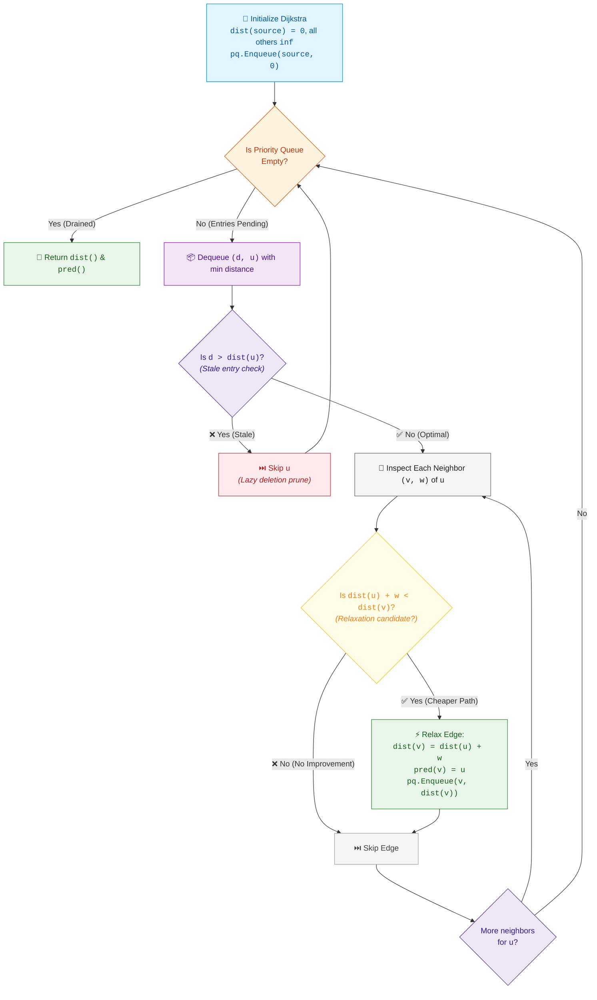

# 📘 Week 09 Day 01: Single-Source Shortest Paths (Dijkstra's Algorithm) — Engineering Guide

> 🧭 **Navigation:** [← Week Overview](README.md) • [🏠 Week Overview](README.md) • [📘 Curriculum Syllabus](../COMPLETE_SYLLABUS.md) • [Next Day: Bellman-Ford & Negative Weights →](Week_09_Day_02_Bellman_Ford_Negative_Weights_Instructional.md)
> 
> 💡 **Instructor Note:** *The most common reason senior engineers stumble on Dijkstra in FAANG rounds is not the heap syntax—it is neglecting **stale entry pruning** (lazy deletion) and falling into **integer overflow** when adding edge weights to sentinel infinity. In modern .NET 8/9, we use `PriorityQueue<int, long>` with 64-bit distances to make Dijkstra bulletproof against both edge-case pitfalls.*

---

## 🎯 LEARNING OBJECTIVES

By the end of this module, you will be able to:

- 🎯 **Internalize** Dijkstra's greedy invariant: in graphs with non-negative edge weights, the first time a vertex is extracted from the min-priority queue with its minimal distance, that distance is globally optimal and permanently finalized.
- ⚙️ **Implement** production-grade Dijkstra in modern C# (.NET 8/9 with `PriorityQueue<int, long>`) and Python (3.11+ with `heapq`), mastering lazy deletion, stale element skipping, and path reconstruction.
- 🪜 **Trace** execution step-by-step on a 4-node napkin graph, tracking min-heap mutations, relaxation steps `dist[v] = min(dist[v], dist[u] + w)`, and stale entry skips.
- 🛡️ **Diagnose & Eliminate** the 4 deadly rookie traps: missing stale pruning (causing exponential TLE on dense graphs), applying Dijkstra to graphs with negative edges, 32-bit integer overflow on sentinel additions, and heap-versus-array performance mismatches.
- 🧩 **Solve** 3 classic FAANG medium/hard variations: Network Delay Time (LeetCode 743), Path with Minimum Effort (LeetCode 1631 - Minimax Dijkstra), and Cheapest Flights Within K Stops (LeetCode 787 - State-Augmented Dijkstra / Level Relaxation).
- 🎙️ **Articulate** full architectural trade-offs during a 45-minute live technical interview using a polished 3-sentence script and structured 5-phase delivery arc.

---

## 🎬 PILLAR 1: THE 60-SECOND HOOK & EVERYDAY ANALOGY

### Hey Engineers, Welcome to Week 9!

You have just opened Google Maps or Waze to navigate from downtown Seattle to Vancouver, BC. 

```text
City Street (Traffic Lights):   3 miles @ 15 mph  --> 12.0 mins
Interstate Freeway (Highway):  10 miles @ 65 mph  -->  9.2 mins
Mountain Pass (Snowy Curves):  7 miles @ 25 mph  --> 16.8 mins
```

If you ran standard Breadth-First Search (BFS) on this road network, BFS would assume that every road segment takes **1 unit of time (1 hop)**. BFS would route you through city streets simply because it takes fewer road segments, completely ignoring the fact that cruising down the interstate at 65 mph is significantly faster!

```text
BFS:       Expands outward by HOP COUNT (FIFO Queue).
           Optimal ONLY when all edge weights are uniform (unweighted).

Dijkstra:  Expands outward by CUMULATIVE COST / TIME (Min-Priority Queue).
           Optimal for heterogeneous, NON-NEGATIVE edge weights.
```

---

### The Expanding Oil Slick Metaphor

Imagine pouring a beaker of viscous oil onto a rough, patterned stone floor:

```text
Expanding Viscous Fluid Wavefront:

                 ~ ~ ~ ( Ring 3: t = 10 mins ) ~ ~ ~
             ~ ~                                     ~ ~
           ~          ( Ring 2: t = 6 mins )             ~
         ~        ~                            ~          ~
        ~        ~       ( Ring 1: t = 2m )     ~          ~
       ~        ~        ~              ~        ~          ~
      ~        ~        ~   ( Drop: 0 )  ~        ~          ~
       ~        ~        ~              ~        ~          ~
        ~        ~       ( Ring 1: t = 2m )     ~          ~
         ~        ~                            ~          ~
           ~          ( Ring 2: t = 6 mins )             ~
             ~ ~                                     ~ ~
                 ~ ~ ~ ( Ring 3: t = 10 mins ) ~ ~ ~
```

The oil flows naturally along channels:
- Through smooth marble grooves, the fluid surges rapidly (low cost / weight).
- Across rough sandpaper patches, the fluid creeps slowly (high cost / weight).

The fluid front expands outward continuously in exact order of arrival time. The precise instant the oil front touches a landmark, **that landmark has been reached by the fastest possible physical path**.

No future wave can ever reach that landmark faster. Why? Because every other wave in the room is currently further behind or traveling through rougher terrain, and fluid cannot travel backward in time!

This physical guarantee is the **Monotonic Greedy Invariant** of Dijkstra's Algorithm.

---

### Why Dijkstra Works ONLY with Non-Negative Edge Weights

For Dijkstra's greedy choice to be globally optimal, edge weights must be strictly non-negative: `w(u, v) >= 0`.

> [!IMPORTANT]
> **The Monotonic Extraction Invariant:**
> When vertex `u` is extracted from the min-priority queue with distance `dist[u]`, no unexplored path can ever reach `u` with a smaller cost. 
> 
> Because all edge weights are non-negative (`w >= 0`), any alternative path from the source to `u` must pass through some currently unvisited frontier node `x` already in the heap. Since the heap always extracts the minimum element, `dist[x] >= dist[u]`. Extending `x` by any non-negative edge can only produce a total cost of `dist[x] + w >= dist[u]`. Thus, `dist[u]` is finalized!

```text
Monotonic Distance Sequence of Extracted Vertices:
  dist[u_1] <= dist[u_2] <= dist[u_3] <= ... <= dist[u_V]
```

---

### Why Negative Edges Shatter Dijkstra's Invariant

What happens if a graph contains an edge with a negative weight, like `-6`?

Consider this 3-node directed graph:

```text
A 3-Node Counterexample:

        ( 0 ) [Source]
       /     \
  w=1 /       \ w=5
     v         v
   ( 1 )     ( 2 )
               |
          w=-6 |
               v
             ( 1 )
```

Let's watch Dijkstra fail in real time:

1. **Initialization:** `dist[0] = 0`, `dist[1] = inf`, `dist[2] = inf`. Heap: `[(0, 0)]`.
2. **Pop `(0, 0)`:** Relax edge `0 -> 1` (`dist[1] = 1`) and `0 -> 2` (`dist[2] = 5`). Heap: `[(1, 1), (5, 2)]`.
3. **Pop `(1, 1)`:** Vertex `1` has the smallest distance in the heap (`1 < 5`). Dijkstra marks vertex `1` as **FINALIZED** and claims the shortest path from `0` to `1` is `1`!
4. **Pop `(5, 2)`:** Now Dijkstra processes vertex `2`. It discovers edge `2 -> 1` with weight `-6`.
   - Cost via node `2`: `dist[2] + (-6) = 5 - 6 = -1`.
   - But vertex `1` was **already marked finalized** and dismissed!

```text
Path 0 -> 1:           Cost = 1
Path 0 -> 2 -> 1:      Cost = 5 + (-6) = -1   <-- STRICTLY CHEAPER!
```

Dijkstra's greedy assumption failed because the negative edge acted like a "time machine," allowing a path that started out more expensive (`5`) to retroactively beat a path that seemed cheaper (`1`).

> [!CAUTION]
> **Cardinal Rule of Shortest Path Algorithms:**
> - Non-negative edge weights (`w >= 0`): **Dijkstra** (`O((V + E) log V)`).
> - Graphs with negative edge weights or negative cycles: **Bellman-Ford** (`O(V * E)`).

---

## 🪜 PILLAR 2: THE SCAFFOLDING LADDER & TOY NAPKIN TRACE

We will ascend our algorithmic ladder step-by-step:

```text
   [ Level 4: State-Augmented Dijkstra / Level BFS ] <-- LC 787: Cheapest Flights Within K Stops
                         ^
   [ Level 3: Minimax 2D Grid Dijkstra ]             <-- LC 1631: Path with Minimum Effort
                         ^
   [ Level 2: Canonical SSSP & Network Broadcast ]   <-- LC 743: Network Delay Time
                         ^
   [ Level 1: 4-Node Toy Napkin Hand-Trace ]         <-- Hand-trace with Min-Heap & Lazy Deletion
```

---

### Level 1: The 4-Node Toy Napkin Hand-Trace

Let us execute Dijkstra's algorithm on a 4-node weighted directed graph.

#### Graph Specification
- Vertices: `V = {0, 1, 2, 3}` (Source: `0`)
- Directed Weighted Edges:
  - `0 -> 1` (weight 4)
  - `0 -> 2` (weight 1)
  - `2 -> 1` (weight 2)
  - `1 -> 3` (weight 1)
  - `2 -> 3` (weight 5)

```text
4-Node Directed Graph Topology:

           (4)
      [ 0 ] ------------> [ 1 ]
        |                 ^  |
        |             (2) |  | (1)
    (1) |       +---------+  v
        v       |          [ 3 ]
      [ 2 ] ----+            ^
        |                    |
        +--------------------+
                 (5)
```

Notice the competing paths to Node `1`:
- Direct path: `0 -> 1` with cost `4`.
- Detour path: `0 -> 2 -> 1` with cost `1 + 2 = 3` (cheaper than direct!).

Notice the competing paths to Node `3`:
- Via Node 2: `0 -> 2 -> 3` with cost `1 + 5 = 6`.
- Via Node 1: `0 -> 2 -> 1 -> 3` with cost `1 + 2 + 1 = 4` (cheapest!).

---

#### Step-by-Step State Transition Trace

- `dist[]` array of size 4 initialized to `[0, inf, inf, inf]`.
- `pred[]` (predecessor) array initialized to `[-1, -1, -1, -1]`.
- Min-Priority Queue stores tuples of `(tentative_distance, vertex)`.
- Initial Seed: `dist[0] = 0`, `pq = [(0, 0)]`.

```text
====================================================================================================
INITIAL STATE:
  dist = [ 0, inf, inf, inf ]
  pred = [ -1, -1, -1, -1 ]
  pq   = [ (0, 0) ]
====================================================================================================

STEP 1: Pop (0, 0)
  Current vertex: u = 0, distance: d = 0.
  Is d > dist[0] (0 > 0)? No. Valid entry.
  Inspect outgoing edges from 0:
    - Edge 0 -> 1 (w = 4):
        dist[0] + 4 = 0 + 4 = 4 < dist[1] (inf) --> RELAX!
        dist[1] = 4, pred[1] = 0. Push (4, 1) to pq.
    - Edge 0 -> 2 (w = 1):
        dist[0] + 1 = 0 + 1 = 1 < dist[2] (inf) --> RELAX!
        dist[2] = 1, pred[2] = 0. Push (1, 2) to pq.

  State after Step 1:
    dist = [ 0, 4, 1, inf ]
    pred = [ -1, 0, 0, -1 ]
    pq   = [ (1, 2), (4, 1) ]
----------------------------------------------------------------------------------------------------

STEP 2: Pop (1, 2)
  Current vertex: u = 2, distance: d = 1.
  Is d > dist[2] (1 > 1)? No. Valid entry.
  Inspect outgoing edges from 2:
    - Edge 2 -> 1 (w = 2):
        dist[2] + 2 = 1 + 2 = 3 < dist[1] (4) --> RELAX! (Found a cheaper detour!)
        dist[1] = 3, pred[1] = 2. Push (3, 1) to pq.
    - Edge 2 -> 3 (w = 5):
        dist[2] + 5 = 1 + 5 = 6 < dist[3] (inf) --> RELAX!
        dist[3] = 6, pred[3] = 2. Push (6, 3) to pq.

  State after Step 2:
    dist = [ 0, 3, 1, 6 ]
    pred = [ -1, 2, 0, 2 ]
    pq   = [ (3, 1), (4, 1), (6, 3) ]
    Note: Node 1 is now in the heap TWICE: (3, 1) and older stale entry (4, 1)!
----------------------------------------------------------------------------------------------------

STEP 3: Pop (3, 1)
  Current vertex: u = 1, distance: d = 3.
  Is d > dist[1] (3 > 3)? No. Valid entry.
  Inspect outgoing edges from 1:
    - Edge 1 -> 3 (w = 1):
        dist[1] + 1 = 3 + 1 = 4 < dist[3] (6) --> RELAX! (Found a cheaper detour!)
        dist[3] = 4, pred[3] = 1. Push (4, 3) to pq.

  State after Step 3:
    dist = [ 0, 3, 1, 4 ]
    pred = [ -1, 2, 0, 1 ]
    pq   = [ (4, 1), (4, 3), (6, 3) ]   (or [(4, 3), (4, 1), (6, 3)] depending on tie-break)
----------------------------------------------------------------------------------------------------

STEP 4: Pop (4, 1)
  Current vertex: u = 1, distance: d = 4.
  Stale Entry Check:
    Is d > dist[1]?
    4 > 3 is TRUE!
    ==> STALE ENTRY DETECTED! PRUNE & SKIP!
    Node 1 was already finalized at distance 3 in Step 3. Do not relax any outgoing edges.

  State after Step 4:
    dist = [ 0, 3, 1, 4 ]
    pred = [ -1, 2, 0, 1 ]
    pq   = [ (4, 3), (6, 3) ]
----------------------------------------------------------------------------------------------------

STEP 5: Pop (4, 3)
  Current vertex: u = 3, distance: d = 4.
  Is d > dist[3] (4 > 4)? No. Valid entry.
  Inspect outgoing edges from 3: None.

  State after Step 5:
    dist = [ 0, 3, 1, 4 ]
    pred = [ -1, 2, 0, 1 ]
    pq   = [ (6, 3) ]
----------------------------------------------------------------------------------------------------

STEP 6: Pop (6, 3)
  Current vertex: u = 3, distance: d = 6.
  Stale Entry Check:
    Is d > dist[3]?
    6 > 4 is TRUE!
    ==> STALE ENTRY DETECTED! PRUNE & SKIP!
    Node 3 was already finalized at distance 4 in Step 5. Do not relax any outgoing edges.

  State after Step 6:
    dist = [ 0, 3, 1, 4 ]
    pred = [ -1, 2, 0, 1 ]
    pq   = [ ] (Heap is empty!)
====================================================================================================
ALGORITHM TERMINATED.
```

---

#### Backward Path Reconstruction

To reconstruct the shortest path from Source `0` to Target `3`, trace the `pred[]` array backward:

```text
Target: 3
curr = 3  --> pred[3] = 1
curr = 1  --> pred[1] = 2
curr = 2  --> pred[2] = 0
curr = 0  --> pred[0] = -1 (Stop!)

Reconstructed sequence (reversed):  0 -> 2 -> 1 -> 3
Total Path Weight: 1 + 2 + 1 = 4
```

---

### Step-by-Step Distance Table Execution

| Step | Popped `(d, u)` | Stale? | Action / Edge Relaxation | Tentative Distances `[0, 1, 2, 3]` | Min-Heap Contents |
| :--- | :--- | :--- | :--- | :--- | :--- |
| **Init** | - | - | Initialize source `0 = 0`, all others `inf` | `[0, inf, inf, inf]` | `[(0, 0)]` |
| **1** | `(0, 0)` | No | Relax `0->1` (cost 4), `0->2` (cost 1) | `[0, 4, 1, inf]` | `[(1, 2), (4, 1)]` |
| **2** | `(1, 2)` | No | Relax `2->1` (`1+2=3 < 4`), `2->3` (`1+5=6 < inf`) | `[0, 3, 1, 6]` | `[(3, 1), (4, 1), (6, 3)]` |
| **3** | `(3, 1)` | No | Relax `1->3` (`3+1=4 < 6`) | `[0, 3, 1, 4]` | `[(4, 1), (4, 3), (6, 3)]` |
| **4** | `(4, 1)` | **YES** | `4 > dist[1] (3)` -> **PRUNED & SKIPPED** | `[0, 3, 1, 4]` | `[(4, 3), (6, 3)]` |
| **5** | `(4, 3)` | No | Node 3 has no outgoing edges | `[0, 3, 1, 4]` | `[(6, 3)]` |
| **6** | `(6, 3)` | **YES** | `6 > dist[3] (4)` -> **PRUNED & SKIPPED** | `[0, 3, 1, 4]` | `[]` (Empty) |

---

> [!TIP]
> ### 🧠 Pause & Predict #1
> **Scenario:** In Step 2, Node `1` already had tentative distance `4` in the heap. When edge `2 -> 1` improved the distance to `3`, we pushed `(3, 1)` into the heap without deleting `(4, 1)`. 
> 
> 1. Why didn't we search through the heap to delete or update `(4, 1)` in place?
> 2. What would happen to our time complexity if we omitted the `if (d > dist[u]) continue;` check?

<details>
<summary>🔍 Click to Reveal the Architectural Breakdown</summary>

**Answers:**
1. Standard binary heaps (`PriorityQueue` in C#, `heapq` in Python) do **not** support an efficient `O(log N)` "decrease-key" operation because finding an element in a binary heap takes `O(N)` linear search. Instead, we use **lazy deletion**: we simply push the new, better pair `(3, 1)` into the heap. Since `3 < 4`, the heap will naturally surface `(3, 1)` first.
2. If you omit the stale check, the algorithm still yields the correct result, but it will process Node `1` multiple times, re-relaxing all of its outgoing edges for every stale entry. On dense graphs, this causes the queue size and runtime to degrade from `O((V + E) log V)` to `O(E * log V)` or exponential operations in the worst case, leading to **Time Limit Exceeded (TLE)**.
</details>

---

> [!TIP]
> ### 🧠 Pause & Predict #2
> **Scenario:** Suppose an edge in the graph has a weight of **`0`** (e.g. a free teleportation gate between two servers).
> 1. Does Dijkstra handle zero-weight edges correctly?
> 2. Could a zero-weight cycle cause an infinite loop?

<details>
<summary>🔍 Click to Reveal the Architectural Breakdown</summary>

**Answers:**
1. **Yes, perfectly.** Because `0 >= 0`, the monotonic greedy property `dist[u] + 0 >= dist[u]` still holds. The distance never decreases.
2. **No infinite loop.** The edge relaxation condition requires strict improvement: `if (newDist < dist[v])`. Traversing a zero-weight cycle yields `dist[u] + 0 = dist[u]`, which is **not** strictly less than `dist[u]`. Therefore, no redundant heap pushes occur, and the algorithm terminates safely.
</details>

---

## 🎨 PILLAR 3: PRAGMATIC VISUAL MODELS

### 1. ASCII Memory Layout & State Array Evolution

```text
Memory Representation During Dijkstra Execution:

Vertex Indices:       0        1        2        3
                  +--------+--------+--------+--------+
dist[] Array:     |   0    |   3    |   1    |   4    |   (Final Shortest Distances)
                  +--------+--------+--------+--------+
pred[] Array:     |  -1    |   2    |   0    |   1    |   (Predecessor Pointers)
                  +--------+--------+--------+--------+

Min-Priority Queue Evolution:
Head
 |
 v
[ (0, 0) ]                         <-- Pop 0 (seed)
[ (1, 2) | (4, 1) ]                <-- Pop 2
[ (3, 1) | (4, 1) | (6, 3) ]       <-- Pop 1 (dist=3)
[ (4, 1)*| (4, 3) | (6, 3) ]       <-- Skip stale (4, 1)*!
[ (4, 3) | (6, 3)*]                <-- Pop 3 (dist=4)
[ (6, 3)*]                         <-- Skip stale (6, 3)*!
[ EMPTY ]                          <-- Terminate!
```

---

### 2. Clean Mermaid Flowchart: The Dijkstra Greedy Execution Loop



---

## 🛑 PILLAR 4: THE ROOKIE TRAP ZONE

### Trap 1: Forgetting Stale Element Pruning (Lazy Deletion)

This is the single most frequent bug that turns an `O((V + E) log V)` Dijkstra into an exponential TLE on dense graphs.

```csharp
// ❌ ROOKIE BLUNDER: Blindly processing every popped element
while (pq.Count > 0)
{
    pq.TryDequeue(out int u, out long d);

    // 💥 DISASTER: Missing the stale check!
    // If node u was relaxed 50 times, u will be popped 50 times.
    // Each pop will re-iterate through all neighbors of u, causing TLE!
    foreach (var (v, weight) in adj[u])
    {
        if (dist[u] + weight < dist[v])
        {
            dist[v] = dist[u] + weight;
            pq.Enqueue(v, dist[v]);
        }
    }
}
```

```csharp
// ✅ SENIOR ARCHITECT PATTERN: O(1) Stale element pruning
while (pq.Count > 0)
{
    pq.TryDequeue(out int u, out long d);

    // 🛡️ BULLETPROOF: Immediately drop stale entries
    if (d > dist[u])
        continue;

    foreach (var (v, weight) in adj[u])
    {
        if (dist[u] + weight < dist[v])
        {
            dist[v] = dist[u] + weight;
            pred[v] = u;
            pq.Enqueue(v, dist[v]);
        }
    }
}
```

#### Why It Matters:
- In lazy-deletion Dijkstra, each successful relaxation adds a new entry to the priority queue. A node with in-degree `K` can have up to `K` entries in the heap.
- Checking `if (d > dist[u]) continue;` drops stale entries in `O(1)` time without iterating through the adjacency list. Each vertex has its outgoing edges scanned **exactly once**.

---

### Trap 2: 32-Bit Integer Overflow on Sentinel Infinity

When initializing distance arrays, candidates routinely use `int.MaxValue`. Adding any positive edge weight immediately overflows into negative numbers!

```csharp
// ❌ ROOKIE BLUNDER: 32-bit integer overflow
int[] dist = new int[n];
Array.Fill(dist, int.MaxValue);

// Later during relaxation:
// dist[u] is int.MaxValue (2,147,483,647). weight is 5.
// int.MaxValue + 5 = -2,147,483,644 (OVERFLOW TO NEGATIVE!)
if (dist[u] + weight < dist[v]) 
{
    // Evaluates TRUE because -2,147,483,644 < dist[v]!
    dist[v] = dist[u] + weight; // 💥 Distances corrupted with negative values!
}
```

```csharp
// ✅ SENIOR ARCHITECT PATTERN: 64-bit distances with overflow-safe guards
long[] dist = new long[n];
Array.Fill(dist, long.MaxValue);

// In .NET 8/9, use PriorityQueue<int, long>
var pq = new PriorityQueue<int, long>();

// Overflow-safe relaxation:
if (dist[u] != long.MaxValue && dist[u] + weight < dist[v])
{
    dist[v] = dist[u] + weight;
    pq.Enqueue(v, dist[v]);
}
```

---

### Trap 3: Applying Dijkstra to Graphs with Negative Edges

Candidates often memorize Dijkstra as "the shortest path algorithm" and blindly apply it whenever they see "shortest path" in a problem statement.

```text
❌ Applying Dijkstra to graphs with negative weights:
   - Wrong shortest paths due to premature greedy finalization.
   - Infinite loops on graphs with negative cycles (if stale check is omitted).

✅ The Algorithmic Selection Rule:
   - Unweighted graph: BFS -> O(V + E)
   - 0 or 1 edge weights: 0-1 BFS with Deque -> O(V + E)
   - Non-negative arbitrary weights: Dijkstra with Min-Heap -> O((V + E) log V)
   - Negative weights / negative cycles: Bellman-Ford -> O(V * E)
   - All-pairs shortest path: Floyd-Warshall -> O(V^3)
```

---

### Trap 4: Priority Queue vs. Linear Array Scan Performance Mismatch

Is a Min-Heap ALWAYS faster than a linear array scan?

```text
Binary Heap Dijkstra:   Time = O((V + E) log V)
Array Scan Dijkstra:    Time = O(V^2 + E) = O(V^2)
```

- **Sparse Graphs (`E << V^2`, e.g., `E = O(V)`):**
  - Binary Heap: `O(V log V)` — **Vastly superior!**
  - Array Scan: `O(V^2)` — Too slow for `V = 10^5`.
- **Dense / Complete Graphs (`E approx V^2`):**
  - Binary Heap: `O(V^2 log V)` — Slower due to heap rebalancing overhead!
  - Array Scan: `O(V^2)` — Faster and zero heap allocation overhead!

```csharp
// ✅ SENIOR ARCHITECT PATTERN: Array scan for dense matrices (V <= 2000, E ~ V^2)
public static int[] DijkstraDense(int n, int[][] adjMatrix, int src)
{
    var dist = new int[n];
    var visited = new bool[n];
    Array.Fill(dist, int.MaxValue);
    dist[src] = 0;

    for (int i = 0; i < n; i++)
    {
        // Linear O(V) scan for the unvisited node with minimal distance
        int u = -1;
        for (int v = 0; v < n; v++)
        {
            if (!visited[v] && (u == -1 || dist[v] < dist[u]))
                u = v;
        }

        if (dist[u] == int.MaxValue) break;
        visited[u] = true;

        for (int v = 0; v < n; v++)
        {
            if (!visited[v] && adjMatrix[u][v] != 0 && dist[u] + adjMatrix[u][v] < dist[v])
            {
                dist[v] = dist[u] + adjMatrix[u][v];
            }
        }
    }
    return dist;
}
```

---

## 🎙️ PILLAR 5: 45-MINUTE INTERVIEW TALK TRACK

### The Golden 3-Sentence Script (Deliver Before Writing Code)

When presented with a shortest path problem with non-negative edge weights, speak this exact script with calm authority:

> 🗣️ *"Because all edge weights are non-negative, I will model this as a Single-Source Shortest Path problem and apply Dijkstra's Algorithm using a Min-Priority Queue to greedily expand the closest frontier vertex in `O((V + E) log V)` time.*
> 
> *I will maintain a tentative distance array initialized to infinity and eagerly push relaxed neighbor candidates into the priority queue, using lazy deletion to prune stale, superseded entries in `O(1)` upon extraction.*
> 
> *This guarantees that the first time a vertex is popped with its optimal distance, it is finalized, preventing redundant edge traversals and bounding auxiliary memory to `O(V + E)`."*

---

### The 5-Phase Live Interview Breakdown

```text
   +-----------------------------------------------------------------------+
   | Phase 1: Clarification & Bounds (0 - 5 min)                           |
   | - Confirm edge weights >= 0, check for cycles, identify V and E       |
   +-----------------------------------------------------------------------+
                                      |
                                      v
   +-----------------------------------------------------------------------+
   | Phase 2: High-Level Approach & Invariant (5 - 12 min)                 |
   | - State greedy monotonic invariant, explain lazy deletion             |
   +-----------------------------------------------------------------------+
                                      |
                                      v
   +-----------------------------------------------------------------------+
   | Phase 3: Live Coding Walkthrough (12 - 30 min)                        |
   | - Modern C# PriorityQueue<int, long> or Python heapq                  |
   | - Stale check, relaxation logic, path reconstruction                  |
   +-----------------------------------------------------------------------+
                                      |
                                      v
   +-----------------------------------------------------------------------+
   | Phase 4: Edge-Case Dry Run & Verification (30 - 38 min)               |
   | - Disconnected graph, 0-weight edges, parallel edges, self-loops      |
   +-----------------------------------------------------------------------+
                                      |
                                      v
   +-----------------------------------------------------------------------+
   | Phase 5: Complexity & Production Trade-Offs (38 - 45 min)             |
   | - Time O((V + E) log V), Aux Space O(V + E)                           |
   | - Production context: Contraction Hierarchies, OSPF routing           |
   +-----------------------------------------------------------------------+
```

#### Phase 1: Clarification & Bounds (0–5 Mins)
- **Candidate:** *"Before selecting an approach, let me verify the constraints:
  1. Are edge weights strictly non-negative? If negative edges exist, Dijkstra's greedy invariant breaks, requiring Bellman-Ford.
  2. What are the maximum bounds on `V` (vertices) and `E` (edges)? If `V <= 10^5` and `E <= 3 * 10^5`, an `O((V + E) log V)` min-heap will run in under 150 ms.
  3. Can the graph contain disconnected components or unreachable nodes? If so, unreachable nodes should remain at infinity / `-1`.
  4. Are edge weights large enough to cause 32-bit integer overflow when accumulated? If yes, I will use `long`."*

#### Phase 2: High-Level Approach & Invariant (5–12 Mins)
- State the data structures: `PriorityQueue<int, long>`, `long[] dist`, `int[] pred`.
- Explain **lazy deletion**: *"Standard heaps do not support `O(log V)` decrease-key without custom index trackers. I will allow duplicate vertex entries in the priority queue and skip stale entries using `if (d > dist[u]) continue;`."*

#### Phase 3: Live Coding Walkthrough (12–30 Mins)
- Write guard clauses for inputs.
- Initialize `dist` with `long.MaxValue` and `pred` with `-1`.
- Seed the source and enqueue `(source, 0)`.
- Implement the while loop with stale pruning and neighbor relaxation.
- Implement backwards path reconstruction.

#### Phase 4: Edge-Case Dry Run (30–38 Mins)
1. **Disconnected Target:** Queue empties, `dist[target]` remains `long.MaxValue`, returns `-1`.
2. **Zero-Weight Edges:** Processed smoothly because relaxation requires strict improvement (`<`).
3. **Parallel Edges:** The lighter edge is prioritized by the min-heap; heavier edges become stale entries and are pruned in `O(1)`.
4. **Single-Node Graph (`V = 1, source = target`):** Initial distance is 0, loop terminates immediately, returns 0.

#### Phase 5: Complexity & Production Trade-Offs (38–45 Mins)
- **Time Complexity:** `O((V + E) log V)` because each vertex is popped once, and each edge relaxation pushes at most one entry into the binary heap.
- **Auxiliary Space:** `O(V + E)` for distance arrays, predecessors, and heap storage.

---

### Production Systems Deep Dive: Interview Callouts

> [!NOTE]
> **System Design Context: GPS Road Networks & Contraction Hierarchies**  
> Continental road networks have `5 * 10^7` intersections. A naive Dijkstra query across North America takes multiple seconds. Production systems (Google Maps, OSRM) pre-process the graph using **Contraction Hierarchies** (creating shortcut edges across residential nodes to express highway corridors) and **Bidirectional A\*** (running two simultaneous search cones with landmark heuristics). This cuts search frontiers from millions of nodes down to several hundred, returning routing queries in under 5 ms.

> [!NOTE]
> **Infrastructure Context: OSPF Link-State Internet Routing**  
> Interior Gateway Protocols like Open Shortest Path First (OSPF) run Dijkstra's algorithm inside enterprise core routers. Routers exchange Link State Advertisements (LSAs) containing link bandwidth metrics. Each router builds an identical link-state database and computes a shortest-path tree rooted at itself to populate its line-rate Forwarding Information Base (FIB), guaranteeing loop-free packet routing.

> [!NOTE]
> **Financial Engineering Context: Multi-Currency Arbitrage**  
> In foreign exchange markets, trading currency `A` for `B` multiplies rates: `amount * rate_AB * rate_BC`. To turn multiplicative path optimization into an additive shortest-path problem, banks apply negative logarithms: `-log(rate)`. If transaction fees and exchange bonuses produce negative edge weights, Dijkstra must be rejected in favor of Bellman-Ford to detect negative cycles (infinite-gain arbitrage loops).

---

## ⚡ PILLAR 6: PRODUCTION DUAL-LANGUAGE IMPLEMENTATIONS

### Implementation 1: Canonical Dijkstra SSSP Engine with Path Reconstruction

Given a directed weighted graph, compute the shortest distance to all vertices from `source` and reconstruct the path to any target.

#### C# (.NET 8/9) Production Implementation

```csharp
namespace GraphAlgorithms.ShortestPaths;

using System;
using System.Collections.Generic;

public static class DijkstraEngine
{
    /// <summary>
    /// Computes single-source shortest paths using Dijkstra's Algorithm with lazy deletion.
    /// Uses .NET 8/9 PriorityQueue<TElement, TPriority> with 64-bit distances to prevent overflow.
    /// Time Complexity: O((V + E) log V) | Auxiliary Space: O(V + E)
    /// </summary>
    /// <param name="vertices">Number of vertices (labeled 0 to vertices - 1).</param>
    /// <param name="adj">Adjacency list where adj[u] contains (neighbor, weight) tuples.</param>
    /// <param name="source">Designated start vertex.</param>
    /// <returns>Tuple of shortest distances array and predecessor array for path reconstruction.</returns>
    public static (long[] Distances, int[] Predecessors) RunDijkstra(
        int vertices,
        List<(int To, int Weight)>[] adj,
        int source)
    {
        // Guard clauses
        ArgumentNullException.ThrowIfNull(adj);
        if (vertices <= 0 || source < 0 || source >= vertices)
        {
            throw new ArgumentOutOfRangeException(nameof(source), "Invalid vertex count or source index.");
        }

        long[] dist = new long[vertices];
        int[] pred = new int[vertices];
        Array.Fill(dist, long.MaxValue);
        Array.Fill(pred, -1);

        dist[source] = 0;

        // Min-Priority Queue: Element is vertex ID, Priority is 64-bit cumulative distance
        var pq = new PriorityQueue<int, long>();
        pq.Enqueue(source, 0);

        while (pq.Count > 0)
        {
            pq.TryDequeue(out int u, out long currentDist);

            // Lazy deletion check: skip stale frontier entries in O(1)
            if (currentDist > dist[u])
                continue;

            // Relax all outgoing edges from finalized vertex u
            foreach (var (v, weight) in adj[u])
            {
                if (weight < 0)
                {
                    throw new InvalidOperationException("Negative edge weight detected. Dijkstra requires non-negative weights.");
                }

                // Guard against overflow when adding to distance
                if (dist[u] != long.MaxValue && dist[u] + weight < dist[v])
                {
                    dist[v] = dist[u] + weight;
                    pred[v] = u;
                    pq.Enqueue(v, dist[v]);
                }
            }
        }

        return (dist, pred);
    }

    /// <summary>
    /// Reconstructs the shortest vertex path from source to target using predecessor pointers.
    /// </summary>
    public static List<int> ReconstructPath(int target, int[] predecessors)
    {
        ArgumentNullException.ThrowIfNull(predecessors);
        if (target < 0 || target >= predecessors.Length)
        {
            throw new ArgumentOutOfRangeException(nameof(target), "Target vertex index out of bounds.");
        }

        var path = new List<int>();
        for (int curr = target; curr != -1; curr = predecessors[curr])
        {
            path.Add(curr);
        }
        path.Reverse();
        return path;
    }
}
```

#### Python (3.11+) Production Implementation

```python
import heapq
from typing import List, Tuple

def run_dijkstra(
    vertices: int,
    adj: List[List[Tuple[int, int]]],
    source: int
) -> Tuple[List[float], List[int]]:
    """
    Computes single-source shortest paths using Dijkstra's Algorithm with heapq.
    
    Time Complexity: O((V + E) log V)
    Auxiliary Space: O(V + E)
    
    :param vertices: Total number of vertices (0 to vertices - 1).
    :param adj: Adjacency list where adj[u] contains (neighbor, weight) tuples.
    :param source: Designated starting node index.
    :return: (distances, predecessors) where predecessors enables path reconstruction.
    """
    if vertices <= 0 or not (0 <= source < vertices):
        raise ValueError("Invalid vertices count or source index.")

    dist: List[float] = [float('inf')] * vertices
    pred: List[int] = [-1] * vertices
    dist[source] = 0.0

    # Min-heap stores tuples of (tentative_distance, vertex)
    pq: List[Tuple[float, int]] = [(0.0, source)]

    while pq:
        current_dist, u = heapq.heappop(pq)

        # Stale entry pruning: if popped distance exceeds best known distance, ignore
        if current_dist > dist[u]:
            continue

        # Relax all incident outgoing edges
        for v, weight in adj[u]:
            if weight < 0:
                raise ValueError("Negative edge weight detected. Dijkstra requires non-negative weights.")

            new_dist = current_dist + weight
            if new_dist < dist[v]:
                dist[v] = new_dist
                pred[v] = u
                heapq.heappush(pq, (new_dist, v))

    return dist, pred

def reconstruct_path(target: int, predecessors: List[int]) -> List[int]:
    """Reconstructs the vertex path from source to target."""
    path: List[int] = []
    curr = target
    while curr != -1:
        path.append(curr)
        curr = predecessors[curr]
    path.reverse()
    return path
```

---

### Implementation 2: Network Delay Time (LeetCode 743)

You are given a network of `n` nodes, labeled from `1` to `n`. You are also given `times`, a list of travel times as directed edges `times[i] = (u_i, v_i, w_i)`. We send a signal from a given node `k`. Return the minimum time it takes for all `n` nodes to receive the signal. If it is impossible for all `n` nodes to receive the signal, return `-1`.

#### C# (.NET 8/9) Implementation

```csharp
namespace GraphAlgorithms.ShortestPaths;

using System;
using System.Collections.Generic;
using System.Linq;

public static class NetworkDelayTimeSolution
{
    /// <summary>
    /// Solves LeetCode 743: Network Delay Time using Dijkstra's Algorithm.
    /// Time Complexity: O((V + E) log V) where V = n, E = times.Length
    /// Auxiliary Space: O(V + E)
    /// </summary>
    public static int NetworkDelayTime(int[][] times, int n, int k)
    {
        ArgumentNullException.ThrowIfNull(times);

        // Build 1-indexed adjacency list
        var adj = new List<(int To, int Weight)>[n + 1];
        for (int i = 1; i <= n; i++)
        {
            adj[i] = [];
        }

        foreach (var edge in times)
        {
            int u = edge[0];
            int v = edge[1];
            int w = edge[2];
            adj[u].Add((v, w));
        }

        // Distance array initialized to infinity
        var dist = new int[n + 1];
        Array.Fill(dist, int.MaxValue);
        dist[k] = 0;

        var pq = new PriorityQueue<int, int>();
        pq.Enqueue(k, 0);

        while (pq.Count > 0)
        {
            pq.TryDequeue(out int u, out int d);

            // Stale entry pruning
            if (d > dist[u]) continue;

            foreach (var (v, weight) in adj[u])
            {
                if (dist[u] + weight < dist[v])
                {
                    dist[v] = dist[u] + weight;
                    pq.Enqueue(v, dist[v]);
                }
            }
        }

        // The time required for all nodes to receive the signal is the max distance among nodes 1..n
        int maxDelay = 0;
        for (int i = 1; i <= n; i++)
        {
            if (dist[i] == int.MaxValue)
                return -1; // Unreachable node exists

            maxDelay = Math.Max(maxDelay, dist[i]);
        }

        return maxDelay;
    }
}
```

#### Python (3.11+) Implementation

```python
import heapq
from typing import List, Tuple

def network_delay_time(times: List[List[int]], n: int, k: int) -> int:
    """
    Solves LeetCode 743: Network Delay Time using Dijkstra with heapq.
    Time Complexity: O((V + E) log V)
    Auxiliary Space: O(V + E)
    """
    # Build 1-indexed adjacency list
    adj: List[List[Tuple[int, int]]] = [[] for _ in range(n + 1)]
    for u, v, w in times:
        adj[u].append((v, w))

    dist = [float('inf')] * (n + 1)
    dist[k] = 0.0

    # Heap contains (time, node)
    pq: List[Tuple[float, int]] = [(0.0, k)]

    while pq:
        d, u = heapq.heappop(pq)

        if d > dist[u]:
            continue

        for v, weight in adj[u]:
            if dist[u] + weight < dist[v]:
                dist[v] = dist[u] + weight
                heapq.heappush(pq, (dist[v], v))

    max_delay = max(dist[1:])
    return int(max_delay) if max_delay != float('inf') else -1
```

---

### Implementation 3: Path with Minimum Effort (LeetCode 1631)

You are a hiker preparing for an upcoming hike. You are given `heights`, a 2D array of size `rows x columns`, where `heights[row][col]` represents the height of cell `(row, col)`. You want to find a route from `(0, 0)` to `(rows - 1, cols - 1)` that minimizes the **effort**. A route's effort is the **maximum absolute difference** in heights between two consecutive cells of the route.

#### Key Architectural Insight: Minimax Dijkstra
Standard Dijkstra minimizes cumulative sum: `dist[v] = dist[u] + w`.  
Minimax Dijkstra minimizes the bottleneck edge: `effort[v] = max(effort[u], abs(height[v] - height[u]))`.  
Because the `max` operation preserves monotonicity (extending a path cannot decrease its maximum edge difference), Dijkstra's greedy property remains 100% optimal!

#### C# (.NET 8/9) Implementation

```csharp
namespace GraphAlgorithms.ShortestPaths;

using System;
using System.Collections.Generic;

public static class MinimumEffortPathSolution
{
    private static readonly int[] Dr = [-1, 1, 0, 0];
    private static readonly int[] Dc = [0, 0, -1, 1];

    /// <summary>
    /// Solves LeetCode 1631: Path with Minimum Effort using Minimax Dijkstra.
    /// Time Complexity: O((R * C) log(R * C))
    /// Auxiliary Space: O(R * C)
    /// </summary>
    public static int MinimumEffortPath(int[][] heights)
    {
        ArgumentNullException.ThrowIfNull(heights);
        int rows = heights.Length;
        int cols = heights[0].Length;

        if (rows == 1 && cols == 1) return 0;

        var effort = new int[rows, cols];
        for (int r = 0; r < rows; r++)
        {
            for (int c = 0; c < cols; c++)
            {
                effort[r, c] = int.MaxValue;
            }
        }
        effort[0, 0] = 0;

        // Min-Priority Queue stores encoded coordinate (r * cols + c) with priority = effort
        var pq = new PriorityQueue<int, int>();
        pq.Enqueue(0, 0); // Start at (0, 0) with effort 0

        while (pq.Count > 0)
        {
            pq.TryDequeue(out int cell, out int currentEffort);
            int r = cell / cols;
            int c = cell % cols;

            // Early exit: First time bottom-right corner is extracted, it is guaranteed optimal!
            if (r == rows - 1 && c == cols - 1)
                return currentEffort;

            // Stale entry check
            if (currentEffort > effort[r, c])
                continue;

            for (int i = 0; i < 4; i++)
            {
                int nr = r + Dr[i];
                int nc = c + Dc[i];

                if (nr >= 0 && nr < rows && nc >= 0 && nc < cols)
                {
                    int stepEffort = Math.Abs(heights[nr][nc] - heights[r][c]);
                    int nextEffort = Math.Max(currentEffort, stepEffort);

                    if (nextEffort < effort[nr, nc])
                    {
                        effort[nr, nc] = nextEffort;
                        pq.Enqueue(nr * cols + nc, nextEffort);
                    }
                }
            }
        }

        return 0;
    }
}
```

#### Python (3.11+) Implementation

```python
import heapq
from typing import List, Tuple

def minimum_effort_path(heights: List[List[int]]) -> int:
    """
    Solves LeetCode 1631: Path with Minimum Effort using Minimax Dijkstra.
    Time Complexity: O((R * C) log(R * C))
    Auxiliary Space: O(R * C)
    """
    rows, cols = len(heights), len(heights[0])
    if rows == 1 and cols == 1:
        return 0

    effort = [[float('inf')] * cols for _ in range(rows)]
    effort[0][0] = 0.0

    # Heap contains (current_effort, r, c)
    pq: List[Tuple[float, int, int]] = [(0.0, 0, 0)]
    directions = [(-1, 0), (1, 0), (0, -1), (0, 1)]

    while pq:
        curr_effort, r, c = heapq.heappop(pq)

        # Early exit: first extraction of target cell is guaranteed optimal!
        if r == rows - 1 and c == cols - 1:
            return int(curr_effort)

        if curr_effort > effort[r][c]:
            continue

        for dr, dc in directions:
            nr, nc = r + dr, c + dc
            if 0 <= nr < rows and 0 <= nc < cols:
                step_effort = abs(heights[nr][nc] - heights[r][c])
                next_effort = max(curr_effort, step_effort)

                if next_effort < effort[nr][nc]:
                    effort[nr][nc] = next_effort
                    heapq.heappush(pq, (next_effort, nr, nc))

    return 0
```

---

### Implementation 4: Cheapest Flights Within K Stops (LeetCode 787)

There are `n` cities connected by some number of flights. You are given an array `flights` where `flights[i] = [from_i, to_i, price_i]`. You are also given three integers `src`, `dst`, and `k`. Return the cheapest price from `src` to `dst` with **at most `k` stops**. If there is no such route, return `-1`.

#### The Architectural Trap: Why Naive Dijkstra Fails Here
In standard Dijkstra, we finalize a node the first time it is visited with the cheapest price.  
However, a path with price `100` that takes `3` stops might block a path with price `120` that takes only `1` stop. If `k = 1`, the first path will exceed the stop limit, while the second path would have reached the destination legally!

#### Two Production Approaches:
1. **Level-by-Level Bellman-Ford / BFS (`K + 1` iterations):** Extremely clean, optimal for fixed stop limits. Runs in `O(K * E)` time and `O(V)` space with zero heap overhead.
2. **State-Augmented Dijkstra:** Track state as `(cost, node, stops)` and maintain a `minStops[node]` array.

Below is the Staff-level Level-Synchronized BFS / Bellman-Ford pattern—the cleanest approach to code under 45-minute live interview pressure:

#### C# (.NET 8/9) Implementation

```csharp
namespace GraphAlgorithms.ShortestPaths;

using System;

public static class CheapestFlightsSolution
{
    /// <summary>
    /// Solves LeetCode 787: Cheapest Flights Within K Stops via Level-Synchronized Relaxation.
    /// Time Complexity: O(K * E) | Auxiliary Space: O(V)
    /// </summary>
    public static int FindCheapestPrice(int n, int[][] flights, int src, int dst, int k)
    {
        ArgumentNullException.ThrowIfNull(flights);

        // prices[i] stores the minimum cost to reach city i
        var prices = new int[n];
        Array.Fill(prices, int.MaxValue);
        prices[src] = 0;

        // Perform at most k + 1 edge relaxation waves (k stops means at most k + 1 flights)
        for (int i = 0; i <= k; i++)
        {
            // Snapshot previous round's prices to prevent multi-hop cascades within a single wave
            var tempPrices = (int[])prices.Clone();
            bool anyUpdate = false;

            foreach (var flight in flights)
            {
                int u = flight[0];
                int v = flight[1];
                int cost = flight[2];

                if (prices[u] != int.MaxValue && prices[u] + cost < tempPrices[v])
                {
                    tempPrices[v] = prices[u] + cost;
                    anyUpdate = true;
                }
            }

            prices = tempPrices;

            // Early exit if no prices were relaxed during this wave
            if (!anyUpdate) break;
        }

        return prices[dst] == int.MaxValue ? -1 : prices[dst];
    }
}
```

#### Python (3.11+) Implementation

```python
from typing import List

def find_cheapest_price(
    n: int, flights: List[List[int]], src: int, dst: int, k: int
) -> int:
    """
    Solves LeetCode 787: Cheapest Flights Within K Stops via Level-Synchronized Relaxation.
    Time Complexity: O(K * E) | Auxiliary Space: O(V)
    """
    prices = [float('inf')] * n
    prices[src] = 0.0

    # At most k + 1 flight legs
    for _ in range(k + 1):
        temp_prices = list(prices)
        any_update = False

        for u, v, cost in flights:
            if prices[u] != float('inf') and prices[u] + cost < temp_prices[v]:
                temp_prices[v] = prices[u] + cost
                any_update = True

        prices = temp_prices
        if not any_update:
            break

    return int(prices[dst]) if prices[dst] != float('inf') else -1
```

---

## 📊 COMPLEXITY ANALYSIS REFERENCE TABLE

| Algorithm | Time Complexity | Auxiliary Space | Optimal Graph Topology | Negative Edge Support? |
| :--- | :--- | :--- | :--- | :--- |
| **BFS (Unweighted)** | `O(V + E)` | `O(V)` | Uniform edge weights (`w = 1`) | ❌ No |
| **0-1 BFS (Deque)** | `O(V + E)` | `O(V)` | Binary weights (`w in {0, 1}`) | ❌ No |
| **Dijkstra (Binary Heap)** | `O((V + E) log V)` | `O(V + E)` | Sparse graphs (`E << V^2`), `w >= 0` | ❌ No |
| **Dijkstra (Dense Array Scan)**| `O(V^2)` | `O(V)` | Dense / Complete (`E approx V^2`) | ❌ No |
| **Bellman-Ford** | `O(V * E)` | `O(V)` | Sparse graphs with negative edges | ✅ Yes (Detects cycles) |
| **Floyd-Warshall** | `O(V^3)` | `O(V^2)` | All-pairs shortest path (`V <= 500`)| ✅ Yes (Detects cycles) |

---

## ⚔️ SUPPLEMENTARY PRACTICE LADDER

| Problem | Platform | Difficulty | Core Pattern | Target Time |
| :--- | :--- | :--- | :--- | :--- |
| **Network Delay Time** | LeetCode #743 | 🟡 Medium | Canonical SSSP with Min-Heap | 15 mins |
| **Path with Minimum Effort** | LeetCode #1631 | 🟡 Medium | Minimax Bottleneck Relaxation on 2D Grid | 20 mins |
| **Cheapest Flights Within K Stops** | LeetCode #787 | 🟡 Medium | Level-Synchronized Bellman-Ford / State Dijkstra | 25 mins |
| **Swim in Rising Water** | LeetCode #778 | 🔴 Hard | Minimax Frontier Expansion | 25 mins |
| **Minimum Cost to Reach Destination in Time** | LeetCode #1928 | 🔴 Hard | 2D State Dijkstra `dist[city][time]` | 35 mins |

---

> 🧭 **Navigation:** [← Week Overview](README.md) • [🏠 Week Overview](README.md) • [📘 Curriculum Syllabus](../COMPLETE_SYLLABUS.md) • [Next Day: Bellman-Ford & Negative Weights →](Week_09_Day_02_Bellman_Ford_Negative_Weights_Instructional.md)
