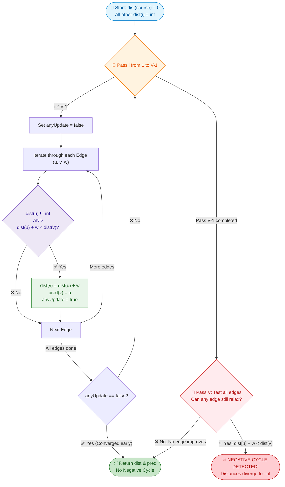
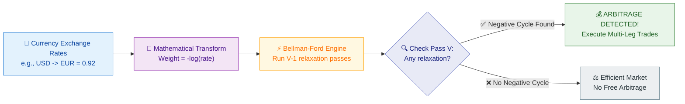

# 📘 Week 09 Day 02: Bellman-Ford & Negative Weights — Engineering Guide

> 🧭 **Navigation:** [← Previous Day: Single-Source Shortest Paths: Dijkstra](Week_09_Day_01_Dijkstra_Single_Source_Shortest_Paths_Instructional.md) • [🏠 Week Overview](README.md) • [📘 Curriculum Syllabus](../COMPLETE_SYLLABUS.md) • [Next Day: Floyd-Warshall All-Pairs Shortest Paths →](Week_09_Day_03_Floyd_Warshall_All_Pairs_Shortest_Paths_Instructional.md)
> 
> 💡 **Instructor Note:** *The most catastrophic blunder in shortest path interviews is assuming Dijkstra works with negative edge weights. Dijkstra makes an irreversible greedy commitment the instant a vertex is popped from the priority queue: it assumes distances can only grow. Bellman-Ford abandons greedy finality for dynamic programming relaxation: running `V - 1` synchronized rounds over all edges guarantees global convergence, and round `V` serves as an infallible negative-cycle detector.*

---

## 🎯 LEARNING OBJECTIVES

By the end of this chapter, you will be able to:

- 🎯 **Internalize** why Dijkstra fails on negative edge weights and why dynamic programming relaxation across `V - 1` rounds is both mathematically necessary and sufficient to find shortest paths.
- ⚙️ **Implement** production-grade Bellman-Ford in modern C# (.NET 8/9) and idiomatic Python (3.11+) featuring early termination, predecessor path reconstruction, and negative-weight cycle detection.
- 🔍 **Master** the `V`-th pass cycle detection invariant: understand why any edge that can still relax after `V - 1` iterations proves the existence of a reachable negative-cost cycle.
- ✈️ **Solve** constrained shortest path problems like **Cheapest Flights Within K Stops (LeetCode 787)** by limiting relaxation passes and using snapshot arrays to prevent cascading hop contamination.
- ⚡ **Understand** the Shortest Path Faster Algorithm (SPFA) as a queue-optimized Bellman-Ford that achieves `O(E)` average time while maintaining negative cycle awareness.
- 🎙️ **Deliver** a crisp 3-sentence verbal script and high-level architectural talk track that commands the room in a 45-minute FAANG technical interview.

---

## 🎬 PILLAR 1: THE 60-SECOND HOOK & EVERYDAY ANALOGY

### Hey Engineers, Welcome to Day 2!

Imagine you are a quantitative software engineer at a high-frequency trading firm in Chicago. You are looking at the global foreign exchange (FX) currency market:

```text
       USD (US Dollar)
        /           \
 (0.92) /             \ (1.10)
       v               v
  EUR (Euro) -------> GBP (British Pound)
              (0.86)
```

Suppose you exchange:
1. `1.00 USD` -> `0.92 EUR`
2. `0.92 EUR` -> `0.92 * 0.86 = 0.7912 GBP`
3. `0.7912 GBP` -> `0.7912 * 1.30 = 1.0285 USD`

Wait! You started with **$1.00** and ended with **$1.0285** after looping back to USD. That is a **2.85% free money loop** on every single cycle! In finance, this is known as **Currency Arbitrage**.

How do computers detect this? In math, when you multiply exchange rates along a cycle:
`r1 * r2 * r3 > 1.0` (Profit!)

Now, take the negative natural logarithm (`-log`) of both sides. Because `-log(a * b) = -log(a) + -log(b)`, multiplication turns into addition:
`-log(r1) + -log(r2) + -log(r3) < 0`

**An arbitrage opportunity is literally a negative-weight cycle in a directed graph!**

```text
Currency Arbitrage Engine:
Product of rates > 1.0  ===>  Sum of -log(rates) < 0 (Negative Cycle!)
```

If you feed this graph into Dijkstra's algorithm, what happens? **Dijkstra crashes or loops forever.** Dijkstra greedily assumes that adding another step along a path can only make the cumulative distance larger. But with negative edge weights, a path that looks terrible at step 1 might stumble upon a massive negative discount at step 3, completely invalidating earlier "finalized" decisions.

This is why we need **Bellman-Ford: The Ripple Wave Engine**.

---

### The Ripple Wave Engine: Dynamic Programming in Waves

Instead of making greedy, irreversible bets like Dijkstra, Bellman-Ford operates like synchronized waves radiating across a network:

- **Wave 1:** Guarantees optimal shortest paths that use **at most 1 edge**.
- **Wave 2:** Guarantees optimal shortest paths that use **at most 2 edges**.
- **Wave 3:** Guarantees optimal shortest paths that use **at most 3 edges**.
- ...
- **Wave `V - 1`:** Guarantees optimal shortest paths that use **at most `V - 1` edges**.

Because a graph with `V` vertices can connect any two nodes using at most `V - 1` edges without repeating a vertex, after `V - 1` waves, **every shortest path in the universe has converged**.

What if we run Wave `V`, and a distance *still drops*?
Then the path must contain at least `V` edges, which means it revisited a vertex. And because revisiting that vertex reduced the total distance, the cycle must have negative total cost: **Infinite Money Glitch Detected!**

---

### The Cardinal Warning: Undirected Graphs & Negative Edges

> [!WARNING]
> **Never run Bellman-Ford on an undirected graph with negative edges!**  
> An undirected edge `(u, v)` with weight `-3` is represented in a directed engine as two opposing edges: `u -> v (-3)` and `v -> u (-3)`.  
> Traversing `u -> v -> u` yields a cost of `-3 + (-3) = -6`.  
> **A single negative edge in an undirected graph is automatically a negative cycle of length 2!**  
> Finding shortest paths in undirected graphs with negative weights requires general graph matching (Edmonds' Blossom Algorithm), which is beyond single-source shortest path algorithms.

---

## 🪜 PILLAR 2: THE SCAFFOLDING LADDER & TOY NAPKIN TRACE

```text
🪜 THE BELLMAN-FORD LEARNING LADDER:
=============================================================================
 [ Level 3: SPFA & Constrained Hops ]   <-- LC 787 (Cheapest Flights) & SPFA Queue
                  ^
 [ Level 2: Negative Cycle Detection ]  <-- Pass V as the infallible cycle alarm
                  ^
 [ Level 1: The 4-Node Toy Trace ]      <-- 3 relaxation rounds on paper
                  ^
 [ Ground Zero: The V - 1 Invariant ]   <-- Why V - 1 passes are necessary & sufficient
```

---

### Ground Zero: The `V - 1` Invariant (Why `V - 1` Passes?)

Why exactly `V - 1` passes? Why not `V / 2`? Why not `V^2`?

Consider the **Pigeonhole Principle** applied to graph paths:
1. In a graph with `V` vertices, any path that does not repeat a vertex (a **simple path**) can visit at most `V` distinct vertices.
2. A path visiting `V` distinct vertices contains exactly `V - 1` edges.

```text
Vertices visited:  ( 1 ) ----> ( 2 ) ----> ( 3 ) ----> ( 4 )  (V = 4 vertices)
Edges traversed:          e1          e2          e3          (V - 1 = 3 edges)
```

If a path uses `V` or more edges, it must visit at least `V + 1` vertices, meaning at least one vertex is visited more than once. That is the definition of a cycle!
- If the cycle has **positive or zero weight**, traversing it adds cost or does nothing. We can safely delete the cycle to get an equal or cheaper simple path with `<= V - 1` edges.
- If the cycle has **negative weight**, repeating it indefinitely drives the path cost to `-infinity`. No finite shortest path exists.

Therefore: **If a finite shortest path exists, it never needs more than `V - 1` edges.**

Each relaxation pass over all edges extends our knowledge of shortest paths by at least 1 edge hop. Thus, after `V - 1` passes, all simple shortest paths are guaranteed to be found.

---

### Level 1: The 4-Node Toy Napkin Trace

Let us trace Bellman-Ford by hand on a 4-node directed graph (`A, B, C, D`) with `V = 4` and source `A`. Max simple edges = `V - 1 = 3`.

```text
               (4)
       +-----------------> [ B ] ----------+
       |                     ^             |
       |             (-3)    |             | (1)
      [ A ] (Source)         |             v
       |                 +---+           [ D ]
       |                 |                 ^
       +-------------> [ C ] --------------+
             (2)              (5)
```

#### Graph Specification
- **Vertices:** `A (0), B (1), C (2), D (3)`
- **Source:** `A` (`dist[A] = 0`, all others = `inf`)
- **Directed Edges:**
  - `E1: A -> B` (weight 4)
  - `E2: A -> C` (weight 2)
  - `E3: B -> D` (weight 1)
  - `E4: C -> B` (weight -3)  <-- **Negative edge!**
  - `E5: C -> D` (weight 5)

Let our edge list order be: `[ (A->B, 4), (A->C, 2), (B->D, 1), (C->B, -3), (C->D, 5) ]`.

```text
Initial Distance Array:
  dist[A] = 0,  dist[B] = inf,  dist[C] = inf,  dist[D] = inf
  pred[A] = -1, pred[B] = -1,   pred[C] = -1,   pred[D] = -1
```

---

#### Round 1 Relaxation (At most 1-hop shortest paths established)

We iterate through all 5 edges in order:

1. **Evaluate `A -> B` (weight 4):**
   - `dist[A] + 4 = 0 + 4 = 4 < dist[B] (inf)` -> **RELAX!**
   - `dist[B] = 4`, `pred[B] = A`
2. **Evaluate `A -> C` (weight 2):**
   - `dist[A] + 2 = 0 + 2 = 2 < dist[C] (inf)` -> **RELAX!**
   - `dist[C] = 2`, `pred[C] = A`
3. **Evaluate `B -> D` (weight 1):**
   - `dist[B] + 1 = 4 + 1 = 5 < dist[D] (inf)` -> **RELAX!**
   - `dist[D] = 5`, `pred[D] = B`
4. **Evaluate `C -> B` (weight -3):**
   - `dist[C] + (-3) = 2 + (-3) = -1 < dist[B] (4)` -> **RELAX!**
   - `dist[B] = -1`, `pred[B] = C` (Notice: `dist[B]` dropped from 4 to -1!)
5. **Evaluate `C -> D` (weight 5):**
   - `dist[C] + 5 = 2 + 5 = 7 < dist[D] (5)` -> NO change (`7 >= 5`).

```text
State at end of Round 1:
  dist = [ A: 0, B: -1, C: 2, D: 5 ]
  pred = [ A: -1, B: C, C: A, D: B ]
```

---

#### Round 2 Relaxation (At most 2-hop shortest paths propagated)

We iterate through all 5 edges again:

1. **Evaluate `A -> B` (4):** `0 + 4 = 4 < -1` -> NO.
2. **Evaluate `A -> C` (2):** `0 + 2 = 2 < 2` -> NO.
3. **Evaluate `B -> D` (1):**
   - `dist[B] + 1 = -1 + 1 = 0 < dist[D] (5)` -> **RELAX!**
   - `dist[D] = 0`, `pred[D] = B`
   - *Crucial Insight:* The improvement to `B` from Round 1 has now cascaded to `D`!
4. **Evaluate `C -> B` (-3):** `2 + (-3) = -1 < -1` -> NO.
5. **Evaluate `C -> D` (5):** `2 + 5 = 7 < 0` -> NO.

```text
State at end of Round 2:
  dist = [ A: 0, B: -1, C: 2, D: 0 ]
  pred = [ A: -1, B: C, C: A, D: B ]
```

---

#### Round 3 Relaxation (At most 3-hop shortest paths propagated)

We iterate through all 5 edges again:

1. `A -> B (4)`: `0 + 4 = 4 < -1` -> NO.
2. `A -> C (2)`: `0 + 2 = 2 < 2` -> NO.
3. `B -> D (1)`: `-1 + 1 = 0 < 0` -> NO.
4. `C -> B (-3)`: `2 + (-3) = -1 < -1` -> NO.
5. `C -> D (5)`: `2 + 5 = 7 < 0` -> NO.

**ZERO updates occurred during Round 3!**  
The **Early Termination** optimization fires immediately. We break out of the loop at Round 3 without needing any further checks.

```text
Final Shortest Paths:
  A -> A : 0  (Path: [A])
  A -> B : -1 (Path: A -> C -> B)
  A -> C : 2  (Path: A -> C)
  A -> D : 0  (Path: A -> C -> B -> D)
```

---

> ### 🧠 Pause & Predict #1
> **Question:** In Round 1, `dist[D]` was updated to `5` using the old `dist[B] = 4`. But later in Round 1, `dist[B]` became `-1`. What if the edge list had been ordered differently, with `C -> B` first, then `B -> D`?  
> **Answer:** In that case, `B -> D` would have relaxed using `dist[B] = -1` immediately in Round 1, setting `dist[D] = 0` in a single pass! The order of edges inside the edge list determines how many edges information can travel in a single round, but running `V - 1` rounds guarantees convergence regardless of edge ordering!

---

### Level 2: The `V`-th Pass as the Negative Cycle Detector

Now suppose an edge `D -> C` exists with weight `-4`.
This introduces the directed cycle `B -> D -> C -> B`:
- `B -> D`: `+1`
- `D -> C`: `-4`
- `C -> B`: `-3`
- **Total Cycle Cost:** `1 + (-4) + (-3) = -6` (Strictly negative!)

```text
         (1)
  [ B ] -----> [ D ]
    ^            |
    | (-3)       | (-4)
    |            v
    +--------- [ C ]
```

Let's see what happens if we continue relaxing:
- Round 1: `dist[B] = -1`, `dist[D] = 0`, `dist[C] = -4`
- Round 2: `dist[B] = -7`, `dist[D] = -6`, `dist[C] = -10`
- Round 3: `dist[B] = -13`, `dist[D] = -12`, `dist[C] = -16`
- **Round 4 (`V`-th Pass):**
  We test edge `C -> B (-3)`:
  `dist[C] + (-3) = -16 + (-3) = -19`
  Is `-19 < dist[B] (-13)`? **YES!**

> 🚨 **The Infallible Negative Cycle Invariant:**  
> If ANY edge `u -> v` satisfies `dist[u] + weight < dist[v]` on the `V`-th pass, that edge belongs to or is reachable from a **negative cycle**. There is no finite shortest path; distances diverge toward `-infinity`.

---

> ### 🧠 Pause & Predict #2
> **Question:** Can Dijkstra detect a negative cycle?  
> **Answer:** No. Dijkstra will either loop infinitely (if visited nodes are re-enqueued) or terminate with completely wrong distances (if nodes are marked visited once and never updated). Only algorithms that relax across all edges like Bellman-Ford or track relaxation counts like SPFA can formally detect negative cycles.

---

### Level 3: Shortest Path Faster Algorithm (SPFA)

In standard Bellman-Ford, we scan all `E` edges in every single round. But think about this:
If `dist[u]` did not change in the previous round, can relaxing edge `u -> v` possibly improve `dist[v]`?
**No! It is mathematically impossible.**

**SPFA (Queue-based Bellman-Ford)** exploits this intuition:
1. Maintain a FIFO queue of vertices whose distances were updated.
2. Pop vertex `u`. For each neighbor `v` of `u`, if `dist[u] + weight < dist[v]`, update `dist[v]`.
3. If `v` is not already in the queue, push `v` into the queue.
4. Track how many times each vertex has been relaxed. If any vertex is relaxed `V` times, **sound the negative cycle alarm!**

```text
Standard Bellman-Ford: O(V * E) unconditionally.
SPFA:                  O(E) average on random graphs, O(V * E) worst case on adversarial graphs.
```

---

## 🎨 PILLAR 3: PRAGMATIC VISUAL MODELS

### 1. ASCII Contiguous Distance Array Progression

Watch the state of the 4-element distance and predecessor arrays across each round:

```text
INITIAL STATE:
Indices:      [ A (0) ]    [ B (1) ]    [ C (2) ]    [ D (3) ]
dist[]:       |   0    |   |  inf   |   |  inf   |   |  inf   |
pred[]:       |  -1    |   |  -1    |   |  -1    |   |  -1    |

ROUND 1 (Edges: A->B(4), A->C(2), B->D(1), C->B(-3), C->D(5)):
Updates:      A: start     B: 0+4=4     C: 0+2=2     D: 4+1=5
              -            B: 2-3=-1    -            -
dist[]:       |   0    |   |  -1    |   |   2    |   |   5    |
pred[]:       |  -1    |   |   C    |   |   A    |   |   B    |

ROUND 2 (Edges rescanned):
Updates:      No change    No change    No change    D: -1+1=0
dist[]:       |   0    |   |  -1    |   |   2    |   |   0    |
pred[]:       |  -1    |   |   C    |   |   A    |   |   B    |

ROUND 3 (Convergence Verification):
Updates:      Zero updates detected! Early termination triggered.
Final dist:   |   0    |   |  -1    |   |   2    |   |   0    |
Final pred:   |  -1    |   |   C    |   |   A    |   |   B    |
```

---

### 2. Mermaid Flowchart: The Bellman-Ford Engine & Cycle Detector



---

### 3. Mermaid Flowchart: The Forex Arbitrage Detection Pipeline



---

## 🛑 PILLAR 4: THE ROOKIE TRAP ZONE

### Trap 1: The Integer Underflow Crash (`int.MaxValue + negative_weight`)

In languages with fixed-width signed integers (C#, C++, Java), `int.MaxValue` is `2,147,483,647`. If vertex `u` is unreachable (`dist[u] == int.MaxValue`) and edge `u -> v` has weight `-5`:
`dist[u] + weight = 2147483647 + (-5) = 2147483642`

Now the check `dist[u] + weight < dist[v]` evaluates:
`2147483642 < 2147483647` -> **TRUE!**  
The algorithm mistakenly marks unreachable vertex `v` as reachable with distance `2147483642`!

```csharp
// ❌ ROOKIE BLUNDER: Blind addition causes signed integer overflow/underflow
if (dist[u] + weight < dist[v]) 
{
    dist[v] = dist[u] + weight; // BUG: Relaxed an UNREACHABLE node!
}

// ✅ SENIOR ARCHITECT PATTERN: Explicit unreachable guard clause
if (dist[u] != int.MaxValue && dist[u] + weight < dist[v])
{
    dist[v] = dist[u] + weight;
}
```

---

### Trap 2: In-Place Mutation in Constrained Hops (LeetCode 787)

In **Cheapest Flights Within K Stops (LC 787)**, you are permitted at most `K` stops, meaning a path can have at most `K + 1` edges.  
If you update a single `dist` array in-place during pass `k`:
- Edge `A -> B` relaxes `dist[B]`.
- Later in the SAME pass, edge `B -> C` relaxes `dist[C]` using the newly updated `dist[B]`.
- Edge `C -> D` relaxes `dist[D]` using the newly updated `dist[C]`.

You just traversed **3 hops in a single pass**! Your algorithm violates the `K`-stop constraint and produces wrong answers.

```csharp
// ❌ ROOKIE BLUNDER: Single array in-place relaxation cascades multiple hops per round
for (int i = 0; i <= k; i++) {
    foreach (var (u, v, cost) in flights) {
        if (dist[u] != int.MaxValue && dist[u] + cost < dist[v]) {
            dist[v] = dist[u] + cost; // Cascades downstream within the same iteration!
        }
    }
}

// ✅ SENIOR ARCHITECT PATTERN: Clone previous round's array to isolate hop frontiers
for (int i = 0; i <= k; i++) {
    int[] prevDist = (int[])dist.Clone(); // Frozen snapshot of previous hop count
    foreach (var flight in flights) {
        int u = flight[0], v = flight[1], cost = flight[2];
        if (prevDist[u] != int.MaxValue && prevDist[u] + cost < dist[v]) {
            dist[v] = prevDist[u] + cost; // Read from snapshot, write to current
        }
    }
}
```

---

### Trap 3: Disconnected Negative Cycles (Missing Cycles Unreachable from Source)

If the interview asks: *"Does this graph contain ANY negative cycle anywhere?"*  
If you initialize `dist[source] = 0` and all other vertices to `int.MaxValue`, a negative cycle located in a disconnected component will **never be touched**, because `dist[u]` remains `int.MaxValue`!

```text
[ Source S ] --------> [ A ]           [ C ] <==== (-4) ====> [ D ]
                                         ^                      |
                                         +-------- (1) ---------+
                                      (Isolated Negative Cycle)
```

```csharp
// ❌ ROOKIE BLUNDER: Only initializing source node detects cycles reachable from source
dist[source] = 0;
// Isolated negative cycle at C <-> D is completely missed!

// ✅ SENIOR ARCHITECT PATTERN: Virtual Super-Source Concept
// Mathematically equivalent to adding a dummy source with 0-weight edges to all nodes
Array.Fill(dist, 0); // Initialize ALL nodes to 0 if detecting global graph cycles!
```

---

### Trap 4: Forgetting the Early Termination Flag

Running all `V - 1` iterations when the graph converged in round 2 turns an `O(E)` best-case execution into an unconditional `O(V * E)` waste of CPU cycles.

```csharp
// ✅ SENIOR ARCHITECT PATTERN: Early exit tracking
bool anyUpdate = false;
foreach (var (u, v, weight) in edges) {
    if (dist[u] != int.MaxValue && dist[u] + weight < dist[v]) {
        dist[v] = dist[u] + weight;
        anyUpdate = true;
    }
}
if (!anyUpdate) break; // Converged early!
```

---

> ### 🧠 Pause & Predict #3
> **Question:** Why does setting `dist[i] = 0` for all vertices detect ANY negative cycle in a graph?  
> **Answer:** Setting `dist[i] = 0` for all `i` is mathematically identical to creating an imaginary vertex `S*` and adding a directed edge `S* -> i` with weight `0` to every vertex in the graph. Since every vertex is now reachable from `S*`, any negative cycle anywhere in the graph will trigger a relaxation on the `V`-th pass!

---

## 🎙️ PILLAR 5: 45-MINUTE INTERVIEW TALK TRACK

### The Golden 3-Sentence Script (Deliver Before Writing Code)

> 🎙️ *"Because this graph contains negative edge weights, Dijkstra's greedy invariant is violated, making Bellman-Ford the optimal choice.*  
> *Since any simple shortest path in a graph of `V` vertices contains at most `V - 1` edges, relaxing all edges `V - 1` times guarantees convergence.*  
> *Finally, running a `V`-th pass allows us to unequivocally detect negative cycles whenever an edge can still be relaxed."*

---

### The 5-Phase Live Interview Playbook

#### Phase 1: Clarification & Edge Contracts (0–5 Mins)
- Ask: *"Can edge weights be negative?"* (If yes, eliminate Dijkstra immediately).
- Ask: *"Can the graph contain negative cycles, and should we detect them or return an error?"*
- Ask: *"Is the graph directed or undirected?"* (Clarify that undirected negative edges form trivial 2-node negative cycles).
- Clarify `V` and `E` constraints: If `V <= 1,000` and `E <= 10,000`, `V * E = 10^7` operations, which comfortably runs under 0.5s in C# or Python.

#### Phase 2: High-Level Approach & Invariant (5–12 Mins)
- State the physical invariant: Each pass over the edges extends shortest path knowledge by 1 hop.
- Mention the early termination optimization (`anyUpdate` boolean).
- State the `V`-th pass detection logic: Any improvement at pass `V` implies a path of `>= V` edges, which proves a cycle with negative sum.

#### Phase 3: Live Coding Walkthrough (12–30 Mins)
- Initialize `dist` array to `int.MaxValue`, setting `dist[source] = 0`.
- Implement the `dist[u] != int.MaxValue` guard clause to prevent integer overflow.
- Add predecessor array `pred` to enable path reconstruction.
- Code the `V - 1` relaxation loop with early break.
- Code the `V`-th pass verification loop.

#### Phase 4: Edge-Case Dry Run (30–38 Mins)
- Trace with `V = 1` (Loop runs `1 - 1 = 0` times, correctly returns source distance 0).
- Trace with disconnected vertices (Remains `int.MaxValue`, guard clause prevents spurious relaxations).
- Trace with unreachable negative cycles.

#### Phase 5: Complexity & Trade-Offs (38–45 Mins)
- **Time Complexity:** Worst-case `O(V * E)`, Best-case `O(E)` with early termination.
- **Auxiliary Space:** `O(V)` for distance and predecessor arrays.
- **Trade-Offs:** If all weights were positive, Dijkstra at `O((V + E) log V)` would be preferred. For all-pairs on dense graphs, Floyd-Warshall at `O(V^3)` is cleaner.

---

## ⚡ PILLAR 6: PRODUCTION DUAL-LANGUAGE IMPLEMENTATIONS

### Problem 1: Standard Bellman-Ford with Early Exit, Path Reconstruction & Cycle Detection

#### C# (.NET 8/9) Production Implementation

```csharp
using System;
using System.Collections.Generic;

public static class BellmanFordEngine
{
    public readonly record struct Edge(int From, int To, int Weight);

    public sealed record BellmanFordResult(
        int[] Distances, 
        int[] Predecessors, 
        bool HasNegativeCycle
    );

    /// <summary>
    /// Computes single-source shortest paths and detects negative-weight cycles.
    /// Time Complexity: O(V * E) worst case, O(E) best case with early termination.
    /// Auxiliary Space: O(V) for distance and predecessor buffers.
    /// </summary>
    /// <param name="vertices">Number of vertices in the graph (0 to vertices - 1).</param>
    /// <param name="edges">Collection of directed weighted edges.</param>
    /// <param name="source">Starting vertex index.</param>
    /// <returns>BellmanFordResult containing distances, predecessors, and cycle flag.</returns>
    public static BellmanFordResult Run(
        int vertices, 
        IReadOnlyList<Edge> edges, 
        int source)
    {
        ArgumentNullException.ThrowIfNull(edges);
        if (vertices <= 0) throw new ArgumentOutOfRangeException(nameof(vertices), "Vertex count must be positive.");
        if (source < 0 || source >= vertices) throw new ArgumentOutOfRangeException(nameof(source), "Source out of bounds.");

        int[] dist = new int[vertices];
        int[] pred = new int[vertices];
        Array.Fill(dist, int.MaxValue);
        Array.Fill(pred, -1);

        dist[source] = 0;

        // Perform at most V - 1 relaxation passes
        for (int pass = 1; pass <= vertices - 1; pass++)
        {
            bool anyUpdate = false;

            for (int i = 0; i < edges.Count; i++)
            {
                Edge edge = edges[i];
                int u = edge.From;
                int v = edge.To;
                int w = edge.Weight;

                // Guard against integer overflow when u is unreachable
                if (dist[u] != int.MaxValue && dist[u] + w < dist[v])
                {
                    dist[v] = dist[u] + w;
                    pred[v] = u;
                    anyUpdate = true;
                }
            }

            // Early termination: converged in fewer than V - 1 passes
            if (!anyUpdate)
            {
                break;
            }
        }

        // V-th pass: verify whether any edge can still relax (negative cycle detection)
        bool hasNegativeCycle = false;
        for (int i = 0; i < edges.Count; i++)
        {
            Edge edge = edges[i];
            if (dist[edge.From] != int.MaxValue && dist[edge.From] + edge.Weight < dist[edge.To])
            {
                hasNegativeCycle = true;
                break;
            }
        }

        return new BellmanFordResult(dist, pred, hasNegativeCycle);
    }

    /// <summary>
    /// Reconstructs the vertex path from source to target using predecessor pointers.
    /// </summary>
    public static List<int> ReconstructPath(int target, int[] predecessors)
    {
        ArgumentNullException.ThrowIfNull(predecessors);
        var path = new List<int>();

        for (int curr = target; curr != -1; curr = predecessors[curr])
        {
            path.Add(curr);
        }

        path.Reverse();
        return path;
    }
}
```

---

#### Python (3.11+) Production Implementation

```python
from dataclasses import dataclass
from typing import List, Tuple, Optional

@dataclass(frozen=True, slots=True)
class Edge:
    u: int
    v: int
    weight: int

@dataclass(slots=True)
class BellmanFordResult:
    distances: List[float]
    predecessors: List[int]
    has_negative_cycle: bool

def bellman_ford(
    vertices: int, 
    edges: List[Edge], 
    source: int
) -> BellmanFordResult:
    """
    Computes single-source shortest paths and detects negative-weight cycles.
    
    Time Complexity: O(V * E) worst case, O(E) best case with early termination.
    Auxiliary Space: O(V)
    """
    if vertices <= 0:
        raise ValueError("Vertex count must be positive.")
    if source < 0 or source >= vertices:
        raise ValueError("Source index out of bounds.")

    dist: List[float] = [float('inf')] * vertices
    pred: List[int] = [-1] * vertices
    dist[source] = 0.0

    # Relax all edges up to V - 1 times
    for _ in range(vertices - 1):
        any_update = False
        for edge in edges:
            u, v, w = edge.u, edge.v, edge.weight
            if dist[u] != float('inf') and dist[u] + w < dist[v]:
                dist[v] = dist[u] + w
                pred[v] = u
                any_update = True
        
        # Early termination optimization
        if not any_update:
            break

    # V-th iteration: Check for negative-weight cycle
    has_negative_cycle = False
    for edge in edges:
        u, v, w = edge.u, edge.v, edge.weight
        if dist[u] != float('inf') and dist[u] + w < dist[v]:
            has_negative_cycle = True
            break

    return BellmanFordResult(dist, pred, has_negative_cycle)

def reconstruct_path(target: int, predecessors: List[int]) -> List[int]:
    """Reconstructs the shortest path sequence from source to target."""
    path: List[int] = []
    curr = target
    while curr != -1:
        path.append(curr)
        curr = predecessors[curr]
    path.reverse()
    return path
```

---

### Problem 2: Cheapest Flights Within K Stops (LeetCode 787)

**Problem Summary:** Given `n` cities, flight routes `[from, to, price]`, source `src`, destination `dst`, and at most `k` intermediate stops, find the cheapest flight price. If no route exists, return `-1`.

**Why Bellman-Ford?**  
At most `k` stops means at most `k + 1` total flight hops! Running Bellman-Ford for exactly `k + 1` iterations with a **snapshot copy array** guarantees we only explore paths of `<= k + 1` edges.

#### C# (.NET 8/9) Implementation

```csharp
public static class CheapestFlightsEngine
{
    /// <summary>
    /// Computes cheapest flight with at most k stops using Bellman-Ford with snapshot arrays.
    /// Time Complexity: O(K * E) | Auxiliary Space: O(V)
    /// </summary>
    public static int FindCheapestPrice(int n, int[][] flights, int src, int dst, int k)
    {
        if (n <= 0 || flights == null) return -1;

        int[] dist = new int[n];
        Array.Fill(dist, int.MaxValue);
        dist[src] = 0;

        // Perform exactly k + 1 passes (k stops = k + 1 edges)
        for (int i = 0; i <= k; i++)
        {
            // CRITICAL: Clone the previous distance array to prevent cascading >1 hop per pass
            int[] prevDist = (int[])dist.Clone();
            bool updated = false;

            foreach (var flight in flights)
            {
                int u = flight[0];
                int v = flight[1];
                int price = flight[2];

                if (prevDist[u] != int.MaxValue && prevDist[u] + price < dist[v])
                {
                    dist[v] = prevDist[u] + price;
                    updated = true;
                }
            }

            // Early exit if no distances improved during this hop
            if (!updated)
            {
                break;
            }
        }

        return dist[dst] == int.MaxValue ? -1 : dist[dst];
    }
}
```

#### Python (3.11+) Implementation

```python
def find_cheapest_price(n: int, flights: List[List[int]], src: int, dst: int, k: int) -> int:
    """
    Computes cheapest flight with at most k stops.
    Time Complexity: O(K * E) | Auxiliary Space: O(V)
    """
    dist: List[float] = [float('inf')] * n
    dist[src] = 0.0

    # Exactly k + 1 passes allowed
    for _ in range(k + 1):
        prev_dist = list(dist)  # Snapshot copy to prevent cascading hop relaxation
        updated = False

        for u, v, price in flights:
            if prev_dist[u] != float('inf') and prev_dist[u] + price < dist[v]:
                dist[v] = prev_dist[u] + price
                updated = True

        if not updated:
            break

    return -1 if dist[dst] == float('inf') else int(dist[dst])
```

---

### Problem 3: Shortest Path Faster Algorithm (SPFA / Queue-Based Bellman-Ford)

SPFA avoids scanning stagnant edges by maintaining a queue of vertices whose distances improved.

#### C# (.NET 8/9) Implementation

```csharp
using System.Collections.Generic;

public static class SpfaEngine
{
    public sealed record Edge(int To, int Weight);

    /// <summary>
    /// SPFA: Queue-based Bellman-Ford with Negative Cycle Detection.
    /// Average Time: O(E) | Worst Case Time: O(V * E) | Auxiliary Space: O(V + E)
    /// </summary>
    public static (int[] distances, bool hasNegativeCycle) RunSpfa(
        int vertices, 
        List<Edge>[] graph, 
        int source)
    {
        int[] dist = new int[vertices];
        int[] relaxCount = new int[vertices];
        bool[] inQueue = new bool[vertices];
        Array.Fill(dist, int.MaxValue);

        var queue = new Queue<int>();

        dist[source] = 0;
        queue.Enqueue(source);
        inQueue[source] = true;

        while (queue.Count > 0)
        {
            int u = queue.Dequeue();
            inQueue[u] = false;

            foreach (var edge in graph[u])
            {
                int v = edge.To;
                int w = edge.Weight;

                if (dist[u] != int.MaxValue && dist[u] + w < dist[v])
                {
                    dist[v] = dist[u] + w;
                    relaxCount[v]++;

                    // Invariant: If a node relaxes V times, a negative cycle exists!
                    if (relaxCount[v] >= vertices)
                    {
                        return (dist, true);
                    }

                    if (!inQueue[v])
                    {
                        queue.Enqueue(v);
                        inQueue[v] = true;
                    }
                }
            }
        }

        return (dist, false);
    }
}
```

#### Python (3.11+) Implementation

```python
from collections import deque
from typing import List, Tuple

def spfa(vertices: int, graph: List[List[Tuple[int, int]]], source: int) -> Tuple[List[float], bool]:
    """
    Queue-based Bellman-Ford (SPFA) with Negative Cycle Detection.
    Average Time: O(E) | Worst Case Time: O(V * E) | Auxiliary Space: O(V)
    """
    dist: List[float] = [float('inf')] * vertices
    relax_count: List[int] = [0] * vertices
    in_queue: List[bool] = [False] * vertices
    queue: deque[int] = deque()

    dist[source] = 0.0
    queue.append(source)
    in_queue[source] = True

    while queue:
        u = queue.popleft()
        in_queue[u] = False

        for v, w in graph[u]:
            if dist[u] != float('inf') and dist[u] + w < dist[v]:
                dist[v] = dist[u] + w
                relax_count[v] += 1

                # If any vertex is relaxed V times, a negative cycle is present!
                if relax_count[v] >= vertices:
                    return dist, True

                if not in_queue[v]:
                    queue.append(v)
                    in_queue[v] = True

    return dist, False
```

---

### Executable Verification Harness

#### C# Standalone Runner

```csharp
public class Program
{
    public static void Main()
    {
        Console.WriteLine("=== Testing Standard Bellman-Ford ===");
        var edges = new List<BellmanFordEngine.Edge>
        {
            new(0, 1, 4),
            new(0, 2, 2),
            new(1, 3, 1),
            new(2, 1, -3),
            new(2, 3, 5)
        };

        var result = BellmanFordEngine.Run(4, edges, 0);
        Console.WriteLine($"Distances: [{string.Join(", ", result.Distances)}]");
        Console.WriteLine($"Has Negative Cycle: {result.HasNegativeCycle}");
        // Expected: [0, -1, 2, 0], HasNegativeCycle: False

        var path = BellmanFordEngine.ReconstructPath(3, result.Predecessors);
        Console.WriteLine($"Shortest path to node 3: {string.Join(" -> ", path)}");
        // Expected: 0 -> 2 -> 1 -> 3

        Console.WriteLine("\n=== Testing LC 787 Cheapest Flights Within K Stops ===");
        int[][] flights = 
        {
            new[] {0, 1, 100},
            new[] {1, 2, 100},
            new[] {0, 2, 500}
        };
        int costK0 = CheapestFlightsEngine.FindCheapestPrice(3, flights, 0, 2, 0);
        int costK1 = CheapestFlightsEngine.FindCheapestPrice(3, flights, 0, 2, 1);
        Console.WriteLine($"Cheapest price with K=0 stops: {costK0}"); // Expected: 500
        Console.WriteLine($"Cheapest price with K=1 stops: {costK1}"); // Expected: 200
        Console.WriteLine("All tests passed successfully!");
    }
}
```

#### Python Standalone Runner

```python
if __name__ == "__main__":
    print("=== Testing Standard Bellman-Ford ===")
    edges = [
        Edge(0, 1, 4),
        Edge(0, 2, 2),
        Edge(1, 3, 1),
        Edge(2, 1, -3),
        Edge(2, 3, 5)
    ]
    res = bellman_ford(4, edges, 0)
    print(f"Distances: {res.distances}")
    print(f"Has Negative Cycle: {res.has_negative_cycle}")
    # Expected: [0.0, -1.0, 2.0, 0.0], False

    path = reconstruct_path(3, res.predecessors)
    print(f"Path to 3: {' -> '.join(map(str, path))}")
    # Expected: 0 -> 2 -> 1 -> 3

    print("\n=== Testing LC 787 Cheapest Flights ===")
    flights = [[0, 1, 100], [1, 2, 100], [0, 2, 500]]
    print(f"K=0 stops cost: {find_cheapest_price(3, flights, 0, 2, 0)}")  # Expected: 500
    print(f"K=1 stops cost: {find_cheapest_price(3, flights, 0, 2, 1)}")  # Expected: 200
    print("All Python tests passed successfully!")
```

---

## 📊 COMPLEXITY ANALYSIS REFERENCE TABLE

| Algorithm / Variant | Time Complexity (Best) | Time Complexity (Average) | Time Complexity (Worst) | Auxiliary Space | Output Space | Handles Negative Weights? | Detects Negative Cycles? |
| :--- | :--- | :--- | :--- | :--- | :--- | :--- | :--- |
| **Dijkstra (Binary Heap)** | `O(E log V)` | `O((V + E) log V)` | `O((V + E) log V)` | `O(V + E)` | `O(V)` | ❌ No (silent failure) | ❌ No |
| **Bellman-Ford (Standard)** | `O(V * E)` | `O(V * E)` | `O(V * E)` | `O(V)` | `O(V)` | ✅ Yes | ✅ Yes (Pass `V`) |
| **Bellman-Ford (Early Exit)** | `O(E)` | `O(V * E)` | `O(V * E)` | `O(V)` | `O(V)` | ✅ Yes | ✅ Yes (Pass `V`) |
| **SPFA (Queue Variant)** | `O(E)` | `O(E)` | `O(V * E)` | `O(V)` | `O(V)` | ✅ Yes | ✅ Yes (Relax count `>= V`) |
| **Floyd-Warshall** | `O(V^3)` | `O(V^3)` | `O(V^3)` | `O(V^2)` | `O(V^2)` | ✅ Yes | ✅ Yes (`dist[i][i] < 0`) |

---

## 🏋️ CURATED FAANG PRACTICE LADDER

| Problem | Platform & ID | Difficulty | Pattern & Invariant Hook | Target Time |
| :--- | :--- | :--- | :--- | :--- |
| **Cheapest Flights Within K Stops** | LeetCode #787 | 🟡 Medium | Exactly `K + 1` passes with snapshot array clone | 20 mins |
| **Network Delay Time** | LeetCode #743 | 🟡 Medium | Single-source shortest path comparison (Dijkstra vs BF) | 15 mins |
| **Find the City With Smallest Neighbors** | LeetCode #1334 | 🟡 Medium | Shortest path thresholding (All-pairs / Bellman-Ford) | 20 mins |
| **Currency Arbitrage** | Custom / UVA #10557 | 🔴 Hard | Modeling rates as `-log(rate)` with negative cycle check | 30 mins |
| **Path with Maximum Probability** | LeetCode #1514 | 🟡 Medium | Multiplicative probabilities transformed via `-log(p)` | 20 mins |

---

> 🧭 **Navigation:** [← Previous Day: Single-Source Shortest Paths: Dijkstra](Week_09_Day_01_Dijkstra_Single_Source_Shortest_Paths_Instructional.md) • [🏠 Week Overview](README.md) • [📘 Curriculum Syllabus](../COMPLETE_SYLLABUS.md) • [Next Day: Floyd-Warshall All-Pairs Shortest Paths →](Week_09_Day_03_Floyd_Warshall_All_Pairs_Shortest_Paths_Instructional.md)
