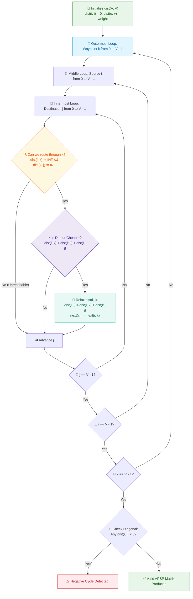

# 📘 Week 09 Day 03: All-Pairs Shortest Paths: Floyd-Warshall — Engineering Guide

> 🧭 **Navigation:** [← Previous Day: Bellman-Ford & Negative Weights](Week_09_Day_02_Bellman_Ford_Negative_Weights_Instructional.md) • [🏠 Week Overview](README.md) • [📘 Curriculum Syllabus](../COMPLETE_SYLLABUS.md) • [Next Day: Minimum Spanning Trees (Kruskal & Prim) →](Week_09_Day_04_Minimum_Spanning_Trees_Kruskal_Prim_Instructional.md)
> 
> 💡 **Instructor Note:** *The #1 fatal bug in All-Pairs Shortest Path interviews is putting the intermediate waypoint loop `k` in the innermost position instead of the outermost position. That single mistake destroys the dynamic programming invariant and silently produces incorrect paths for any route requiring more than one intermediate hop. In addition, beware of integer overflow when adding distances to infinity sentinels (`int.MaxValue`). Master the outermost-`k` invariant, safe overflow guarding, and negative cycle detection via the matrix diagonal today.*

---

## 🎯 LEARNING OBJECTIVES

By the end of this chapter, you will be able to:

- 🎯 **Internalize** the All-Pairs Shortest Path (APSP) problem and Floyd-Warshall's dynamic programming mechanism: expanding the set of allowable intermediate waypoints prefix by prefix (`{0 .. k}`).
- ⚙️ **Implement** production-grade Floyd-Warshall in modern C# (.NET 8/9) and idiomatic Python (3.11+) featuring full path reconstruction (`next[i, j]`) and negative cycle detection.
- 📐 **Prove** mechanically why the intermediate waypoint `k` loop **must** be strictly outermost, and explain how 2D memory in-place updates preserve the underlying 3D DP recurrence.
- 🛑 **Diagnose & eliminate** the top 4 rookie traps: innermost-`k` loop ordering, integer overflow on `dist[i, k] + dist[k, j]`, applying `O(V^3)` to graphs with `V > 500`, and mishandling self-distance initialization.
-  solve **LeetCode 1334** (*Find the City With the Smallest Number of Neighbors at a Threshold Distance*) with clean, optimal, interview-ready code in both languages.
- 🎙️ **Deliver** a crisp 3-sentence verbal script and lead a 45-minute live technical interview with total architectural command.

---

## 🎬 PILLAR 1: THE 60-SECOND HOOK & EVERYDAY ANALOGY

### Hey Engineers, Welcome to Day 3!

Imagine you are a lead software engineer at Google Flights, Skyscanner, or Kayak. A traveler opens your app and asks:

> *"What is the cheapest way to fly from San Francisco (City A) to Tokyo (City B)?"*

You look up the direct flight:
- **Direct Flight (`A -> B`):** 1,200 USD.

Can you do better? What if you introduce an intermediate layover in Honolulu (City `K`)?
- **Segment 1 (`A -> K`):** 400 USD
- **Segment 2 (`K -> B`):** 500 USD
- **Total Detour Cost via `K`:** 400 USD + 500 USD = **900 USD**!

```
Direct Route:
  [ City A ] ──────────────────────────────────────────────> [ City B ]
                               1,200 USD

Detour Through Layover K:
  [ City A ] ─────────────> [ City K ] ─────────────> [ City B ]
               400 USD                    500 USD
                        Total = 900 USD  (Saved 300 USD!)
```

By introducing City `K` as an allowable layover, you shaved 300 USD off the ticket price.

Now here is the real-world engineering challenge:
Your user doesn't just want flights between San Francisco and Tokyo. Millions of users are querying flights between **every possible origin and every possible destination** in the world simultaneously. Furthermore, routes might connect through multiple layovers: `San Francisco -> Honolulu -> Guam -> Tokyo`.

How do you find the absolute cheapest route between **every single pair of cities `(i, j)`** across an entire global network?

Enter the **Floyd-Warshall Algorithm** (1962).

Floyd-Warshall systematically answers one simple question:
> *"If we allow City `K` into our club of permitted layover airports, does routing through `K` provide a cheaper journey between City `I` and City `J` than whatever best route we already had?"*

By testing every candidate intermediate city `k` one by one, Floyd-Warshall updates an entire `V * V` distance matrix in an astonishingly compact triple-nested loop:

```
dist[i, j] = min(dist[i, j], dist[i, k] + dist[k, j])
```

No complex priority queues. No recursion stacks. Just 4 lines of pure, cache-friendly array manipulation that runs in `O(V^3)` time and handles negative edge weights naturally.

---

## 🪜 PILLAR 2: THE SCAFFOLDING LADDER & TOY NAPKIN TRACE

We will ascend our algorithmic ladder step-by-step, starting with a napkin trace on a 3-node graph, building the formal dynamic programming invariant, uncovering negative cycle detection, and culminating in canonical FAANG problems.

```
       [ Level 4: Edge Cases & Negative Cycle Divergence ] <-- Diagonal check: dist[i, i] < 0
                      ^
       [ Level 3: Classic FAANG Medium ]                   <-- LeetCode 1334 (Threshold Cities)
                      ^
       [ Level 2: Warm-Up: Transitive Closure ]            <-- Warshall Reachability Matrix
                      ^
       [ Level 1: The 3-Node Toy Napkin Trace ]            <-- Step-by-step for k = 0, 1, 2
```

---

### Level 1: The 3-Node Toy Napkin Trace

Let us trace Floyd-Warshall on a compact 3-node directed graph where every node gets an opportunity to act as an intermediate waypoint.

#### Graph Specification
- **Vertices:** `0, 1, 2` (`V = 3`)
- **Directed Weighted Edges:**
  - `0 -> 1` (weight 3)
  - `0 -> 2` (weight 8)
  - `1 -> 2` (weight 1)
  - `2 -> 0` (weight 4)

```
3-Node Trace Graph:

             ( 3 )
    ( 0 ) -----------> ( 1 )
      |  \               |
      |   \ ( 8 )        | ( 1 )
      |    \             |
  (4) |     +--------->  v
      +---------------- ( 2 )
```

Notice the key tension:
Direct edge `0 -> 2` costs `8`. But detouring `0 -> 1 -> 2` costs `3 + 1 = 4`. Watch how Floyd-Warshall discovers this!

#### Initial State (`k = -1`, Direct Edges Only)
Every vertex has distance `0` to itself (`dist[i, i] = 0`). Direct edges are populated; non-existent edges are initialized to `inf`.

```text
Initial Distance Matrix:
         To 0     To 1     To 2
From 0 [   0,       3,       8   ]
From 1 [  inf,      0,       1   ]
From 2 [   4,      inf,      0   ]
```

---

#### Step 1: `k = 0` (Allow Vertex `0` as an Intermediate Waypoint)
We test whether any pair `(i, j)` can improve its distance by detouring through vertex `0`:
`dist[i, j] = min(dist[i, j], dist[i, 0] + dist[0, j])`

Pairs to evaluate:
- `(1, 2)` via 0: `dist[1, 0] + dist[0, 2] = inf + 8 = inf` (No change, current is `1`).
- `(2, 1)` via 0: `dist[2, 0] + dist[0, 1] = 4 + 3 = 7`.
  - Current `dist[2, 1] = inf`.
  - `7 < inf` -> **Update `dist[2, 1] = 7`!** (Route: `2 -> 0 -> 1`)
- `(2, 2)` via 0: `dist[2, 0] + dist[0, 2] = 4 + 8 = 12 > 0` (No change).

```text
Distance Matrix after k = 0:
         To 0     To 1     To 2
From 0 [   0,       3,       8   ]
From 1 [  inf,      0,       1   ]
From 2 [   4,       7,       0   ]   <-- (2, 1) unlocked via 2->0->1 (Cost: 7)
```

---

> 🧠 **Pause & Predict 1:**
> Look closely at the matrix after `k = 0`. We are about to run `k = 1` (allowing vertex `1` as an intermediate stop).
> Will path `0 -> 2` change? What is `dist[0, 1] + dist[1, 2]` compared to current `dist[0, 2] = 8`?
> Take 5 seconds to calculate before reading the next section!

<details>
<summary>🔍 Click to Reveal Answer</summary>

**Yes!**
`dist[0, 1] + dist[1, 2] = 3 + 1 = 4`.
Because `4 < 8`, `dist[0, 2]` will be updated from `8` to `4` via detour `0 -> 1 -> 2`!
</details>

---

#### Step 2: `k = 1` (Allow Vertex `1` as an Intermediate Waypoint)
We test whether detouring through vertex `1` improves any pair `(i, j)`:
`dist[i, j] = min(dist[i, j], dist[i, 1] + dist[1, 1])`

Pairs to evaluate:
- `(0, 2)` via 1: `dist[0, 1] + dist[1, 2] = 3 + 1 = 4`.
  - Current `dist[0, 2] = 8`.
  - `4 < 8` -> **Update `dist[0, 2] = 4`!** (Route: `0 -> 1 -> 2`)
- `(2, 2)` via 1: `dist[2, 1] + dist[1, 2] = 7 + 1 = 8 > 0` (No change).

```text
Distance Matrix after k = 1:
         To 0     To 1     To 2
From 0 [   0,       3,       4   ]   <-- (0, 2) improved from 8 to 4 via 0->1->2!
From 1 [  inf,      0,       1   ]
From 2 [   4,       7,       0   ]
```

---

> 🧠 **Pause & Predict 2:**
> Look at row 1. Currently, `dist[1, 0] = inf`. Can you reach node `0` from node `1`?
> At `k = 2`, vertex `2` becomes an allowable waypoint. What will `dist[1, 0]` become?
> Calculate: `dist[1, 2] + dist[2, 0]`.

<details>
<summary>🔍 Click to Reveal Answer</summary>

`dist[1, 2] + dist[2, 0] = 1 + 4 = 5`.
Because `5 < inf`, `dist[1, 0]` will update from `inf` to `5` via detour `1 -> 2 -> 0`!
</details>

---

#### Step 3: `k = 2` (Allow Vertex `2` as an Intermediate Waypoint)
We test whether detouring through vertex `2` improves any pair `(i, j)`:
`dist[i, j] = min(dist[i, j], dist[i, 2] + dist[2, j])`

Pairs to evaluate:
- `(0, 1)` via 2: `dist[0, 2] + dist[2, 1] = 4 + 7 = 11 > 3` (No change).
- `(1, 0)` via 2: `dist[1, 2] + dist[2, 0] = 1 + 4 = 5`.
  - Current `dist[1, 0] = inf`.
  - `5 < inf` -> **Update `dist[1, 0] = 5`!** (Route: `1 -> 2 -> 0`)
- `(1, 1)` via 2: `dist[1, 2] + dist[2, 1] = 1 + 7 = 8 > 0` (No change).

```text
Final Distance Matrix (k = 2 Complete):
         To 0     To 1     To 2
From 0 [   0,       3,       4   ]
From 1 [   5,       0,       1   ]   <-- (1, 0) finalized to 5 via 1->2->0!
From 2 [   4,       7,       0   ]
```

Every single pair `(i, j)` now holds its globally optimal shortest-path distance!

---

### The Fundamental DP Invariant: Why `k` MUST Be Outermost

This is the intellectual core of Floyd-Warshall.

Let `D[k, i, j]` represent:
> *"The length of the shortest path from vertex `i` to vertex `j` such that all intermediate vertices on the path belong exclusively to the subset `{0, 1, ..., k}`."*

Notice what this means:
- When `k = -1`: No intermediate vertices allowed. Only direct edges `(i, j)`.
- When `k = 0`: Only vertex `0` can be used as a stepping stone.
- When `k = 1`: Vertices `{0, 1}` can be used as stepping stones.
- When `k = V - 1`: Any vertex in the entire graph can be an intermediate stepping stone.

#### The Recurrence Relation:
For stage `k`, any shortest path between `i` and `j` using intermediates from `{0 .. k}` either:
1. **Does NOT use vertex `k` as an intermediate stop:** The path uses only intermediates from `{0 .. k - 1}`, so its cost is `D[k - 1, i, j]`.
2. **DOES use vertex `k` as an intermediate stop:** The path goes `i -> ... -> k -> ... -> j`. Because vertex `k` is visited once (assuming no negative cycles), the sub-path `i -> k` and sub-path `k -> j` only use intermediate vertices from `{0 .. k - 1}`!
   Their costs are `D[k - 1, i, k]` and `D[k - 1, k, j]`.

```
                  D[k, i, j] = min(
                      D[k - 1, i, j],                     // Choice 1: Bypass k
                      D[k - 1, i, k] + D[k - 1, k, j]     // Choice 2: Detour through k
                  )
```

```
WHY k MUST BE THE OUTERMOST LOOP:
Each stage k depends strictly on the fully computed, finalized results of stage k - 1!
If you iterate i or j outside k, you attempt to use vertex k as a waypoint before all
sub-paths through vertices {0 .. k - 1} have finished propagating.
```

#### Why Can We Drop the 3D Array Down to 2D In-Place?
A naive implementation would allocate a 3D table `int[V, V, V]`, requiring `O(V^3)` memory.
However, observe the recurrence when updating row `k` or column `k`:
- `D[k, i, k] = min(D[k - 1, i, k], D[k - 1, i, k] + D[k - 1, k, k]) = D[k - 1, i, k]` (since `D[k - 1, k, k] = 0`).
- `D[k, k, j] = min(D[k - 1, k, j], D[k - 1, k, k] + D[k - 1, k, j]) = D[k - 1, k, j]`.

Entries in row `k` and column `k` **never change** during stage `k`! Therefore, computing `D[i, j]` in-place in a 2D matrix does not overwrite any value needed for other calculations in the same stage. Space collapses from `O(V^3)` to `O(V^2)` with zero data corruption!

---

### Level 4: Negative Cycle Detection (The Diagonal Invariant)

What happens if our 3-node graph contains a negative cycle?
Suppose edge `2 -> 0` had weight `-6` instead of `4`.

Look at cycle `0 -> 1 -> 2 -> 0`:
- `0 -> 1`: `3`
- `1 -> 2`: `1`
- `2 -> 0`: `-6`
- **Total Cycle Cost:** `3 + 1 + (-6) = -2 < 0` (Negative Cycle!)

```
Negative Cycle Mechanics:

           ( 3 )
  ( 0 ) -----------> ( 1 )
    ^                  |
    |                  | ( 1 )
(-6)|                  v
    +--------------- ( 2 )
```

At stage `k = 2`, the algorithm evaluates self-distance `dist[0, 0]` through waypoint `2`:
- `dist[0, 0] = min(dist[0, 0], dist[0, 2] + dist[2, 0])`
- `dist[0, 2]` was improved to `4` during `k = 1`.
- `dist[0, 2] + dist[2, 0] = 4 + (-6) = -2`.
- Since `-2 < 0`, **`dist[0, 0]` is updated to `-2`!**

> 🛑 **The Diagonal Invariant:**
> In any valid metric space without negative cycles, the distance from any vertex to itself must be `0` (`dist[i, i] == 0`).
> If at the end of Floyd-Warshall, **any diagonal element `dist[i, i] < 0`**, then vertex `i` is part of or can reach a **negative-weight cycle**!

---

## 🎨 PILLAR 3: PRAGMATIC VISUAL MODELS

### ASCII 2D Distance Matrix Evolution Trace

Here is the exact memory footprint of our 3-node graph as it transitions through each stage `k`:

```
===================================================================================
INITIAL STATE (k = -1: Direct Edges Only)
===================================================================================
          Col 0       Col 1       Col 2
Row 0 [     0,          3,          8    ]  (0->1=3, 0->2=8)
Row 1 [    inf,         0,          1    ]  (1->2=1)
Row 2 [     4,         inf,         0    ]  (2->0=4)

===================================================================================
AFTER k = 0 (Waypoint {0} Unlocked)
===================================================================================
          Col 0       Col 1       Col 2
Row 0 [     0,          3,          8    ]
Row 1 [    inf,         0,          1    ]
Row 2 [     4,        ⭐ 7,         0    ]  <-- Cell (2, 1) updated: 2->0 (4) + 0->1 (3) = 7

===================================================================================
AFTER k = 1 (Waypoints {0, 1} Unlocked)
===================================================================================
          Col 0       Col 1       Col 2
Row 0 [     0,          3,        ⭐ 4    ]  <-- Cell (0, 2) updated: 0->1 (3) + 1->2 (1) = 4
Row 1 [    inf,         0,          1    ]
Row 2 [     4,          7,          0    ]

===================================================================================
AFTER k = 2 (Waypoints {0, 1, 2} Unlocked — FINAL MATRIX)
===================================================================================
          Col 0       Col 1       Col 2
Row 0 [     0,          3,          4    ]
Row 1 [   ⭐ 5,         0,          1    ]  <-- Cell (1, 0) updated: 1->2 (1) + 2->0 (4) = 5
Row 2 [     4,          7,          0    ]
```

---

### Algorithmic Execution Flowchart

The following flowchart captures the nested triple-loop architecture, the overflow safety guard, the relaxation step, and the post-processing diagonal inspection for negative cycles:



---

## 🛑 PILLAR 4: THE ROOKIE TRAP ZONE

### Trap 1: The Outermost `k` Invariant (Loop Inversion Disaster)

This is the single most common algorithmic blunder committed in graph interviews.

```csharp
// ❌ ROOKIE BLUNDER: k is placed in the innermost loop!
for (int i = 0; i < V; i++)
{
    for (int j = 0; j < V; j++)
    {
        for (int k = 0; k < V; k++) // 💥 DISASTER: Fails completely on multi-hop paths!
        {
            if (dist[i, k] != INF && dist[k, j] != INF)
            {
                dist[i, j] = Math.Min(dist[i, j], dist[i, k] + dist[k, j]);
            }
        }
    }
}
```

```csharp
// ✅ SENIOR ARCHITECT PATTERN: k is strictly the outermost loop!
for (int k = 0; k < V; k++) // 🛡️ BULLETPROOF: Stage k expands intermediate set {0 .. k}
{
    for (int i = 0; i < V; i++)
    {
        for (int j = 0; j < V; j++)
        {
            if (dist[i, k] != INF && dist[k, j] != INF)
            {
                int detour = dist[i, k] + dist[k, j];
                if (detour < dist[i, j])
                {
                    dist[i, j] = detour;
                    next[i, j] = next[i, k];
                }
            }
        }
    }
}
```

#### Why the Blunder Fails:
Consider path `0 -> 1 -> 2 -> 3`.
If `k` is innermost:
1. When evaluating pair `(0, 3)` with `i = 0, j = 3`, the loop tests all `k` in `{0, 1, 2, 3}`.
2. But when `k = 1`, `dist[1, 3]` has **not** been computed yet because `i = 1` comes later in the middle loop!
3. Therefore, `dist[0, 3]` remains `inf`. The algorithm finishes without ever discovering the 3-hop connection!
4. When `k` is outermost, all 1-hop and 2-hop paths using earlier waypoints are guaranteed to be fully resolved before the next waypoint is introduced.

---

### Trap 2: Integer Overflow with Infinity Sentinel (`int.MaxValue`)

In languages like C#, Java, or C++, setting `INF = int.MaxValue` causes arithmetic overflow:

```csharp
// ❌ ROOKIE BLUNDER: Arithmetic overflow wraps to negative infinity!
int INF = int.MaxValue;
// Suppose dist[i, k] = INF, and dist[k, j] = 5
int detour = dist[i, k] + dist[k, j]; 
// 💥 OVERFLOW: 2147483647 + 5 wraps around to -2147483644!
// -2147483644 < dist[i, j] evaluates to TRUE!
// The matrix gets corrupted with bogus negative numbers!
```

```csharp
// ✅ SENIOR ARCHITECT PATTERN: Explicit Reachability Guard or Safe Infinity
const int INF = 1_000_000_000; // Safe: INF + INF fits within standard 32-bit signed int

// Or Guard Clause (Preferred when weights can be large):
if (dist[i, k] != int.MaxValue && dist[k, j] != int.MaxValue)
{
    int detour = dist[i, k] + dist[k, j];
    if (detour < dist[i, j])
    {
        dist[i, j] = detour;
    }
}
```

---

### Trap 3: The `V > 500` Scale Mismatch (O(V^3) Runtime Explosion)

Candidates often memorize Floyd-Warshall and attempt to apply it to any problem that mentions "shortest path between nodes".

Let us look at the arithmetic of `O(V^3)`:

| Vertex Count `V` | Operations `V^3` | Floyd-Warshall Viable? | Recommended Alternative |
| :--- | :--- | :--- | :--- |
| `V = 100` | `1,000,000` (`10^6`) | 🚀 **Instant** (< 2 ms) | Floyd-Warshall is optimal |
| `V = 400` | `64,000,000` (`6.4 * 10^7`) | ✅ **Viable** (~60 ms) | Floyd-Warshall is ideal |
| `V = 1,000` | `1,000,000,000` (`10^9`) | 💥 **TLE** (> 1.5 seconds) | Dijkstra x `V` (`O(V * E log V)`) |
| `V = 10,000` | `1,000,000,000,000` (`10^12`)| 💀 **Crash / Timeout** | Bidirectional Dijkstra / SSSP on-demand |

> [!WARNING]
> **Interview Rule of Thumb:**
> If `V <= 400` or `V <= 500`, Floyd-Warshall is your top choice: it requires under 15 lines of code, has zero heap allocation overhead, and exhibits phenomenal CPU cache locality.
> If `V > 500`, **do not use Floyd-Warshall**. Run Dijkstra `V` times if weights are non-negative, or use Johnson's algorithm if negative weights exist.

---

### Trap 4: Self-Loop and Next-Hop Matrix Misinitialization

```csharp
// ❌ ROOKIE BLUNDER: Forgetting dist[i, i] = 0 or incorrectly setting next-hop
for (int i = 0; i < V; i++)
{
    for (int j = 0; j < V; j++)
    {
        dist[i, j] = matrix[i, j];
        next[i, j] = k; // Nonsense pointer!
    }
}
```

```csharp
// ✅ SENIOR ARCHITECT PATTERN: Precise Next-Hop Contract
for (int i = 0; i < V; i++)
{
    for (int j = 0; j < V; j++)
    {
        dist[i, j] = (i == j) ? 0 : graph[i, j];
        next[i, j] = (graph[i, j] != INF && i != j) ? j : -1;
    }
}
// When relaxing:
if (detour < dist[i, j])
{
    dist[i, j] = detour;
    next[i, j] = next[i, k]; // Step towards k, preserving the first hop!
}
```

---

> 🧠 **Pause & Predict 3:**
> Suppose nodes `A` and `B` belong to two completely disconnected graph components. What will `dist[A, B]` and `next[A, B]` be when Floyd-Warshall finishes?

<details>
<summary>🔍 Click to Reveal Answer</summary>

`dist[A, B]` remains at `INF` (`int.MaxValue` or sentinel `1_000_000_000`).
`next[A, B]` remains at `-1`.
When path reconstruction is called, `next[A, B] == -1` immediately halts and returns an empty list, safely reporting that no valid route exists.
</details>

---

## 🎙️ PILLAR 5: 45-MINUTE INTERVIEW TALK TRACK

### The Golden 3-Sentence Script (Deliver Before Writing Code)

When presented with an All-Pairs Shortest Path or threshold reachability problem, speak this exact script with total poise:

> 🗣️ *"Because we require all-pairs shortest paths on a bounded graph with `V <= 400`, I will use the Floyd-Warshall dynamic programming algorithm, which evaluates whether routing through intermediate waypoints `{0 .. k}` improves the path between any pair `(i, j)` in `O(V^3)` time.*
> 
> *I will structure the recurrence `dist[i, j] = min(dist[i, j], dist[i, k] + dist[k, j])` with `k` strictly as the outermost loop, guarding against integer overflow when adding sentinel infinities and updating a `next[i, j]` matrix for path reconstruction.*
> 
> *After the triple loop terminates, I will verify the matrix diagonal `dist[i, i]` in `O(V)` time to guarantee that no negative-weight cycles exist before returning the final distance matrix."*

---

### The 5-Phase Interview Blueprint

#### Phase 1: Clarify Bounds & Contracts (0–5 Mins)
- **APSP vs SSSP:** *"Do we need paths between all pairs of nodes, or only from a single source? (If single source, Dijkstra or Bellman-Ford is faster)."*
- **Edge Weights:** *"Can edge weights be negative? Can there be negative cycles?"*
- **Node Count `V`:** *"What is the upper bound on `V`? If `V <= 400`, `V^3 = 6.4 * 10^7` operations, which comfortably executes within 80 ms."*
- **Graph Density:** *"Is the graph dense (`E ~ V^2`) or sparse? On dense graphs, Floyd-Warshall outperforms repeated Dijkstra due to continuous cache locality."*

#### Phase 2: High-Level Approach & DP Invariant (5–12 Mins)
- State the DP state clearly: `dist[k][i][j]` = shortest path using only intermediate nodes from `{0 .. k}`.
- Explain the in-place space optimization: Row `k` and column `k` are invariant during iteration `k`, permitting 2D `O(V^2)` memory.
- Emphasize the **outermost `k` rule**: *"Waypoint `k` must be the outermost loop because each stage builds upon the finalized subproblems of stage `k - 1`."*

#### Phase 3: Live Coding Walkthrough (12–28 Mins)
- Initialize `dist` and `next` matrices.
- Set `dist[i, i] = 0` for all `i`.
- Implement the triple nested loop with the overflow guard `dist[i, k] != INF && dist[k, j] != INF`.
- Update `next[i, j] = next[i, k]` on relaxation.
- Add the diagonal negative-cycle check.
- Implement the path reconstruction helper.

#### Phase 4: Edge-Case Dry Run & Verification (28–36 Mins)
Walk the interviewer through these 4 boundary cases:
1. **Disconnected Components:** Nodes without paths remain at `INF`, next-hop remains `-1`.
2. **Negative Edges without Negative Cycles:** Correctly relaxes detour edges without corrupting diagonals.
3. **Negative Cycle Presence:** A negative cycle causes `dist[i, i] < 0`, properly triggering cycle detection.
4. **Self-Edges (`u -> u` with weight `w`):** If `w >= 0`, `dist[u, u]` remains `0`. If `w < 0`, detected as an immediate negative cycle.

#### Phase 5: Complexity & Scale Trade-offs (36–45 Mins)
- **Time Complexity:** `O(V^3)` across best, average, and worst cases.
- **Auxiliary Space:** `O(V^2)` for distances and routing table.
- **Cache Locality:** Note that accessing `dist[i, j]` sequentially in the inner loop hits contiguous L1/L2 cache lines, making Floyd-Warshall 5x to 10x faster in wall-clock time than pointer-heavy graph structures.

---

## ⚡ PILLAR 6: PRODUCTION DUAL-LANGUAGE IMPLEMENTATIONS

### Implementation 1: Complete Floyd-Warshall Engine with Path Reconstruction

#### C# (.NET 8/9) Production Implementation

```csharp
using System;
using System.Collections.Generic;

namespace AdvancedGraphAlgorithms;

/// <summary>
/// Production-grade Floyd-Warshall implementation with path reconstruction,
/// overflow-safe arithmetic, and negative-weight cycle detection.
/// Time Complexity: O(V^3) | Auxiliary Space: O(V^2)
/// </summary>
public sealed class FloydWarshallEngine
{
    public const int Infinity = 1_000_000_000; // Safe infinity to prevent 32-bit integer overflow

    public readonly struct FloydWarshallResult
    {
        public int[,] Distances { get; }
        public int[,] NextHop { get; }
        public bool HasNegativeCycle { get; }
        public int VertexCount { get; }

        public FloydWarshallResult(int[,] distances, int[,] nextHop, bool hasNegativeCycle, int vertexCount)
        {
            Distances = distances;
            NextHop = nextHop;
            HasNegativeCycle = hasNegativeCycle;
            VertexCount = vertexCount;
        }

        /// <summary>
        /// Reconstructs the shortest path from start to end vertex.
        /// Returns an empty list if no path exists or if a negative cycle affects the route.
        /// </summary>
        public List<int> ReconstructPath(int start, int end)
        {
            if (start < 0 || start >= VertexCount || end < 0 || end >= VertexCount)
                throw new ArgumentOutOfRangeException("Vertex indices out of valid graph bounds.");

            if (NextHop[start, end] == -1 || Distances[start, end] >= Infinity)
                return [];

            var path = new List<int> { start };
            int current = start;

            while (current != end)
            {
                current = NextHop[current, end];
                path.Add(current);

                // Guard against infinite loop if path traverses a negative cycle
                if (path.Count > VertexCount)
                    return [];
            }

            return path;
        }
    }

    /// <summary>
    /// Executes the All-Pairs Shortest Path Floyd-Warshall algorithm.
    /// </summary>
    /// <param name="vertices">Number of vertices in the graph.</param>
    /// <param name="edges">List of directed edges as (u, v, weight).</param>
    public static FloydWarshallResult Compute(int vertices, IEnumerable<(int u, int v, int weight)> edges)
    {
        ArgumentOutOfRangeException.ThrowIfNegativeOrZero(vertices);
        ArgumentNullException.ThrowIfNull(edges);

        int[,] dist = new int[vertices, vertices];
        int[,] next = new int[vertices, vertices];

        // STEP 1: Initialize Distance and Next-Hop Matrices
        for (int i = 0; i < vertices; i++)
        {
            for (int j = 0; j < vertices; j++)
            {
                dist[i, j] = (i == j) ? 0 : Infinity;
                next[i, j] = -1;
            }
        }

        // STEP 2: Populate Direct Edges
        foreach (var (u, v, weight) in edges)
        {
            if (u < 0 || u >= vertices || v < 0 || v >= vertices)
                throw new ArgumentException($"Edge ({u}, {v}) contains an invalid vertex index.");

            // If parallel edges exist, preserve the minimum weight edge
            if (weight < dist[u, v])
            {
                dist[u, v] = weight;
                next[u, v] = v;
            }
        }

        // STEP 3: Triple Nested DP Loops
        // CRITICAL INVARIANT: k MUST be the outermost loop!
        for (int k = 0; k < vertices; k++)
        {
            for (int i = 0; i < vertices; i++)
            {
                // Early prune: If source i cannot reach intermediate k, skip inner loop
                if (dist[i, k] >= Infinity) continue;

                for (int j = 0; j < vertices; j++)
                {
                    // Guard against adding infinity
                    if (dist[k, j] >= Infinity) continue;

                    int detour = dist[i, k] + dist[k, j];
                    if (detour < dist[i, j])
                    {
                        dist[i, j] = detour;
                        next[i, j] = next[i, k];
                    }
                }
            }
        }

        // STEP 4: Inspect Diagonal for Negative Cycles
        bool hasNegativeCycle = false;
        for (int i = 0; i < vertices; i++)
        {
            if (dist[i, i] < 0)
            {
                hasNegativeCycle = true;
                break;
            }
        }

        return new FloydWarshallResult(dist, next, hasNegativeCycle, vertices);
    }
}
```

---

#### Python (3.11+) Production Implementation

```python
from typing import List, Tuple, Optional

class FloydWarshallEngine:
    """
    Production-grade Floyd-Warshall implementation with path reconstruction,
    infinity guards, and negative-weight cycle detection.
    Time Complexity: O(V^3) | Auxiliary Space: O(V^2)
    """
    INF: float = float("inf")

    def __init__(self, vertices: int, edges: List[Tuple[int, int, float]]):
        if vertices <= 0:
            raise ValueError("Vertex count must be strictly positive.")
        
        self.v: int = vertices
        self.dist: List[List[float]] = [[self.INF] * vertices for _ in range(vertices)]
        self.next_hop: List[List[int]] = [[-1] * vertices for _ in range(vertices)]
        self.has_negative_cycle: bool = False

        # Step 1: Self-loop distances
        for i in range(vertices):
            self.dist[i][i] = 0.0

        # Step 2: Populate direct edges (preserve minimum weight for parallel edges)
        for u, v, weight in edges:
            if 0 <= u < vertices and 0 <= v < vertices:
                if weight < self.dist[u][v]:
                    self.dist[u][v] = float(weight)
                    self.next_hop[u][v] = v
            else:
                raise ValueError(f"Edge ({u}, {v}) out of valid vertex bounds.")

        # Step 3: Execute All-Pairs Shortest Path
        self._compute()

    def _compute(self) -> None:
        """Core Floyd-Warshall DP relaxation."""
        v = self.v
        dist = self.dist
        next_hop = self.next_hop
        inf = self.INF

        # CRITICAL INVARIANT: k MUST be the outermost loop
        for k in range(v):
            for i in range(v):
                if dist[i][k] == inf:
                    continue  # Early pruning: unreachable waypoint
                
                for j in range(v):
                    if dist[k][j] == inf:
                        continue
                    
                    detour = dist[i][k] + dist[k][j]
                    if detour < dist[i][j]:
                        dist[i][j] = detour
                        next_hop[i][j] = next_hop[i][k]

        # Step 4: Check diagonal for negative cycle presence
        self.has_negative_cycle = any(dist[i][i] < 0.0 for i in range(v))

    def reconstruct_path(self, start: int, end: int) -> List[int]:
        """
        Reconstructs the shortest path sequence from start to end.
        Returns [] if no path exists or if the destination is unreachable.
        """
        if not (0 <= start < self.v and 0 <= end < self.v):
            raise IndexError("Vertex index out of graph bounds.")
        
        if self.next_hop[start][end] == -1 or self.dist[start][end] == self.INF:
            return []

        path = [start]
        curr = start
        visited_steps = 0

        while curr != end:
            curr = self.next_hop[curr][end]
            path.append(curr)
            visited_steps += 1
            if visited_steps > self.v:
                # Cycle detected during reconstruction
                return []

        return path
```

---

### Implementation 2: Classic FAANG Problem — LeetCode 1334

**Problem Statement:**  
There are `n` cities numbered from `0` to `n - 1`. Given an array `edges` where `edges[i] = [fromi, toi, weighti]` represents a bidirectional weighted edge, and an integer `distanceThreshold`.

Return the city with the **smallest number of cities** that are reachable through some path and whose distance is **at most** `distanceThreshold`. If there are multiple such cities, return the city with the **greatest numerical ID**.

**Why Floyd-Warshall is Optimal Here:**
- Constraints: `2 <= n <= 100`.
- `n = 100` means `n^3 = 10^6` operations, executing in under 2 milliseconds!
- Bidirectional dense lookup makes Floyd-Warshall vastly simpler and faster than initializing 100 separate Dijkstra instances.

#### C# (.NET 8/9) Implementation: LeetCode 1334

```csharp
public sealed class CityThresholdFinder
{
    private const int Infinity = 1_000_000_000;

    public int FindTheCity(int n, int[][] edges, int distanceThreshold)
    {
        // STEP 1: Allocate and initialize distance matrix
        int[,] dist = new int[n, n];
        for (int i = 0; i < n; i++)
        {
            for (int j = 0; j < n; j++)
            {
                dist[i, j] = (i == j) ? 0 : Infinity;
            }
        }

        // STEP 2: Load bidirectional edges
        foreach (var edge in edges)
        {
            int u = edge[0];
            int v = edge[1];
            int w = edge[2];
            dist[u, v] = w;
            dist[v, u] = w;
        }

        // STEP 3: Floyd-Warshall Triple Loop (k outermost!)
        for (int k = 0; k < n; k++)
        {
            for (int i = 0; i < n; i++)
            {
                if (dist[i, k] >= Infinity) continue;

                for (int j = 0; j < n; j++)
                {
                    int detour = dist[i, k] + dist[k, j];
                    if (detour < dist[i, j])
                    {
                        dist[i, j] = detour;
                    }
                }
            }
        }

        // STEP 4: Evaluate reachable neighbor counts
        int bestCity = -1;
        int minReachableCount = int.MaxValue;

        for (int i = 0; i < n; i++)
        {
            int reachableCount = 0;
            for (int j = 0; j < n; j++)
            {
                if (i != j && dist[i, j] <= distanceThreshold)
                {
                    reachableCount++;
                }
            }

            // Tie-breaking: smaller count wins; if equal, GREATER city ID wins (>=)
            if (reachableCount <= minReachableCount)
            {
                minReachableCount = reachableCount;
                bestCity = i;
            }
        }

        return bestCity;
    }
}
```

---

#### Python (3.11+) Implementation: LeetCode 1334

```python
from typing import List

class Solution:
    def findTheCity(self, n: int, edges: List[List[int]], distanceThreshold: int) -> int:
        INF = float("inf")
        dist = [[INF] * n for _ in range(n)]

        # Initialize self-distance to 0
        for i in range(n):
            dist[i][i] = 0

        # Load undirected edges
        for u, v, w in edges:
            dist[u][v] = w
            dist[v][u] = w

        # Floyd-Warshall DP: k outermost
        for k in range(n):
            for i in range(n):
                if dist[i][k] == INF:
                    continue
                for j in range(n):
                    detour = dist[i][k] + dist[k][j]
                    if detour < dist[i][j]:
                        dist[i][j] = detour

        # Find city with smallest reachable count, breaking ties by larger city index
        best_city = -1
        min_reachable = INF

        for i in range(n):
            reachable_count = sum(
                1 for j in range(n) if i != j and dist[i][j] <= distanceThreshold
            )
            # Tie-break rule: smaller reachable count; if equal, largest city ID
            if reachable_count <= min_reachable:
                min_reachable = reachable_count
                best_city = i

        return best_city
```

---

## 📊 COMPLEXITY DECONSTRUCTION

| Metric | Complexity | Exact Architectural Rationale |
| :--- | :--- | :--- |
| **Time (Best / Worst / Average)** | `O(V^3)` | Three strictly nested loops iterating `V` times each. The inner comparison and relaxation are `O(1)` primitive operations. No dynamic allocations or pointer indirection occur in the hot loop. |
| **Auxiliary Working Space** | `O(V^2)` | Requires two contiguous matrices: `dist[V, V]` for shortest distances and `next[V, V]` for path reconstruction. Space does not depend on edge count `E`. |
| **Output Space** | `O(V^2)` | The complete `V * V` distance matrix. Path reconstruction for any pair `(u, v)` requires `O(L)` auxiliary memory where `L <= V` is the hop count. |
| **Cache Locality Factor** | **Exceptional** | With loops ordered `(k -> i -> j)`, the innermost loop accesses row `dist[i, *]` and `dist[k, *]` contiguously in memory. This maximizes hardware prefetching and minimizes L1 data cache misses compared to pointer-chasing heap algorithms. |

---

### APSP Architectural Trade-Off Matrix

When your interviewer asks: *"Why not just run Dijkstra `V` times?"*, refer to this precise trade-off comparison:

```
APSP Strategy Comparison:

                      +-------------------+--------------------+--------------------+
                      | Floyd-Warshall    | Dijkstra x V       | Johnson's Alg      |
+---------------------+-------------------+--------------------+--------------------+
| Time (Dense Graph)  | O(V^3)            | O(V^3 log V)       | O(V^3 log V)       |
| Time (Sparse Graph) | O(V^3)            | O(V * E log V)     | O(V * E + V^2 logV)|
| Space               | O(V^2)            | O(V + E)           | O(V^2)             |
| Negative Edges?     | ✅ Yes            | ❌ Fails           | ✅ Yes             |
| Negative Cycles?    | ✅ Detects        | ❌ Infinite loop   | ✅ Detects         |
| Implementation      | ~10 lines         | Complex heap state | Multi-stage pipeline|
+---------------------+-------------------+--------------------+--------------------+
```

---

### Real-World Production Systems Callouts

> [!NOTE]
> **Production Architecture 1: Datacenter Spine Topology & Network Diameter**  
> In distributed storage clusters (e.g. Ceph, Azure Storage) and spine-and-leaf datacenter networks, the **network diameter** is defined as the maximum shortest path between any two server nodes (`max(dist[i][j])`). Network engineering teams run Floyd-Warshall periodically on cluster topology graphs (`V < 500`) to compute diameter, detect high-latency transit bottlenecks, and verify fault-tolerant rerouting bounds.

> [!NOTE]
> **Production Architecture 2: Compilers & Static Code Analysis (Transitive Closure)**  
> In optimizing compilers (Roslyn for C#, LLVM) and database query optimizers, **Warshall's Algorithm** (the boolean variant using bitwise operations: `reach[i, j] = reach[i, j] | (reach[i, k] & reach[k, j])`) computes transitive reachability across call graphs. It determines whether method `A` can ever transitively invoke method `B`, enabling dead-code elimination and escape analysis. Using 64-bit integer bitmasks, Warshall's algorithm runs at `O(V^3 / 64)`.

> [!NOTE]
> **Production Architecture 3: Logistics Hub-and-Spoke Routing**  
> Air cargo carriers (FedEx, UPS) operate regional sorting hubs (`V ~ 300`). Running Floyd-Warshall once per scheduling cycle creates a precomputed lookup table enabling `O(1)` real-time package dispatch routing while naturally supporting negative-cost backhaul incentives.

---

## 🏋️ CURATED FAANG PRACTICE LADDER

| Problem | Source | Difficulty | Core Pattern & Key Insight | Target Interview Time |
| :--- | :--- | :--- | :--- | :--- |
| **Find the City With Smallest Neighbors at Threshold** | LeetCode #1334 | 🟡 Medium | Canonical Floyd-Warshall with neighbor count filtering and tie-breaking | 20 mins |
| **Course Schedule IV** | LeetCode #1462 | 🟡 Medium | Transitive closure reachability matrix (`isPrerequisite[i, j]`) | 15 mins |
| **Evaluate Division** | LeetCode #399 | 🟡 Medium | Multiplicative all-pairs paths: `dist[i, j] = dist[i, k] * dist[k, j]` | 25 mins |
| **Network Delay Time (All-Pairs Context)** | LeetCode #743 | 🟡 Medium | Compare SSSP (Dijkstra) vs APSP (Floyd-Warshall) trade-offs | 15 mins |
| **Find All Anagrams in Graph / Path Finding** | Codeforces / HackerRank | 🔴 Hard | Floyd-Warshall with bitmask dynamic programming over small subsets | 35 mins |

---

> 🧭 **Navigation:** [← Previous Day: Bellman-Ford & Negative Weights](Week_09_Day_02_Bellman_Ford_Negative_Weights_Instructional.md) • [🏠 Week Overview](README.md) • [📘 Curriculum Syllabus](../COMPLETE_SYLLABUS.md) • [Next Day: Minimum Spanning Trees (Kruskal & Prim) →](Week_09_Day_04_Minimum_Spanning_Trees_Kruskal_Prim_Instructional.md)
