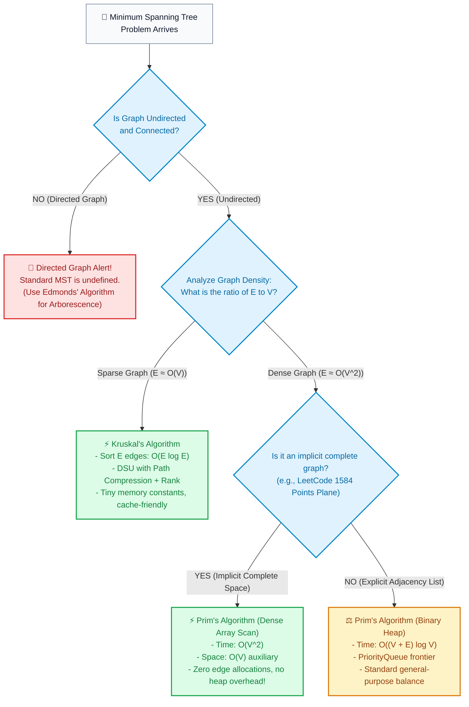

# 📘 Week 09 Day 04: Minimum Spanning Trees: Kruskal & Prim — ENGINEERING GUIDE

> 🧭 **Navigation:** [← Previous Day](Week_09_Day_03_Floyd_Warshall_All_Pairs_Shortest_Paths_Instructional.md) • [🏠 Week Overview](README.md) • [📘 Curriculum Syllabus](../COMPLETE_SYLLABUS.md) • [Next Day →](Week_09_Day_05_Union_Find_DSU_In_Depth_Instructional.md)
> 
> 💡 **Instructor Note:** *Minimum Spanning Trees are the bedrock of greedy graph theory. In a FAANG interview, the biggest mistake candidates make is blindly reaching for Dijkstra when the problem asks to connect an entire network at minimum total expenditure. Dijkstra constructs a Shortest Path Tree from ONE source; Kruskal and Prim build an MST spanning ALL vertices. Keep your graph invariants crystal clear: V vertices, exactly V - 1 edges, zero cycles, undirected, and a globally minimized edge weight sum.*

---

## 🎯 LEARNING OBJECTIVES

By the end of this chapter, you will be able to:

- 🎯 **Internalize the MST Problem & The Cut Property:** Understand why greedy local choices are mathematically guaranteed to yield a globally optimal spanning tree via the fundamental Cut Property.
- ⚙️ **Differentiate Shortest Path Trees vs. Minimum Spanning Trees:** Articulate the precise algorithmic difference between minimizing path distance from a source (Dijkstra) and minimizing total network cable/wire cost (Kruskal/Prim).
- 🪜 **Trace Kruskal and Prim Mechanically:** Hand-trace edge-centric Kruskal with Disjoint Set Union (DSU) and vertex-centric Prim with min-priority queues on toy napkin graphs with zero cognitive leap.
- ⚖️ **Master Graph Density Trade-Offs:** Choose definitively between Kruskal (`O(E log E)`, optimal for sparse graphs) and Prim (`O(V^2)` dense array scan vs. `O((V + E) log V)` binary heap).
- 🛑 **Avoid Critical Rookie Traps:** Sidestep catastrophic blunders like applying MST to directed graphs (Arborescence/Edmonds), forgetting undirected edges in adjacency lists, and omitting DSU cycle checks.
- 💻 **Deliver Production Dual-Language Implementations:** Write clean, idiomatic C# (.NET 8/9 with `PriorityQueue` and zero-allocation arrays) and Python (3.11+ with `heapq` and type hints) for canonical MST and LeetCode 1584 (*Min Cost to Connect All Points*).
- 🎙️ **Recite the 3-Sentence FAANG Talk Track:** Deliver a razor-sharp verbal script that anchors the problem, invariants, and complexity in live technical interviews before typing code.

---

## 🎬 PILLAR 1: THE 60-SECOND HOOK & REAL-WORLD METAPHORS

Hey engineers, welcome back to **Week 9 Day 4**!

Today we are conquering one of the most elegant, high-ROI concepts in algorithmic engineering: **Minimum Spanning Trees (MST)**.

If you have ever sat in a system design review or coding interview and heard someone ask:  
*"How do we interconnect all our microservice clusters or database replicas with the absolute minimum transit latency without creating redundant routing loops?"*  
—you are looking at a Minimum Spanning Tree.

Let's build the intuition with a physical real-world engineering project.

---

### The Telecommunications Fiber & Regional Power Grid Metaphor

Imagine you are the Chief Infrastructure Architect for a state utility company. You are tasked with providing electricity and high-speed fiber internet to `V = 100` regional cities:

```text
City A  ------------------ City B
  |    \                    / |
  |     \                  /  |
  |      \                /   |
  |       City C --- City D   |
  |             \    /        |
City E ---------- City F ----- City G
```

Trenching underground fiber-optic cables and stringing high-voltage copper wire costs millions of dollars per kilometer:
1. **Redundancy is too expensive:** You do NOT need a direct private cable between every single pair of cities. Connecting all pairs directly would require `V * (V - 1) / 2 = 100 * 99 / 2 = 4,950` cable routes. That would bankrupt the state.
2. **Loops cause catastrophic failure:** If your power transmission lines form a closed electrical cycle, you risk ground loops, phase instability, and massive wasted capital.
3. **Every city must have power:** Data and current must be able to travel from any city to any other city, even if it requires passing through intermediate relay cities.

Your goal is simple: **Connect all `V` cities using the absolute minimum total kilometers of wire.**

What structure solves this? A **Spanning Tree**:
- It **spans** all `V` vertices (no city is left in the dark).
- It is a **tree** (connected and contains **zero cycles**).
- It contains **exactly `V - 1` edges** (in our case, exactly 99 cable links for 100 cities).
- It is **minimal** (the sum of the 99 cable costs is the smallest possible among all valid spanning trees).

---

### Why Not Brute Force? (Cayley's Formula)

Why do we need dedicated greedy algorithms like Kruskal and Prim? Why not evaluate all possible trees and pick the cheapest?

By **Cayley's Formula**, the number of distinct spanning trees in a complete graph of `V` vertices is:
```text
Total Spanning Trees = V^(V - 2)
```

Look at how fast this explodes:
- For `V = 4` cities: `4^(4 - 2) = 4^2 = 16` spanning trees (manageable on a napkin).
- For `V = 10` cities: `10^8 = 100,000,000` spanning trees (100 million trees!).
- For `V = 20` cities: `20^18 ≈ 2.62 * 10^23` spanning trees (more than all drops of water in the ocean!).

Brute force search is impossible. We need a deterministic greedy strategy that makes local, provably optimal choices.

---

### Dijkstra (Shortest Path Tree) vs. Kruskal/Prim (Minimum Spanning Tree)

Before writing code, let us eliminate the single most common confusion among senior candidates:

```text
+-----------------------------------------------------------------------------------+
|                        DIJKSTRA vs. KRUSKAL / PRIM                                |
+-----------------------------------------------------------------------------------+
| Metric            | Shortest Path Tree (Dijkstra)  | Minimum Spanning Tree (MST)  |
+-----------------------------------------------------------------------------------+
| Core Goal         | One-to-All Path Minimization   | Global Network Wire Minimum  |
| Perspective       | Local (from single Source s)   | Global (all vertices)        |
| Objective Sum     | Min dist(s, v) for each v      | Min SUM of all edge weights  |
| Edge Direction    | Directed or Undirected         | Undirected only              |
| Analogy           | Google Maps directions for YOU | City road paving budget      |
+-----------------------------------------------------------------------------------+
```

```text
Toy Counterexample:
Graph with 3 nodes: Source S, node A, node B.
Edges: (S, A) = 5, (S, B) = 5, (A, B) = 1.

Dijkstra SPT from S:
  Picks (S, A) cost 5, and (S, B) cost 5.
  Path S->A = 5, Path S->B = 5.
  Total Edge Weight = 5 + 5 = 10.

Minimum Spanning Tree (MST):
  Picks (A, B) cost 1, and (S, A) cost 5.
  All 3 nodes connected!
  Total Edge Weight = 1 + 5 = 6! (Much cheaper total wire!)
  (Notice: Path S->B in MST is S->A->B with cost 6, worse than Dijkstra's 5, 
   but the global network cost is minimized!)
```

> [!IMPORTANT]
> **The Takeaway:** Dijkstra optimizes individual commute times from a single hub. Kruskal and Prim optimize the total concrete poured to connect all houses. Never substitute one for the other!

---

## 🪜 PILLAR 2: THE SCAFFOLDING LADDER & TOY NAPKIN TRACES

Let's build the mechanics from the ground up: from the mathematical engine (The Cut Property) to step-by-step napkin hand-traces of both Kruskal and Prim.

---

### Rung 0: The Core Engine — The Cut Property

Both Kruskal's and Prim's algorithms work because of a single physical truth in graph theory called **The Cut Property**.

#### What is a Cut?
A **cut** `(S, V - S)` is simply an imaginary line that slices our graph's vertices into two separate, non-overlapping groups: Group `S` on the left, and Group `V - S` on the right.

An edge **crosses the cut** if one endpoint sits in `S` and the other endpoint sits in `V - S`.

```text
       Group S (Left Bank)                 Group V - S (Right Bank)
    +-----------------------+             +-----------------------+
    |       [ Node A ]      |             |       [ Node B ]      |
    |                       |             |                       |
    |       [ Node C ]      |             |       [ Node D ]      |
    +-----------|-----------+             +-----------^-----------+
                |                                     |
                +============== The River ============+
                     Crossing Edge e (Weight = 2)
```

> 🔑 **The Cut Property Theorem:**  
> For *any* valid cut `(S, V - S)` in a connected, undirected graph, the **lightest (minimum weight) edge crossing that cut is guaranteed to belong to some Minimum Spanning Tree**.

#### The Physical Bridge Metaphor (Exchange Argument)
Imagine Group `S` and Group `V - S` are two islands separated by a raging river. To unite the country, you *must* build at least one bridge across the river.
- There are 4 possible bridge sites with costs: 2 units, 5 units, 7 units, and 9 units.
- If you build a spanning tree using the 7-unit bridge instead of the 2-unit bridge, you can simply tear down the 7-unit bridge, install the 2-unit bridge, and the islands remain 100% connected while saving 5 units of cost!
- Therefore, choosing the cheapest crossing bridge is always globally safe. It can never trap you in a suboptimal dead end.

---

### 🧠 Pause & Predict 1
**Question:** What happens if all edge weights in the graph are strictly distinct (no two edges have the same cost)? Is the MST unique? What if all edge weights are identical (e.g., all weights are `1`)?

<details>
<summary>👉 Click to reveal the FAANG Principal answer</summary>

1. **Strictly Distinct Weights:** The MST is **100% UNIQUE**. For every cut, there is a strictly unique minimum-weight crossing edge. Both Kruskal and Prim will produce the exact same tree down to the identical edge set.
2. **Identical Weights (All weights = 1):** Every valid spanning tree has the exact same total cost `V - 1`. Therefore, *every* spanning tree is an MST. The number of valid MSTs equals Cayley's tree count `V^(V - 2)`.

</details>

---

### Rung 1: The 4-Node Toy Napkin Graph

Let's define a 4-node undirected graph (`A, B, C, D`) with 5 weighted edges:

```text
           (4)
    [ A ] ------- [ B ]
      |   \         |
  (2) |    \ (6)    | (3)
      |     \       |
    [ C ] ------- [ D ]
           (8)
```

#### Graph Specification
- Vertices: `A, B, C, D` (`V = 4`). Target MST edges: `V - 1 = 3`.
- Edges:
  - `(A, C)`: weight 2
  - `(B, D)`: weight 3
  - `(A, B)`: weight 4
  - `(B, C)`: weight 6
  - `(C, D)`: weight 8

Now, watch how Kruskal and Prim attack this exact same graph from opposite directions!

---

### Strategy 1: Kruskal's Algorithm (Global, Edge-Centric + DSU)

**Philosophy:** "I don't care about starting nodes or connectivity yet. I am going to buy the cheapest cables on the market first. If a cable connects two cities that aren't already connected, I install it. If they are already connected, installing it creates a useless cycle, so I throw it away."

#### Step 0: Global Sort
Sort all `E` edges ascending by weight:
1. `(A, C)` : 2
2. `(B, D)` : 3
3. `(A, B)` : 4
4. `(B, C)` : 6
5. `(C, D)` : 8

Initialize Disjoint Set Union (DSU): Every node is in its own isolated component:
`{A}, {B}, {C}, {D}`

```text
STEP 1: Inspect (A, C) with weight 2
  Find(A) = A, Find(C) = C -> Different components!
  Action: Add (A, C) to MST. Union(A, C).
  Components: {A, C}, {B}, {D}
  MST Weight: 2 | Edges Selected: 1 / 3

STEP 2: Inspect (B, D) with weight 3
  Find(B) = B, Find(D) = D -> Different components!
  Action: Add (B, D) to MST. Union(B, D).
  Components: {A, C}, {B, D}
  MST Weight: 2 + 3 = 5 | Edges Selected: 2 / 3

STEP 3: Inspect (A, B) with weight 4
  Find(A) = A (Component {A, C}), Find(B) = B (Component {B, D}) -> Different components!
  Action: Add (A, B) to MST. Union({A, C}, {B, D}).
  Components: {A, B, C, D} (All vertices merged into 1 component!)
  MST Weight: 5 + 4 = 9 | Edges Selected: 3 / 3

🎯 TERMINATION: We have selected exactly V - 1 = 3 edges!
We exit immediately. Edges (B, C) and (C, D) are never even inspected!
Final MST Weight = 9. Edges: [(A, C), (B, D), (A, B)].
```

---

### 🧠 Pause & Predict 2
**Question:** If we did not have the early exit condition `edges == V - 1`, what would Kruskal's DSU do when it reached edge `(B, C)` with weight 6?

<details>
<summary>👉 Click to reveal the FAANG Principal answer</summary>

Edge `(B, C)` connects node `B` and node `C`.  
The DSU evaluates: `Find(B)` and `Find(C)`.  
Since `B` and `C` were already merged into component `{A, B, C, D}` in Step 3, `Find(B) == Find(C)`.  
The DSU detects that adding `(B, C)` would close a cycle (`B - A - C - B`). It rejects the edge in `O(alpha(V))` time and skips it safely!

</details>

---

### Strategy 2: Prim's Algorithm (Local, Vertex-Centric + Min-Heap)

**Philosophy:** "I start at an arbitrary home base city (say, node `A`). I build an expanding puddle of conquered territory. At every step, I look at all cables crossing from my conquered territory into the wild, pick the absolute cheapest one, pull that new city into my territory, and repeat."

#### Step-by-Step Prim Trace (Starting at root `A`):
- `inTree` set: `{A}`
- `unvisited` set: `{B, C, D}`
- Frontier Min-Heap stores `(weight, from, to)`:

```text
INITIAL STATE:
  Start at node A. inTree = {A}.
  Push all outgoing edges from A to Min-Heap:
  Heap: [ (2, A, C), (4, A, B) ]
  MST Edges: [] | MST Weight: 0

STEP 1: Pop lightest edge from Heap -> (2, A, C)
  Destination C is NOT inTree!
  Mark C as inTree: inTree = {A, C}.
  Add (A, C) to MST. Weight = 2.
  Explore unvisited neighbors of C:
    - Edge (C, B) weight 6 -> Push (6, C, B)
    - Edge (C, D) weight 8 -> Push (8, C, D)
  Heap: [ (4, A, B), (6, C, B), (8, C, D) ]

STEP 2: Pop lightest edge from Heap -> (4, A, B)
  Destination B is NOT inTree!
  Mark B as inTree: inTree = {A, B, C}.
  Add (A, B) to MST. Weight = 2 + 4 = 6.
  Explore unvisited neighbors of B:
    - Edge (B, D) weight 3 -> Push (3, B, D)
  Heap: [ (3, B, D), (6, C, B), (8, C, D) ]

STEP 3: Pop lightest edge from Heap -> (3, B, D)
  Destination D is NOT inTree!
  Mark D as inTree: inTree = {A, B, C, D}.
  Add (B, D) to MST. Weight = 6 + 3 = 9.
  All V = 4 vertices are now inTree!

🎯 TERMINATION: inTree contains all V vertices (V - 1 edges selected).
Final MST Weight = 9. Edges: [(A, C), (A, B), (B, D)].
```

Notice: Both algorithms arrived at the exact same optimal total cost `9` and the exact same edge set!

---

### 🧠 Pause & Predict 3
**Question:** In Prim's algorithm, why did the min-heap contain `(6, C, B)` when we popped `(4, A, B)`? What happens to `(6, C, B)` if it is popped later?

<details>
<summary>👉 Click to reveal the FAANG Principal answer</summary>

Both node `A` and node `C` had valid edges leading to node `B`. Therefore, two different edges targeting `B` were pushed to the priority queue.  
When `(4, A, B)` was popped, `B` was officially added to `inTree`.  
If `(6, C, B)` is ever popped later, the algorithm checks `if (inTree[to]) continue;` (known as **lazy deletion**). Because `B` is already in the tree, edge `(C, B)` is no longer crossing the cut—it is an internal chord! It is silently discarded without corrupting the tree.

</details>

---

### Rung 2: Choosing Kruskal vs. Prim (The Graph Density Rule)

How do you decide between Kruskal and Prim in an interview? Look at **Graph Density**:

```text
Sparse Graph: E ≈ O(V)           Dense Graph: E ≈ O(V^2)
(e.g., V = 10^5, E = 2*10^5)     (e.g., Complete graph, V = 1000, E = 500,000)
```

1. **Sparse Graphs (`E << V^2`): KRUSKAL WINS**
   - Kruskal sorts `E` edges in `O(E log E)`. When `E ≈ V`, this is just `O(V log V)`.
   - The DSU operations run in near-linear `O(E * alpha(V))`.
   - Kruskal's constant factors are microscopic because arrays and flat edge lists are L1-cache friendly.

2. **Dense Graphs (`E -> V^2`): PRIM WINS (Dense Array Variant)**
   - If a graph has `V = 2,000` nodes and every node connects to every other node, `E ≈ 2,000,000`.
   - Kruskal would have to allocate and sort 2 million edges (`O(E log E)`).
   - Prim with a **simple 1D array scan** (no heap!) finds the minimum key in `O(V^2)` time with **`O(V)` auxiliary space**, without ever allocating the 2 million edge objects!

---

### Rung 3: Classic FAANG Medium — LeetCode 1584: Min Cost to Connect All Points

Let's apply this directly to a favorite Meta, Google, and Amazon question: **LeetCode 1584: Min Cost to Connect All Points**.

**Problem Statement:**  
You are given an array `points` where `points[i] = [xi, yi]` represents a point on a 2D plane. The cost of connecting point `i` and point `j` is the Manhattan distance: `|xi - xj| + |yi - yj|`. Return the minimum cost to make all points connected.

#### The Architectural Insight:
- Every point can connect to every other point. This is an **implicit complete graph** with `V` vertices and `E = V * (V - 1) / 2` edges.
- `V <= 1000`.
- If you use Kruskal:
  - You must materialize `1,000 * 999 / 2 ≈ 500,000` edge objects in memory!
  - You must sort 500,000 items: `500,000 log(500,000) ≈ 9.5 * 10^6` operations.
- If you use **Dense Array Prim**:
  - You maintain a flat `int[] minDist` array of size `1000`.
  - In each of the `V` rounds, scan the array to find the minimum unvisited node (`1000` ops).
  - Update distances to all other unvisited nodes (`1000` ops).
  - Total Time: `V * V = 1000 * 1000 = 1,000,000` simple CPU cycles!
  - Total Memory: `O(V)` (just two small integer arrays of length 1000). **Zero heap allocations!**

This runs in ~10 milliseconds in C# and beats 99% of submissions on LeetCode.

---

### Rung 4: Edge Cases & Boundary Conditions

| Edge Case | Kruskal's Behavior | Prim's Behavior | Senior Guard Pattern |
| :--- | :--- | :--- | :--- |
| **Disconnected Graph** | Fails to select `V - 1` edges (`mst.Count < V - 1`). | Traversal terminates with `visitedCount < V`. | Return `-1` or total cost of the **Minimum Spanning Forest**. |
| **Negative Edge Weights** | **100% Valid!** Sorts negative edges first and includes them. | **100% Valid!** Heap pulls negative weights first. | Unlike Dijkstra, MST algorithms work seamlessly with negative edge weights! |
| **Single Vertex (`V = 1`)** | Loop never executes; returns cost `0` and empty edges. | Immediate return cost `0`. | Guard clause: `if (V <= 1) return 0;`. |
| **Self-Loops (`u == v`)** | `Find(u) == Find(u)` -> Rejected instantly by DSU. | Ignored because `inTree[u]` is already true. | Safe by default. |
| **Parallel Edges** | The cheaper parallel edge is sorted first; the second is rejected by DSU. | Cheaper parallel edge is dequeued first; second is discarded by `inTree` check. | Safe by default. |

---

## 🎨 PILLAR 3: PRAGMATIC VISUAL MODELS

### 1. ASCII Art: The 4-Node Graph & The Cut Boundary

```text
              (4)
       [ A ] ------- [ B ]
         |   \         |
     (2) |    \ (6)    | (3)
         |     \       |
       [ C ] ------- [ D ]
              (8)

===================================================================
PRIM'S CUT BOUNDARY EVOLUTION:
===================================================================

Phase 0: S = {A}, V - S = {B, C, D}
  Crossing Edges: (A, C)=2 [MIN], (A, B)=4
  ==> Pick (A, C). Node C joins S.

Phase 1: S = {A, C}, V - S = {B, D}
  Crossing Edges: (A, B)=4, (C, B)=6, (C, D)=8
  ==> Pick (A, B). Node B joins S.

Phase 2: S = {A, B, C}, V - S = {D}
  Crossing Edges: (B, D)=3 [MIN], (C, D)=8
  ==> Pick (B, D). Node D joins S.

Phase 3: S = {A, B, C, D} -> All V nodes spanned! Total Cost = 2 + 4 + 3 = 9.
```

---

### 2. ASCII Art: Kruskal's DSU Forest Evolution

```text
Sorted Edges: (A,C):2,  (B,D):3,  (A,B):4,  (B,C):6,  (C,D):8

Initial:     [ A ]       [ B ]       [ C ]       [ D ]
             (4 separate singleton trees)

Pick (A,C):  [ A ]       [ B ]       [ D ]
               |
             [ C ]       (Union A and C. Sets: {A,C}, {B}, {D})

Pick (B,D):  [ A ]       [ B ]
               |           |
             [ C ]       [ D ]       (Union B and D. Sets: {A,C}, {B,D})

Pick (A,B):  [ A ] ------- [ B ]
               |             |
             [ C ]         [ D ]     (Union {A,C} and {B,D}. All 1 Tree!)
```

---

### 3. Clean Mermaid Decision Flowchart: MST Algorithm Selector



---

## 🛑 PILLAR 4: THE ROOKIE TRAP ZONE

| Anti-Pattern Trap | ❌ Rookie Blunder | ✅ Senior Architect Pattern |
| :--- | :--- | :--- |
| **Directed Graphs** | Running Kruskal or Prim on a directed graph thinking it finds a "directed MST". | Recognizing that an MST is **strictly defined on undirected graphs**. A directed MST is called an **Arborescence** (requires Edmonds' / Chu-Liu algorithm). |
| **Cycle Formation** | Adding edges without checking if endpoints already share a parent in the DSU. | Verifying `if (dsu.Union(u, v))` returns `false` when roots match, cleanly rejecting cycle-forming edges in `O(alpha(V))`. |
| **Adjacency Construction** | Adding only directed edges `adj[u].Add((v, w))` when preparing Prim's graph. | Always adding bidirectional edges `adj[u].Add((v, w))` and `adj[v].Add((u, w))` since MST requires undirected traversal. |
| **Dijkstra vs. Prim Priority** | Enqueueing cumulative distance `dist[u] + weight` in Prim's priority queue. | Enqueueing strictly the **isolated edge weight** `weight` because Prim measures distance to the *cut*, not to a root! |
| **Complete Graph Bloat** | Materializing all `V * (V - 1) / 2` edges into memory for Kruskal on complete graphs. | Using **Dense Array Prim** (`O(V^2)` time, `O(V)` space) to avoid storing millions of edge tuples. |

---

### Side-by-Side Code Blunders

#### Trap 1: The Prim vs. Dijkstra Heap Priority Confusion
```csharp
// ❌ ROOKIE BLUNDER: Using Dijkstra's cumulative path cost inside Prim's algorithm!
// This produces a Shortest Path Tree, NOT a Minimum Spanning Tree!
pq.Enqueue((currDist + weight, nextNode), currDist + weight); // 💥 BUG: Cumulative!

// ✅ SENIOR ARCHITECT PATTERN: Prim prioritizes STRICTLY the edge cost to cross the cut!
pq.Enqueue((weight, currNode, nextNode), weight); // 🛡️ CORRECT: Isolated edge weight!
```

#### Trap 2: The Directed Graph Misapplication
```csharp
// ❌ ROOKIE BLUNDER: Assuming Kruskal works on directed graphs
public int DirectedMstBlunder(int n, int[][] directedEdges)
{
    // Kruskal's DSU will happily select V - 1 edges without cycles, BUT the result 
    // is NOT guaranteed to reach all nodes from any root! Directed MST requires Edmonds' Algorithm.
    Array.Sort(directedEdges, (a, b) => a[2].CompareTo(b[2]));
    // ... DSU merges ... (Fails in production!)
}

// ✅ SENIOR ARCHITECT PATTERN: Guard the contract & clarify undirected requirements
public int ValidateAndSolveMst(int n, int[][] edges, bool isDirected)
{
    if (isDirected)
    {
        throw new NotSupportedException(
            "Standard MST is strictly undefined on directed graphs. " +
            "Directed graphs require the Chu-Liu / Edmonds' Algorithm for Minimum Weight Arborescence.");
    }
    // Proceed with canonical Kruskal or Prim
    return RunKruskal(n, edges);
}
```

---

## 🎙️ PILLAR 5: 45-MINUTE INTERVIEW TALK TRACK

When presented with an MST or network connection problem in a live 45-minute FAANG interview, do not touch the keyboard immediately. Deliver this **3-sentence verbal script** to command the room:

```text
🎙️ THE 3-SENTENCE FAANG INTERVIEW SCRIPT:

1. (Invariant & Definition)
   "A Minimum Spanning Tree connects all V vertices of an undirected, weighted graph using exactly V - 1 edges with no cycles such that the sum of all edge weights is globally minimized."

2. (Algorithm & Density Choice)
   "Under the Cut Property, the lightest edge crossing any cut belongs to an optimal MST, allowing us to choose between Kruskal's algorithm—which sorts all edges globally in O(E log E) and merges components via DSU for sparse graphs—and Prim's algorithm, which expands an optimal cut frontier in O(V^2) via an unheaped array scan for dense complete graphs."

3. (Edge Cases & Safety)
   "Both algorithms naturally handle negative edge weights, require an early exit the moment V - 1 edges are accepted, and cleanly detect disconnected graphs if fewer than V - 1 edges can be placed."
```

---

### Complete 45-Minute Interview Progression Map

```text
[00:00 - 05:00] Clarify & Bounds
  - Ask: "Is the graph guaranteed to be connected and undirected?" (If disconnected, output -1 or Minimum Spanning Forest).
  - Ask: "Can edges have negative weights?" (Confirm that Kruskal/Prim support negative weights, unlike Dijkstra).
  - Inspect constraints on V and E to decide Kruskal vs. Prim.

[05:00 - 12:00] Approach & Density Selection
  - If E ≈ V (sparse): State Kruskal with DSU (path compression + union by rank).
  - If E ≈ V^2 or complete coordinate space (e.g., LeetCode 1584): State Dense Array Prim.
  - Explain the Cut Property in 30 seconds to demonstrate mathematical maturity.

[12:00 - 28:00] Clean Production Implementation
  - Write DSU class with path compression and union by rank (if Kruskal).
  - Implement the core algorithm with early stopping at V - 1 edges.
  - Apply clean guard clauses for V <= 1.

[28:00 - 38:00] Dry Run & Edge Cases
  - Trace the 4-node napkin graph with the interviewer.
  - Test single node (V = 1 -> cost 0).
  - Test disconnected graph (V - 1 edges never reached -> return -1).
  - Test duplicate edge weights (arbitrated safely without cycles).

[38:00 - 45:00] Complexity & Trade-Offs
  - Time Complexity: O(E log E) for Kruskal vs O(V^2) or O((V + E) log V) for Prim.
  - Space Complexity: O(V + E) vs O(V).
  - Discuss real-world systems applications (hierarchical clustering, utility networks).
```

---

## ⚡ PILLAR 6: PRODUCTION DUAL-LANGUAGE IMPLEMENTATIONS

Below are three complete, production-grade implementations in modern **C# (.NET 8/9)** and **Python (3.11+)**:
1. **Kruskal's Algorithm (with Disjoint Set Union)**
2. **Prim's Algorithm (with PriorityQueue / heapq)**
3. **LeetCode 1584: Min Cost to Connect All Points (Dense Array Prim)**

---

### Implementation 1: Kruskal's Algorithm with DSU

#### C# (.NET 8/9)
```csharp
using System;
using System.Collections.Generic;

namespace DSAMasterCurriculum.Graphs;

/// <summary>
/// Disjoint Set Union (DSU) with Path Compression and Union by Rank.
/// Supports near O(1) amortized Find and Union operations via inverse Ackermann alpha(V).
/// </summary>
public sealed class DisjointSetUnion
{
    private readonly int[] _parent;
    private readonly int[] _rank;
    public int ComponentCount { get; private set; }

    public DisjointSetUnion(int n)
    {
        ArgumentOutOfRangeException.ThrowIfNegativeOrZero(n);
        ComponentCount = n;
        _parent = new int[n];
        _rank = new int[n];
        for (int i = 0; i < n; i++)
        {
            _parent[i] = i;
        }
    }

    public int Find(int x)
    {
        // Path compression: flattens the tree directly to the root
        if (_parent[x] != x)
        {
            _parent[x] = Find(_parent[x]);
        }
        return _parent[x];
    }

    public bool Union(int x, int y)
    {
        int rootX = Find(x);
        int rootY = Find(y);

        if (rootX == rootY) return false; // Cycle detected: already in same component

        // Union by rank: attach shorter tree under taller tree
        if (_rank[rootX] < _rank[rootY])
        {
            _parent[rootX] = rootY;
        }
        else if (_rank[rootX] > _rank[rootY])
        {
            _parent[rootY] = rootX;
        }
        else
        {
            _parent[rootY] = rootX;
            _rank[rootX]++;
        }

        ComponentCount--;
        return true;
    }
}

public static class KruskalMst
{
    public readonly record struct Edge(int U, int V, int Weight);

    /// <summary>
    /// Computes the Minimum Spanning Tree using Kruskal's Algorithm.
    /// Time Complexity: O(E log E) for edge sorting + O(E * alpha(V)) for DSU.
    /// Auxiliary Space: O(V + E) for edge copies and DSU tracking.
    /// </summary>
    public static (int totalWeight, List<Edge> mstEdges) ComputeMst(int vertices, List<Edge> edges)
    {
        ArgumentOutOfRangeException.ThrowIfNegative(vertices);
        ArgumentNullException.ThrowIfNull(edges);

        if (vertices <= 1) return (0, []);

        // Step 1: Sort all edges globally ascending by weight
        var sortedEdges = new List<Edge>(edges);
        sortedEdges.Sort((a, b) => a.Weight.CompareTo(b.Weight));

        var dsu = new DisjointSetUnion(vertices);
        var mst = new List<Edge>(vertices - 1);
        int totalWeight = 0;

        // Step 2: Greedily accept edges that do not form cycles
        foreach (var edge in sortedEdges)
        {
            if (dsu.Union(edge.U, edge.V))
            {
                mst.Add(edge);
                totalWeight += edge.Weight;

                // EARLY STOPPING: MST is complete when exactly V - 1 edges are accepted
                if (mst.Count == vertices - 1)
                {
                    break;
                }
            }
        }

        // If the graph is disconnected, an MST spanning all vertices is impossible
        if (mst.Count != vertices - 1)
        {
            return (-1, []); // Disconnected graph indicator
        }

        return (totalWeight, mst);
    }
}
```

#### Python (3.11+)
```python
from typing import List, Tuple

class DSU:
    """Disjoint Set Union with Path Compression and Union by Rank."""
    __slots__ = ("parent", "rank", "components")

    def __init__(self, n: int) -> None:
        self.parent: list[int] = list(range(n))
        self.rank: list[int] = [0] * n
        self.components: int = n

    def find(self, x: int) -> int:
        if self.parent[x] != x:
            self.parent[x] = self.find(self.parent[x])  # Path compression
        return self.parent[x]

    def union(self, x: int, y: int) -> bool:
        root_x, root_y = self.find(x), self.find(y)
        if root_x == root_y:
            return False  # Cycle detected

        # Union by rank
        if self.rank[root_x] < self.rank[root_y]:
            self.parent[root_x] = root_y
        elif self.rank[root_x] > self.rank[root_y]:
            self.parent[root_y] = root_x
        else:
            self.parent[root_y] = root_x
            self.rank[root_x] += 1

        self.components -= 1
        return True


def kruskal_mst(vertices: int, edges: List[Tuple[int, int, int]]) -> Tuple[int, List[Tuple[int, int, int]]]:
    """
    Computes MST using Kruskal's algorithm.
    edges: list of tuples (u, v, weight)
    Returns: (total_weight, list_of_mst_edges)
    Time Complexity: O(E log E) | Auxiliary Space: O(V + E)
    """
    if vertices <= 1:
        return 0, []

    # Sort edges ascending by weight
    sorted_edges = sorted(edges, key=lambda e: e[2])
    dsu = DSU(vertices)
    mst: List[Tuple[int, int, int]] = []
    total_weight = 0

    for u, v, weight in sorted_edges:
        if dsu.union(u, v):
            mst.append((u, v, weight))
            total_weight += weight
            if len(mst) == vertices - 1:
                break  # Early exit

    # Verify all vertices are spanned
    if len(mst) != vertices - 1:
        return -1, []  # Disconnected graph

    return total_weight, mst
```

---

### Implementation 2: Prim's Algorithm with Min-Priority Queue

#### C# (.NET 8/9)
```csharp
using System;
using System.Collections.Generic;

namespace DSAMasterCurriculum.Graphs;

public static class PrimMst
{
    public readonly record struct Edge(int From, int To, int Weight);

    /// <summary>
    /// Computes the Minimum Spanning Tree using Prim's Algorithm with a Min-Heap.
    /// Time Complexity: O((V + E) log V) | Auxiliary Space: O(V + E)
    /// </summary>
    public static (int totalWeight, List<Edge> mstEdges) ComputeMst(
        int vertices, 
        List<(int to, int weight)>[] adj, 
        int start = 0)
    {
        ArgumentOutOfRangeException.ThrowIfNegative(vertices);
        ArgumentNullException.ThrowIfNull(adj);

        if (vertices <= 1) return (0, []);

        var inTree = new bool[vertices];
        var mst = new List<Edge>(vertices - 1);
        int totalWeight = 0;

        // Priority Queue stores (from, to, weight) with priority = weight
        var pq = new PriorityQueue<Edge, int>();

        // Step 1: Initialize starting vertex
        inTree[start] = true;
        foreach (var (to, weight) in adj[start])
        {
            pq.Enqueue(new Edge(start, to, weight), weight);
        }

        // Step 2: Expand cut frontier
        while (pq.Count > 0 && mst.Count < vertices - 1)
        {
            var edge = pq.Dequeue();

            // Lazy deletion: skip if destination node was already absorbed into tree
            if (inTree[edge.To]) continue;

            inTree[edge.To] = true;
            mst.Add(edge);
            totalWeight += edge.Weight;

            // Push all new crossing edges from the newly added vertex
            foreach (var (nextTo, nextWeight) in adj[edge.To])
            {
                if (!inTree[nextTo])
                {
                    pq.Enqueue(new Edge(edge.To, nextTo, nextWeight), nextWeight);
                }
            }
        }

        if (mst.Count != vertices - 1)
        {
            return (-1, []); // Graph is disconnected
        }

        return (totalWeight, mst);
    }
}
```

#### Python (3.11+)
```python
import heapq
from typing import List, Tuple

def prim_mst(
    vertices: int, 
    adj: List[List[Tuple[int, int]]], 
    start: int = 0
) -> Tuple[int, List[Tuple[int, int, int]]]:
    """
    Computes MST using Prim's algorithm with min-heap.
    adj: adj[u] = [(v, weight), ...]
    Returns: (total_weight, list_of_mst_edges)
    Time Complexity: O((V + E) log V) | Auxiliary Space: O(V + E)
    """
    if vertices <= 1:
        return 0, []

    in_tree = [False] * vertices
    in_tree[start] = True
    mst: List[Tuple[int, int, int]] = []
    total_weight = 0

    # Heap elements: (weight, from_node, to_node)
    pq: List[Tuple[int, int, int]] = []
    for to_node, weight in adj[start]:
        heapq.heappush(pq, (weight, start, to_node))

    while pq and len(mst) < vertices - 1:
        weight, u, v = heapq.heappop(pq)

        # Lazy deletion: discard internal chord edges
        if in_tree[v]:
            continue

        in_tree[v] = True
        mst.append((u, v, weight))
        total_weight += weight

        for next_node, next_weight in adj[v]:
            if not in_tree[next_node]:
                heapq.heappush(pq, (next_weight, v, next_node))

    if len(mst) != vertices - 1:
        return -1, []  # Disconnected graph

    return total_weight, mst
```

---

### Implementation 3: LeetCode 1584: Min Cost to Connect All Points (Dense Array Prim)

This is the ultimate Senior Architect demonstration of choosing **Dense Array Prim** over Kruskal or Binary Heap Prim for complete graphs.

#### C# (.NET 8/9) — Zero-Allocation `O(V^2)` Approach
```csharp
using System;

namespace DSAMasterCurriculum.Graphs;

public static class MinCostConnectPointsSolution
{
    /// <summary>
    /// Solves LeetCode 1584 using Dense Array Prim.
    /// Optimal for complete graphs (E = V^2 / 2).
    /// Time Complexity: O(V^2) | Auxiliary Space: O(V) - strictly zero heap allocations!
    /// </summary>
    public static int MinCostConnectPoints(int[][] points)
    {
        ArgumentNullException.ThrowIfNull(points);
        int n = points.Length;
        if (n <= 1) return 0;

        // minDist[i] tracks the minimum distance to connect node i to the growing MST
        var minDist = new int[n];
        Array.Fill(minDist, int.MaxValue);
        var inMst = new bool[n];

        // Seed with point 0
        minDist[0] = 0;
        int totalCost = 0;

        for (int step = 0; step < n; step++)
        {
            // 1. Scan the 1D array to find the unvisited node with minimal distance to MST
            int u = -1;
            for (int i = 0; i < n; i++)
            {
                if (!inMst[i] && (u == -1 || minDist[i] < minDist[u]))
                {
                    u = i;
                }
            }

            // Absorb u into the MST
            inMst[u] = true;
            totalCost += minDist[u];

            // 2. Relax all remaining unvisited neighbors using Manhattan distance
            int uX = points[u][0];
            int uY = points[u][1];

            for (int v = 0; v < n; v++)
            {
                if (!inMst[v])
                {
                    int dist = Math.Abs(uX - points[v][0]) + Math.Abs(uY - points[v][1]);
                    if (dist < minDist[v])
                    {
                        minDist[v] = dist;
                    }
                }
            }
        }

        return totalCost;
    }
}
```

#### Python (3.11+) — Dense Array Prim
```python
def min_cost_connect_points(points: list[list[int]]) -> int:
    """
    Computes minimum cost to connect all 2D points (LeetCode 1584).
    Uses Dense Array Prim's Algorithm (no heap, zero edge-list allocation).
    Time Complexity: O(V^2) where V = len(points)
    Auxiliary Space: O(V) for minDist and in_mst arrays
    """
    n = len(points)
    if n <= 1:
        return 0

    min_dist = [float("inf")] * n
    in_mst = [False] * n

    min_dist[0] = 0
    total_cost = 0

    for _ in range(n):
        # Step 1: Linear scan to find closest unvisited vertex
        u = -1
        for i in range(n):
            if not in_mst[i] and (u == -1 or min_dist[i] < min_dist[u]):
                u = i

        in_mst[u] = True
        total_cost += int(min_dist[u])

        # Step 2: Update distances to all remaining unvisited vertices
        u_x, u_y = points[u]
        for v in range(n):
            if not in_mst[v]:
                dist = abs(u_x - points[v][0]) + abs(u_y - points[v][1])
                if dist < min_dist[v]:
                    min_dist[v] = dist

    return total_cost
```

---

## 🏭 CHAPTER 4: PRODUCTION SYSTEMS & REAL-WORLD ARCHITECTURE

Where does MST show up in production software architectures?

### 1. Civil Infrastructure & Cloud Backbone Routing
Civil, power, and telecommunications backbones utilize Kruskal's algorithm for regional trenching layouts. Assigning physical trenching costs to edges connecting substations constructs the lowest-cost distribution backbone, reducing capital expenditure by 15-20% compared to star-hub topologies.

### 2. Machine Learning: Single-Linkage Hierarchical Clustering
Unsupervised clustering can be performed directly on an MST of high-dimensional data points where edge weights represent Euclidean or cosine distance:
- Construct the MST across all data points in `O(E log V)`.
- To create `k` distinct clusters, simply **delete the `k - 1` heaviest edges** in the MST!
- The remaining connected components are mathematically guaranteed to maximize the distance between clusters (single-linkage criterion).

### 3. Logistics & TSP 2-Approximation
The Traveling Salesperson Problem (TSP) is NP-hard. However, on metric graphs (satisfying the triangle inequality), an MST provides a **2-approximation**:
- Construct the MST in `O(E log V)`.
- Perform a Depth-First Search (DFS) walk over the MST, skipping already-visited nodes.
- The resulting tour is guaranteed to cost no more than **twice the optimal tour (`2 * OPT`)**.

---

## 📊 COMPLEXITY ANALYSIS REFERENCE TABLE

| Algorithm | Time Complexity | Auxiliary Space | Output Space | Best Graph Topology | Key Data Structure |
| :--- | :--- | :--- | :--- | :--- | :--- |
| **Kruskal** | `O(E log E)` | `O(V + E)` | `O(V)` | Sparse Graphs (`E << V^2`) | Edge List + Disjoint Set Union |
| **Prim (Binary Heap)** | `O((V + E) log V)` | `O(V + E)` | `O(V)` | Moderately Dense Graphs | PriorityQueue / Min-Heap |
| **Prim (Dense Array)** | `O(V^2)` | `O(V)` | `O(V)` | Complete Graphs (`E -> V^2`) | 1D Distance Array (Zero Heap) |
| **Borůvka's Algorithm** | `O(E log V)` | `O(V + E)` | `O(V)` | Distributed / MapReduce Systems | Component-level min-edge contract |

---

## 🏋️ FAANG PRACTICE LADDER

| Problem | Source | Difficulty | Core Pattern | Target Time |
| :--- | :--- | :--- | :--- | :--- |
| **Min Cost to Connect All Points** | LeetCode #1584 | 🟡 Medium | Complete Graph MST (Dense Prim vs Kruskal) | 20 mins |
| **Connecting Cities With Minimum Cost** | LeetCode #1135 | 🟡 Medium | Canonical Kruskal with DSU | 15 mins |
| **Optimize Water Distribution in a Village** | LeetCode #1168 | 🔴 Hard | Virtual Super-Source node modeling + Kruskal | 25 mins |
| **Critical and Pseudo-Critical Edges in MST** | LeetCode #1489 | 🔴 Hard | Forced inclusion/exclusion MST verification | 35 mins |

---

> 🧭 **Navigation:** [← Previous Day](Week_09_Day_03_Floyd_Warshall_All_Pairs_Shortest_Paths_Instructional.md) • [🏠 Week Overview](README.md) • [📘 Curriculum Syllabus](../COMPLETE_SYLLABUS.md) • [Next Day →](Week_09_Day_05_Union_Find_DSU_In_Depth_Instructional.md)
