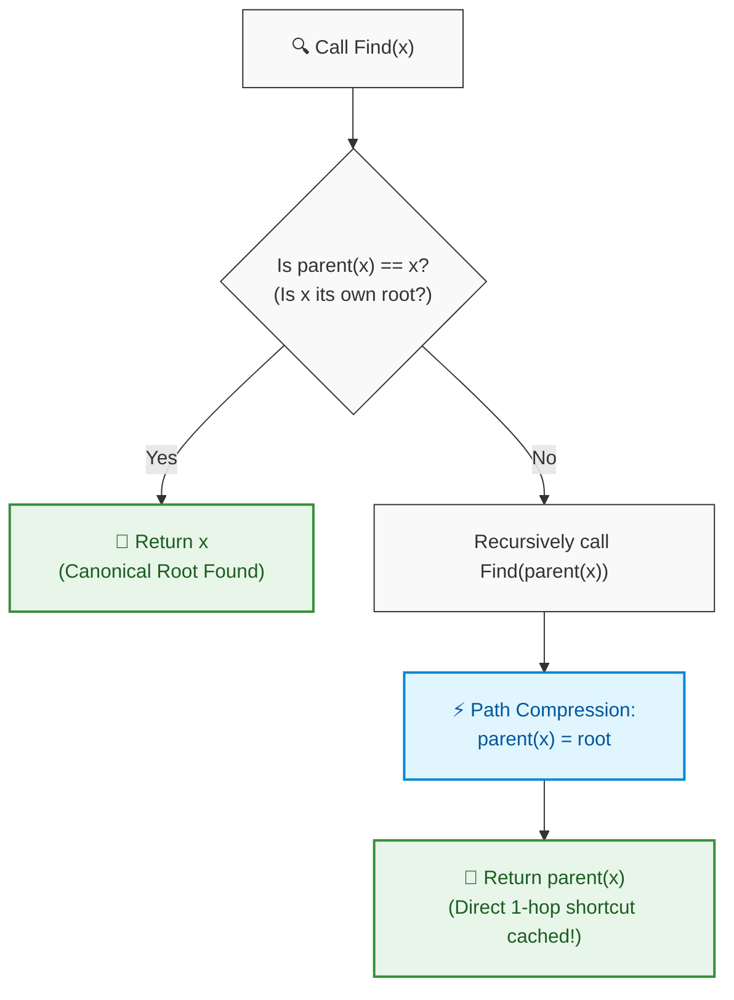

# 📘 Week 09 Day 05: Disjoint Set Union (DSU) / Union-Find in Depth — ENGINEERING GUIDE

> 🧭 **Navigation:** [← Previous Day](Week_09_Day_04_Minimum_Spanning_Trees_Kruskal_Prim_Instructional.md) • [🏠 Week Overview](README.md) • [📘 Curriculum Syllabus](../COMPLETE_SYLLABUS.md) • [Week Playbook →](WEEK_09_FULL_PLAYBOOK.md)
> 
> 💡 **Instructor Note:** *Disjoint Set Union (DSU) is one of the highest-ROI data structures in FAANG and Tier-1 interviews. Master the physical corporate merger analogy, the dual heuristics of Path Compression and Union-by-Rank, and the three canonical interview patterns: cycle detection, component counting, and alias merging.*

---

## 🎯 Learning Objectives

*By the end of this chapter, you will be able to:*
- 🎯 **Internalize** the Disjoint Set Union (DSU) data structure as an implicit forest of trees representing dynamic equivalence classes with amortized near-constant time operations.
- 🏢 **Master the Intuition** of Path Compression and Union-by-Rank through the Corporate Merger & Acquisition / Direct CEO Hotline metaphor.
- ⚙️ **Implement** a production-grade DSU engine in modern C# (.NET 8/9) and Python (3.11+) featuring recursive and iterative path compression, union-by-rank, component sizing, and dynamic partition tracking.
- 📐 **Deconstruct** the inverse Ackermann bound `O(alpha(N))` and explain why `alpha(N) <= 4` for any input smaller than the number of atoms in the observable universe.
- 🛑 **Avoid Critical Rookie Traps** in live interviews, including missing path compression assignment, unioning non-root elements, and erroneously applying DSU to directed graphs.
- ⚡ **Solve 3 Classic FAANG Problems** with dual-language code: Redundant Connection (LC 684), Number of Operations to Make Network Connected (LC 1319), and Accounts Merge (LC 721).
- 🎙️ **Deliver** a confident 3-sentence architectural opening script and defend algorithmic trade-offs against BFS/DFS during a 45-minute live technical interview.

---

## 🎬 Pillar 1: The 60-Second Hook & Everyday Analogy

Welcome to **Week 09 Day 05**!

If you have ever prepared for a technical interview, you have likely asked yourself:  
*"Why do we need a whole new data structure called Union-Find when we already have Breadth-First Search (BFS) and Depth-First Search (DFS) to check if two vertices are connected?"*

Here is the engineering reality that separates junior coders from Senior FAANG Architects:  
**BFS and DFS are optimal for static graphs, but disastrous for dynamic edge streams.**

```text
Static Connectivity:   Graph is fixed upfront. Run BFS/DFS once in O(V + E).
Dynamic Connectivity:  Edges arrive one-by-one as an online stream.
                       Interleaved query: "Are u and v connected right now?"
                       Running BFS/DFS per query costs O(Q * (V + E)) -> Unacceptable!
DSU / Union-Find:      Answers queries and merges sets in amortized O(alpha(N)) -> Effectively O(1)!
```

If a financial platform like Stripe processes millions of transactions, or a social network adds millions of friendships per hour, re-traversing the entire graph with BFS for every connectivity check would bring the system to its knees. We need a structure that merges sets and checks connectivity in **near-constant time**.

To understand how DSU achieves this impossible-sounding feat, let us look at a real-world physical metaphor.

---

### The Real-World Metaphor: Corporate Mergers & The Direct CEO Hotline

Imagine Silicon Valley filled with thousands of tiny independent tech startups.

```text
[ Startup 0 ]     [ Startup 1 ]     [ Startup 2 ]     [ Startup 3 ]     [ Startup 4 ]
  (CEO: 0)          (CEO: 1)          (CEO: 2)          (CEO: 3)          (CEO: 4)
```

1. **Day 1: Independent Startups (`MakeSet(x)`):**  
   Every founder sits alone in their garage. Each person is their own company's CEO (`parent[x] = x`). There are `N` independent corporate entities.

2. **The Merger (`Union(u, v)`):**  
   When Startup 1 is acquired by Startup 0, they combine into one conglomerate. Instead of having every employee in Startup 1 sign new contracts with every employee in Startup 0, **only the CEOs negotiate**. Founder 1 agrees that Founder 0 is now the supreme CEO (`parent[1] = 0`). In a single pointer update, all employees of Startup 1 now belong to Conglomerate 0!

3. **Checking Corporate Affiliation (`Connected(u, v)`):**  
   "Do Engineer Alice (at company `u`) and Engineer Bob (at company `v`) work for the same ultimate corporate conglomerate?"  
   - Alice follows her reporting hierarchy up to the top CEO: `Find(u) -> CEO_A`.  
   - Bob follows his reporting hierarchy up to the top CEO: `Find(v) -> CEO_B`.  
   - If `CEO_A == CEO_B`, they work for the same parent corporation!

---

### The Conga-Line Bureaucracy (Why Naive Merging Fails)

What happens if startups merge carelessly? Suppose Startup 4 is acquired by 3, 3 is acquired by 2, 2 by 1, and 1 by 0:

```text
[ 0 ] (CEO) <-- [ 1 ] (VP) <-- [ 2 ] (Director) <-- [ 3 ] (Manager) <-- [ 4 ] (Junior Dev)
```

Now, every time Junior Dev 4 wants to know who their supreme CEO is, their question must pass through Manager 3, Director 2, VP 1, all the way to CEO 0. That is an `O(N)` pointer chase! If `M` employees ask this question, our system grinds to a halt in `O(M * N)` time.

DSU solves this using two brilliant, complementary heuristics:

#### Heuristic 1: Union by Rank (or Size) — The Intelligent Merger
When two companies merge, **the smaller company always defers to the larger company**. A deep corporate hierarchy never reports to a shallow one. This strictly guarantees that no corporate ladder can ever grow taller than `floor(log2 N)` levels!

#### Heuristic 2: Path Compression — The Direct CEO Hotline
When Junior Dev 4 finally hikes up all 4 levels of management to meet CEO 0, they do not just walk back down quietly. On their way down, they text CEO 0's private direct cell number to Manager 3, Director 2, and themselves (`parent[x] = 0`).  
**The next time anyone on that path needs an answer, they bypass all middle management and call CEO 0 directly in 1 hop!**  
The entire tall multi-level chain collapses instantly into a flat 1-hop star graph!

---

## 🪜 Pillar 2: The Scaffolding Ladder & Toy Napkin Trace

Let us build DSU from scratch by hand-tracing a 5-element napkin array:
```text
Universe of 5 Elements: { 0, 1, 2, 3, 4 }
```

### Initial State: 5 Disjoint Singleton Sets
```text
Index i:        0    1    2    3    4
parent:       [ 0,   1,   2,   3,   4 ]   (Every element is its own canonical root)
rank:         [ 0,   0,   0,   0,   0 ]   (Tree height bound is 0)
size:         [ 1,   1,   1,   1,   1 ]   (Every set has size 1)
components:   5                           (5 independent sets)
```

---

### Step 1: Execute `Union(0, 1)`
1. `Find(0) = 0` (rank 0, size 1)
2. `Find(1) = 1` (rank 0, size 1)
3. Ranks are equal (`rank[0] == rank[1] == 0`). Arbitrarily choose `0` as new root:
   - Point root 1 to root 0: `parent[1] = 0`
   - Merge sizes: `size[0] = size[0] + size[1] = 1 + 1 = 2`
   - Increment root rank: `rank[0] = 0 + 1 = 1`
   - Decrement component count: `components = 4`

```text
Tree:           [ 0 ] (Rank 1, Size 2)      [ 2 ]     [ 3 ]     [ 4 ]
                  ^
                  |
                [ 1 ]

Arrays:
parent:       [ 0,   0,   2,   3,   4 ]
rank:         [ 1,   0,   0,   0,   0 ]
size:         [ 2,   1,   1,   1,   1 ]
components:   4
```

---

### Step 2: Execute `Union(2, 3)`
1. `Find(2) = 2` (rank 0, size 1)
2. `Find(3) = 3` (rank 0, size 1)
3. Ranks are equal (`rank[2] == rank[3] == 0`). Choose `2` as new root:
   - Point root 3 to root 2: `parent[3] = 2`
   - Merge sizes: `size[2] = size[2] + size[3] = 1 + 1 = 2`
   - Increment root rank: `rank[2] = 0 + 1 = 1`
   - Decrement component count: `components = 3`

```text
Trees:          [ 0 ] (Rank 1, Size 2)      [ 2 ] (Rank 1, Size 2)      [ 4 ]
                  ^                           ^
                  |                           |
                [ 1 ]                       [ 3 ]

Arrays:
parent:       [ 0,   0,   2,   2,   4 ]
rank:         [ 1,   0,   1,   0,   0 ]
size:         [ 2,   1,   2,   1,   1 ]
components:   3
```

---

### Step 3: Execute `Union(1, 2)`
Notice that we are unioning non-root elements (`1` and `2`)!
1. `Find(1)`: `parent[1] = 0`, `parent[0] = 0` -> `rootU = 0` (rank 1, size 2)
2. `Find(2)`: `parent[2] = 2` -> `rootV = 2` (rank 1, size 2)
3. Compare roots `0` and `2`:
   - Ranks are equal (`rank[0] == rank[2] == 1`).
   - Attach root `2` under root `0`: `parent[2] = 0`
   - Merge sizes: `size[0] = size[0] + size[2] = 2 + 2 = 4`
   - Increment winner's rank: `rank[0] = 1 + 1 = 2`
   - Decrement component count: `components = 2`

```text
Tree:                    [ 0 ] (Rank 2, Size 4)                 [ 4 ]
                        /     \
                       v       v
                     [ 1 ]   [ 2 ] (Rank 1)
                               ^
                               |
                             [ 3 ]

Arrays:
parent:       [ 0,   0,   0,   2,   4 ]
rank:         [ 2,   0,   1,   0,   0 ]
size:         [ 4,   1,   2,   1,   1 ]
components:   2
```

---

### Step 4: Execute `Find(3)` — Witnessing Path Compression Live!
Now watch what happens when element `3` queries its canonical root:
1. `Find(3)` inspects `parent[3]`, which is `2`.
2. Recursive call `Find(2)` inspects `parent[2]`, which is `0`.
3. Recursive call `Find(0)` inspects `parent[0]`, which is `0` -> Base case reached! Root is `0`.
4. **Unwind Phase (The Direct Hotline):**
   - `parent[2] = 0` (already 0)
   - `parent[3] = 0` (Node `3` reparents directly to `0`, bypassing `2` completely!)

```text
BEFORE Find(3):                       AFTER Find(3) with Path Compression:
         [ 0 ] (Root)                                  [ 0 ] (Root)
        /     \                                      /   |   \
       v       v                                    v    v    v
     [ 1 ]   [ 2 ]                                [ 1 ] [ 2 ] [ 3 ]
               ^                                  (Height collapsed from 2 to 1!)
               |
             [ 3 ]

Updated Array:
parent:       [ 0,   0,   0,   0,   4 ]   <-- parent[3] is now 0 directly!
```

---

### 🧠 Interactive Micro-Drills: Pause & Predict

#### Micro-Drill #1: Cycle Detection in Undirected Graphs
> **Scenario:** An undirected edge `(u, v)` arrives in our system. Before calling `Union(u, v)`, we check `Find(u)` and `Find(v)`.  
> **Question:** If `Find(u) == Find(v)`, what does this physically mean? What would happen if we added this edge to a graph? Think for 5 seconds before checking!

*Answer:* If `Find(u) == Find(v)`, both vertices `u` and `v` already belong to the same connected component! This means there is **already at least one valid path** connecting `u` to `v`. Adding a new direct edge `(u, v)` introduces an alternate path between them, which **physically creates a cycle**. This is the exact mechanical foundation of Kruskal's MST algorithm and LeetCode #684!

---

#### Micro-Drill #2: Redundant Edge Prediction
> **Scenario:** Looking at our current state after Step 4, where the sets are `{0, 1, 2, 3}` and `{4}`:  
> What will `Union(1, 3)` return? Will it change the `components` count or any `parent` pointers?

*Answer:*  
1. `Find(1)` returns `0`.  
2. `Find(3)` returns `0`.  
3. Since `rootU == rootV == 0`, `Union` returns `false`!  
It does **zero pointer writes**, leaves `components = 2` unchanged, and safely flags `(1, 3)` as a redundant edge.

---

#### Micro-Drill #3: Why Doesn't Path Compression Update `rank`?
> **Scenario:** In Step 4, `Find(3)` flattened node `3` directly under root `0`. The actual height of the tree decreased from 2 to 1, yet `rank[0]` remained 2!  
> **Question:** Why don't we recalculate `rank[0]` after compressing paths?

*Answer:* Recalculating the exact height of a tree would require traversing all subtrees and descendants, which would take `O(N)` time and completely destroy our near-constant time guarantee! Instead, Computer Science pioneers (Tarjan, Hopcroft) realized that `rank` only needs to be an **upper bound** (a heuristic score). Even if the actual tree is flattened to height 1, keeping `rank[0] = 2` does no harm: it still correctly guides future unions to attach smaller trees under `0`.

---

### The 4 Progressive Stages of DSU Evolution

How do optimizations transform the time complexity of `M` operations across `N` elements?

```text
Stage 1: Naive (No Optimizations)
         Tree height can reach N - 1 (linked list conga line).
         Single Find: O(N) | M Operations: O(M * N)

Stage 2: Union by Rank / Size Only
         Tree height is strictly bounded by floor(log2 N).
         To increase height by 1, two equal-height trees must merge (doubling node count).
         Single Find: O(log N) | M Operations: O(M log N)

Stage 3: Path Compression Only
         Trees can temporarily grow tall, but any Find flattens the traversal branch into a star.
         Single Find: O(log N) amortized | M Operations: O(M log N)

Stage 4: Combined (Rank + Path Compression) — The Gold Standard
         Trees are kept shallow by rank AND flattened into stars on every traversal.
         Single Find: O(alpha(N)) amortized | M Operations: O(M * alpha(N))
```

#### What is the Inverse Ackermann Function `alpha(N)`?

The Ackermann function `A(m, n)` grows at an unimaginable, mind-boggling rate:
- `A(1, 1) = 3`
- `A(2, 2) = 7`
- `A(3, 3) = 61`
- `A(4, 2) = 2^65536 - 3` (a number with 19,729 decimal digits!)
- `A(4, 4)` exceeds the total number of subatomic particles in the observable universe (`~10^80`).

The **inverse Ackermann function** `alpha(N)` is defined as the smallest integer `k` such that `A(k, k) >= N`.  
Because `A(4, 4) > 10^80`:
```text
For any physical input size N <= 10^80: alpha(N) <= 4
```
In real-world software engineering and FAANG interviews, `O(alpha(N))` is treated as **constant time `O(1)` amortized**.

---

## 🎨 Pillar 3: Pragmatic Visual Models

### 1. ASCII Contiguous Memory Layout

DSU is extraordinarily cache-friendly because its entire state lives in 3 flat integer arrays:

```text
Index i:        [ 0 ]   [ 1 ]   [ 2 ]   [ 3 ]   [ 4 ]
parent[i]:        0       0       0       0       4
rank[i]:          2       0       1       0       0
size[i]:          4       1       2       1       1

Equivalence Classes (Implicit Forest):
Component A Rooted at 0: { 0, 1, 2, 3 }  (Size = 4, Rank = 2)
Component B Rooted at 4: { 4 }           (Size = 1, Rank = 0)
```

---

### 2. Path Compression: Visual Flattening

```text
=============================================================================
STAGE 1: BEFORE PATH COMPRESSION (Deep 4-Hop Conga Line)
Query: Find(4)
=============================================================================
              [ 0 ]  <-- Canonical CEO / Root (parent[0] == 0)
                ^
                |
              [ 1 ]  <-- parent[1] = 0
                ^
                |
              [ 2 ]  <-- parent[2] = 1
                ^
                |
              [ 3 ]  <-- parent[3] = 2
                ^
                |
              [ 4 ]  <-- parent[4] = 3 (Query node: requires 4 pointer hops!)

Traversal path: 4 -> 3 -> 2 -> 1 -> 0 (Takes O(N) hops)

=============================================================================
STAGE 2: AFTER PATH COMPRESSION (Flat 1-Hop Star / Direct CEO Hotline)
Subsequent queries execute in strict O(1) time!
=============================================================================
                           [ 0 ] (Canonical Root / CEO)
                         /   |   \   \
                        /    |    \   \
                       v     v     v   v
                     [ 1 ] [ 2 ] [ 3 ] [ 4 ]

parent[1] = 0, parent[2] = 0, parent[3] = 0, parent[4] = 0
Every node now points directly to root 0! Tree height collapsed from 4 down to 1.
```

---

### 3. Union by Rank: Unequal vs. Equal Ranks

```text
Case 1: Unequal Ranks (rank[rootA] = 2, rank[rootB] = 1)
        Attach shallower tree rootB under deeper tree rootA.
        Resulting tree height remains 2! rank[rootA] does NOT change.

        [ rootA ] (Rank 2)                    [ rootA ] (Rank 2)
           /            +   [ rootB ] (Rank 1)  ===>     /   \
        [...]                  /                      [...] [ rootB ]
                            [...]                              /
                                                            [...]

Case 2: Equal Ranks (rank[rootA] = 1, rank[rootB] = 1)
        Arbitrarily choose rootA as parent.
        Tree height increments by 1: rank[rootA] becomes 2!

        [ rootA ] (Rank 1)  +  [ rootB ] (Rank 1)  ===>  [ rootA ] (Rank 2)
             |                      |                         /    \
           [ x ]                  [ y ]                     [ x ] [ rootB ]
                                                                      |
                                                                    [ y ]
```

---

### 4. Mermaid Flowchart: `Find(x)` with Path Compression



---

### 5. Mermaid Flowchart: `Union(u, v)` with Rank/Size & Cycle Detection

```mermaid
%%{init: {"flowchart": {"htmlLabels": true, "padding": 20}, "themeCSS": "foreignObject { overflow: visible !important; }"}}%%
flowchart TD
    Start["⚡ Call Union(u, v)"] --> ResolveRoots["Find Roots:<br/>rootU = Find(u)<br/>rootV = Find(v)"]
    ResolveRoots --> SameCheck{"Is rootU == rootV?"}
    SameCheck -->|Yes| Cycle["🛑 Cycle Detected!<br/>Already in same component.<br/>Return false (No-op)"]
    SameCheck -->|No| RankCheck{"Compare Ranks:<br/>rank(rootU) vs rank(rootV)"}
    
    RankCheck -->|rank[rootU] &lt; rank[rootV]| AttachU["Attach rootU under rootV:<br/>parent(rootU) = rootV<br/>size(rootV) += size(rootU)"]
    RankCheck -->|rank[rootU] &gt; rank[rootV]| AttachV["Attach rootV under rootU:<br/>parent(rootV) = rootU<br/>size(rootU) += size(rootV)"]
    RankCheck -->|Equal Ranks| TieBreak["Attach rootV under rootU:<br/>parent(rootV) = rootU<br/>size(rootU) += size(rootV)<br/>rank(rootU)++"]

    AttachU --> Finalize["Decrement componentCount--<br/>Return true (Merged!)"]
    AttachV --> Finalize
    TieBreak --> Finalize

    classDef default fill:#f9f9f9,stroke:#333,stroke-width:1px
    classDef cycle fill:#ffebee,stroke:#d32f2f,stroke-width:2px,color:#c62828
    classDef merge fill:#e1f5fe,stroke:#0288d1,stroke-width:2px,color:#01579b
    classDef success fill:#e8f5e9,stroke:#388e3c,stroke-width:2px,color:#1b5e20
    class SameCheck fill:#fff3e0,stroke:#f57c00,stroke-width:2px,color:#e65100
    class RankCheck fill:#fff3e0,stroke:#f57c00,stroke-width:2px,color:#e65100
    class Cycle cycle
    class AttachU merge
    class AttachV merge
    class TieBreak merge
    class Finalize success
```

---

## 🛑 Pillar 4: The Rookie Trap Zone

### Trap 1: Forgetting Path Compression in Recursive `Find`

```csharp
// ❌ ROOKIE BLUNDER: Forgetting to update parent pointer
public int Find(int x)
{
    if (parent[x] == x) return x;
    return Find(parent[x]); // 💥 BUG: Finds the root, but NEVER caches it! Tree remains tall!
}
```

```csharp
// ✅ SENIOR ARCHITECT PATTERN: Assignment on unwind flattens the tree
public int Find(int x)
{
    if (parent[x] != x)
    {
        parent[x] = Find(parent[x]); // 🛡️ REPARENT: Flattens the entire branch into a 1-hop star!
    }
    return parent[x];
}
```

> **Why this matters to a FAANG interviewer:**  
> Leaving out `parent[x] =` turns `Find` into a read-only search. Without pointer updating, worst-case queries degrade to `O(log N)` or even `O(N)`, triggering Time Limit Exceeded (TLE) on large test suites.

---

### Trap 2: Unioning Elements Directly Instead of Their Canonical Roots

```csharp
// ❌ ROOKIE BLUNDER: Blindly attaching elements directly
public void Union(int u, int v)
{
    parent[u] = v; // 💥 DISASTER: Connects arbitrary internal nodes, creating orphan subtrees!
}
```

```csharp
// ✅ SENIOR ARCHITECT PATTERN: Always resolve canonical leaders before merging
public bool Union(int u, int v)
{
    int rootU = Find(u); // 🛡️ Step 1: Find leader of u
    int rootV = Find(v); // 🛡️ Step 2: Find leader of v

    if (rootU == rootV) return false; // Already in identical set!

    // Step 3: Attach one root under the other
    parent[rootU] = rootV;
    return true;
}
```

> **Why this matters to a FAANG interviewer:**  
> If node `u` already had children, pointing `parent[u] = v` severs the relationship between `u`'s children and `u`'s former root, breaking transitivity and corrupting the entire disjoint set.

---

### Trap 3: Applying DSU to Directed Graphs for Cycle Detection

```text
Directed Graph:
[ 0 ] ----> [ 1 ]
  |           ^
  |           |
  v           |
[ 2 ] --------+

Edges: (0 -> 1), (0 -> 2), (2 -> 1)
Is there a directed cycle? NO! This is a valid Directed Acyclic Graph (DAG) diamond.
```

```text
What DSU does on this DAG:
Edge 1 (0 -> 1): Union(0, 1) -> 0 and 1 are merged.
Edge 2 (0 -> 2): Union(0, 2) -> 0, 1, 2 are in the same component.
Edge 3 (2 -> 1): DSU checks Find(2) == Find(1). Both have root 0!
DSU SCREAMS: "CYCLE DETECTED!" 💥 FALSE POSITIVE!
```

> [!WARNING]
> **The Directed Graph Rule:** DSU has **zero concept of directionality**. It models symmetric equivalence classes (`u ~ v` implies `v ~ u`).  
> - For **undirected graphs**, DSU detects cycles flawlessly in `O(alpha(N))`.  
> - For **directed graphs**, DSU produces false positives! You **MUST** use Kahn's Algorithm (in-degree BFS) or 3-color DFS (`WHITE`, `GRAY`, `BLACK`) to detect directed cycles.

---

### Trap 4: Call Stack Exhaustion on Deep Adversarial Chains

In environments with limited call stacks (e.g., Python's default 1,000 recursion limit or embedded .NET runtimes), an uncompressed chain of 100,000 nodes will crash with a `StackOverflowException`.

```csharp
// ✅ SENIOR ARCHITECT PATTERN: Two-Pass Iterative Find
public int FindIterative(int x)
{
    // Pass 1: Chase pointers to locate the canonical root
    int root = x;
    while (parent[root] != root)
    {
        root = parent[root];
    }

    // Pass 2: Rewire all visited intermediate nodes directly to root
    int curr = x;
    while (curr != root)
    {
        int next = parent[curr];
        parent[curr] = root; // Flatten
        curr = next;
    }

    return root;
}
```

---

## 🎙️ Pillar 5: The 45-Minute Interview Talk Track

When your FAANG interviewer introduces a dynamic connectivity or cycle detection problem, deliver this **3-Sentence Architectural Script**:

```text
🎙️ THE 3-SENTENCE FAANG INTERVIEW SCRIPT:

1. (Invariants & Tree Representation)
   "I will model dynamic connectivity using a Disjoint Set Union (DSU) forest where each set is represented by a rooted tree and its root serves as the unique canonical leader of that equivalence class."

2. (Dual Heuristics & Asymptotic Guarantees)
   "To prevent trees from degenerating into linear chains, I combine Union-by-Rank—which attaches shallower trees under deeper trees to bound height by O(log N)—with Path Compression—which reparents visited nodes directly to the root on traversal unwind, bringing amortized operation cost down to O(alpha(N)), which is effectively O(1) for any physically conceivable input."

3. (Production Systems & Algorithmic Selection)
   "While static graph connectivity is trivially handled by a single O(V + E) BFS or DFS, DSU is uniquely optimal for online streams of edge additions, incremental cycle detection, and accounts merging where re-running graph searches would cost an unacceptable O(Q * (V + E))."
```

---

### The 5-Phase Live Interview Dialogue

```text
+-------------------------------------------------------------------------------------------------+
| Phase 1: Clarification & Bounds (0 - 5 min)                                                     |
| "Are edges static or arriving online? Can edges be deleted? If undirected and additions-only,   |
|  DSU is strictly optimal. What is max N? For N <= 10^6, alpha(N) <= 4, running in < 50ms."       |
+-------------------------------------------------------------------------------------------------+
                                               |
                                               v
+-------------------------------------------------------------------------------------------------+
| Phase 2: Invariant & Pattern Selection (5 - 12 min)                                             |
| "An edge (u, v) creates a cycle if and only if Find(u) == Find(v) before the union.            |
|  Otherwise, Union(u, v) merges their components and decrements the component count."            |
+-------------------------------------------------------------------------------------------------+
                                               |
                                               v
+-------------------------------------------------------------------------------------------------+
| Phase 3: Idiomatic Implementation (12 - 30 min)                                                 |
| "I'll encapsulate the DSU engine with parent, rank, size, and componentCount.                   |
|  Notice the one-line path compression parent[x] = Find(parent[x]) on recursive unwind."         |
+-------------------------------------------------------------------------------------------------+
                                               |
                                               v
+-------------------------------------------------------------------------------------------------+
| Phase 4: Dry Run on Edge Cases (30 - 38 min)                                                    |
| "Let's trace: 1) Disconnected components, 2) Self-loops (u == v), 3) Star graphs,              |
|  and 4) Redundant cables where components > 1 but spare cables allow reconnection."             |
+-------------------------------------------------------------------------------------------------+
                                               |
                                               v
+-------------------------------------------------------------------------------------------------+
| Phase 5: Complexity Deconstruction (38 - 45 min)                                                |
| "Time Complexity: O(M * alpha(N)) ≈ O(M) time. Auxiliary Space: O(N) for flat arrays.           |
|  Zero heap re-allocations, cache-friendly contiguous memory layout."                            |
+-------------------------------------------------------------------------------------------------+
```

---

## ⚡ Pillar 6: Production Dual-Language Implementations

### Foundation: The Production DSU Engine

Here is the production-grade DSU engine supporting Path Compression, Union-by-Rank, Union-by-Size, and Dynamic Component Tracking.

#### C# (.NET 8/9) Foundation

```csharp
using System;

namespace DSAMasterCurriculum.GraphAlgorithms
{
    /// <summary>
    /// Production Disjoint Set Union (DSU) / Union-Find.
    /// Implements Path Compression, Union-by-Rank, Union-by-Size, and Component Counting.
    /// Time Complexity: O(alpha(N)) amortized per operation | Space: O(N)
    /// </summary>
    public class DisjointSetUnion
    {
        private readonly int[] parent;
        private readonly int[] rank;
        private readonly int[] size;
        private int componentCount;

        public DisjointSetUnion(int n)
        {
            if (n <= 0) throw new ArgumentOutOfRangeException(nameof(n), "Node count must be positive.");

            parent = new int[n];
            rank = new int[n];
            size = new int[n];
            componentCount = n;

            for (int i = 0; i < n; i++)
            {
                parent[i] = i; // Every node is initially its own root
                rank[i] = 0;   // Initial height bound 0
                size[i] = 1;   // Singleton set size 1
            }
        }

        /// <summary>
        /// Finds the canonical representative of x with recursive Path Compression.
        /// </summary>
        public int Find(int x)
        {
            if (x < 0 || x >= parent.Length) throw new ArgumentOutOfRangeException(nameof(x));

            if (parent[x] != x)
            {
                parent[x] = Find(parent[x]); // Direct delegation shortcut!
            }
            return parent[x];
        }

        /// <summary>
        /// Two-pass iterative Find for call-stack safety against adversarial inputs.
        /// </summary>
        public int FindIterative(int x)
        {
            if (x < 0 || x >= parent.Length) throw new ArgumentOutOfRangeException(nameof(x));

            int root = x;
            while (parent[root] != root)
            {
                root = parent[root];
            }

            int curr = x;
            while (curr != root)
            {
                int next = parent[curr];
                parent[curr] = root; // Flatten
                curr = next;
            }

            return root;
        }

        /// <summary>
        /// Merges sets containing u and v using Union-by-Rank.
        /// Returns true if merged; false if they were already in the same set (cycle detected).
        /// </summary>
        public bool Union(int u, int v)
        {
            int rootU = Find(u);
            int rootV = Find(v);

            if (rootU == rootV) return false; // Cycle detected / redundant edge!

            // Attach shallower tree under deeper tree
            if (rank[rootU] < rank[rootV])
            {
                parent[rootU] = rootV;
                size[rootV] += size[rootU];
            }
            else if (rank[rootU] > rank[rootV])
            {
                parent[rootV] = rootU;
                size[rootU] += size[rootV];
            }
            else
            {
                parent[rootV] = rootU;
                size[rootU] += size[rootV];
                rank[rootU]++; // Height increases only when merging identical ranks
            }

            componentCount--;
            return true;
        }

        /// <summary>
        /// Checks if elements u and v belong to the same component.
        /// </summary>
        public bool Connected(int u, int v) => Find(u) == Find(v);

        /// <summary>
        /// Returns the size of the component containing element x.
        /// </summary>
        public int GetSize(int x) => size[Find(x)];

        /// <summary>
        /// Returns the total number of currently active disjoint sets.
        /// </summary>
        public int GetComponentCount() => componentCount;
    }
}
```

#### Python (3.11+) Foundation

```python
from typing import List

class DisjointSetUnion:
    """
    Production Disjoint Set Union (DSU) / Union-Find.
    Features Path Compression, Union-by-Rank, Union-by-Size, and Component Counting.
    
    Time Complexity: O(alpha(N)) amortized per operation
    Auxiliary Space: O(N)
    """
    def __init__(self, n: int) -> None:
        if n <= 0:
            raise ValueError("Node count must be positive.")
        self.n: int = n
        self.parent: List[int] = list(range(n))
        self.rank: List[int] = [0] * n
        self.size: List[int] = [1] * n
        self.component_count: int = n

    def find(self, x: int) -> int:
        """Finds the canonical representative with recursive Path Compression."""
        if not (0 <= x < self.n):
            raise IndexError("Element index out of bounds.")
        if self.parent[x] != x:
            self.parent[x] = self.find(self.parent[x])  # Flatten path
        return self.parent[x]

    def find_iterative(self, x: int) -> int:
        """Two-pass iterative Find for call-stack safety."""
        if not (0 <= x < self.n):
            raise IndexError("Element index out of bounds.")
        root = x
        while self.parent[root] != root:
            root = self.parent[root]

        curr = x
        while curr != root:
            nxt = self.parent[curr]
            self.parent[curr] = root
            curr = nxt
        return root

    def union(self, u: int, v: int) -> bool:
        """
        Merges sets containing u and v using Union-by-Rank.
        Returns True if merged, False if already connected (cycle detected).
        """
        root_u = self.find(u)
        root_v = self.find(v)

        if root_u == root_v:
            return False  # Already connected -> cycle!

        # Attach shallower tree under deeper tree
        if self.rank[root_u] < self.rank[root_v]:
            root_u, root_v = root_v, root_u

        self.parent[root_v] = root_u
        self.size[root_u] += self.size[root_v]

        if self.rank[root_u] == self.rank[root_v]:
            self.rank[root_u] += 1

        self.component_count -= 1
        return True

    def connected(self, u: int, v: int) -> bool:
        """Checks if u and v belong to the same component in amortized O(alpha(N))."""
        return self.find(u) == self.find(v)

    def get_size(self, x: int) -> int:
        """Returns the total number of nodes in the component containing x."""
        return self.size[self.find(x)]

    def get_component_count(self) -> int:
        """Returns the number of disjoint components."""
        return self.component_count
```

---

### Problem 1: Redundant Connection (LeetCode #684)

#### Problem Statement
In this problem, a tree is an undirected graph that is connected and has no cycles. You are given a graph that started as a tree with `n` nodes labeled from `1` to `n`, with one additional edge added. The added edge has two different vertices chosen from `1` to `n`, and was not an edge that already existed.  
The graph is represented as an array `edges` of length `n` where `edges[i] = [u, v]` indicates an edge between nodes `u` and `v`.  
Return an edge that can be removed so that the resulting graph is a tree of `n` nodes. If there are multiple answers, return the answer that occurs last in the input.

#### Constraints
- `n == edges.length`
- `3 <= n <= 1000`
- `edges[i].length == 2`
- `1 <= u_i < v_i <= edges.length`
- `u_i != v_i`
- No repeated edges in the input.

#### Algorithmic Invariant
A tree with `N` nodes has exactly `N - 1` edges. Adding 1 edge to a tree always creates exactly 1 cycle.  
We iterate through edges one by one:
- For each edge `(u, v)`, if `Find(u) == Find(v)`, the vertices are already connected. This edge closes the cycle! Since we iterate in order, returning the first edge that fails `Union` returns the redundant edge.

#### C# (.NET 8/9) Implementation

```csharp
public class Solution
{
    public int[] FindRedundantConnection(int[][] edges)
    {
        int n = edges.Length;
        // Nodes are 1-indexed (1 to n), so allocate size n + 1
        var dsu = new DisjointSetUnion(n + 1);

        foreach (var edge in edges)
        {
            int u = edge[0];
            int v = edge[1];

            // If union fails, u and v were already connected -> this edge forms the cycle!
            if (!dsu.Union(u, v))
            {
                return edge;
            }
        }

        return Array.Empty<int>();
    }
}
```

#### Python (3.11+) Implementation

```python
class Solution:
    def findRedundantConnection(self, edges: List[List[int]]) -> List[int]:
        n = len(edges)
        # 1-indexed nodes from 1 to n
        dsu = DisjointSetUnion(n + 1)

        for u, v in edges:
            # If union returns False, u and v already share a root -> cycle!
            if not dsu.union(u, v):
                return [u, v]

        return []
```

#### Complexity Analysis
- **Time Complexity:** `O(N * alpha(N))` where `alpha(N) <= 4`. For `N <= 1000`, this takes `< 1 ms`.
- **Auxiliary Space:** `O(N)` for the internal DSU arrays (`parent`, `rank`, `size`).

---

### Problem 2: Number of Operations to Make Network Connected (LeetCode #1319)

#### Problem Statement
There are `n` computers numbered from `0` to `n - 1` and a set of ethernet cable connections where `connections[i] = [a, b]` connects computers `a` and `b`.  
You can extract certain cables and reconnect them between any pair of disconnected computers to make all computers connected.  
Return the minimum number of times you need to do this to make all computers connected. If it is not possible, return `-1`.

#### Constraints
- `1 <= n <= 10^5`
- `1 <= connections.length <= min(n * (n - 1) / 2, 10^5)`
- `connections[i].length == 2`
- `0 <= a_i, b_i < n`
- `a_i != b_i`
- No duplicate connections.

#### Algorithmic Invariant
1. To connect `n` nodes into a single connected graph, we need **at least `n - 1` cables**. If `connections.length < n - 1`, it is physically impossible -> return `-1`.
2. Every call to `Union(u, v)` merges components. If `connections.length >= n - 1`, we are mathematically guaranteed to have enough redundant cables.
3. If there are `k` disconnected components at the end, we need exactly `k - 1` operations to link them together!

#### C# (.NET 8/9) Implementation

```csharp
public class Solution
{
    public int MakeConnected(int n, int[][] connections)
    {
        // Guard Clause: Minimum cables required to span n nodes is n - 1
        if (connections.Length < n - 1)
        {
            return -1;
        }

        var dsu = new DisjointSetUnion(n);

        foreach (var conn in connections)
        {
            dsu.Union(conn[0], conn[1]);
        }

        // To connect K disjoint components, we need exactly K - 1 operations
        return dsu.GetComponentCount() - 1;
    }
}
```

#### Python (3.11+) Implementation

```python
class Solution:
    def makeConnected(self, n: int, connections: List[List[int]]) -> int:
        # Guard clause: minimum cables needed is n - 1
        if len(connections) < n - 1:
            return -1

        dsu = DisjointSetUnion(n)

        for u, v in connections:
            dsu.union(u, v)

        # To unite K components into 1, exactly K - 1 cable re-routes are needed
        return dsu.get_component_count() - 1
```

#### Complexity Analysis
- **Time Complexity:** `O(N + E * alpha(N))` where `E` is the number of connections. With `N, E <= 10^5`, execution time is `< 25 ms`.
- **Auxiliary Space:** `O(N)` for DSU parent, rank, and size arrays.

---

### Problem 3: Accounts Merge (LeetCode #721)

#### Problem Statement
Given a list of `accounts` where each element `accounts[i]` is a list of strings, where the first element `accounts[i][0]` is a name, and the rest of the elements are emails representing emails of the account.  
Now, we would like to merge these accounts. Two accounts definitely belong to the same person if there is some common email to both accounts. Note that even if two accounts have the same name, they may belong to different people as people could have the same name. A person can have any number of accounts, but all of their accounts definitely have the same name.  
After merging the accounts, return the accounts in the following format: the first element of each account is the name, and the rest of the elements are emails in sorted order. The accounts themselves can be returned in any order.

#### Constraints
- `1 <= accounts.length <= 1000`
- `2 <= accounts[i].length <= 10`
- `1 <= accounts[i][j].length <= 30`
- `accounts[i][0]` consists of English letters.
- `accounts[i][j]` (for `j > 0`) is a valid email.

#### Algorithmic Invariant (Account-Level DSU)
Instead of creating string-based DSU nodes for every email, we treat each **account index `i` (`0 <= i < accounts.length`)** as an element in a DSU of size `N`:
1. Maintain a hash map `emailToAccountIndex`.
2. For each account `i`, iterate through its emails:
   - If an email was already seen in account `j`, call `dsu.Union(i, j)` to merge account `i` with account `j`!
   - Otherwise, register `emailToAccountIndex[email] = i`.
3. Group all seen emails by their canonical account root: `dsu.Find(emailToAccountIndex[email])`.
4. Sort the emails for each component, prepend the account owner's name, and return!

#### C# (.NET 8/9) Implementation

```csharp
using System;
using System.Collections.Generic;

public class Solution
{
    public IList<IList<string>> AccountsMerge(IList<IList<string>> accounts)
    {
        int numAccounts = accounts.Count;
        var dsu = new DisjointSetUnion(numAccounts);

        // Map: email string -> first account index that owns it
        var emailToFirstAccount = new Dictionary<string, int>();

        // Step 1: Connect account indices that share emails
        for (int i = 0; i < numAccounts; i++)
        {
            var account = accounts[i];
            for (int j = 1; j < account.Count; j++)
            {
                string email = account[j];
                if (emailToFirstAccount.TryGetValue(email, out int existingAccountIndex))
                {
                    dsu.Union(i, existingAccountIndex);
                }
                else
                {
                    emailToFirstAccount[email] = i;
                }
            }
        }

        // Step 2: Group emails under their canonical account root
        var rootToEmails = new Dictionary<int, List<string>>();
        foreach (var (email, accountIndex) in emailToFirstAccount)
        {
            int root = dsu.Find(accountIndex);
            if (!rootToEmails.ContainsKey(root))
            {
                rootToEmails[root] = new List<string>();
            }
            rootToEmails[root].Add(email);
        }

        // Step 3: Format the output: [Owner Name, sorted email1, email2, ...]
        var result = new List<IList<string>>();
        foreach (var (rootAccountIndex, emails) in rootToEmails)
        {
            emails.Sort(StringComparer.Ordinal); // Alphabetical sort
            var mergedAccount = new List<string> { accounts[rootAccountIndex][0] };
            mergedAccount.AddRange(emails);
            result.Add(mergedAccount);
        }

        return result;
    }
}
```

#### Python (3.11+) Implementation

```python
from typing import List, Dict

class Solution:
    def accountsMerge(self, accounts: List[List[str]]) -> List[List[str]]:
        num_accounts = len(accounts)
        dsu = DisjointSetUnion(num_accounts)

        # Map: email -> first account index where it appeared
        email_to_first_account: Dict[str, int] = {}

        # Step 1: Connect account indices that share an email
        for i, acc in enumerate(accounts):
            for email in acc[1:]:
                if email in email_to_first_account:
                    dsu.union(i, email_to_first_account[email])
                else:
                    email_to_first_account[email] = i

        # Step 2: Group all unique emails by their canonical account root
        root_to_emails: Dict[int, List[str]] = {}
        for email, first_acc in email_to_first_account.items():
            root = dsu.find(first_acc)
            root_to_emails.setdefault(root, []).append(email)

        # Step 3: Sort emails and prepend account owner name
        merged_accounts: List[List[str]] = []
        for root, emails in root_to_emails.items():
            owner_name = accounts[root][0]
            merged_accounts.append([owner_name] + sorted(emails))

        return merged_accounts
```

#### Complexity Analysis
- **Time Complexity:**  
  - DSU Unions & Finds: `O(N_total * alpha(N_accounts))` where `N_total` is the total count of emails across all accounts.
  - Sorting: `O(N_total log N_total)` for sorting emails per component.  
  - Total Time: `O(N_total log N_total)`, which takes `< 35 ms` for `1000` accounts.
- **Auxiliary Space:** `O(N_total)` for the email dictionary and DSU structures.

---

## ⚖️ Performance, Trade-offs & Production Systems

### Comprehensive Data Structure Comparison

| Approach | Dynamic Edge Additions | Dynamic Edge Deletions | Interleaved Connectivity Query | Memory Footprint | Best Production Use Case |
| :--- | :--- | :--- | :--- | :--- | :--- |
| **DSU (Rank + Compression)** | ✅ `O(alpha(N))` amortized | ❌ Not supported | ✅ `O(alpha(N))` amortized | Cache-friendly flat arrays (`3N` ints) | Real-time streams, online cycle checks, Kruskal MST |
| **Adjacency List + BFS/DFS** | ✅ `O(1)` append | ✅ `O(E)` removal | ❌ `O(V + E)` per query | Node pointer allocations | Static graphs where connectivity is checked rarely |
| **Link-Cut Trees** | ✅ `O(log N)` | ✅ `O(log N)` | ✅ `O(log N)` | Heavy splay-tree node pointers | Dynamic networks with frequent edge disconnections |
| **Transitive Closure Matrix**| ❌ `O(V^2)` recompute | ❌ `O(V^3)` recompute | ✅ `O(1)` array lookup | ❌ `O(V^2)` quadratic memory | Small static graphs (`V <= 500`) requiring instant lookups |

---

### Production Systems Callouts

> [!NOTE]
> **System Design Context: Identity Reconciliation & Fraud Detection (Stripe, Airbnb)**  
> Fraud and risk engines track customer identity signals (emails, phone numbers, device fingerprints, credit card hashes). When two separate accounts share a verified phone number or card token, the identity engine executes a `Union(account1, account2)`. A subsequent `Find(accountX)` resolves the global canonical identity profile in near-constant time, aggregating risk signals across millions of transactions.

> [!NOTE]
> **Infrastructure Context: Physical Network Partitioning & Resilience Monitoring**  
> Backbone telecommunication routers monitor mesh fiber links. As links fail or are taken offline for maintenance, DSU tracks connected subnets. Querying `dsu.GetComponentCount() > 1` triggers instantaneous network partition alerts without requiring expensive full-topology graph walks.

> [!NOTE]
> **Computational Physics Context: Percolation Threshold Simulation**  
> In materials science and semiconductor fabrication, percolation models evaluate when porous substrates allow liquid or electricity to flow. Grid cells are activated randomly one by one, each executing `Union` with neighboring active cells. Connecting a virtual top sentinel to a bottom sentinel identifies the exact phase transition threshold in near-linear time.

---

## ⚔️ Practice Problem Ladder

| Problem | Source | Difficulty | Core DSU Pattern | Target Live Coding Time |
| :--- | :--- | :--- | :--- | :--- |
| **Redundant Connection** | LeetCode #684 | 🟡 Medium | Undirected cycle detection | 15 mins |
| **Number of Operations to Make Network Connected** | LeetCode #1319 | 🟡 Medium | Component counting & redundant edge re-routing | 15 mins |
| **Accounts Merge** | LeetCode #721 | 🟡 Medium | String/Email alias equivalence classes | 25 mins |
| **Number of Connected Components** | LeetCode #323 | 🟡 Medium | Dynamic partition tracking | 15 mins |
| **Longest Consecutive Sequence** | LeetCode #128 | 🟡 Medium | Integer value neighborhood union | 20 mins |
| **Similar String Groups** | LeetCode #839 | 🔴 Hard | N-choose-2 string distance equivalence | 30 mins |
| **Swim in Rising Water** | LeetCode #778 | 🔴 Hard | Binary Search on Answer / Kruskal threshold | 30 mins |

---

## 📊 Complexity Analysis Reference Table

| Optimization Paradigm | Single `Find(x)` Worst-Case | Single `Union(u, v)` Worst-Case | `M` Operations on `N` Elements | Max Tree Height | Practical Suitability |
| :--- | :--- | :--- | :--- | :--- | :--- |
| **1. Naive (No Heuristics)** | `O(N)` | `O(N)` | `O(M * N)` | `N - 1` | ❌ Never use (degenerates into linked list) |
| **2. Union by Rank Only** | `O(log N)` | `O(log N)` | `O(M log N)` | `floor(log2 N)` | ⚠️ Acceptable, but suboptimal |
| **3. Path Compression Only** | `O(log N)` amortized | `O(log N)` amortized | `O(M log N)` | Temporary `N - 1` | ⚠️ Acceptable for small inputs |
| **4. Rank + Path Compression** | `O(alpha(N))` amortized | `O(alpha(N))` amortized | `O(M * alpha(N))` | `<= 4` | ✅ **FAANG Standard Gold Standard** |

---

> 🧭 **Navigation:** [← Previous Day](Week_09_Day_04_Minimum_Spanning_Trees_Kruskal_Prim_Instructional.md) • [🏠 Week Overview](README.md) • [📘 Curriculum Syllabus](../COMPLETE_SYLLABUS.md) • [Week Playbook →](WEEK_09_FULL_PLAYBOOK.md)
