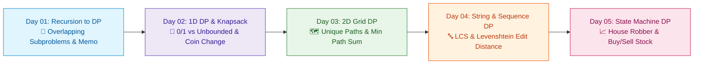

# 📘 Week 10: Dynamic Programming I: Fundamentals & Core Families

> 🧭 **Navigation:** [← Previous: Week 09](../week_09_graph_algorithms_i/README.md) • [🏠 Curriculum Overview](../README.md) • [📘 Complete Syllabus](../COMPLETE_SYLLABUS.md) • [Next: Week 11 →](../week_11_dp_ii_advanced/README.md)

---

## 🎬 Welcome to Week 10: The DP Master Architect's Masterclass!

Dynamic Programming strikes fear into many software engineers, but beneath the intimidating academic terminology lies a simple, mechanical truth: **DP is just recursion with a cache, or a directed acyclic graph (DAG) traversed in topological order.**

If a problem exhibits **Overlapping Subproblems** (solving the exact same smaller question thousands of times) and **Optimal Substructure** (an optimal overall answer is constructed directly from optimal sub-answers), brute force explodes exponentially to `O(2^N)`.

This week systematically demystifies DP through intuitive mental models: **the memoization cheat sheet**, **the 1D knapsack shopping cart**, **the 2D grid tax collector**, **sequence alignment with Edit Distance**, and **state machines (House Robber & Stock Trading)**.

---

## 📅 Day-by-Day Learning Path

| Day | Instructional Masterclass | Core Mental Model & Intuition | Key Pattern / Invariant |
| :--- | :--- | :--- | :--- |
| **Day 01** | [DP: Recursion & Memoization](Week_10_Day_01_DP_Recursion_Memoization_Instructional.md) | **The Mathematician's Cheat Sheet:** Never solve the same puzzle twice. | Top-down memoization vs bottom-up tabulation, Fibonacci, Climbing Stairs. |
| **Day 02** | [1D DP & The Knapsack Family](Week_10_Day_02_1D_DP_Knapsack_Family_Instructional.md) | **The Luggage Weight Limit:** Take it or leave it. | 0/1 Knapsack (reverse iteration), Unbounded Knapsack (forward iteration), Coin Change. |
| **Day 03** | [2D DP: Grids & Matrix Paths](Week_10_Day_03_2D_DP_Grids_Edit_Distance_Instructional.md) | **The Toll Booth Collector:** Reaching `(r, c)` from top and left. | Unique Paths, Minimum Path Sum, space compression from `O(M * N)` to `O(N)`. |
| **Day 04** | [DP on Sequences: LCS & Edit Distance](Week_10_Day_04_DP_on_Sequences_Instructional.md) | **The DNA Alignment / Spell Checker:** Insert, delete, replace costs. | Longest Common Subsequence (LCS), Longest Increasing Subsequence (LIS), Edit Distance. |
| **Day 05** | [State Machine DP: Multi-State Transitions](Week_10_Day_05_Story_Driven_DP_Advanced_Instructional.md) | **The Traffic Light Switcher:** Transitioning between discrete states. | House Robber (rob vs skip), Best Time to Buy and Sell Stock with Cooldown/Fee. |

---

## 📚 Consolidated Playbooks & Reference Guides

*   📖 **Comprehensive Week Playbook:** [WEEK_10_FULL_PLAYBOOK.md](WEEK_10_FULL_PLAYBOOK.md) — High-density synthesis of all invariants, theorems, and pattern triggers for this week.
*   📊 **Visual Concepts Playbook (Hybrid):** [Week_10_Visual_Concepts_Playbook_HYBRID.md](Week_10_Visual_Concepts_Playbook_HYBRID.md) — Compact Mermaid diagrams, state transitions, and complexity reference tables.
*   💻 **Production C# Reference (.NET 8/9):** [Week_10_Extended_CSharp_Complete.md](Week_10_Extended_CSharp_Complete.md) — Idiomatic, zero-allocation memory-aware implementations (`Span<int>`) and problem ladders.
*   🐍 **Production Python Reference (Python 3.11+):** [Week_10_Extended_Python_Complete.md](Week_10_Extended_Python_Complete.md) — Clean, pythonic reference implementations (`@cache`, `lru_cache`) for rapid whiteboard prototyping.

---

## 🛠️ The 5 Core Support Files (`support files/`)

1.  📋 [Daily Progress Checklist](support%20files/Week_10_Daily_Progress_Checklist.md) — Step-by-step accountability tracker for theory, coding, and variants.
2.  🧭 [Weekly Guidelines & Mental Models](support%20files/Week_10_Guidelines.md) — Strategic roadmap, common pitfalls, and conceptual anchors.
3.  🎙️ [Interview Q&A Comprehensive Reference](support%20files/Week_10_Interview_QA_Reference.md) — High-frequency senior technical questions with verbal response frameworks.
4.  🗺️ [Problem-Solving Roadmap](support%20files/Week_10_Problem_Solving_Roadmap.md) — Tier-1 problem progression ladder from warm-up to advanced.
5.  📑 [Summary & Key Concepts Synthesis](support%20files/Week_10_Summary_Key_Concepts.md) — Fast-revision cheat sheet covering all governing invariants and system trade-offs.

---

> 🧭 **Navigation:** [← Previous: Week 09](../week_09_graph_algorithms_i/README.md) • [🏠 Curriculum Overview](../README.md) • [📘 Complete Syllabus](../COMPLETE_SYLLABUS.md) • [Next: Week 11 →](../week_11_dp_ii_advanced/README.md)
