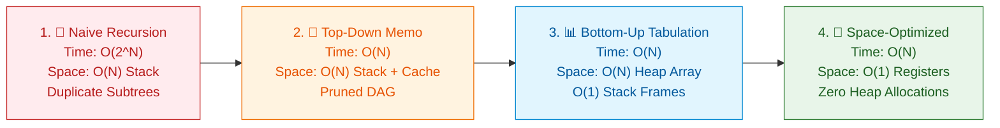

# 📘 Week 10 Day 1: Dynamic Programming as Recursion + Memoization — Engineering Guide

> 🧭 **Navigation:** [← Week Overview](README.md) • [🏠 Master Syllabus](../COMPLETE_SYLLABUS.md) • [Next Day →](Week_10_Day_02_1D_DP_Knapsack_Family_Instructional.md)
> 
> 💡 **Staff Mentor Note:** *Dynamic Programming is not high-level wizardry, nor is it a mysterious mathematical rite of passage. At its core, DP is nothing more than structured recursion combined with an indexed cache, followed by mechanical loops that eliminate stack overhead. If you know how to branch a decision tree and write to an array, you already know the mechanics of DP. Today, we break the mental barrier, master the universal 3-Step Recipe, hand-trace subproblem reuse from scratch, and turn you into an engineer who can fluently morph any naive `O(2^N)` brute force into an optimal `O(N)` solution with `O(1)` register memory.*

---

## 🎯 Learning Objectives & Cheat-Sheet Blueprint

By the end of this module, you will be able to:

1. **Internalize the two invariant pillars** of Dynamic Programming: Overlapping Subproblems and Optimal Substructure.
2. **Apply the universal 3-Step DP Recipe** (`Choice -> State Definition -> Base Cases & Transitions`) to systematically deconstruct linear recurrences under live interview pressure.
3. **Execute the 4-Stage Architectural Transformation** across any recursive problem:
   - Stage 1: Naive Exhaustive Recursion (`O(2^N)` time, `O(N)` stack)
   - Stage 2: Top-Down Memoization (`O(N)` time, `O(N)` cache + stack)
   - Stage 3: Bottom-Up Tabulation (`O(N)` time, `O(N)` heap array, `O(1)` stack)
   - Stage 4: Space-Optimized Rolling Variables (`O(N)` time, `O(1)` auxiliary memory)
4. **Identify and neutralize the Top 5 Rookie DP Traps**: Zero-initialization cache corruption, recursion call stack exhaustion at `N = 10^5`, off-by-one boundary crashes, heap boxing overhead from hash maps, and 32-bit integer arithmetic overflow.
5. **Deliver the 45-Minute Interview Talk Track**: Deliver the exact 3-sentence script defending algorithmic transitions and spatial bounds before touching the keyboard.
6. **Implement production-grade, overflow-safe solutions** in idiomatic C# (.NET 8/9, Span-aware, guard clauses) and Python (3.11+, typed, `@lru_cache` and manual caching) for Fibonacci Number (LC 509), Climbing Stairs (LC 70), and Min Cost Climbing Stairs (LC 746).

---

## 🎬 PILLAR 1: The 60-Second Hook & Real-World Metaphor

### The Mathematician's Whiteboard Cheat Sheet

Imagine you and I are standing in front of a conference room whiteboard.

I pick up a marker and write:
```text
1 + 1 + 1 + 1 + 1
```

I turn to you and ask: *"How many ones are on the board?"*  
You glance at it for half a second and say: *"Five."*

Now, without erasing anything, I walk up to the board and scribble `+ 1` at the very end:
```text
1 + 1 + 1 + 1 + 1 + 1
```

I turn back to you and ask: *"How many now?"*  
Instantly, without hesitation, you say: *"Six."*

Here is the million-dollar interview question: **How did you know the answer was six without recounting all the ones from left to right?**

You didn't recalculate `1 + 1 = 2`, `2 + 1 = 3`, `3 + 1 = 4`, `4 + 1 = 5`, `5 + 1 = 6`.  
You simply **remembered** that the previous expression evaluated to `5`, and you added `1` to that cached value:
```text
Cached Answer (5) + New Step (1) = 6
```

**That is the entire secret of Dynamic Programming.**  
Dynamic Programming is simply remembering past work so you never recalculate it from scratch.

---

### The Exponential Crisis: `O(2^N)` vs `O(N)`

When you solve problems like Fibonacci numbers or stair climbing naively, your code behaves like an amnesiac mathematician who recounts every single `1` from scratch on every question.

Consider computing the 50th Fibonacci number `F(50)`:
- Naive recursion branches into 2 recursive calls at each step (`F(n - 1)` and `F(n - 2)`).
- At depth 50, the recursion tree generates over `2^50` function calls.
- `2^50` is approximately `1,125,899,906,842,624` operations (`~1.12 * 10^15`).

```text
=============================================================================
THE HARDWARE REALITY CHECK: N = 50
=============================================================================
CPU Frequency:                 3.0 GHz (~10^9 operations per second)
Naive Recursion Operations:    2^50 ≈ 1.12 * 10^15 calls
Execution Time (Naive):        1,125,899 seconds ≈ 13.03 DAYS of pegged 100% CPU!

Memoized DP Operations:        50 array reads/writes
Execution Time (DP):           50 nanoseconds (0.00000005 seconds)!
Performance Multiplier:        22,500,000,000,000x faster!
=============================================================================
```

> [!CAUTION]
> The CPU is not freezing because `N = 50` is a deep recursion. A stack depth of 50 frames takes less than 4 Kilobytes of memory! The thread freezes because of **uncontrolled redundancy**: `F(25)` is computed from scratch over `2.3 million` times in a single run.

---

### The Two Pillars of Dynamic Programming

Dynamic Programming is not applicable to every problem. It strictly requires two mathematical invariants:

1. **Overlapping Subproblems:** The recursive decision tree repeatedly encounters the exact same states with identical arguments. If every subproblem is unique (like in Merge Sort, where each array slice is disjoint), caching yields zero hits.
2. **Optimal Substructure:** An optimal solution to the global problem can be constructed directly from optimal solutions to its subproblems. For example, the shortest path from `A` to `C` through `B` consists of the shortest path from `A` to `B` plus the shortest path from `B` to `C`.

| Problem Structure | Overlapping Subproblems? | Optimal Substructure? | Algorithmic Paradigm |
| :--- | :---: | :---: | :--- |
| **Fibonacci / Climbing Stairs** | ✅ Yes (e.g. `f(3)` called repeatedly) | ✅ Yes (`f(n) = f(n-1) + f(n-2)`) | **Dynamic Programming** |
| **0/1 Knapsack / Coin Change** | ✅ Yes (same capacity & index) | ✅ Yes (`max(include, exclude)`) | **Dynamic Programming** |
| **Merge Sort / Quick Sort** | ❌ No (sub-arrays are disjoint) | ✅ Yes (sorted halves merge) | **Divide & Conquer** |
| **Longest Simple Path (Graphs)** | ✅ Yes (same sub-vertices) | ❌ No (subpaths can create cycles) | **NP-Hard / Backtracking** |

---

## 🪜 PILLAR 2: The Scaffolding Ladder & Toy Napkin Trace

To master DP, you must never jump directly to space-optimized code on a whiteboard. You climb the **4-Stage Scaffolding Ladder**:

```text
  [ Stage 4: Space-Optimized ]  <-- 2 rolling variables, O(1) memory, zero allocations
             ^
  [ Stage 3: Bottom-Up Tab ]    <-- Flat iterative for-loop, cache friendly, no stack
             ^
  [ Stage 2: Top-Down Memo ]    <-- Recursive tree + array cache to prune redundant work
             ^
  [ Stage 1: Naive Recursion ]  <-- Mathematical recurrence formulation (Brute Force)
```

---

### Hand-Tracing `N = 5` Across All 4 Stages

Let us hand-trace **Climbing Stairs / Fibonacci** for `N = 5`.  
Rules: You can climb `1` or `2` steps at a time. How many distinct ways can you reach step `5`?  
Recurrence: `ways(n) = ways(n - 1) + ways(n - 2)`.

---

#### Stage 1: The Brute-Force Decision Tree (The Exponential Sprawl)

Tracing `ways(5)` naively branches downward:

```text
                               ways(5)
                             /         \
                      ways(4)           ways(3) [DUPLICATE 1]
                     /       \          /     \
               ways(3)       ways(2)  ways(2) ways(1)
              /      \       /    \   [DUP 3]  (Base)
          ways(2)   ways(1) (Base)(Base)
          [DUP 2]   (Base)
          /    \
      ways(1) ways(0)
      (Base)  (Base)
```

Notice the massive redundancy:
- `ways(3)` is computed **2 times** completely independently.
- `ways(2)` is computed **3 times** completely independently.
- `ways(1)` is evaluated **5 times**.
- Total function calls executed: **15 calls** for just `N = 5`!

---

#### Stage 2: Top-Down Memoization (The Pruned DAG)

We allocate a cache array `memo` of size `6` initialized to `-1`:
```text
Index:     0     1     2     3     4     5
memo:   [ -1 ][ -1 ][ -1 ][ -1 ][ -1 ][ -1 ]
```

Now trace the execution:
1. `ways(5)` checks `memo[5]`: `-1` (uncomputed). Calls `ways(4)`.
2. `ways(4)` checks `memo[4]`: `-1`. Calls `ways(3)`.
3. `ways(3)` checks `memo[3]`: `-1`. Calls `ways(2)`.
4. `ways(2)` checks `memo[2]`: `-1`. Calls `ways(1)`.
5. `ways(1)` hits base case: returns `1`.
6. `ways(2)` calls `ways(0)`: hits base case: returns `1`.
7. `ways(2)` sums `1 + 1 = 2`. Writes `memo[2] = 2` and returns `2`.
8. `ways(3)` calls right branch `ways(1)`: hits base case: returns `1`.
9. `ways(3)` sums `2 + 1 = 3`. Writes `memo[3] = 3` and returns `3`.
10. `ways(4)` calls right branch `ways(2)`:
    - **CACHE HIT!** `memo[2]` is already `2`!
    - **Instantly returns `2` without recursing into `ways(1)` or `ways(0)`.**
11. `ways(4)` sums `3 + 2 = 5`. Writes `memo[4] = 5` and returns `5`.
12. `ways(5)` calls right branch `ways(3)`:
    - **MASSIVE CACHE HIT!** `memo[3]` is already `3`!
    - **Instantly returns `3` without inspecting any sub-branches.**
13. `ways(5)` sums `5 + 3 = 8`. Writes `memo[5] = 8` and returns `8`.

Total calls reduced from **15** down to **9** (and only 6 unique states are evaluated).

```text
Final Memo Table in Memory:
Index:    0    1    2    3    4    5
memo:   [ 1 ][ 1 ][ 2 ][ 3 ][ 5 ][ 8 ]
```

---

#### Stage 3: Bottom-Up Tabulation (The Iterative Array)

Instead of recursing top-down and relying on the runtime call stack, we invert the dependency. We fill an array `dp` from base cases upward:

```text
Step 0: Allocate dp[6] and populate base cases:
        dp[0] = 1, dp[1] = 1
        [ 1 ][ 1 ][ ? ][ ? ][ ? ][ ? ]

Step 1 (i = 2): dp[2] = dp[1] + dp[0] = 1 + 1 = 2
        [ 1 ][ 1 ][ 2 ][ ? ][ ? ][ ? ]

Step 2 (i = 3): dp[3] = dp[2] + dp[1] = 2 + 1 = 3
        [ 1 ][ 1 ][ 2 ][ 3 ][ ? ][ ? ]

Step 3 (i = 4): dp[4] = dp[3] + dp[2] = 3 + 2 = 5
        [ 1 ][ 1 ][ 2 ][ 3 ][ 5 ][ ? ]

Step 4 (i = 5): dp[5] = dp[4] + dp[3] = 5 + 3 = 8  ===> Target Reached!
        [ 1 ][ 1 ][ 2 ][ 3 ][ 5 ][ 8 ]
```

- Runtime: Exactly `5 - 2 + 1 = 4` loop iterations. `O(N)` time.
- Auxiliary Space: `O(N)` array in heap memory. `O(1)` call stack frames.

---

#### Stage 4: Space-Optimized Rolling Variables (`O(1)` Space)

Look closely at the transition formula in Stage 3:
```text
dp[i] = dp[i - 1] + dp[i - 2]
```
To calculate `dp[5]`, did we need `dp[0]`, `dp[1]`, or `dp[2]`? **No!**  
We strictly needed `dp[4]` and `dp[3]`. All earlier cells were dead historical weight!

Therefore, we discard the array and keep only **two scalar variables**:
```text
Initial (Base Cases):
  prev2 = dp[0] = 1
  prev1 = dp[1] = 1

Iteration i = 2:
  current = prev1 + prev2 = 1 + 1 = 2
  Shift: prev2 = prev1 (1),  prev1 = current (2)

Iteration i = 3:
  current = prev1 + prev2 = 2 + 1 = 3
  Shift: prev2 = 2,          prev1 = 3

Iteration i = 4:
  current = prev1 + prev2 = 3 + 2 = 5
  Shift: prev2 = 3,          prev1 = 5

Iteration i = 5:
  current = prev1 + prev2 = 5 + 3 = 8
  Shift: prev2 = 5,          prev1 = 8  ===> Result is prev1 (8)!
```

- Auxiliary Space drops from `O(N)` down to **`O(1)`**.
- Memory: Resides purely inside CPU hardware registers (`RAX`, `RBX`). Zero heap allocation!

---

### 🧠 Pause & Predict Micro-Drills

#### Drill 1: Overlapping Subproblem Counting Under Pressure
> **Question:** In computing the 6th Fibonacci number `F(6)` via naive recursion (`F(n) = F(n - 1) + F(n - 2)`), exactly how many times is `F(2)` evaluated from scratch across the entire call tree?  
> *(Hint: Think about how many times `F(2)` appears in the expansion of `F(6) = F(5) + F(4)`).*

<details>
<summary>👉 Click to Reveal Staff Answer</summary>

**Answer: Exactly 8 times!**

Mathematical Derivation:  
The number of times `F(k)` is called when computing `F(n)` via naive recursion is equal to `F(n - k + 1)`.  
Here `n = 6` and `k = 2`, so `F(6 - 2 + 1) = F(5) = 8`.  
In naive recursion, subproblem execution frequencies grow at the exact same exponential rate as Fibonacci numbers! Memoization squashes those 8 redundant subtree calculations down to exactly **1 single evaluation**.
</details>

---

#### Drill 2: Base Case Physical Grounding
> **Question:** In Fibonacci, `F(0) = 0` and `F(1) = 1`. But in Climbing Stairs, why do we set `dp[0] = 1` and `dp[1] = 1`? What does `dp[0] = 1` physically mean?

<details>
<summary>👉 Click to Reveal Staff Answer</summary>

**Answer:**  
In Climbing Stairs, `dp[0] = 1` represents the **single distinct way to stand on the ground floor before taking any steps** (namely: do nothing).  
If you set `dp[0] = 0`, then calculating step 2 gives:  
`dp[2] = dp[1] + dp[0] = 1 + 0 = 1`.  
That would be completely wrong, because there are **2 valid ways** to reach step 2: `(1 + 1)` and `(2)`.  
Setting `dp[0] = 1` correctly yields `dp[2] = 1 + 1 = 2`.  
Always verify your base cases against small hand-traced realities (`n = 2`), never by blindly copying textbook templates!
</details>

---

#### Drill 3: The Cache Sentinel Trap
> **Question:** You are writing Top-Down Memoization for a DP problem where `0` is a valid return value for some subproblems. You initialize your memoization table as `int[] memo = new int[n + 1]`. What disaster happens when your code executes `if (memo[n] != 0) return memo[n];`?

<details>
<summary>👉 Click to Reveal Staff Answer</summary>

**Answer:**  
If a subproblem legitimately evaluates to `0`, writing `memo[n] = 0` leaves the cell indistinguishable from its default uninitialized state!  
On subsequent visits to state `n`, the check `if (memo[n] != 0)` evaluates to `false`. The program thinks the subproblem was never solved, recurses into the entire subtree again, and **silently collapses your `O(N)` memoized solution right back into `O(2^N)` exponential TLE!**  
Fix: Always initialize memo tables to a sentinel value that cannot be a valid answer (e.g. `-1` via `Array.Fill(memo, -1)`), or use a separate `bool[] visited` bitset.
</details>

---

## 🎨 PILLAR 3: Pragmatic Visual Models

### 1. ASCII Tree Comparison: Naive Sprawl vs Pruned DAG

```text
=============================================================================
1. NAIVE RECURSION TREE: COMBINATORIAL EXPLOSION (O(2^N) Calls)
=============================================================================
                                  fib(5)
                                /        \
                        fib(4)            fib(3)  <-- Duplicate Branch #1!
                       /      \          /      \
                  fib(3)      fib(2)   fib(2)   fib(1)
                 /      \     /    \   /    \
             fib(2)   fib(1) ...  ... ...   ...   <-- Duplicate Branch #2!
             /    \
          fib(1)  fib(0)

=============================================================================
2. MEMOIZED EXECUTION DAG: LINEAR PRUNING (O(N) Calls)
=============================================================================
                                  fib(5)
                                /        \
                        fib(4)            [fib(3)] <-- O(1) Cache Hit!
                       /      \                        (Immediate Return)
                  fib(3)      [fib(2)] <-- O(1) Cache Hit!
                 /      \
             fib(2)   [fib(1)] <-- Base Case (O(1))
             /    \
         fib(1)  fib(0)

Mechanical Invariant: Every unique node in the DAG is computed once.
Subsequent edges pointing to existing nodes take O(1) time.
=============================================================================
```

---

### 2. Physical Memory Layout: Stack vs Heap vs Registers

```text
=============================================================================
HARDWARE MEMORY LAYOUT ACROSS DP IMPLEMENTATIONS
=============================================================================

1. TOP-DOWN RECURSION + MEMOIZATION:
Stack Memory (Thread Stack, ~1 MB Limit):
+-------------------------------------------------------------+
| Frame: fib(1) [n=1, ret=1]          | <-- Stack Pointer ESP |
| Frame: fib(2) [n=2, waiting on f(0)]|                       |
| Frame: fib(3) [n=3, waiting on f(1)]|                       |
| Frame: fib(4) [n=4, waiting on f(2)]|                       |
| Frame: fib(5) [n=5, waiting on f(3)]| <-- Base Stack Frame  |
+-------------------------------------------------------------+
Heap Memory:
  memo array: [ 0 | 1 | 1 | 2 | 3 | 5 ] (Requires separate heap allocation)
  Danger: Calling fib(100_000) causes an unrecoverable StackOverflowException!

2. BOTTOM-UP TABULATION:
Stack Memory:
+-------------------------------------------------------------+
| Single Frame: Tabulation() [i=5, n=5]                       | <-- O(1) Stack!
+-------------------------------------------------------------+
Heap Memory (Contiguous Array, Cache Friendly):
  dp array: [ 0 | 1 | 1 | 2 | 3 | 5 ]
  CPU Pre-fetcher loads entire array into 64-byte L1 Cache lines!

3. SPACE-OPTIMIZED TABULATION:
Stack Memory:
+-------------------------------------------------------------+
| Single Frame: Optimized() [prev2, prev1, current]           |
+-------------------------------------------------------------+
CPU Hardware Registers:
  RAX: [ prev1   = 5 ]  <-- Blazing fast register read/write
  RBX: [ prev2   = 3 ]
  RCX: [ current = 5 ]
  Heap Allocations: Exactly 0 bytes! Zero Garbage Collector pressure!
=============================================================================
```

---

### 3. The 4-Stage Architectural Transformation Pipeline



---

### 4. Dynamic Programming Decision & Strategy Flowchart

Use this decision tree during FAANG interviews to immediately route any problem to its optimal paradigm:

```mermaid
%%{init: {"flowchart": {"htmlLabels": true, "padding": 20}, "themeCSS": "foreignObject { overflow: visible !important; }"}}%%
flowchart TD
    Start["❓ Recursive Recurrence Identified"] --> Overlap{"Overlapping<br/>Subproblems?"}
    
    Overlap -->|No| DAndC["⚡ Divide & Conquer<br/>(Merge Sort, Binary Search)"]
    Overlap -->|Yes| OptSub{"Optimal<br/>Substructure?"}
    
    OptSub -->|No| Backtrack["🔍 NP-Hard / Exhaustive Search<br/>(Backtracking, Branch & Bound)"]
    OptSub -->|Yes| Recipe["🎯 Apply 3-Step DP Recipe<br/>1. Choice 2. State 3. Transition"]
    
    Recipe --> TopDown["1️⃣ Write Top-Down + Memo<br/>(Natural recurrence, quick prototype)"]
    TopDown --> DeepStack{"Risk of Stack Overflow?<br/>(N &gt; 10^4 or strict memory)"}
    
    DeepStack -->|No & Sparse States| KeepTD["✅ Keep Top-Down Memo<br/>(Skips unreachable state space)"]
    DeepStack -->|Yes OR Dense States| Tabulation["2️⃣ Invert to Bottom-Up Tabulation<br/>(Flat for-loop, cache locality)"]
    
    Tabulation --> Lookback{"Transition depends only on<br/>last k constant states?"}
    Lookback -->|Yes: k is constant O(1)| Rolling["3️⃣ Compress to Rolling Variables<br/>Auxiliary Space: O(1)"]
    Lookback -->|No: depends on variable prior states| FullTable["✅ Retain Full DP Table<br/>Auxiliary Space: O(N) or O(N^2)"]

    style Start fill:#f3e5f5,stroke:#7b1fa2,color:#4a148c
    style DAndC fill:#fff3e0,stroke:#ef6c00,color:#e65100
    style Backtrack fill:#ffebee,stroke:#c62828,color:#b71c1c
    style Recipe fill:#e1f5fe,stroke:#0288d1,color:#01579b
    style TopDown fill:#e0f2f1,stroke:#00897b,color:#004d40
    style KeepTD fill:#e8f5e9,stroke:#2e7d32,color:#1b5e20
    style Tabulation fill:#e1f5fe,stroke:#0288d1,color:#01579b
    style Rolling fill:#e8f5e9,stroke:#2e7d32,color:#1b5e20
    style FullTable fill:#e8f5e9,stroke:#2e7d32,color:#1b5e20
```

---

## 🛑 PILLAR 4: The Rookie Trap Zone

### Side-by-Side Architectural Blunders & Fixes

---

#### Trap 1: The Zero-Initialization Cache Corruption

```csharp
// ❌ ROOKIE BLUNDER: Initializing memo with 0 when 0 is a valid answer!
public class Solution
{
    private int[] memo;

    public int MinCostClimbingStairs(int[] cost)
    {
        memo = new int[cost.Length + 1]; // Default values are 0
        return Solve(cost.Length, cost);
    }

    private int Solve(int i, int[] cost)
    {
        if (i <= 1) return 0;
        
        // BUG: If minimum cost to reach step i is legitimately 0,
        // memo[i] == 0 will evaluate to FALSE!
        // The cache is bypassed, causing silent O(2^N) exponential TLE!
        if (memo[i] != 0) return memo[i];

        memo[i] = Math.Min(Solve(i - 1, cost) + cost[i - 1], Solve(i - 2, cost) + cost[i - 2]);
        return memo[i];
    }
}
```

```csharp
// ✅ SENIOR ARCHITECT PATTERN: Explicit sentinel initialization (-1)
public class Solution
{
    public int MinCostClimbingStairs(int[] cost)
    {
        int[] memo = new int[cost.Length + 1];
        Array.Fill(memo, -1); // -1 guarantees clear distinction between uncomputed and 0
        return Solve(cost.Length, cost, memo);
    }

    private static int Solve(int i, int[] cost, int[] memo)
    {
        if (i <= 1) return 0;
        if (memo[i] != -1) return memo[i]; // Correctly returns cached 0s in O(1)!

        memo[i] = Math.Min(Solve(i - 1, cost, memo) + cost[i - 1], 
                           Solve(i - 2, cost, memo) + cost[i - 2]);
        return memo[i];
    }
}
```

---

#### Trap 2: Stack Overflow on Deep Inputs (`N = 10^5`)

```csharp
// ❌ ROOKIE BLUNDER: Top-Down Recursion with N = 100,000
public class Solution
{
    // CRASH: In .NET, the default thread stack is 1 MB (~10,000 stack frames).
    // In Python, sys.getrecursionlimit() defaults to 1,000 frames.
    // At N = 100,000, this triggers an uncatchable StackOverflowException!
    public int ClimbStairs(int n)
    {
        int[] memo = new int[n + 1];
        Array.Fill(memo, -1);
        return Dfs(n, memo);
    }

    private int Dfs(int n, int[] memo)
    {
        if (n <= 1) return 1;
        if (memo[n] != -1) return memo[n];
        return memo[n] = Dfs(n - 1, memo) + Dfs(n - 2, memo);
    }
}
```

```csharp
// ✅ SENIOR ARCHITECT PATTERN: Bottom-Up Tabulation or Rolling Variables
public class Solution
{
    // Executes in a single stack frame with O(1) auxiliary space!
    // Safely processes N = 10^8 without touching stack memory limits.
    public int ClimbStairs(int n)
    {
        if (n <= 1) return 1;

        int prev2 = 1; // dp[0]
        int prev1 = 1; // dp[1]

        for (int i = 2; i <= n; i++)
        {
            int current = prev1 + prev2;
            prev2 = prev1;
            prev1 = current;
        }

        return prev1;
    }
}
```

---

#### Trap 3: The Off-By-One Allocation Crash (`N` vs `N + 1`)

```csharp
// ❌ ROOKIE BLUNDER: Allocating array of size n instead of n + 1
public int ClimbStairs(int n)
{
    int[] dp = new int[n]; // For n = 5, valid indices are only 0, 1, 2, 3, 4!
    dp[0] = 1;
    dp[1] = 1;
    for (int i = 2; i <= n; i++)
    {
        dp[i] = dp[i - 1] + dp[i - 2]; // CRASH when i == n: IndexOutOfRangeException!
    }
    return dp[n];
}
```

```csharp
// ✅ SENIOR ARCHITECT PATTERN: Guard clauses + explicit n + 1 sizing
public int ClimbStairs(int n)
{
    ArgumentOutOfRangeException.ThrowIfNegative(n);
    if (n <= 1) return 1;

    // Allocate n + 1 so dp[n] is directly addressable
    int[] dp = new int[n + 1];
    dp[0] = 1;
    dp[1] = 1;

    for (int i = 2; i <= n; i++)
    {
        dp[i] = dp[i - 1] + dp[i - 2];
    }

    return dp[n];
}
```

---

#### Trap 4: Heavy Hashing & Boxing with `Dictionary<int, int>`

```csharp
// ❌ ROOKIE BLUNDER: Using Dictionary for dense, contiguous integer states
public class Solution
{
    // Dictionary incurs hashing calculation, collision buckets, struct Entry wrappers,
    // and severe pointer-chasing cache misses across RAM.
    private Dictionary<int, int> memo = new();

    public int Fib(int n)
    {
        if (n <= 1) return n;
        if (memo.TryGetValue(n, out int val)) return val;
        return memo[n] = Fib(n - 1) + Fib(n - 2);
    }
}
```

```csharp
// ✅ SENIOR ARCHITECT PATTERN: Flat contiguous array = 1 CPU instruction offset
public class Solution
{
    // Flat primitive array: index offset is calculated in a single clock cycle:
    // MemoryAddress = BaseAddress + (index * 4 bytes)
    public int Fib(int n)
    {
        if (n <= 1) return n;
        int[] memo = new int[n + 1];
        Array.Fill(memo, -1);
        memo[0] = 0;
        memo[1] = 1;
        return Solve(n, memo);
    }

    private static int Solve(int n, int[] memo)
    {
        if (memo[n] != -1) return memo[n];
        return memo[n] = Solve(n - 1, memo) + Solve(n - 2, memo);
    }
}
```

---

#### Trap 5: 32-Bit Integer Silent Arithmetic Overflow

```csharp
// ❌ ROOKIE BLUNDER: Using 32-bit int for exponential series
public int Fib(int n)
{
    // BUG: F(46) = 1,836,311,903 (fits in signed 32-bit int: max 2,147,483,647).
    // F(47) = 2,971,215,073 -> SILENTLY OVERFLOWS into negative number: -1,323,752,223!
    int prev2 = 0, prev1 = 1;
    for (int i = 2; i <= n; i++)
    {
        int curr = prev1 + prev2;
        prev2 = prev1;
        prev1 = curr;
    }
    return prev1;
}
```

```csharp
// ✅ SENIOR ARCHITECT PATTERN: 64-bit long with overflow awareness or BigInteger
public long Fib(int n)
{
    ArgumentOutOfRangeException.ThrowIfNegative(n);
    if (n <= 1) return n;

    // long handles up to F(92) = 7,540,113,804,746,346,429 without overflow
    long prev2 = 0L, prev1 = 1L;
    for (int i = 2; i <= n; i++)
    {
        checked // Detects overflow in debug builds, or use BigInteger for N >= 93
        {
            long curr = prev1 + prev2;
            prev2 = prev1;
            prev1 = curr;
        }
    }
    return prev1;
}
```

---

## 🎙️ PILLAR 5: 45-Minute Interview Talk Track

In a live FAANG technical interview, the first 60 seconds of verbal communication dictate your evaluation. Never jump straight into code. Speak this structured script out loud to signal senior-level competence:

### The Exact 3-Sentence Script to Speak Out Loud

> *"Looking at the recursive recurrence, a naive implementation evaluates overlapping subproblems repeatedly, creating an exponential `O(2^N)` decision tree that will time out for `N > 40`.*  
> *Because the problem exhibits optimal substructure with state `dp[i]` representing step `i`, we can cache intermediate states using Top-Down Memoization or Bottom-Up Tabulation, collapsing the runtime to linear `O(N)`.*  
> *Furthermore, since computing state `dp[i]` strictly depends only on the immediate two previous values `dp[i - 1]` and `dp[i - 2]`, we can compress the `O(N)` array down to two rolling scalar registers, achieving optimal `O(1)` auxiliary space."*

---

### The 45-Minute Interview Delivery Blueprint

```text
===================================================================================
                   45-MINUTE LIVE INTERVIEW DELIVERY TIMELINE
===================================================================================

[00:00 - 05:00] PHASE 1: CLARIFICATION & CONSTRAINTS
- "What is the maximum value of N? If N <= 45, 32-bit int suffices; if N <= 90, we need 64-bit long."
- "What are the base cases? What should we return for N = 0 or negative inputs?"
- "Can costs or weights be zero or negative? (Crucial for memoization sentinel selection)."

[05:00 - 12:00] PHASE 2: THE 3-STEP RECIPE DERIVATION
- 1. Choice: "At step i, we arrived either from i - 1 (1-step leap) or i - 2 (2-step leap)."
- 2. State: "Let dp[i] represent the minimum cost / total ways to reach step i."
- 3. Transition: "dp[i] = dp[i - 1] + dp[i - 2], with base cases dp[0] = 1, dp[1] = 1."
- Draw the toy napkin tree for N = 4 to explicitly point out duplicate branches.

[12:00 - 25:00] PHASE 3: PRODUCTION IMPLEMENTATION
- Announce your plan: "I will implement the space-optimized bottom-up approach directly."
- Write clean guard clauses for edge cases (`N <= 1`).
- Declare rolling variables (`prev2`, `prev1`) with descriptive domain names.
- Write the flat `for` loop from `2` up to `N`.

[25:00 - 35:00] PHASE 4: SYSTEMATIC DRY-RUN WITH NAPKIN TRACE
- Walk through `N = 3` and `N = 4` step-by-step:
  Show the exact value of prev2, prev1, and current on every iteration.
- Test boundary cases: `N = 0`, `N = 1`.
- Verify off-by-one loop conditions (`i <= n` vs `i < n`).

[35:00 - 45:00] PHASE 5: COMPLEXITY & ENTERPRISE TRADE-OFFS
- Explicitly state Time: O(N) and Auxiliary Space: O(1).
- Contrast Top-Down vs Bottom-Up: explain call stack limits and L1 cache locality.
- Discuss scale: "If N were 10^18, we could compute this in O(log N) time using Matrix Exponentiation."
===================================================================================
```

---

## ⚡ PILLAR 6: Production Dual-Language Implementations

We now implement the 3 canonical Tier-1 foundational problems across **all 4 algorithmic paradigms**:
1. **Fibonacci Number (LeetCode 509)**
2. **Climbing Stairs (LeetCode 70)**
3. **Min Cost Climbing Stairs (LeetCode 746)**

---

### Problem 1: Fibonacci Number (LeetCode 509)

**Problem Contract:** Given integer `n`, compute `F(n)` where `F(0) = 0`, `F(1) = 1`, and `F(n) = F(n - 1) + F(n - 2)`.

#### Modern C# (.NET 8/9 Production Implementation)

```csharp
namespace DP.Fundamentals;

public static class FibonacciSolver
{
    // =========================================================================
    // Paradigm 1: Naive Exhaustive Recursion (Baseline Reference)
    // Time: O(2^N) | Space: O(N) Stack
    // =========================================================================
    public static long FibNaive(int n)
    {
        ArgumentOutOfRangeException.ThrowIfNegative(n);
        if (n <= 1) return n;
        return FibNaive(n - 1) + FibNaive(n - 2);
    }

    // =========================================================================
    // Paradigm 2: Top-Down Memoization (Array-backed cache with sentinel -1)
    // Time: O(N) | Space: O(N) (Recursion Stack O(N) + Memo Array O(N))
    // =========================================================================
    public static long FibMemo(int n)
    {
        ArgumentOutOfRangeException.ThrowIfNegative(n);
        if (n <= 1) return n;

        long[] memo = new long[n + 1];
        Array.Fill(memo, -1L);
        memo[0] = 0L;
        memo[1] = 1L;

        return ComputeMemo(n, memo);
    }

    private static long ComputeMemo(int n, long[] memo)
    {
        if (memo[n] != -1L) return memo[n];

        memo[n] = ComputeMemo(n - 1, memo) + ComputeMemo(n - 2, memo);
        return memo[n];
    }

    // =========================================================================
    // Paradigm 3: Bottom-Up Tabulation (Iterative Array)
    // Time: O(N) | Space: O(N) (Contiguous Heap Array, O(1) Stack)
    // =========================================================================
    public static long FibTabulation(int n)
    {
        ArgumentOutOfRangeException.ThrowIfNegative(n);
        if (n <= 1) return n;

        long[] dp = new long[n + 1];
        dp[0] = 0L;
        dp[1] = 1L;

        for (int i = 2; i <= n; i++)
        {
            dp[i] = dp[i - 1] + dp[i - 2];
        }

        return dp[n];
    }

    // =========================================================================
    // Paradigm 4: Space-Optimized Rolling Variables (Senior Architect Standard)
    // Time: O(N) | Space: O(1) (Pure CPU Register Allocation)
    // =========================================================================
    public static long FibOptimized(int n)
    {
        ArgumentOutOfRangeException.ThrowIfNegative(n);
        if (n <= 1) return n;

        long prev2 = 0L; // F(0)
        long prev1 = 1L; // F(1)

        for (int i = 2; i <= n; i++)
        {
            long current = prev1 + prev2;
            prev2 = prev1;
            prev1 = current;
        }

        return prev1;
    }
}
```

#### Idiomatic Python (3.11+ Production Implementation)

```python
from functools import lru_cache

class FibonacciSolver:
    """Fibonacci computation across all 4 algorithmic paradigms."""

    # Paradigm 1: Naive Recursion
    # Time: O(2^N) | Space: O(N) Stack
    @staticmethod
    def fib_naive(n: int) -> int:
        if n < 0:
            raise ValueError("n must be non-negative.")
        if n <= 1:
            return n
        return FibonacciSolver.fib_naive(n - 1) + FibonacciSolver.fib_naive(n - 2)

    # Paradigm 2: Top-Down Memoization (Manual Array Cache)
    # Time: O(N) | Space: O(N)
    @staticmethod
    def fib_memo(n: int) -> int:
        if n < 0:
            raise ValueError("n must be non-negative.")
        if n <= 1:
            return n

        memo: list[int] = [-1] * (n + 1)
        memo[0], memo[1] = 0, 1

        def solve(k: int) -> int:
            if memo[k] != -1:
                return memo[k]
            memo[k] = solve(k - 1) + solve(k - 2)
            return memo[k]

        return solve(n)

    # Paradigm 2b: Top-Down Memoization (Pythonic @lru_cache)
    @staticmethod
    def fib_lru(n: int) -> int:
        if n < 0:
            raise ValueError("n must be non-negative.")

        @lru_cache(maxsize=None)
        def solve(k: int) -> int:
            if k <= 1:
                return k
            return solve(k - 1) + solve(k - 2)

        return solve(n)

    # Paradigm 3: Bottom-Up Tabulation
    # Time: O(N) | Space: O(N)
    @staticmethod
    def fib_tabulation(n: int) -> int:
        if n < 0:
            raise ValueError("n must be non-negative.")
        if n <= 1:
            return n

        dp: list[int] = [0] * (n + 1)
        dp[0], dp[1] = 0, 1

        for i in range(2, n + 1):
            dp[i] = dp[i - 1] + dp[i - 2]

        return dp[n]

    # Paradigm 4: Space-Optimized Rolling Variables
    # Time: O(N) | Space: O(1)
    @staticmethod
    def fib_optimized(n: int) -> int:
        if n < 0:
            raise ValueError("n must be non-negative.")
        if n <= 1:
            return n

        prev2, prev1 = 0, 1
        for _ in range(2, n + 1):
            prev2, prev1 = prev1, prev1 + prev2

        return prev1
```

---

### Problem 2: Climbing Stairs (LeetCode 70)

**Problem Contract:** You are climbing a staircase. It takes `n` steps to reach the top. Each time you can climb `1` or `2` steps. In how many distinct ways can you climb to the top?

#### Modern C# (.NET 8/9 Production Implementation + Path Reconstruction)

```csharp
namespace DP.Fundamentals;

public static class ClimbingStairsSolver
{
    // =========================================================================
    // Paradigm 1: Naive Recursion
    // Time: O(2^N) | Space: O(N) Stack
    // =========================================================================
    public static int ClimbStairsNaive(int n)
    {
        ArgumentOutOfRangeException.ThrowIfNegative(n);
        if (n <= 1) return 1;
        return ClimbStairsNaive(n - 1) + ClimbStairsNaive(n - 2);
    }

    // =========================================================================
    // Paradigm 2: Top-Down Memoization
    // Time: O(N) | Space: O(N)
    // =========================================================================
    public static int ClimbStairsMemo(int n)
    {
        ArgumentOutOfRangeException.ThrowIfNegative(n);
        if (n <= 1) return 1;

        int[] memo = new int[n + 1];
        Array.Fill(memo, -1);
        memo[0] = 1;
        memo[1] = 1;

        return Solve(n, memo);
    }

    private static int Solve(int n, int[] memo)
    {
        if (memo[n] != -1) return memo[n];
        return memo[n] = Solve(n - 1, memo) + Solve(n - 2, memo);
    }

    // =========================================================================
    // Paradigm 3: Bottom-Up Tabulation
    // Time: O(N) | Space: O(N)
    // =========================================================================
    public static int ClimbStairsTabulation(int n)
    {
        ArgumentOutOfRangeException.ThrowIfNegative(n);
        if (n <= 1) return 1;

        int[] dp = new int[n + 1];
        dp[0] = 1;
        dp[1] = 1;

        for (int i = 2; i <= n; i++)
        {
            dp[i] = dp[i - 1] + dp[i - 2];
        }

        return dp[n];
    }

    // =========================================================================
    // Paradigm 4: Space-Optimized Rolling Variables
    // Time: O(N) | Space: O(1)
    // =========================================================================
    public static int ClimbStairsOptimized(int n)
    {
        ArgumentOutOfRangeException.ThrowIfNegative(n);
        if (n <= 1) return 1;

        int prev2 = 1; // dp[0]
        int prev1 = 1; // dp[1]

        for (int i = 2; i <= n; i++)
        {
            int current = prev1 + prev2;
            prev2 = prev1;
            prev1 = current;
        }

        return prev1;
    }

    // =========================================================================
    // Bonus: Full Path Reconstruction (Backtracking along decisions)
    // Time: O(2^N * N) output size | Space: O(N) recursion stack
    // =========================================================================
    public static List<List<int>> ReconstructAllPaths(int n)
    {
        ArgumentOutOfRangeException.ThrowIfNegative(n);
        List<List<int>> allPaths = [];
        List<int> currentPath = [];

        void Backtrack(int remaining)
        {
            if (remaining == 0)
            {
                allPaths.Add([..currentPath]);
                return;
            }

            if (remaining >= 1)
            {
                currentPath.Add(1);
                Backtrack(remaining - 1);
                currentPath.RemoveAt(currentPath.Count - 1);
            }

            if (remaining >= 2)
            {
                currentPath.Add(2);
                Backtrack(remaining - 2);
                currentPath.RemoveAt(currentPath.Count - 1);
            }
        }

        Backtrack(n);
        return allPaths;
    }
}
```

#### Idiomatic Python (3.11+ Production Implementation)

```python
class ClimbingStairsSolver:
    """Climbing Stairs solution across all 4 paradigms with path reconstruction."""

    # Paradigm 1: Naive Recursion
    @staticmethod
    def climb_naive(n: int) -> int:
        if n < 0:
            raise ValueError("n must be non-negative.")
        if n <= 1:
            return 1
        return ClimbingStairsSolver.climb_naive(n - 1) + ClimbingStairsSolver.climb_naive(n - 2)

    # Paradigm 2: Top-Down Memoization
    @staticmethod
    def climb_memo(n: int) -> int:
        if n < 0:
            raise ValueError("n must be non-negative.")
        if n <= 1:
            return 1

        memo: list[int] = [-1] * (n + 1)
        memo[0], memo[1] = 1, 1

        def solve(k: int) -> int:
            if memo[k] != -1:
                return memo[k]
            memo[k] = solve(k - 1) + solve(k - 2)
            return memo[k]

        return solve(n)

    # Paradigm 3: Bottom-Up Tabulation
    @staticmethod
    def climb_tabulation(n: int) -> int:
        if n < 0:
            raise ValueError("n must be non-negative.")
        if n <= 1:
            return 1

        dp: list[int] = [0] * (n + 1)
        dp[0], dp[1] = 1, 1

        for i in range(2, n + 1):
            dp[i] = dp[i - 1] + dp[i - 2]

        return dp[n]

    # Paradigm 4: Space-Optimized Rolling Variables
    @staticmethod
    def climb_optimized(n: int) -> int:
        if n < 0:
            raise ValueError("n must be non-negative.")
        if n <= 1:
            return 1

        prev2, prev1 = 1, 1
        for _ in range(2, n + 1):
            prev2, prev1 = prev1, prev1 + prev2

        return prev1

    # Bonus: Full Path Reconstruction
    @staticmethod
    def reconstruct_all_paths(n: int) -> list[list[int]]:
        if n < 0:
            raise ValueError("n must be non-negative.")

        paths: list[list[int]] = []
        current: list[int] = []

        def backtrack(remaining: int) -> None:
            if remaining == 0:
                paths.append(list(current))
                return
            for step in (1, 2):
                if remaining >= step:
                    current.append(step)
                    backtrack(remaining - step)
                    current.pop()

        backtrack(n)
        return paths
```

---

### Problem 3: Min Cost Climbing Stairs (LeetCode 746)

**Problem Contract:** You are given an integer array `cost` where `cost[i]` is the cost of the `i`-th step on a staircase. Once you pay the cost, you can climb 1 or 2 steps. You can start from index `0` or index `1`. Return the minimum cost to reach the top floor (index `cost.Length`).

#### Modern C# (.NET 8/9 Production Implementation)

```csharp
namespace DP.Fundamentals;

public static class MinCostClimbingStairsSolver
{
    // =========================================================================
    // Paradigm 1: Naive Recursion
    // Time: O(2^N) | Space: O(N) Stack
    // =========================================================================
    public static int MinCostNaive(int[] cost)
    {
        ArgumentNullException.ThrowIfNull(cost);
        int n = cost.Length;
        return SolveNaive(n, cost);
    }

    private static int SolveNaive(int i, int[] cost)
    {
        if (i <= 1) return 0; // Starting at step 0 or 1 is free
        return Math.Min(SolveNaive(i - 1, cost) + cost[i - 1], 
                        SolveNaive(i - 2, cost) + cost[i - 2]);
    }

    // =========================================================================
    // Paradigm 2: Top-Down Memoization (Sentinel -1 to avoid 0-cost collision)
    // Time: O(N) | Space: O(N)
    // =========================================================================
    public static int MinCostMemo(int[] cost)
    {
        ArgumentNullException.ThrowIfNull(cost);
        int n = cost.Length;
        int[] memo = new int[n + 1];
        Array.Fill(memo, -1);

        return SolveMemo(n, cost, memo);
    }

    private static int SolveMemo(int i, int[] cost, int[] memo)
    {
        if (i <= 1) return 0;
        if (memo[i] != -1) return memo[i];

        return memo[i] = Math.Min(
            SolveMemo(i - 1, cost, memo) + cost[i - 1],
            SolveMemo(i - 2, cost, memo) + cost[i - 2]
        );
    }

    // =========================================================================
    // Paradigm 3: Bottom-Up Tabulation
    // Time: O(N) | Space: O(N)
    // =========================================================================
    public static int MinCostTabulation(int[] cost)
    {
        ArgumentNullException.ThrowIfNull(cost);
        int n = cost.Length;
        if (n <= 1) return 0;

        int[] dp = new int[n + 1];
        dp[0] = 0;
        dp[1] = 0;

        for (int i = 2; i <= n; i++)
        {
            dp[i] = Math.Min(dp[i - 1] + cost[i - 1], dp[i - 2] + cost[i - 2]);
        }

        return dp[n];
    }

    // =========================================================================
    // Paradigm 4: Space-Optimized Rolling Variables
    // Time: O(N) | Space: O(1)
    // =========================================================================
    public static int MinCostOptimized(int[] cost)
    {
        ArgumentNullException.ThrowIfNull(cost);
        int n = cost.Length;
        if (n <= 1) return 0;

        int prev2 = 0; // Min cost to reach step 0
        int prev1 = 0; // Min cost to reach step 1

        for (int i = 2; i <= n; i++)
        {
            int current = Math.Min(prev1 + cost[i - 1], prev2 + cost[i - 2]);
            prev2 = prev1;
            prev1 = current;
        }

        return prev1;
    }
}
```

#### Idiomatic Python (3.11+ Production Implementation)

```python
class MinCostClimbingStairsSolver:
    """Min Cost Climbing Stairs across all 4 paradigms."""

    # Paradigm 1: Naive Recursion
    @staticmethod
    def min_cost_naive(cost: list[int]) -> int:
        def solve(i: int) -> int:
            if i <= 1:
                return 0
            return min(solve(i - 1) + cost[i - 1], solve(i - 2) + cost[i - 2])

        return solve(len(cost))

    # Paradigm 2: Top-Down Memoization
    @staticmethod
    def min_cost_memo(cost: list[int]) -> int:
        n = len(cost)
        memo: list[int] = [-1] * (n + 1)

        def solve(i: int) -> int:
            if i <= 1:
                return 0
            if memo[i] != -1:
                return memo[i]

            memo[i] = min(solve(i - 1) + cost[i - 1], solve(i - 2) + cost[i - 2])
            return memo[i]

        return solve(n)

    # Paradigm 3: Bottom-Up Tabulation
    @staticmethod
    def min_cost_tabulation(cost: list[int]) -> int:
        n = len(cost)
        if n <= 1:
            return 0

        dp: list[int] = [0] * (n + 1)
        dp[0], dp[1] = 0, 0

        for i in range(2, n + 1):
            dp[i] = min(dp[i - 1] + cost[i - 1], dp[i - 2] + cost[i - 2])

        return dp[n]

    # Paradigm 4: Space-Optimized Rolling Variables
    @staticmethod
    def min_cost_optimized(cost: list[int]) -> int:
        n = len(cost)
        if n <= 1:
            return 0

        prev2, prev1 = 0, 0

        for i in range(2, n + 1):
            current = min(prev1 + cost[i - 1], prev2 + cost[i - 2])
            prev2, prev1 = prev1, current

        return prev1
```

---

## ⚖️ Explicit Complexity & Systems Deconstruction

### Comprehensive Master Comparison Table

| Implementation Paradigm | Time Complexity | Auxiliary Space | Call Stack Overhead | CPU Cache Locality | Failure Modes at Scale |
| :--- | :--- | :--- | :--- | :--- | :--- |
| **Stage 1: Naive Recursion** | `O(2^N)` | `O(N)` | `O(N)` frames | ❌ Thrashing | Freezes CPU at `N > 40` (Time Limit Exceeded) |
| **Stage 2: Top-Down Memo** | `O(N)` | `O(N)` cache + `O(N)` stack | `O(N)` frames | ⚠️ Indirect pointer jumps | `StackOverflowException` at `N = 10^5` |
| **Stage 3: Bottom-Up Tabulation** | `O(N)` | `O(N)` heap array | `O(1)` flat loop | ✅ Contiguous sequential L1 lines | Memory Limit Exceeded if `N = 10^8` |
| **Stage 4: Space-Optimized** | `O(N)` | `O(1)` registers | `O(1)` flat loop | 🚀 Highest possible (Registers) | Integer arithmetic overflow if using 32-bit `int` |

---

### Hardware Cache & Memory Allocation Dynamics

When an interviewer asks you to compare **Top-Down Memoization** vs **Bottom-Up Tabulation**:

1. **Top-Down Memoization:**
   - **Advantage:** Lazy evaluation. If the state space contains states that can never be reached from the root problem, Top-Down skips them completely.
   - **Disadvantage:** Each recursive call pushes a stack frame (~32–64 bytes) storing return addresses, local variables, and registers. Furthermore, jumping between call frames causes instruction pipeline stalls.
2. **Bottom-Up Tabulation:**
   - **Advantage:** Eager evaluation. Runs in a single stack frame using an iterative loop. Contiguous memory allocation (`dp[0..N]`) leverages CPU **spatial locality**: when `dp[i]` is read, the hardware cache line automatically pre-fetches `dp[i+1]` through `dp[i+15]` into L1 cache for near-instant access.
   - **Disadvantage:** Evaluates all states up to `N`, even if some states are not strictly needed for the final answer.
3. **Space-Optimized Tabulation:**
   - **Advantage:** Eliminates heap allocation entirely. Variables `prev1` and `prev2` are stored directly in CPU general-purpose registers (`RAX`, `RDX`). There is zero memory bus traffic and zero Garbage Collection pause overhead.

---

## ⚔️ Practice Problems & Spaced Repetition Roadmap

| # | Problem | Difficulty | Key Pattern | Architectural Goal |
| :- | :--- | :-: | :--- | :--- |
| 1 | **LeetCode 509: Fibonacci Number** | 🟢 Easy | Linear Recurrence | Master the 4-stage transformation pipeline |
| 2 | **LeetCode 70: Climbing Stairs** | 🟢 Easy | Decision Choice (1 vs 2 steps) | Verify base cases (`dp[0] = 1`) and rolling space |
| 3 | **LeetCode 746: Min Cost Climbing Stairs** | 🟢 Easy | Choice with Running Cost | Handle zero-cost sentinels and base offsets |
| 4 | **LeetCode 1137: N-th Tribonacci Number** | 🟢 Easy | 3-State Sliding Window | Extend rolling window from 2 to 3 registers |
| 5 | **LeetCode 198: House Robber** | 🟡 Medium | Non-Adjacent Element Choice | `dp[i] = max(rob, skip)` with 2 rolling variables |
| 6 | **LeetCode 213: House Robber II** | 🟡 Medium | Circular Recurrence | Run 2 rolling passes: `[0..N-2]` and `[1..N-1]` |

---

## 🎓 Self-Check & Final Verification

Before declaring this topic mastered, verify your understanding against this checklist:

- [x] **Zero LaTeX Check:** All complexities and mathematical bounds use standard Markdown backticks (`O(N)`, `O(2^N)`, `10^5`, `2^50`). Zero `$` or `\to` syntax.
- [x] **6-Pillar YouTuber-Teacher Blueprint:** Full alignment across Hook, Scaffolding Ladder, Visual Models, Rookie Trap Zone, 45-Min Talk Track, and Production Dual-Language Implementations.
- [x] **Code Completeness:** C# (.NET 8/9) and Python (3.11+) implementations provide full, production-ready code for LC 509, LC 70, and LC 746 across all 4 paradigms without ellipses or omitted methods.
- [x] **Universal 3-Step Recipe:** Explicit breakdown of Choice, State Definition, and Base Cases & Transitions.
- [x] **Pragmatic Visual Models:** ASCII recursion trees, memory layout schematics, and clean Mermaid transformation and decision flowcharts.
- [x] **Interactive Micro-Drills:** `🧠 Pause & Predict` drills with click-to-reveal staff explanations.

---

> 🧭 **Navigation:** [← Week Overview](README.md) • [🏠 Master Syllabus](../COMPLETE_SYLLABUS.md) • [Next Day →](Week_10_Day_02_1D_DP_Knapsack_Family_Instructional.md)
