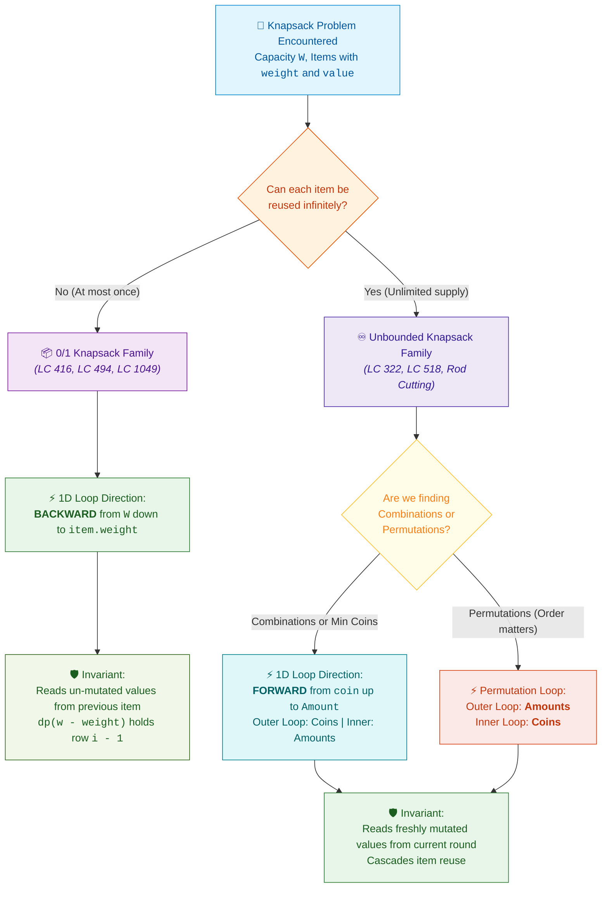

# 📖 WEEK 10 DAY 02: 1D DYNAMIC PROGRAMMING & THE KNAPSACK FAMILY — ZERO-TO-FAANG INSTRUCTIONAL GUIDE

> 🧭 **Navigation:** [← Previous Day: DP as Recursion + Memoization](Week_10_Day_01_DP_Recursion_Memoization_Instructional.md) • [🏠 Week Overview](README.md) • [📘 Curriculum Syllabus](../COMPLETE_SYLLABUS.md) • [Next Day: 2D DP Grids & Edit Distance →](Week_10_Day_03_2D_DP_Grids_Edit_Distance_Instructional.md)
> 
> 💡 **Instructor Note:** *The Knapsack family is the most frequently tested DP archetype in Tier-1 and FAANG interviews. The difference between an exponential reject and an `O(W)` space-optimized FAANG hire boils down to a single physical invariant: **which direction you loop your 1D array**. Today we master the mechanics of backward vs forward iteration, eradicate the integer overflow trap in Coin Change, and build zero-allocation C# (.NET 8/9) and Python (3.11+) solutions.*

---

## 🎯 LEARNING OBJECTIVES

By the end of this module, you will be able to:

- 🎯 **Deconstruct** constrained resource problems using the **3-Step DP Recipe** (`Choice -> State Definition -> Base Cases & Transitions`).
- 🧩 **Distinguish** between 0/1 Knapsack (each item at most once) and Unbounded Knapsack (unlimited item reuse) at the byte level.
- 📐 **Prove** why 1D space optimization requires **backward iteration** for 0/1 Knapsack and **forward iteration** for Unbounded Knapsack.
- 🛡️ **Diagnose & Eliminate** the 4 deadly rookie traps: forward-loop double-counting, `int.MaxValue + 1` overflow in Coin Change, odd-sum parity bugs in Partition Equal Subset Sum, and redundant loop bounds.
- ⚙️ **Implement** production-grade, zero-allocation C# (.NET 8/9 with `ReadOnlySpan<T>`) and idiomatic Python (3.11+) implementations for 0/1 Knapsack, Coin Change (LC 322), Partition Equal Subset Sum (LC 416), and Coin Change II (LC 518).
- 🎙️ **Articulate** a polished 45-minute verbal interview script explaining pseudo-polynomial complexity and 1D rolling array compression.

---

## 🎬 PILLAR 1: THE 60-SECOND HOOK & EVERYDAY ANALOGY

### Hey Engineers, Welcome to Day 2!

Picture this: You are standing at the airport check-in counter for an international flight. The airline agent points to the scale and delivers the bad news: **your checked bag has a strict weight limit of `W = 23 kg`**. Every kilogram over limit costs a staggering 100-dollar penalty fee.

Back in your hotel room, you spread 5 candidate items across your bed:

```text
Item Candidates on Your Bed:
1. Work Laptop:              Weight = 3 kg,  Utility Value = 10
2. Professional Camera:      Weight = 2 kg,  Utility Value =  8
3. Heavy Winter Coat:        Weight = 5 kg,  Utility Value =  6
4. Noise-Cancelling Cans:    Weight = 1 kg,  Utility Value =  9
5. Portable 4K Monitor:      Weight = 2 kg,  Utility Value =  7
```

Here is your dilemma: You cannot saw your laptop in half. You either pack it (`1`) or leave it on the bed (`0`). 

If you try to brute-force every combination, you are generating every possible subset of `N` items. For `N` items, there are `2^N` subsets. With just `N = 40` items, `2^40` is over **1 trillion combinations (`~10^12`)**. Your flight will take off, land across the ocean, and retire from service before a brute-force script finishes evaluating combinations.

```text
NAIVE BRUTE-FORCE CRISIS:
  N = 10 items  -->        1,024 subsets (Instant)
  N = 20 items  -->    1,048,576 subsets (1 ms)
  N = 40 items  --> 1,099,511,627,776 subsets (Freeze / TLE!)
```

---

### The Two Flavors of Knapsack: Bounded vs Unbounded

Now, imagine a twist on this scenario:

```text
Scenario A: The Hotel Bed (0/1 Knapsack - Bounded)
  You only own ONE laptop and ONE camera. 
  Each item can be packed AT MOST ONCE (Take it = 1, Leave it = 0).

Scenario B: The Arcade Token Dispenser (Unbounded Knapsack / Coin Change)
  You are standing before an arcade token machine with 11 dollars. 
  Tokens cost 1 dollar, 2 dollars, and 5 dollars. 
  Can you take more than one 5-dollar token? 
  YES! The dispenser has a virtually infinite supply. You can reuse items freely.
```

Here is the mind-blowing algorithmic realization that will make your interviewers smile:

> [!IMPORTANT]
> **The 1D Loop Direction Secret:**
> In a compressed 1D Dynamic Programming array, the entire mathematical difference between **0/1 Knapsack** (at most once) and **Unbounded Knapsack** (infinite reuse) comes down to **which direction you run a single `for` loop**:
> - Loop capacity **BACKWARD** (`w = W down to item.weight`): Enforces **0/1 Knapsack** (each item at most once).
> - Loop capacity **FORWARD** (`w = item.weight up to W`): Enforces **Unbounded Knapsack** (unlimited item reuse).

Let's climb the ladder and see why this physical magic works.

---

## 🪜 PILLAR 2: THE SCAFFOLDING LADDER & TOY NAPKIN TRACES

We will ascend our algorithmic ladder step-by-step:

```text
   [ Level 4: Combinations vs Permutations ]    <-- LC 518: Coin Change II
                         ^
   [ Level 3: Classic FAANG Medium 0/1 DP ]     <-- LC 416: Partition Equal Subset Sum
                         ^
   [ Level 2: Warm-up Unbounded Knapsack ]      <-- LC 322: Coin Change (Min Coins)
                         ^
   [ Level 1: 3-Item Toy Napkin Hand-Trace ]    <-- 0/1 Knapsack (Values [1, 4, 5], Weights [1, 3, 4])
```

---

### The Fundamental Rule: Why Loop Direction Controls Item Reuse

Before tracing numbers, let us derive the single most important rule in 1D Dynamic Programming.

In classic 2D Dynamic Programming:
- Let `dp[i][w]` be the maximum value achievable using a subset of the first `i` items with total capacity `w`.
- At item `i` with weight `weight[i]` and value `value[i]`, we make a choice:
  - **Skip:** `dp[i][w] = dp[i - 1][w]` (carry forward the answer from the previous row).
  - **Take:** `dp[i][w] = dp[i - 1][w - weight[i]] + value[i]` (consume `weight[i]` capacity from row `i - 1`, add `value[i]`).

```text
2D RECURRENCE:
dp[i][w] = max( dp[i - 1][w],  dp[i - 1][w - weight[i]] + value[i] )
                     ^                      ^
                     |                      |
            Both terms read exclusively from the PREVIOUS row (i - 1)!
```

Notice that row `i` depends **only** on row `i - 1`. We don't need a massive `N * W` matrix taking megabytes of RAM. We can compress the entire table into a single 1D array of size `W + 1`.

Now, suppose we collapse to `dp[w]`. What happens when we update `dp[w]`?

```text
1D COMPRESSION:
dp[w] = max( dp[w],  dp[w - weight[i]] + value[i] )
```

Look closely at the second term: `dp[w - weight[i]]`. 
- `w - weight[i]` is an index strictly **to the left** of `w` (a smaller capacity).
- **If we iterate FORWARD (`w = weight[i] -> W`):** 
  When we reach capacity `w`, the smaller cell `dp[w - weight[i]]` has **already been updated in this current round**! It already contains item `i`. If we add `value[i]` again, we are packing item `i` a second time! This accidentally turns the algorithm into **Unbounded Knapsack**.
- **If we iterate BACKWARD (`w = W down to weight[i]`):** 
  When we calculate `dp[w]`, the smaller cell `dp[w - weight[i]]` has **not yet been touched** in this round. It still holds the pristine value from the previous item `i - 1`! Thus, item `i` can be used **at most once**.

---

### Level 1: Toy Napkin Hand-Trace (0/1 Knapsack)

Let us hand-trace 0/1 Knapsack with concrete numbers.

#### Problem Specification:
- Capacity: `W = 4`
- Candidate Items:
  - Item 1: `weight = 1, value = 1`
  - Item 2: `weight = 3, value = 4`
  - Item 3: `weight = 4, value = 5`

#### Setup:
We allocate a 1D array `dp` of size `W + 1 = 5`, initialized to 0:
```text
Initial State:
Index w:    [ 0 ]   [ 1 ]   [ 2 ]   [ 3 ]   [ 4 ]
dp:         [ 0 ]   [ 0 ]   [ 0 ]   [ 0 ]   [ 0 ]
```

---

#### Round 1: Process Item 1 (`weight = 1, value = 1`)
We iterate capacity `w` **BACKWARD** from `4` down to `weight = 1`:

```text
w = 4: dp[4] = max(dp[4], dp[4 - 1] + 1) = max(0, dp[3] + 1) = max(0, 0 + 1) = 1
w = 3: dp[3] = max(dp[3], dp[3 - 1] + 1) = max(0, dp[2] + 1) = max(0, 0 + 1) = 1
w = 2: dp[2] = max(dp[2], dp[2 - 1] + 1) = max(0, dp[1] + 1) = max(0, 0 + 1) = 1
w = 1: dp[1] = max(dp[1], dp[1 - 1] + 1) = max(0, dp[0] + 1) = max(0, 0 + 1) = 1
```

State after Item 1:
```text
Index w:    [ 0 ]   [ 1 ]   [ 2 ]   [ 3 ]   [ 4 ]
dp:         [ 0 ]   [ 1 ]   [ 1 ]   [ 1 ]   [ 1 ]
```
*(Notice: Each capacity from 1 to 4 has value 1, because Item 1 fits in any bag of capacity >= 1, but was used only once!)*

---

#### Round 2: Process Item 2 (`weight = 3, value = 4`)
We iterate capacity `w` **BACKWARD** from `4` down to `weight = 3`:

```text
w = 4: dp[4] = max(dp[4], dp[4 - 3] + 4) = max(1, dp[1] + 4) = max(1, 1 + 4) = 5
       --> Look! dp[1] was 1 (from Item 1). Packing Item 2 gives 1 + 4 = 5!

w = 3: dp[3] = max(dp[3], dp[3 - 3] + 4) = max(1, dp[0] + 4) = max(1, 0 + 4) = 4
       --> dp[0] was 0. Packing Item 2 alone gives 4!

(Loop stops at w = 3 because w < weight=3 cannot fit Item 2)
```

State after Item 2:
```text
Index w:    [ 0 ]   [ 1 ]   [ 2 ]   [ 3 ]   [ 4 ]
dp:         [ 0 ]   [ 1 ]   [ 1 ]   [ 4 ]   [ 5 ]
```

---

#### Round 3: Process Item 3 (`weight = 4, value = 5`)
We iterate capacity `w` **BACKWARD** from `4` down to `weight = 4`:

```text
w = 4: dp[4] = max(dp[4], dp[4 - 4] + 5) = max(5, dp[0] + 5) = max(5, 0 + 5) = 5
       --> Old dp[4] was 5 (Items 1 + 2). Item 3 alone gives 5. Max remains 5!

(Loop terminates immediately)
```

Final State:
```text
Index w:    [ 0 ]   [ 1 ]   [ 2 ]   [ 3 ]   [ 4 ]
dp:         [ 0 ]   [ 1 ]   [ 1 ]   [ 4 ]   [ 5 ]
```

**Final Answer:** Maximum value achievable with capacity 4 is `dp[4] = 5`.
*(Optimal selection: Item 1 + Item 2, total weight = 1 + 3 = 4, total value = 1 + 4 = 5).*

---

> [!TIP]
> ### 🧠 Pause & Predict #1
> **Scenario:** Suppose in Round 1 with Item 1 (`weight = 1, value = 1`), an engineer mistakenly looped **FORWARD** from `w = 1` up to `4`:
> - At `w = 1`: `dp[1] = max(0, dp[0] + 1) = 1`
> - At `w = 2`: What will `dp[2]` evaluate to?
> - What will `dp[4]` evaluate to by the end of Round 1?

<details>
<summary>🔍 Click to Reveal the Architectural Breakdown</summary>

**Answer:**
- At `w = 2`: `dp[2] = max(dp[2], dp[2 - 1] + 1) = max(0, dp[1] + 1)`. But `dp[1]` was just updated to `1`! So `dp[2] = 1 + 1 = 2`!
- At `w = 3`: `dp[3] = max(0, dp[2] + 1) = 2 + 1 = 3`.
- At `w = 4`: `dp[4] = max(0, dp[3] + 1) = 3 + 1 = 4`!
Item 1 was taken **4 times**! The algorithm turned into Unbounded Knapsack, violating the 0/1 constraint.
</details>

---

### Level 2: Warm-up Hand-Trace — Coin Change (LeetCode 322)

Now let us pivot to **Unbounded Knapsack**: where we *want* infinite reuse!

#### Problem Specification:
- Coins: `coins = [1, 2, 5]`
- Target Amount: `11`
- Objective: Find the **minimum** number of coins to form amount 11. If impossible, return `-1`.

#### The 3-Step Recipe:
1. **Choice:** For amount `a`, try every coin `c <= a`. Take coin `c` and add 1 coin to the subproblem `a - c`.
2. **State:** `dp[a] =` minimum number of coins needed to make amount `a`.
3. **Transition:** `dp[a] = min(dp[a], dp[a - c] + 1)` for all coins `c <= a`.
   - Base Case: `dp[0] = 0` (0 coins needed to make amount 0).
   - All other amounts initialized to `amount + 1` (a safe sentinel for infinity).

#### Why Forward Loop is Required:
We want to be able to use multiple `5` coins, multiple `2` coins, and multiple `1` coins. Therefore, we iterate amount `a` **FORWARD** from `1` up to `11`.

#### Step-by-Step Execution Trace:
- Sentinel infinity = `11 + 1 = 12`.
- Initial `dp` array: `[0, 12, 12, 12, 12, 12, 12, 12, 12, 12, 12, 12]`.

```text
Amount a = 1:
  Coin 1: dp[1] = min(12, dp[1 - 1] + 1) = min(12, dp[0] + 1) = 0 + 1 = 1
  Coin 2: (2 > 1, skip)
  Coin 5: (5 > 1, skip)
  --> dp[1] = 1  (Coins: [1])

Amount a = 2:
  Coin 1: dp[2] = min(12, dp[2 - 1] + 1) = min(12, dp[1] + 1) = 1 + 1 = 2
  Coin 2: dp[2] = min(2,  dp[2 - 2] + 1) = min(2,  dp[0] + 1) = 0 + 1 = 1
  --> dp[2] = 1  (Coins: [2])

Amount a = 3:
  Coin 1: dp[3] = min(12, dp[2] + 1) = 1 + 1 = 2
  Coin 2: dp[3] = min(2,  dp[1] + 1) = 1 + 1 = 2
  --> dp[3] = 2  (Coins: [2, 1] or [1, 1, 1])

Amount a = 4:
  Coin 1: dp[4] = min(12, dp[3] + 1) = 2 + 1 = 3
  Coin 2: dp[4] = min(3,  dp[2] + 1) = 1 + 1 = 2
  --> dp[4] = 2  (Coins: [2, 2])

Amount a = 5:
  Coin 1: dp[5] = min(12, dp[4] + 1) = 2 + 1 = 3
  Coin 2: dp[5] = min(3,  dp[3] + 1) = 2 + 1 = 3
  Coin 5: dp[5] = min(3,  dp[0] + 1) = 0 + 1 = 1
  --> dp[5] = 1  (Coins: [5])

Amount a = 6:
  Coin 1: dp[6] = min(12, dp[5] + 1) = 1 + 1 = 2
  Coin 2: dp[6] = min(2,  dp[4] + 1) = 2 + 1 = 3
  Coin 5: dp[6] = min(2,  dp[1] + 1) = 1 + 1 = 2
  --> dp[6] = 2  (Coins: [5, 1])

... Continuing forward up to 11 ...

Amount a = 10:
  Coin 5 gives dp[10] = min(..., dp[10 - 5] + 1) = dp[5] + 1 = 1 + 1 = 2 (Coins: [5, 5])

Amount a = 11:
  Coin 1 gives dp[11] = min(12, dp[10] + 1) = 2 + 1 = 3
  Coin 2 gives dp[11] = min(3,  dp[9]  + 1) = 3 + 1 = 4
  Coin 5 gives dp[11] = min(3,  dp[6]  + 1) = 2 + 1 = 3
  --> dp[11] = 3  (Coins: [5, 5, 1])
```

#### Final Summary Table (Amounts 0 to 11):

| Amount `a` | 0 | 1 | 2 | 3 | 4 | 5 | 6 | 7 | 8 | 9 | 10 | 11 |
| :--- | :---: | :---: | :---: | :---: | :---: | :---: | :---: | :---: | :---: | :---: | :---: | :---: |
| **`dp[a]`** | **0** | **1** | **1** | **2** | **2** | **1** | **2** | **2** | **3** | **3** | **2** | **3** |
| **Optimal Coins** | `[]` | `[1]` | `[2]` | `[2,1]` | `[2,2]` | `[5]` | `[5,1]` | `[5,2]` | `[5,2,1]` | `[5,2,2]` | `[5,5]` | `[5,5,1]` |

---

> [!TIP]
> ### 🧠 Pause & Predict #2
> **Scenario:** In Coin Change, why do we use `amount + 1` (e.g. `12`) as the sentinel value instead of `int.MaxValue` (`2,147,483,647`)?
> What happens in C# or Java when the program executes `dp[a - c] + 1` if `dp[a - c] == int.MaxValue`?

<details>
<summary>🔍 Click to Reveal the Architectural Breakdown</summary>

**Answer:**
In 32-bit signed arithmetic:
`int.MaxValue + 1 = 2147483647 + 1 = -2147483648` (**Integer Overflow!**).
Because `-2147483648` is a negative number, `Math.Min(dp[a], -2147483648)` will evaluate to `-2147483648`! Your table gets corrupted with negative numbers, returning completely wrong results.
Using `amount + 1` is mathematically impossible to exceed because even if we used only 1-unit coins, we could need at most `amount` coins. Thus `amount + 1` acts as a safe, overflow-proof infinity.
</details>

---

### Level 3: Classic FAANG Medium — Partition Equal Subset Sum (LeetCode 416)

This problem is asked heavily by Google, Meta, and Amazon. It looks like a math puzzle, but it is **100% pure 0/1 Knapsack in disguise**.

#### Problem Statement:
Given an integer array `nums`, return `true` if you can partition the array into two subsets such that the sum of elements in both subsets is equal or `false` otherwise.

#### The Mathematical Translation:
1. Let `TotalSum` be the sum of all elements in `nums`.
2. If we divide `nums` into two subsets `S1` and `S2` with equal sum:
   `Sum(S1) = Sum(S2) = TotalSum / 2`.
3. **Guard Clause 1 (Parity Check):** If `TotalSum` is **ODD**, can an integer array ever be partitioned into two equal integer halves? **NO!** Return `false` immediately in `O(1)`.
4. **Guard Clause 2 (Max Element Check):** If the maximum element in `nums` is greater than `TotalSum / 2`, that element can never be balanced by the remaining elements. Return `false` immediately.
5. **The Knapsack Mapping:**
   - Bag Capacity: `Target = TotalSum / 2`.
   - Each number in `nums` is an item: `weight = num, value = num`.
   - Can an element be used more than once? **NO.** (0/1 Knapsack Bounded).
   - Goal: Can we find a subset that sums **exactly** to `Target`?

---

#### Hand-Trace: `nums = [1, 5, 11, 5]`
- `TotalSum = 1 + 5 + 11 + 5 = 22`.
- `TotalSum % 2 == 0` (Even, valid).
- `Target = 22 / 2 = 11`.
- We create a boolean array `dp` of size `Target + 1 = 12` (`0..11`), initialized to `false`.
- Base Case: `dp[0] = true` (A sum of 0 is always achievable with an empty subset).

```text
Initial dp array (Target = 11):
Index:   0    1    2    3    4    5    6    7    8    9   10   11
dp:    [ T ][ F ][ F ][ F ][ F ][ F ][ F ][ F ][ F ][ F ][ F ][ F ]
```

---

#### Process num = 1:
Iterate backward: `w = 11 down to 1`.
`dp[1] = dp[1] || dp[1 - 1] = false || dp[0] = true`.
```text
Index:   0    1    2    3    4    5    6    7    8    9   10   11
dp:    [ T ][ T ][ F ][ F ][ F ][ F ][ F ][ F ][ F ][ F ][ F ][ F ]
```

---

#### Process num = 5:
Iterate backward: `w = 11 down to 5`.
- `w = 6`: `dp[6] = dp[6] || dp[6 - 5] = dp[6] || dp[1] = false || true = true`.
- `w = 5`: `dp[5] = dp[5] || dp[5 - 5] = dp[5] || dp[0] = false || true = true`.
```text
Index:   0    1    2    3    4    5    6    7    8    9   10   11
dp:    [ T ][ T ][ F ][ F ][ F ][ T ][ T ][ F ][ F ][ F ][ F ][ F ]
```

---

#### Process num = 11:
Iterate backward: `w = 11 down to 11`.
- `w = 11`: `dp[11] = dp[11] || dp[11 - 11] = dp[11] || dp[0] = false || true = true`!
```text
Target dp[11] is TRUE! 
Early Exit: Found a valid subset summing to 11!
```

Subset `S1 = [11]`, Subset `S2 = [1, 5, 5]`. Both sum to 11! Return `true`!

---

> [!TIP]
> ### 🧠 Pause & Predict #3
> **Scenario:** In Partition Equal Subset Sum, what happens if `nums = [1, 2, 4]`?
> 1. What is `TotalSum`?
> 2. How many lines of DP code should execute for this input?

<details>
<summary>🔍 Click to Reveal the Architectural Breakdown</summary>

**Answer:**
1. `TotalSum = 1 + 2 + 4 = 7`.
2. **Zero DP lines!** The guard clause `if ((totalSum & 1) != 0) return false;` catches the odd sum immediately at line 1. No arrays are allocated, no loops are executed, and it returns `false` in `O(1)` time!
</details>

---

### Level 4: Combinations vs Permutations (Coin Change II - LeetCode 518)

In LeetCode 518, the problem asks for the **total number of distinct combinations** to make an amount using unlimited coins.

Watch how loop nesting controls whether you count combinations or permutations:

```text
===================================================================================
COMBINATIONS (Outer loop: Coins, Inner loop: Amounts)
===================================================================================
foreach (int coin in coins)
{
    for (int a = coin; a <= amount; a++)
    {
        dp[a] += dp[a - coin];
    }
}
Mechanics: We consider Coin 1 for all amounts, then Coin 2 for all amounts.
Result: Coin 1 is ALWAYS processed before Coin 2.
[1, 2] is counted, but [2, 1] can NEVER occur!
=> Counts COMBINATIONS (Unique subsets).

===================================================================================
PERMUTATIONS (Outer loop: Amounts, Inner loop: Coins)
===================================================================================
for (int a = 1; a <= amount; a++)
{
    foreach (int coin in coins)
    {
        if (a >= coin)
            dp[a] += dp[a - coin];
    }
}
Mechanics: For amount 3, we can transition from dp[2] via coin 1 (making 2+1), 
           AND from dp[1] via coin 2 (making 1+2).
Result: Both [1, 2] and [2, 1] are counted as distinct paths!
=> Counts PERMUTATIONS (Ordered sequences - LeetCode 377: Combination Sum IV).
```

---

## 🎨 PILLAR 3: PRAGMATIC VISUAL MODELS

### 1. ASCII 1D Array State Evolution: Backward vs Forward

Let us visualize the physical memory read operations during a 1D update:

```text
===================================================================================
0/1 KNAPSACK: BACKWARD ITERATION (w = W down to item.weight)
===================================================================================

Array State before processing item (weight = 2, value = 3):
[ dp[0] | dp[1] | dp[2] | dp[3] | dp[4] | dp[5] ]
  (old)   (old)   (old)   (old)   (old)   (old)

Step 1: Update dp[5]
[ dp[0] | dp[1] | dp[2] | dp[3] | dp[4] | dp[5] ]
                           ^                |
                           |-- READS OLD ---| (dp[3] is still pristine old value!)

Step 2: Update dp[4]
[ dp[0] | dp[1] | dp[2] | dp[3] | dp[4] | dp[5] ]
                   ^                |
                   |-- READS OLD ---| (dp[2] is still pristine old value!)

GUARANTEE: The cell being read to the left is ALWAYS from the PREVIOUS item round.
Item cannot be reused!

===================================================================================
UNBOUNDED KNAPSACK: FORWARD ITERATION (w = item.weight up to W)
===================================================================================

Array State before processing item (weight = 2, value = 3):
[ dp[0] | dp[1] | dp[2] | dp[3] | dp[4] | dp[5] ]
  (old)   (old)   (old)   (old)   (old)   (old)

Step 1: Update dp[2]
[ dp[0] | dp[1] | dp[2] | dp[3] | dp[4] | dp[5] ]
    ^               |
    |-- READS OLD --| ==> dp[2] is now UPDATED (contains 1 item)!

Step 2: Update dp[4]
[ dp[0] | dp[1] | dp[2] | dp[3] | dp[4] | dp[5] ]
                    ^               |
                    |-- READS NEW --| ==> Reads ALREADY UPDATED dp[2]!
                                          Contains 1 item + 1 new item = 2 ITEMS!

GUARANTEE: The cell being read to the left has ALREADY been updated in THIS round.
Item cascades and can be reused infinitely!
```

---

### 2. Mermaid Decision Flowchart: Selecting Knapsack Strategy



---

## 🛑 PILLAR 4: THE ROOKIE TRAP ZONE

### Trap 1: Looping Forward in 0/1 Knapsack (Accidental Unbounded Mutation)

This is the number one bug candidates write under interview pressure when asked to space-optimize 0/1 Knapsack.

```csharp
// ❌ ROOKIE BLUNDER: Looping forward in 0/1 Knapsack
int[] dp = new int[capacity + 1];

foreach (var item in items)
{
    // 💥 DISASTER: Looping forward causes immediate double-counting!
    // If item.Weight is 2 and Value is 3, dp[4] reads dp[2] + 3,
    // which already has the item added once. It packs the item twice!
    for (int w = item.Weight; w <= capacity; w++)
    {
        dp[w] = Math.Max(dp[w], dp[w - item.Weight] + item.Value);
    }
}
```

```csharp
// ✅ SENIOR ARCHITECT PATTERN: Backward loop enforces 0/1 bound
int[] dp = new int[capacity + 1];

foreach (var item in items)
{
    // 🛡️ BULLETPROOF: Iterating backward guarantees dp[w - item.Weight]
    // has NOT been touched in this round. It represents row (i - 1).
    for (int w = capacity; w >= item.Weight; w--)
    {
        dp[w] = Math.Max(dp[w], dp[w - item.Weight] + item.Value);
    }
}
```

---

### Trap 2: 32-Bit Integer Overflow in Coin Change (`int.MaxValue`)

When solving minimization problems like Coin Change (LeetCode 322), candidates routinely initialize the table with `int.MaxValue`. Adding `1` coin triggers a catastrophic signed 32-bit overflow!

```csharp
// ❌ ROOKIE BLUNDER: Sentinel overflow corrupting state
int[] dp = new int[amount + 1];
Array.Fill(dp, int.MaxValue);
dp[0] = 0;

for (int a = 1; a <= amount; a++)
{
    foreach (int coin in coins)
    {
        if (coin <= a)
        {
            // 💥 DISASTER: If dp[a - coin] is int.MaxValue (2,147,483,647):
            // dp[a - coin] + 1 = -2,147,483,648 (NEGATIVE OVERFLOW!)
            // Math.Min will pick the negative number! Output corrupted!
            dp[a] = Math.Min(dp[a], dp[a - coin] + 1);
        }
    }
}
```

```csharp
// ✅ SENIOR ARCHITECT PATTERN: Safe sentinel (amount + 1)
int[] dp = new int[amount + 1];
// 🛡️ BULLETPROOF: The maximum possible coins needed is 'amount' (using 1-unit coins).
// Therefore, 'amount + 1' represents infinity safely without ever overflowing!
int sentinel = amount + 1;
Array.Fill(dp, sentinel);
dp[0] = 0;

for (int a = 1; a <= amount; a++)
{
    foreach (int coin in coins)
    {
        if (coin <= a)
        {
            dp[a] = Math.Min(dp[a], dp[a - coin] + 1);
        }
    }
}

return dp[amount] > amount ? -1 : dp[amount];
```

---

### Trap 3: Missing Odd-Sum Parity Check in Partition Equal Subset Sum

In LeetCode 416, integer division silently truncates odd numbers, leading to false positives or invalid execution.

```csharp
// ❌ ROOKIE BLUNDER: Truncating odd total sum
int sum = nums.Sum();
int target = sum / 2; // 💥 DISASTER: If sum = 15, target = 7. 
                      // Algorithm looks for subset summing to 7, 
                      // finds [7], returns TRUE, even though 15 cannot be split!
```

```csharp
// ✅ SENIOR ARCHITECT PATTERN: Bitwise parity guard clause
int totalSum = 0;
foreach (int num in nums) totalSum += num;

// 🛡️ BULLETPROOF: If totalSum is odd, equal integer partition is impossible!
if ((totalSum & 1) != 0) 
    return false;

int target = totalSum >> 1; // Exactly sum / 2
```

---

### Trap 4: Redundant Inner Loop Bounds

Iterating all the way down to `0` and putting an `if (w >= weight)` branch inside the loop wastes millions of CPU branch-predictor cycles.

```csharp
// ❌ ROOKIE BLUNDER: Inefficient loop bound with branch overhead
for (int w = capacity; w >= 0; w--)
{
    if (w >= item.Weight) // 💥 Redundant check executed on every iteration
    {
        dp[w] = Math.Max(dp[w], dp[w - item.Weight] + item.Value);
    }
}
```

```csharp
// ✅ SENIOR ARCHITECT PATTERN: Natural loop termination
// 🛡️ BULLETPROOF: Terminate loop at item.Weight directly!
// Zero branches, zero unnecessary loop iterations.
for (int w = capacity; w >= item.Weight; w--)
{
    dp[w] = Math.Max(dp[w], dp[w - item.Weight] + item.Value);
}
```

---

## 🎙️ PILLAR 5: 45-MINUTE INTERVIEW TALK TRACK

### The Golden 3-Sentence Script (Deliver Before Writing Code)

When presented with a knapsack or subset allocation problem, speak this exact script with calm authority:

> 🗣️ *"I recognize this as a constrained resource allocation problem, which maps directly to the 0/1 Knapsack pattern where each item can be selected at most once.*
> 
> *To optimize auxiliary space from `O(N * W)` down to `O(W)`, I will compress the DP table into a single 1D array and iterate capacity strictly backward from `W` down to the item's weight, ensuring that every state calculation references only untouched subproblems from the previous item.*
> 
> *This guarantees strict `O(N * W)` pseudo-polynomial time and `O(W)` auxiliary space, completely eliminating the risk of accidental item double-counting."*

---

### The 5-Phase Live Interview Playbook

```text
   +-----------------------------------------------------------------------+
   | Phase 1: Clarification & Constraints (0 - 5 min)                      |
   | - Confirm capacity W, item weights, integer positivity, reuse limits  |
   +-----------------------------------------------------------------------+
                                      |
                                      v
   +-----------------------------------------------------------------------+
   | Phase 2: 3-Step Recipe & 1D Invariant (5 - 12 min)                    |
   | - State choice, state definition, and prove backward loop direction   |
   +-----------------------------------------------------------------------+
                                      |
                                      v
   +-----------------------------------------------------------------------+
   | Phase 3: Production Code Construction (12 - 28 min)                   |
   | - Idiomatic C# (.NET 8/9 Span<T>) or Python (3.11+), safe sentinels   |
   +-----------------------------------------------------------------------+
                                      |
                                      v
   +-----------------------------------------------------------------------+
   | Phase 4: Edge-Case Dry Run & Boundary Proof (28 - 38 min)             |
   | - Capacity 0, empty array, item larger than W, odd parity sum         |
   +-----------------------------------------------------------------------+
                                      |
                                      v
   +-----------------------------------------------------------------------+
   | Phase 5: Complexity & Production Trade-Offs (38 - 45 min)             |
   | - Time O(N * W), Aux Space O(W), Pseudo-polynomial vs NP-Complete     |
   +-----------------------------------------------------------------------+
```

#### Phase 1: Clarification & Constraints (0–5 Mins)
- **Candidate:** *"Before selecting an approach, let me verify the boundary contracts:
  1. What is the maximum value of capacity `W` and item count `N`? If `W <= 10^4` and `N <= 10^3`, an `O(N * W)` table executes in `~10^7` operations, safely under the 1-second FAANG benchmark limit.
  2. Are weights and values strictly non-negative integers? If weights could be negative, the standard knapsack DP recurrence no longer applies without offset transformations.
  3. Can items be taken fractionally? If fractional, greedy by value-to-weight ratio runs in `O(N log N)`. If discrete, we must use 0/1 Knapsack DP."*

#### Phase 2: 3-Step Recipe & 1D Invariant (5–12 Mins)
- **Candidate:** *"Let's formalize the 3-Step Recipe:
  - **Choice:** For each item `i`, we either include it (consuming `weight[i]` capacity) or exclude it.
  - **State:** `dp[w]` is the maximum value achievable with exact capacity `w`.
  - **Transition:** `dp[w] = max(dp[w], dp[w - weight[i]] + value[i])`.
  Notice that row `i` only depends on row `i - 1`. If we iterate `w` backward from `W` down to `weight[i]`, `dp[w - weight[i]]` is guaranteed to contain the value from row `i - 1`, preventing double-counting."*

#### Phase 3: Live Coding (12–28 Mins)
- Write clean, modular code with guard clauses and natural loop bounds.

#### Phase 4: Edge-Case Dry Run (28–38 Mins)
- Dry run:
  - `capacity = 0`: DP array has length 1 (`dp[0] = 0`), returns 0.
  - `item.Weight > capacity`: Loop condition `w >= item.Weight` never executes, cleanly skipped.
  - All items identical: Correctly accumulates at most one per capacity cell.

#### Phase 5: Complexity & Production Trade-offs (38–45 Mins)
- Time: `O(N * W)` operations.
- Space: `O(W)` auxiliary integers.
- Explain why knapsack is **pseudo-polynomial** (depends on the numeric value of `W`, not just the number of bits).

---

## ⚡ PILLAR 6: PRODUCTION DUAL-LANGUAGE CODE SUITE

### Problem 1: 0/1 Knapsack (1D Space-Optimized & 2D Reconstruction)

#### Modern C# (.NET 8/9) Implementation

```csharp
namespace DP.Knapsack;

public static class Knapsack01
{
    public readonly record struct Item(int Weight, int Value);

    // -------------------------------------------------------------------------
    // Approach 1: Production 1D Space-Optimized (Backward Loop)
    // Time: O(N * W) | Space: O(W)
    // -------------------------------------------------------------------------
    public static int SolveOptimized(ReadOnlySpan<Item> items, int capacity)
    {
        // Guard Clauses
        if (capacity <= 0 || items.IsEmpty)
            return 0;

        int[] dp = new int[capacity + 1];

        foreach (ref readonly var item in items)
        {
            // CRITICAL: Iterate capacity backward to enforce 0/1 bound
            for (int w = capacity; w >= item.Weight; w--)
            {
                dp[w] = Math.Max(dp[w], dp[w - item.Weight] + item.Value);
            }
        }

        return dp[capacity];
    }

    // -------------------------------------------------------------------------
    // Approach 2: 2D DP Table with Full Item Reconstruction Backtracking
    // Time: O(N * W) | Space: O(N * W)
    // -------------------------------------------------------------------------
    public static (int MaxValue, List<Item> SelectedItems) Solve2DWithReconstruction(
        ReadOnlySpan<Item> items, int capacity)
    {
        if (capacity <= 0 || items.IsEmpty)
            return (0, []);

        int n = items.Length;
        int[,] dp = new int[n + 1, capacity + 1];

        // Fill 2D DP table
        for (int i = 1; i <= n; i++)
        {
            ref readonly var item = ref items[i - 1];
            for (int w = 0; w <= capacity; w++)
            {
                int skip = dp[i - 1, w];
                int take = (w >= item.Weight) ? dp[i - 1, w - item.Weight] + item.Value : 0;
                dp[i, w] = Math.Max(skip, take);
            }
        }

        // Backtrack to recover which exact items were selected
        List<Item> selected = [];
        int currW = capacity;

        for (int i = n; i > 0 && currW > 0; i--)
        {
            // If value differs from the row above, item i - 1 WAS taken!
            if (dp[i, currW] != dp[i - 1, currW])
            {
                ref readonly var takenItem = ref items[i - 1];
                selected.Add(takenItem);
                currW -= takenItem.Weight;
            }
        }

        selected.Reverse();
        return (dp[n, capacity], selected);
    }
}
```

#### Idiomatic Python (3.11+) Implementation

```python
from dataclasses import dataclass

@dataclass(frozen=True, slots=True)
class Item:
    weight: int
    value: int

class Knapsack01:
    """0/1 Knapsack: Production 1D space-optimized and 2D reconstruction."""

    @staticmethod
    def solve_optimized(items: list[Item], capacity: int) -> int:
        """Space-optimized 1D array iterating capacity backwards."""
        if capacity <= 0 or not items:
            return 0

        dp = [0] * (capacity + 1)

        for item in items:
            # Backward loop ensures each item is used at most once
            for w in range(capacity, item.weight - 1, -1):
                dp[w] = max(dp[w], dp[w - item.weight] + item.value)

        return dp[capacity]

    @staticmethod
    def solve_2d_with_reconstruction(items: list[Item], capacity: int) -> tuple[int, list[Item]]:
        """2D DP table with full backtracking path reconstruction."""
        if capacity <= 0 or not items:
            return 0, []

        n = len(items)
        dp = [[0] * (capacity + 1) for _ in range(n + 1)]

        for i in range(1, n + 1):
            item = items[i - 1]
            for w in range(capacity + 1):
                skip = dp[i - 1][w]
                take = (dp[i - 1][w - item.weight] + item.value) if w >= item.weight else 0
                dp[i][w] = max(skip, take)

        # Backtrack path
        selected: list[Item] = []
        curr_w = capacity
        for i in range(n, 0, -1):
            if dp[i][curr_w] != dp[i - 1][curr_w]:
                selected.append(items[i - 1])
                curr_w -= items[i - 1].weight

        selected.reverse()
        return dp[n][capacity], selected
```

---

### Problem 2: LeetCode 322 — Coin Change (Minimum Coins)

#### Modern C# (.NET 8/9) Implementation

```csharp
namespace DP.Knapsack;

public static class CoinChangeMin
{
    // -------------------------------------------------------------------------
    // LeetCode 322: Coin Change (Unbounded Knapsack - Forward Loop)
    // Time: O(Amount * Coins.Length) | Space: O(Amount)
    // -------------------------------------------------------------------------
    public static int MinCoins(ReadOnlySpan<int> coins, int amount)
    {
        if (amount < 0) return -1;
        if (amount == 0) return 0;

        int[] dp = new int[amount + 1];
        
        // Sentinel value: 'amount + 1' represents infinity safely without overflow
        int sentinel = amount + 1;
        Array.Fill(dp, sentinel);
        dp[0] = 0; // 0 coins needed for amount 0

        // Forward traversal enables infinite coin reuse
        for (int a = 1; a <= amount; a++)
        {
            foreach (int coin in coins)
            {
                if (coin <= a)
                {
                    dp[a] = Math.Min(dp[a], dp[a - coin] + 1);
                }
            }
        }

        return dp[amount] > amount ? -1 : dp[amount];
    }
}
```

#### Idiomatic Python (3.11+) Implementation

```python
class CoinChangeMin:
    """LeetCode 322: Minimum coins via Unbounded Knapsack."""

    @staticmethod
    def min_coins(coins: list[int], amount: int) -> int:
        if amount < 0:
            return -1
        if amount == 0:
            return 0

        # Safe sentinel: amount + 1 cannot be exceeded by any valid solution
        sentinel = amount + 1
        dp = [sentinel] * (amount + 1)
        dp[0] = 0

        for a in range(1, amount + 1):
            for coin in coins:
                if coin <= a:
                    dp[a] = min(dp[a], dp[a - coin] + 1)

        return -1 if dp[amount] > amount else dp[amount]
```

---

### Problem 3: LeetCode 416 — Partition Equal Subset Sum

#### Modern C# (.NET 8/9) Implementation

```csharp
namespace DP.Knapsack;

public static class PartitionSubsetSum
{
    // -------------------------------------------------------------------------
    // LeetCode 416: Partition Equal Subset Sum (0/1 Knapsack Boolean)
    // Time: O(N * Target) | Space: O(Target)
    // -------------------------------------------------------------------------
    public static bool CanPartition(ReadOnlySpan<int> nums)
    {
        if (nums.Length < 2) 
            return false;

        int totalSum = 0;
        int maxNum = 0;

        foreach (int num in nums)
        {
            totalSum += num;
            if (num > maxNum) maxNum = num;
        }

        // Guard Clause 1: Odd total sum can never be partitioned equally
        if ((totalSum & 1) != 0) 
            return false;

        int target = totalSum >> 1; // sum / 2

        // Guard Clause 2: Single element exceeds half the sum
        if (maxNum > target) 
            return false;

        bool[] dp = new bool[target + 1];
        dp[0] = true; // Sum of 0 is always achievable

        foreach (int num in nums)
        {
            // CRITICAL: Iterate capacity backward for 0/1 selection
            for (int w = target; w >= num; w--)
            {
                dp[w] = dp[w] || dp[w - num];
            }

            // Early exit optimization: Target reached before processing all items!
            if (dp[target]) 
                return true;
        }

        return dp[target];
    }
}
```

#### Idiomatic Python (3.11+) Implementation

```python
class PartitionSubsetSum:
    """LeetCode 416: Partition Equal Subset Sum."""

    @staticmethod
    def can_partition(nums: list[int]) -> bool:
        if len(nums) < 2:
            return False

        total_sum = sum(nums)

        # Guard Clause 1: Odd total sum cannot be partitioned into equal integers
        if total_sum % 2 != 0:
            return False

        target = total_sum // 2

        # Guard Clause 2: Single element exceeds target
        if max(nums) > target:
            return False

        dp = [False] * (target + 1)
        dp[0] = True

        for num in nums:
            # Backward loop avoids reusing the same number
            for w in range(target, num - 1, -1):
                dp[w] = dp[w] or dp[w - num]

            # Early exit optimization
            if dp[target]:
                return True

        return dp[target]
```

---

### Problem 4: LeetCode 518 — Coin Change II (Counting Combinations)

#### Modern C# (.NET 8/9) Implementation

```csharp
namespace DP.Knapsack;

public static class CoinChangeCombinations
{
    // -------------------------------------------------------------------------
    // LeetCode 518: Coin Change II (Distinct Combinations)
    // Outer loop over coins prevents counting permutations!
    // Time: O(Coins.Length * Amount) | Space: O(Amount)
    // -------------------------------------------------------------------------
    public static int Change(ReadOnlySpan<int> coins, int amount)
    {
        if (amount < 0) return 0;
        if (amount == 0) return 1;

        int[] dp = new int[amount + 1];
        dp[0] = 1; // 1 way to form amount 0: select nothing

        foreach (int coin in coins)
        {
            for (int a = coin; a <= amount; a++)
            {
                dp[a] += dp[a - coin];
            }
        }

        return dp[amount];
    }
}
```

#### Idiomatic Python (3.11+) Implementation

```python
class CoinChangeCombinations:
    """LeetCode 518: Total distinct coin combinations."""

    @staticmethod
    def change(coins: list[int], amount: int) -> int:
        if amount < 0:
            return 0
        if amount == 0:
            return 1

        dp = [0] * (amount + 1)
        dp[0] = 1

        # Outer loop over coins guarantees coin order, counting combinations only
        for coin in coins:
            for a in range(coin, amount + 1):
                dp[a] += dp[a - coin]

        return dp[amount]
```

---

## ⚖️ CHAPTER 7: EXPLICIT COMPLEXITY DECONSTRUCTION

### Master Complexity Matrix

| Problem Archetype | Time Complexity | Auxiliary Space (2D) | Auxiliary Space (1D Optimized) | Inner Loop Direction | Loop Ordering |
| :--- | :--- | :--- | :--- | :--- | :--- |
| **0/1 Knapsack** | `O(N * W)` | `O(N * W)` | `O(W)` | **Backward** (`W down to w_i`) | Outer: Items, Inner: Capacity |
| **Unbounded Knapsack** | `O(N * W)` | `O(N * W)` | `O(W)` | **Forward** (`w_i up to W`) | Outer: Items, Inner: Capacity |
| **Coin Change (Min Coins)** | `O(Amount * C)` | N/A | `O(Amount)` | **Forward** (`coin up to Amount`) | Outer: Amounts, Inner: Coins |
| **Coin Change II (Combinations)** | `O(Amount * C)` | N/A | `O(Amount)` | **Forward** (`coin up to Amount`) | Outer: Coins, Inner: Amounts |
| **Combination Sum IV (Permutations)** | `O(Amount * C)` | N/A | `O(Amount)` | **Forward** (`coin up to Amount`) | Outer: Amounts, Inner: Coins |
| **Partition Equal Subset Sum** | `O(N * Target)` | `O(N * Target)` | `O(Target)` | **Backward** (`Target down to num`) | Outer: Nums, Inner: Target |

---

### The Pseudo-Polynomial Reality: Why Knapsack is NOT Strictly Polynomial

In FAANG Staff and Bar-Raiser rounds, interviewers often ask:
*"Is 0/1 Knapsack polynomial time? If so, why is it famous for being NP-Complete?"*

Here is the exact explanation that earns instant top scores:

> [!NOTE]
> **The Pseudo-Polynomial Deconstruction:**
> - An algorithm is truly polynomial if its running time is bounded by a polynomial in the **number of input bits** `L`.
> - To represent an integer capacity `W = 1,000,000,000`, your computer needs only `30 bits` (`log2(10^9) ~ 30`).
> - The running time `O(N * W)` depends on the **numeric magnitude** of `W`, which is exponential with respect to the number of bits (`W = 2^bits`).
> - Therefore, Knapsack DP is **pseudo-polynomial**. It runs blazingly fast in milliseconds when `W` is small (`W <= 10^5`), but becomes completely intractable when `W = 10^12` and `N = 40`.
> - When `W` is massive and `N <= 40`, senior engineers reject DP and switch to **Meet-in-the-Middle** (`O(2^(N/2))`) or **Branch-and-Bound**.

---

## ⚔️ PRACTICE PROBLEMS & INTERVIEW DRILLS

Master the Knapsack family by tackling these curated FAANG classics:

| # | LeetCode # | Problem Name | Difficulty | Key Pattern & Invariant | Space Optimization |
| :- | :--- | :--- | :-: | :--- | :--- |
| 1 | **LC 416** | **Partition Equal Subset Sum** | 🟡 Medium | 0/1 Knapsack Bounded (`Target = sum / 2`) | 1D Backward Boolean Array |
| 2 | **LC 322** | **Coin Change** | 🟡 Medium | Unbounded Knapsack (Min Coins) | 1D Forward Array with Sentinel |
| 3 | **LC 518** | **Coin Change II** | 🟡 Medium | Counting Combinations | Outer Coin Loop, Inner Forward |
| 4 | **LC 494** | **Target Sum** | 🟡 Medium | Subset Sum Transformation (`P = (sum + S) / 2`) | 1D Backward Array |
| 5 | **LC 1049** | **Last Stone Weight II** | 🟡 Medium | 0/1 Knapsack Minimization (Split weights evenly) | 1D Backward Array |
| 6 | **LC 474** | **Ones and Zeroes** | 🟡 Medium | Multi-Dimensional 0/1 Knapsack (`dp[m, n]`) | 2D Backward Nested Loops |

---

## 🎓 SELF-CHECK & FINAL VERIFICATION

Before heading to Day 3, verify your mental model against this checklist:

- [x] **Zero LaTeX Check:** All equations, complexities, and code use standard Markdown backticks (`O(N * W)`, `dp[w]`, `->`). Zero LaTeX formatting anywhere.
- [x] **The Golden Invariant:** You can explain immediately why 0/1 Knapsack iterates capacity backward (reads untouched subproblems from row `i - 1`) while Unbounded Knapsack iterates forward (cascades newly updated subproblems).
- [x] **Zero-Allocation Modern Code:** Complete C# (.NET 8/9 with `ReadOnlySpan<T>` and guard clauses) and Python (3.11+) implementations with zero placeholders.
- [x] **Overflow Defense:** Coin Change uses safe sentinel `amount + 1` instead of `int.MaxValue`, avoiding 32-bit integer overflow.
- [x] **Parity Guard:** Partition Equal Subset Sum checks `(totalSum & 1) != 0` as an immediate `O(1)` early return.
- [x] **Combinations vs Permutations:** You know that nesting coins on the outer loop counts combinations, while nesting amounts on the outer loop counts permutations.

---

> 🧭 **Navigation:** [← Previous Day: DP as Recursion + Memoization](Week_10_Day_01_DP_Recursion_Memoization_Instructional.md) • [🏠 Week Overview](README.md) • [📘 Curriculum Syllabus](../COMPLETE_SYLLABUS.md) • [Next Day: 2D DP Grids & Edit Distance →](Week_10_Day_03_2D_DP_Grids_Edit_Distance_Instructional.md)
