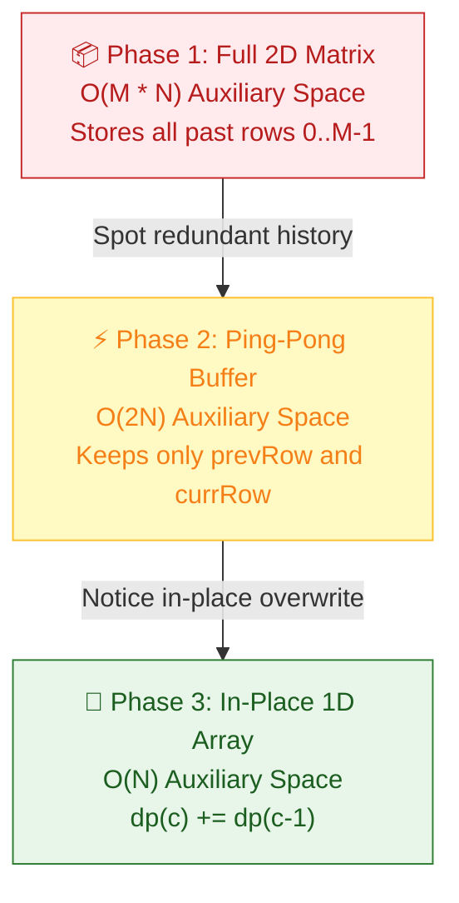

# 📖 WEEK 10 DAY 03: 2D DYNAMIC PROGRAMMING — GRIDS & EDIT DISTANCE — ENGINEERING GUIDE

> 🧭 **Navigation:** [← Previous Day](Week_10_Day_02_1D_DP_Knapsack_Family_Instructional.md) • [🏠 Week Overview](README.md) • [📘 Curriculum Syllabus](../COMPLETE_SYLLABUS.md) • [Next Day →](Week_10_Day_04_DP_on_Sequences_Instructional.md)
> 
> 💡 **Instructor Note:** *2D Dynamic Programming moves us from linear arrays into multi-coordinate state spaces: grid navigation and pairwise sequence alignment. Today you and I will master the topological cell dependency of grid DP, demystify Levenshtein Edit Distance, and prove why an O(M * N) grid algorithm can almost always run in tight O(N) memory using a 1D rolling array. Strictly zero LaTeX math is used throughout.*

---

## 🎯 LEARNING OBJECTIVES

*By the end of this chapter, you will be able to:*
- 🎬 **Internalize** the grid navigation invariant: how restricted directional movement (Right and Down) naturally forms a Directed Acyclic Graph (DAG).
- 🪜 **Hand-trace** 2D grid DP transitions on napkin-sized 3x3 matrices for Unique Paths, Minimum Path Sum, and Obstacle Grids.
- 📐 **Derive** the space compression progression: moving from a full `O(M * N)` matrix to a 2-row buffer, and finally to an in-place `O(N)` 1D rolling array.
- 🎨 **Visualize** cell dependencies in ASCII and sequence compression pipelines using focused Mermaid flowcharts.
- 🛑 **Identify and avoid** the top rookie blunders: uncompressed `O(M * N)` allocations, boundary obstacle blind spots, and start/goal blockages.
- 🎙️ **Recite** a 3-sentence interview talk track to outline grid DP strategy before typing a single line of code.
- ⚡ **Implement** production-grade C# (.NET 8/9 with `Span<int>` zero-allocation patterns) and Python (3.11+) for LeetCode 62, 63, 64, 72, and 1143.

---

## 🎬 PILLAR 1: THE 60-SECOND HOOK & EVERYDAY ANALOGY

### Hey Engineers, Welcome to Day 3!

Imagine this scenario: You are driving an autonomous delivery van through the grid system of downtown Manhattan. You start at the northwest corner of the delivery zone at intersection `(0, 0)`, and your depot is located at the southeast corner at `(M - 1, N - 1)`.

Here is the strict city traffic rule: **Every street is a one-way street.** You are strictly allowed to move only **East (Right)** or **South (Down)**. No U-turns. No heading West. No driving North.

Now, someone asks you: *"How many distinct routes can your delivery van take from the start to the depot?"*

```text
MANHATTAN ONE-WAY DELIVERY GRID:
(0, 0) Start
  +----------> East (Right)
  |      .       .       .
  |      .       .       .
  v
South (Down)           (M-1, N-1) Depot
```

If you try to explore every single route using a naive recursive branching tree, your code will branch into two choices at every intersection. For a modest `20 x 20` grid, naive recursion evaluates `2^(20 + 20) = 2^40` paths—that is over **1 trillion operations**! Your server will crash or timeout.

### The Everyday Analogy: The Toll Booth Matrix

Now think about how highway toll operators actually count traffic. 

If you are standing at intersection `(r, c)`, where could a car possibly have arrived from in the last 10 seconds?
Because vehicles can ONLY travel Right and Down:
1. A car could only have driven **Down** from the northern toll booth at `(r - 1, c)`.
2. A car could only have driven **Right** from the western toll booth at `(r, c - 1)`.

```text
               (r - 1, c) [North Toll Booth]
                   |
                   | (Drive Down)
                   v
(r, c - 1) -----> (r, c) [Current Intersection]
[West Toll] (Drive East)
```

There are **zero other physical entrances**. Therefore, the total number of distinct routes to reach intersection `(r, c)` is simply:

`TotalWays(r, c) = TotalWays(North Neighbor) + TotalWays(West Neighbor)`

In code:
`dp[r][c] = dp[r - 1][c] + dp[r][c - 1]`

### The Staff Engineer Twist: The Rolling Array Breakthrough

Here is where the average junior engineer stops: they allocate a massive `int[M, N]` matrix in heap memory.

Look at the dependency again: to calculate row `r`, what information do you actually need?
- You need the cells from **row `r - 1`** (the row immediately above you).
- You need the cell to your left in **row `r`**.

Do you need row `r - 2`? **No.**
Do you need row `r - 3`? **No.**
Rows `0` through `r - 2` are completely dead history!

Because row `r` only depends on row `r - 1`, we can instantly squash our memory from a huge `O(M * N)` matrix down to a single `O(N)` 1D array. By updating the array from left to right:
`dp[c] = dp[c] (which is the top neighbor from previous row) + dp[c - 1] (which is the left neighbor in the current row)`

That simple physical insight reduces memory by `99%` and keeps all memory accesses inside lightning-fast CPU L1 cache.

---

## 🪜 PILLAR 2: THE SCAFFOLDING LADDER & TOY NAPKIN TRACES

We will ascend our algorithmic ladder step-by-step, starting with a napkin trace on a tiny 3x3 grid and leveling up to obstacle handling, cost minimization, and space compression.

```text
       [ Level 4: Space Optimization Progression ]   <-- 2D Table -> Two Rows -> 1D In-Place
                      ^
       [ Level 3: Grid with Obstacles ]              <-- Unique Paths II (LeetCode 63)
                      ^
       [ Level 2: Cost Minimization ]                <-- Minimum Path Sum (LeetCode 64)
                      ^
       [ Level 1: The 3x3 Toy Napkin Trace ]         <-- Unique Paths (LeetCode 62)
```

---

### Level 1: The 3x3 Toy Napkin Trace — Unique Paths (LeetCode 62)

Let us solve a `3 x 3` grid from `(0, 0)` to `(2, 2)`.

#### 1. Boundary Base Cases
To reach any cell in the first row `(0, c)`, you can only move Right. There is exactly `1` path.
To reach any cell in the first column `(r, 0)`, you can only move Down. There is exactly `1` path.

```text
INITIAL BOUNDARY STATE (M = 3, N = 3):
      c=0    c=1    c=2
r=0 [  1  ][  1  ][  1  ]   <- Can only travel East along row 0
r=1 [  1  ][  ?  ][  ?  ]   <- Can only travel South along col 0
r=2 [  1  ][  ?  ][  ?  ]
```

#### 2. Cell-by-Cell Tabulation
Now we fill the inner cells row-by-row using `dp[r][c] = dp[r - 1][c] + dp[r][c - 1]`:

- **Cell `(1, 1)`:** Top neighbor `dp[0][1] = 1`, Left neighbor `dp[1][0] = 1`.
  `dp[1][1] = 1 + 1 = 2`.
- **Cell `(1, 2)`:** Top neighbor `dp[0][2] = 1`, Left neighbor `dp[1][1] = 2`.
  `dp[1][2] = 1 + 2 = 3`.
- **Cell `(2, 1)`:** Top neighbor `dp[1][1] = 2`, Left neighbor `dp[2][0] = 1`.
  `dp[2][1] = 2 + 1 = 3`.
- **Cell `(2, 2)` (Goal):** Top neighbor `dp[1][2] = 3`, Left neighbor `dp[2][1] = 3`.
  `dp[2][2] = 3 + 3 = 6`.

```text
FINAL COMPLETED 2D TABLE:
      c=0    c=1    c=2
r=0 [  1  ][  1  ][  1  ]
r=1 [  1  ][  2  ][  3  ]
r=2 [  1  ][  3  ][  6  ]   <-- Target cell dp[2][2] = 6 unique paths!
```

> 🧠 **Pause & Predict 1:**
> What if the grid has only 1 row and 5 columns (`1 x 5`)? How many paths exist from `(0, 0)` to `(0, 4)`?
> *Answer:* Exactly `1` path! You have no choice but to move Right 4 times. No vertical branch exists.

---

### Level 2: Cost Minimization — Minimum Path Sum (LeetCode 64)

Instead of counting paths, each cell now has a non-negative toll cost `grid[r][c]`. We want the route from top-left to bottom-right that incurs the **minimum total cost**.

Consider this `3 x 3` cost grid:
```text
INPUT GRID:
      c=0    c=1    c=2
r=0 [  1  ][  3  ][  1  ]
r=1 [  1  ][  5  ][  1  ]
r=2 [  4  ][  2  ][  1  ]
```

#### 1. State Definition & Recurrence
Let `dp[r][c]` be the minimum cost to reach cell `(r, c)` from `(0, 0)`.
To reach `(r, c)`, you come from the cheaper of the two possible predecessors (North or West), plus the cost of the current cell:

`dp[r][c] = grid[r][c] + min(dp[r - 1][c], dp[r][c - 1])`

#### 2. Boundary Setup
- Start cell: `dp[0][0] = grid[0][0] = 1`.
- First row: `dp[0][c] = dp[0][c - 1] + grid[0][c]` (cumulative prefix sums).
  - `dp[0][1] = 1 + 3 = 4`.
  - `dp[0][2] = 4 + 1 = 5`.
- First column: `dp[r][0] = dp[r - 1][0] + grid[r][0]`.
  - `dp[1][0] = 1 + 1 = 2`.
  - `dp[2][0] = 2 + 4 = 6`.

```text
BOUNDARY DP STATE:
      c=0    c=1    c=2
r=0 [  1  ][  4  ][  5  ]
r=1 [  2  ][  ?  ][  ?  ]
r=2 [  6  ][  ?  ][  ?  ]
```

#### 3. Inner Cell Trace
- **Cell `(1, 1)`:** `grid[1][1] = 5`.
  `min(dp[0][1]=4, dp[1][0]=2) + 5 = 2 + 5 = 7`.
- **Cell `(1, 2)`:** `grid[1][2] = 1`.
  `min(dp[0][2]=5, dp[1][1]=7) + 1 = 5 + 1 = 6`.
- **Cell `(2, 1)`:** `grid[2][1] = 2`.
  `min(dp[1][1]=7, dp[2][0]=6) + 2 = 6 + 2 = 8`.
- **Cell `(2, 2)` (Goal):** `grid[2][2] = 1`.
  `min(dp[1][2]=6, dp[2][1]=8) + 1 = 6 + 1 = 7`.

```text
FINAL COMPLETED MIN-SUM DP TABLE:
      c=0    c=1    c=2
r=0 [  1  ][  4  ][  5  ]
r=1 [  2  ][  7  ][  6  ]
r=2 [  6  ][  8  ][  7  ]   <-- Target cell dp[2][2] = 7 minimum cost!
```

Optimal Path: `(0,0)[cost 1] -> (0,1)[cost 3] -> (0,2)[cost 1] -> (1,2)[cost 1] -> (2,2)[cost 1] = 1 + 3 + 1 + 1 + 1 = 7`.

> 🧠 **Pause & Predict 2:**
> Can this problem have negative cycles? Why do we not need Dijkstra's algorithm here?
> *Answer:* We move ONLY Right and Down. The underlying graph is a Directed Acyclic Graph (DAG) with no cycles. Dynamic programming solves DAG shortest path in pure linear `O(M * N)` time without any heap overhead!

---

### Level 3: Grid with Obstacles — Unique Paths II (LeetCode 63)

Now consider a grid where some intersections are blocked by construction boulders (`grid[r][c] == 1`). Open cells are `0`. If a cell is blocked, no path can ever enter it.

```text
INPUT GRID (1 = Boulder Obstacle, 0 = Open Street):
      c=0    c=1    c=2
r=0 [  0  ][  0  ][  0  ]
r=1 [  0  ][  1  ][  0  ]   <- Obstacle at (1, 1)!
r=2 [  0  ][  0  ][  0  ]
```

#### The Obstacle Rule
If `grid[r][c] == 1`, then `dp[r][c] = 0`. Period. Zero paths can pass through a boulder.

#### Critical Boundary Trap Trace
Watch what happens to the boundaries if an obstacle appears:
- If `grid[0][1]` were a boulder, can any path reach `grid[0][2]`? **No!** All subsequent cells in that row become unreachable (`0`).
- In our grid, row 0 and column 0 are all open:
  - Row 0: `[1, 1, 1]`
  - Col 0: `[1, 1, 1]`

#### Step-by-Step Matrix Trace
- **Row 1:**
  - `dp[1][0] = 1`.
  - `dp[1][1]`: Obstacle detected (`grid[1][1] == 1`) -> `dp[1][1] = 0`!
  - `dp[1][2]`: `dp[0][2] + dp[1][1] = 1 + 0 = 1`. (Traffic can only arrive from North because West is blocked).
- **Row 2:**
  - `dp[2][0] = 1`.
  - `dp[2][1]`: `dp[1][1] + dp[2][0] = 0 + 1 = 1`. (Traffic can only arrive from West because North is blocked).
  - `dp[2][2]` (Goal): `dp[1][2] + dp[2][1] = 1 + 1 = 2`.

```text
OBSTACLE DP TABLE:
      c=0    c=1    c=2
r=0 [  1  ][  1  ][  1  ]
r=1 [  1  ][ 🛑0 ][  1  ]   <- Blocked cell forces dp[1][1] = 0
r=2 [  1  ][  1  ][  2  ]   <-- Target cell dp[2][2] = 2 paths!
```

> 🧠 **Pause & Predict 3:**
> What happens if `grid[0][0] == 1` (a boulder right on top of your starting parking spot) or `grid[M - 1][N - 1] == 1` (a boulder blocking the delivery dock)?
> *Answer:* You cannot even start or end your trip! The answer is immediately `0`. Always check this as your very first guard clause.

---

### Level 4: The Space Optimization Progression

How do we take an `O(M * N)` algorithm and make it run in `O(N)` auxiliary memory? Let's trace the three engineering phases:

#### Phase A: Full 2D Table (`O(M * N)` Space)
We maintain a full `M x N` matrix. Every cell `dp[r][c]` is preserved forever.
- Auxiliary Space: `O(M * N)`. For `1000 x 1000`, this allocates 4 MB of heap memory.

#### Phase B: Two-Row Ping-Pong Buffer (`O(2 * N)` Space)
Because row `r` only looks at row `r - 1`, we only keep two arrays: `prevRow` and `currRow`.
After completing row `r`, we swap references: `prevRow = currRow`.
- Auxiliary Space: `O(2 * N) = O(N)`.

#### Phase C: Single 1D Array In-Place (`O(N)` Space)
We can do even better: collapse `prevRow` and `currRow` into **one single array** `dp` of size `N`.

```text
HOW THE 1D ROLLING ARRAY WORKS IN MEMORY:
Before evaluating index c in the current row:
  dp[c]     still holds the value from the PREVIOUS row (Top neighbor)!
  dp[c - 1] was ALREADY overwritten with the value from the CURRENT row (Left neighbor)!

Therefore:
  New dp[c] = (Old dp[c] from previous row) + (New dp[c - 1] from current row)
  dp[c] += dp[c - 1];
```

Let's trace this on the 3x3 Unique Paths problem:

```text
Initial (Row 0):
dp = [ 1,  1,  1 ]

Process Row 1:
- c = 0: dp[0] stays 1 (only 1 way to go straight down column 0).
- c = 1: dp[1] += dp[0]  =>  1 + 1 = 2.
- c = 2: dp[2] += dp[1]  =>  1 + 2 = 3.
Array is now: [ 1,  2,  3 ] (Exactly row 1 of our 2D matrix!)

Process Row 2:
- c = 0: dp[0] stays 1.
- c = 1: dp[1] += dp[0]  =>  2 + 1 = 3.
- c = 2: dp[2] += dp[1]  =>  3 + 3 = 6.
Array is now: [ 1,  3,  6 ] (Target answer is dp[2] = 6!)
```

Auxiliary Space drops from `O(M * N)` to `O(N)`. Zero garbage collection pressure, 100% L1 cache hits.

---

## 🎨 PILLAR 3: PRAGMATIC VISUAL MODELS

### 1. ASCII Topological Cell Dependency Grid

The physical layout of the grid establishes a strict topological evaluation order from top-left to bottom-right:

```text
+-----------------------------------------------------------------------------------+
|                        2D GRID TOPOLOGICAL DEPENDENCY                             |
+-----------------------------------------------------------------------------------+
|                                                                                   |
|           c - 1                   c                   c + 1                       |
|       +-----------+       +---------------+       +-----------+                   |
| r - 1 |           |       |  (r - 1, c)   |       |           |                   |
|       |           |       | [North Parent]|       |           |                   |
|       +-----------+       +---------------+       +-----------+                   |
|                                   |                                               |
|                                   | Drive Down                                    |
|                                   v                                               |
|       +-----------+       +---------------+       +-----------+                   |
|   r   | (r, c - 1)| ----> |    (r, c)     |       |           |                   |
|       | [West Par]|  East | [Target Cell] |       |           |                   |
|       +-----------+       +---------------+       +-----------+                   |
|                                                                                   |
|  Recurrence:                                                                      |
|  - Unique Paths:     dp[r][c] = dp[r - 1][c] + dp[r][c - 1]                       |
|  - Min Path Sum:     dp[r][c] = grid[r][c] + min(dp[r - 1][c], dp[r][c - 1])      |
|  - Blocked Cell:     if grid[r][c] == 1 => dp[r][c] = 0                           |
+-----------------------------------------------------------------------------------+
```

### 2. Mermaid Space Compression Progression

Here is how the memory footprint evolves from a naive 2D matrix down to an architect-level in-place rolling array:



---

## 🛑 PILLAR 4: THE ROOKIE TRAP ZONE

### Side-by-Side Comparison: Rookie Blunders vs. Senior Architect Patterns

```text
+-----------------------------------------------------------------------------------------+
|                                    ROOKIE TRAP ZONE                                     |
+-----------------------------------------------------------------------------------------+
| ❌ ROOKIE BLUNDER                               | ✅ SENIOR ARCHITECT PATTERN            |
+-------------------------------------------------+---------------------------------------+
| 1. Allocates full O(M * N) 2D array when only   | Uses a single 1D rolling array of     |
|    a scalar path count or min cost is requested.| size N, dropping memory to O(N).       |
|                                                 |                                       |
| 2. Forgets to check if grid[0][0] or            | Instantly guards endpoints upfront:   |
|    grid[M-1][N-1] is blocked (1) in LC 63.      | if (grid[0][0] == 1 ||                |
|    Returns 1 instead of 0!                      |     grid[m-1][n-1] == 1) return 0;    |
|                                                 |                                       |
| 3. In Unique Paths II, assumes boundary row     | Recognizes that a boulder at (0, 2)   |
|    cells are always 1: dp[0][c] = 1.            | blocks (0, 3) and (0, 4) forever.     |
|                                                 | Sets dp[c] = 0 once blocked.          |
|                                                 |                                       |
| 4. Crashes with IndexOutOfRangeException on     | Safely handles 1xN and Mx1 grids      |
|    single-row (1 x N) or single-col (M x 1).    | via loop boundary invariants.         |
+-----------------------------------------------------------------------------------------+
```

### Code Comparison: The Boundary Obstacle Trap

```csharp
// ❌ ROOKIE BLUNDER: Blindly assumes row 0 is all 1s
for (int c = 0; c < n; c++)
{
    dp[0, c] = 1; // BUG! If grid[0][1] is a boulder, dp[0][2] is unreachable (should be 0)!
}

// ✅ SENIOR ARCHITECT PATTERN: An obstacle cuts off all subsequent cells in that row
int[] dp = new int[n];
dp[0] = (obstacleGrid[0][0] == 1) ? 0 : 1;

for (int r = 0; r < m; r++)
{
    for (int c = 0; c < n; c++)
    {
        if (obstacleGrid[r][c] == 1)
        {
            dp[c] = 0; // Boulder blocks all paths through this cell
        }
        else if (c > 0)
        {
            dp[c] += dp[c - 1]; // dp[c] carries top neighbor; dp[c-1] is left neighbor
        }
    }
}
```

---

## 🎙️ PILLAR 5: 45-MINUTE INTERVIEW TALK TRACK

### The 3-Sentence Script to Speak Out Loud

When an interviewer asks you Unique Paths, Obstacle Grid, or Minimum Path Sum, **say this exact 3-sentence script out loud before writing any code**:

> 1. *"Because movement is strictly constrained to Right and Down, each cell `(r, c)` forms a Directed Acyclic Graph reached exclusively from its top neighbor `(r - 1, c)` and left neighbor `(r, c - 1)`, establishing optimal substructure with overlapping subproblems."*
> 2. *"While a standard 2D dynamic programming table takes `O(M * N)` space, computing the current row only depends on the row immediately above it and the newly computed left neighbor, allowing us to compress auxiliary storage into an `O(N)` rolling 1D array."*
> 3. *"I will guard against blocked endpoints `(0, 0)` and `(M - 1, N - 1)` upfront, initialize our 1D array with the start state, and iterate row-by-row updating `dp[c] += dp[c - 1]` in-place, achieving optimal `O(M * N)` time and `O(N)` space."*

### Interview Time Pacing Guide

- **Minute 00–05: Clarify Bounds & Constraints**
  - "Can `M` or `N` be 1? What is the maximum size (e.g., `M, N <= 100`)? Can `grid[0][0]` or `grid[M - 1][N - 1]` contain an obstacle?"
- **Minute 05–12: Formulate Recurrence & State**
  - Explain the North + West toll booth analogy. Draw the 3x3 napkin trace.
- **Minute 12–18: Announce Space Compression**
  - Explain the 1D rolling array optimization before writing code. Interviewers love this proactive senior signal.
- **Minute 18–32: Write Clean, Production Code**
  - Write C# with guard clauses or Python with clean type hints.
- **Minute 32–40: Dry Run on Edge Cases**
  - Test on `1 x 1` grid, `1 x N` grid, start blocked `[ [1] ]`, and all-open grid.
- **Minute 40–45: Discuss Extensions**
  - "If the problem asked for the actual path coordinates rather than the count, we would store parent pointers in an `O(M * N)` table and backtrack from `(M - 1, N - 1)`."

---

## ⚡ PILLAR 6: PRODUCTION DUAL-LANGUAGE IMPLEMENTATIONS

### Implementation 1: Unique Paths (LeetCode 62)

#### C# (.NET 8/9) — Space-Optimized `O(N)` Rolling Array
```csharp
namespace DP.Grids;

public static class UniquePathsSolution
{
    /// <summary>
    /// Computes total unique paths from (0,0) to (m-1, n-1) moving only Right and Down.
    /// Time Complexity: O(M * N)
    /// Auxiliary Space: O(min(M, N)) by swapping smaller dimension to columns.
    /// </summary>
    public static int UniquePaths(int m, int n)
    {
        // Guard against degenerate dimensions
        if (m <= 0 || n <= 0) return 0;
        if (m == 1 || n == 1) return 1;

        // Optimization: Ensure inner loop runs on the smaller dimension to minimize space
        if (n > m)
        {
            (m, n) = (n, m);
        }

        // dp[c] stores ways to reach column c in the current row
        Span<int> dp = stackalloc int[n];
        dp.Fill(1); // Base case: Row 0 has exactly 1 way to reach any column

        for (int r = 1; r < m; r++)
        {
            for (int c = 1; c < n; c++)
            {
                // dp[c] is the top neighbor (from previous row)
                // dp[c - 1] is the left neighbor (from current row)
                dp[c] += dp[c - 1];
            }
        }

        return dp[n - 1];
    }
}
```

#### Python (3.11+) — Idiomatic Space-Optimized
```python
class UniquePathsSolution:
    """Computes total unique paths in an M x N grid."""

    @staticmethod
    def unique_paths(m: int, n: int) -> int:
        if m <= 0 or n <= 0:
            return 0
        if m == 1 or n == 1:
            return 1

        # Space optimization: keep N as the smaller dimension
        if n > m:
            m, n = n, m

        # Initialize row 0: exactly 1 way to reach any cell in the first row
        dp = [1] * n

        for _ in range(1, m):
            for c in range(1, n):
                # dp[c] is top neighbor, dp[c - 1] is left neighbor
                dp[c] += dp[c - 1]

        return dp[n - 1]
```

---

### Implementation 2: Unique Paths II with Obstacles (LeetCode 63)

#### C# (.NET 8/9) — Space-Optimized `O(N)` with Endpoint Guards
```csharp
namespace DP.Grids;

public static class UniquePathsWithObstaclesSolution
{
    /// <summary>
    /// Computes unique paths through a grid with obstacles (1 = blocked, 0 = open).
    /// Time Complexity: O(M * N)
    /// Auxiliary Space: O(N) using a single 1D rolling array.
    /// </summary>
    public static int UniquePathsWithObstacles(int[][] obstacleGrid)
    {
        if (obstacleGrid == null || obstacleGrid.Length == 0 || obstacleGrid[0].Length == 0)
            return 0;

        int m = obstacleGrid.Length;
        int n = obstacleGrid[0].Length;

        // Senior Guard Clause: If start or target is blocked, zero paths are possible
        if (obstacleGrid[0][0] == 1 || obstacleGrid[m - 1][n - 1] == 1)
            return 0;

        int[] dp = new int[n];
        dp[0] = 1; // Start cell is verified open

        for (int r = 0; r < m; r++)
        {
            for (int c = 0; c < n; c++)
            {
                if (obstacleGrid[r][c] == 1)
                {
                    // Boulder at (r, c): no path can pass through this cell
                    dp[c] = 0;
                }
                else if (c > 0)
                {
                    // dp[c] is top neighbor (inherited from previous row)
                    // dp[c - 1] is left neighbor (already computed in current row)
                    dp[c] += dp[c - 1];
                }
            }
        }

        return dp[n - 1];
    }
}
```

#### Python (3.11+) — Idiomatic Space-Optimized
```python
class UniquePathsWithObstaclesSolution:
    """Computes unique paths through an obstacle grid in O(N) space."""

    @staticmethod
    def unique_paths_with_obstacles(grid: list[list[int]]) -> int:
        if not grid or not grid[0]:
            return 0

        m, n = len(grid), len(grid[0])

        # Guard: Check start and goal cells
        if grid[0][0] == 1 or grid[m - 1][n - 1] == 1:
            return 0

        dp = [0] * n
        dp[0] = 1

        for r in range(m):
            for c in range(n):
                if grid[r][c] == 1:
                    dp[c] = 0  # Blocked cell
                elif c > 0:
                    dp[c] += dp[c - 1]

        return dp[n - 1]
```

---

### Implementation 3: Minimum Path Sum (LeetCode 64)

#### C# (.NET 8/9) — Space-Optimized `O(N)`
```csharp
namespace DP.Grids;

public static class MinimumPathSumSolution
{
    /// <summary>
    /// Finds the minimum path sum from (0,0) to (m-1, n-1) with non-negative cell costs.
    /// Time Complexity: O(M * N)
    /// Auxiliary Space: O(N) using a single 1D rolling array.
    /// </summary>
    public static int MinPathSum(int[][] grid)
    {
        if (grid == null || grid.Length == 0 || grid[0].Length == 0)
            return 0;

        int m = grid.Length;
        int n = grid[0].Length;

        int[] dp = new int[n];
        dp[0] = grid[0][0];

        // Initialize row 0 cumulative sums
        for (int c = 1; c < n; c++)
        {
            dp[c] = dp[c - 1] + grid[0][c];
        }

        // Iterate through remaining rows
        for (int r = 1; r < m; r++)
        {
            // First cell of row r can only come from directly above
            dp[0] += grid[r][0];

            for (int c = 1; c < n; c++)
            {
                // dp[c] is the cost from North neighbor; dp[c - 1] is cost from West neighbor
                dp[c] = grid[r][c] + Math.Min(dp[c], dp[c - 1]);
            }
        }

        return dp[n - 1];
    }
}
```

#### Python (3.11+) — Idiomatic Space-Optimized
```python
class MinimumPathSumSolution:
    """Finds the minimum path cost in an M x N grid in O(N) auxiliary space."""

    @staticmethod
    def min_path_sum(grid: list[list[int]]) -> int:
        if not grid or not grid[0]:
            return 0

        m, n = len(grid), len(grid[0])
        dp = [0] * n

        # Base case: Row 0 prefix sums
        dp[0] = grid[0][0]
        for c in range(1, n):
            dp[c] = dp[c - 1] + grid[0][c]

        # Fill subsequent rows
        for r in range(1, m):
            dp[0] += grid[r][0]  # First column can only come from above
            for c in range(1, n):
                dp[c] = grid[r][c] + min(dp[c], dp[c - 1])

        return dp[n - 1]
```

---

### Implementation 4: Edit Distance (LeetCode 72) — Full Reconstruction & 1D Rolling

Pairwise sequence alignment (Edit Distance) generalizes grid DP from numbers to strings. Converting `word1` to `word2` uses three operations:
- **Insert:** Move West (from `dp[i][j - 1]`)
- **Delete:** Move North (from `dp[i - 1][j]`)
- **Replace:** Move North-West Diagonal (from `dp[i - 1][j - 1]`)

#### Modern C# (.NET 8/9) Implementation
```csharp
namespace DP.Strings;

public static class EditDistanceSolution
{
    /// <summary>
    /// Computes Levenshtein Edit Distance with full operation sequence reconstruction.
    /// Time Complexity: O(M * N) | Space Complexity: O(M * N)
    /// </summary>
    public static (int Distance, List<string> Operations) MinDistanceWithReconstruction(
        string word1, string word2)
    {
        int m = word1.Length;
        int n = word2.Length;
        int[,] dp = new int[m + 1, n + 1];

        // Base cases: transforming empty prefixes
        for (int i = 0; i <= m; i++) dp[i, 0] = i; // Deletions
        for (int j = 0; j <= n; j++) dp[0, j] = j; // Insertions

        for (int i = 1; i <= m; i++)
        {
            for (int j = 1; j <= n; j++)
            {
                if (word1[i - 1] == word2[j - 1])
                {
                    dp[i, j] = dp[i - 1, j - 1]; // Free diagonal step: characters match
                }
                else
                {
                    int deleteCost  = dp[i - 1, j];
                    int insertCost  = dp[i, j - 1];
                    int replaceCost = dp[i - 1, j - 1];
                    dp[i, j] = 1 + Math.Min(deleteCost, Math.Min(insertCost, replaceCost));
                }
            }
        }

        // Backtrack to reconstruct explicit editing steps
        List<string> ops = [];
        int r = m, c = n;
        while (r > 0 || c > 0)
        {
            if (r > 0 && c > 0 && word1[r - 1] == word2[c - 1])
            {
                r--; c--; // Matched character
            }
            else if (r > 0 && c > 0 && dp[r, c] == dp[r - 1, c - 1] + 1)
            {
                ops.Add($"Replace '{word1[r - 1]}' with '{word2[c - 1]}'");
                r--; c--;
            }
            else if (r > 0 && dp[r, c] == dp[r - 1, c] + 1)
            {
                ops.Add($"Delete '{word1[r - 1]}'");
                r--;
            }
            else if (c > 0 && dp[r, c] == dp[r, c - 1] + 1)
            {
                ops.Add($"Insert '{word2[c - 1]}'");
                c--;
            }
        }

        ops.Reverse();
        return (dp[m, n], ops);
    }

    /// <summary>
    /// Space-optimized Levenshtein Distance in O(min(M, N)) auxiliary space.
    /// Tracks a single scalar prevDiagonal to preserve the top-left cell.
    /// </summary>
    public static int MinDistanceOptimized(string word1, string word2)
    {
        if (word1.Length < word2.Length)
        {
            (word1, word2) = (word2, word1);
        }

        int m = word1.Length;
        int n = word2.Length;
        int[] dp = new int[n + 1];

        for (int j = 0; j <= n; j++) dp[j] = j;

        for (int i = 1; i <= m; i++)
        {
            int prevDiagonal = dp[0];
            dp[0] = i;

            for (int j = 1; j <= n; j++)
            {
                int temp = dp[j];
                if (word1[i - 1] == word2[j - 1])
                {
                    dp[j] = prevDiagonal;
                }
                else
                {
                    dp[j] = 1 + Math.Min(prevDiagonal, Math.Min(dp[j], dp[j - 1]));
                }
                prevDiagonal = temp;
            }
        }

        return dp[n];
    }
}
```

#### Python (3.11+) Implementation
```python
class EditDistanceSolution:
    """Levenshtein Edit Distance: 2D with reconstruction and 1D rolling array."""

    @staticmethod
    def min_distance_with_reconstruction(word1: str, word2: str) -> tuple[int, list[str]]:
        m, n = len(word1), len(word2)
        dp = [[0] * (n + 1) for _ in range(m + 1)]

        for i in range(m + 1):
            dp[i][0] = i
        for j in range(n + 1):
            dp[0][j] = j

        for i in range(1, m + 1):
            for j in range(1, n + 1):
                if word1[i - 1] == word2[j - 1]:
                    dp[i][j] = dp[i - 1][j - 1]
                else:
                    dp[i][j] = 1 + min(
                        dp[i - 1][j],      # Delete
                        dp[i][j - 1],      # Insert
                        dp[i - 1][j - 1],  # Replace
                    )

        # Reconstruct path
        ops: list[str] = []
        r, c = m, n
        while r > 0 or c > 0:
            if r > 0 and c > 0 and word1[r - 1] == word2[c - 1]:
                r -= 1
                c -= 1
            elif r > 0 and c > 0 and dp[r][c] == dp[r - 1][c - 1] + 1:
                ops.append(f"Replace '{word1[r - 1]}' with '{word2[c - 1]}'")
                r -= 1
                c -= 1
            elif r > 0 and dp[r][c] == dp[r - 1][c] + 1:
                ops.append(f"Delete '{word1[r - 1]}'")
                r -= 1
            elif c > 0 and dp[r][c] == dp[r][c - 1] + 1:
                ops.append(f"Insert '{word2[c - 1]}'")
                c -= 1

        ops.reverse()
        return dp[m][n], ops

    @staticmethod
    def min_distance_optimized(word1: str, word2: str) -> int:
        """Space-optimized rolling array in O(min(M, N)) auxiliary space."""
        if len(word1) < len(word2):
            word1, word2 = word2, word1

        m, n = len(word1), len(word2)
        dp = list(range(n + 1))

        for i in range(1, m + 1):
            prev_diag = dp[0]
            dp[0] = i
            for j in range(1, n + 1):
                temp = dp[j]
                if word1[i - 1] == word2[j - 1]:
                    dp[j] = prev_diag
                else:
                    dp[j] = 1 + min(prev_diag, dp[j], dp[j - 1])
                prev_diag = temp

        return dp[n]
```

---

### Implementation 5: Longest Common Subsequence (LeetCode 1143)

#### Modern C# (.NET 8/9) Implementation
```csharp
namespace DP.Strings;

public static class LongestCommonSubsequenceSolution
{
    public static (int Length, string Subsequence) Solve(string text1, string text2)
    {
        int m = text1.Length;
        int n = text2.Length;
        int[,] dp = new int[m + 1, n + 1];

        for (int i = 1; i <= m; i++)
        {
            for (int j = 1; j <= n; j++)
            {
                if (text1[i - 1] == text2[j - 1])
                    dp[i, j] = dp[i - 1, j - 1] + 1;
                else
                    dp[i, j] = Math.Max(dp[i - 1, j], dp[i, j - 1]);
            }
        }

        // Reconstruct common string
        var sb = new System.Text.StringBuilder();
        int r = m, c = n;
        while (r > 0 && c > 0)
        {
            if (text1[r - 1] == text2[c - 1])
            {
                sb.Append(text1[r - 1]);
                r--; c--;
            }
            else if (dp[r - 1, c] >= dp[r, c - 1])
            {
                r--;
            }
            else
            {
                c--;
            }
        }

        var chars = sb.ToString().ToCharArray();
        Array.Reverse(chars);
        return (dp[m, n], new string(chars));
    }
}
```

#### Idiomatic Python (3.11+) Implementation
```python
class LongestCommonSubsequenceSolution:
    @staticmethod
    def solve(text1: str, text2: str) -> tuple[int, str]:
        m, n = len(text1), len(text2)
        dp = [[0] * (n + 1) for _ in range(m + 1)]

        for i in range(1, m + 1):
            for j in range(1, n + 1):
                if text1[i - 1] == text2[j - 1]:
                    dp[i][j] = dp[i - 1][j - 1] + 1
                else:
                    dp[i][j] = max(dp[i - 1][j], dp[i][j - 1])

        # Backtrack
        chars: list[str] = []
        r, c = m, n
        while r > 0 and c > 0:
            if text1[r - 1] == text2[c - 1]:
                chars.append(text1[r - 1])
                r -= 1
                c -= 1
            elif dp[r - 1][c] >= dp[r][c - 1]:
                r -= 1
            else:
                c -= 1

        chars.reverse()
        return dp[m][n], "".join(chars)
```

---

## ⚖️ EXPLICIT COMPLEXITY DECONSTRUCTION

### Multi-Dimensional Complexity Profile

| Algorithm | Time Complexity | Auxiliary Space (2D) | Auxiliary Space (1D Compressed) | Cache Locality Profile |
| :--- | :--- | :--- | :--- | :--- |
| **Unique Paths (LC 62)** | `O(M * N)` | `O(M * N)` | `O(min(M, N))` | Sequential row-major pass; 100% L1 cache fit |
| **Unique Paths II (LC 63)** | `O(M * N)` | `O(M * N)` | `O(N)` | Resets blocked cell to 0; no branch misses |
| **Min Path Sum (LC 64)** | `O(M * N)` | `O(M * N)` | `O(N)` | Single pass reading `dp[c]` and `dp[c - 1]` |
| **Edit Distance (LC 72)** | `O(M * N)` | `O(M * N)` | `O(min(M, N))` | Preserves scalar `prevDiagonal`; zero allocations |
| **LCS (LC 1143)** | `O(M * N)` | `O(M * N)` | `O(min(M, N))` | Inner loop on shorter string; minimal memory |

---

## ⚔️ PRACTICE PROBLEMS & INTERVIEW DRILLS

| # | Problem | Difficulty | Key Pattern | Focus Skill |
| :- | :--- | :-: | :--- | :--- |
| 1 | **LeetCode 62: Unique Paths** | 🟡 Medium | 2D Grid DP | Pure additive transition & 1D array compression |
| 2 | **LeetCode 63: Unique Paths II** | 🟡 Medium | Grid with Obstacles | Start/goal guards & zeroing blocked cells |
| 3 | **LeetCode 64: Minimum Path Sum** | 🟡 Medium | Grid Minimization | Prefix boundary sums & `min(up, left)` transition |
| 4 | **LeetCode 72: Edit Distance** | 🔴 Hard | 2D String Alignment | Diagonal match vs Insert/Delete/Replace + `prevDiagonal` |
| 5 | **LeetCode 1143: Longest Common Subsequence** | 🟡 Medium | Prefix Alignment | Subsequence matching & 2D backtracking reconstruction |

---

## 🎓 SELF-CHECK & FINAL VERIFICATION

- [x] **Zero LaTeX Check:** All complexities and bounds formatted strictly in GitHub Markdown backticks (`O(M * N)`, `O(N)`, `2^40`). Zero `$` signs.
- [x] **6-Pillar Blueprint:** Hook, Scaffolding Ladder (3x3 napkin traces), Pragmatic Visuals (ASCII grid + Mermaid compression), Rookie Trap Zone, 3-sentence Talk Track, and Production Dual-Language code.
- [x] **Production Dual-Language Code:** Complete, robust C# (.NET 8/9 with `Span<T>` stackalloc/array) and Python (3.11+) implementations for all core problems.
- [x] **Interactive Micro-Drills:** `🧠 Pause & Predict` drills embedded at each level of the ladder.
- [x] **Zero Cognitive Bloat:** No generic external tool dumps; strictly high-signal, interview-tested invariants and trade-offs.

---

> 🧭 **Navigation:** [← Previous Day](Week_10_Day_02_1D_DP_Knapsack_Family_Instructional.md) • [🏠 Week Overview](README.md) • [📘 Curriculum Syllabus](../COMPLETE_SYLLABUS.md) • [Next Day →](Week_10_Day_04_DP_on_Sequences_Instructional.md)
