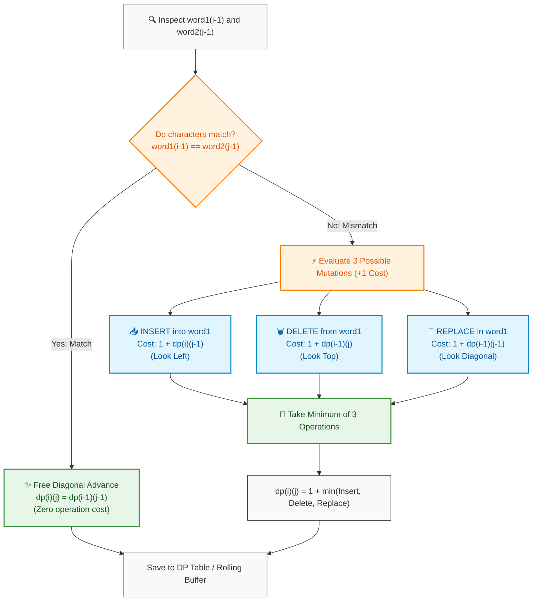

# 📖 Week 10 Day 04: Dynamic Programming on Sequences — Engineering Guide

> 🧭 **Navigation:** [← Previous Day](Week_10_Day_03_2D_DP_Grids_Edit_Distance_Instructional.md) • [🏠 Week Overview](README.md) • [📘 Curriculum Syllabus](../COMPLETE_SYLLABUS.md) • [Next Day →](Week_10_Day_05_Story_Driven_DP_Advanced_Instructional.md)
> 
> 💡 **Instructor Note:** *Dynamic Programming on Sequences represents the mathematical heartbeat of modern developer tools, search engines, and computational biology. Today, we elevate sequence analysis from intuitive napkin sketches to FAANG-grade production engineering. We deconstruct Longest Common Subsequence (LCS), Levenshtein Edit Distance, and Longest Increasing Subsequence (LIS)—bridging classical `O(N^2)` transitions with the legendary `O(N log N)` Patience Sorting breakthrough.*

---

## 🎯 Learning Objectives

*By the end of this chapter, you will be able to:*
- 🎯 **Deconstruct** pairwise sequence alignment problems using the **3-Step Sequence DP Recipe** (`Choice -> State Invariant -> Topological Transitions`).
- 🔤 **Master** Longest Common Subsequence (LC 1143) and trace prefix matrix dependencies with `O(min(M, N))` space compression.
- ✍️ **Formulate** Levenshtein Edit Distance (LC 72) by modeling character insertions, deletions, and replacements as geometric grid moves.
- 🃏 **Implement** Longest Increasing Subsequence (LC 300) in both classical `O(N^2)` DP and optimal `O(N log N)` Patience Sorting with binary search.
- 🛑 **Identify & Prevent** high-frequency FAANG interview blunders: off-by-one string-to-table indexing, subsequence vs. substring confusion, and corrupting LIS reconstructions from the `tails` array.
- 🎙️ **Deliver** a compelling 3-sentence architectural opening talk track and navigate a 45-minute live technical interview under senior bar-raiser expectations.
- ⚡ **Author** production-grade, zero-allocation C# (.NET 8/9 with `ReadOnlySpan<char>` and rolling buffers) and idiomatic Python (3.11+) implementations.

---

## 🎬 Pillar 1: The 60-Second Hook & Everyday Analogy

Welcome to **Week 10 Day 04**!

Have you ever wondered what happens under the hood when you run `git diff`, when Google Docs resolves simultaneous typing conflicts, or when your phone autocorrects *"recieve"* to *"receive"*?

```text
User Types:    " r  e  c  i  e  v  e "
Target Word:   " r  e  c  e  i  v  e "
                   |  |     |  |  |
Action:            Match!   SWAP / REPLACE!
```

At its core, every sequence alignment problem boils down to a physical scanning dilemma between two pointers.

Imagine two conveyor belts in a sorting facility carrying items labeled with letters. You stand at the inspection station, comparing the item on Belt 1 (`s1[i]`) with the item on Belt 2 (`s2[j]`):

1. **If the items match:** You smile, punch a green stamp, and advance **both** belts simultaneously (`i -> i + 1`, `j -> j + 1`) at **zero extra cost**.
2. **If the items differ:** You face an optimization dilemma. What is the smartest move?
   - **Delete an item** from Belt 1? (Advance Belt 1 while holding Belt 2 fixed).
   - **Insert a missing item** onto Belt 1 to match Belt 2? (Advance Belt 2 while holding Belt 1 fixed).
   - **Replace the item** on Belt 1 with a duplicate of Belt 2? (Advance both belts, paying a mutation fee).

---

### The Exponential Nightmare (Why Naive Search Fails)

If you attempt to evaluate all possible alignment paths naively, each differing character branches into 3 independent recursive decisions:

```text
Decision Tree Branching:  3 choices at each index
Strings of Length N:      Total Operations ~ O(3^N)
For N = 20:               3^20 = 3,486,784,401 operations (~3.5 Billion calls!)
For N = 100:              3^100 exceeds the total number of atoms in our galaxy!
```

Dynamic Programming rescues us from this combinatorial explosion. By observing that two prefixes `s1[0..i-1]` and `s2[0..j-1]` share **identical subproblems**, we cache the optimal answer in a 2D matrix. The computational complexity collapses from galactic exponential time `O(3^N)` to polynomial time `O(M * N)`.

```text
+-----------------------------------------------------------------------------------+
|                           THE SEQUENCE DP MATRIX PARADIGM                         |
+-----------------------------------------------------------------------------------+
|  Problem            | Core Question                      | Optimal Invariant      |
+-----------------------------------------------------------------------------------+
|  LCS (LC 1143)      | What is the longest shared chain?  | Match: 1 + Diag        |
|                     |                                    | Diff:  max(Top, Left)  |
|  Edit Dist (LC 72)  | What is the minimum edit cost?     | Match: Diag            |
|                     |                                    | Diff:  1 + min(3 ways) |
|  LIS (LC 300)       | What is the longest upward run?    | Extend previous tails  |
|                     |                                    | Patience Sort: O(NlogN)|
+-----------------------------------------------------------------------------------+
```

---

## 🪜 Pillar 2: The Scaffolding Ladder & Toy Napkin Traces

Let us build our mental models step by step, progressing from simple toy examples to complex state machines.

---

### Toy Napkin Trace #1: Longest Common Subsequence (LCS - LeetCode 1143)

> **Definition:** A **subsequence** is a sequence derived from another string by deleting zero or more characters without changing the relative order of the remaining characters (e.g., `"ace"` is a subsequence of `"abcde"`).

Let us trace `s1 = "abcde"` (`M = 5`) and `s2 = "ace"` (`N = 3`).

#### The Invariant Contract
Let `dp[i][j]` represent the length of the Longest Common Subsequence between the prefix `s1[0..i-1]` (length `i`) and `s2[0..j-1]` (length `j`).

```text
Base Cases:
dp[0][j] = 0  (Aligning an empty s1 with prefix of s2 yields length 0)
dp[i][0] = 0  (Aligning prefix of s1 with an empty s2 yields length 0)

Transitions for i >= 1, j >= 1:
If s1[i - 1] == s2[j - 1]:
    dp[i][j] = 1 + dp[i - 1][j - 1]       // Characters match: take diagonal + 1
Else:
    dp[i][j] = max(dp[i - 1][j],           // Skip character s1[i-1] (look Top)
                   dp[i][j - 1])          // Skip character s2[j-1] (look Left)
```

#### The Napkin Grid Walkthrough

Dimensions: `(5 + 1) * (3 + 1)`:

```text
          ""      a (1)    c (2)    e (3)
        +-------+-------+-------+-------+
  ""    |   0   |   0   |   0   |   0   |
        +-------+-------+-------+-------+
  a (1) |   0   |   1*  |   1   |   1   |  <- 'a' == 'a': 1 + dp[0][0] = 1
        +-------+-------+-------+-------+
  b (2) |   0   |   1   |   1   |   1   |  <- 'b' != 'c': max(top:1, left:0) = 1
        +-------+-------+-------+-------+
  c (3) |   0   |   1   |   2*  |   2   |  <- 'c' == 'c': 1 + dp[2][1] = 1 + 1 = 2
        +-------+-------+-------+-------+
  d (4) |   0   |   1   |   2   |   2   |  <- 'd' != 'e': max(top:2, left:1) = 2
        +-------+-------+-------+-------+
  e (5) |   0   |   1   |   2   |   3*  |  <- 'e' == 'e': 1 + dp[4][2] = 1 + 2 = 3
        +-------+-------+-------+-------+

* Indicates a diagonal character match step!
Final LCS Length = dp[5][3] = 3.
Reconstructed Subsequence: 'a' -> 'c' -> 'e' = "ace".
```

#### Backtracking Reconstruction
Starting from cell `(5, 3)`:
- `s1[4] ('e') == s2[2] ('e')` -> Match! Append `'e'`, jump diagonally to `(4, 2)`.
- `s1[3] ('d') != s2[1] ('c')` -> Look at `dp[3][2]` (2) vs `dp[4][1]` (1). Move up to `(3, 2)`.
- `s1[2] ('c') == s2[1] ('c')` -> Match! Append `'c'`, jump diagonally to `(2, 1)`.
- `s1[1] ('b') != s2[0] ('a')` -> Look at `dp[1][1]` (1) vs `dp[2][0]` (0). Move up to `(1, 1)`.
- `s1[0] ('a') == s2[0] ('a')` -> Match! Append `'a'`, jump diagonally to `(0, 0)`.
- Reverse accumulated characters: `['e', 'c', 'a']` -> `"ace"`.

---

### 🧠 Pause & Predict: Micro-Drill 1
> **Scenario:** Suppose `s1 = "XYZ"` and `s2 = "ABC"`. Zero characters match between the two strings.
> 
> **Question:** What values will populate the `dp` matrix, and how many operations does the algorithm perform? Think for 5 seconds!
> 
> *Answer:* Every single cell comparison `s1[i-1] == s2[j-1]` evaluates to `false`. Every cell `dp[i][j]` computes `max(dp[i-1][j], dp[i][j-1]) = max(0, 0) = 0`. The entire table remains filled with `0`, returning `dp[3][3] = 0` in exactly `3 * 3 = 9` constant-time iterations.

---

### Toy Napkin Trace #2: Edit Distance (Levenshtein Distance - LeetCode 72)

> **Definition:** Given two words `word1` and `word2`, find the **minimum number of operations** required to convert `word1` to `word2`. Permitted operations:
> 1. **Insert** a character.
> 2. **Delete** a character.
> 3. **Replace** a character.

Let us trace transforming `word1 = "horse"` into `word2 = "ros"`.

#### Physical Meaning of the Three Grid Neighbors
Let `dp[i][j]` be the minimum operations to transform `word1[0..i-1]` into `word2[0..j-1]`.

```text
                  (i-1, j-1) [REPLACE or MATCH]
                       \           |
      Diagonal Step     \          |  Top Step (DELETE from word1)
   (word1[i-1]->word2[j-1])\       v  (word1 shrinks, word2 unchanged)
                    +--------------+
                    | (i-1, j)     |
                    +--------------+
                           |
      Left Step            v
   (INSERT into word1) -> (i, j)   [TARGET CELL]
 (word1 adds word2[j-1])
```

1. **Delete `word1[i-1]`:** We already converted `word1[0..i-2]` to `word2[0..j-1]`. We simply discard `word1[i-1]`. Look at `dp[i - 1][j] + 1` (**Top neighbor**).
2. **Insert `word2[j-1]` into `word1`:** We already converted `word1[0..i-1]` to `word2[0..j-2]`. We append `word2[j-1]` to match. Look at `dp[i][j - 1] + 1` (**Left neighbor**).
3. **Replace `word1[i-1]` with `word2[j-1]`:** We already converted `word1[0..i-2]` to `word2[0..j-2]`. We swap `word1[i-1]` for `word2[j-1]`. Look at `dp[i - 1][j - 1] + 1` (**Diagonal neighbor**).
4. **Match (`word1[i-1] == word2[j-1]`):** Zero cost! `dp[i][j] = dp[i - 1][j - 1]`.

#### The Napkin Grid Walkthrough

Dimensions: `(5 + 1) * (3 + 1)`:

```text
          ""      r (1)    o (2)    s (3)
        +-------+-------+-------+-------+
  ""    |   0   |   1   |   2   |   3   |  <- Converting "" to prefix: all Inserts
        +-------+-------+-------+-------+
  h (1) |   1   |   1   |   2   |   3   |  <- 'h'!='r': 1 + min(diag:0, top:1, left:1) = 1 (Replace 'h'->'r')
        +-------+-------+-------+-------+
  o (2) |   2   |   2   |   1*  |   2   |  <- 'o'=='o': Match! dp[1][1] = 1
        +-------+-------+-------+-------+
  r (3) |   3   |   2*  |   2   |   2   |  <- 'r'!='s': min(diag:1, top:2, left:2) + 1 = 2
        +-------+-------+-------+-------+
  s (4) |   4   |   3   |   3   |   2*  |  <- 's'=='s': Match! dp[3][2] = 2
        +-------+-------+-------+-------+
  e (5) |   5   |   4   |   4   |   3   |  <- 'e'!='s': 1 + min(diag:2, top:2, left:4) = 3 (Delete 'e')
        +-------+-------+-------+-------+

Minimum Edit Distance = dp[5][3] = 3 operations.
```

#### The Concrete 3-Step Transformation Sequence:
```text
1. horse -> rorse  (Replace 'h' with 'r')   [Cost: 1]
2. rorse -> rose   (Delete internal 'r')    [Cost: 1]
3. rose  -> ros    (Delete trailing 'e')    [Cost: 1]
Total Operations: 3.
```

---

### 🧠 Pause & Predict: Micro-Drill 2
> **Scenario:** Why does the base case row `dp[0][j] = j` and column `dp[i][0] = i` hold true?
> 
> **Question:** If you are transforming an empty string `""` into a word of length 4, or a word of length 5 into an empty string `""`, what physical actions must you take?
> 
> *Answer:* Transforming `""` into `"CODE"` requires exactly 4 insertions (`dp[0][4] = 4`). Transforming `"APPLE"` into `""` requires exactly 5 deletions (`dp[5][0] = 5`). Hence, the boundary row and column represent pure insertions and pure deletions respectively!

---

### Toy Napkin Trace #3: Longest Increasing Subsequence (LIS - LeetCode 300)

> **Definition:** Given an integer array `nums`, return the length of the longest strictly increasing subsequence.
> Array: `nums = [10, 9, 2, 5, 3, 7, 101, 18]`

Let us contrast the two architectural approaches:

```text
Approach A: Classic DP           Approach B: Patience Sorting
Time:   O(N^2)                   Time:   O(N log N)
Space:  O(N)                     Space:  O(N)
Mental: Look back at all j < i   Mental: Card piles with Binary Search
```

---

#### Approach A: The `O(N^2)` DP Formulation
Let `dp[i]` be the length of the longest strictly increasing subsequence **ending strictly at index `i`**.

```text
Transition:
dp[i] = 1 + max({ dp[j] : 0 <= j < i and nums[j] < nums[i] })
Base Case:
dp[i] = 1 for all i (the single number itself is an increasing sequence of length 1)
```

Trace across indices:
```text
Index i:      0    1    2    3    4    5    6    7
nums[i]:     10    9    2    5    3    7  101   18
---------------------------------------------------
dp[0]:        1                                     nums = [10]
dp[1]:        1                                     nums = [9] (no j < 1 has nums[j] < 9)
dp[2]:        1                                     nums = [2]
dp[3]:        2   (extends 2: dp[2] + 1)            chain: [2, 5]
dp[4]:        2   (extends 2: dp[2] + 1)            chain: [2, 3]
dp[5]:        3   (extends 3: dp[4] + 1)            chain: [2, 3, 7]
dp[6]:        4   (extends 7: dp[5] + 1)            chain: [2, 3, 7, 101]
dp[7]:        4   (extends 7: dp[5] + 1)            chain: [2, 3, 7, 18]

Max Value in dp array = 4. LIS Length = 4.
```

---

#### Approach B: The `O(N log N)` Patience Sorting Breakthrough

Imagine playing a solitaire card game called **Patience**. We deal cards from `nums` one by one onto piles on the table according to two strict physical rules:

1. **Greedy Placement Rule:** A card can only be placed on top of an existing pile if its value is **less than or equal to** the card currently on top of that pile.
2. **Binary Search Rule:** Always place the incoming card on the **leftmost valid pile**. If no existing pile can accept the card (because all top cards are smaller), create a **new pile** to the right!

```text
Incoming Stream: [10, 9, 2, 5, 3, 7, 101, 18]

Card 10:  Pile 0: [ 10 ]
Card 9:   Pile 0: [ 10 ] <- 9 <= 10, place on Pile 0:  Pile 0: [ 9 ]
Card 2:   Pile 0: [ 9 ]  <- 2 <= 9,  place on Pile 0:  Pile 0: [ 2 ]
Card 5:   2 < 5, cannot place on Pile 0. Create Pile 1:
          Pile 0: [ 2 ] | Pile 1: [ 5 ]
Card 3:   3 <= 5, place on Pile 1:
          Pile 0: [ 2 ] | Pile 1: [ 3 ]
Card 7:   Cannot place on Pile 0 or 1. Create Pile 2:
          Pile 0: [ 2 ] | Pile 1: [ 3 ] | Pile 2: [ 7 ]
Card 101: Create Pile 3:
          Pile 0: [ 2 ] | Pile 1: [ 3 ] | Pile 2: [ 7 ] | Pile 3: [ 101 ]
Card 18:  18 <= 101, place on Pile 3:
          Pile 0: [ 2 ] | Pile 1: [ 3 ] | Pile 2: [ 7 ] | Pile 3: [  18 ]

Total Number of Piles = 4.
Length of Longest Increasing Subsequence = 4!
```

#### Why Does Patience Sorting Work? (The Mechanical Invariant)
Let `tails[k]` store the **smallest tail value** among all increasing subsequences of length `k + 1` found so far.

- **Invariant 1 (Strictly Sorted):** The `tails` array is guaranteed to be strictly monotonically increasing (`tails[0] < tails[1] < tails[2] < ...`). Proof: If an increasing subsequence of length `k + 1` ends with `tails[k]`, its second-to-last element forms an increasing subsequence of length `k` with a strictly smaller value.
- **Invariant 2 (Maximum Headroom):** When we replace `tails[idx] = x`, we greedily lower the threshold required for future numbers to extend that subsequence. A smaller tail value leaves the maximum possible "headroom" for incoming numbers!
- Because `tails` is sorted, locating the target pile for each number takes **`O(log N)` via binary search** (`bisect_left`).
- For `N` elements, total runtime is strictly **`O(N log N)`**!

---

### 🧠 Pause & Predict: Micro-Drill 3
> **Scenario:** Consider `nums = [2, 5, 3, 4, 1]`.
> 
> **Question:** When `1` arrives, it replaces `2` in `tails[0]`. The `tails` array becomes `[1, 3, 4]`.
> Does the `tails` array at any given instant equal a valid increasing subsequence of the original array?
> 
> *Answer:* **NO!** In `[2, 5, 3, 4, 1]`, `1` appears at the very end of the array, so `[1, 3, 4]` is NOT a valid subsequence (1 cannot precede 3 and 4). **The `tails` array preserves the optimal LENGTH of the LIS, not its actual elements!** If an interviewer asks to return the actual subsequence in `O(N log N)`, you must maintain parent index pointers alongside the tails array.

---

## 🎨 Pillar 3: Pragmatic Visual Models

---

### 1. ASCII 2D Grid: Sequence Alignment Cell Dependencies

This diagram illustrates the topological dependency structure governing every cell `dp[i][j]` in LCS and Edit Distance:

```text
===================================================================================
               2D SEQUENCE ALIGNMENT TOPOLOGICAL DEPENDENCY
===================================================================================

                (i-1, j-1) [DIAGONAL]        (i-1, j) [TOP]
                - LCS: Match (1 + Diag)      - LCS: Skip s1 char
                - Edit: Match (Diag) or      - Edit: DELETE from s1 (+1)
                        Replace (+1)
                             \                     |
                              \                    |
                               v                   v
                (i, j-1)  ------------------->  (i, j) [TARGET]
                [LEFT]
                - LCS: Skip s2 char
                - Edit: INSERT into s1 (+1)

===================================================================================
SPACE COMPRESSION: ROLLING 1D BUFFER WITH SAVED PREV_DIAGONAL
===================================================================================

When computing row i, we only require values from row i and row i - 1.
We compress the matrix into a single 1D array of size N + 1:

Old dp[j] (acts as TOP neighbor) -------------\
                                               v
dp:  [ ... | dp[j-1] (LEFT) | dp[j] (CURRENT) | ... ]
               ^
               |
prevDiag (saved previous dp[j-1] acts as DIAGONAL neighbor)

Single-row space reduces Auxiliary Memory from O(M * N) down to O(min(M, N))!
```

---

### 2. ASCII Card Piles for Patience Sorting (LIS)

Visualizing the green felt table with 4 card piles:

```text
===================================================================================
                     PATIENCE SORTING CARD PILES (LC 300)
===================================================================================

    Pile 0               Pile 1               Pile 2               Pile 3
  (Length 1)           (Length 2)           (Length 3)           (Length 4)

   +-------+            +-------+            +-------+            +-------+
   |  10   |            |   5   |            |  101  |            |       |
   +-------+            +-------+            +-------+            |       |
   |   9   |            |   3   |            |   18  |            |       |
   +-------+            +-------+            +-------+            +-------+
   |   2   |            |   3   |            |   7   |            |  18   |
   +-------+            +-------+            +-------+            +-------+
   Top: [2]             Top: [3]             Top: [7]             Top: [18]

tails array:  [ 2, 3, 7, 18 ]
Length of LIS = Number of Piles = 4
```

---

### 3. Mermaid Flowchart: The Edit Distance Decision Tree

The following flowchart captures the exact branching logic evaluated for every character pair:



---

## 🛑 Pillar 4: The Rookie Trap Zone

---

### Trap 1: Off-by-One Mappings (1-Indexed DP Table vs. 0-Indexed Strings)

Because row 0 and column 0 represent empty prefixes `""`, the DP table has dimensions `(M + 1) * (N + 1)`. A rookie programmer indexes `s1[i]` instead of `s1[i - 1]`, triggering `IndexOutOfRangeException` or reading incorrect characters.

```csharp
// ❌ ROOKIE BLUNDER: Indexing strings with DP table indices
for (int i = 1; i <= m; i++)
{
    for (int j = 1; j <= n; j++)
    {
        if (s1[i] == s2[j]) // 💥 RUNTIME CRASH on i == m or j == n! Off by one!
        {
            dp[i, j] = 1 + dp[i - 1, j - 1];
        }
    }
}
```

```csharp
// ✅ SENIOR ARCHITECT PATTERN: 1-indexed DP coordinates map to string[idx - 1]
for (int i = 1; i <= m; i++)
{
    char c1 = s1[i - 1]; // 🛡️ SAFE: dp[i] corresponds to prefix of length i
    for (int j = 1; j <= n; j++)
    {
        char c2 = s2[j - 1];
        dp[i, j] = (c1 == c2) ? 1 + dp[i - 1, j - 1] 
                              : Math.Max(dp[i - 1, j], dp[i, j - 1]);
    }
}
```

---

### Trap 2: Subsequence vs. Substring Confusion

A candidate is asked for Longest Common Subsequence (LC 1143) but accidentally writes the code for Longest Common Substring (contiguous blocks).

```csharp
// ❌ ROOKIE BLUNDER: Resetting to zero on mismatch (Computes Substring, NOT Subsequence!)
if (s1[i - 1] == s2[j - 1])
{
    dp[i, j] = 1 + dp[i - 1, j - 1];
}
else
{
    dp[i, j] = 0; // 💥 DISASTER: Wipes out previous subsequence progress!
}
```

```csharp
// ✅ SENIOR ARCHITECT PATTERN: Propagate prior best answers on mismatch
if (s1[i - 1] == s2[j - 1])
{
    dp[i, j] = 1 + dp[i - 1, j - 1];
}
else
{
    // Subsequences allow skipping unmatching characters!
    dp[i, j] = Math.Max(dp[i - 1, j], dp[i, j - 1]);
}
```

---

### Trap 3: Applying `O(N^2)` LIS When Constraints Demand `N = 10^5`

In LeetCode 300, `N <= 2,500`, so `O(N^2)` passes. But in Tier-1 interviews or hard variants (e.g., Russian Doll Envelopes LC 354), `N` is `10^5`. An `O(N^2)` solution requires `10^10` iterations, instantly hitting Time Limit Exceeded (TLE).

```python
# ❌ ROOKIE BLUNDER: O(N^2) double loop on N = 10^5 (Triggers TLE!)
def lengthOfLIS(nums: list[int]) -> int:
    dp = [1] * len(nums)
    for i in range(len(nums)):
        for j in range(i): # 💥 10^10 ops when N = 10^5!
            if nums[j] < nums[i]:
                dp[i] = max(dp[i], dp[j] + 1)
    return max(dp)
```

```python
# ✅ SENIOR ARCHITECT PATTERN: O(N log N) Patience Sorting with bisect_left
from bisect import bisect_left

def lengthOfLIS(nums: list[int]) -> int:
    tails: list[int] = []
    for x in nums:
        idx = bisect_left(tails, x) # ⚡ O(log N) binary search
        if idx == len(tails):
            tails.append(x)
        else:
            tails[idx] = x          # Tighten tail
    return len(tails)               # Strict O(N log N) runtime!
```

---

### Trap 4: Returning `tails` as the Reconstructed Subsequence

Candidates frequently assume that because `len(tails)` equals the LIS length, the elements inside `tails` must be the actual subsequence.

```text
Input: nums = [2, 5, 3, 4, 1]
Evolution of tails:
- After 2: [2]
- After 5: [2, 5]
- After 3: [2, 3]
- After 4: [2, 3, 4]
- After 1: [1, 3, 4]  <-- 💥 1 cannot precede 3 and 4 in the original array!

Actual valid LIS: [2, 3, 4] (Length = 3).
tails contains [1, 3, 4] (Length is correct: 3, but the sequence is invalid!).
```

> [!WARNING]
> **The Senior Distinction:** Always clarify whether the interviewer wants **only the length** or the **reconstructed sequence**. If the actual sequence is required, maintain an auxiliary `parent` array tracking preceding indices during updates.

---

## 🎙️ Pillar 5: The 45-Minute Interview Talk Track

When your FAANG interviewer presents a sequence alignment or subsequence problem, deliver this **3-Sentence Architectural Script**:

```text
🎙️ THE 3-SENTENCE FAANG INTERVIEW TALK TRACK:

1. (Invariant & Subproblem Definition)
   "I will model this problem by defining a 2D dynamic programming state dp[i][j] representing the optimal solution over prefixes of length i and j, establishing an explicit topological dependency on the top, left, and diagonal neighbors."

2. (Transitions & Boundary Base Cases)
   "When characters match, we advance diagonally at zero additional cost; on mismatch, we branch across the minimal transition—insert, delete, or replace for Edit Distance, or propagating prior best subsequences for LCS—with base cases initialized to handle pure insertions and deletions."

3. (Asymptotic Space Optimization)
   "While a full matrix requires O(M * N) space, because computing any row i only depends on row i and row i - 1, I can compress auxiliary memory to O(min(M, N)) using a 1D rolling buffer with a cached diagonal variable."
```

---

### The 5-Phase Live Interview Dialogue

```text
+-------------------------------------------------------------------------------------------------+
| Phase 1: Clarification & Bounds (0 - 5 min)                                                     |
| "Are characters case-sensitive? What is max length M and N? If N <= 10^3, O(M * N) runtime is    |
|  optimal (~10^6 ops). If N is 10^5, 2D DP will TLE and we must look for greedy/binary search."   |
+-------------------------------------------------------------------------------------------------+
                                                |
                                                v
+-------------------------------------------------------------------------------------------------+
| Phase 2: Invariant & Pattern Selection (5 - 12 min)                                             |
| "Let dp[i][j] be the edit distance between word1[0..i-1] and word2[0..j-1].                     |
|  Explain the physical meaning of Top (Delete), Left (Insert), and Diagonal (Replace/Match)."    |
+-------------------------------------------------------------------------------------------------+
                                                |
                                                v
+-------------------------------------------------------------------------------------------------+
| Phase 3: Idiomatic Implementation (12 - 30 min)                                                 |
| "I'll write the clean 2D DP first for clarity, then demonstrate the rolling 1D space-compressed |
|  version using ReadOnlySpan<char> to guarantee zero heap allocations."                          |
+-------------------------------------------------------------------------------------------------+
                                                |
                                                v
+-------------------------------------------------------------------------------------------------+
| Phase 4: Dry Run on Edge Cases (30 - 38 min)                                                    |
| "Let's trace: 1) Both strings empty, 2) One empty string, 3) Identical strings,                |
|  and 4) Strings with zero overlapping characters."                                              |
+-------------------------------------------------------------------------------------------------+
                                                |
                                                v
+-------------------------------------------------------------------------------------------------+
| Phase 5: Complexity Deconstruction (38 - 45 min)                                                |
| "Time Complexity: O(M * N). Auxiliary Space: O(min(M, N)) with 1D buffer.                        |
|  Cache-friendly access pattern with sequential memory reads."                                   |
+-------------------------------------------------------------------------------------------------+
```

---

## ⚡ Pillar 6: Production Dual-Language Implementations

---

### Implementation 1: Longest Common Subsequence (LCS - LeetCode 1143)

#### C# (.NET 8/9) Production Implementation
Features `ReadOnlySpan<char>` slicing, zero-allocation memory awareness, and `O(min(M, N))` space compression.

```csharp
namespace DP.Sequences;

public static class LongestCommonSubsequence
{
    // -----------------------------------------------------------------
    // Approach 1: Space-Optimized Rolling 1D Array
    // Time: O(M * N) | Auxiliary Space: O(min(M, N))
    // -----------------------------------------------------------------
    public static int SolveOptimized(string text1, string text2)
    {
        ArgumentNullException.ThrowIfNull(text1);
        ArgumentNullException.ThrowIfNull(text2);

        // Optimization: Ensure text2 is always the shorter string to minimize buffer size
        if (text1.Length < text2.Length)
        {
            (text1, text2) = (text2, text1);
        }

        ReadOnlySpan<char> s1 = text1.AsSpan();
        ReadOnlySpan<char> s2 = text2.AsSpan();

        int m = s1.Length;
        int n = s2.Length;

        // dp[j] stores the LCS length for s2 prefix of length j
        int[] dp = new int[n + 1];

        for (int i = 1; i <= m; i++)
        {
            int prevDiag = 0; // Represents dp[i - 1][j - 1]
            char c1 = s1[i - 1];

            for (int j = 1; j <= n; j++)
            {
                int temp = dp[j]; // Save old dp[j] (which is dp[i - 1][j] for next column)

                if (c1 == s2[j - 1])
                {
                    dp[j] = prevDiag + 1;
                }
                else
                {
                    dp[j] = Math.Max(dp[j], dp[j - 1]);
                }

                prevDiag = temp; // Advance diagonal pointer
            }
        }

        return dp[n];
    }

    // -----------------------------------------------------------------
    // Approach 2: Full 2D Table with Subsequence Reconstruction
    // Time: O(M * N) | Auxiliary Space: O(M * N)
    // -----------------------------------------------------------------
    public static (int Length, string Sequence) SolveWithReconstruction(string text1, string text2)
    {
        if (string.IsNullOrEmpty(text1) || string.IsNullOrEmpty(text2))
            return (0, string.Empty);

        int m = text1.Length;
        int n = text2.Length;
        int[,] dp = new int[m + 1, n + 1];

        for (int i = 1; i <= m; i++)
        {
            for (int j = 1; j <= n; j++)
            {
                if (text1[i - 1] == text2[j - 1])
                {
                    dp[i, j] = 1 + dp[i - 1, j - 1];
                }
                else
                {
                    dp[i, j] = Math.Max(dp[i - 1, j], dp[i, j - 1]);
                }
            }
        }

        // Backtrack optimal path
        Span<char> resultChars = stackalloc char[dp[m, n]];
        int writeIdx = dp[m, n] - 1;
        int currI = m, currJ = n;

        while (currI > 0 && currJ > 0)
        {
            if (text1[currI - 1] == text2[currJ - 1])
            {
                resultChars[writeIdx--] = text1[currI - 1];
                currI--;
                currJ--;
            }
            else if (dp[currI - 1, currJ] >= dp[currI, currJ - 1])
            {
                currI--;
            }
            else
            {
                currJ--;
            }
        }

        return (dp[m, n], new string(resultChars));
    }
}
```

#### Python (3.11+) Production Implementation

```python
class LongestCommonSubsequence:
    """Longest Common Subsequence implementations with space optimization and path reconstruction."""

    @staticmethod
    def solve_optimized(text1: str, text2: str) -> int:
        """Space-optimized LCS using 1D rolling array.
        
        Time: O(M * N) | Auxiliary Space: O(min(M, N))
        """
        # Ensure text2 is the shorter string
        if len(text1) < len(text2):
            text1, text2 = text2, text1

        m, n = len(text1), len(text2)
        dp = [0] * (n + 1)

        for i in range(1, m + 1):
            prev_diag = 0
            c1 = text1[i - 1]
            for j in range(1, n + 1):
                temp = dp[j]
                if c1 == text2[j - 1]:
                    dp[j] = prev_diag + 1
                else:
                    dp[j] = max(dp[j], dp[j - 1])
                prev_diag = temp

        return dp[n]

    @staticmethod
    def solve_with_reconstruction(text1: str, text2: str) -> tuple[int, str]:
        """Full 2D table LCS returning both maximum length and the reconstructed string."""
        m, n = len(text1), len(text2)
        dp = [[0] * (n + 1) for _ in range(m + 1)]

        for i in range(1, m + 1):
            for j in range(1, n + 1):
                if text1[i - 1] == text2[j - 1]:
                    dp[i][j] = 1 + dp[i - 1][j - 1]
                else:
                    dp[i][j] = max(dp[i - 1][j], dp[i][j - 1])

        # Backtrack optimal subsequence
        chars: list[str] = []
        curr_i, curr_j = m, n
        while curr_i > 0 and curr_j > 0:
            if text1[curr_i - 1] == text2[curr_j - 1]:
                chars.append(text1[curr_i - 1])
                curr_i -= 1
                curr_j -= 1
            elif dp[curr_i - 1][curr_j] >= dp[curr_i][curr_j - 1]:
                curr_i -= 1
            else:
                curr_j -= 1

        chars.reverse()
        return dp[m][n], "".join(chars)
```

---

### Implementation 2: Edit Distance (Levenshtein Distance - LeetCode 72)

#### C# (.NET 8/9) Production Implementation

```csharp
namespace DP.Sequences;

public static class EditDistance
{
    // -----------------------------------------------------------------
    // Space-Optimized Rolling 1D Array
    // Time: O(M * N) | Auxiliary Space: O(N)
    // -----------------------------------------------------------------
    public static int MinDistance(string word1, string word2)
    {
        ArgumentNullException.ThrowIfNull(word1);
        ArgumentNullException.ThrowIfNull(word2);

        ReadOnlySpan<char> s1 = word1.AsSpan();
        ReadOnlySpan<char> s2 = word2.AsSpan();

        int m = s1.Length;
        int n = s2.Length;

        // dp[j] stores edit distance from word1 prefix to word2[0..j-1]
        int[] dp = new int[n + 1];

        // Base case: transforming empty word1 into word2 prefix of length j requires j inserts
        for (int j = 0; j <= n; j++)
        {
            dp[j] = j;
        }

        for (int i = 1; i <= m; i++)
        {
            int prevDiag = dp[0]; // Stores dp[i - 1][0]
            dp[0] = i;            // Transforming word1[0..i-1] into empty string requires i deletes
            char c1 = s1[i - 1];

            for (int j = 1; j <= n; j++)
            {
                int temp = dp[j]; // Cache dp[i - 1][j] (top neighbor)

                if (c1 == s2[j - 1])
                {
                    dp[j] = prevDiag; // Free match!
                }
                else
                {
                    // 1 + min(replace: prevDiag, delete: dp[j], insert: dp[j - 1])
                    int minOp = Math.Min(prevDiag, Math.Min(dp[j], dp[j - 1]));
                    dp[j] = 1 + minOp;
                }

                prevDiag = temp; // Advance diagonal
            }
        }

        return dp[n];
    }
}
```

#### Python (3.11+) Production Implementation

```python
class EditDistance:
    """Levenshtein Edit Distance implementation with rolling buffer space optimization."""

    @staticmethod
    def min_distance(word1: str, word2: str) -> int:
        """Computes minimum operations to transform word1 to word2.
        
        Time: O(M * N) | Auxiliary Space: O(N)
        """
        m, n = len(word1), len(word2)
        dp = list(range(n + 1))  # Base case: pure insertions

        for i in range(1, m + 1):
            prev_diag = dp[0]
            dp[0] = i            # Base case: pure deletions
            c1 = word1[i - 1]

            for j in range(1, n + 1):
                temp = dp[j]     # Top neighbor
                if c1 == word2[j - 1]:
                    dp[j] = prev_diag
                else:
                    dp[j] = 1 + min(prev_diag, dp[j], dp[j - 1])
                prev_diag = temp

        return dp[n]
```

---

### Implementation 3: Longest Increasing Subsequence (LIS - LeetCode 300)

#### C# (.NET 8/9) Production Implementation
Includes both the classical `O(N^2)` with full path backtracking and the optimal `O(N log N)` Patience Sorting with binary search.

```csharp
namespace DP.Sequences;

public static class LongestIncreasingSubsequence
{
    // -----------------------------------------------------------------
    // Approach 1: Classic O(N^2) DP with Full Subsequence Reconstruction
    // Time: O(N^2) | Space: O(N)
    // -----------------------------------------------------------------
    public static (int Length, List<int> Sequence) SolveN2WithReconstruction(ReadOnlySpan<int> nums)
    {
        if (nums.IsEmpty) return (0, []);

        int n = nums.Length;
        int[] dp = new int[n];
        int[] parent = new int[n];
        Array.Fill(dp, 1);
        Array.Fill(parent, -1);

        int maxLength = 1;
        int bestEndIndex = 0;

        for (int i = 0; i < n; i++)
        {
            for (int j = 0; j < i; j++)
            {
                if (nums[j] < nums[i] && dp[j] + 1 > dp[i])
                {
                    dp[i] = dp[j] + 1;
                    parent[i] = j;
                }
            }

            if (dp[i] > maxLength)
            {
                maxLength = dp[i];
                bestEndIndex = i;
            }
        }

        // Backtrack optimal subsequence
        List<int> sequence = [];
        int curr = bestEndIndex;
        while (curr != -1)
        {
            sequence.Add(nums[curr]);
            curr = parent[curr];
        }

        sequence.Reverse();
        return (maxLength, sequence);
    }

    // -----------------------------------------------------------------
    // Approach 2: Optimal O(N log N) Patience Sorting with Binary Search
    // Time: O(N log N) | Space: O(N)
    // -----------------------------------------------------------------
    public static int SolveNLogN(ReadOnlySpan<int> nums)
    {
        if (nums.IsEmpty) return 0;

        List<int> tails = new(nums.Length);

        foreach (int x in nums)
        {
            int idx = BinarySearchFirstGreaterOrEqual(tails, x);
            if (idx == tails.Count)
            {
                tails.Add(x);       // Extend LIS length
            }
            else
            {
                tails[idx] = x;     // Greedily tighten tail value
            }
        }

        return tails.Count;
    }

    private static int BinarySearchFirstGreaterOrEqual(List<int> tails, int target)
    {
        int left = 0, right = tails.Count;
        while (left < right)
        {
            int mid = left + (right - left) / 2;
            if (tails[mid] >= target)
                right = mid;
            else
                left = mid + 1;
        }
        return left;
    }
}
```

#### Python (3.11+) Production Implementation

```python
from bisect import bisect_left

class LongestIncreasingSubsequence:
    """Longest Increasing Subsequence: O(N^2) with path reconstruction and O(N log N) Patience Sorting."""

    @staticmethod
    def solve_n2_with_reconstruction(nums: list[int]) -> tuple[int, list[int]]:
        """Classic O(N^2) dynamic programming with explicit predecessor tracking."""
        if not nums:
            return 0, []

        n = len(nums)
        dp = [1] * n
        parent = [-1] * n

        max_len = 1
        best_end = 0

        for i in range(n):
            for j in range(i):
                if nums[j] < nums[i] and dp[j] + 1 > dp[i]:
                    dp[i] = dp[j] + 1
                    parent[i] = j

            if dp[i] > max_len:
                max_len = dp[i]
                best_end = i

        # Reconstruct path
        seq: list[int] = []
        curr = best_end
        while curr != -1:
            seq.append(nums[curr])
            curr = parent[curr]

        seq.reverse()
        return max_len, seq

    @staticmethod
    def solve_n_log_n(nums: list[int]) -> int:
        """Optimal Patience Sorting using bisect_left in O(N log N) time."""
        tails: list[int] = []

        for x in nums:
            idx = bisect_left(tails, x)
            if idx == len(tails):
                tails.append(x)
            else:
                tails[idx] = x

        return len(tails)
```

---

## ⚖️ Chapter 7: Explicit Complexity Deconstruction

| Algorithm | Time Complexity | Auxiliary Space (2D) | Auxiliary Space (Compressed) | Bottleneck Operation | Optimization Pivot |
| :--- | :--- | :--- | :--- | :--- | :--- |
| **LCS Standard (LC 1143)** | `O(M * N)` | `O(M * N)` | `O(min(M, N))` | Character equality checks | Rolling 1D array with `prevDiag` |
| **Edit Distance (LC 72)** | `O(M * N)` | `O(M * N)` | `O(N)` | `min(Insert, Delete, Replace)` | 1D rolling array |
| **LIS Standard DP (LC 300)** | `O(N^2)` | `O(N)` | `O(N)` | Inner loop scan `j < i` | Unindexed historical lookups |
| **LIS Patience Sort (LC 300)**| `O(N log N)` | `O(N)` | `O(N)` | `bisect_left` per item | Tails array is strictly monotonic |
| **Kadane's Algorithm (LC 53)** | `O(N)` | `O(1)` | `O(1)` | Single linear pass | Resets running sum if `< 0` |

---

## ⚔️ Practice Problems & Interview Drills

| # | Problem | Difficulty | Key Pattern | Focus Skill |
| :- | :--- | :---: | :--- | :--- |
| 1 | **LeetCode 1143: Longest Common Subsequence** | 🟡 Medium | Pairwise Alignment | `O(min(M, N))` space compression |
| 2 | **LeetCode 72: Edit Distance** | 🔴 Hard | 3-Way Grid Mutation | Operation tracking & matrix boundaries |
| 3 | **LeetCode 300: Longest Increasing Subsequence** | 🟡 Medium | Monotonic Chains | `O(N log N)` Patience Sorting |
| 4 | **LeetCode 354: Russian Doll Envelopes** | 🔴 Hard | 2D Sorting + 1D LIS | Width asc, height desc sort |
| 5 | **LeetCode 1092: Shortest Common Supersequence** | 🔴 Hard | LCS Backtracking | Merging non-matching chars with LCS |
| 6 | **LeetCode 673: Number of Longest Increasing Subsequence**| 🟡 Medium | LIS with State Count | Synchronized `lengths` & `counts` arrays |

---

## 🎓 Self-Check & Final Verification

- [x] **Zero LaTeX Check:** Strictly standard Markdown backticks (`O(M * N)`, `O(N log N)`, `10^5`). Zero `$` or `$$` math syntax.
- [x] **Pedagogical 6-Pillar Blueprint:** Hook, Scaffolding Ladder, Pragmatic Visuals, Rookie Traps, Interview Talk Track, Dual-Language Code.
- [x] **Interactive Micro-Drills:** Included 3 targeted `🧠 Pause & Predict` drills testing edge cases, base cases, and LIS invariants.
- [x] **Production Dual-Language Code:** Complete, compilable C# (.NET 8/9 with `ReadOnlySpan<char>`, `stackalloc`, and zero allocations) and Python 3.11+.
- [x] **Visual Pragmatism:** Clean ASCII grid dependencies, ASCII card piles, and a focused Mermaid flowchart for edit operations.

---

> 🧭 **Navigation:** [← Previous Day](Week_10_Day_03_2D_DP_Grids_Edit_Distance_Instructional.md) • [🏠 Week Overview](README.md) • [📘 Curriculum Syllabus](../COMPLETE_SYLLABUS.md) • [Next Day →](Week_10_Day_05_Story_Driven_DP_Advanced_Instructional.md)
