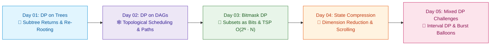

# 📘 Week 11: Dynamic Programming II: Advanced State Spaces

> 🧭 **Navigation:** [← Previous: Week 10](../week_10_dynamic_programming_i_fundamentals/README.md) • [🏠 Curriculum Overview](../README.md) • [📘 Complete Syllabus](../COMPLETE_SYLLABUS.md) • [Next: Week 12 →](../week_12_greedy_and_paradigms/README.md)

---

## 🎬 Welcome to Week 11: The Advanced State-Space Architect's Masterclass!

In Staff and Principal-level technical interviews, dynamic programming rarely presents itself as a simple 1D array. Problems evolve into non-linear, high-dimensional topologies: hierarchical trees, directed acyclic dependency networks, exponential subset powersets, and compressed memory layouts.

This week elevates you from introductory DP to advanced state-space modeling: **Tree DP (bottom-up post-order propagation & re-rooting)**, **DP on DAGs (topological ordering & longest/shortest paths)**, **Bitmask DP (representing subsets as integer bit arrays & Traveling Salesperson)**, **State Compression (space-saving rolling bit vectors)**, and **Mixed DP master challenges (Interval DP & Matrix Chain Multiplication)**.

---

## 📅 Day-by-Day Learning Path

| Day | Instructional Masterclass | Core Mental Model & Intuition | Key Pattern / Invariant |
| :--- | :--- | :--- | :--- |
| **Day 01** | [DP on Trees](Week_11_Day_01_DP_on_Trees_Instructional.md) | **The Subtree Delegation Contract:** Bottom-up aggregation. | `dp[u][0]` vs `dp[u][1]`, House Robber III, Binary Tree Camera, Re-rooting technique. |
| **Day 02** | [DP on DAGs](Week_11_Day_02_DP_On_DAGs_Instructional.md) | **The Topological Cascade:** Processing nodes in dependency order. | Topological order DP, longest path in DAG, number of paths between source and target. |
| **Day 03** | [Bitmask & Subset DP](Week_11_Day_03_Bitmask_And_Subset_DP_Instructional.md) | **The LED Switchboard:** Packing 20 boolean flags into a 32-bit int. | Subsets as integers `mask & (1 << i)`, Traveling Salesperson Problem (TSP), matchings. |
| **Day 04** | [State Compression & Optimizations](Week_11_Day_04_State_Compression_And_Optimizations_Instructional.md) | **The Flat Memory Buffer:** Crushing multi-dimensional tables. | Dimension folding, 2-row ping-pong buffers, bitwise submask iteration `(sub - 1) & mask`. |
| **Day 05** | [Mixed DP Problems & Interval DP](Week_11_Day_05_Mixed_DP_Problems_Instructional.md) | **The Shrinking Envelope:** Expanding outward from length 1 to N. | Interval DP `dp[i, j]`, Burst Balloons (LC 312), Matrix Chain Multiplication. |

---

## 📚 Consolidated Playbooks & Reference Guides

*   📖 **Comprehensive Week Playbook:** [WEEK_11_FULL_PLAYBOOK.md](WEEK_11_FULL_PLAYBOOK.md) — High-density synthesis of all invariants, theorems, and pattern triggers for this week.
*   📊 **Visual Concepts Playbook (Hybrid):** [Week_11_Visual_Concepts_Playbook_HYBRID.md](Week_11_Visual_Concepts_Playbook_HYBRID.md) — Compact Mermaid diagrams, state transitions, and complexity reference tables.
*   💻 **Production C# Reference (.NET 8/9):** [Week_11_Extended_CSharp_Complete.md](Week_11_Extended_CSharp_Complete.md) — Idiomatic, zero-allocation memory-aware implementations and problem ladders.
*   🐍 **Production Python Reference (Python 3.11+):** [Week_11_Extended_Python_Complete.md](Week_11_Extended_Python_Complete.md) — Clean, pythonic reference implementations for rapid whiteboard prototyping.

---

## 🛠️ The 5 Core Support Files (`support files/`)

1.  📋 [Daily Progress Checklist](support%20files/Week_11_Daily_Progress_Checklist.md) — Step-by-step accountability tracker for theory, coding, and variants.
2.  🧭 [Weekly Guidelines & Mental Models](support%20files/Week_11_Guidelines.md) — Strategic roadmap, common pitfalls, and conceptual anchors.
3.  🎙️ [Interview Q&A Comprehensive Reference](support%20files/Week_11_Interview_QA_Reference.md) — High-frequency senior technical questions with verbal response frameworks.
4.  🗺️ [Problem-Solving Roadmap](support%20files/Week_11_Problem_Solving_Roadmap.md) — Tier-1 problem progression ladder from warm-up to advanced.
5.  📑 [Summary & Key Concepts Synthesis](support%20files/Week_11_Summary_Key_Concepts.md) — Fast-revision cheat sheet covering all governing invariants and system trade-offs.

---

> 🧭 **Navigation:** [← Previous: Week 10](../week_10_dynamic_programming_i_fundamentals/README.md) • [🏠 Curriculum Overview](../README.md) • [📘 Complete Syllabus](../COMPLETE_SYLLABUS.md) • [Next: Week 12 →](../week_12_greedy_and_paradigms/README.md)
