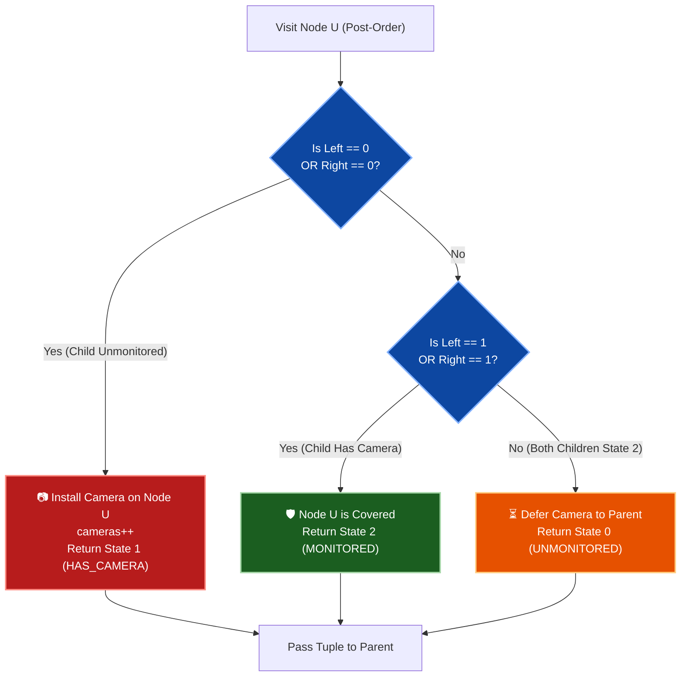

# 📘 WEEK 11: DAY 01 — DYNAMIC PROGRAMMING ON TREES: THE SUBTREE DELEGATION CONTRACT

> 🧭 **Navigation:** [← Week Overview](README.md) • [🏠 Week Overview](README.md) • [📘 Curriculum Syllabus](../COMPLETE_SYLLABUS.md) • [Next Day →](Week_11_Day_02_DP_On_DAGs_Instructional.md)
> 
> 💡 **Instructor Note:** *Tree DP is the foundational gateway to all advanced graph DP. The core secret is the "Subtree Delegation Contract": solve children first, summarize their reality into a tiny value tuple, and let parents synthesize decisions in `O(1)` time without re-traversing subtrees. Zero LaTeX math is used throughout.*

---

## 📋 TABLE OF CONTENTS

1. [🎬 Pillar 1: The 60-Second Hook & Everyday Analogy](#-pillar-1-the-60-second-hook--everyday-analogy)
2. [🎯 Learning Objectives](#-learning-objectives)
3. [🪜 Pillar 2: The Scaffolding Ladder & Toy Napkin Traces](#-pillar-2-the-scaffolding-ladder--toy-napkin-traces)
   - [Level 1: Warm-Up — The Tree Superpowers & Single-Branch Returns (LC 543 & LC 124)](#level-1-warm-up--the-tree-superpowers--single-branch-returns)
   - [Level 2: Core FAANG Medium — House Robber III (LC 337) & 2-State Tuple Delegation](#level-2-core-faang-medium--house-robber-iii-lc-337--2-state-tuple-delegation)
   - [Level 3: Advanced FAANG Hard — Binary Tree Cameras (LC 968) & 3-State Greedy DP](#level-3-advanced-faang-hard--binary-tree-cameras-lc-968--3-state-greedy-dp)
   - [Level 4: Staff-Level Pattern — Tree Rerooting & All Nodes Distance (LC 834)](#level-4-staff-level-pattern--tree-rerooting--all-nodes-distance-lc-834)
4. [🎨 Pillar 3: Pragmatic Visual Models](#-pillar-3-pragmatic-visual-models)
   - [ASCII Architecture: The (Rob, Skip) Tuple Bubbling Upward](#ascii-architecture-the-rob-skip-tuple-bubbling-upward)
   - [Mermaid State Machine: The 3-State Camera Decision Logic](#mermaid-state-machine-the-3-state-camera-decision-logic)
5. [🛑 Pillar 4: The Rookie Trap Zone (Blunders vs. Senior Architect Patterns)](#-pillar-4-the-rookie-trap-zone)
6. [🎙️ Pillar 5: The 45-Minute Interview Talk Track](#-pillar-5-the-45-minute-interview-talk-track)
7. [⚡ Pillar 6: Production Dual-Language Implementations (C# .NET 8/9 & Python 3.11+)](#-pillar-6-production-dual-language-implementations)
   - [Problem 1: House Robber III (LeetCode 337)](#problem-1-house-robber-iii-leetcode-337)
   - [Problem 2: Binary Tree Cameras (LeetCode 968)](#problem-2-binary-tree-cameras-leetcode-968)
   - [Problem 3: Sum of Distances in Tree (LeetCode 834 — Re-rooting)](#problem-3-sum-of-distances-in-tree-leetcode-834--re-rooting)
   - [Problem 4 (Reference): Binary Tree Maximum Path Sum (LeetCode 124)](#problem-4-reference-binary-tree-maximum-path-sum-leetcode-124)
8. [⚖️ Production Engineering: Recursion Depth, Call Stacks & Iterative Post-Order](#-production-engineering-recursion-depth-call-stacks--iterative-post-order)
9. [📊 Explicit Complexity Deconstruction](#-explicit-complexity-deconstruction)
10. [📚 Practice Matrix & Self-Assessment Checklist](#-practice-matrix--self-assessment-checklist)

---

## 🎬 PILLAR 1: THE 60-SECOND HOOK & EVERYDAY ANALOGY

### Hey Engineers, Welcome to Tree DP!

If you've ever looked at a dynamic programming problem on an array and felt overwhelmed by 2D lookup tables, index boundary offsets, and nested loops, here is the best news in computer science:

> **Trees don't complicate dynamic programming—trees TRIVIALIZE dynamic programming.**

In a general graph, DP collapses because cycles create circular dependencies: state `A` depends on `B`, which depends on `C`, which loops back to `A`. But a tree is an acyclic graph with one unique path between any two nodes. Removing any node instantly isolates its subtrees into completely independent sub-universes. 

There are no side-doors, no back-channels, and no cycles. That means you never have to guess your topological ordering: **a bottom-up post-order traversal (`Left -> Right -> Root`) is already the exact topological order.**

---

### The Everyday Analogy: The Corporate Branch Reporting Contract

Imagine you are the CEO of a global retail corporation with 100,000 physical branches arranged in a strict corporate hierarchy (a corporate tree). You want to optimize total quarterly company revenue, under one constraint: you cannot visit two stores that directly report to each other (to avoid executive micromanagement panic!).

```
Naive Re-computation Disaster:             The Subtree Delegation Contract:
+------------------------------------+     +------------------------------------+
| CEO flies to every store.          |     | Every store manager sends direct   |
| Every evaluation re-traverses all  | vs  | superior a 3x5 index card with:    |
| sub-branches from scratch.         |     |   1. Rob: Best revenue if visited  |
| Time: O(N^2) or O(2^N)             |     |   2. Skip: Best revenue if skipped |
| Result: Bankrupt from travel costs!|     | Time: Strictly O(N) single-pass    |
+------------------------------------+     +------------------------------------+
```

1. **The Naive Disaster (`O(N^2)` or `O(2^N)`):**
   Every time the CEO ponders whether to visit Branch A, they deploy auditors to re-survey every employee in Branch A's entire downstream subtree. The team recalculates every possible combination over and over again. At 100,000 stores, your company crashes before completing a single quarterly projection.

2. **The Senior Architect Pattern: The Subtree Delegation Contract (`O(N)`):**
   Instead of re-surveying, the CEO establishes an unshakeable contract:
   - Every branch manager independently rolls up numbers from their direct subordinates.
   - Each manager hands their direct VP a 3x5 index card containing exactly **two numbers**:
     1. `Rob`: The optimal revenue from my branch if you decide to visit me.
     2. `Skip`: The optimal revenue from my branch if you decide to skip me.
   - The regional VP does not know—and does not care—about the 5,000 individual employees working down in the sub-branches. The VP only needs those two numbers to make their own decision in `O(1)` time!

> 💡 **The Core "Aha!" Moment:**
> In tree DP, you never pass entire subtrees or state histories upward. A node computes its own answer in `O(1)` time strictly using the tiny summary tuples returned by its immediate children.

---

## 🎯 LEARNING OBJECTIVES

*By the end of this module, you will be able to:*

- 🎯 **Internalize** why tree acyclicity and subtree independence guarantee optimal substructure without cycle checks.
- ⚙️ **Master** the Post-Order Delegation Contract: synthesize parent states in `O(1)` time from child return tuples.
- 🧩 **Formulate & Implement** 2-state `(Rob, Skip)` DP (House Robber III), 3-state greedy coverage DP (Binary Tree Cameras), and 2-pass subtree rerooting (Sum of Distances in Tree).
- 🛑 **Eliminate** fatal interview blunders: memoizing on object references, duplicate grandchild recursive calls, and confusing "skip parent" with "must rob children".
- 🎙️ **Recite** the 3-sentence FAANG interview talk track with complete confidence before writing a line of code.
- ⚡ **Ship** production-grade C# (.NET 8/9 with zero-allocation `record struct` and value tuples) and idiomatic Python (3.11+).

---

## 🪜 PILLAR 2: THE SCAFFOLDING LADDER & TOY NAPKIN TRACES

Here is our progression from fundamental mechanics to staff-level re-rooting:

```
       [ Level 4: Staff-Level Pattern: 2-Pass Tree Rerooting ] <-- LC 834: Sum of Distances
                          ^
       [ Level 3: Advanced FAANG Hard: 3-State Camera DP ]     <-- LC 968: Binary Tree Cameras
                          ^
       [ Level 2: Core FAANG Medium: 2-State Tuple DP ]        <-- LC 337: House Robber III
                          ^
       [ Level 1: Warm-Up: Single-Branch vs Apex Turnaround ]  <-- LC 543 / LC 124: Diameter & Path Sum
```

---

### Level 1: Warm-Up — The Tree Superpowers & Single-Branch Returns

Before handling multiple states, let's understand the two distinct responsibilities every tree recursive helper must balance:

1. **What must be returned to the parent?** A *single extendable branch* (e.g., maximum depth from this node downwards).
2. **What updates the global answer?** An *inverted-U turnaround path* combining left and right branches through the current node as the apex.

```
                  (Current Node: Apex)
                  /                  \
          [Left Branch]          [Right Branch]
          Depth = L              Depth = R
          
  Turnaround Path through Apex = L + R (edges)  --> Updates globalMax
  Value returned to parent     = 1 + max(L, R)  --> Cannot branch into both!
```

> ⚠️ **The Branching Rule:** A simple path cannot fork. Once a path ascends from a child to a parent, it can only continue upward to an ancestor or turn into the parent's other child. It can **never** fork into both children and continue upward!

---

### Level 2: Core FAANG Medium — House Robber III (LC 337) & 2-State Tuple Delegation

**Problem Statement:** A thief wants to rob houses arranged as a binary tree. If two directly linked houses (parent and child) are broken into on the same night, alarms sound. Return the maximum money the thief can rob without alerting police.

#### State Formulation & Recurrence
For every node `u`, define a 2-state tuple:
- `Rob(u)`: Maximum money collected from `u`'s subtree if house `u` **is robbed**.
- `Skip(u)`: Maximum money collected from `u`'s subtree if house `u` **is skipped**.

**The Recurrence:**
- `Rob(u) = u.val + Skip(left) + Skip(right)`  
  *(If we rob house `u`, security alarms forbid robbing direct children. Both children must be skipped!)*
- `Skip(u) = max(Rob(left), Skip(left)) + max(Rob(right), Skip(right))`  
  *(If we skip house `u`, our children are free! We independently choose whether to rob or skip each child based on which yields more cash!)*

---

#### 5-Node Toy Napkin Hand-Trace

Let's trace this 5-node binary tree:

```
              [3] (Root A)
             /   \
           [4]   [5] (Child C)
           / \
         [1] [3]
       (Leaf D)(Leaf E)
```

Nodes: `A(val=3)`, `B(val=4)`, `C(val=5)`, `D(val=1)`, `E(val=3)`.

##### Step 1: Leaf D (`val = 1`)
- Both children are `null -> (rob=0, skip=0)`.
- `Rob(D) = 1 + 0 + 0 = 1`.
- `Skip(D) = max(0, 0) + max(0, 0) = 0`.
- **Returns:** `(rob=1, skip=0)`.

##### Step 2: Leaf E (`val = 3`)
- Both children are `null -> (rob=0, skip=0)`.
- `Rob(E) = 3 + 0 + 0 = 3`.
- `Skip(E) = max(0, 0) + max(0, 0) = 0`.
- **Returns:** `(rob=3, skip=0)`.

##### Step 3: Node B (`val = 4`)
- Left child `D` returns `(1, 0)`.
- Right child `E` returns `(3, 0)`.
- `Rob(B) = 4 + Skip(D) + Skip(E) = 4 + 0 + 0 = 4`.
- `Skip(B) = max(Rob(D), Skip(D)) + max(Rob(E), Skip(E)) = max(1, 0) + max(3, 0) = 1 + 3 = 4`.
- **Returns:** `(rob=4, skip=4)`.

##### Step 4: Leaf C (`val = 5`)
- Both children are `null -> (rob=0, skip=0)`.
- `Rob(C) = 5 + 0 + 0 = 5`.
- `Skip(C) = 0`.
- **Returns:** `(rob=5, skip=0)`.

##### Step 5: Root A (`val = 3`)
- Left child `B` returns `(rob=4, skip=4)`.
- Right child `C` returns `(rob=5, skip=0)`.
- `Rob(A) = 3 + Skip(B) + Skip(C) = 3 + 4 + 0 = 7`.
- `Skip(A) = max(Rob(B), Skip(B)) + max(Rob(C), Skip(C)) = max(4, 4) + max(5, 0) = 4 + 5 = 9`.
- **Returns:** `(rob=7, skip=9)`.

**Final Global Max:** `max(Rob(A), Skip(A)) = max(7, 9) = 9`!

> 🧠 **Pause & Predict 1:**
> Notice that `Skip(A) = 9` beat `Rob(A) = 7`! Why? Because skipping Root `A` allowed us to rob Child `C` (worth `5`), which far outweighed Root `A`'s value of `3`.
> What would happen if Root `A` had a value of `10`?
> *Prediction:* `Rob(A) = 10 + 4 + 0 = 14`, while `Skip(A) = 9`. Root `A` would be robbed for total `14`!

---

### Level 3: Advanced FAANG Hard — Binary Tree Cameras (LC 968) & 3-State Greedy DP

**Problem Statement:** You are given the root of a binary tree. Install cameras on the nodes such that every node in the tree is monitored. Each camera monitors itself, its parent, and its immediate children. Return the **minimum number of cameras** needed.

#### The 3 Node States
In a bottom-up post-order DFS, what does a node report to its parent?

```
State 0: UNMONITORED  --> "I am naked! I have no camera and no child covers me. Parent, HELP ME!"
State 1: HAS_CAMERA   --> "I installed a camera here. Parent, you are covered!"
State 2: MONITORED    --> "I am safely covered by my child's camera. But I have no camera to cover you, parent."
```

#### Base Case: What does `null` return?

> 🧠 **Pause & Predict 2:**
> Should a `null` node return `State 0 (UNMONITORED)` or `State 2 (MONITORED)`?
> Think physically: what happens to a leaf node if its `null` children return `0`?

*Physical Reality:*
- If `null` returned `0 (UNMONITORED)`, every leaf node would look down, see an "unmonitored" child, and panic: it would install a camera on itself!
- But placing a camera on a leaf covers at most **2 nodes** (the leaf and its parent). Placing a camera on the leaf's *parent* covers up to **4 nodes** (parent, left leaf, right leaf, grandparent)!
- Therefore, `null` must return **State 2 (MONITORED)**: it needs no camera, and it doesn't force its parent to install one.

#### Post-Order Decision Rules
At node `u`, inspect child states `left` and `right`:
1. **Rule 1 (Child in Need):** If `left == 0 || right == 0`:
   - At least one child is crying for help. Node `u` **must** install a camera!
   - Action: `cameraCount++`, return `State 1 (HAS_CAMERA)`.
2. **Rule 2 (Parent Covered):** Else if `left == 1 || right == 1`:
   - At least one child has a camera shining upward. Node `u` is safely covered!
   - Action: return `State 2 (MONITORED)`.
3. **Rule 3 (Greedy Deferral):** Else (`left == 2 && right == 2`):
   - Both children are covered from below, but neither has a camera. Node `u` is currently unmonitored.
   - Action: Greedily defer camera installation to `u`'s parent. Return `State 0 (UNMONITORED)`.

#### The Root Edge Case
When the root finishes its DFS, what if it returns `State 0`?
The root has no parent to save it! If `dfs(root) == 0`, we must install one final camera at the root: `cameraCount++`.

---

### Level 4: Staff-Level Pattern — Tree Rerooting & All Nodes Distance (LC 834)

**Problem Statement:** Given an undirected tree with `N` nodes and `N - 1` edges, return an array `ans` of length `N` where `ans[i]` is the sum of distances from node `i` to all other nodes.

#### Why the Naive Solution Fails
Running a standard BFS/DFS from every single node takes:
`N * O(N) = O(N^2)` time.
When `N = 3 * 10^4`, `N^2 = 9 * 10^8` operations -> **Instant Time Limit Exceeded (TLE)**!

#### The Subtree Shift Invariant
What happens to total distances when we move the root from parent `u` to adjacent child `v`?

```
      [Parent U]                            [Child V]
      /        \                            /       \
  (Subtree)   [Child V]       ==>       [Parent U]  (V Subtree)
                  |                         |
             (V Subtree)               (U Subtree)
```

When root moves from `u` to `v`:
- Every node in `v`'s subtree (`count[v]` nodes) gets **1 step closer** to the root: `- count[v]`.
- Every other node in the tree (`N - count[v]` nodes) gets **1 step farther** from the root: `+ (N - count[v])`.

```
ans[v] = ans[u] - count[v] + (N - count[v])
       = ans[u] + N - 2 * count[v]
```

#### The 2-Pass Architecture:
1. **Pass 1 (Bottom-Up Post-Order DFS rooted at 0):**
   - Compute `count[u]`: the size of `u`'s subtree (`1 + sum(count[child])`).
   - Compute `ans[0]`: the sum of distances from root `0` to all nodes in its subtree (`sum(ans[child] + count[child])`).
2. **Pass 2 (Top-Down Pre-Order DFS from 0):**
   - For every child `v` of `u`, compute `ans[v]` in `O(1)` using the formula:
     `ans[v] = ans[u] + N - 2 * count[v]`.
   - Recurse downward, distributing answers to the entire tree in `O(N)` total time!

---

## 🎨 PILLAR 3: PRAGMATIC VISUAL MODELS

### ASCII Architecture: The (Rob, Skip) Tuple Bubbling Upward

Here is the exact dataflow of our 5-node House Robber III tree. Notice how each node encapsulates its subtree and bubbles upward a pure 2-element value tuple:

```
                            [Node A: val=3]
                     Rob: 3 + 4 + 0 = 7
                     Skip: max(4,4) + max(5,0) = 9
                     Returns: (7, 9)
                     Final Answer: max(7, 9) = 9
                           /                 \
             (4, 4)       /                   \       (5, 0)
                         /                     \
              [Node B: val=4]               [Node C: val=5]
         Rob: 4 + 0 + 0 = 4             Rob: 5 + 0 + 0 = 5
         Skip: max(1,0)+max(3,0) = 4    Skip: 0 + 0 = 0
         Returns: (4, 4)                Returns: (5, 0)
                 /          \
    (1, 0)      /            \      (3, 0)
               /              \
     [Node D: val=1]       [Node E: val=3]
     Rob: 1 + 0 = 1        Rob: 3 + 0 = 3
     Skip: 0 + 0 = 0       Skip: 0 + 0 = 0
     Returns: (1, 0)       Returns: (3, 0)
         /      \              /      \
      null      null        null      null
     (0, 0)    (0, 0)      (0, 0)    (0, 0)
```

---

### Mermaid State Machine: The 3-State Camera Decision Logic

The following decision tree shows how every node determines its coverage state from its children in LeetCode 968:



---

## 🛑 PILLAR 4: THE ROOKIE TRAP ZONE

### Blunders vs. Senior Architect Patterns

| Dimension | ❌ Rookie Blunder | ✅ Senior Architect Pattern |
| :--- | :--- | :--- |
| **Memoization Strategy** | Storing `TreeNode` references in `Dictionary<TreeNode, int>` or `@lru_cache`, creating memory leaks and GC overhead. | Returning stack-allocated value tuples `(int Rob, int NotRob)` in post-order DFS with **zero heap allocations**. |
| **Recursive Branching** | Calling `Rob(root.left.left) + Rob(root.left.right)` directly, causing `O(2^N)` exponential explosion. | Making strictly **two** recursive calls (`Dfs(node.left)`, `Dfs(node.right)`) and synthesizing state in `O(1)`. |
| **Skip Logic Semantics** | Assuming skipping a parent mandates robbing its children: `skip = left.rob + right.rob`. | Recognizing skipping gives the **freedom to choose**: `skip = max(left.rob, left.skip) + max(right.rob, right.skip)`. |
| **Graph Tree Cycles** | Forgetting trees in adjacency lists are undirected, recursing without parent check into infinite loops. | Guarding with `if (child == parent) continue;` in every undirected tree traversal. |
| **Root Camera Edge Case** | Forgetting to check the root after DFS finishes, leaving the tree root unmonitored. | Checking root status: `if (Dfs(root) == State.Unmonitored) cameraCount++;`. |

---

### Bad vs. Good Code Comparison

#### Trap 1: The Exponential Re-traversal Disaster in House Robber III

```csharp
// ❌ ROOKIE BLUNDER: O(2^N) Exponential Explosion & Object Reference Leaks
public int RobBad(TreeNode? root)
{
    if (root == null) return 0;
    
    // Robbing root: manually digging into 4 grandchildren!
    int robThis = root.val;
    if (root.left != null) robThis += RobBad(root.left.left) + RobBad(root.left.right);
    if (root.right != null) robThis += RobBad(root.right.left) + RobBad(root.right.right);
    
    // Skipping root: re-traversing children!
    int skipThis = RobBad(root.left) + RobBad(root.right);
    
    return Math.Max(robThis, skipThis); // Recomputes identical subtrees exponentially!
}

// ✅ SENIOR ARCHITECT PATTERN: O(N) Post-Order Value-Tuple Delegation
public int RobGood(TreeNode? root)
{
    var (rob, notRob) = Dfs(root);
    return Math.Max(rob, notRob);
    
    static (int Rob, int NotRob) Dfs(TreeNode? node)
    {
        if (node is null) return (0, 0); // Zero heap allocations
        
        var left = Dfs(node.left);
        var right = Dfs(node.right);
        
        int rob = node.val + left.NotRob + right.NotRob;
        int notRob = Math.Max(left.Rob, left.NotRob) + Math.Max(right.Rob, right.NotRob);
        
        return (rob, notRob);
    }
}
```

---

## 🎙️ PILLAR 5: THE 45-MINUTE INTERVIEW TALK TRACK

When you encounter a Tree DP problem in a FAANG interview, do not immediately start coding. Look the interviewer in the eye (or into the webcam) and speak this **exact 3-sentence script**:

```
"Because a tree is a connected acyclic graph, every node partitions the tree into completely independent subtrees, making post-order traversal the natural topological order for dynamic programming.

Rather than re-traversing subtrees or maintaining a costly heap-allocated memoization table, each recursive call will return a fixed-size value tuple summarizing the optimal outcomes for its subtree—such as (rob, skip) or camera coverage state—allowing the parent to synthesize its own state in O(1) time.

This guarantees a single-pass O(N) time complexity with O(H) auxiliary stack space, completely eliminating redundant re-computation and heap allocation."
```

### The 45-Minute Interview Timeline Breakdown

```
[00:00 - 05:00] Clarify Constraints & Boundaries:
- Is tree binary or N-ary?
- Can values be negative? (Crucial for Max Path Sum: clamp with Math.Max(0, x)).
- Can the tree be degenerate/skewed? (Clarifies O(N) vs O(log N) stack depth).

[05:00 - 12:00] State Design & Subtree Contract:
- Explicitly state: "I will define a helper returning a 2-element tuple (rob, skip)."
- State the base case: null returns (0, 0) or State 2.
- Write the O(1) recurrence on the whiteboard before writing implementation.

[12:00 - 25:00] Dual-Language Implementation:
- Write clean, idiomatic code with guard clauses.
- Use stack-allocated value tuples in C#; avoid class allocations in hot recursive loops.

[25:00 - 35:00] Dry-Run on Edge Cases:
- Trace leaf node: verify null handling.
- Trace 3-node tree where skipping root beats robbing root.
- Verify camera root edge case (does root need camera if it returns 0?).

[35:00 - 45:00] Complexity Deconstruction & Production Scaling:
- Time: strictly O(N) because every node is visited once and transitions are O(1).
- Space: O(H) stack frames where H is tree height. Mention stack overflow mitigation for H = 10^5.
```

---

## ⚡ PILLAR 6: PRODUCTION DUAL-LANGUAGE IMPLEMENTATIONS

### Problem 1: House Robber III (LeetCode 337)

#### C# (.NET 8/9) — Zero-Allocation Value Tuples
```csharp
namespace Week11.TreeDP;

public sealed class TreeNode
{
    public int val;
    public TreeNode? left;
    public TreeNode? right;

    public TreeNode(int val = 0, TreeNode? left = null, TreeNode? right = null)
    {
        this.val = val;
        this.left = left;
        this.right = right;
    }
}

public sealed class HouseRobberIII
{
    // Using a readonly record struct guarantees stack-allocation with zero GC pressure
    public readonly record struct RobPlan(int Rob, int Skip);

    public int Rob(TreeNode? root)
    {
        RobPlan result = PostOrder(root);
        return Math.Max(result.Rob, result.Skip);
    }

    private static RobPlan PostOrder(TreeNode? node)
    {
        if (node is null)
        {
            return new RobPlan(0, 0);
        }

        // Subtree Delegation Contract: solve children first
        RobPlan left = PostOrder(node.left);
        RobPlan right = PostOrder(node.right);

        // Option 1: Rob this node -> children MUST be skipped
        int rob = node.val + left.Skip + right.Skip;

        // Option 2: Skip this node -> children can be robbed OR skipped independently
        int skip = Math.Max(left.Rob, left.Skip) + Math.Max(right.Rob, right.Skip);

        return new RobPlan(rob, skip);
    }
}
```

#### Python 3.11+ — Typed Lightweight Tuples
```python
from typing import Optional, Tuple


class TreeNode:
    def __init__(self, val: int = 0, left: Optional['TreeNode'] = None, right: Optional['TreeNode'] = None):
        self.val = val
        self.left = left
        self.right = right


class Solution:
    def rob(self, root: Optional[TreeNode]) -> int:
        def dfs(node: Optional[TreeNode]) -> Tuple[int, int]:
            """
            Subtree Delegation Contract:
            Returns (rob_this_subtree, skip_this_subtree) for the given node.
            """
            if not node:
                return (0, 0)

            left_rob, left_skip = dfs(node.left)
            right_rob, right_skip = dfs(node.right)

            # If we rob this house, children cannot be robbed
            rob = node.val + left_skip + right_skip

            # If we skip this house, choose best independent outcome for each child
            skip = max(left_rob, left_skip) + max(right_rob, right_skip)

            return (rob, skip)

        rob_root, skip_root = dfs(root)
        return max(rob_root, skip_root)
```

---

### Problem 2: Binary Tree Cameras (LeetCode 968)

#### C# (.NET 8/9) — Strongly-Typed State Machine
```csharp
namespace Week11.TreeDP;

public sealed class BinaryTreeCameras
{
    public enum NodeState
    {
        Unmonitored = 0, // Needs a camera
        HasCamera = 1,   // Active camera installed
        Monitored = 2    // Covered by child camera
    }

    public int MinCameraCover(TreeNode? root)
    {
        int cameraCount = 0;

        NodeState Dfs(TreeNode? node)
        {
            // Base case: null nodes are considered covered (Monitored)
            if (node is null)
            {
                return NodeState.Monitored;
            }

            NodeState left = Dfs(node.left);
            NodeState right = Dfs(node.right);

            // Rule 1: If either child is naked, current node MUST host a camera
            if (left == NodeState.Unmonitored || right == NodeState.Unmonitored)
            {
                cameraCount++;
                return NodeState.HasCamera;
            }

            // Rule 2: If either child has a camera, current node is covered
            if (left == NodeState.HasCamera || right == NodeState.HasCamera)
            {
                return NodeState.Monitored;
            }

            // Rule 3: Both children are covered from below; defer camera to parent
            return NodeState.Unmonitored;
        }

        // Root edge case: if root itself remains unmonitored, place camera at root
        if (Dfs(root) == NodeState.Unmonitored)
        {
            cameraCount++;
        }

        return cameraCount;
    }
}
```

#### Python 3.11+ — Idiomatic Greedy State DFS
```python
from enum import IntEnum
from typing import Optional


class State(IntEnum):
    UNMONITORED = 0
    HAS_CAMERA = 1
    MONITORED = 2


class Solution:
    def minCameraCover(self, root: Optional[TreeNode]) -> int:
        cameras = 0

        def dfs(node: Optional[TreeNode]) -> State:
            nonlocal cameras
            if not node:
                # Null nodes need no camera and don't force parent to install one
                return State.MONITORED

            left = dfs(node.left)
            right = dfs(node.right)

            # Rule 1: Child is crying for help -> must place camera here
            if left == State.UNMONITORED or right == State.UNMONITORED:
                cameras += 1
                return State.HAS_CAMERA

            # Rule 2: Child has camera shining light up -> covered
            if left == State.HAS_CAMERA or right == State.HAS_CAMERA:
                return State.MONITORED

            # Rule 3: Both children covered; greedily defer camera to parent
            return State.UNMONITORED

        # Root edge case: nobody above root to save it!
        if dfs(root) == State.UNMONITORED:
            cameras += 1

        return cameras
```

---

### Problem 3: Sum of Distances in Tree (LeetCode 834 — Re-rooting)

#### C# (.NET 8/9) — 2-Pass Subtree Shift
```csharp
namespace Week11.TreeDP;

public sealed class SumOfDistancesInTreeSolution
{
    public int[] SumOfDistancesInTree(int n, int[][] edges)
    {
        // Guard clause
        if (n <= 1)
        {
            return new int[n];
        }

        // Build adjacency list representation
        var adj = new List<int>[n];
        for (int i = 0; i < n; i++)
        {
            adj[i] = new List<int>();
        }

        foreach (var edge in edges)
        {
            adj[edge[0]].Add(edge[1]);
            adj[edge[1]].Add(edge[0]);
        }

        var count = new int[n];
        var ans = new int[n];

        // Pass 1: Post-Order DFS to compute subtree sizes and root 0 total distance
        void PostOrder(int node, int parent)
        {
            count[node] = 1;
            foreach (int child in adj[node])
            {
                if (child == parent) continue; // Prevent undirected cycle
                PostOrder(child, node);
                count[node] += count[child];
                ans[node] += ans[child] + count[child];
            }
        }

        // Pass 2: Pre-Order DFS to reroot and transfer answers to all children
        void PreOrder(int node, int parent)
        {
            foreach (int child in adj[node])
            {
                if (child == parent) continue;
                // Transition: child gets closer to count[child] nodes, farther from rest
                ans[child] = ans[node] - count[child] + (n - count[child]);
                PreOrder(child, node);
            }
        }

        PostOrder(0, -1);
        PreOrder(0, -1);
        return ans;
    }
}
```

#### Python 3.11+ — 2-Pass Subtree Shift
```python
from collections import defaultdict
from typing import List


class Solution:
    def sumOfDistancesInTree(self, n: int, edges: List[List[int]]) -> List[int]:
        if n <= 1:
            return [0] * n

        adj = defaultdict(list)
        for u, v in edges:
            adj[u].append(v)
            adj[v].append(u)

        count = [1] * n
        ans = [0] * n

        # Pass 1: Bottom-up post-order DFS rooted at 0
        def post_order(node: int, parent: int) -> None:
            for neighbor in adj[node]:
                if neighbor == parent:
                    continue
                post_order(neighbor, node)
                count[node] += count[neighbor]
                ans[node] += ans[neighbor] + count[neighbor]

        # Pass 2: Top-down pre-order DFS distributing rerooting delta
        def pre_order(node: int, parent: int) -> None:
            for neighbor in adj[node]:
                if neighbor == parent:
                    continue
                # When shifting root from 'node' to 'neighbor':
                # - neighbor subtree moves 1 step closer (- count[neighbor])
                # - remaining (n - count[neighbor]) nodes move 1 step farther
                ans[neighbor] = ans[node] - count[neighbor] + (n - count[neighbor])
                pre_order(neighbor, node)

        post_order(0, -1)
        pre_order(0, -1)
        return ans
```

---

### Problem 4 (Reference): Binary Tree Maximum Path Sum (LeetCode 124)

#### C# (.NET 8/9) — Branch Clamping DP
```csharp
namespace Week11.TreeDP;

public sealed class MaxPathSumSolution
{
    public int MaxPathSum(TreeNode? root)
    {
        int globalMax = int.MinValue;

        int Dfs(TreeNode? node)
        {
            if (node is null)
            {
                return 0;
            }

            // Clamping: If a child branch is negative, prune it (take 0)
            int leftGain = Math.Max(0, Dfs(node.left));
            int rightGain = Math.Max(0, Dfs(node.right));

            // Inverted-U path turnaround through this apex
            int currentApexSum = node.val + leftGain + rightGain;
            globalMax = Math.Max(globalMax, currentApexSum);

            // Return single extendable branch to parent
            return node.val + Math.Max(leftGain, rightGain);
        }

        Dfs(root);
        return globalMax;
    }
}
```

---

## ⚖️ PRODUCTION ENGINEERING: RECURSION DEPTH, CALL STACKS & ITERATIVE POST-ORDER

In theoretical algorithm design, recursion stack memory is casually brushed off as `O(H)`. In production backends, an unmonitored `O(H)` stack is a ticking crash bomb.

### The Stack Overflow Latency Cliff

| Tree Topology | Height `H` | Recursion Stack Memory | Crash Risk in Production |
| :--- | :--- | :--- | :--- |
| **Balanced Binary Tree** | `O(log N)` | `~20` frames for `10^6` nodes (`< 2 KB`) | **Zero** |
| **Degenerate Skewed Chain** | `O(N)` | `10^5` stack frames (`~8 MB`) | **Critical**: C# thread stack default is 1 MB (`StackOverflowException` kills process); Python default limit is 1,000 (`RecursionError`). |

```
Balanced Tree: H = O(log N)          Degenerate Skewed Tree: H = O(N)
          (1)                               (1)
         /   \                                \
       (2)   (3)                              (2)
       / \   / \                                \
     (4) (5)(6) (7)                             (3)
Stack Depth = 3 frames                           \
Negligible memory                                (4) -> 100,000 deep -> Process CRASH!
```

### Production Hardening: Iterative Post-Order with Explicit Heap Stack

To process arbitrary untrusted trees without risk of thread stack overflow, emulate the call stack on the **heap** using a 2-state iterative post-order traversal:

```csharp
public static int RobIterative(TreeNode? root)
{
    if (root == null) return 0;

    // Stack tracks: (node, visited_children_flag)
    var stack = new Stack<(TreeNode Node, bool Processed)>();
    var results = new Dictionary<TreeNode, (int Rob, int Skip)>();

    stack.Push((root, false));

    while (stack.Count > 0)
    {
        var (curr, processed) = stack.Pop();

        if (processed)
        {
            // Children are already processed; synthesize current node
            var left = curr.left != null ? results[curr.left] : (0, 0);
            var right = curr.right != null ? results[curr.right] : (0, 0);

            int rob = curr.val + left.Skip + right.Skip;
            int skip = Math.Max(left.Rob, left.Skip) + Math.Max(right.Rob, right.Skip);

            results[curr] = (rob, skip);
        }
        else
        {
            // First visit: push node back as processed, then push children
            stack.Push((curr, true));
            if (curr.right != null) stack.Push((curr.right, false));
            if (curr.left != null) stack.Push((curr.left, false));
        }
    }

    var rootRes = results[root];
    return Math.Max(rootRes.Rob, rootRes.Skip);
}
```

---

## 📊 EXPLICIT COMPLEXITY DECONSTRUCTION

| Problem | Time Complexity | Auxiliary Heap Space | Recursion Stack Space | State Representation | Transition Cost |
| :--- | :--- | :--- | :--- | :--- | :--- |
| **Diameter of Binary Tree (LC 543)** | `O(N)` | `O(1)` | `O(H)` where `H in [log N, N]` | Single `int` depth return | `O(1)` per node |
| **Binary Tree Max Path Sum (LC 124)** | `O(N)` | `O(1)` | `O(H)` where `H in [log N, N]` | Single `int` branch gain | `O(1)` with `max(0, gain)` clamp |
| **House Robber III (LC 337)** | `O(N)` | `O(1)` | `O(H)` where `H in [log N, N]` | 2-tuple: `(Rob, Skip)` | `O(1)` synthesis |
| **Binary Tree Cameras (LC 968)** | `O(N)` | `O(1)` | `O(H)` where `H in [log N, N]` | 3-state enum: `(0, 1, 2)` | `O(1)` greedy decision |
| **Sum of Distances in Tree (LC 834)** | `O(N)` | `O(N)` for `adj`, `count`, `ans` | `O(H)` call stack | Subtree size + delta | `O(1)` per reroot edge |

---

## 📚 PRACTICE MATRIX & SELF-ASSESSMENT CHECKLIST

### Problem Ladder

| Problem | LeetCode # | Tier | Primary Pattern | Key Invariant |
| :--- | :--- | :--- | :--- | :--- |
| **Diameter of Binary Tree** | LC 543 | 🟢 Easy | Post-Order DFS | `globalMax = max(L + R)`, return `1 + max(L, R)` |
| **Maximum Path Sum** | LC 124 | 🔴 Hard | Branch Clamping | Prune negative subtrees: `max(0, Dfs(child))` |
| **House Robber III** | LC 337 | 🟡 Medium | 2-State Tuple DP | `skip = max(L.rob, L.skip) + max(R.rob, R.skip)` |
| **Binary Tree Cameras** | LC 968 | 🔴 Hard | 3-State Greedy DP | Null returns Monitored; leaves defer to parents |
| **Distribute Coins in Binary Tree**| LC 979 | 🟡 Medium | Balance Flow Rollup | `moves += abs(node.val - 1 + L + R)` |
| **Sum of Distances in Tree** | LC 834 | 🔴 Hard | 2-Pass Rerooting | `ans[v] = ans[u] + N - 2 * count[v]` |
| **Longest ZigZag Path in Binary Tree**| LC 1372 | 🟡 Medium | Directional Tuple DP | Return `(fromLeft, fromRight)` |

---

### Self-Assessment Checklist
- [ ] Can you explain why a post-order traversal provides an automatic topological ordering on a tree?
- [ ] Can you trace why skipping a parent in House Robber III does NOT mandate robbing its children?
- [ ] Can you explain why `null` returns `State 2 (Monitored)` instead of `State 0 (Unmonitored)` in Binary Tree Cameras?
- [ ] Can you write the `O(1)` re-rooting mathematical equation for shifting root from `u` to child `v` on a napkin?
- [ ] Can you identify the stack overflow risk for a tree of depth `10^5` and describe the iterative heap-stack alternative?

---

> 🧭 **Navigation:** [← Week Overview](README.md) • [🏠 Week Overview](README.md) • [📘 Curriculum Syllabus](../COMPLETE_SYLLABUS.md) • [Next Day →](Week_11_Day_02_DP_On_DAGs_Instructional.md)
