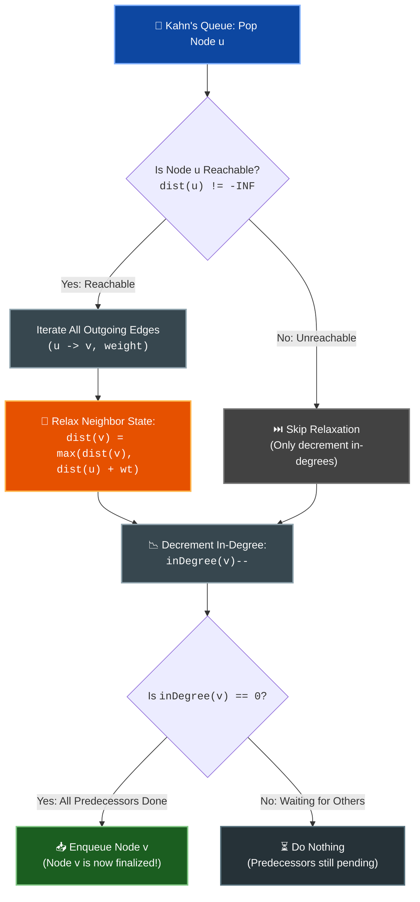

# 📘 WEEK 11: DAY 02 — DYNAMIC PROGRAMMING ON DIRECTED ACYCLIC GRAPHS (DAGs)

> 🧭 **Navigation:** [← Previous Day](Week_11_Day_01_DP_on_Trees_Instructional.md) • [🏠 Week Overview](README.md) • [📘 Curriculum Syllabus](../COMPLETE_SYLLABUS.md) • [Next Day →](Week_11_Day_03_Bitmask_And_Subset_DP_Instructional.md)
> 
> 💡 **Instructor Note:** *DAG DP is the theoretical bridge between dynamic programming and graph theory. Topological sorting completely linearizes state dependencies, enabling `O(V + E)` single-pass shortest and longest path computations—even in the presence of negative edge weights or complex game-theoretic backward induction.*

---

## 📋 TABLE OF CONTENTS

1. [🎬 PILLAR 1: The 60-Second Hook & Real-World Metaphor](#-pillar-1-the-60-second-hook--real-world-metaphor)
2. [🪜 PILLAR 2: The Scaffolding Ladder & Toy Napkin Trace](#-pillar-2-the-scaffolding-ladder--toy-napkin-trace)
   - [Hand-Trace 1: Longest Path in a DAG](#hand-trace-1-longest-path-in-a-dag)
   - [Hand-Trace 2: Number of Distinct Paths (Path Counting DP)](#hand-trace-2-number-of-distinct-paths-path-counting-dp)
   - [Hand-Trace 3: Game Theory on DAGs (Nim / Stone Game Invariants)](#hand-trace-3-game-theory-on-dags-nim--stone-game-invariants)
   - [🧠 Pause & Predict Micro-Drills](#-pause--predict-micro-drills)
3. [🎨 PILLAR 3: Pragmatic Visual Models](#-pillar-3-pragmatic-visual-models)
   - [Linearized Topological Tiers (ASCII)](#linearized-topological-tiers-ascii)
   - [State Relaxation Decision Pipeline (Mermaid)](#state-relaxation-decision-pipeline-mermaid)
4. [🛑 PILLAR 4: The Rookie Trap Zone](#-pillar-4-the-rookie-trap-zone)
   - [Trap 1: Attempting Dijkstra for Longest Path or Negative Weights](#trap-1-attempting-dijkstra-for-longest-path-or-negative-weights)
   - [Trap 2: Premature Relaxation Before In-Degree Hits Zero](#trap-2-premature-relaxation-before-in-degree-hits-zero)
   - [Trap 3: Arithmetic Overflow When Propagating Unreachable States](#trap-3-arithmetic-overflow-when-propagating-unreachable-states)
5. [🎙️ PILLAR 5: 45-Minute Interview Talk Track](#-pillar-5-45-minute-interview-talk-track)
   - [The 3-Sentence Live Verbal Hook](#the-3-sentence-live-verbal-hook)
   - [Stage-by-Stage 45-Minute Interview Playbook](#stage-by-stage-45-minute-interview-playbook)
6. [⚡ PILLAR 6: Production Dual-Language Implementations](#-pillar-6-production-dual-language-implementations)
   - [Problem 1: Longest Path in a Weighted DAG (Kahn's + DP)](#problem-1-longest-path-in-a-weighted-dag-kahns--dp)
   - [Problem 2: Number of Increasing Paths in a Grid (LeetCode 2328)](#problem-2-number-of-increasing-paths-in-a-grid-leetcode-2328)
   - [Problem 3: All Paths From Source to Target (LeetCode 797)](#problem-3-all-paths-from-source-to-target-leetcode-797)
   - [Problem 4: Single-Source Shortest Path with Negative Weights](#problem-4-single-source-shortest-path-with-negative-weights)
   - [Problem 5: Critical Path Method (CPM) & Slack Analysis](#problem-5-critical-path-method-cpm--slack-analysis)
7. [📊 EXPLICIT COMPLEXITY DECONSTRUCTION](#-explicit-complexity-deconstruction)
8. [📚 PRACTICE MATRIX & INTERVIEW CHECKLIST](#-practice-matrix--interview-checklist)

---

## 🎯 LEARNING OBJECTIVES

*By the end of this chapter, you will be able to:*
- 🎯 **Internalize** why acyclicity eliminates circular reasoning, turning any state transition network into an equivalent topological assembly line.
- ⚙️ **Linearize** any DAG in guaranteed `O(V + E)` time using Kahn's algorithm or post-order DFS.
- 🧩 **Implement** Longest Path, Path Counting, Grid DAGs (LeetCode 2328), Path Enumeration (LeetCode 797), and Critical Path Scheduling in idiomatic C# (.NET 8/9) and Python (3.11+).
- ⚖️ **Articulate** why Dijkstra fails on longest path or negative weights, whereas DAG DP solves both in optimal linear time.
- 🎙️ **Deliver** an airtight 3-sentence interview opening script and defend DAG invariants under live FAANG interview pressure.

---

## 🎬 PILLAR 1: THE 60-SECOND HOOK & REAL-WORLD METAPHOR

### The Assembly Line & The Construction Gantt Chart

Imagine you are the Lead Systems Architect at a Tesla Gigafactory or the Chief Engineer overseeing the construction of a 100-story skyscraper.

You have hundreds of tasks:
- **Task A:** Pour the concrete foundation.
- **Task B:** Erect the steel superstructure.
- **Task C:** Install electrical conduit and wiring.
- **Task D:** Drywall and interior paint.

```
       [Task A: Foundation]
            |          \
            v           v
    [Task B: Steel]   [Task C: Wiring]
            \          /
             v        v
        [Task D: Drywall]
```

Can you install the drywall (Task D) before the foundation (Task A) or wiring (Task C) is finished? **Obviously not.** 

What if someone accidentally introduces a circular dependency—say, Task C requires Task D, but Task D requires Task C? **The entire factory deadlocks.** Work grinds to a halt forever.

This is the essence of a **Directed Acyclic Graph (DAG)**:
1. Every task is a **node**.
2. Every prerequisite dependency is a **directed edge** (`u -> v` means `u` must finish before `v` can start).
3. The promise that there are **NO cycles** guarantees time flows in only one direction.

### The Grand Epiphany: Topological Sort Flattens Time

In general graphs, computing the longest simple path between two nodes is **NP-hard** (equivalent to the Hamiltonian Path problem). But the moment someone tells you, *"This graph is a DAG"*, the problem collapses from intractable to trivial **`O(V + E)` linear time**.

Why? Because a **Topological Sort** linearizes the graph into a single-file conveyor belt:

```
Tangled Dependencies:                    Linearized Conveyor Belt:
      (A) -----> (C)
       |          |                      [ A ] ===> [ B ] ===> [ C ] ===> [ D ]
       v          v                        |          |          |          |
      (B) -----> (D)                     Tier 0     Tier 1     Tier 2     Tier 3
```

When you walk down this conveyor belt from left to right:
- By the time you arrive at node `v`, **every single predecessor that could ever influence `v` has already been visited and fully computed**.
- Node `v`'s optimal value is frozen in stone. No future node can reach back and invalidate it!
- **Dynamic programming on a DAG is simply walking this conveyor belt once.**

> [!NOTE]
> **Production Systems in the Wild**
> Every build system you touch—from MSBuild and Bazel to npm and Cargo—builds a DAG of project dependencies. Workflow orchestrators like Apache Airflow, Temporal, and AWS Step Functions model workflows as DAGs to schedule tasks, identify the Critical Path, and compute minimum latency bounds.

---

## 🪜 PILLAR 2: THE SCAFFOLDING LADDER & TOY NAPKIN TRACE

Let us construct a concrete 4-node DAG on our napkin and hand-trace the three most famous DAG DP paradigms.

### The 4-Node Blueprint Graph

Consider the vertices `{0: A, 1: B, 2: C, 3: D}` with the following directed weighted edges:
- `A -> B` (weight = 3)
- `A -> C` (weight = 2)
- `B -> C` (weight = 1)
- `B -> D` (weight = 4)
- `C -> D` (weight = 5)

```
        (3)
   (A) ------> (B)
    |           |  \ (4)
 (2)|        (1)|   \
    v           v    v
   (C) ------> (D)  [Sink]
        (5)
```

- In-degrees: `A: 0`, `B: 1`, `C: 2`, `D: 2`.
- Valid Topological Order: **`[A, B, C, D]`**.

---

### Hand-Trace 1: Longest Path in a DAG

**Objective:** Find the maximum weight path starting from source `A` to all reachable nodes.
- Initial State: `dist[A] = 0`, `dist[B] = -inf`, `dist[C] = -inf`, `dist[D] = -inf`.

| Step | Current Node `u` | `dist[u]` | Outgoing Edge `(u -> v, w)` | Relaxation Formula `dist[v] = max(dist[v], dist[u] + w)` | State of `dist` Array |
| :---: | :---: | :---: | :---: | :---: | :---: |
| **0** | *Init* | - | - | Base: `dist[A] = 0`, others `-inf` | `[A: 0, B: -inf, C: -inf, D: -inf]` |
| **1** | **`A`** | `0` | `A -> B (3)` | `max(-inf, 0 + 3) = 3` | `[A: 0, B: 3, C: -inf, D: -inf]` |
|  |  |  | `A -> C (2)` | `max(-inf, 0 + 2) = 2` | `[A: 0, B: 3, C: 2, D: -inf]` |
| **2** | **`B`** | `3` | `B -> C (1)` | `max(2, 3 + 1) = 4` *(Overridden!)* | `[A: 0, B: 3, C: 4, D: -inf]` |
|  |  |  | `B -> D (4)` | `max(-inf, 3 + 4) = 7` | `[A: 0, B: 3, C: 4, D: 7]` |
| **3** | **`C`** | `4` | `C -> D (5)` | `max(7, 4 + 5) = 9` *(Overridden!)* | `[A: 0, B: 3, C: 4, D: 9]` |
| **4** | **`D`** | `9` | *(None)* | Sink node; no outgoing edges | **Final:** `[A: 0, B: 3, C: 4, D: 9]` |

**Result:** The longest path from `A` to `D` has length **`9`** along path `A -> B -> C -> D` (`3 + 1 + 5 = 9`).

---

### Hand-Trace 2: Number of Distinct Paths (Path Counting DP)

**Objective:** Count the total number of distinct directed paths from `A` to `D`.
- Recurrence: `paths[v] = sum(paths[u])` for all incoming edges `u -> v`.
- Forward Form: Each node `u` pushes its accumulated count to all its successors `v`: `paths[v] = paths[v] + paths[u]`.
- Initial State: `paths[A] = 1`, all other nodes `0`.

| Step | Processing Node `u` | `paths[u]` | Target Neighbor `v` | Update: `paths[v] += paths[u]` | `paths` Snapshot |
| :---: | :---: | :---: | :---: | :---: | :---: |
| **0** | *Init* | - | - | `paths[A] = 1` | `[A: 1, B: 0, C: 0, D: 0]` |
| **1** | **`A`** | `1` | `B` | `paths[B] = 0 + 1 = 1` | `[A: 1, B: 1, C: 0, D: 0]` |
|  |  |  | `C` | `paths[C] = 0 + 1 = 1` | `[A: 1, B: 1, C: 1, D: 0]` |
| **2** | **`B`** | `1` | `C` | `paths[C] = 1 + 1 = 2` | `[A: 1, B: 1, C: 2, D: 0]` |
|  |  |  | `D` | `paths[D] = 0 + 1 = 1` | `[A: 1, B: 1, C: 2, D: 1]` |
| **3** | **`C`** | `2` | `D` | `paths[D] = 1 + 2 = 3` | `[A: 1, B: 1, C: 2, D: 3]` |
| **4** | **`D`** | `3` | *(Sink)* | Finalized | **Result:** `paths[D] = 3` |

The 3 paths are:
1. `A -> B -> D`
2. `A -> B -> C -> D`
3. `A -> C -> D`

Notice how dynamic programming counted all 3 paths in `O(V + E)` time without enumerating them!

---

### Hand-Trace 3: Game Theory on DAGs (Nim / Stone Game Invariants)

Any impartial, two-player game with no repeated positions (e.g., removing 1, 2, or 3 stones from a pile of `N`) is an **implicit DAG**.
- **Nodes:** Game states (e.g., current number of stones remaining).
- **Edges:** Legal moves from state `u` to state `v`.
- **Terminal Sinks (out-degree 0):** State `0` (no moves left). Under normal play convention, the player whose turn it is to move from a terminal state **loses**. Thus, terminal states are **Losing States (L)**.

#### The Backward Induction Invariant
We evaluate states in **reverse topological order** (from sinks back to sources):
1. **Winning State (W):** A state is winning if there exists **at least one** legal move to a Losing State (you hand the opponent a lost position).
   `is_winning[u] = any(not is_winning[v] for v in successors(u))`
2. **Losing State (L):** A state is losing if **every** legal move leads to a Winning State (any move you make leaves the opponent in an advantageous position).
   `is_winning[u] = all(is_winning[v] for v in successors(u))` or `u` is a terminal sink.

```
Piles of stones: Moves allowed: take 1 or 2 stones.
Terminal Sink:
  State 0: No moves possible -> [Losing]
State 1: Can move to 0 (which is L) -> [Winning]
State 2: Can move to 1 (W) or 0 (L). Choosing 0 hands opponent L -> [Winning]
State 3: Can move to 2 (W) or 1 (W). Both lead to W! -> [Losing]
State 4: Can move to 3 (L) or 2 (W). Choosing 3 hands opponent L -> [Winning]
```

Because the move graph is a DAG, backward topological evaluation solves game theory states in `O(V + E)`.

---

### 🧠 Pause & Predict Micro-Drills

> **Drill 1:** Why is it mathematically impossible for `dist[v]` to receive another update after node `v` is popped from the topological queue?  
> *Prediction Check:* In a DAG, all edges point strictly forward in topological order. Any node `w` that appears after `v` in the ordering has no path leading back to `v` (as that would form a directed cycle). Thus, once all predecessors before `v` have pushed their values, `v`'s value is permanently finalized.

> **Drill 2:** What happens if node `u` is unreachable from source `s` (i.e., `dist[u] == int.MinValue`) and has an edge to `v` with weight `10`?  
> *Prediction Check:* If you don't check for reachability, `int.MinValue + 10` causes **integer overflow/underflow**! It wraps around to a positive number, corrupting `dist[v]` with garbage. You must explicitly `if (dist[u] == int.MinValue) continue;`.

> **Drill 3:** Why does Dijkstra fail to find the longest path on a DAG, even though it works for shortest path on non-negative graphs?  
> *Prediction Check:* Dijkstra greedily marks a node "finalized" the first time it pops it from the priority queue. But for longest paths, a longer, multi-hop detour through other nodes might be discovered later! Because edge weights are positive, longer paths grow larger, violating Dijkstra's greedy invariant.

---

## 🎨 PILLAR 3: PRAGMATIC VISUAL MODELS

### Linearized Topological Tiers (ASCII)

A DAG can be grouped into discrete **topological tiers** based on the maximum distance from source nodes. This makes parallel evaluation obvious:

```
[ Tier 0: In-degree 0 ]        [ Tier 1 ]            [ Tier 2 ]            [ Tier 3: Sinks ]
+----------------------+     +-------------+       +-------------+       +-----------------+
|      Node A          | ==> |   Node B    | ====> |   Node C    | ====> |     Node D      |
|  (In-degree: 0)      |     | (In-deg: 0) |       | (In-deg: 0) |       |   (In-deg: 0)   |
|  dist[A] = 0         |     | dist[B] = 3 |       | dist[C] = 4 |       |   dist[D] = 9   |
+----------------------+     +-------------+       +-------------+       +-----------------+
           |                        |                     ^                       ^
           |                        +---------------------+                       |
           +----------------------------------------------------------------------+
                                   (Edge B -> D: wt 4)
                                   (Edge C -> D: wt 5)
```

In-degree tracking buffer during Kahn's Algorithm:
```
Index:        [ 0 : A ]   [ 1 : B ]   [ 2 : C ]   [ 3 : D ]
In-Degrees:   [   0   ]   [   1   ]   [   2   ]   [   2   ]
Process A:    [ DONE  ]   [ 0 (Q) ]   [   1   ]   [   2   ]  --> Push B to Queue
Process B:    [ DONE  ]   [ DONE  ]   [ 0 (Q) ]   [   1   ]  --> Push C to Queue
Process C:    [ DONE  ]   [ DONE  ]   [ DONE  ]   [ 0 (Q) ]  --> Push D to Queue
Process D:    [ DONE  ]   [ DONE  ]   [ DONE  ]   [ DONE  ]  --> Queue Empty!
```

---

### State Relaxation Decision Pipeline (Mermaid)



---

## 🛑 PILLAR 4: THE ROOKIE TRAP ZONE

### Trap 1: Attempting Dijkstra for Longest Path or Negative Weights

```
❌ ROOKIE BLUNDER: Using Dijkstra with Max-Heap or Inverted Weights
```
```csharp
// FATAL FLAW: Dijkstra relies on greedy non-decreasing edge weights.
// Inverting weights creates negative edges.
// In a longest-path scenario, exploring a longer detour later will violate
// the priority queue's "already visited" set!
public int BrokenLongestPathDijkstra(int n, List<(int u, int v, int w)> edges, int src)
{
    var pq = new PriorityQueue<int, int>(); // Max-heap attempt
    // Will loop infinitely or produce incorrect shortest-detour answers!
}
```

```
✅ SENIOR ARCHITECT PATTERN: Linear Topological Edge Relaxation
```
```csharp
// Guaranteed O(V + E) single pass.
// No heap overhead, no cycle traps, handles negative weights natively!
public int[] OptimalDagLongestPath(int n, List<(int u, int v, int w)> edges, int src)
{
    var topoOrder = KahnTopologicalSort(n, edges);
    var dist = new int[n];
    Array.Fill(dist, int.MinValue);
    dist[src] = 0;

    foreach (int u in topoOrder)
    {
        if (dist[u] == int.MinValue) continue; // Critical unreachable guard!
        foreach (var (v, weight) in adj[u])
        {
            if (dist[u] + weight > dist[v])
            {
                dist[v] = dist[u] + weight;
            }
        }
    }
    return dist;
}
```

---

### Trap 2: Premature Relaxation Before In-Degree Hits Zero

| Pitfall Scenario | What Happens Mechanically | How Senior Engineers Guard Against It |
| :--- | :--- | :--- |
| **Evaluating node `v` via standard BFS queue without waiting for `inDegree[v] == 0`** | Node `v` is processed before all incoming branches reach it. Later, an unvisited predecessor updates `v`, requiring re-evaluating `v` and its descendants, exploding complexity to `O(2^V)`. | **Strict Kahn's Invariant:** Only push `v` into the execution queue when its `inDegree[v]` counter decrements strictly to `0`. |
| **Forgetting to check for cycles** | If the graph has a cycle, the topological queue empties prematurely (`processedCount < V`). Running DP on the incomplete list gives wrong answers. | **Cycle Validation:** Always check `if (topoOrder.Count != numNodes) throw new InvalidOperationException("Graph has a cycle!");` |

---

### Trap 3: Arithmetic Overflow When Propagating Unreachable States

```csharp
// ❌ WRONG: Blind arithmetic on sentinel values
int[] dist = new int[n];
Array.Fill(dist, int.MinValue);
dist[source] = 0;

foreach (int u in topoOrder)
{
    foreach (var (v, w) in adj[u])
    {
        // BUG: If u is unreachable, int.MinValue + w OVERFLOWS into a large positive number!
        dist[v] = Math.Max(dist[v], dist[u] + w); 
    }
}

// ✅ CORRECT: Guard clause prevents numeric corruption
foreach (int u in topoOrder)
{
    if (dist[u] == int.MinValue) continue; // Node u cannot be reached from source

    foreach (var (v, w) in adj[u])
    {
        if (dist[u] + w > dist[v])
        {
            dist[v] = dist[u] + w;
        }
    }
}
```

---

## 🎙️ PILLAR 5: 45-MINUTE INTERVIEW TALK TRACK

### The 3-Sentence Live Verbal Hook

Deliver this verbatim script in the first 2 minutes of your interview:

> *"Because this problem operates on a Directed Acyclic Graph, acyclicity guarantees a topological ordering that completely linearizes time and dependency resolution.*
> 
> *By relaxing states strictly in topological order, every prerequisite predecessor of node `v` is finalized before we evaluate `v`, allowing us to compute optimal longest paths, shortest paths, and path counts in pure `O(V + E)` time.*
> 
> *This eliminates the `O((V + E) log V)` heap overhead of Dijkstra, eliminates cycle detection overhead, and handles arbitrary edge weights and path summations seamlessly."*

---

### Stage-by-Stage 45-Minute Interview Playbook

```
[00:00 - 05:00] Clarify & Establish Graph Guarantees
- "Are we guaranteed that the input contains no directed cycles?"
- "Can edge weights be negative or zero?"
- "Can certain vertices be disconnected or unreachable from the designated source?"
- "What are the scale limits on V and E (e.g., V <= 10^5, E <= 2 * 10^5)?"

[05:00 - 10:00] Establish Naive Baseline & Propose Topological DP
- "On an arbitrary graph, finding the longest simple path is NP-hard."
- "However, because the graph is a DAG, we can sort the vertices topologically in O(V + E) using Kahn's in-degree BFS."
- "Once sorted, a single linear relaxation pass through all edges solves the recurrence in O(V + E) time and O(V + E) auxiliary space."

[10:00 - 25:00] Write Production-Grade Code
- Build adjacency list and compute in-degrees.
- Run Kahn's algorithm: enqueue nodes with in-degree 0.
- Validate cycle freedom: assert topoOrder.Count == V.
- Initialize DP array with sentinel identity values.
- Relax forward edges with reachability guard clauses.

[25:00 - 35:00] Hand-Trace & Dry Run Edge Cases
- Hand-trace the toy 4-node diamond graph.
- Edge Case 1: Disconnected graph / unreachable component.
- Edge Case 2: Graph with only 1 node or 0 edges.
- Edge Case 3: Multiple parallel paths with identical weights.
- Edge Case 4: Negative edge weights.

[35:00 - 45:00] Systems Follow-up & Production Extensions
- "How does this apply to build engines (MSBuild, Bazel) or workflow engines (Airflow)?"
- Explain Critical Path Method (CPM): Forward pass computes Earliest Start Time (EST), backward pass computes Latest Start Time (LST).
- Tasks with Slack (LST - EST) == 0 lie on the Critical Path and cannot be delayed without delaying the entire project deadline.
```

---

## ⚡ PILLAR 6: PRODUCTION DUAL-LANGUAGE IMPLEMENTATIONS

### Problem 1: Longest Path in a Weighted DAG (Kahn's + DP)

**Problem Statement:** Given a weighted directed acyclic graph with `numNodes` vertices labeled `0` to `numNodes - 1` and a designated `source`, compute the longest path from `source` to all reachable nodes. For unreachable nodes, return `-1` (or indicate unreachable).

#### Production C# (.NET 8/9) Implementation
```csharp
namespace Week11.DagDP;

public sealed class DagLongestPath
{
    /// <summary>
    /// Computes the longest path from source to all vertices in a weighted DAG in O(V + E) time.
    /// </summary>
    public static int[] FindLongestPaths(int numNodes, List<(int From, int To, int Weight)> edges, int source)
    {
        ArgumentOutOfRangeException.ThrowIfNegative(numNodes);
        ArgumentOutOfRangeException.ThrowIfNegative(source);
        if (source >= numNodes)
        {
            throw new ArgumentException("Source node must be within graph bounds.", nameof(source));
        }

        // 1. Build Adjacency List and In-Degree Array
        var adj = new List<(int To, int Weight)>[numNodes];
        var inDegree = new int[numNodes];

        for (int i = 0; i < numNodes; i++)
        {
            adj[i] = new List<(int To, int Weight)>();
        }

        foreach (var (from, to, weight) in edges)
        {
            adj[from].Add((to, weight));
            inDegree[to]++;
        }

        // 2. Kahn's In-Degree BFS to obtain Topological Sort
        var queue = new Queue<int>();
        for (int i = 0; i < numNodes; i++)
        {
            if (inDegree[i] == 0)
            {
                queue.Enqueue(i);
            }
        }

        var topoOrder = new List<int>(numNodes);
        while (queue.Count > 0)
        {
            int u = queue.Dequeue();
            topoOrder.Add(u);

            foreach (var (v, _) in adj[u])
            {
                inDegree[v]--;
                if (inDegree[v] == 0)
                {
                    queue.Enqueue(v);
                }
            }
        }

        // Guard against cycles
        if (topoOrder.Count != numNodes)
        {
            throw new InvalidOperationException("Graph contains a cycle! Longest path is undefined.");
        }

        // 3. Dynamic Programming Relaxation in Topological Order
        var dist = new int[numNodes];
        Array.Fill(dist, int.MinValue);
        dist[source] = 0;

        foreach (int u in topoOrder)
        {
            // Skip unreachable nodes to prevent arithmetic underflow/overflow
            if (dist[u] == int.MinValue)
            {
                continue;
            }

            foreach (var (v, weight) in adj[u])
            {
                if (dist[u] + weight > dist[v])
                {
                    dist[v] = dist[u] + weight;
                }
            }
        }

        return dist;
    }
}
```

#### Idiomatic Python (3.11+) Implementation
```python
from collections import deque
from typing import List, Tuple


def find_longest_paths_dag(
    num_nodes: int,
    edges: List[Tuple[int, int, int]],
    source: int
) -> List[int | float]:
    """
    Computes the longest path from source to all vertices in a weighted DAG in O(V + E) time.
    Returns float('-inf') for unreachable vertices.
    """
    adj = [[] for _ in range(num_nodes)]
    in_degree = [0] * num_nodes

    for u, v, weight in edges:
        adj[u].append((v, weight))
        in_degree[v] += 1

    # Kahn's Algorithm for Topological Sort
    queue = deque([i for i in range(num_nodes) if in_degree[i] == 0])
    topo_order = []

    while queue:
        u = queue.popleft()
        topo_order.append(u)
        for v, _ in adj[u]:
            in_degree[v] -= 1
            if in_degree[v] == 0:
                queue.append(v)

    if len(topo_order) != num_nodes:
        raise ValueError("Graph contains a directed cycle; longest path is NP-hard!")

    # Forward DP Relaxation
    dist: List[int | float] = [float('-inf')] * num_nodes
    dist[source] = 0

    for u in topo_order:
        if dist[u] == float('-inf'):
            continue  # Node is unreachable from source

        for v, weight in adj[u]:
            if dist[u] + weight > dist[v]:
                dist[v] = dist[u] + weight

    return dist
```

---

### Problem 2: Number of Increasing Paths in a Grid (LeetCode 2328)

**Problem Statement:** You are given an `m x n` integer matrix `grid`. You can move from any cell to an adjacent cell (up, down, left, right) if the adjacent cell has a **strictly greater** value. Return the total number of strictly increasing paths in the grid modulo `10^9 + 7`. (A single cell is a path of length 1).

**Core Intuition:** Because moves must strictly increase in cell value (`grid[nr][nc] > grid[r][c]`), the grid is an **implicit DAG**! Cycles are mathematically impossible. We can either:
1. Use DFS with memoization (`memo[r][c] = 1 + sum(dfs(nr, nc))`).
2. Sort all cells by value in `O((M * N) log(M * N))` to obtain a valid topological order and relax bottom-up.

#### Production C# (.NET 8/9) Implementation
```csharp
namespace Week11.DagDP;

public sealed class NumberOfIncreasingPathsSolution
{
    private const int Mod = 1_000_000_007;
    private static readonly (int dr, int dc)[] Directions = [(-1, 0), (1, 0), (0, -1), (0, 1)];

    public int CountPaths(int[][] grid)
    {
        if (grid is null || grid.Length == 0 || grid[0].Length == 0)
        {
            return 0;
        }

        int rows = grid.Length;
        int cols = grid[0].Length;
        var memo = new int[rows, cols];

        int Dfs(int r, int c)
        {
            if (memo[r, c] != 0)
            {
                return memo[r, c];
            }

            // Every single cell is itself a valid path of length 1
            long pathCount = 1;

            foreach (var (dr, dc) in Directions)
            {
                int nr = r + dr;
                int nc = c + dc;

                if (nr >= 0 && nr < rows && nc >= 0 && nc < cols && grid[nr][nc] > grid[r][c])
                {
                    pathCount = (pathCount + Dfs(nr, nc)) % Mod;
                }
            }

            memo[r, c] = (int)pathCount;
            return memo[r, c];
        }

        long totalPaths = 0;
        for (int r = 0; r < rows; r++)
        {
            for (int c = 0; c < cols; c++)
            {
                totalPaths = (totalPaths + Dfs(r, c)) % Mod;
            }
        }

        return (int)totalPaths;
    }
}
```

#### Idiomatic Python (3.11+) Implementation
```python
from typing import List


class NumberOfIncreasingPathsSolution:
    def countPaths(self, grid: List[List[int]]) -> int:
        MOD = 1_000_000_007
        rows, cols = len(grid), len(grid[0])
        memo = [[-1] * cols for _ in range(rows)]
        directions = [(-1, 0), (1, 0), (0, -1), (0, 1)]

        def dfs(r: int, c: int) -> int:
            if memo[r][c] != -1:
                return memo[r][c]

            # Path of length 1 consisting of cell (r, c) itself
            paths = 1

            for dr, dc in directions:
                nr, nc = r + dr, c + dc
                if 0 <= nr < rows and 0 <= nc < cols and grid[nr][nc] > grid[r][c]:
                    paths = (paths + dfs(nr, nc)) % MOD

            memo[r][c] = paths
            return paths

        total_paths = 0
        for r in range(rows):
            for c in range(cols):
                total_paths = (total_paths + dfs(r, c)) % MOD

        return total_paths
```

---

### Problem 3: All Paths From Source to Target (LeetCode 797)

**Problem Statement:** Given a directed acyclic graph (DAG) of `n` nodes labeled from `0` to `n - 1`, return **all possible paths** from node `0` to node `n - 1` in any order. The graph is given as an adjacency list `graph[i]`.

**Architectural Distinction:**
- **Path Counting:** Runs in `O(V + E)` via DP because it only computes scalar totals.
- **Path Enumeration:** Runs in `O(2^V * V)` worst-case because a dense DAG can have up to `2^(V - 1)` distinct physical paths! Backtracking DFS is required to construct each path copy.

#### Production C# (.NET 8/9) Implementation
```csharp
namespace Week11.DagDP;

public sealed class AllPathsSourceTargetSolution
{
    public IList<IList<int>> AllPathsSourceTarget(int[][] graph)
    {
        ArgumentNullException.ThrowIfNull(graph);

        int target = graph.Length - 1;
        var result = new List<IList<int>>();
        var currentPath = new List<int> { 0 };

        void Dfs(int u)
        {
            if (u == target)
            {
                // Found a complete path from 0 to n - 1; clone and append
                result.Add(new List<int>(currentPath));
                return;
            }

            foreach (int v in graph[u])
            {
                currentPath.Add(v);
                Dfs(v);
                currentPath.RemoveAt(currentPath.Count - 1); // Backtrack
            }
        }

        Dfs(0);
        return result;
    }
}
```

#### Idiomatic Python (3.11+) Implementation
```python
from typing import List


class AllPathsSourceTargetSolution:
    def allPathsSourceTarget(self, graph: List[List[int]]) -> List[List[int]]:
        """
        Finds all paths from node 0 to node n - 1 in an explicit DAG using backtracking DFS.
        Time: O(2^V * V), Space: O(V) auxiliary call stack.
        """
        target = len(graph) - 1
        result: List[List[int]] = []
        current_path: List[int] = [0]

        def dfs(u: int) -> None:
            if u == target:
                result.append(list(current_path))
                return

            for v in graph[u]:
                current_path.append(v)
                dfs(v)
                current_path.pop()  # Backtrack

        dfs(0)
        return result
```

---

### Problem 4: Single-Source Shortest Path with Negative Weights

**Problem Statement:** Given a weighted DAG where edge weights may be **negative**, compute the shortest path from `source` to all nodes in `O(V + E)` time.

> [!IMPORTANT]
> Dijkstra fails on graphs with negative weights because its greedy assumption is violated. However, on a DAG, topological order guarantees that all incoming paths to node `u` have been evaluated before relaxing `u`, making negative edge weights trivial to handle in `O(V + E)`.

#### Production C# (.NET 8/9) Implementation
```csharp
namespace Week11.DagDP;

public sealed class DagShortestPathSolution
{
    public static int[] FindShortestPaths(int numNodes, List<(int From, int To, int Weight)> edges, int source)
    {
        var adj = new List<(int To, int Weight)>[numNodes];
        var inDegree = new int[numNodes];
        for (int i = 0; i < numNodes; i++)
        {
            adj[i] = new List<(int, int)>();
        }

        foreach (var (from, to, weight) in edges)
        {
            adj[from].Add((to, weight));
            inDegree[to]++;
        }

        var queue = new Queue<int>();
        for (int i = 0; i < numNodes; i++)
        {
            if (inDegree[i] == 0)
            {
                queue.Enqueue(i);
            }
        }

        var topoOrder = new List<int>(numNodes);
        while (queue.Count > 0)
        {
            int u = queue.Dequeue();
            topoOrder.Add(u);
            foreach (var (v, _) in adj[u])
            {
                if (--inDegree[v] == 0)
                {
                    queue.Enqueue(v);
                }
            }
        }

        var dist = new int[numNodes];
        Array.Fill(dist, int.MaxValue);
        dist[source] = 0;

        foreach (int u in topoOrder)
        {
            if (dist[u] == int.MaxValue) continue; // Unreachable node guard

            foreach (var (v, weight) in adj[u])
            {
                if (dist[u] + weight < dist[v])
                {
                    dist[v] = dist[u] + weight;
                }
            }
        }

        return dist;
    }
}
```

#### Idiomatic Python (3.11+) Implementation
```python
from collections import deque
from typing import List, Tuple


def find_shortest_paths_dag(
    num_nodes: int,
    edges: List[Tuple[int, int, int]],
    source: int
) -> List[int | float]:
    adj = [[] for _ in range(num_nodes)]
    in_degree = [0] * num_nodes

    for u, v, weight in edges:
        adj[u].append((v, weight))
        in_degree[v] += 1

    queue = deque([i for i in range(num_nodes) if in_degree[i] == 0])
    topo_order = []
    while queue:
        u = queue.popleft()
        topo_order.append(u)
        for v, _ in adj[u]:
            in_degree[v] -= 1
            if in_degree[v] == 0:
                queue.append(v)

    dist: List[int | float] = [float('inf')] * num_nodes
    dist[source] = 0

    for u in topo_order:
        if dist[u] == float('inf'):
            continue
        for v, weight in adj[u]:
            if dist[u] + weight < dist[v]:
                dist[v] = dist[u] + weight

    return dist
```

---

### Problem 5: Critical Path Method (CPM) & Slack Analysis

**Problem Statement:** In a project scheduling graph, each node represents a task with a specific `duration`. Directed edges represent prerequisites.
1. Compute the **Earliest Start Time (EST)** for all tasks (Forward Pass).
2. Compute the **Latest Start Time (LST)** for all tasks without delaying project completion (Backward Pass).
3. Compute the **Slack** (`LST - EST`). Tasks with `Slack == 0` form the **Critical Path**.

```
Forward Pass (EST):     EST[v] = max over preds (EST[u] + duration[u])
Backward Pass (LST):    LFT[u] = min over succs (LST[v]), where LST[u] = LFT[u] - duration[u]
Slack:                  Slack[u] = LST[u] - EST[u]
```

#### Production C# (.NET 8/9) Implementation
```csharp
namespace Week11.DagDP;

public sealed class CriticalPathMethod
{
    public readonly record struct TaskSchedule(
        int TaskId,
        int Duration,
        int EarliestStart,
        int LatestStart,
        int Slack,
        bool IsCritical
    );

    public static List<TaskSchedule> ComputeSchedule(
        int numTasks,
        int[] durations,
        List<(int Prereq, int Task)> dependencies)
    {
        var adj = new List<int>[numTasks];
        var inDegree = new int[numTasks];

        for (int i = 0; i < numTasks; i++)
        {
            adj[i] = new List<int>();
        }

        foreach (var (u, v) in dependencies)
        {
            adj[u].Add(v);
            inDegree[v]++;
        }

        // Topo Sort
        var queue = new Queue<int>();
        for (int i = 0; i < numTasks; i++)
        {
            if (inDegree[i] == 0) queue.Enqueue(i);
        }

        var topoOrder = new List<int>(numTasks);
        while (queue.Count > 0)
        {
            int u = queue.Dequeue();
            topoOrder.Add(u);
            foreach (int v in adj[u])
            {
                if (--inDegree[v] == 0) queue.Enqueue(v);
            }
        }

        // 1. Forward Pass: Earliest Start Time
        var est = new int[numTasks];
        foreach (int u in topoOrder)
        {
            foreach (int v in adj[u])
            {
                est[v] = Math.Max(est[v], est[u] + durations[u]);
            }
        }

        // Total project duration is max completion time
        int projectDuration = 0;
        for (int i = 0; i < numTasks; i++)
        {
            projectDuration = Math.Max(projectDuration, est[i] + durations[i]);
        }

        // 2. Backward Pass: Latest Start Time
        var lst = new int[numTasks];
        Array.Fill(lst, projectDuration);

        for (int i = topoOrder.Count - 1; i >= 0; i--)
        {
            int u = topoOrder[i];
            if (adj[u].Count == 0)
            {
                lst[u] = projectDuration - durations[u];
            }
            else
            {
                int minSuccessorStart = int.MaxValue;
                foreach (int v in adj[u])
                {
                    minSuccessorStart = Math.Min(minSuccessorStart, lst[v]);
                }
                lst[u] = minSuccessorStart - durations[u];
            }
        }

        // 3. Synthesize Slack
        var result = new List<TaskSchedule>(numTasks);
        for (int i = 0; i < numTasks; i++)
        {
            int slack = lst[i] - est[i];
            result.Add(new TaskSchedule(i, durations[i], est[i], lst[i], slack, slack == 0));
        }

        return result;
    }
}
```

#### Idiomatic Python (3.11+) Implementation
```python
from collections import deque
from typing import List, NamedTuple, Tuple


class TaskSchedule(NamedTuple):
    task_id: int
    duration: int
    earliest_start: int
    latest_start: int
    slack: int
    is_critical: bool


def compute_critical_path(
    num_tasks: int,
    durations: List[int],
    dependencies: List[Tuple[int, int]]
) -> List[TaskSchedule]:
    adj = [[] for _ in range(num_tasks)]
    in_degree = [0] * num_tasks

    for u, v in dependencies:
        adj[u].append(v)
        in_degree[v] += 1

    queue = deque([i for i in range(num_tasks) if in_degree[i] == 0])
    topo_order = []
    while queue:
        u = queue.popleft()
        topo_order.append(u)
        for v in adj[u]:
            in_degree[v] -= 1
            if in_degree[v] == 0:
                queue.append(v)

    # 1. Forward Pass (Earliest Start Time)
    est = [0] * num_tasks
    for u in topo_order:
        for v in adj[u]:
            est[v] = max(est[v], est[u] + durations[u])

    project_finish = max(est[i] + durations[i] for i in range(num_tasks))

    # 2. Backward Pass (Latest Start Time)
    lst = [project_finish] * num_tasks
    for u in reversed(topo_order):
        if not adj[u]:
            lst[u] = project_finish - durations[u]
        else:
            min_succ_start = min(lst[v] for v in adj[u])
            lst[u] = min_succ_start - durations[u]

    # 3. Slack Calculation
    return [
        TaskSchedule(
            task_id=i,
            duration=durations[i],
            earliest_start=est[i],
            latest_start=lst[i],
            slack=lst[i] - est[i],
            is_critical=(lst[i] - est[i] == 0)
        )
        for i in range(num_tasks)
    ]
```

---

## 📊 EXPLICIT COMPLEXITY DECONSTRUCTION

| Algorithm / Operation | Time Complexity | Auxiliary Space | Output Space | Bottleneck Driver |
| :--- | :--- | :--- | :--- | :--- |
| **Kahn's Topological Sort** | `O(V + E)` | `O(V + E)` | `O(V)` | Every vertex enqueued once; every edge decremented once. |
| **Longest Path in a DAG** | `O(V + E)` | `O(V)` | `O(V)` | Single forward relaxation over all vertices and directed edges. |
| **Shortest Path with Negatives** | `O(V + E)` | `O(V)` | `O(V)` | Topological order guarantees zero edge re-evaluations. |
| **Distinct Path Counting** | `O(V + E)` | `O(V)` | `O(1)` | Scalar addition per incoming edge modulo `10^9 + 7`. |
| **Increasing Paths in Grid (LC 2328)** | `O(M * N)` | `O(M * N)` | `O(1)` | Each cell has at most 4 transitions; memoized once. |
| **All Paths from Source (LC 797)** | `O(2^V * V)` | `O(V)` stack | `O(2^V * V)` | Exponential path branching in dense DAGs requires path copying. |
| **Critical Path Method (CPM)** | `O(V + E)` | `O(V)` | `O(V)` | Forward pass for EST + backward pass for LST. |

---

## 📚 PRACTICE MATRIX & INTERVIEW CHECKLIST

### Problem Progression Matrix

| Problem | LeetCode | Difficulty | Core Pattern & Invariant |
| :--- | :--- | :--- | :--- |
| **Course Schedule II** | LC 210 | 🟡 Medium | Kahn's algorithm + Cycle Detection |
| **All Paths From Source to Target** | LC 797 | 🟡 Medium | Backtracking path enumeration on DAG |
| **Number of Increasing Paths in Grid** | LC 2328 | 🔴 Hard | Implicit DAG DP on 2D grid with memoization |
| **Longest Increasing Path in a Matrix** | LC 329 | 🔴 Hard | Longest path in implicit DAG via DFS + memoization |
| **Cheapest Flights Within K Stops** | LC 787 | 🟡 Medium | Layered DAG DP / Shortest path with hop constraints |
| **Alien Dictionary** | LC 269 | 🔴 Hard | Building graph from lexical constraints + Topo Sort |

### Final Pre-Interview Checklist
- [ ] Did you confirm the graph is acyclic before applying topological DP?
- [ ] Did you include a guard clause for unreachable nodes to prevent arithmetic underflow/overflow?
- [ ] Can you explain why Dijkstra fails on longest path or negative weights, while DAG DP succeeds in linear time?
- [ ] Can you distinguish between path counting (`O(V + E)`) and path enumeration (`O(2^V * V)`)?
- [ ] Can you model two-player impartial games as backward induction on DAG sinks?

---

> 🧭 **Navigation:** [← Previous Day](Week_11_Day_01_DP_on_Trees_Instructional.md) • [🏠 Week Overview](README.md) • [📘 Curriculum Syllabus](../COMPLETE_SYLLABUS.md) • [Next Day →](Week_11_Day_03_Bitmask_And_Subset_DP_Instructional.md)
