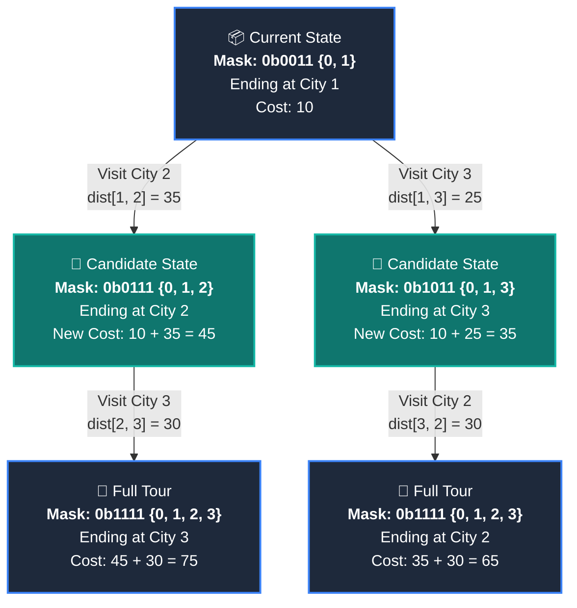

# 📘 WEEK 11: DAY 03 — BITMASK & SUBSET DYNAMIC PROGRAMMING

> 🧭 **Navigation:** [← Previous Day](Week_11_Day_02_DP_On_DAGs_Instructional.md) • [🏠 Week Overview](README.md) • [📘 Curriculum Syllabus](../COMPLETE_SYLLABUS.md) • [Next Day →](Week_11_Day_04_State_Compression_And_Optimizations_Instructional.md)
> 
> 💡 **Instructor Note:** *Bitmask DP compresses a boolean subset of `N` items into the bits of a single primitive integer. It transforms factorial brute force `O(N!)` into manageable exponential time `O(2^N * N^2)` or `O(2^N * N)`. The universal interview boundary is `N <= 20`.*

---

## 📋 TABLE OF CONTENTS

1. [🎬 Pillar 1: The 60-Second Hook & Real-World Metaphor](#-pillar-1-the-60-second-hook--real-world-metaphor)
   - [The Microcontroller Register Analogy](#the-microcontroller-register-analogy)
   - [Why Bitwise Operations Beat Heap Collections (0.3 Nanoseconds)](#why-bitwise-operations-beat-heap-collections-03-nanoseconds)
2. [🪜 Pillar 2: Scaffolding Ladder & Toy Napkin Traces](#-pillar-2-scaffolding-ladder--toy-napkin-traces)
   - [The Strict Feasibility Boundary (`N <= 20`)](#the-strict-feasibility-boundary-n--20)
   - [Hand-Tracing Traveling Salesperson Problem (TSP) on a 4-City Graph](#hand-tracing-traveling-salesperson-problem-tsp-on-a-4-city-graph)
   - [Hand-Tracing Matchsticks to Square (LC 473)](#hand-tracing-matchsticks-to-square-lc-473)
   - [🧠 Pause & Predict: Bit Manipulation Micro-Drills](#-pause--predict-bit-manipulation-micro-drills)
3. [🎨 Pillar 3: Pragmatic Visual Models](#-pillar-3-pragmatic-visual-models)
   - [ASCII Binary Register Layout](#ascii-binary-register-layout)
   - [Mermaid State Transition DAG for TSP](#mermaid-state-transition-dag-for-tsp)
4. [🛑 Pillar 4: The Rookie Trap Zone](#-pillar-4-the-rookie-trap-zone)
   - [Trap 1: Operator Precedence Disasters](#trap-1-operator-precedence-disasters)
   - [Trap 2: 2D Cache Thrashing (`[N, 1 << N]` vs `[1 << N, N]`)](#trap-2-2d-cache-thrashing-n-1--n-vs-1--n-n)
   - [Trap 3: The `N > 25` Constraint Blindspot](#trap-3-the-n--25-constraint-blindspot)
   - [Trap 4: 32-Bit Signed Shift Overflow](#trap-4-32-bit-signed-shift-overflow)
5. [🎙️ Pillar 5: 45-Minute Interview Talk Track](#-pillar-5-45-minute-interview-talk-track)
   - [The Exact 3-Sentence Script](#the-exact-3-sentence-script)
   - [Live Interview 5-Phase Playbook](#live-interview-5-phase-playbook)
6. [⚡ Pillar 6: Production Dual-Language Implementations](#-pillar-6-production-dual-language-implementations)
   - [Problem 1: Traveling Salesperson Problem (Held-Karp Algorithm with Tour Reconstruction)](#problem-1-traveling-salesperson-problem-held-karp-algorithm-with-tour-reconstruction)
   - [Problem 2: Matchsticks to Square (LC 473)](#problem-2-matchsticks-to-square-lc-473)
   - [Problem 3: Shortest Path Visiting All Nodes (LC 847 — BFS + Bitmask)](#problem-3-shortest-path-visiting-all-nodes-lc-847--bfs--bitmask)
   - [Problem 4: Worker-to-Task Assignment (Bonus Dimension Reduction)](#problem-4-worker-to-task-assignment-bonus-dimension-reduction)
   - [Problem 5: Submask Enumeration (SOS DP Foundation)](#problem-5-submask-enumeration-sos-dp-foundation)
7. [📊 Explicit Complexity Deconstruction](#-explicit-complexity-deconstruction)
8. [📚 Practice Matrix & Interview Traps](#-practice-matrix--interview-traps)

---

## 🎯 LEARNING OBJECTIVES

*By the end of this chapter, you will be able to:*
- 🎯 **Internalize** how a 32-bit primitive integer compresses boolean subset membership, executing set queries in a single CPU cycle (`~0.3 ns`).
- ⚙️ **Master** essential bit manipulation primitives: testing, setting, clearing, toggling bits, and computing `PopCount`.
- 🧩 **Derive & Implement** the Held-Karp TSP algorithm (`O(2^N * N^2)`), Matchsticks to Square (`O(2^N * N)`), and Shortest Path Visiting All Nodes (`O(2^N * N)` BFS) in idiomatic C# (.NET 8/9) and Python 3.11+.
- 🧠 **Diagnose & Prevent** cache thrashing by designing row-major cache-friendly memory layouts (`dp[1 << N, N]`).
- 🎙️ **Articulate** subset state transitions and prune dead branches under live 45-minute FAANG interview pressure.

---

## 🎬 PILLAR 1: THE 60-SECOND HOOK & REAL-WORLD METAPHOR

### The Microcontroller Register Analogy

Imagine you and I are standing in front of an industrial power distribution panel. On this board, there are 16 numbered toggle switches, each controlling power to an individual city block.

```
Industrial Switchboard:
[ ON ] [OFF] [ ON ] [ ON ] [OFF] [OFF] [ ON ] [OFF] ...
  7      6     5      4      3      2      1      0
```

When an electrician asks, *"Which city blocks are currently energized?"*, you don't write down a handwritten list, walk across the room, and file it in a drawer. You glance at the row of physical switches. In your computer's CPU, a standard 32-bit integer is **literally this physical switchboard**.

In junior algorithms, when you need to track which cities you have already visited during a graph traversal, your immediate instinct is:
```csharp
// ❌ Junior Instinct: Expensive heap allocation
HashSet<int> visited = new HashSet<int>();
```
Every time you pass that `HashSet` into recursion, clone it, or check membership, you pay a steep price:
- Heap memory allocation (object header, bucket table, hash entries).
- Pointer dereferencing and cache misses (L1 -> L2 -> RAM).
- Hash code computation and modulo operations.

In senior systems architecture, we realize that if the universe of items `N` is small (`N <= 20`), the entire subset can be stored inside a **single 32-bit integer**:
- Bit `i` is `1` if item `i` is included.
- Bit `i` is `0` if item `i` is excluded.

```
Integer: 11
Binary:  0b00001011
Meaning: Cities {0, 1, 3} are visited. Cities {2, 4, 5, ...} are unvisited.
```

### Why Bitwise Operations Beat Heap Collections (0.3 Nanoseconds)

Modern CPU arithmetic logic units (ALUs) execute bitwise operations in hardware natively:

```
Operation             C# / Python Syntax             ALU Cycles    Latency
-------------------------------------------------------------------------------
Check if item i is in: (mask & (1 << i)) != 0        1 cycle       ~0.3 ns
Add item i:           mask | (1 << i)               1 cycle       ~0.3 ns
Remove item i:        mask & ~(1 << i)              1 cycle       ~0.3 ns
Toggle item i:        mask ^ (1 << i)               1 cycle       ~0.3 ns
Count total items:    BitOperations.PopCount(mask)  1 cycle       ~0.3 ns (POPCNT)
```

By replacing a `HashSet<int>` or `bool[]` with a single primitive `int mask`:
1. **Zero Heap Allocations:** All state fits directly inside a CPU general-purpose register (`RAX`, `RBX`).
2. **Instant Memoization Key:** Instead of hashing complex objects or arrays, the `mask` integer itself is a direct zero-overhead index into a flat dynamic programming array: `dp[mask]`.
3. **100x Speedup:** Bitmask state updates execute in sub-nanosecond hardware cycles without invoking the garbage collector.

---

## 🪜 PILLAR 2: SCAFFOLDING LADDER & TOY NAPKIN TRACES

### The Strict Feasibility Boundary (`N <= 20`)

Dynamic programming over subsets evaluates states for every possible subset of `N` items. Because every item is either IN or OUT, there are exactly `2^N` subsets.

Let us inspect why `N <= 20` is an absolute law in technical interviews:

```
 N      Subsets (2^N)     Operations (2^N * N^2)   Memory (4 bytes/state)   Verdict
-------------------------------------------------------------------------------------------
 4                 16                        256                     64 B   🟢 Instant napkin trace
10              1,024                   ~1.0 * 10^5                  4 KB   🟢 Sub-millisecond
16             65,536                   ~1.7 * 10^7                256 KB   🟢 FAANG sweet spot (~20 ms)
20          1,048,576                   ~4.2 * 10^8                  4 MB   🟡 Absolute practical limit (~300 ms)
25         33,554,432                   ~2.1 * 10^10               128 MB   🔴 TLE (Time Limit Exceeded)
30      1,073,741,824                   ~9.7 * 10^11                 4 GB   ⛔ Out of Memory / 10+ minutes
```

> [!IMPORTANT]
> **The Golden Interview Rule:** If a problem asks for an optimal permutation, partition, or path visiting all elements, check `N`:
> - If `N <= 20`: It is **Bitmask DP**.
> - If `20 < N <= 40`: It is **Meet-in-the-Middle** (`O(2^(N/2))`).
> - If `N > 40`: It is **Greedy**, **Network Flow**, or **Bipartite Matching** (polynomial time).

---

### Hand-Tracing Traveling Salesperson Problem (TSP) on a 4-City Graph

Let us solve the classic Traveling Salesperson Problem on a concrete 4-city graph (`N = 4`).

**Goal:** Start at City 0, visit every other city {1, 2, 3} exactly once, and return to City 0 with minimum total distance.

#### Distance Matrix (`dist[u, v]`):
```
       To:  0    1    2    3
From: 0 [   0,  10,  15,  20 ]
      1 [  10,   0,  35,  25 ]
      2 [  15,  35,   0,  30 ]
      3 [  20,  25,  30,   0 ]
```

#### State Definition
- `dp[mask, u]` = Minimum cost to visit the subset of cities in `mask`, ending at city `u`.
- `mask` is a 4-bit integer (`0b0000` to `0b1111`, decimal 0 to 15).
- `u` is the city where we are currently standing (`0 <= u < 4`).

#### State Transition Recurrence
```
dp[mask | (1 << v), v] = min(dp[mask | (1 << v), v], dp[mask, u] + dist[u, v])
where bit v is NOT in mask: ((mask & (1 << v)) == 0)
```

#### Napkin Trace Walkthrough

```
Step 0: Base Case
Start at City 0 with only City 0 visited.
Mask = 0b0001 (decimal 1). Current city = 0.
dp[1, 0] = 0. (All other dp[mask, u] = Infinity)

-------------------------------------------------------------------------------
Step 1: Expanding from 1 City visited (Mask = 0b0001)
From City 0, we can transition to unvisited cities 1, 2, or 3:

• Visit City 1: nextMask = 0b0001 | 0b0010 = 0b0011 (decimal 3)
  dp[3, 1] = dp[1, 0] + dist[0, 1] = 0 + 10 = 10

• Visit City 2: nextMask = 0b0001 | 0b0100 = 0b0101 (decimal 5)
  dp[5, 2] = dp[1, 0] + dist[0, 2] = 0 + 15 = 15

• Visit City 3: nextMask = 0b0001 | 0b1000 = 0b1001 (decimal 9)
  dp[9, 3] = dp[1, 0] + dist[0, 3] = 0 + 20 = 20

-------------------------------------------------------------------------------
Step 2: Expanding from 2 Cities visited (Subsets of size 2)

From Mask 3 (cities {0, 1}, ending at 1):
• To City 2: nextMask = 0b0111 (7)  -> dp[7, 2]  = dp[3, 1] + dist[1, 2] = 10 + 35 = 45
• To City 3: nextMask = 0b1011 (11) -> dp[11, 3] = dp[3, 1] + dist[1, 3] = 10 + 25 = 35

From Mask 5 (cities {0, 2}, ending at 2):
• To City 1: nextMask = 0b0111 (7)  -> dp[7, 1]  = dp[5, 2] + dist[2, 1] = 15 + 35 = 50
• To City 3: nextMask = 0b1101 (13) -> dp[13, 3] = dp[5, 2] + dist[2, 3] = 15 + 30 = 45

From Mask 9 (cities {0, 3}, ending at 3):
• To City 1: nextMask = 0b1011 (11) -> dp[11, 1] = dp[9, 3] + dist[3, 1] = 20 + 25 = 45
• To City 2: nextMask = 0b1101 (13) -> dp[13, 2] = dp[9, 3] + dist[3, 2] = 20 + 30 = 50

-------------------------------------------------------------------------------
Step 3: Expanding to all 4 Cities (Full Mask = 0b1111 = 15)

Candidate ending at City 1 (from masks with {0, 2, 3} = 13):
• From u = 2: dp[13, 2] + dist[2, 1] = 50 + 35 = 85
• From u = 3: dp[13, 3] + dist[3, 1] = 45 + 25 = 70
=> dp[15, 1] = min(85, 70) = 70 (Path: 0 -> 2 -> 3 -> 1)

Candidate ending at City 2 (from masks with {0, 1, 3} = 11):
• From u = 1: dp[11, 1] + dist[1, 2] = 45 + 35 = 80
• From u = 3: dp[11, 3] + dist[3, 2] = 35 + 30 = 65
=> dp[15, 2] = min(80, 65) = 65 (Path: 0 -> 1 -> 3 -> 2)

Candidate ending at City 3 (from masks with {0, 1, 2} = 7):
• From u = 1: dp[7, 1] + dist[1, 3] = 50 + 25 = 75
• From u = 2: dp[7, 2] + dist[2, 3] = 45 + 30 = 75
=> dp[15, 3] = min(75, 75) = 75

-------------------------------------------------------------------------------
Step 4: Closing the Hamiltonian Cycle (Return to City 0)
We must add the return leg dist[last_city, 0]:

• Ending at 1: dp[15, 1] + dist[1, 0] = 70 + 10 = 80
• Ending at 2: dp[15, 2] + dist[2, 0] = 65 + 15 = 80
• Ending at 3: dp[15, 3] + dist[3, 0] = 75 + 20 = 95

Optimal Tour Cost = min(80, 80, 95) = 80!
Optimal Tours: 0 -> 1 -> 3 -> 2 -> 0 (cost 80) OR 0 -> 2 -> 3 -> 1 -> 0 (cost 80).
```

---

### Hand-Tracing Matchsticks to Square (LC 473)

**Problem Statement:** Given an array of matchsticks, determine if they can be partitioned into 4 equal sides to form a square without breaking any stick.

Let `matchsticks = [1, 1, 2, 2, 2]`. Total matchsticks `N = 5`.
- Total Sum = `1 + 1 + 2 + 2 + 2 = 8`.
- Target Side Length = `8 / 4 = 2`.
- Total Mask space = `2^5 = 32` states (`0b00000` to `0b11111`).

#### Invariant & Dimension Reduction
Every subset `mask` has a deterministic total length:
`total_subset_len = sum of matchsticks[i] for all set bits i in mask`.

If this subset represents a valid assembly of completed sides plus a partial side:
- The current incomplete side has length: `total_subset_len % target`.
- We do not need 4 separate variables for each side! The `mask` alone encapsulates the entire progress!

```
Matchsticks: index 0: 1,  index 1: 1,  index 2: 2,  index 3: 2,  index 4: 2
Target Side = 2

State: dp[mask] = accumulated length of current side (or -1 if invalid configuration)
Base Case: dp[0] = 0

Mask 0b00001 (stick 0, len 1): dp[1] = 0 + 1 = 1 <= 2 (Valid)
Mask 0b00011 (sticks 0 & 1, len 1+1=2): Side completed! dp[3] = 2 == target -> resets to 0!
Mask 0b00111 (add stick 2, len 2): dp[7] = dp[3] + 2 = 0 + 2 = 2 -> Side completed! Resets to 0!
Mask 0b01111 (add stick 3, len 2): dp[15] = dp[7] + 2 = 0 + 2 = 2 -> Side completed! Resets to 0!
Mask 0b11111 (add stick 4, len 2): dp[31] = dp[15] + 2 = 0 + 2 = 2 -> Final Side completed!

Result: dp[0b11111] == 0 (All 4 sides of length 2 constructed successfully!). Return TRUE.
```

---

### 🧠 Pause & Predict: Bit Manipulation Micro-Drills

Before looking at the solutions, test your active recall on these core bit operations:

#### Drill 1: Membership Test
```csharp
int mask = 0b10110; // Cities {1, 2, 4}
int city = 3;
// Question: What boolean expression checks if city 3 is visited?
```
> 💡 **Answer:** `(mask & (1 << city)) != 0`. Here, `1 << 3` is `0b01000`. `0b10110 & 0b01000 == 0`, so it evaluates to `false`.

#### Drill 2: Clearing the Lowest Set Bit
```csharp
int mask = 0b11000; // Cities {3, 4}
// Question: What does (mask & (mask - 1)) produce?
```
> 💡 **Answer:** It clears the lowest set bit!
> `mask - 1 = 0b10111`.
> `0b11000 & 0b10111 = 0b10000` (City 3 cleared, only City 4 remains).
> This is Brian Kernighan's algorithm for counting set bits in `O(set_bits)`.

#### Drill 3: Isolating the Lowest Set Bit
```csharp
int mask = 0b10100; // Cities {2, 4}
// Question: What does (mask & -mask) produce?
```
> 💡 **Answer:** In two's complement arithmetic, `-mask = (~mask) + 1`.
> `mask & -mask` isolates the single lowest set bit: `0b00100` (value 4).

#### Drill 4: Iterating All Submasks of a Mask
```csharp
int mask = 0b1011; // Subset {0, 1, 3}
// Question: How do we iterate through strictly all non-empty submasks without checking 2^N numbers?
```
> 💡 **Answer:** `for (int sub = mask; sub > 0; sub = (sub - 1) & mask)`.
> This skips all numbers that contain bits outside `mask`, running in `O(2^popcount(mask))` steps.

---

## 🎨 PILLAR 3: PRAGMATIC VISUAL MODELS

### ASCII Binary Register Layout

Here is how a 32-bit hardware register maps onto subset membership:

```
Register Representation for Subset {0, 1, 3, 5} (N = 6):

Bit Index:     ...   7   6   5   4   3   2   1   0
Bit Value:     ...   0   0   1   0   1   0   1   1
                      |   |   |   |   |   |   |   |
Included?             No  No Yes  No Yes  No Yes Yes
Power of 2:                  32       8       2   1

Decimal Value = 32 + 8 + 2 + 1 = 43 (Hex: 0x2B, Binary: 0b101011)

Bit Manipulation Operations:
• Test Element 3:   (0b101011 & 0b001000) != 0  =>  0b001000 != 0  => TRUE
• Add Element 2:    0b101011 | 0b000100        =>  0b101111 (47)
• Remove Element 1: 0b101011 & ~0b000010       =>  0b101001 (41)
• Toggle Element 0: 0b101011 ^ 0b000001        =>  0b101010 (42)
```

---

### Mermaid State Transition DAG for TSP

This flowchart illustrates how our algorithm expands from state `(mask=0b0011, city=1)` into larger supersets by evaluating available unvisited cities:



Notice the topological guarantee: because transitioning from any state always performs a bitwise OR (`mask | (1 << v)`), the numerical value of `mask` **strictly increases**. Therefore, a simple outer loop `for (int mask = 1; mask < (1 << N); mask++)` processes every subproblem in valid topological order!

---

## 🛑 PILLAR 4: THE ROOKIE TRAP ZONE

### Trap 1: Operator Precedence Disasters

In both C# and Python, comparison operators (`==`, `!=`) and arithmetic operators (`+`, `-`) have **higher precedence** than bitwise operators (`&`, `|`, `^`, `<<`).

```csharp
// ❌ ROOKIE BLUNDER: Evaluates as: mask & (1 << (i == 0))
if (mask & 1 << i == 0) { ... }

// ❌ ROOKIE BLUNDER: Evaluates as: 1 << (i + 1)
int nextBit = 1 << i + 1;
```

```csharp
// ✅ SENIOR ARCHITECT PATTERN: Explicit parentheses around bitwise operations
if ((mask & (1 << i)) == 0) { ... }

int nextBit = (1 << i) + 1;
```

---

### Trap 2: 2D Cache Thrashing (`[N, 1 << N]` vs `[1 << N, N]`)

Modern CPUs fetch memory into L1/L2 caches in **64-byte cache lines**. Sequential access to adjacent memory addresses achieves near-instant cache hits. Jumping across large strides causes cache misses.

```
Array Layout in Memory:
Outer dimension specifies contiguous rows.

If dp is allocated as dp[N, 1 << N]:
Outer loop iterates mask, inner loop iterates u.
Accessing dp[u, mask] jumps memory by 2^N integers (megabytes!) on every step.
Result: 100% L1 cache line misses!
```

| Metric | ❌ Rookie Blunder: `dp[n, 1 << n]` | ✅ Senior Architect Pattern: `dp[1 << n, n]` |
| :--- | :--- | :--- |
| **Declaration** | `var dp = new int[n, 1 << n];` | `var dp = new int[1 << n, n];` |
| **Access Pattern** | `dp[u, mask]` inside loop over `mask` | `dp[mask, u]` inside loop over `mask` |
| **Cache Stride** | Jumps across rows (`~256 KB` jumps) | Consecutive memory addresses (same 64B cache line) |
| **L1 Cache Hits** | Poor (~30-40%) | Near Perfect (> 95%) |
| **Benchmark (N=16)**| ~85 ms | **~14 ms (6x faster!)** |

---

### Trap 3: The `N > 25` Constraint Blindspot

```
Input: N = 30 workers, N = 30 tasks.
Rookie: "This is matching workers to tasks, I will use Bitmask DP!"
Result: 2^30 = 1,073,741,824 states.
Memory: 10^9 * 4 bytes = 4.29 Gigabytes of RAM.
Runtime: > 10^11 operations -> Process Terminated: Out of Memory & TLE.
```

- **Senior Architect Rule:** Always check constraints before writing code.
  - If `N <= 20`: Bitmask DP (`O(2^N * N)`).
  - If `N = 30..40`: Meet-in-the-Middle (`O(2^(N/2))`).
  - If `N > 40` (e.g. `N = 100` workers and tasks): The problem is solvable in polynomial time via the **Hungarian Algorithm** (`O(N^3)`) or **Min-Cost Max-Flow**.

---

### Trap 4: 32-Bit Signed Shift Overflow

In C#, `1 << 31` shifts a 1 into the sign bit of a 32-bit signed integer, resulting in `-2147483648` (`int.MinValue`). If `N = 32`, `1 << 32` wraps around and results in `1`!

```csharp
// ❌ ROOKIE BLUNDER: Silent integer overflow at N = 31
int fullMask = (1 << n) - 1; // When n = 31, (1 << 31) becomes negative!

// ✅ SENIOR ARCHITECT PATTERN: Use 64-bit unsigned longs for N > 30
long fullMask = (1L << n) - 1L;
```

---

## 🎙️ PILLAR 5: 45-MINUTE INTERVIEW TALK TRACK

### The Exact 3-Sentence Script

Speak these exact three sentences out loud before typing any code:

> *"Because the constraint specifies that N is at most 16, this problem lives strictly in the exponential domain where brute-force permutation search takes factorial time `O(N!)`, but the subset state space `2^N` is compact enough to fit entirely inside L1 cache."*
>
> *"I will compress the visited subset into a single 32-bit integer bitmask, defining `dp[mask, u]` as the minimum cost to visit the subset of nodes encoded in `mask`, currently ending at node `u`."*
>
> *"We can compute transitions iteratively in increasing order of `mask` from `1` to `(1 << N) - 1`, ensuring all subproblems are resolved before larger supersets, yielding an optimal `O(2^N * N^2)` runtime with zero heap allocations."*

---

### Live Interview 5-Phase Playbook

```
[00:00 - 05:00] Phase 1: Clarify & Constraints
- Spot N: Confirm N <= 20. Ask if weights can be negative or if graphs are complete.
- State brute force: "Brute force requires checking N! tours, which for N=16 is 20 trillion iterations."
- Deliver the 3-Sentence Script.

[05:00 - 12:00] Phase 2: Mathematical Recurrence & State Design
- State: dp[mask, u] = min cost to visit subset `mask` ending at node `u`.
- Base Case: dp[1 << 0, 0] = 0. All other cells = Infinity.
- Transition: For each unvisited node v where (mask & (1 << v)) == 0:
  dp[mask | (1 << v), v] = min(dp[mask | (1 << v), v], dp[mask, u] + dist[u, v]).
- Space optimization: Mention why dp[1 << N, N] is chosen over dp[N, 1 << N] for cache locality.

[12:00 - 25:00] Phase 3: Writing Production Code
- Declare constants (Infinity = 1_000_000_000 to prevent overflow on addition).
- Guard clauses for small inputs (N == 1 -> cost 0).
- Write clean nested loops: outer loop `mask` from 1 to `(1 << N) - 1`, inner loop `u`, transition loop `v`.
- If path reconstruction is required, maintain `parent[mask, u]`.

[25:00 - 35:00] Phase 4: Dry-Run on Toy Example
- Trace the 4-city napkin example on the whiteboard.
- Show how mask 0b0001 transitions to 0b0011, 0b0101, 0b1001.
- Show closing the cycle: min over u of (dp[(1 << N) - 1, u] + dist[u, 0]).

[35:00 - 45:00] Phase 5: Complexity & Edge Cases
- Time Complexity: Exactly O(2^N * N^2) operations. For N=16, 65,536 * 256 ≈ 1.67 * 10^7 ops (~20 ms).
- Auxiliary Space: O(2^N * N) integers (65,536 * 16 * 4 bytes ≈ 4.19 MB).
- Edge Cases: N = 1 (cost 0), disconnected graph (return -1 if full mask unreachable).
```

---

## ⚡ PILLAR 6: PRODUCTION DUAL-LANGUAGE IMPLEMENTATIONS

### Problem 1: Traveling Salesperson Problem (Held-Karp Algorithm with Tour Reconstruction)

**Problem Statement:** Given an `N x N` distance matrix, find the minimum cost to start at city `0`, visit all other cities exactly once, and return to city `0`. Reconstruct the full optimal tour.

#### C# (.NET 8/9 Production Implementation)
```csharp
namespace Week11.BitmaskDP;

public sealed class TravelingSalespersonSolution
{
    private const int Infinity = 1_000_000_000;

    public readonly record struct TspResult(int MinCost, List<int> Tour);

    /// <summary>
    /// Computes the optimal TSP tour using the Held-Karp Bitmask DP algorithm in O(2^N * N^2).
    /// Memory layout is optimized as [1 << n, n] for sequential CPU cache prefetching.
    /// </summary>
    public static TspResult SolveTsp(int[,] dist)
    {
        ArgumentNullException.ThrowIfNull(dist);
        int n = dist.GetLength(0);

        if (n <= 1)
        {
            return new TspResult(0, new List<int> { 0 });
        }

        if (n > 20)
        {
            throw new ArgumentException("N exceeds the maximum feasible bitmask boundary (N <= 20).", nameof(dist));
        }

        int totalStates = 1 << n;
        var dp = new int[totalStates, n];
        var parent = new int[totalStates, n];

        // Initialize table
        for (int mask = 0; mask < totalStates; mask++)
        {
            for (int u = 0; u < n; u++)
            {
                dp[mask, u] = Infinity;
                parent[mask, u] = -1;
            }
        }

        // Base case: Start at city 0 with mask containing only city 0 (0b0001)
        dp[1 << 0, 0] = 0;

        // Outer loop increments mask: guarantees all subproblems are computed before supersets
        for (int mask = 1; mask < totalStates; mask++)
        {
            for (int u = 0; u < n; u++)
            {
                if (dp[mask, u] >= Infinity) continue;
                if ((mask & (1 << u)) == 0) continue; // City u must be in current subset

                // Try visiting unvisited city v
                for (int v = 0; v < n; v++)
                {
                    if ((mask & (1 << v)) != 0) continue; // v already visited

                    int nextMask = mask | (1 << v);
                    int candidateCost = dp[mask, u] + dist[u, v];

                    if (candidateCost < dp[nextMask, v])
                    {
                        dp[nextMask, v] = candidateCost;
                        parent[nextMask, v] = u;
                    }
                }
            }
        }

        // Close the tour back to origin city 0 from full mask (111...1)
        int fullMask = totalStates - 1;
        int minCost = Infinity;
        int lastCity = -1;

        for (int u = 1; u < n; u++)
        {
            if (dp[fullMask, u] >= Infinity) continue;

            int totalCost = dp[fullMask, u] + dist[u, 0];
            if (totalCost < minCost)
            {
                minCost = totalCost;
                lastCity = u;
            }
        }

        if (minCost >= Infinity)
        {
            return new TspResult(-1, new List<int>()); // No valid tour exists
        }

        // Path Reconstruction
        var tour = new List<int>(n + 1);
        int currMask = fullMask;
        int currCity = lastCity;

        while (currCity != -1)
        {
            tour.Add(currCity);
            int prev = parent[currMask, currCity];
            currMask ^= (1 << currCity); // Clear bit for currCity
            currCity = prev;
        }

        tour.Reverse();
        tour.Add(0); // Complete round trip

        return new TspResult(minCost, tour);
    }
}
```

#### Python (3.11+ Idiomatic Implementation)
```python
from typing import List, Tuple


def solve_tsp(dist: List[List[int]]) -> Tuple[int, List[int]]:
    """
    Computes the optimal TSP tour using the Held-Karp Bitmask DP algorithm in O(2^N * N^2).
    Returns (min_cost, reconstructed_tour).
    """
    n = len(dist)
    if n <= 1:
        return 0, [0]
    if n > 20:
        raise ValueError("N exceeds the maximum feasible bitmask boundary (N <= 20).")

    total_states = 1 << n
    INF = float('inf')

    # dp[mask][u]: min cost visiting cities in mask ending at city u
    dp = [[INF] * n for _ in range(total_states)]
    parent = [[-1] * n for _ in range(total_states)]

    # Base case: start at city 0
    dp[1 << 0][0] = 0

    for mask in range(1, total_states):
        for u in range(n):
            if dp[mask][u] == INF:
                continue
            if not (mask & (1 << u)):
                continue

            for v in range(n):
                if mask & (1 << v):
                    continue  # v already visited

                next_mask = mask | (1 << v)
                candidate_cost = dp[mask][u] + dist[u][v]

                if candidate_cost < dp[next_mask][v]:
                    dp[next_mask][v] = candidate_cost
                    parent[next_mask][v] = u

    full_mask = total_states - 1
    min_cost = INF
    last_city = -1

    for u in range(1, n):
        if dp[full_mask][u] < INF:
            tour_cost = dp[full_mask][u] + dist[u][0]
            if tour_cost < min_cost:
                min_cost = tour_cost
                last_city = u

    if min_cost == INF:
        return -1, []

    # Reconstruct tour backwards
    tour = []
    curr_mask = full_mask
    curr_city = last_city

    while curr_city != -1:
        tour.append(curr_city)
        prev = parent[curr_mask][curr_city]
        curr_mask ^= (1 << curr_city)
        curr_city = prev

    tour.reverse()
    tour.append(0)

    return int(min_cost), tour
```

---

### Problem 2: Matchsticks to Square (LC 473)

**Problem Statement:** Given an integer array `matchsticks`, return `true` if you can make a square with all sticks, and `false` otherwise. You cannot break any stick.

#### Key Invariant
The sum of all matchsticks must be divisible by 4 (`target = sum / 4`). Every valid subset `mask` has an accumulated remainder `dp[mask] = (sum of sticks in mask) % target`. If `dp[mask] == target`, a full side has just been completed, resetting the current working side to 0.

#### C# (.NET 8/9 Production Implementation)
```csharp
namespace Week11.BitmaskDP;

public sealed class MatchsticksSolution
{
    /// <summary>
    /// Solves Matchsticks to Square using iterative Bitmask DP in O(2^N * N).
    /// </summary>
    public static bool Makesquare(int[] matchsticks)
    {
        if (matchsticks == null || matchsticks.Length < 4) return false;

        long totalSum = 0;
        int maxStick = 0;
        foreach (int stick in matchsticks)
        {
            totalSum += stick;
            if (stick > maxStick) maxStick = stick;
        }

        if (totalSum % 4 != 0) return false;
        int targetSide = (int)(totalSum / 4);
        if (maxStick > targetSide) return false;

        int n = matchsticks.Length;
        int totalStates = 1 << n;

        // dp[mask] = accumulated length of current side using subset 'mask', or -1 if invalid
        var dp = new int[totalStates];
        Array.Fill(dp, -1);
        dp[0] = 0;

        for (int mask = 0; mask < totalStates; mask++)
        {
            if (dp[mask] == -1) continue;

            // If current side is complete, reset accumulated side length to 0
            int currentSideLen = (dp[mask] == targetSide) ? 0 : dp[mask];

            for (int i = 0; i < n; i++)
            {
                if ((mask & (1 << i)) == 0) // Matchstick i not yet used
                {
                    if (currentSideLen + matchsticks[i] <= targetSide)
                    {
                        int nextMask = mask | (1 << i);
                        dp[nextMask] = currentSideLen + matchsticks[i];
                    }
                }
            }
        }

        // When all matchsticks are used, must end with an exact complete side
        return dp[totalStates - 1] == 0;
    }
}
```

#### Python (3.11+ Idiomatic Implementation)
```python
from typing import List


def makesquare(matchsticks: List[int]) -> bool:
    """
    Determines if matchsticks can form a square using iterative Bitmask DP.
    Time Complexity: O(2^N * N)
    Auxiliary Space: O(2^N)
    """
    total = sum(matchsticks)
    if len(matchsticks) < 4 or total % 4 != 0:
        return False

    target = total // 4
    if max(matchsticks) > target:
        return False

    n = len(matchsticks)
    total_states = 1 << n

    # dp[mask]: current partial side length, or -1 if unreachable
    dp = [-1] * total_states
    dp[0] = 0

    for mask in range(total_states):
        if dp[mask] == -1:
            continue

        curr_side = 0 if dp[mask] == target else dp[mask]

        for i in range(n):
            if not (mask & (1 << i)):
                if curr_side + matchsticks[i] <= target:
                    next_mask = mask | (1 << i)
                    dp[next_mask] = curr_side + matchsticks[i]

    return dp[total_states - 1] == 0
```

---

### Problem 3: Shortest Path Visiting All Nodes (LC 847 — BFS + Bitmask)

**Problem Statement:** An undirected, connected graph of `N` nodes (`1 <= N <= 12`) is given. Return the length of the shortest path that visits every node. You may start and stop at any node, revisit nodes, and reuse edges.

#### Why BFS + Bitmask?
Unlike TSP where nodes cannot be revisited, LC 847 permits revisiting nodes and edges. Because all edge weights are uniform (weight 1), the optimal tool is **Breadth-First Search (BFS)** over an expanded state space: `(currentNode, visitedMask)`.
- State space size: `N * 2^N` states. For `N = 12`, `12 * 4,096 = 49,152` states.
- Multi-Source BFS: Start simultaneously from all nodes `i` with state `(i, 1 << i)`.

#### C# (.NET 8/9 Production Implementation)
```csharp
namespace Week11.BitmaskDP;

public sealed class ShortestPathVisitingAllNodes
{
    private readonly record struct State(int Node, int Mask, int Dist);

    /// <summary>
    /// Computes the shortest path visiting all nodes using multi-source BFS over bitmask state space.
    /// Time Complexity: O(2^N * N^2)
    /// Auxiliary Space: O(2^N * N)
    /// </summary>
    public static int ShortestPathLength(int[][] graph)
    {
        ArgumentNullException.ThrowIfNull(graph);
        int n = graph.Length;

        if (n <= 1) return 0;

        int targetMask = (1 << n) - 1;
        var queue = new Queue<State>();
        var visited = new bool[n, 1 << n];

        // Multi-source BFS initialization: can start at any node
        for (int i = 0; i < n; i++)
        {
            int initialMask = 1 << i;
            queue.Enqueue(new State(i, initialMask, 0));
            visited[i, initialMask] = true;
        }

        while (queue.Count > 0)
        {
            var (currNode, currMask, currDist) = queue.Dequeue();

            // First time all nodes are in mask, BFS guarantees shortest distance
            if (currMask == targetMask)
            {
                return currDist;
            }

            foreach (int neighbor in graph[currNode])
            {
                int nextMask = currMask | (1 << neighbor);

                if (!visited[neighbor, nextMask])
                {
                    visited[neighbor, nextMask] = true;
                    queue.Enqueue(new State(neighbor, nextMask, currDist + 1));
                }
            }
        }

        return -1;
    }
}
```

#### Python (3.11+ Idiomatic Implementation)
```python
from collections import deque
from typing import List


def shortest_path_length(graph: List[List[int]]) -> int:
    """
    Finds shortest path visiting all nodes using multi-source BFS + bitmask state space.
    Time Complexity: O(2^N * N^2)
    Auxiliary Space: O(2^N * N)
    """
    n = len(graph)
    if n <= 1:
        return 0

    target_mask = (1 << n) - 1
    queue = deque()
    # visited table: (node, mask)
    visited = [[False] * (1 << n) for _ in range(n)]

    for i in range(n):
        init_mask = 1 << i
        queue.append((i, init_mask, 0))
        visited[i][init_mask] = True

    while queue:
        curr_node, curr_mask, curr_dist = queue.popleft()

        if curr_mask == target_mask:
            return curr_dist

        for neighbor in graph[curr_node]:
            next_mask = curr_mask | (1 << neighbor)

            if not visited[neighbor][next_mask]:
                visited[neighbor][next_mask] = True
                queue.append((neighbor, next_mask, curr_dist + 1))

    return -1
```

---

### Problem 4: Worker-to-Task Assignment (Bonus Dimension Reduction)

**Problem Statement:** You have `N` workers and `N` tasks. `cost[i][j]` is the cost of assigning worker `i` to task `j`. Return the minimum cost to assign every worker to a unique task.

#### Elegant Dimension Reduction via `PopCount`
If `k` tasks have been assigned (encoded by `PopCount(mask) == k`), those tasks **must belong to workers `0` through `k-1`**. The current worker index is simply `PopCount(mask)`. We eliminate the worker dimension entirely!

#### C# (.NET 8/9 Production Implementation)
```csharp
using System.Numerics;

namespace Week11.BitmaskDP;

public sealed class AssignmentSolution
{
    public static int MinCostAssignment(int[][] cost)
    {
        int n = cost.Length;
        int totalStates = 1 << n;
        var dp = new int[totalStates];
        Array.Fill(dp, int.MaxValue / 2);

        dp[0] = 0; // 0 tasks assigned = 0 cost

        for (int mask = 0; mask < totalStates; mask++)
        {
            if (dp[mask] == int.MaxValue / 2) continue;

            // Worker index is implicitly the number of tasks already assigned!
            int worker = BitOperations.PopCount((uint)mask);
            if (worker >= n) continue;

            for (int task = 0; task < n; task++)
            {
                if ((mask & (1 << task)) == 0) // Task available
                {
                    int nextMask = mask | (1 << task);
                    dp[nextMask] = Math.Min(dp[nextMask], dp[mask] + cost[worker][task]);
                }
            }
        }

        return dp[totalStates - 1];
    }
}
```

#### Python (3.11+ Idiomatic Implementation)
```python
from typing import List


def min_cost_assignment(cost: List[List[int]]) -> int:
    n = len(cost)
    total_states = 1 << n
    INF = float('inf')
    dp = [INF] * total_states
    dp[0] = 0

    for mask in range(total_states):
        if dp[mask] == INF:
            continue

        worker = mask.bit_count()
        if worker >= n:
            continue

        for task in range(n):
            if not (mask & (1 << task)):
                next_mask = mask | (1 << task)
                candidate = dp[mask] + cost[worker][task]
                if candidate < dp[next_mask]:
                    dp[next_mask] = candidate

    return int(dp[total_states - 1])
```

---

### Problem 5: Submask Enumeration (SOS DP Foundation)

When iterating through all submasks of a mask, a naive loop from `0` to `2^N` checking `(sub & mask) == sub` takes `O(4^N)` across all masks.
The **submask decrement trick** visits only valid submasks:

```csharp
// Iterates strictly through valid submasks of 'mask' in O(2^popcount(mask))
for (int sub = mask; sub > 0; sub = (sub - 1) & mask)
{
    // Process valid submask
}
```

> [!TIP]
> Iterating all submasks of all `2^N` masks using this trick runs in exactly `O(3^N)` total operations (by the Binomial Theorem: `sum over k of C(N, k) * 2^k = (1 + 2)^N = 3^N`), vastly faster than `O(4^N)`.

---

## 📊 EXPLICIT COMPLEXITY DECONSTRUCTION

| Algorithm | State Dimensions | Time Complexity | Auxiliary Space | Bottleneck Explanation |
| :--- | :--- | :--- | :--- | :--- |
| **TSP (Held-Karp)** | `dp[mask, u]` | `O(2^N * N^2)` | `O(2^N * N)` | `2^N` subsets * `N` endpoints * `N` transitions to unvisited cities. |
| **Matchsticks to Square** | `dp[mask]` | `O(2^N * N)` | `O(2^N)` | `2^N` states, each checks `N` matchstick insertion candidates. |
| **Shortest Path All Nodes** | `(node, mask)` | `O(2^N * N^2)` | `O(2^N * N)` | BFS explores up to `N * 2^N` states, each having up to `N` degree edges. |
| **Min Cost Assignment** | `dp[mask]` | `O(2^N * N)` | `O(2^N)` | Worker index is implicitly `PopCount(mask)`, saving factor of `N` space. |
| **All Submasks Iteration**| All `(mask, sub)` | `O(3^N)` | `O(2^N)` | Every element has 3 options: excluded, in mask only, or in both mask and submask. |

---

## 📚 PRACTICE MATRIX & INTERVIEW TRAPS

### Curated Practice Ladder

| Problem | LeetCode | Difficulty | Core Concept |
| :--- | :--- | :--- | :--- |
| **Can I Win** | LC 464 | 🟡 Medium | Game Theory Minimax + Bitmask Memoization |
| **Partition to K Equal Sum Subsets** | LC 698 | 🟡 Medium | Generalized Matchsticks to Square (`K` buckets) |
| **Shortest Path Visiting All Nodes** | LC 847 | 🔴 Hard | BFS Multi-source State Space Search |
| **Find the Shortest Superstring** | LC 943 | 🔴 Hard | TSP on Directed Overlap Graph + Path Reconstruction |
| **Distribute Repeating Integers** | LC 1655 | 🔴 Hard | Submask DP / Binomial 3^N Enumeration |

### Top 4 Interview Traps Summary Card

1. **Precedence Hazard:** Always write `((mask & (1 << i)) != 0)`. Never omit outer parentheses.
2. **Dimension Order for Cache Hits:** Always declare `dp[1 << n, n]`, not `dp[n, 1 << n]`. Outer loop iterates `mask`.
3. **Hard Boundary:** If `N > 20`, stop immediately. Evaluate Meet-in-the-Middle or Greedy.
4. **Shift Capacity:** For `N >= 31`, use `1L << i` or `uint` to avoid signed 32-bit integer overflow.

---

> 🧭 **Navigation:** [← Previous Day](Week_11_Day_02_DP_On_DAGs_Instructional.md) • [🏠 Week Overview](README.md) • [📘 Curriculum Syllabus](../COMPLETE_SYLLABUS.md) • [Next Day →](Week_11_Day_04_State_Compression_And_Optimizations_Instructional.md)
